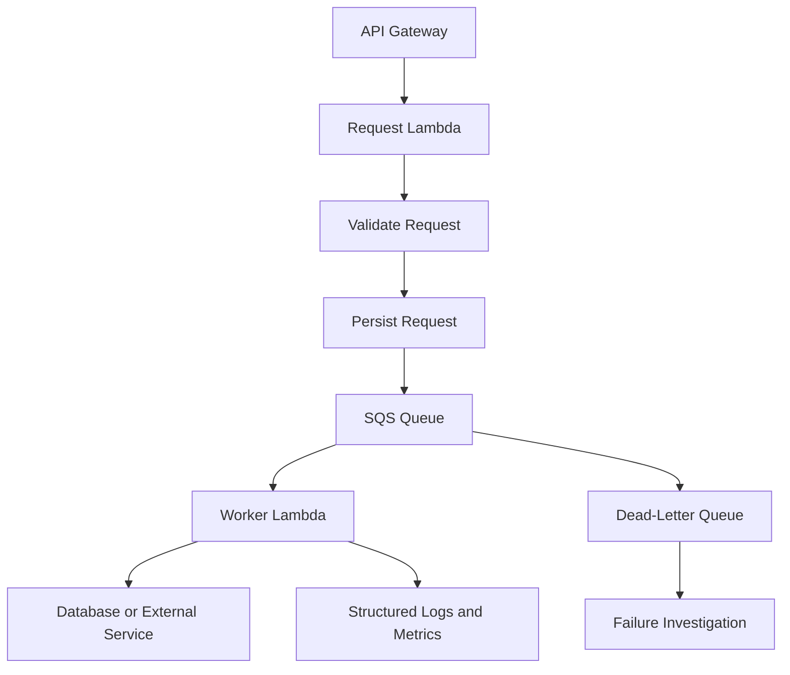
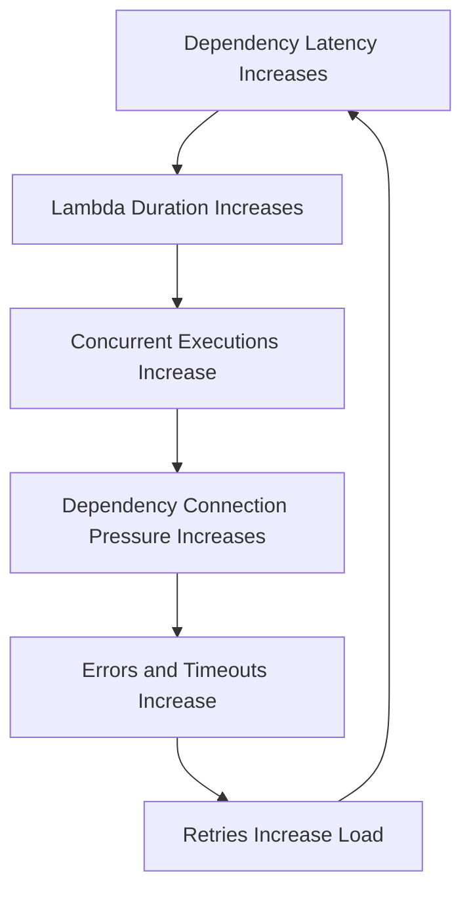

# 06- Production Operations and Best Practices

## Overview

Operating AWS Lambda in production requires more than deploying a handler and configuring an event source. Production workloads must remain reliable under traffic spikes, dependency failures, duplicate events, deployment errors, security incidents, and unexpected cost increases.

Lambda manages execution environments and infrastructure scaling, but application teams remain responsible for business correctness, authorization, dependency behavior, data integrity, observability, and recovery procedures.

A production-ready Lambda system should provide:

- Predictable behavior under normal and peak workloads.
- Explicit timeout, memory, and concurrency configuration.
- Safe retries and idempotent business operations.
- Least-privilege permissions and secure secret management.
- Actionable logs, metrics, traces, and alarms.
- Repeatable deployments and tested recovery procedures.
- Cost visibility and clear operational ownership.

This document consolidates the practices required to operate Lambda functions as dependable backend components. Detailed configuration and tuning techniques belong in the dedicated concurrency, performance, and cost optimization notes; this document focuses on applying those techniques consistently in production.

## Production Architecture Principles

### Design functions around clear responsibilities

A Lambda function should have a clearly defined responsibility, input contract, output contract, and failure behavior.

Examples include:

- Handling an API request.
- Processing an SQS message batch.
- Transforming an S3 object.
- Applying a business operation to a DynamoDB record.
- Executing a scheduled maintenance task.

Separate functions when they need different scaling policies, permissions, deployment lifecycles, failure handling, or operational ownership.

Avoid both extremes:

- A single function that handles unrelated API, batch, and scheduled workloads.
- Excessive fragmentation into functions that require complicated coordination for otherwise simple operations.

### Choose synchronous or asynchronous processing deliberately

Synchronous processing is appropriate when the caller requires an immediate result. Asynchronous processing is useful when work can complete independently of the initiating request.



This design separates request acceptance from downstream processing and allows worker concurrency to be controlled independently.

However, asynchronous processing introduces eventual completion, message retention concerns, duplicate delivery, and additional recovery responsibilities. The API should communicate whether an operation has been accepted, completed, or failed.

Do not return a successful business result merely because an asynchronous event was accepted by Lambda or placed on a queue.

## Execution Environment and Application Design

### Keep handlers stateless

Lambda execution environments may be reused across invocations. Reuse can improve performance, but an application must not depend on a particular environment remaining available.

Safe reusable objects often include:

- AWS SDK clients.
- HTTP clients configured for connection reuse.
- Immutable application configuration.
- Compiled regular expressions.
- Read-only lookup data with an acceptable refresh strategy.

Avoid storing request-specific information in mutable module-level variables.

```python
import json
import os

import boto3

dynamodb = boto3.resource("dynamodb")
table = dynamodb.Table(os.environ["ORDERS_TABLE"])


def lambda_handler(event, context):
    order_id = event.get("order_id")

    if not isinstance(order_id, str) or not order_id:
        return {
            "statusCode": 400,
            "body": json.dumps({"error": "order_id is required"}),
        }

    response = table.get_item(Key={"order_id": order_id})
    order = response.get("Item")

    if order is None:
        return {
            "statusCode": 404,
            "body": json.dumps({"error": "Order not found"}),
        }

    return {
        "statusCode": 200,
        "body": json.dumps(order, default=str),
    }
```

This example demonstrates reusable client initialization and basic input validation. Production API implementations must also enforce authorization, validate the complete request contract, and handle expected dependency failures.

### Do not rely on shutdown hooks for correctness

Execution environments can be terminated without providing a dependable opportunity to complete arbitrary cleanup work.

Do not depend on shutdown handlers to commit business transactions, flush critical records, or perform required recovery actions.

Use explicit transaction boundaries, durable queues, persistent state, and well-defined completion semantics.

### Configure timeouts deliberately

A Lambda timeout is an upper bound on an invocation's execution time. Select it according to the workload, downstream timeouts, and caller's latency budget.

Account for:

- Connection establishment.
- Dependency request and response time.
- Processing and serialization.
- Retry behavior.
- Remaining time needed for safe error handling.

Avoid allowing a database query or HTTP request to outlive the useful lifetime of the Lambda invocation.

In Python, use the context object's remaining execution time to avoid starting work that cannot reasonably finish.

```python
def lambda_handler(event, context):
    remaining_ms = context.get_remaining_time_in_millis()

    if remaining_ms < 1_000:
        raise TimeoutError("Insufficient time to begin processing")

    return process_event(event, remaining_ms=remaining_ms)
```

A production implementation should calculate a conservative deadline and pass the remaining time budget to downstream operations. Checking the remaining time once does not guarantee that the entire operation can finish.

## Idempotency and Duplicate Processing

Lambda integrations can deliver duplicate events or retry work after failures. A successful side effect followed by a lost response can also cause a caller or event source to repeat an operation.

At-least-once delivery does not guarantee exactly-once business execution.

### Design idempotent handlers

An idempotent operation produces the same intended business outcome when the same logical request is processed more than once.

Common approaches include:

- Idempotency keys for API requests.
- Conditional writes in DynamoDB.
- Unique constraints in relational databases.
- Durable processing records.
- Transactional updates that combine state changes with deduplication.
- Outbox and inbox patterns for reliable event publication and consumption.

For example, an order-payment operation should not charge a customer twice because a message was delivered twice.

A typical processing flow is:

1. Extract a stable business event identifier.
2. Atomically claim or register the idempotency key.
3. Apply the business operation.
4. Persist the outcome and deduplication state consistently.
5. Return success only when the required durable work has completed.

A separate "check, then insert" operation without a conditional write or transaction can race when duplicate events arrive concurrently.

Idempotency records also need a retention policy appropriate to the maximum replay and duplicate-delivery window. Expiring records too early can allow old events to repeat business operations.

## Retry and Failure Handling

Retries improve resilience to transient failures, but they can increase cost and amplify an outage.

### Classify failures

| Failure type | Recommended handling |
|---|---|
| Invalid input | Reject or quarantine; do not retry indefinitely |
| Authorization failure | Correct permissions or configuration |
| Temporary network error | Retry within a bounded policy when safe |
| Downstream throttling | Apply backoff and control concurrency |
| Database conflict | Retry only when transaction and business semantics permit it |
| Permanent business-rule failure | Record the outcome and route for appropriate handling |
| Unknown application failure | Log diagnostic context and follow the source-specific retry policy |

Retry behavior differs by invocation model and event source. Configure and test each integration independently.

### SQS partial batch failures

For SQS event source mappings, implement partial batch responses when appropriate. This allows successfully processed records to be acknowledged while failed records remain eligible for retry.

The event source mapping must be configured to recognize the partial batch response format. Returning a `batchItemFailures` field without the required configuration does not guarantee partial failure behavior.

Also configure visibility timeout, redrive policy, dead-letter queue, and worker concurrency to match the processing model.

### Dead-letter queues and failure destinations

Dead-letter queues and asynchronous invocation destinations serve related but different purposes.

- An SQS dead-letter queue commonly receives messages that exceed a source queue's configured redrive threshold.
- A Lambda asynchronous failure destination can capture invocation failure information for supported asynchronous invocation configurations.
- A Lambda asynchronous dead-letter queue is a separate mechanism with different payload semantics.

Use the mechanism appropriate to the integration. Define ownership for failed records, investigation procedures, replay safety, and retention.

Do not automatically replay every failed record without checking whether it caused partial side effects or represents a permanent business failure.

## Concurrency and Downstream Protection

Lambda can scale to a concurrency level that exceeds the safe capacity of a database or external API.

Production concurrency should be derived from measured traffic, execution duration, and downstream limits.

Recommended controls include:

- Reserved concurrency to isolate critical functions or cap resource-intensive workloads.
- Provisioned concurrency when its latency benefit justifies the additional cost.
- Event source mapping concurrency limits where supported.
- Bounded connection pools and dependency timeouts.
- Queues to absorb bursts when asynchronous completion is acceptable.
- Monitoring for throttling, queue age, and downstream saturation.

A concurrency limit is not a complete rate limiter. If a third-party service requires a strict requests-per-second limit, implement rate-aware processing in addition to concurrency control.

### Recognize overload feedback loops



Break the loop through bounded concurrency, connection management, sensible timeouts, backoff, and isolation of failing dependencies.

For capacity calculations and configuration commands, refer to the concurrency and capacity management documentation in this folder.

## Security Best Practices

### Use least-privilege execution roles

A Lambda execution role grants the function permission to access AWS resources. It should contain only the actions and resources required by that function.

Avoid policies granting unrestricted access to all S3 buckets or DynamoDB tables when the application needs only specific resources.

Separate runtime permissions from deployment permissions. The deployment identity should not automatically inherit the application's data-access permissions.

### Protect secrets

Do not hardcode credentials, API keys, or database passwords in source code or deployment artifacts.

Use AWS Secrets Manager or Systems Manager Parameter Store according to the security, lifecycle, and operational requirements of the workload.

Production considerations include:

- Restrict access to specific secrets.
- Encrypt sensitive values using appropriate KMS controls.
- Avoid logging secret values.
- Plan for secret rotation and connection refresh.
- Account for retrieval latency and caching behavior.
- Ensure private connectivity where required.

Environment variables are appropriate for configuration, but they should not be treated as a complete secret-management strategy.

### Secure deployment artifacts

- Pin and review dependencies.
- Scan dependencies and container images.
- Build artifacts through controlled CI/CD workflows.
- Restrict who can publish or update function versions.
- Protect deployment credentials.
- Use immutable deployment artifacts where practical.
- Audit permission and configuration changes.

Scope resource-based policies to intended principals and source resources wherever supported. Cross-account invocation should be explicitly designed and tested.

## Observability and Alerting

Logs alone are insufficient for operating a production Lambda workload. Use metrics to identify trends and traces to investigate distributed latency.

### Structured logging

Include stable, searchable fields such as:

- Timestamp and severity.
- Function or service name.
- Request or correlation identifier.
- Business event identifier where appropriate.
- Operation name.
- Error category.
- Processing outcome and duration.

Avoid logging secrets, authorization headers, personal information, or complete payloads without a justified and approved need.

A request identifier helps correlate logs, but it is not necessarily an idempotency key. Keep operational correlation and business deduplication separate.

### Important metrics

| Metric or signal | Why it matters |
|---|---|
| `Invocations` | Indicates workload volume |
| `Errors` | Reveals failed executions |
| `Throttles` | Indicates capacity or invocation constraints |
| `Duration` | Shows latency and execution-cost trends |
| `ConcurrentExecutions` | Indicates concurrency demand |
| SQS oldest-message age | Reveals processing delay |
| Stream iterator age | Reveals lag in stream processing |
| Downstream connection utilization | Reveals dependency saturation |
| Dead-letter queue depth | Indicates unresolved processing failures |

Create alarms around user-visible impact and recovery requirements. A high invocation count alone is not necessarily an incident, and a low error count does not guarantee that business operations are correct.

### Operational dashboards

Maintain dashboards that combine Lambda metrics with dependency health and business outcomes.

For API workloads, monitor latency, error rate, throttling, and database performance. For asynchronous workers, monitor queue age, processing throughput, retries, and dead-letter volume.

Set log retention deliberately and manage telemetry costs without removing information required for security audits or incident investigation.

## Deployment and Release Safety

Production deployments should be repeatable, verifiable, and reversible where the architecture permits.

### Use published versions and aliases

Published Lambda versions provide immutable snapshots of function code and configuration. Aliases provide stable references to versions and can support controlled traffic shifting where supported.

A release process should:

1. Build the artifact in CI.
2. Run unit and integration tests.
3. Scan dependencies and validate configuration.
4. Deploy the candidate version.
5. Verify configuration and permissions.
6. Run smoke tests.
7. Shift traffic using the selected deployment strategy.
8. Monitor errors, latency, throttling, and business outcomes.
9. Roll back or stop promotion if defined thresholds are breached.

Do not assume that changing an alias reverses every external side effect. Database schema changes, queued messages, external API calls, and already-committed business operations may remain after rollback.

### Separate environments

Use separate development, test, staging, and production environments with appropriate IAM boundaries and configuration.

Keep secrets and environment-specific endpoints outside source code. Use infrastructure as code to make configuration changes reviewable and repeatable.

Production configuration should not be modified manually without an auditable change process unless an incident procedure explicitly requires it.

### CI/CD controls

A GitHub Actions deployment workflow should use narrowly scoped credentials, preferably through a suitable federated identity mechanism such as GitHub OIDC when configured.

Avoid long-lived AWS access keys in repository secrets when federation is a viable option.

Require appropriate validation before deployment, and make post-deployment verification an explicit pipeline step rather than treating a successful deployment command as proof of application health.

## Database and Network Operations

### Manage connections carefully

Lambda execution environments may be reused, but application instances can scale independently. Creating a new database connection for every operation can exhaust the database connection limit.

Use reusable clients and suitable pooling or proxying strategies. Set connection and query timeouts, and size concurrency based on database capacity.

A process-local connection pool is not shared across all Lambda execution environments. Each environment has its own process state.

### Validate VPC connectivity

For functions attached to a VPC, validate:

- Subnet routing.
- Security group rules.
- Network ACLs where relevant.
- DNS resolution.
- Private endpoint configuration.
- NAT or other outbound connectivity when required.
- Database access rules.
- Availability of required service endpoints.

A Lambda function attached to private subnets does not automatically gain internet access. Verify the actual routing and egress architecture rather than treating subnet selection alone as sufficient.

## Cost and Resource Governance

Production cost controls should detect unusual usage before it becomes a significant financial or operational problem.

Recommended practices include:

- Monitor Lambda and related service spending.
- Configure AWS Budgets and cost alerts.
- Review invocation spikes and recursive trigger risks.
- Optimize memory and duration using representative benchmarks.
- Set appropriate log retention.
- Review provisioned concurrency utilization.
- Tune batch size and event source concurrency.
- Remove unused resources and obsolete deployment artifacts where safe.
- Include cost regression checks in performance testing.

Budget notifications are not hard spending limits. Assign an owner and response procedure for unexpected cost increases.

See the cost optimization documentation in this folder for pricing details and tuning methods.

## Incident Response and Recovery

A production runbook should provide a consistent diagnostic sequence and safe remediation steps.

### Standard incident workflow

1. **Detect:** Identify the affected function, invocation path, and time window.
2. **Scope:** Determine whether the impact affects one function, multiple functions, or a shared dependency.
3. **Diagnose:** Correlate Lambda metrics, logs, traces, event source state, and dependency health.
4. **Contain:** Apply safe measures such as limiting concurrency, pausing a consumer where appropriate, or disabling a faulty trigger.
5. **Recover:** Restore dependencies or configuration and process recoverable work.
6. **Verify:** Confirm that error rates, latency, backlog, and business outcomes have returned to acceptable levels.
7. **Review:** Document the root cause, corrective actions, and prevention measures.

### Common incident patterns

| Symptom | Likely areas to investigate | Initial action |
|---|---|---|
| Elevated throttling | Account capacity, reserved concurrency, event source limits | Inspect concurrency and invocation metrics |
| Increasing duration | Database latency, external APIs, initialization, CPU or memory pressure | Correlate duration with dependency metrics |
| Queue backlog growth | Worker failures, insufficient concurrency, downstream throttling | Inspect oldest-message age and processing throughput |
| Repeated duplicate effects | Missing idempotency, retry semantics, non-atomic state changes | Contain unsafe replay and verify business state |
| Missing logs | Execution-role permissions, log group configuration, invocation path | Check logging configuration and execution-role access |
| Sudden cost increase | Invocation spike, recursion, duration regression, telemetry volume | Compare usage metrics and cost dimensions |
| Deployment regression | Code, configuration, IAM, or dependency changes | Stop rollout or revert traffic where safe |

### Safe recovery principles

- Preserve evidence before deleting or replaying failed records.
- Do not repeatedly replay a dead-letter queue without checking idempotency.
- Avoid raising concurrency during a downstream outage without understanding the impact.
- Prefer reversible containment actions when the root cause is uncertain.
- Validate data integrity after recovery, not just service availability.
- Record operational actions and communicate ownership during incidents.

## Production Readiness Checklist

### Application behavior

- [ ] Function responsibilities and contracts are documented.
- [ ] Inputs are validated and expected errors are handled.
- [ ] Execution-environment reuse does not leak request-specific state.
- [ ] Idempotency is implemented for operations that may be repeated.
- [ ] Timeouts and memory are configured from workload measurements.
- [ ] Dependencies use appropriate connection and request timeouts.

### Reliability and scaling

- [ ] Retry behavior matches the invocation model and event source.
- [ ] Dead-letter queues or failure destinations are configured where appropriate.
- [ ] Partial batch failures are handled correctly for supported integrations.
- [ ] Concurrency limits protect downstream dependencies.
- [ ] Queue backlog and stream lag are monitored.
- [ ] Failure recovery and replay procedures are documented and tested.

### Security

- [ ] Execution roles follow least privilege.
- [ ] Invocation policies are scoped appropriately.
- [ ] Secrets are managed securely and excluded from logs.
- [ ] Dependencies and deployment artifacts are reviewed.
- [ ] Deployment and runtime permissions are separated.
- [ ] CloudTrail and relevant security monitoring are enabled as required.

### Observability and operations

- [ ] Logs are structured and have appropriate retention.
- [ ] Metrics and traces support incident diagnosis.
- [ ] Alarms cover meaningful reliability and capacity risks.
- [ ] Runbooks define detection, containment, recovery, and verification.
- [ ] Cost budgets and ownership are established.
- [ ] Production changes are auditable.

### Deployment and recovery

- [ ] CI/CD validates artifacts before deployment.
- [ ] Published versions and aliases are used where appropriate.
- [ ] Smoke tests verify deployed behavior.
- [ ] Rollback procedures and their limitations are documented.
- [ ] Database and event-schema changes are backward-compatible where required.
- [ ] Recovery procedures have been tested in a safe environment.

## Key Takeaways

- Production Lambda reliability depends on application design, event semantics, dependency protection, security, and operational recovery—not just successful function deployment.
- Design handlers to be stateless and idempotent, with explicit timeouts and safe execution-environment reuse.
- Match retries, concurrency, batching, and failure handling to the invocation model and downstream capacity.
- Combine structured logs, metrics, traces, and actionable runbooks to detect, diagnose, contain, and recover from incidents.
- Treat deployment safety, cost governance, and recovery verification as continuous production responsibilities.