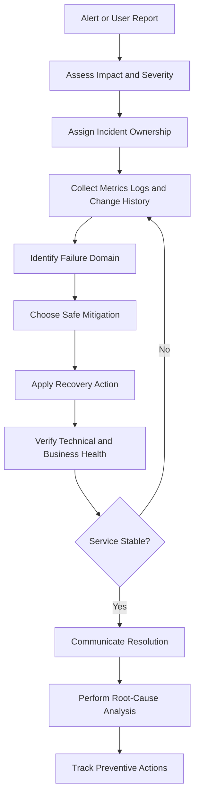

# 07- Production Incident Response

## Overview

Production incident response for AWS Lambda is the structured process of detecting, diagnosing, containing, and recovering from failures that affect service availability, data integrity, security, or operational cost.

AWS Lambda manages the underlying compute infrastructure, but application teams remain responsible for handler failures, dependency outages, concurrency limits, event-processing backlogs, permission errors, deployment regressions, and downstream service capacity.

An effective incident response process must restore service safely while preserving evidence and minimizing business impact. It should also produce actionable improvements that reduce the likelihood or impact of future incidents.

The key objectives are to:

- Determine the scope and severity of the incident.
- Identify the failing component and establish a reliable timeline.
- Contain the impact before it spreads to dependent services.
- Restore service without creating duplicate operations or data corruption.
- Verify recovery using technical and business-level signals.
- Document root causes and implement preventive actions.

## Incident Severity and Ownership

Severity should reflect user impact, business criticality, data integrity, security exposure, and the availability of workarounds.

### Severity classification

| Severity | Example | Response priority |
|---|---|---|
| SEV-1 | Critical business operations unavailable, widespread outage, or major security or data-integrity incident | Immediate coordinated response |
| SEV-2 | Significant degradation, sustained processing failures, or rapidly growing backlog affecting important workflows | Urgent investigation and mitigation |
| SEV-3 | Limited or intermittent impact with a viable workaround | Prioritized investigation |
| SEV-4 | Low-impact anomaly or operational warning without meaningful service disruption | Normal engineering workflow |

Use the organization's formal severity definitions when available. Severity should be reassessed as the incident develops.

### Incident roles

For significant incidents, assign responsibilities explicitly.

- **Incident commander:** Coordinates the response, prioritizes actions, and manages stakeholder communication.
- **Technical lead:** Directs diagnosis and remediation.
- **Service owner:** Provides application, architecture, and dependency context.
- **Communications owner:** Publishes status updates.
- **Scribe:** Maintains the timeline, records evidence, and tracks decisions.

One person may fill several roles during a small incident. For a major incident, separating coordination from hands-on debugging helps prevent communication gaps and conflicting remediation attempts.

## Incident Response Lifecycle

A consistent lifecycle keeps the response focused on restoring service rather than making unrelated changes.



### Initial response procedure

1. Confirm the affected AWS account, Region, function, and invocation path.
2. Establish the incident start time and current business impact.
3. Determine whether the failure is ongoing or historical.
4. Review recent deployments, configuration changes, and infrastructure modifications.
5. Inspect Lambda metrics, logs, and downstream dependency health.
6. Identify a safe mitigation that limits further impact.
7. Record observations, decisions, and the results of each action.

Do not immediately increase concurrency, broaden IAM permissions, or replay failed messages without evaluating the consequences.

## Build an Incident Timeline

A reliable timeline helps distinguish the initiating failure from symptoms that appear later.

Capture:

- First known user impact.
- Alert and detection timestamps.
- Deployment and configuration-change timestamps.
- Changes in invocation volume, duration, errors, and concurrency.
- Database, queue, and external-service health changes.
- Mitigation attempts and their results.
- Recovery verification and any data correction.
- Incident resolution and stakeholder communication.

Use UTC timestamps when correlating CloudWatch metrics, application logs, CloudTrail events, and deployment records.

A deployment immediately preceding an outage is an important lead, but temporal correlation alone does not establish causation.

## Lambda Metrics for Incident Diagnosis

Lambda publishes CloudWatch metrics that help identify execution failures, latency increases, and capacity constraints.

| Metric | What it indicates | Investigation focus |
|---|---|---|
| `Invocations` | Invocation volume | Traffic spikes, trigger loops, workload changes |
| `Errors` | Failed function executions | Handler exceptions, runtime failures, timeouts |
| `Throttles` | Invocations rejected due to throttling | Concurrency allocation, account capacity, applicable limits |
| `Duration` | Execution duration | Slow dependencies, inefficient code, initialization |
| `ConcurrentExecutions` | Concurrent execution demand | Traffic bursts, long-running invocations, capacity pressure |
| `AsyncEventsReceived` | Events received for asynchronous processing | Incoming asynchronous workload |
| `AsyncEventsDropped` | Asynchronous events discarded under applicable failure conditions | Retry exhaustion, event age, queue capacity |
| `IteratorAge` | Age of the last record when a stream event source mapping processes it | Consumer lag, processing failures, throughput constraints |

Metric availability and interpretation depend on the invocation model and integration. For example, `IteratorAge` is relevant to supported stream-processing integrations, not ordinary synchronous API requests.

A metric identifies a symptom, not necessarily the root cause. Correlate Lambda metrics with application logs, event-source metrics, database health, and upstream integration signals.

### Establish operational baselines

Maintain baselines for:

- Normal invocation volume and peak traffic.
- Expected error rate and tail latency.
- Typical concurrency range.
- Queue age and stream-processing lag.
- Downstream latency and resource utilization.
- Normal cost and telemetry volume.

Use these baselines to distinguish a genuine incident from expected workload variation.

## Retrieve CloudWatch Metrics Using AWS CLI

The following commands are read-only. Replace the function name, Region, and time window with the values relevant to the incident.

### Inspect invocation errors

```bash
aws cloudwatch get-metric-statistics \
  --namespace AWS/Lambda \
  --metric-name Errors \
  --dimensions Name=FunctionName,Value=orders-api \
  --start-time 2026-10-11T00:00:00Z \
  --end-time 2026-10-11T01:00:00Z \
  --period 60 \
  --statistics Sum \
  --region ap-south-1
```

This retrieves the sum of reported errors over one-minute periods for the specified function and time window.

### Inspect throttling

```bash
aws cloudwatch get-metric-statistics \
  --namespace AWS/Lambda \
  --metric-name Throttles \
  --dimensions Name=FunctionName,Value=orders-api \
  --start-time 2026-10-11T00:00:00Z \
  --end-time 2026-10-11T01:00:00Z \
  --period 60 \
  --statistics Sum \
  --region ap-south-1
```

Investigate sustained throttling alongside reserved concurrency, account-level capacity, event source mapping constraints, and invocation volume.

### Inspect execution duration

```bash
aws cloudwatch get-metric-statistics \
  --namespace AWS/Lambda \
  --metric-name Duration \
  --dimensions Name=FunctionName,Value=orders-api \
  --start-time 2026-10-11T00:00:00Z \
  --end-time 2026-10-11T01:00:00Z \
  --period 60 \
  --statistics Average Maximum \
  --region ap-south-1
```

Average duration can hide tail-latency problems. Use percentile statistics where available to investigate p95 and p99 execution duration.

`get-metric-statistics` does not guarantee chronological ordering of returned datapoints. Sort datapoints by timestamp when automating analysis.

## Retrieve and Search Lambda Logs

For a conventional Lambda function using its default log group, the log group is usually `/aws/lambda/FUNCTION_NAME`. Custom logging configurations may use different destinations.

### Read recent log events

```bash
aws logs tail /aws/lambda/orders-api \
  --since 30m \
  --region ap-south-1
```

To follow new log events during an active investigation:

```bash
aws logs tail /aws/lambda/orders-api \
  --since 10m \
  --follow \
  --region ap-south-1
```

These commands read logs. They do not change the function configuration.

### Search for timeout errors

```bash
aws logs filter-log-events \
  --log-group-name /aws/lambda/orders-api \
  --filter-pattern '"Task timed out"' \
  --start-time 1791676800000 \
  --end-time 1791680400000 \
  --region ap-south-1
```

The time values are illustrative Unix epoch timestamps in milliseconds. Convert the actual incident start and end times before running the command.

Useful search patterns include:

- `Task timed out`
- `AccessDeniedException`
- `Runtime.ImportModuleError`
- `TooManyRequestsException`
- `Connection timed out`
- `Connection refused`

Exact error messages vary by runtime, SDK, integration, and underlying service.

Not every failure appears in the function's log group. Invocation permission failures, event-source failures, and upstream integration errors may require investigation through the calling service, CloudTrail, or event-source metrics.

## Inspect Function Configuration

Unexpected configuration changes can cause incidents even when the application code has not changed.

### Inspect deployed configuration

```bash
aws lambda get-function-configuration \
  --function-name orders-api \
  --query '{
    State:State,
    LastUpdateStatus:LastUpdateStatus,
    Runtime:Runtime,
    Handler:Handler,
    MemorySize:MemorySize,
    Timeout:Timeout,
    Role:Role,
    VpcConfig:VpcConfig
  }' \
  --output json \
  --region ap-south-1
```

Review the result for unexpected runtime, handler, timeout, memory, execution-role, or VPC changes.

Avoid printing environment variables unnecessarily. They may contain sensitive configuration, and raw command output should not be shared in tickets or chat without review and redaction.

### Inspect reserved concurrency

```bash
aws lambda get-function-concurrency \
  --function-name orders-api \
  --region ap-south-1
```

A missing reserved concurrency configuration does not mean unlimited capacity. Functions without reserved concurrency share the applicable account-level concurrency pool.

### Inspect the production alias

If production traffic uses a Lambda alias, verify its target version before assuming the latest published version is serving requests.

```bash
aws lambda get-alias \
  --function-name orders-api \
  --name production \
  --region ap-south-1
```

This is a read-only command. Replace `production` with the actual alias name.

## Diagnose Common Production Incidents

Use a consistent diagnostic sequence for each failure:

**Symptom → Possible causes → Isolation strategy → Diagnostic commands → Root-cause verification → Corrective action → Prevention**

### Elevated error rate

**Possible causes**

- Application exceptions.
- Invalid event payloads.
- Dependency failures.
- Runtime or dependency incompatibility.
- Authorization errors.
- Timeouts or memory exhaustion.

**Isolation strategy**

1. Compare error rate with invocation volume.
2. Identify the first failing timestamp.
3. Inspect representative error logs and stack traces.
4. Determine whether failures affect all invocations or a specific event type.
5. Correlate the failures with deployments and dependency changes.

**Corrective action**

- Roll back a confirmed bad release when safe.
- Correct invalid configuration or permissions.
- Restore dependency availability.
- Quarantine poison messages where appropriate.
- Avoid swallowing exceptions that should trigger retries or alerts.

**Prevention**

Use contract validation, dependency-failure tests, structured logging, and deployment verification.

### Function timeouts

**Possible causes**

- Slow database queries.
- Unresponsive external APIs.
- Network connectivity problems.
- Excessive processing time.
- Deadlocks or blocked I/O.
- Incorrect timeout configuration.

**Isolation strategy**

1. Compare `Duration` with the configured timeout.
2. Inspect the final log messages before termination.
3. Check downstream latency and connection metrics.
4. Review recent code, memory, and timeout changes.
5. Determine whether the function is CPU-bound, I/O-bound, or blocked on a dependency.

**Corrective action**

- Fix inefficient queries or algorithms.
- Configure connection and read timeouts.
- Reduce unnecessary external calls.
- Increase the Lambda timeout only when the operation legitimately requires more time and the caller can tolerate the latency.
- Move long-running work to an appropriate asynchronous architecture when necessary.

**Prevention**

Set explicit dependency deadlines, monitor tail latency, and test realistic payload sizes.

### Throttling and concurrency exhaustion

**Possible causes**

- Traffic bursts.
- Reserved concurrency set too low.
- Shared account concurrency consumed by other functions.
- Event source mapping concurrency constraints.
- Invocations taking longer because of dependency degradation.

**Isolation strategy**

1. Inspect `Throttles` and `ConcurrentExecutions`.
2. Check account-level concurrency settings.
3. Inspect function reserved concurrency.
4. Review event source mapping configuration.
5. Compare invocation volume and duration against the baseline.

**Corrective action**

- Remove an accidental traffic source.
- Adjust concurrency if sufficient downstream capacity exists.
- Isolate critical workloads using reserved concurrency where appropriate.
- Reduce dependency latency.
- Use queues to absorb bursts when the architecture supports asynchronous processing.

Do not raise concurrency blindly. If a database is already saturated, increasing concurrency can amplify the incident.

**Prevention**

Establish capacity limits, workload-specific alarms, and load-tested concurrency settings.

### Database connection exhaustion

**Possible causes**

- Too many Lambda execution environments opening connections.
- Excessive connection creation per invocation.
- Large connection pools in each environment.
- Slow transactions holding connections.
- Missing connection timeouts.

**Isolation strategy**

1. Inspect database connection counts and wait events.
2. Correlate connection growth with Lambda concurrency.
3. Review connection-pool settings and initialization logic.
4. Inspect slow queries and transaction duration.
5. Check whether connections are created repeatedly during invocation.

**Corrective action**

- Reduce Lambda concurrency when necessary.
- Reuse database clients safely.
- Reduce per-environment connection-pool sizes.
- Recover stuck transactions through an approved database procedure.
- Evaluate RDS Proxy where appropriate for the database engine and workload.

**Prevention**

Load-test connection demand, set query and connection timeouts, and monitor database capacity alongside Lambda concurrency.

### IAM authorization failures

**Possible causes**

- Missing action in the execution role.
- Incorrect resource ARN.
- Missing resource-based permission.
- Incorrect trust relationship.
- Explicit deny from a policy, permissions boundary, service control policy, or resource policy.

**Isolation strategy**

1. Identify the denied action and resource.
2. Determine which principal made the request.
3. Inspect the execution role and attached policies.
4. Check resource policies and applicable organizational restrictions.
5. Review CloudTrail events when available.

**Corrective action**

Add only the required permission to the correct principal and resource. Do not resolve the incident by granting unrestricted administrative access to the function.

**Prevention**

Use least-privilege policies, policy validation in CI/CD, and integration tests that exercise required AWS operations.

### VPC connectivity failures

**Possible causes**

- Incorrect subnet route tables.
- Security group restrictions.
- DNS resolution failures.
- Missing NAT or service endpoints.
- Database access-control restrictions.
- Incorrect VPC or subnet configuration.

**Isolation strategy**

1. Identify the unreachable dependency.
2. Inspect the function's VPC configuration.
3. Verify subnet routing and security group rules.
4. Check DNS resolution and endpoint availability.
5. Test connectivity from an appropriate diagnostic environment with equivalent network access.

**Corrective action**

Correct the route, security group, endpoint, DNS, or database configuration responsible for the failure.

A function attached to private subnets does not automatically have internet access. Private access to AWS services may use VPC endpoints, while public internet access generally requires suitable egress infrastructure.

**Prevention**

Manage networking through infrastructure as code and test connectivity during deployment verification.

### Asynchronous invocation failures

**Possible causes**

- Handler errors.
- Retry exhaustion.
- Events exceeding configured maximum age.
- Asynchronous queue pressure.
- Failure-destination or dead-letter configuration problems.

**Isolation strategy**

1. Inspect invocation errors and asynchronous event metrics.
2. Review function logs.
3. Check retry and event-age configuration.
4. Inspect configured failure destinations or dead-letter queues.
5. Verify whether failed events remain recoverable.

**Corrective action**

Fix the failure, preserve failed-event evidence, and replay only after validating idempotency and payload compatibility.

**Prevention**

Configure bounded retries, event-age limits, failure destinations, and alarms for dropped events.

### SQS backlog growth

**Possible causes**

- Insufficient worker throughput.
- Increased message arrival rate.
- Repeated message failures.
- Downstream throttling.
- Worker concurrency constraints.
- Visibility timeout or batch-processing problems.

**Isolation strategy**

1. Inspect queue depth and oldest-message age.
2. Compare arrival rate with successful processing throughput.
3. Review Lambda errors, throttles, and duration.
4. Inspect dead-letter queue volume.
5. Check database and external-service capacity.

**Corrective action**

Resolve the processing failure, then increase worker throughput only within safe downstream limits. For poison messages, use a controlled redrive or quarantine process.

**Prevention**

Tune batching and concurrency, implement partial batch responses, and test backlog recovery under realistic failure conditions.

### Deployment regression

**Possible causes**

- Incorrect artifact or handler.
- Dependency mismatch.
- Configuration drift.
- IAM changes.
- Incompatible event schema.
- Database migration incompatibility.

**Isolation strategy**

1. Identify the active version and alias.
2. Compare the current release with the last known good version.
3. Inspect deployment events and configuration differences.
4. Review error and latency changes after rollout.
5. Determine whether the regression affects all traffic or a specific version.

**Corrective action**

Stop traffic shifting or revert the alias when safe. Coordinate rollback with database and event-schema compatibility requirements.

**Prevention**

Use immutable artifacts, automated tests, staged releases, smoke tests, and post-deployment alarms.

## Incident-Specific AWS CLI Workflows

### Inspect recent function errors and state

```bash
aws lambda get-function-configuration \
  --function-name orders-api \
  --query '{
    State:State,
    LastUpdateStatus:LastUpdateStatus,
    LastModified:LastModified,
    Timeout:Timeout,
    MemorySize:MemorySize
  }' \
  --output table \
  --region ap-south-1
```

This read-only inspection helps identify a function that is not active or has an incomplete update. Follow it with metric and log inspection for the same time window.

### Inspect event source mappings

```bash
aws lambda list-event-source-mappings \
  --function-name order-worker \
  --query 'EventSourceMappings[].{
    UUID:UUID,
    State:State,
    StateTransitionReason:StateTransitionReason,
    LastProcessingResult:LastProcessingResult,
    BatchSize:BatchSize
  }' \
  --output table \
  --region ap-south-1
```

Review mapping state, the last processing result, and batch configuration. Some fields may be absent depending on the integration or current mapping state.

### Inspect account concurrency

```bash
aws lambda get-account-settings \
  --query '{
    ConcurrentExecutions:AccountLimit.ConcurrentExecutions,
    UnreservedConcurrentExecutions:AccountLimit.UnreservedConcurrentExecutions
  }' \
  --output table \
  --region ap-south-1
```

Use this output alongside function-level concurrency and throttling metrics. Account capacity alone does not explain every source of throttling.

### Verify the active AWS identity

```bash
aws sts get-caller-identity
aws configure get region
```

The first command identifies the active AWS principal. The second reports the configured default Region for the active profile; an explicit `--region` argument or service-specific configuration can override it.

For named profiles, use the appropriate `--profile` argument consistently. Confirm the account and Region before running any remediation command.

## Safe Mitigation and Recovery

Incident response should prioritize safe restoration rather than making the largest possible configuration change.

### Prefer reversible actions

Examples include:

- Stopping an in-progress rollout.
- Reverting an alias to a known-good version.
- Pausing a problematic consumer when supported and safe.
- Reducing concurrency to protect an overloaded dependency.
- Disabling a faulty event trigger.
- Temporarily restricting traffic through an appropriate upstream control.

Each action has trade-offs. Disabling a trigger may create a backlog, reducing concurrency may increase message age, and rolling back application code may not reverse external side effects.

Before executing a write operation, identify the affected resources, expected impact, rollback method, and required approval.

### Preserve failed work

Before deleting messages, clearing a dead-letter queue, or discarding asynchronous events:

1. Preserve representative payloads and relevant metadata securely.
2. Determine whether the failure is transient or permanent.
3. Check whether any side effects already occurred.
4. Verify idempotency and replay safety.
5. Establish an explicit recovery or redrive plan.
6. Confirm that replay will not overwhelm downstream services.

Failed events may contain sensitive information. Store and share them only through approved mechanisms.

### Verify business recovery

Successful Lambda invocations do not necessarily prove that the business process is healthy.

Recovery verification should include:

- Error rates returning to acceptable levels.
- Latency recovering to expected ranges.
- Queue age and stream lag declining.
- Dead-letter queue growth stopping.
- Database and external-service health recovering.
- Required records or transactions being present and consistent.
- Downstream consumers receiving expected events.

For asynchronous workloads, distinguish between the service being operational and the backlog being fully processed.

## Communication During an Incident

Incident communication should be concise, factual, and updated at a predictable cadence.

A useful status update includes:

- **Impact:** Which services or business operations are affected?
- **Start time:** When was impact first observed?
- **Current state:** What is known, and what remains uncertain?
- **Mitigation:** What actions have been taken?
- **Next action:** What is being investigated or changed?
- **Next update:** When will stakeholders receive another update?

Do not present an unverified hypothesis as the root cause. Clearly distinguish confirmed observations from current theories.

Record significant decisions, especially when an action affects data integrity, security, or service availability.

## Root-Cause Analysis and Prevention

A post-incident review should explain how the system failed and why existing controls did not prevent or detect the failure sooner.

### Structure the review

Include:

- Incident summary and business impact.
- Start and recovery timestamps.
- Detection method and time to detect.
- Timeline of key events.
- Technical root cause and contributing factors.
- Why existing safeguards were insufficient.
- Mitigation and recovery actions.
- Data-integrity verification.
- Corrective and preventive actions.
- Owners and target dates.

Avoid assigning blame to an individual. Focus on system behavior, engineering decisions, missing safeguards, and opportunities to improve detection and recovery.

### Example: Database saturation following a deployment

Suppose a deployment introduces slower database queries. Lambda duration rises, concurrent executions increase, database connections reach their limit, and invocation failures grow.

A weak conclusion would be: "Lambda ran out of capacity."

A stronger analysis identifies the causal chain:

1. The query regression increased execution duration.
2. Longer-running invocations increased concurrency demand.
3. Each execution environment opened database connections.
4. The database reached its connection limit.
5. Timeouts and retries amplified the workload.
6. Existing alarms detected errors but did not identify early database saturation.

Preventive actions might include query-plan regression tests, connection-capacity limits, earlier dependency-latency alarms, and load testing with realistic concurrency.

### Track corrective actions

Each action should have:

- A specific failure mode it addresses.
- An accountable owner.
- A measurable completion criterion.
- A target date.
- A verification method.

Prefer concrete actions such as "Alert when oldest SQS message age exceeds the service objective for five minutes" over vague actions such as "Improve monitoring."

## Incident Response Runbook Template

Use the following template for each production Lambda service.

```markdown
# Incident Runbook: <Service Name>

## Service Details

- Service owner:
- AWS account:
- AWS Region:
- Lambda function:
- Production alias:
- Invocation model:
- Critical dependencies:
- Business criticality:

## Impact Assessment

- User-visible symptoms:
- Affected business operations:
- First observed time (UTC):
- Current severity:
- Known workarounds:

## Initial Checks

- [ ] Verify AWS account and Region.
- [ ] Check Lambda Errors, Throttles, Duration, and Invocations.
- [ ] Inspect recent logs and exceptions.
- [ ] Review recent deployments and configuration changes.
- [ ] Check downstream service health.
- [ ] Inspect queue age or stream lag where applicable.

## Mitigation

- Proposed action:
- Expected impact:
- Approval required:
- Rollback procedure:
- Data-integrity risks:

## Recovery Verification

- [ ] Error rate is acceptable.
- [ ] Latency has recovered.
- [ ] Queue backlog or stream lag is recovering.
- [ ] Downstream dependencies are healthy.
- [ ] Business data is consistent.
- [ ] Stakeholders have been updated.

## Follow-Up

- Root cause:
- Corrective actions:
- Owners:
- Target dates:
```

Keep runbooks service-specific. Store actual resource identifiers in an access-controlled operational system rather than copying sensitive configuration into public documentation.

## Production Incident Readiness Checklist

### Detection and diagnosis

- [ ] CloudWatch dashboards cover invocation volume, errors, throttles, duration, and concurrency.
- [ ] Alerts map to meaningful reliability or business-impact conditions.
- [ ] Logs contain correlation identifiers and useful failure context.
- [ ] Event-source and downstream dependency metrics are available.
- [ ] Deployment and configuration changes are auditable.
- [ ] Diagnostic commands are documented and tested.

### Mitigation and recovery

- [ ] Incident ownership and escalation paths are defined.
- [ ] Known-good deployment versions and rollback procedures are available.
- [ ] Concurrency and trigger controls can be changed safely.
- [ ] Failed-event recovery and replay procedures are documented.
- [ ] Idempotency is implemented for repeatable business operations.
- [ ] Data-integrity checks exist for critical workflows.

### Prevention

- [ ] Failure-path tests cover dependency outages and timeouts.
- [ ] Load tests validate concurrency and downstream limits.
- [ ] Retry policies and failure destinations are reviewed.
- [ ] Infrastructure changes are managed through auditable workflows.
- [ ] Post-incident actions have owners and target dates.
- [ ] Runbooks are reviewed after significant architecture changes.

## Key Takeaways

- Diagnose Lambda incidents by correlating metrics, logs, deployment history, event-source behavior, and downstream dependency health rather than assuming the function itself is the root cause.
- Prefer reversible mitigations and account for the effects of concurrency changes, trigger shutdowns, retries, and replay operations.
- Preserve failed-event evidence and validate idempotency before replaying work that may have partially completed.
- Verify recovery through business outcomes, dependency health, queue or stream progress, and data integrity—not only successful Lambda invocations.
- Convert incident findings into owned preventive actions, improved alarms, tested runbooks, and safer deployment and recovery procedures.