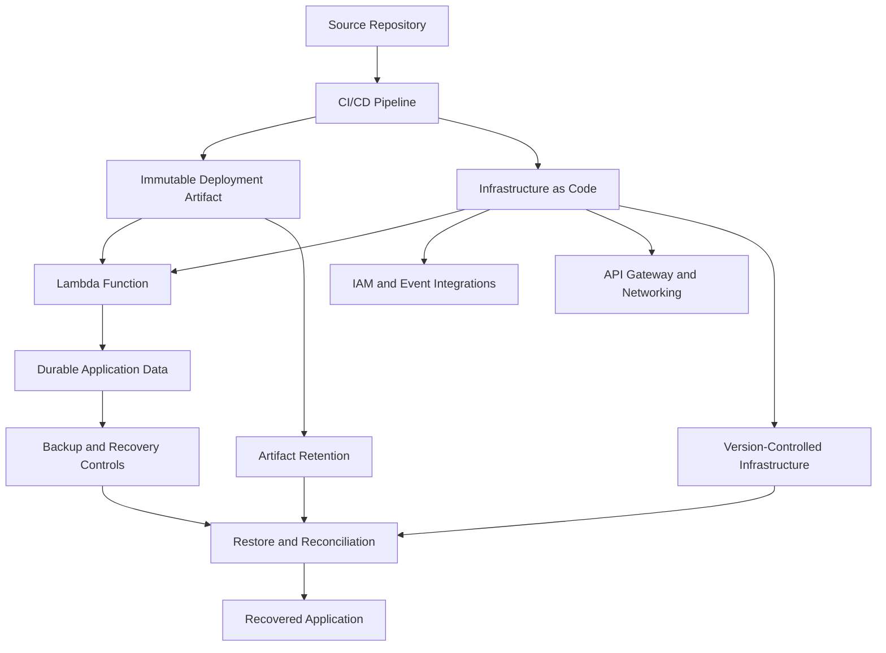
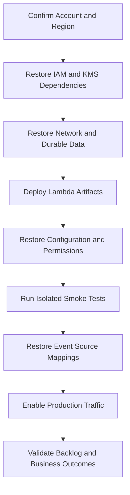

# 08- Backup and Recovery

## Overview

Backup and recovery for AWS Lambda is the process of preserving application code, deployment artifacts, configuration, infrastructure definitions, durable data, and event-processing state so that a serverless workload can be restored after accidental deletion, deployment failure, data corruption, security incidents, or regional outages.

AWS Lambda manages the underlying compute infrastructure, but application teams remain responsible for recovering the complete application. Recreating a function does not automatically restore its database, execution role, event source mappings, secrets, networking, or business data.

A production recovery strategy should answer four questions:

- What must be restored?
- How much data loss is acceptable?
- How quickly must service be restored?
- How will the team verify that recovery is complete?

The objective is not merely to make the Lambda function active again. It is to restore correct business behavior within agreed recovery objectives.

## Recovery Objectives

Two metrics guide disaster recovery planning.

| Metric | Meaning | Example |
|---|---|---|
| Recovery Time Objective (RTO) | Maximum acceptable time to restore service | Restore order processing within 30 minutes |
| Recovery Point Objective (RPO) | Maximum acceptable data loss measured in time | Recover records with no more than 5 minutes of data loss |

These are business requirements, not automatic Lambda guarantees. Actual recovery time depends on deployment automation, data restoration, dependencies, access permissions, and validation.

### Define objectives per workload

| Workload | Primary recovery concern | Recovery strategy |
|---|---|---|
| Synchronous REST API | Availability and latency | Redeploy a known-good artifact and validate dependencies |
| SQS consumer | Message preservation and backlog recovery | Restore the consumer and safely resume processing |
| S3 file processor | Source-file availability and repeatability | Retain source objects and reprocess selected inputs |
| DynamoDB Streams consumer | Stream retention and processing progress | Restore the consumer and assess recoverable records |
| Scheduled Lambda | Missed executions | Reconcile missed runs and execute idempotently |
| Financial workflow | Data integrity and duplicate side effects | Restore durable state and reconcile transactions |

A critical financial workflow may require a smaller RPO and a more rigorously tested recovery process than a non-critical reporting job.

## What Must Be Backed Up?

Lambda is only one component of a serverless application. Build a recovery inventory that covers every resource required to restore business behavior.

| Asset | Recovery mechanism | Important consideration |
|---|---|---|
| Source code | Version control | Preserve dependencies and build instructions |
| ZIP deployment packages | Immutable artifact storage | Retain the exact artifact associated with each release |
| Container images | Amazon ECR and retention controls | Record image digests rather than relying on mutable tags |
| Function configuration | Infrastructure as Code | Include runtime, handler, timeout, memory, and networking |
| Published versions and aliases | Release metadata and deployment automation | Restore the intended traffic-routing state |
| IAM roles and policies | Version-controlled infrastructure definitions | Restore least-privilege permissions |
| Event source mappings | Infrastructure as Code | Avoid duplicate or premature event consumption |
| DynamoDB tables | On-demand backups and point-in-time recovery where configured | Validate the recovery point and restored data |
| S3 objects | Versioning, replication, or backup controls | Replication alone may not protect against deletion or corruption |
| SQS messages | Queue retention, dead-letter queues, and source-data reconstruction | Messages can expire or be deleted |
| Secrets | Secrets Manager or Parameter Store recovery procedures | Preserve access controls without exposing secret values |
| Logs and audit records | Retention policies and archival controls | Logs may expire unless retained or exported |
| Networking | Infrastructure as Code | Recreate routes, subnets, security groups, and endpoints |

Also include API Gateway, EventBridge rules and schedules, Step Functions state machines, KMS keys, databases, and other application dependencies.

## Recovery Architecture

A reliable recovery design separates deployment artifacts, infrastructure definitions, durable business data, and operational evidence.



Recovery should be reproducible from controlled artifacts and documented procedures, rather than relying on manually copying settings from the AWS console.

## Recover Lambda Code and Configuration

### Use version control as the source of truth

Store handler code, dependency definitions, infrastructure templates, deployment scripts, and operational configuration in version control.

A service repository might contain:

```text
orders-service/
    src/
        handler.py
    tests/
    requirements.txt
    template.yaml
    .github/
        workflows/
            deploy.yml
```

The structure depends on the deployment framework. The essential requirement is that the service can be rebuilt and deployed through a repeatable process.

Never commit AWS credentials, plaintext secrets, or production environment files to the repository.

### Preserve immutable deployment artifacts

Retain the exact deployment package or container image used for every production release.

Record metadata such as:

- Source commit and artifact checksum.
- Function name and deployment environment.
- Runtime and dependency versions.
- Build timestamp.
- Published Lambda version.
- Associated infrastructure revision.
- Container image digest, where applicable.

A mutable image tag such as `latest` is insufficient evidence of which code was deployed.

For ZIP deployments, retain the built package in an approved artifact repository. For container-based functions, configure Amazon ECR retention policies so that images required for rollback or disaster recovery are not removed prematurely.

### Inspect the deployed function

The following AWS CLI command is read-only.

```bash
aws lambda get-function-configuration \
  --function-name orders-api \
  --query '{
    FunctionName:FunctionName,
    State:State,
    LastUpdateStatus:LastUpdateStatus,
    Runtime:Runtime,
    Handler:Handler,
    Role:Role,
    Timeout:Timeout,
    MemorySize:MemorySize,
    EphemeralStorage:EphemeralStorage,
    VpcConfig:VpcConfig,
    LastModified:LastModified
  }' \
  --output json \
  --region ap-south-1
```

Use this output to compare the deployed function with the approved configuration. It is useful for investigation, but infrastructure definitions should remain the authoritative recovery source.

Avoid exporting or sharing environment-variable values unnecessarily because they may contain sensitive information.

### Recover a known-good release

A controlled recovery workflow should:

1. Identify the last known-good source revision and artifact.
2. Verify artifact integrity and compatibility with the current infrastructure.
3. Validate the required IAM roles, secrets, and network dependencies.
4. Deploy the artifact using the established deployment pipeline.
5. Publish or identify the intended Lambda version.
6. Update the production alias if appropriate.
7. Run smoke tests and verify downstream behavior.

Do not assume that an older application version is compatible with the current database schema or event contracts. Rolling back code does not automatically reverse data migrations or external side effects.

## Lambda Versions and Aliases

Published Lambda versions provide immutable snapshots of function code and version-specific configuration. Aliases provide stable names for versions and can support traffic routing.

This separation is useful when a deployment introduces a regression.

Suppose the production alias points to version `42`, while version `41` is the last known-good release.

Inspect the alias:

```bash
aws lambda get-alias \
  --function-name orders-api \
  --name production \
  --region ap-south-1
```

This command is read-only.

If rollback is approved and version `41` is compatible with the current dependencies, the alias can be updated:

```bash
aws lambda update-alias \
  --function-name orders-api \
  --name production \
  --function-version 41 \
  --region ap-south-1
```

This command modifies production traffic routing. Replace the example values with verified resource identifiers and the correct version.

Verify the result:

```bash
aws lambda get-alias \
  --function-name orders-api \
  --name production \
  --region ap-south-1
```

Alias rollback has important limitations:

- It does not restore deleted or corrupted business data.
- It does not reverse IAM, networking, or other infrastructure changes.
- It does not undo database migrations.
- It does not cancel already-running invocations.
- It does not reverse messages or external requests already processed.

Use alias rollback for code-routing recovery, not as a substitute for complete application recovery.

## Back Up Infrastructure as Code

Infrastructure as Code makes recovery repeatable and reduces configuration drift.

Depending on the platform, use AWS CloudFormation, AWS SAM, AWS CDK, or Terraform.

Infrastructure definitions should cover:

- Lambda functions and deployment configuration.
- IAM roles, policies, and invocation permissions.
- Event source mappings.
- API Gateway integrations and stages.
- EventBridge rules and schedules.
- SQS queues and dead-letter queues.
- VPC dependencies.
- Log groups, retention settings, alarms, and dashboards.
- Required data stores and integration resources.

### Environment-specific configuration

Keep development, staging, and production configuration separate while maintaining consistent infrastructure definitions.

The following is an illustrative configuration structure, not a directly deployable CloudFormation or SAM template.

```yaml
service:
  name: orders-service

deployment:
  artifact: orders-service-commit-abc123.zip

lambda:
  memory_size: 1024
  timeout: 30

monitoring:
  log_retention_days: 30
```

Translate the values into the syntax of the infrastructure tool used by the project.

Do not store plaintext secrets in source-controlled configuration. Reference managed secrets or inject them through an approved deployment mechanism.

### Recovery deployment principles

- Build from a known source revision.
- Pin dependencies and record artifact checksums.
- Keep infrastructure templates under version control.
- Separate deployment permissions from runtime permissions.
- Validate infrastructure changes before applying them to production.
- Recreate resources in dependency order.
- Verify restored resources before enabling event triggers.
- Record recovery changes in the normal audit trail.

## Recover Durable Application Data

Lambda does not own the business data processed by a function. Recovery must follow the backup and durability mechanisms of each integrated service.

### DynamoDB recovery

DynamoDB provides on-demand backups and point-in-time recovery (PITR), subject to the table configuration, Region, and current service limits.

PITR must be enabled before the incident for the required historical recovery period to be available.

Inspect continuous backup configuration:

```bash
aws dynamodb describe-continuous-backups \
  --table-name Orders \
  --region ap-south-1
```

This is a read-only command. Review the reported recovery status and available restorable time range.

For recovery:

1. Select a recovery point consistent with the incident timeline.
2. Restore the table, commonly to a new table name.
3. Validate the restored data and required indexes.
4. Reapply or verify application permissions and configuration.
5. Test the application against the restored table.
6. Switch traffic through a controlled configuration change.
7. Reconcile writes or transactions that occurred after the recovery point.

Restoring a table does not automatically restore the Lambda function, IAM policies, event source mappings, or every associated integration.

If the application uses DynamoDB Streams, assess stream configuration and consumer behavior separately. Do not assume that restoring table data automatically recreates the original stream-processing state.

### S3 recovery

For S3-based processing, consider:

- Versioning for object-level recovery.
- Replication for additional copies where appropriate.
- Lifecycle rules that preserve required versions.
- Access controls that prevent unauthorized deletion.
- Independent backup or archival controls for critical data.

Versioning can preserve earlier object versions, but recovery requires identifying and restoring the intended version safely.

Replication is not equivalent to an independent backup. Depending on the configuration, unwanted changes or deletions may propagate, and replication does not protect against every account-level or security incident.

For S3-triggered Lambda workflows, preserve the original object identity and version information where applicable so that reprocessing targets the intended input.

### SQS recovery

SQS retains messages according to the configured queue retention period. It is not a permanent business-data archive.

For critical processing:

- Configure retention according to recovery requirements.
- Use a dead-letter queue where appropriate.
- Monitor queue depth and oldest-message age.
- Preserve failed payloads securely when long-term recovery requires them.
- Implement idempotency before redrive or replay.
- Verify that downstream dependencies can handle the recovery load.

Expired or deleted messages may be unrecoverable from the queue. If the original input is stored elsewhere, reconstruct work from that durable source where safe.

### Secrets and encryption keys

A recovered Lambda function may fail if its secrets or encryption keys are unavailable.

Document:

- Secret identifiers and ownership.
- Rotation and recovery procedures.
- Required IAM permissions.
- KMS key dependencies.
- Cross-account and cross-Region access requirements.
- Recovery responsibilities and access controls.

Do not store plaintext secrets in backup manifests or recovery scripts. Key availability and access policies are part of recovery because preserved data can become inaccessible when its encryption keys or required permissions are lost.

## Recover Event Sources and Triggers

Restoring a function without its triggers may leave the service unavailable. Restoring triggers too early can cause duplicate processing or a sudden traffic spike.

| Integration | Recovery consideration |
|---|---|
| API Gateway | Restore routes, integrations, stages, permissions, and deployment configuration |
| SQS | Verify queue configuration, event source mapping, visibility timeout, and redrive policy |
| S3 | Verify bucket notifications and Lambda invocation permissions |
| EventBridge | Restore rules, targets, schedules, and target permissions |
| DynamoDB Streams | Verify stream availability, mapping configuration, and processing progress |
| SNS | Restore subscriptions, delivery permissions, and filtering configuration |
| Step Functions | Restore state machine definitions, execution permissions, and external dependencies |

### Recommended restoration sequence



The exact order depends on the architecture. For example, the function may need to exist before a trigger can be configured, while a database or queue must be available before the function can process events.

Where possible, deploy and validate the function using controlled test events before enabling production triggers.

## Cross-Region Disaster Recovery

A regional outage can affect Lambda and other regional resources. Cross-Region recovery must account for the entire dependency graph, not just the function artifact.

Potential recovery components include:

- Replicated deployment artifacts.
- Infrastructure definitions deployable in the recovery Region.
- Required IAM roles and resource policies.
- Network resources and private endpoints.
- Durable data replicas or backups.
- Secrets and encryption-key dependencies.
- API and DNS failover mechanisms.
- Event sources and replay procedures.
- Monitoring and operational access.

### Recovery strategy comparison

| Strategy | Description | Trade-off |
|---|---|---|
| Backup and restore | Rebuild resources and restore data after disruption | Lower standing cost, usually longer RTO |
| Pilot light | Keep critical data and minimal recovery infrastructure ready | Faster than rebuilding everything, but still requires deployment and scaling |
| Warm standby | Maintain a reduced but functional environment in another Region | Faster recovery with additional operating cost |
| Active-active | Run workloads in multiple Regions and distribute traffic | Higher complexity, cost, and data-consistency requirements |

Choose a strategy based on business-criticality, RTO, RPO, operational complexity, and budget.

### Cross-Region recovery considerations

- Lambda functions and many integrations are regional resources.
- Account quotas and service availability may differ between Regions.
- Secrets and KMS keys require appropriate regional provisioning or replication.
- Database replication lag affects achievable RPO.
- Event source mappings and resource policies must be recreated or validated.
- DNS failover is not instantaneous and may be affected by client caching.
- Simultaneous activation can cause duplicate processing if both Regions consume the same logical workload.
- Cross-Region data transfer and replicated resources can increase costs.

Do not activate a secondary consumer until workload ownership and concurrent-processing risks have been assessed.

## Recovery Testing

A backup that has never been restored is an unverified recovery assumption.

Test recovery procedures according to service criticality and after significant architecture changes.

### Recommended test scenarios

| Scenario | What to verify |
|---|---|
| Accidental function deletion | Function, configuration, permissions, and triggers can be recreated |
| Bad application release | Alias rollback restores compatible code |
| Configuration corruption | Infrastructure can be redeployed from the approved revision |
| DynamoDB data corruption | Data can be restored and reconciled against the recovery point |
| Failed event processing | Messages can be inspected, corrected, and replayed safely |
| Regional outage simulation | Recovery environment has required dependencies and access |
| Secret or key access failure | Access can be restored without exposing sensitive material |
| Queue backlog accumulation | Work can be processed within the recovery objective |

Use non-production environments for destructive tests unless a formally approved production exercise has appropriate safeguards.

### Recovery verification checklist

- [ ] Correct AWS account and Region are selected.
- [ ] Required artifacts are available and integrity-checked.
- [ ] Infrastructure deployment completes successfully.
- [ ] Function configuration matches the approved recovery revision.
- [ ] Execution roles and invocation permissions work.
- [ ] Network and downstream dependencies are reachable.
- [ ] Logs, metrics, and alarms are operational.
- [ ] Smoke tests pass.
- [ ] Event source mappings are enabled in a controlled manner.
- [ ] Backlog processing remains within downstream capacity.
- [ ] Business records are consistent and duplicates are handled.
- [ ] Measured RTO and RPO meet the agreed objectives.

## Automate Recovery Readiness Checks

Read-only checks can identify missing recovery prerequisites before an incident.

Verify that a function exists and is active:

```bash
aws lambda get-function-configuration \
  --function-name orders-api \
  --query '{
    State:State,
    LastUpdateStatus:LastUpdateStatus,
    LastModified:LastModified
  }' \
  --output json \
  --region ap-south-1
```

Check DynamoDB point-in-time recovery status:

```bash
aws dynamodb describe-continuous-backups \
  --table-name Orders \
  --region ap-south-1
```

Inspect the production alias:

```bash
aws lambda get-alias \
  --function-name orders-api \
  --name production \
  --region ap-south-1
```

These commands inspect current resources; they do not prove that full recovery will succeed. Readiness automation should also verify artifact availability, infrastructure deployment, secret access, data restoration, and application behavior.

Use a read-only IAM role wherever possible. Recovery scripts that modify production resources should require explicit authorization and should record their actions.

## Security and Cost Considerations

### Secure recovery artifacts

Recovery materials can provide powerful access to production systems. Protect them accordingly.

- Restrict artifact and backup access using least-privilege IAM policies.
- Encrypt data at rest and in transit.
- Separate production deployment permissions from runtime permissions.
- Protect backup deletion and retention settings.
- Audit recovery operations using CloudTrail.
- Keep secrets out of backup manifests and logs.
- Control access to recovery accounts and Regions.
- Test restoration of encryption keys and required permissions.

Where supported, consider account separation and controls that reduce the risk of an attacker deleting both production resources and their backups.

### Manage recovery costs

Potential cost drivers include:

- Cross-Region replication.
- Backup storage and retained object versions.
- Database backups and restored tables.
- ECR image retention.
- Warm standby compute and networking resources.
- CloudWatch logs and archived incident evidence.
- Data transfer and disaster recovery exercises.

Balance cost against RTO and RPO. Do not remove recovery resources merely to reduce spending without confirming that the revised design still meets business recovery requirements.

## Common Backup and Recovery Mistakes

| Mistake | Why it fails | Better approach |
|---|---|---|
| Treating Lambda as the entire application | Data and integrations may remain unavailable | Inventory the full dependency graph |
| Keeping only the latest artifact | A known-good version may no longer be available | Retain immutable, identifiable release artifacts |
| Treating source control as a complete backup | External state, secrets, and configuration may be missing | Combine source control with infrastructure and data recovery |
| Assuming alias rollback reverses all changes | Data and infrastructure changes remain | Define rollback boundaries and compatibility checks |
| Enabling every trigger immediately | A recovered system can overload dependencies or duplicate work | Restore traffic gradually and verify capacity |
| Replaying events without idempotency | Business side effects may occur more than once | Use idempotency keys and reconciliation |
| Assuming replication prevents all data loss | Deletions or corruption may propagate | Use appropriate independent backup and retention controls |
| Never testing restoration | Hidden permission and dependency gaps remain | Run documented recovery exercises |
| Ignoring KMS and IAM dependencies | Preserved data may be inaccessible | Include key and access recovery |
| Measuring only infrastructure recovery | Business processing may remain incomplete | Verify data integrity and business outcomes |

## Production Recovery Runbook Template

```markdown
# Recovery Runbook: <Service Name>

## Service Information

- Service owner:
- AWS account:
- Primary Region:
- Recovery Region:
- Lambda function and production alias:
- Infrastructure repository:
- Artifact location:
- Data stores and event sources:

## Recovery Objectives

- RTO:
- RPO:
- Business impact:
- Escalation contact:

## Recovery Prerequisites

- [ ] Confirm incident scope and approved recovery strategy.
- [ ] Verify access to the correct AWS account and Region.
- [ ] Locate the approved source revision and deployment artifact.
- [ ] Verify artifact integrity.
- [ ] Confirm required IAM roles and KMS keys.
- [ ] Confirm data backups and recovery points.
- [ ] Verify networking and downstream dependencies.

## Recovery Procedure

- [ ] Restore required infrastructure.
- [ ] Restore or validate durable application data.
- [ ] Deploy the approved Lambda artifact.
- [ ] Restore configuration, permissions, and aliases.
- [ ] Run isolated smoke tests.
- [ ] Restore event sources in a controlled sequence.
- [ ] Monitor errors, latency, concurrency, and backlog.
- [ ] Verify business data integrity.
- [ ] Communicate recovery status.

## Recovery Results

- Recovery start time (UTC):
- Service restoration time (UTC):
- Measured RTO:
- Verified recovery point:
- Measured RPO:
- Data reconciliation required:
- Outstanding risks:

## Follow-Up

- Recovery gaps:
- Corrective actions:
- Owners:
- Target dates:
```

## Key Takeaways

- Lambda recovery requires restoring code, configuration, permissions, event integrations, networking, and durable application data—not merely recreating the function.
- Define RTO and RPO per workload, and select backup, standby, or multi-Region strategies according to business requirements and cost.
- Retain immutable deployment artifacts and version-controlled infrastructure so known-good releases can be restored reproducibly.
- Validate idempotency, data integrity, event replay safety, and downstream capacity before resuming production processing.
- Test recovery procedures regularly and measure actual restoration time and recoverable data loss rather than assuming backups are sufficient.