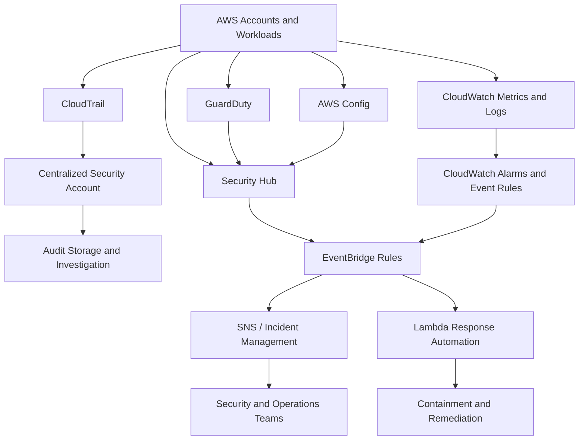
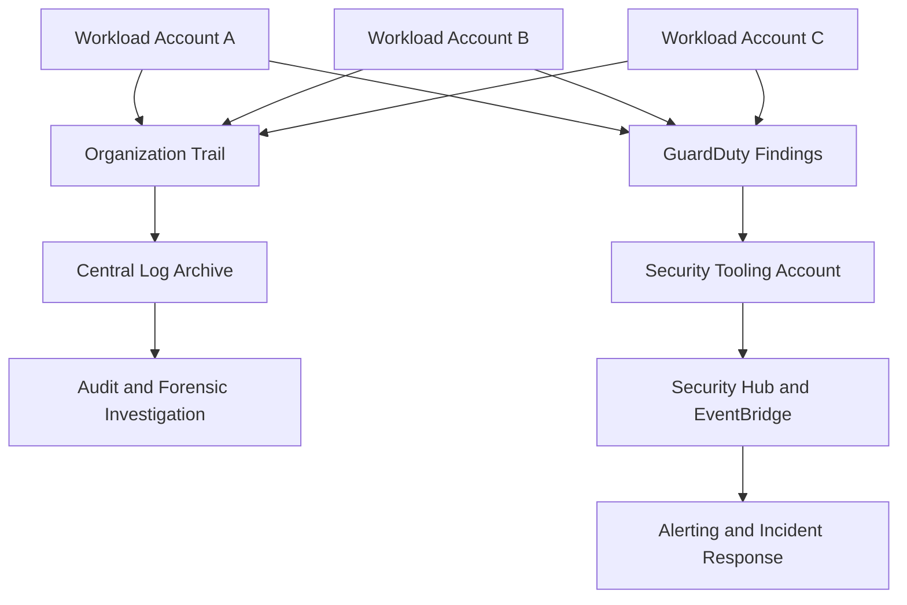
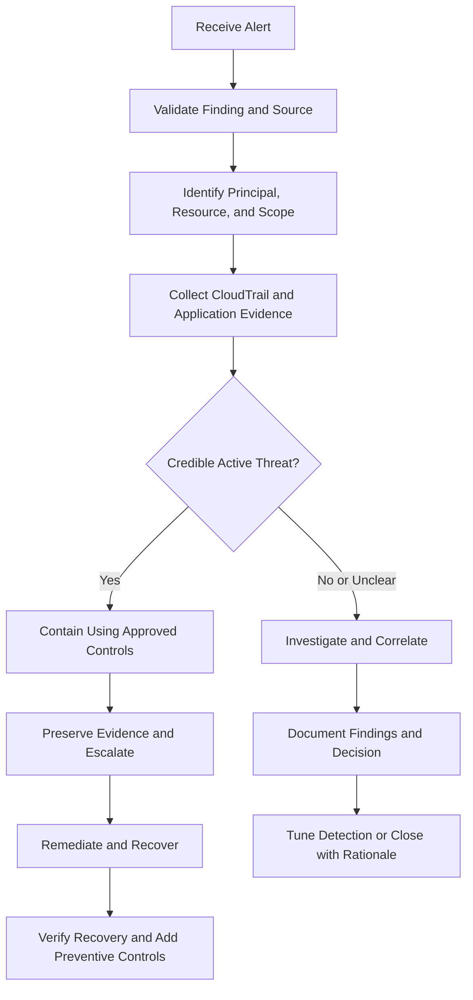

# 01- Security Monitoring and Alerting

## Overview

AWS security monitoring provides continuous visibility into identity activity, API operations, network behavior, resource configuration, and potential threats across AWS accounts and workloads. Security alerting converts relevant telemetry into actionable notifications so engineering and security teams can investigate suspicious activity, contain incidents, and prevent recurrence.

For backend engineers, security monitoring is not limited to enabling AWS security services. It requires designing a reliable pipeline that collects relevant events, evaluates them against security policies and behavioral expectations, routes findings to the right responders, and preserves evidence for investigation.

A production security monitoring system should answer four questions:

- **What happened?** Identify the API operation, principal, resource, timestamp, and request context.
- **Is it suspicious?** Evaluate the event against known threats, expected behavior, and security policies.
- **What is the impact?** Determine affected accounts, workloads, data, credentials, and trust boundaries.
- **What action is required?** Notify responders, contain the threat, preserve evidence, and verify recovery.

## Security Monitoring Architecture

AWS security monitoring combines preventive controls, telemetry collection, threat detection, alert routing, and incident response.



The exact integration depends on the enabled services, regional configuration, account topology, and event sources. Security Hub findings can be routed through EventBridge, while CloudWatch alarms and other AWS service events can use their own supported event integrations.

A centralized design should separate security telemetry collection from workload administration. This reduces the risk that a compromised application account can modify or erase its own investigation evidence.

## Core AWS Security Monitoring Services

### Amazon CloudTrail

CloudTrail records AWS API activity and provides evidence of actions performed by users, assumed roles, AWS services, and other supported principals.

Use CloudTrail to investigate:

- Unexpected IAM policy or trust-policy changes.
- Unusual role assumptions or credential use.
- Public-access configuration changes on S3 resources.
- KMS key-policy changes and suspicious cryptographic operations.
- Security group modifications and unexpected network exposure.
- Attempts to disable logging or alter security controls.

CloudTrail Event history provides a searchable history of management events for the preceding 90 days in a region. For longer retention, centralized collection, or broader investigation requirements, configure a trail and appropriate event data stores. Data events, such as supported S3 object-level operations and Lambda invocations, require deliberate configuration and can incur additional charges.

Inspect trail configuration:

```bash
aws cloudtrail describe-trails \
  --region <AWS_REGION>
```

Inspect delivery status:

```bash
aws cloudtrail get-trail-status \
  --name <TRAIL_ARN_OR_NAME> \
  --region <AWS_REGION>
```

Look for the configured destination, logging state, and delivery errors. A trail reporting healthy delivery does not establish that every relevant event category or resource is being recorded.

Query recent management events:

```bash
aws cloudtrail lookup-events \
  --lookup-attributes AttributeKey=EventName,AttributeValue=AssumeRole \
  --start-time <START_TIME> \
  --end-time <END_TIME> \
  --region <AWS_REGION>
```

This command is useful for targeted investigations. For larger-scale correlation, long retention, or more complex queries, use an appropriately configured CloudTrail Lake event data store or query the centralized log destination.

### Amazon GuardDuty

GuardDuty analyzes supported AWS telemetry to identify potentially malicious activity and suspicious behavior. Depending on enabled protection plans and supported resource types, detections can cover credential misuse, reconnaissance, unusual API activity, malware, and other threats.

Use GuardDuty when the objective is threat detection rather than merely recording API activity.

Inspect findings:

```bash
aws guardduty list-detectors \
  --region <AWS_REGION>
```

After identifying the detector ID:

```bash
aws guardduty list-findings \
  --detector-id <DETECTOR_ID> \
  --region <AWS_REGION>
```

Retrieve finding details:

```bash
aws guardduty get-findings \
  --detector-id <DETECTOR_ID> \
  --finding-ids <FINDING_ID> \
  --region <AWS_REGION>
```

Interpret a finding using its severity, affected resource, principal, timestamps, activity details, and recommended remediation. A finding is an investigation signal, not automatic proof of compromise.

### AWS Security Hub

Security Hub centralizes supported security findings and posture information from integrated AWS services and other supported sources. Its capabilities depend on enabled standards, controls, integrations, and account configuration.

Use Security Hub to:

- Consolidate findings across accounts and regions.
- Prioritize security issues using severity and resource context.
- Track posture findings and control failures.
- Route findings to incident-management systems.
- Establish centralized visibility for security operations.

Inspect findings:

```bash
aws securityhub get-findings \
  --region <AWS_REGION> \
  --filters '{"RecordState":[{"Value":"ACTIVE","Comparison":"EQUALS"}]}' \
  --max-results 50
```

The response includes finding metadata and resource details. Use pagination or supported next-token mechanisms when retrieving larger result sets. Configure cross-account aggregation and regional settings deliberately; enabling Security Hub in one account or region does not automatically guarantee complete organization-wide visibility.

### Amazon CloudWatch

CloudWatch provides metrics, logs, alarms, and operational visibility. It is useful for both security-specific signals and application symptoms that can indicate abuse or compromise.

Examples include:

- Repeated authentication failures.
- Unexpected spikes in HTTP 401 or 403 responses.
- Unusual request rates or elevated error rates.
- Changes in Lambda invocation patterns.
- Application failures while retrieving secrets.
- Security-related events emitted by applications or infrastructure.

CloudWatch alarms evaluate metrics against configured thresholds or anomaly-detection models. Logs can be queried using CloudWatch Logs Insights, while supported AWS service events can be routed through EventBridge.

Avoid using application error counts alone as evidence of malicious activity. Correlate them with identity, request, network, and AWS API telemetry.

### AWS Config

AWS Config records supported resource configuration changes and evaluates resources against configured rules or conformance packs.

Use it to identify configuration drift and persistent security posture violations, such as:

- Security groups allowing unintended ingress.
- Resources that violate required encryption settings.
- Noncompliant resource configurations.
- Changes to selected security-relevant resources.

AWS Config complements CloudTrail: CloudTrail helps establish who performed an API operation, while Config helps establish how a resource's configuration changed over time and whether it violates an applicable rule.

Config coverage depends on recording configuration for the relevant resource types and deploying suitable rules. Evaluate recording scope, retention, regional behavior, and cost.

## Preventive, Detective, and Responsive Controls

Security monitoring is most effective when it is part of a defense-in-depth architecture.

| Control category | Purpose | AWS examples | Limitation |
|---|---|---|---|
| Preventive | Block unauthorized or unsafe actions before they succeed | IAM, SCPs, permission boundaries, security groups, AWS WAF, KMS key policies | Incorrect policies can still permit unintended actions or block legitimate workloads |
| Detective | Identify suspicious activity or configuration drift | CloudTrail, GuardDuty, Security Hub, AWS Config, CloudWatch | Detection can be delayed, incomplete, or dependent on enabled telemetry |
| Responsive | Contain threats and restore secure operation | EventBridge-driven automation, Lambda, incident workflows, credential revocation | Automated actions can disrupt production if poorly scoped |

No single category replaces the others. Preventive controls reduce the attack surface, detective controls expose failures and suspicious behavior, and responsive controls limit impact after an event is identified.

## Security Events Worth Monitoring

Define a prioritized set of security events according to workload sensitivity, threat model, and regulatory requirements.

| Event category | Examples | Typical response |
|---|---|---|
| Identity and privilege | IAM policy changes, role trust-policy changes, unexpected `AssumeRole` activity | Validate the actor, intended change, and resulting permissions |
| Credential compromise | Unusual API calls, suspicious credential use, unexpected regions or principals | Verify the credential owner, contain suspected misuse, and preserve evidence |
| Data exposure | S3 public-access changes, unexpected resource-policy updates | Determine exposure, restrict unintended access, and assess affected data |
| Encryption | KMS key-policy changes, disabled keys, unusual decrypt activity | Validate the change, assess data-access impact, and preserve audit evidence |
| Network exposure | Security group ingress changes, unexpected public endpoints | Confirm intended exposure and restrict unnecessary connectivity |
| Audit integrity | CloudTrail changes, delivery failures, unexpected logging gaps | Verify coverage, protect retained evidence, and investigate the gap |
| Application abuse | Authentication failures, abnormal request rates, repeated authorization failures | Correlate application telemetry with identity and edge-protection signals |
| Configuration drift | AWS Config noncompliance, unexpected resource changes | Restore approved configuration or document an authorized exception |

High-risk events should have explicit owners, investigation procedures, and escalation criteria. Low-risk findings can be grouped or deduplicated to reduce alert fatigue.

## Centralized Multi-Account Monitoring

For production environments, separate workload accounts from security and audit responsibilities.

A typical organization uses:

- **Workload accounts** for applications, databases, and supporting infrastructure.
- **Security tooling account** for centralized security findings and monitoring integrations.
- **Log archive account** for centralized audit storage with restricted modification and deletion permissions.
- **Organization-level controls** to establish baseline restrictions and required security configuration.



Production considerations:

- Configure organization-wide collection where supported and appropriate.
- Ensure relevant regions and event categories are covered.
- Restrict who can stop trails, modify destinations, change retention, or delete evidence.
- Use separate roles for workload administration, security operations, and audit access.
- Validate cross-account permissions and delivery destinations.
- Protect log integrity with suitable S3 policies, encryption, retention controls, and supported integrity-validation mechanisms.
- Test account onboarding and offboarding so new accounts do not silently fall outside monitoring coverage.

Centralization improves investigation and consistency, but it introduces cross-account permissions, storage costs, data-access governance, and regional configuration requirements.

## Event Routing and Alerting

Amazon EventBridge can route supported service events and findings to targets such as SNS, Lambda, SQS, and other supported integrations. Rules should match meaningful security signals rather than indiscriminately forwarding every event.

For example, an EventBridge rule can match high-severity GuardDuty findings:

```json
{
  "source": ["aws.guardduty"],
  "detail-type": ["GuardDuty Finding"],
  "detail": {
    "severity": [
      {
        "numeric": [">=", 7]
      }
    ]
  }
}
```

This event pattern is an example for a compatible GuardDuty finding event. Confirm the actual event structure and severity representation for the source and integration being used.

A production routing design should include:

- A dedicated destination for high-severity findings.
- Lower-priority routing for routine posture findings.
- Retry and failure handling for supported targets.
- Dead-letter handling where supported and appropriate.
- Deduplication using stable finding or event identifiers.
- Clear ownership and escalation paths.
- Monitoring for failures in the alerting pipeline itself.

Do not assume every finding or log record will trigger an alert automatically. Configure and test the event source, rule, target permissions, and downstream delivery behavior.

## Designing Actionable Alerts

A useful alert contains enough context for a responder to make an initial decision without exposing sensitive information.

Include:

- Finding or event identifier.
- Severity and detection timestamp.
- AWS account and region.
- Affected resource ARN and resource type.
- Principal ARN or actor identity, when available.
- Event name and relevant request metadata.
- Link or instructions for retrieving the original evidence.
- Suggested investigation steps and escalation owner.

Avoid including secret values, access keys, session tokens, authorization headers, or unnecessary customer data.

Use deduplication and grouping to prevent repeated notifications for the same underlying incident. Alert severity should reflect potential impact, confidence, asset sensitivity, and exploitability rather than a single numeric field in isolation.

## Monitoring Backend Applications

AWS-level telemetry should be correlated with application-level monitoring for services built with Django, FastAPI, or other backend frameworks.

For a typical API request, relevant signals can include:

- Authentication and authorization outcomes.
- Request rate, latency, and error rate.
- Repeated access-denied responses.
- Unexpected administrative endpoint access.
- Secret retrieval and KMS operation failures.
- Correlation IDs and distributed trace identifiers.
- Deployment identity and release version.

Use structured logs with bounded, non-sensitive fields. Do not log credentials or entire request headers. A correlation ID helps connect application activity with infrastructure events, but it does not replace the AWS request ID or CloudTrail event identifier.

For example, a Python application should log the failure category and operation context without logging secret contents:

```python
import logging

logger = logging.getLogger(__name__)


def record_secret_retrieval_failure(
    *,
    secret_id: str,
    operation: str,
    correlation_id: str,
) -> None:
    logger.error(
        "Secret retrieval failed",
        extra={
            "secret_id": secret_id,
            "operation": operation,
            "correlation_id": correlation_id,
        },
    )
```

Use this pattern only when the identifier is safe to log under the organization's data-classification policy. Avoid logging secret values, raw credentials, full request headers, or sensitive exception payloads. Add the exception category through a controlled mapping when more diagnostic detail is required.

## Security Monitoring Metrics and SLOs

Define measurable objectives for both the monitored environment and the monitoring pipeline.

| Metric | Why it matters |
|---|---|
| Time to detect | Measures delay between relevant activity and detection |
| Time to acknowledge | Measures how quickly an owner accepts responsibility for an alert |
| Time to contain | Measures how quickly active risk is reduced |
| Logging coverage | Measures whether required accounts, regions, and event categories are monitored |
| Alert delivery failures | Identifies broken notification or automation paths |
| High-severity finding backlog | Highlights unresolved security risks |
| False-positive rate | Indicates whether rules need better context or tuning |
| Configuration compliance | Tracks drift from approved security baselines |

Define targets according to risk and incident-response requirements. A dashboard showing no findings is not sufficient evidence of a secure environment; it may indicate missing telemetry, disabled detectors, ineffective rules, or failed event delivery.

## Incident Triage Workflow

Use a consistent workflow when a security alert fires.



### Investigation Checklist

- [ ] Validate that the alert originated from the expected source.
- [ ] Record the detection time, account, region, finding ID, and affected resource.
- [ ] Identify the actor and determine whether the action was expected.
- [ ] Retrieve relevant CloudTrail events and application logs.
- [ ] Determine the potential data, identity, and service impact.
- [ ] Preserve evidence before making changes that could destroy useful context.
- [ ] Escalate according to severity and incident-response policy.
- [ ] Contain active threats using approved, scoped procedures.
- [ ] Verify recovery and document follow-up actions.

### Credential Compromise

If credentials may have been exposed:

1. Identify the affected IAM user, role session, workload identity, or external identity.
2. Determine which credentials and permissions could have been compromised.
3. Review recent API activity for unexpected operations.
4. Revoke or rotate the affected credentials using the supported mechanism.
5. Restrict access or disable affected identities when necessary and authorized.
6. Review persistence mechanisms, policy changes, new credentials, and related resources.
7. Validate that legitimate workloads can recover using secure credentials.

For temporary role credentials, stopping new role assumptions does not necessarily invalidate every credential already issued. Containment must account for the credential type, session lifetime, available revocation mechanisms, and applicable authorization controls.

### Unexpected Security Configuration Changes

For unauthorized changes to IAM, KMS, networking, logging, or resource policies:

- Capture the relevant CloudTrail event and the actor's identity.
- Compare the current configuration with the approved baseline.
- Determine whether the change created new access or weakened monitoring.
- Restore the approved configuration using a controlled change process.
- Investigate related actions performed by the same principal.
- Confirm that logging and alerting remained effective throughout the incident.

Avoid immediately reverting changes without capturing evidence when doing so could obscure the sequence of events.

## Monitoring Pipeline Reliability

The monitoring pipeline is itself a production system and requires operational safeguards.

### Availability and Failure Handling

- Monitor trail delivery status and destination health.
- Monitor EventBridge target failures and supported retry or dead-letter mechanisms.
- Monitor log ingestion delays and unexpected gaps.
- Alert when security tooling is disabled or coverage changes unexpectedly.
- Validate that notification endpoints and incident-management integrations remain operational.
- Test failure scenarios, including unavailable downstream destinations.

### Retention and Evidence Integrity

Set retention according to investigation requirements, compliance obligations, and cost constraints. Protect centralized evidence from unauthorized deletion or modification, and use supported log-integrity validation where appropriate.

Restrict access to sensitive logs because audit records can reveal resource names, identities, network details, and operational activity. Retention alone is not a substitute for access control or integrity protection.

### Cost and Scale

Costs depend on event volume, data-event selection, log ingestion, storage, retention, query frequency, enabled detection capabilities, and regional usage.

Control cost without sacrificing essential visibility by:

- Selecting data events according to threat model and data sensitivity.
- Using lifecycle policies for retained logs where appropriate.
- Avoiding redundant high-volume alerts.
- Applying efficient filters and queries.
- Reviewing service pricing and quotas before enabling broad organization-wide collection.
- Testing detection coverage after any cost-optimization change.

## Common Mistakes

| Mistake | Impact | Prevention |
|---|---|---|
| Enabling CloudTrail without validating event coverage | Relevant data or regional activity may be absent | Review selectors, regions, destinations, and logging status |
| Treating GuardDuty findings as confirmed compromise | Unnecessary disruption and poor incident decisions | Validate evidence and correlate related telemetry |
| Sending every finding to the same urgent channel | Alert fatigue and delayed response to critical incidents | Prioritize, deduplicate, and route by severity and ownership |
| Relying only on application logs | Missing visibility into AWS control-plane activity | Correlate application telemetry with CloudTrail and service findings |
| Allowing workload administrators to delete centralized logs | Loss of investigation evidence | Separate audit ownership and restrict destination permissions |
| Automating destructive remediation without safeguards | Accidental production outages | Use scoped actions, approval thresholds, idempotency, and rollback procedures |
| Assuming no findings means no threats | False confidence caused by missing or ineffective telemetry | Monitor coverage, delivery health, detector status, and rule effectiveness |
| Logging complete request headers or credentials | Secret leakage through log systems | Apply structured logging and sensitive-field redaction |
| Ignoring alert delivery failures | Incidents can remain undetected by responders | Monitor the alerting pipeline and test end-to-end delivery |

## Operational Review Checklist

Review the security monitoring posture regularly and after significant architecture or account changes.

- [ ] Required accounts, regions, and resource types are covered.
- [ ] CloudTrail management events and required data events are configured.
- [ ] Audit destinations have appropriate access controls, encryption, and retention.
- [ ] GuardDuty and Security Hub are configured according to the organization's coverage requirements.
- [ ] AWS Config records relevant resources and evaluates approved security baselines.
- [ ] EventBridge rules route important findings to monitored destinations.
- [ ] CloudWatch alarms and notification paths have been tested.
- [ ] High-severity findings have clear owners and escalation procedures.
- [ ] Incident-response procedures cover credential compromise and evidence preservation.
- [ ] Monitoring failures and missing telemetry generate actionable alerts.
- [ ] Costs, quotas, retention, and data-event coverage are reviewed.
- [ ] Incident exercises validate detection, containment, and recovery.

## Key Takeaways

- Combine CloudTrail, GuardDuty, Security Hub, AWS Config, and CloudWatch according to their distinct auditing, threat-detection, compliance, and operational-monitoring roles.
- Centralize security visibility and protect audit evidence with separate ownership, controlled access, and deliberate retention policies.
- Design alerts around actionable context, severity, ownership, and tested delivery paths rather than forwarding every event indiscriminately.
- Treat incident response as a controlled workflow that preserves evidence, contains threats, verifies recovery, and prevents recurrence.
- Monitor the monitoring system itself, including coverage gaps, delivery failures, disabled controls, and alerting latency.