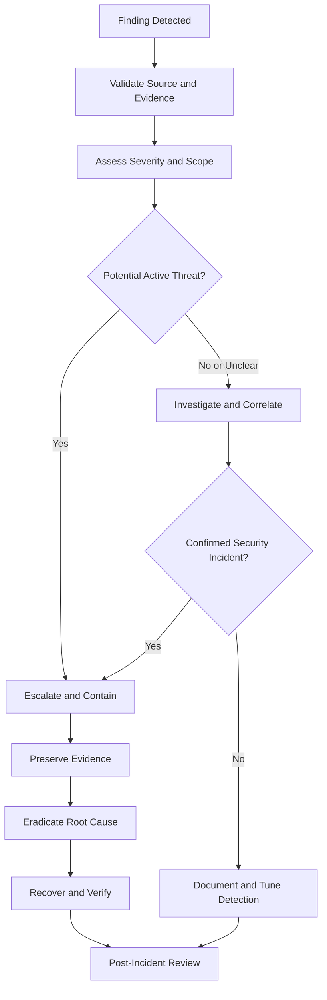

# 02- Security Findings and Incident Response

## Overview

AWS security findings identify potential threats, unauthorized activity, exposed resources, and deviations from approved security configurations. Incident response turns those findings into a controlled process for validation, containment, investigation, remediation, and recovery.

A finding is not necessarily proof of compromise. It is an input to an investigation that must consider the affected resource, identity, event history, business impact, and available evidence.

For backend engineering teams, effective incident response must protect application availability while limiting the impact of compromised credentials, excessive permissions, exposed data, and unauthorized infrastructure changes.

This document covers security finding triage, incident severity, investigation workflows, containment strategies, evidence preservation, recovery, and operational readiness.

## Security Findings and Their Sources

AWS security findings originate from different services and integrations. Each source provides a different view of the environment.

| Source | Primary purpose | Typical findings or evidence |
|---|---|---|
| Amazon GuardDuty | Threat detection | Suspicious API activity, unusual credential usage, potentially malicious behavior |
| AWS Security Hub | Centralized security findings and posture | Aggregated findings, control failures, security configuration issues |
| AWS Config | Configuration tracking and compliance evaluation | Noncompliant resources, configuration drift |
| AWS CloudTrail | API activity auditing | Actor identity, API operation, timestamp, resource, request context |
| Amazon CloudWatch | Operational monitoring | Error spikes, unusual traffic, application failures, alarm state changes |
| AWS WAF | Web application request filtering | Blocked requests, rate-based rule activity, suspicious request patterns |
| AWS IAM and KMS | Identity and cryptographic controls | Policy changes, authorization failures, key-policy modifications |

CloudTrail is primarily an audit source rather than a threat-detection engine. GuardDuty analyzes supported telemetry for threats, while Security Hub helps consolidate findings and posture information. CloudWatch supplies operational signals that can help establish impact and correlate application behavior.

The availability and detail of findings depend on enabled services, protection plans, configuration, account coverage, region, and event source.

## Finding Lifecycle

A finding should move through a documented lifecycle rather than being closed as soon as someone acknowledges it.



Recommended lifecycle states include:

- **New:** The finding has been received but not yet assessed.
- **Triaged:** An owner has reviewed the finding and assigned a priority.
- **Investigating:** Evidence is being collected to determine validity, scope, and impact.
- **Contained:** Immediate risk has been reduced, although the underlying issue may remain.
- **Remediating:** The root cause and affected resources are being addressed.
- **Resolved:** Recovery and security verification have completed.
- **Closed as non-incident:** Evidence supports a documented benign explanation or false positive.

Keep workflow state separate from the source service's native finding status. Updating a Security Hub or GuardDuty finding does not automatically establish that an incident has been remediated across all affected systems.

## Finding Triage and Prioritization

### Assess Severity

Prioritize findings according to potential impact and urgency, not severity labels alone.

Consider:

- **Asset criticality:** Is the affected resource production infrastructure, a customer database, or a security control?
- **Exposure:** Is the resource publicly accessible or reachable from an untrusted network?
- **Identity privileges:** Does the principal have administrative, cross-account, or sensitive data permissions?
- **Evidence confidence:** Is the finding supported by correlated events or a single ambiguous signal?
- **Exploitability:** Can an attacker realistically use the observed condition?
- **Business impact:** Could the event cause data exposure, service disruption, financial loss, or compliance violations?
- **Persistence:** Could the attacker retain access through new credentials, modified policies, or additional resources?

Example operational priority model:

| Priority | Typical conditions | Response expectation |
|---|---|---|
| Critical | Credible active compromise of highly privileged credentials, confirmed sensitive data exposure, or ongoing destructive activity | Immediate escalation and containment under the incident-response plan |
| High | Strong indicators of compromise, suspicious privileged API activity, or a critical control being disabled | Urgent investigation and risk reduction |
| Medium | Potentially unauthorized changes or significant configuration violations without confirmed active exploitation | Timely investigation and corrective action |
| Low | Limited-impact posture findings, informational events, or low-confidence signals | Scheduled review, tracking, and detection tuning |

These labels are an example internal classification scheme, not universal AWS severity definitions. Map source-specific severity values to the organization's incident policy.

### Validate the Finding

Before dismissing a finding or triggering disruptive remediation, verify:

1. The finding originated from the expected AWS account, region, and service.
2. The affected resource and principal exist and match the reported context.
3. The timestamp and activity details are consistent with the reported event.
4. The action corresponds to an approved deployment, maintenance operation, or automation workflow, if applicable.
5. CloudTrail, application logs, and related findings support or contradict the initial interpretation.
6. The resource's current state and recent configuration history have been checked.

Do not dismiss a finding solely because the activity came from an authorized account. Compromised credentials and overly permissive roles can be used by legitimate-looking principals.

## Inspecting Security Findings with AWS CLI

The following commands are read-only inspection operations. They require suitable permissions and should be run in the relevant region.

### Discover GuardDuty Detectors

```bash
aws guardduty list-detectors \
  --region <AWS_REGION>
```

This returns detector identifiers for the account and region. GuardDuty must be configured appropriately for the intended monitoring coverage.

### Retrieve GuardDuty Findings

```bash
aws guardduty list-findings \
  --detector-id <DETECTOR_ID> \
  --region <AWS_REGION>
```

The command returns finding identifiers. Retrieve the associated details:

```bash
aws guardduty get-findings \
  --detector-id <DETECTOR_ID> \
  --finding-ids <FINDING_ID> \
  --region <AWS_REGION>
```

Review the finding type, severity, affected resource, timestamps, and activity details. Use the returned evidence to guide further investigation rather than assuming the finding proves compromise.

### Query Active Security Hub Findings

```bash
aws securityhub get-findings \
  --region <AWS_REGION> \
  --filters '{"RecordState":[{"Value":"ACTIVE","Comparison":"EQUALS"}]}' \
  --max-results 50
```

This retrieves active findings for the selected region. Use supported pagination mechanisms when processing larger result sets.

For focused investigations, add filters for severity, resource identifiers, workflow status, or finding source as supported by the API. Security Hub aggregation and cross-region visibility must be configured according to the organization's requirements.

### Investigate CloudTrail Activity

Search for a relevant API operation within a defined time window:

```bash
aws cloudtrail lookup-events \
  --lookup-attributes AttributeKey=EventName,AttributeValue=PutRolePolicy \
  --start-time <START_TIME> \
  --end-time <END_TIME> \
  --region <AWS_REGION>
```

For an IAM policy-change investigation, inspect the event's principal, event time, source IP where available, request parameters, error details, and affected resource.

CloudTrail Event history covers management events for the preceding 90 days in a region. Data events and longer-term investigations may require configured trails, appropriate event selectors, or CloudTrail Lake.

### Inspect a Security Group

```bash
aws ec2 describe-security-groups \
  --group-ids <SECURITY_GROUP_ID> \
  --region <AWS_REGION>
```

Review ingress and egress rules, including source CIDRs, protocol, and port ranges. Confirm the rules against the intended architecture before making changes.

### Inspect a KMS Key

```bash
aws kms describe-key \
  --key-id <KEY_ID> \
  --region <AWS_REGION>
```

Use the output to verify the key ARN, state, key specification, and other metadata. If a finding concerns unauthorized key access or a policy change, inspect the relevant key policy and CloudTrail evidence as well.

## Investigation Workflow

A repeatable investigation should establish what happened, which identities and resources were involved, what impact occurred, and whether the threat remains active.

### Identify the Actor

Start with the principal and authentication context.

```bash
aws sts get-caller-identity
```

This identifies the caller associated with the credentials currently used by the CLI. It does not identify the principal responsible for a historical event; use the relevant CloudTrail event for that.

For historical activity, inspect:

- `userIdentity`, including assumed-role details where present.
- `eventSource` and `eventName`.
- `eventTime` and `awsRegion`.
- `sourceIPAddress` and `userAgent`, when available.
- `requestParameters` and `responseElements`, where recorded.
- Error information and request identifiers.
- Session and session-issuer details for assumed roles.

Interpret these fields in context. A user agent or source IP alone is not definitive proof of malicious activity.

### Establish the Timeline

Build a timeline using consistent timestamps and relevant identifiers.

| Evidence | Question answered |
|---|---|
| CloudTrail events | Which AWS API operations occurred, and under which principal? |
| GuardDuty findings | What suspicious behavior was detected? |
| Security Hub findings | Which related security or compliance issues are known? |
| AWS Config history | How did the resource configuration change? |
| Application logs | Which requests, operations, or business transactions were affected? |
| CloudWatch metrics | Did error rates, request volumes, or service health change? |
| Deployment records | Was the activity associated with an approved release or automation? |

Normalize timestamps to a common timezone and preserve original event timestamps. Account for ingestion delays and differences in telemetry availability.

### Determine Scope and Impact

Identify:

- All resources affected by the principal or configuration change.
- The permissions available to the compromised identity.
- Data that may have been accessed, modified, or deleted.
- Related identities, sessions, credentials, and trust relationships.
- Whether the attacker established persistence.
- Whether logging, monitoring, or security controls were modified.
- Whether the activity crossed account or regional boundaries.

Do not limit the investigation to the resource named in the initial finding. A compromised role may have access to other resources through identity policies, resource policies, or cross-account trust.

## Incident Containment

Containment reduces the attacker's ability to continue harmful activity while preserving enough evidence for investigation.

Choose actions according to the credential type, affected service, business impact, and incident severity.

| Situation | Potential containment action | Important consideration |
|---|---|---|
| Compromised IAM user access key | Deactivate the affected key and rotate or replace credentials | Verify whether other keys or credentials are also exposed |
| Suspected role-session compromise | Restrict new role assumptions and evaluate supported session-revocation controls | Previously issued temporary credentials may remain usable until expiration unless additional controls invalidate or deny their use |
| Unauthorized IAM policy change | Restore the approved policy and investigate related changes | Preserve the original policy and change evidence |
| Publicly exposed S3 data | Restrict unintended access and review resource and account-level controls | Assess whether the data was accessed before exposure was removed |
| Exposed application secret | Rotate the secret, update dependent workloads, and invalidate old credentials where supported | Coordinate rotation to avoid production outages |
| Suspicious network exposure | Remove unintended ingress or egress paths through a controlled change | Confirm legitimate traffic and dependent systems remain functional |
| KMS key misuse | Restrict the affected access path and investigate key-policy changes | Avoid disabling a key without assessing dependencies and recovery requirements |

### Containment Principles

- Preserve evidence before making destructive changes, when doing so does not materially increase active risk.
- Use the narrowest effective control that stops the suspected activity.
- Escalate immediately when sensitive data, privileged credentials, or critical production systems may be affected.
- Coordinate actions across application, infrastructure, security, and incident-command teams.
- Record every containment action, including its operator, timestamp, justification, and verification.
- Verify that containment worked and that the attacker cannot simply use an alternative credential or access path.

Containment is not the same as remediation. Removing one malicious policy statement may stop an immediate attack but leave exposed credentials or other persistence mechanisms intact.

## Credential Compromise and Persistence

Credential compromise requires investigation beyond the original secret or key.

### Investigation Checklist

- [ ] Identify the credential type and affected principal.
- [ ] Determine the likely exposure window.
- [ ] Review CloudTrail activity for unexpected API operations.
- [ ] Inspect IAM policy, trust-policy, and credential changes.
- [ ] Look for unexpected role assumptions and cross-account activity.
- [ ] Review access to secrets, KMS keys, storage, and databases.
- [ ] Determine whether credentials were copied into source control, CI logs, application logs, or artifacts.
- [ ] Rotate or revoke affected credentials using supported mechanisms.
- [ ] Verify that dependent applications use the replacement credentials.
- [ ] Review related resources for persistence and unauthorized modifications.

### Temporary Role Credentials

AWS STS credentials have a bounded lifetime, but their existence does not guarantee immediate revocation when an incident occurs.

Potential containment options include:

- Preventing additional role assumptions by changing the relevant trust or identity controls.
- Applying a carefully scoped explicit deny where supported and appropriate.
- Using supported session-revocation mechanisms, such as role-policy changes that deny older sessions based on session issuance context.
- Restricting the affected principal or resource while preserving legitimate production access.

These measures have different semantics and may affect legitimate sessions. Validate the selected mechanism against the actual authorization path and role-session context.

## Evidence Preservation

Evidence must remain useful, accessible to authorized investigators, and protected against unauthorized modification.

Preserve:

- Original finding JSON and source identifiers.
- Relevant CloudTrail events and timestamps.
- Security Hub and GuardDuty finding details.
- Before-and-after resource configuration.
- Application and infrastructure logs.
- Relevant deployment records and change approvals.
- Containment actions and operator notes.
- A record of evidence retrieval, handling, and access where required by policy.

Store evidence in approved, access-controlled locations with suitable encryption and retention. Use centralized audit storage when available and restrict workload administrators from deleting or modifying incident evidence.

Avoid placing secrets, access keys, session tokens, or unnecessary personal data into incident tickets. Redact sensitive fields while retaining the metadata required for investigation.

For high-impact incidents, follow the organization's legal, compliance, and forensic evidence-handling procedures.

## Remediation and Recovery

After containment, remove the underlying cause and restore service operation safely.

### Remediation

Typical corrective actions include:

- Removing excessive IAM permissions.
- Correcting trust policies and cross-account relationships.
- Rotating exposed credentials and updating dependent services.
- Restoring approved security group and resource-policy configurations.
- Correcting KMS key policies or grants after reviewing dependent workloads.
- Restoring audit collection and security monitoring.
- Patching vulnerable applications or dependencies.
- Removing unauthorized resources, credentials, or persistence mechanisms.

Avoid deleting suspicious resources before collecting the evidence required to understand their purpose and impact, unless leaving them active creates unacceptable risk.

### Recovery Verification

Before closing the incident, verify:

- The original attack path is no longer available.
- Affected credentials and sessions are handled according to the containment plan.
- Application health and business functionality are restored.
- Legitimate access remains available without broad permission grants.
- Encryption, network, and audit controls are functioning.
- Monitoring rules detect relevant follow-up activity.
- The root cause has been documented and corrective work tracked.

For a Django or FastAPI service, recovery testing should include application authentication, service-to-service access, secret retrieval, database connectivity, and expected authorization behavior.

## Security Automation

Automation can reduce response time for known, bounded scenarios. It should not replace investigation or human judgment for ambiguous, high-impact events.

A common architecture routes selected findings through EventBridge to Lambda or an incident-management integration.

```mermaid
flowchart TD
    A["GuardDuty or Security Hub Finding"] --> B["EventBridge Rule"]
    B --> C["Validate Event and Deduplicate"]
    C --> D{"Approved Automated Action?"}
    D -- "Yes" --> E["Execute Scoped Response"]
    D -- "No" --> F["Notify Incident Responder"]
    E --> G["Record Action and Result"]
    F --> H["Manual Investigation"]
    G --> I["Verify Containment"]
    H --> I
```



Appropriate automation candidates include:

- Creating an incident ticket for a high-severity finding.
- Enriching a finding with resource ownership and deployment metadata.
- Notifying the responsible team.
- Applying a preapproved, narrowly scoped containment action for a well-defined event.
- Recording the response action and its result.

### Automation Safeguards

- Validate the source, event type, account, region, and resource identity.
- Make actions idempotent so duplicate events do not cause repeated disruption.
- Use a dedicated execution role with only the required permissions.
- Configure supported retries and dead-letter handling.
- Log decisions and outcomes without exposing credentials or sensitive payloads.
- Require approval for destructive or broad-impact actions where appropriate.
- Test false positives, duplicate events, partial failures, and rollback procedures.
- Monitor the automation itself for errors and unexpected behavior.

Never attach administrator permissions to an incident-response Lambda merely to simplify implementation.

## Operational Readiness

Incident response is more reliable when roles, procedures, and communication paths are defined before an incident occurs.

### Responsibilities

| Role | Responsibility |
|---|---|
| Incident commander | Coordinates response, prioritization, decisions, and communications |
| Security responder | Investigates findings, evaluates threat activity, and recommends containment |
| Platform or cloud engineer | Implements infrastructure containment and recovery |
| Application owner | Evaluates application impact, credentials, and business functionality |
| Compliance or legal contact | Advises on reporting, evidence preservation, and regulatory obligations when required |

One person may hold multiple roles in smaller teams, but ownership and escalation must remain explicit.

### Readiness Checklist

- [ ] Incident severity levels and escalation paths are documented.
- [ ] Responders can access audit evidence without relying on compromised workload identities.
- [ ] Credential rotation and revocation procedures have been tested.
- [ ] Emergency IAM and network containment procedures are documented.
- [ ] Centralized logs and findings have appropriate retention and access controls.
- [ ] Security automation has least-privilege permissions and tested failure handling.
- [ ] Recovery procedures cover application dependencies and encrypted resources.
- [ ] Incident exercises validate response time, evidence collection, and communication.
- [ ] Post-incident actions have owners, priorities, and completion criteria.

## Common Mistakes

| Mistake | Consequence | Correct approach |
|---|---|---|
| Treating every finding as confirmed compromise | Unnecessary disruption and poor prioritization | Validate the finding using independent evidence |
| Dismissing findings because the principal is known | Compromised credentials may appear legitimate | Check the actual session, activity, and expected behavior |
| Revoking one credential without reviewing related access | An attacker may retain another path | Investigate associated keys, sessions, roles, and persistence |
| Deleting resources before collecting evidence | Loss of forensic context | Preserve relevant state before destructive remediation when safe |
| Assuming temporary credentials can always be revoked immediately | Continued unauthorized activity may go unnoticed | Evaluate session expiry and supported revocation controls |
| Automating broad remediation from a single signal | False positives can cause production outages | Use scoped actions, validation, idempotency, and approval thresholds |
| Closing an incident after containment alone | Root cause or persistence may remain | Complete eradication, recovery verification, and preventive follow-up |
| Failing to test the alerting pipeline | Important findings may never reach responders | Monitor delivery failures and run end-to-end exercises |

## Key Takeaways

- Treat security findings as investigation signals; validate them using identity, resource, configuration, and audit evidence.
- Prioritize incidents according to impact, exposure, confidence, and urgency rather than relying on a finding's severity label alone.
- Contain threats with scoped actions while accounting for temporary credentials, alternate access paths, and production dependencies.
- Preserve audit evidence, investigate persistence, and verify recovery before closing an incident.
- Use least-privilege response automation, tested escalation procedures, and post-incident improvements to strengthen long-term security.
```