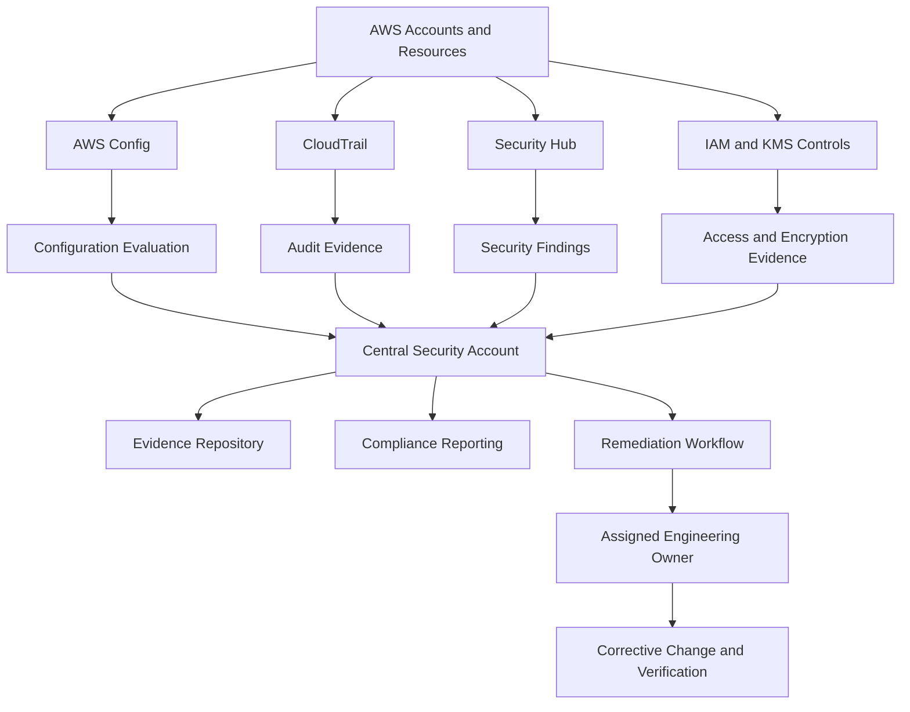
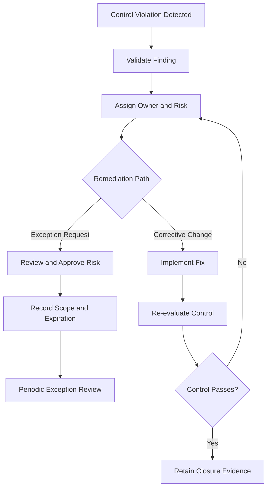

# 03- Compliance Monitoring and Audit Readiness

## Overview

AWS compliance monitoring is the continuous evaluation of cloud resources, identity permissions, security configurations, and operational controls against defined organizational and regulatory requirements.

Audit readiness means being able to demonstrate that required controls are implemented, operate effectively, and are supported by reliable, traceable evidence. Enabling encryption, restricting IAM permissions, or activating CloudTrail is only part of the process. Engineering teams must also validate coverage, detect configuration drift, document exceptions, assign remediation ownership, and preserve evidence for the required retention period.

For backend engineers, compliance monitoring connects AWS infrastructure security with application configuration, CI/CD pipelines, access governance, operational monitoring, and incident response.

A production-ready compliance process should provide:

- Continuous evaluation of security configurations and control violations.
- Traceability for infrastructure, identity, and permission changes.
- Repeatable verification of security requirements.
- Accountable remediation with risk-based deadlines.
- Protected, searchable, and appropriately retained audit evidence.
- Consistent reporting across AWS accounts, regions, and environments.

Compliance tooling supports an assessment; it does not independently certify that an environment satisfies a regulatory framework. The organization must map applicable requirements to implemented controls, evidence, and assessment procedures.

## Compliance Monitoring Architecture

A practical architecture combines preventive controls, configuration evaluation, API auditing, centralized findings, and evidence management.



Separate three responsibilities:

| Responsibility | Purpose | Typical implementation |
|---|---|---|
| Control enforcement | Prevent or restrict unsafe operations | IAM, SCPs, KMS key policies, security groups, resource policies |
| Continuous evaluation | Detect configuration drift and violations | AWS Config rules, Security Hub controls, CloudWatch alarms |
| Evidence and assurance | Demonstrate control implementation and operation | CloudTrail events, configuration history, access reviews, deployment approvals, test results |

These responsibilities complement one another. A preventive policy does not prove that all relevant resources are compliant, and a compliance finding does not necessarily indicate an active security incident.

## Define Compliance Control Objectives

Start with explicit, testable control objectives rather than enabling every available security check without a defined purpose.

Examples include:

- Production workloads must use approved encryption settings.
- Privileged access must follow defined authentication and authorization requirements.
- Public exposure must be explicitly approved and documented.
- Required AWS API activity must be recorded and retained.
- Application secrets must not be embedded in source code or deployment artifacts.
- Infrastructure changes must be traceable to an approved deployment or operator.
- Security findings must have accountable owners and remediation targets.

Map each control objective to its enforcement mechanism, evaluation method, evidence source, and owner.

| Control objective | Enforcement or implementation | Validation evidence |
|---|---|---|
| Least-privilege access | IAM policies, permission boundaries, SCPs, resource policies | Policy reviews, access tests, CloudTrail events |
| Encryption at rest | Service encryption settings and KMS policies | Resource configuration, key metadata, control evaluations |
| Auditability | CloudTrail and appropriate event selectors | Trail configuration, delivery status, retained events |
| Network exposure control | Security groups, routing, network ACLs, private connectivity | Resource configuration, AWS Config evaluations |
| Secret protection | Secrets Manager, Parameter Store, workload identity | Secret metadata, IAM permissions, rotation results |
| Change accountability | CI/CD identity controls and change management | CloudTrail events, deployment records, approvals |
| Finding remediation | Security Hub, AWS Config, tracked workflows | Finding status, assigned owner, closure evidence |

The presence of a security service is not proof of control effectiveness. For example, an enabled CloudTrail trail does not establish that required data events are recorded or that retained evidence is protected from unauthorized modification.

## AWS Config for Continuous Compliance

AWS Config records supported resource configurations and evaluates them against configured rules or conformance packs.

Use it to detect configuration drift, identify noncompliant resources, and validate defined security baselines.

### Config Rules

A Config rule evaluates specific resource properties or configuration conditions. Examples include checks for:

- Publicly accessible resources.
- Encryption configuration.
- Security group ingress restrictions.
- Required resource settings.
- Selected operational and security baselines.

Managed rules cover specific predefined checks. Custom rules can address requirements that are not adequately expressed by available managed rules.

Rule coverage is not universal. Verify the resource types, properties, and conditions that a rule actually evaluates.

### Inspect Config Rules

```bash
aws configservice describe-config-rules \
  --region <AWS_REGION>
```

This lists configured rules. Review their identifiers, scope, source, and parameters to establish whether the intended control is evaluated.

### Inspect Compliance Results

```bash
aws configservice describe-compliance-by-config-rule \
  --region <AWS_REGION>
```

This returns compliance information for configured rules.

For resource-level evaluation details:

```bash
aws configservice get-compliance-details-by-config-rule \
  --config-rule-name <CONFIG_RULE_NAME> \
  --region <AWS_REGION>
```

Review the affected resource, compliance result, and available annotation. A noncompliant result indicates that a resource violates the rule's evaluation criteria; it does not independently establish exploitability or business impact.

### Configuration History

Configuration history helps establish how a resource's observed configuration changed over time. Availability depends on Config recording coverage and the resource type.

For audit investigations, correlate configuration history with CloudTrail events and approved change records:

- Config helps establish the resource configuration observed.
- CloudTrail helps identify the API activity associated with a change.
- Change-management records help establish whether the activity was approved.

### Production Considerations

- Configure recording for the required resource types.
- Validate regional and account coverage.
- Monitor recording and evaluation failures.
- Test custom rules and maintain their execution permissions.
- Account for evaluation delays when designing remediation deadlines.
- Review recording, evaluation, aggregation, and storage costs.

Use Config to validate explicit control objectives rather than assuming a default set of rules establishes comprehensive compliance.

## AWS Security Hub for Compliance Visibility

AWS Security Hub centralizes supported security findings and posture information. Its coverage depends on enabled capabilities, standards, controls, integrations, and account configuration.

Use it to:

- Consolidate findings from supported AWS security services.
- Evaluate selected security controls.
- Review findings by severity and affected resource.
- Track posture across configured accounts and regions.
- Route findings into remediation and reporting workflows.

### Inspect Active Findings

```bash
aws securityhub get-findings \
  --region <AWS_REGION> \
  --filters '{"RecordState":[{"Value":"ACTIVE","Comparison":"EQUALS"}]}' \
  --max-results 50
```

Use supported pagination mechanisms when processing larger result sets. For focused reviews, apply filters for severity, resource identifiers, finding source, or workflow status as appropriate.

### Interpret Findings Correctly

For each significant finding, identify:

- The control or security concern involved.
- The affected account, resource, and region.
- The finding source and timestamps.
- The expected configuration or behavior.
- The reason the current state violates the requirement.
- The remediation owner and target date.
- The evidence required to demonstrate correction.

A Security Hub finding is not automatically equivalent to a failed regulatory control. Map findings to internal control objectives and applicable assessment requirements explicitly.

## CloudTrail and Audit Evidence

CloudTrail records supported AWS API activity and provides evidence of actions performed by users, assumed roles, and AWS services.

Relevant events can include:

- IAM policy and trust-policy changes.
- Role assumptions and other identity operations.
- Security group and resource-policy modifications.
- KMS key-policy changes.
- Changes to logging and security configurations.
- Administrative operations affecting sensitive resources.

### Inspect Trail Configuration

```bash
aws cloudtrail describe-trails \
  --region <AWS_REGION>
```

Review the configured destinations and relevant trail settings to determine whether the required accounts, regions, and event categories are covered.

Inspect trail status:

```bash
aws cloudtrail get-trail-status \
  --name <TRAIL_ARN_OR_NAME> \
  --region <AWS_REGION>
```

Review logging state and delivery errors. Successful delivery does not prove that all required event categories are recorded.

### Search Audit Events

```bash
aws cloudtrail lookup-events \
  --lookup-attributes AttributeKey=EventName,AttributeValue=PutBucketPolicy \
  --start-time <START_TIME> \
  --end-time <END_TIME> \
  --region <AWS_REGION>
```

This searches management event history for bucket policy changes. Review the principal, timestamp, resource context, request parameters, and operation outcome.

CloudTrail Event history provides 90 days of management events in a region. Longer retention, centralized collection, data-event coverage, and advanced queries require appropriate trail or CloudTrail Lake configuration.

### Protect Audit Evidence

A production audit architecture should:

- Centralize logs in a dedicated account where appropriate.
- Restrict write and delete permissions to authorized administrators.
- Apply suitable encryption and retention controls.
- Use supported log-file integrity validation where required.
- Monitor delivery failures and unexpected logging configuration changes.
- Preserve access for authorized auditors and incident responders.
- Retain evidence for the applicable policy or assessment period.

Storing logs in S3 does not automatically make them immutable. Access policies, deletion permissions, retention configuration, and required immutability controls must be configured and verified separately.

## IAM Governance and Access Reviews

IAM governance establishes who can access AWS resources, which operations they can perform, and how those permissions are reviewed over time.

### Identity and Permission Controls

Review:

- Human identities and privileged access.
- Workload roles used by EC2, Lambda, containers, and CI/CD.
- Trust policies and cross-account relationships.
- Identity-based and resource-based policies.
- Permissions boundaries and organization-level SCPs.
- Long-lived credentials and unused access keys.
- Required MFA and temporary-credential protections.

### Inspect IAM Identities

List IAM users:

```bash
aws iam list-users
```

List roles:

```bash
aws iam list-roles
```

Inspect a role and its trust policy:

```bash
aws iam get-role \
  --role-name <ROLE_NAME>
```

Inspect attached managed policies:

```bash
aws iam list-attached-role-policies \
  --role-name <ROLE_NAME>
```

These commands provide identity inventory and policy attachment information. They do not calculate all effective permissions across every applicable policy layer.

In environments using federation and workload roles, IAM users represent only part of the identity landscape. Include federated principals, role trust relationships, and external access paths in the review.

### Access Review Process

1. Inventory human identities, workload roles, privileged principals, and cross-account trust relationships.
2. Identify permissions that exceed documented workload requirements.
3. Review unused or obsolete credentials and access paths.
4. Validate trust policies and external access requirements.
5. Confirm that privileged access follows approved authentication requirements.
6. Assign owners to remediation actions.
7. Test legitimate application workflows after permission changes.
8. Retain review decisions and supporting evidence.

For example, a backend service that reads one secret and writes to a specific S3 prefix should not require broad administrative access to all secrets and buckets.

## Encryption and KMS Key Governance

Encryption compliance includes encryption at rest, transport security, key authorization, key lifecycle, and the evidence used to validate these controls.

### Encryption Control Areas

| Area | Validation |
|---|---|
| S3 | Encryption settings, bucket policies, public-access controls |
| EBS | Volume and snapshot encryption configuration |
| RDS | Database and snapshot encryption configuration |
| CloudWatch Logs | Log group encryption configuration where required |
| KMS | Key state, key policy, grants, rotation configuration, administrative permissions |
| Application transport | TLS configuration, certificate lifecycle, secure endpoints |

The correct control depends on the service and resource type. Verify the supported configuration and the precise control requirement instead of assuming all AWS services use the same encryption model.

### Inspect KMS Metadata

```bash
aws kms describe-key \
  --key-id <KEY_ID> \
  --region <AWS_REGION>
```

Inspect the default key policy:

```bash
aws kms get-key-policy \
  --key-id <KEY_ID> \
  --policy-name default \
  --region <AWS_REGION>
```

These are read-only inspection operations. Review key state, ownership, policy permissions, and compliance with the applicable requirements.

A successful metadata query does not prove that an application can encrypt or decrypt data. Access may also depend on IAM permissions, key policies, grants, encryption context, and the service's authorization path.

### Key Governance Practices

- Restrict key administration and key usage to appropriate identities.
- Separate key administration from routine data access where required.
- Review key policies and grants periodically.
- Validate rotation settings against the applicable key type and control requirements.
- Monitor key-policy changes and unexpected cryptographic operations.
- Document dependencies before disabling or scheduling deletion of a key.
- Retain evidence of key configuration and approved exceptions.

Key-policy changes can affect multiple workloads. Remediation must account for encrypted data, dependent services, recovery requirements, and the risk of service disruption.

## Secrets Management and Configuration Compliance

Secrets should be stored in approved secret-management systems rather than source code, container images, build logs, or committed configuration files.

AWS Secrets Manager and Systems Manager Parameter Store provide different capabilities. Select the service according to requirements for rotation, encryption, versioning, access control, and operational cost.

### Inspect Secrets Manager Metadata

```bash
aws secretsmanager describe-secret \
  --secret-id <SECRET_ID> \
  --region <AWS_REGION>
```

This retrieves metadata and rotation configuration without requesting the secret value.

For Parameter Store:

```bash
aws ssm describe-parameters \
  --region <AWS_REGION>
```

This lists parameter metadata according to the caller's permissions. It does not retrieve parameter values.

### Compliance Considerations

- Enforce least-privilege secret access.
- Prevent credentials from entering source control and deployment artifacts.
- Validate rotation configuration and execution results.
- Monitor secret retrieval and relevant permission changes.
- Protect encryption keys used by secret-management services.
- Ensure application logs and CI/CD output do not expose secret values.
- Test rotation against dependent services before enabling it in production.

Rotation configuration alone does not prove successful rotation. Verify execution results, the current secret version, and dependent application behavior.

## Network and Resource Configuration Compliance

Network controls help demonstrate that workloads are exposed only through approved paths.

Review:

- Security group ingress and egress.
- Network ACLs and route tables.
- Public IP assignments and internet-facing resources.
- VPC endpoint policies and private connectivity.
- Public API exposure and AWS WAF configuration.
- Resource policies granting cross-account or public access.

Inspect security groups:

```bash
aws ec2 describe-security-groups \
  --region <AWS_REGION>
```

For a targeted review, specify the relevant security group IDs. Review source CIDRs, ports, protocols, and whether each rule matches the approved architecture.

Broad internet ingress may be appropriate for a deliberately public endpoint but inappropriate for a database or internal service. Compliance checks should distinguish approved public services from unintended exposure.

Use AWS Config rules and relevant Security Hub controls to detect selected configuration violations. Validate findings against architecture requirements and approved exceptions before remediation.

## Evidence Collection and Audit Readiness

Audit evidence should demonstrate both control design and control operation.

Examples include:

- AWS Config evaluation results.
- Security Hub findings and control status.
- CloudTrail events and trail configuration.
- IAM policies and access-review records.
- KMS metadata and policy reviews.
- Deployment approvals and change records.
- Secret rotation status and verification records.
- Security monitoring and incident-response test results.

### Evidence Quality

High-quality evidence should be:

- **Relevant:** Directly linked to a specific control objective.
- **Traceable:** Associated with an account, resource, time period, and responsible owner.
- **Current:** Collected within the required assessment window.
- **Reliable:** Obtained from a trustworthy source with appropriate integrity protections.
- **Complete:** Includes the scope and context needed to interpret the result.
- **Protected:** Available only to authorized reviewers and retained according to policy.

A dashboard screenshot may be useful, but it may not establish configuration history, complete coverage, or the state of a resource during the assessment period. Preserve source records and query results when required.

### Evidence Repository Design

Organize evidence by control identifier, account, environment, assessment period, and evidence type.

```text
compliance-evidence/
    <ASSESSMENT_PERIOD>/
        <CONTROL_ID>/
            <ACCOUNT_ID>/
                configuration/
                audit-events/
                access-reviews/
                change-records/
                verification-results/
```

This is a logical organization example, not a required AWS directory structure. An S3-based repository should use suitable bucket policies, encryption, versioning or retention controls where required, and narrowly scoped access permissions.

Avoid storing secret values or unnecessary customer data in evidence packages. Redact sensitive fields while preserving the information needed to demonstrate the control.

## Compliance Exceptions and Remediation Tracking

Not every finding can be resolved immediately. A documented exception process prevents temporary deviations from becoming invisible, permanent weaknesses.

Each exception should include:

- Control identifier and affected resources.
- Reason for the deviation.
- Business and security risk.
- Compensating controls, if applicable.
- Approving authority.
- Responsible owner.
- Expiration or review date.
- Remediation plan and status.

An exception records an explicitly accepted deviation; it does not prove that the underlying control is satisfied.

### Remediation Lifecycle



Set remediation deadlines according to risk and organizational policy. Public exposure of sensitive data and excessive privileged access require a different response priority from a low-impact documentation gap.

## CI/CD and Infrastructure-as-Code Compliance

Security requirements should be validated before deployment and after resources are created.

A production pipeline can combine:

- Static analysis of infrastructure definitions.
- Policy checks for IAM and resource exposure.
- Secret scanning.
- Dependency and container image scanning.
- Deployment identity restrictions.
- Post-deployment configuration evaluation.
- Approval gates for sensitive changes.

For Terraform or CloudFormation deployments, enforce security requirements through reusable modules, policy checks, code review, and restricted deployment permissions. Use AWS Config and other supported runtime controls to detect drift after deployment.

### Deployment Identity Governance

- Prefer short-lived credentials or supported workload federation over long-lived access keys.
- Separate deployment roles by environment and responsibility.
- Restrict production deployment permissions.
- Prevent deployment identities from disabling required audit collection without explicit authorization.
- Record infrastructure changes through CloudTrail and retain pipeline approval evidence.
- Validate rollback procedures for security-related configuration changes.

Static checks and runtime checks serve different purposes. A template may pass validation while runtime drift, external changes, or unsupported resource configurations introduce violations later.

## Reporting and Continuous Review

Compliance dashboards should help teams identify risk and incomplete work rather than simply display counts.

| Metric | Purpose |
|---|---|
| Control compliance rate | Tracks the proportion of evaluated resources or controls meeting requirements |
| High-risk open findings | Highlights unresolved security exposure |
| Mean time to remediate | Measures how quickly violations are corrected |
| Exception age | Identifies accepted deviations requiring renewed review |
| Evidence freshness | Indicates whether required evidence is current |
| Audit coverage | Tracks required accounts, regions, resources, and event categories |
| Reopened findings | Identifies ineffective or incomplete remediation |
| Logging and evaluation gaps | Detects missing telemetry or failed control evaluation |

Define metric scope precisely. A compliance percentage is misleading if required resources are not evaluated or unsupported resources are silently excluded.

Review metrics alongside actual findings, control coverage, exceptions, and remediation outcomes. Use automated reports for visibility, but preserve the source evidence required to validate the reported state.

## Common Mistakes

| Mistake | Impact | Prevention |
|---|---|---|
| Assuming enabled security services guarantee compliance | Required controls may remain unimplemented or unmonitored | Map each requirement to explicit controls and evidence |
| Treating a passing Config rule as proof of overall security | The rule may evaluate only a narrow property | Review rule scope, applicability, and limitations |
| Collecting evidence without timestamps or scope | Results may not demonstrate the assessed environment or period | Record account, region, resource, collection time, and control identifier |
| Retaining audit logs without restricting deletion | Evidence may be altered or lost | Separate log administration and apply appropriate integrity and retention controls |
| Treating all Security Hub findings as regulatory violations | Findings may not map directly to a particular requirement | Map findings to internal control objectives and assessment criteria |
| Ignoring exceptions after approval | Temporary deviations can persist indefinitely | Assign owners, expiration dates, and periodic reviews |
| Relying exclusively on pre-deployment checks | Runtime drift can introduce violations | Combine pipeline checks with runtime evaluation |
| Treating secret rotation settings as proof of successful rotation | Applications may still use expired or exposed credentials | Verify rotation execution and dependent workload behavior |
| Optimizing compliance metrics by excluding difficult resources | Dashboards can hide meaningful risk | Track evaluation coverage and document unsupported resources |
| Making broad permission changes to pass a control | Security exposure can increase while one finding is cleared | Apply the narrowest change and verify effective permissions |

## Audit Readiness Checklist

### Governance and Scope

- [ ] Applicable control requirements and assessment scope are documented.
- [ ] Account, region, resource, and environment coverage is known.
- [ ] Control owners and remediation responsibilities are assigned.
- [ ] Exceptions have documented risk acceptance and review dates.

### Identity and Access

- [ ] Privileged identities and workload roles have been reviewed.
- [ ] IAM policies and cross-account trust relationships are justified.
- [ ] Required MFA and privileged-access protections are validated.
- [ ] Obsolete credentials and unnecessary permissions are addressed.

### Configuration and Data Protection

- [ ] AWS Config records the required resource types.
- [ ] Relevant compliance rules and Security Hub controls are enabled.
- [ ] Encryption and KMS configurations meet defined requirements.
- [ ] Network exposure and public-access settings have been reviewed.
- [ ] Secrets storage and rotation controls have been verified.

### Audit Evidence

- [ ] CloudTrail coverage and delivery status have been verified.
- [ ] Required data events and regional coverage have been assessed.
- [ ] Audit logs have suitable access restrictions and retention.
- [ ] Evidence is traceable, current, complete, and protected.
- [ ] Change approvals and access-review records are available.

### Operations and Remediation

- [ ] High-risk findings have assigned owners and deadlines.
- [ ] Exception records are current and periodically reviewed.
- [ ] CI/CD controls validate sensitive infrastructure changes.
- [ ] Monitoring gaps and failed evaluations generate actionable alerts.
- [ ] Remediation has been verified against the original control objective.

## Key Takeaways

- Compliance monitoring requires explicit control objectives, continuous evaluation, accountable remediation, and reliable evidence; enabling security services alone is insufficient.
- AWS Config, Security Hub, and CloudTrail provide complementary configuration, security-posture, and audit capabilities.
- Protect audit evidence through controlled access, appropriate retention, integrity safeguards, and traceable collection procedures.
- Integrate compliance checks into CI/CD and runtime monitoring to detect both deployment-time weaknesses and subsequent configuration drift.
- Treat exceptions, evidence freshness, evaluation coverage, and remediation verification as ongoing governance responsibilities.