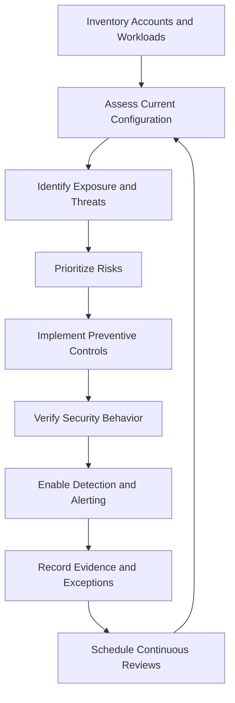

# 04- Security Hardening Checklist

## Overview

AWS security hardening is the systematic process of reducing attack surfaces, enforcing least privilege, protecting sensitive data, and validating security controls across cloud infrastructure and backend applications.

A hardening checklist converts security requirements into verifiable controls. It supports production-readiness reviews, periodic security assessments, compliance evidence collection, and incident prevention.

For backend systems built with Python, Django, FastAPI, PostgreSQL, Redis, Celery, Docker, and AWS managed services, security must cover the complete application lifecycle: identity provisioning, deployment, runtime access, data storage, monitoring, and recovery.

This document provides a practical checklist for engineering teams operating AWS workloads. It complements detailed documentation on IAM, encryption, network security, security monitoring, incident response, and compliance.

### Scope

- AWS account and organization security.
- IAM identities, policies, roles, and privileged access.
- Temporary credentials and workload identities.
- Network boundaries and public API exposure.
- Encryption, KMS, and data protection.
- Secrets management and credential rotation.
- EC2, Lambda, S3, RDS, API Gateway, and container workloads.
- CI/CD security and deployment controls.
- Logging, detection, compliance, and incident response.

## Security Hardening Principles

| Principle | Implementation | Verification |
|---|---|---|
| Least privilege | Grant only necessary actions on required resources | Review policies and effective access |
| Defense in depth | Combine identity, network, application, and data controls | Test each security layer independently |
| Secure by default | Deny unnecessary access and use restrictive baseline configurations | Validate baseline policies and resource settings |
| Zero trust | Authenticate and authorize each access path | Review identities, resource policies, and service boundaries |
| Short-lived access | Prefer temporary credentials and managed identities | Inspect credential sources and role-assumption patterns |
| Continuous validation | Detect configuration drift and policy violations | Review AWS Config evaluations and security findings |
| Evidence preservation | Centralize and protect security logs | Verify delivery, retention, and access restrictions |
| Incident readiness | Prepare tested containment and recovery procedures | Conduct incident-response exercises |

A configured control is not necessarily an effective control. Verification must demonstrate that it works, that failures are detected, and that an accountable owner maintains it.

## Security Hardening Workflow



### Risk Prioritization

Prioritize findings using business impact, exploitability, exposure, and workload criticality.

| Priority | Example | Response |
|---|---|---|
| Critical | Confirmed account compromise, active credential abuse, public exposure of highly sensitive data | Initiate incident response and containment immediately |
| High | Public administrative interfaces, excessive workload permissions, critical monitoring gaps | Remediate urgently under the organization's security process |
| Medium | Unused permissions, incomplete evidence retention, weak rotation procedures | Assign an owner and remediation deadline |
| Low | Documentation gaps or low-impact configuration inconsistencies | Address through planned hardening work |

These categories are illustrative. Follow organizational incident policies and applicable regulatory requirements when determining severity and deadlines.

## Account and Organization Security

### Preventive Controls

- [ ] Use AWS Organizations to establish controlled account boundaries.
- [ ] Separate production, development, testing, security tooling, and centralized logging where appropriate.
- [ ] Avoid deploying ordinary application workloads into the Organizations management account.
- [ ] Apply organization-level guardrails through service control policies (SCPs).
- [ ] Restrict who can leave the organization or modify security governance.
- [ ] Protect root-user access with MFA and appropriate recovery controls.
- [ ] Remove unused root-user access keys and never use root for routine operations.
- [ ] Maintain current security, billing, and operational contacts.
- [ ] Establish procedures for provisioning, reviewing, and decommissioning accounts.
- [ ] Review enabled AWS Regions and restrict unwanted Regions where appropriate.
- [ ] Configure budgets and billing alerts to help identify unexpected usage.
- [ ] Protect centralized logging and security accounts from routine workload administration.

### Organization-Level Guardrails

SCPs define the maximum permissions available to affected principals in member accounts. They do not grant permissions and do not replace IAM policies.

Use SCPs to restrict high-risk operations, such as disabling mandatory security services or changing protected logging infrastructure.

Before deploying a restrictive SCP:

1. Identify affected accounts, organizational units, and principals.
2. Test required deployment, support, and recovery workflows.
3. Confirm that incident responders retain necessary access.
4. Roll out gradually and monitor denied operations.
5. Maintain a documented rollback procedure.

Do not assume SCPs apply to the management account in the same way they apply to member accounts. Validate the exact scope of each organization-level control.

### Root User Verification

The following command is read-only:

```bash
aws iam get-account-summary \
  --query 'SummaryMap.AccountAccessKeysPresent' \
  --output text
```

Interpretation:

- `0`: No root access keys are present.
- `1`: Root access keys exist and require investigation.

This command does not verify root MFA, login activity, or the complete root-user security posture. Review those controls separately.

## IAM and Access Management

### Human Access

- [ ] Use IAM Identity Center or an approved federated identity provider for workforce access.
- [ ] Require MFA for privileged access and follow the organization's authentication policy.
- [ ] Use distinct permission sets or roles for read-only, development, production operations, and administration.
- [ ] Avoid long-lived IAM user access keys for human users.
- [ ] Remove inactive identities, credentials, and obsolete permissions.
- [ ] Review privileged access periodically and after role or team changes.
- [ ] Require approval and auditing for sensitive administrative operations.
- [ ] Protect emergency access paths and test them periodically.
- [ ] Restrict the ability to create access keys and modify IAM policies.

### Workload Access

- [ ] Assign a dedicated IAM role to each workload that requires AWS access.
- [ ] Use EC2 instance profiles for EC2 applications.
- [ ] Use Lambda execution roles for Lambda functions.
- [ ] Use ECS task roles for ECS applications and appropriate workload identities on other supported platforms.
- [ ] Avoid sharing a broad runtime role across unrelated services.
- [ ] Restrict actions to required APIs and resource ARNs.
- [ ] Use policy conditions where supported and appropriate.
- [ ] Separate deployment permissions from runtime application permissions.
- [ ] Restrict `iam:PassRole` to approved roles.
- [ ] Review permissions that allow IAM policy modification, role creation, or role assumption.
- [ ] Remove unused roles and obsolete trust relationships.

### IAM Policy Review

- [ ] Inspect identity-based and resource-based policies.
- [ ] Investigate wildcard actions and resources.
- [ ] Review permissions such as `iam:CreatePolicyVersion`, `iam:AttachRolePolicy`, `iam:PassRole`, and `sts:AssumeRole`.
- [ ] Check for privilege-escalation paths rather than reviewing only direct administrator policies.
- [ ] Validate trust policies for unexpected principals.
- [ ] Restrict cross-account trust to approved accounts, roles, or federated identities.
- [ ] Use external IDs where appropriate for third-party cross-account access.
- [ ] Use permission boundaries for delegated policy administration where required.
- [ ] Evaluate SCPs, session policies, resource policies, and explicit denies during access investigations.
- [ ] Document intentional exceptions and remove obsolete permissions.

An explicit deny overrides an applicable allow. An absent allow normally produces an implicit deny. Cross-account access generally requires authorization from both the principal's account and the resource-owning account, subject to the relevant service and policy model.

### IAM Inspection Commands

These commands are read-only.

```bash
# Confirm the identity used by the current AWS CLI session.
aws sts get-caller-identity

# Inspect a role, including its trust policy.
aws iam get-role \
  --role-name application-runtime-role

# List managed policies attached to the role.
aws iam list-attached-role-policies \
  --role-name application-runtime-role

# List inline policies attached to the role.
aws iam list-role-policies \
  --role-name application-runtime-role

# Inspect managed policy metadata.
aws iam get-policy \
  --policy-arn arn:aws:iam::123456789012:policy/application-read-policy

# Retrieve a specific managed policy version.
aws iam get-policy-version \
  --policy-arn arn:aws:iam::123456789012:policy/application-read-policy \
  --version-id v1
```

Use the results to identify attached policies, trust relationships, and the policy version currently being inspected. These commands do not calculate every effective permission across all applicable policy layers.

For deeper analysis, use IAM Access Analyzer, the policy simulator where applicable, and the relevant resource-policy inspection commands.

Never resolve an unexplained `AccessDenied` error by indiscriminately granting administrator access. Identify the denied action, resource, principal, and applicable policy layer first.

## Authentication and Temporary Credentials

- [ ] Prefer temporary credentials and managed credential providers over static access keys.
- [ ] Use approved federation or named profiles for local development.
- [ ] Verify the AWS account and principal before executing privileged operations.
- [ ] Prevent credentials from entering Git history, container images, build artifacts, and logs.
- [ ] Establish a documented procedure for revoking compromised credentials.
- [ ] Use STS role assumption for approved cross-account access.
- [ ] Configure role session durations and session policies where supported.
- [ ] Redact authorization headers, session tokens, and signed request material from diagnostics.
- [ ] Maintain time synchronization for systems that sign AWS requests.
- [ ] Review workload credential sources and prevent unintended fallback to developer credentials.

### Verify the Active Identity

```bash
aws sts get-caller-identity
```

Check the returned account and ARN against the expected execution environment before running privileged commands.

For an approved role-assumption workflow:

```bash
aws sts assume-role \
  --role-arn arn:aws:iam::123456789012:role/approved-operations-role \
  --role-session-name security-review
```

The response contains temporary credentials. Do not paste them into tickets, terminal transcripts, source code, or logs. Prefer configured profiles and credential-provider integrations that avoid manual credential handling.

### SigV4 and Request Security

- [ ] Use supported AWS SDKs instead of implementing Signature Version 4 manually where possible.
- [ ] Verify endpoint, Region, service name, timestamp, and signing credentials.
- [ ] Include the session token when signing requests with temporary credentials.
- [ ] Use HTTPS for AWS API requests.
- [ ] Investigate signature mismatches, expired tokens, clock skew, and authorization errors separately.
- [ ] Avoid logging complete authorization headers or canonical requests containing sensitive data.

Request signing authenticates a request using AWS credentials and protects signed request components against tampering. It does not independently grant access to a resource and does not replace TLS.

## Secrets and Application Configuration

### Secrets Management Checklist

- [ ] Store passwords, API keys, and database credentials in AWS Secrets Manager or an appropriate secure configuration service.
- [ ] Use Systems Manager Parameter Store `SecureString` for suitable encrypted configuration use cases.
- [ ] Restrict secret access to specific workload roles and secret resources.
- [ ] Review IAM permissions and KMS authorization for encrypted secrets.
- [ ] Enable rotation for supported credentials where operationally appropriate.
- [ ] Test rotation against database connection pools, application caches, and background workers.
- [ ] Cache secrets only for a bounded period appropriate to rotation and revocation requirements.
- [ ] Prevent secret values from entering logs, metrics, tracing attributes, crash reports, and API responses.
- [ ] Separate secrets across development, testing, and production.
- [ ] Review secret access activity and remove unused secrets.
- [ ] Validate application behavior when secret retrieval fails.

### Python Backend Example

Use the AWS SDK credential provider chain and retrieve only the required secret.

```python
import json
import logging
import os

import boto3
from botocore.exceptions import BotoCoreError, ClientError

logger = logging.getLogger(__name__)


def load_database_config() -> dict:
    secret_arn = os.environ["DATABASE_SECRET_ARN"]
    region = os.environ["AWS_REGION"]

    client = boto3.client("secretsmanager", region_name=region)

    try:
        response = client.get_secret_value(SecretId=secret_arn)
        secret_string = response.get("SecretString")

        if not secret_string:
            raise RuntimeError("Database secret is not available as a string")

        secret = json.loads(secret_string)

        required_fields = {"username", "password", "host", "dbname"}
        if not required_fields.issubset(secret):
            raise RuntimeError("Database secret is missing required fields")

        return secret

    except (ClientError, BotoCoreError):
        logger.exception("Unable to retrieve database configuration")
        raise
```

Production considerations:

- Grant the workload role `secretsmanager:GetSecretValue` only for the intended secret.
- Ensure the role has the necessary KMS permissions if a customer-managed key requires them.
- Never log the returned secret or include it in exception messages.
- Validate the secret schema before using it to establish database connections.
- Consider bounded caching to reduce latency and API calls. Caching introduces a period during which rotated or revoked credentials may remain in use.
- Ensure connection pools and background workers can refresh credentials after rotation.
- Define startup and runtime behavior when the secret service is temporarily unavailable.

This example intentionally does not implement caching or rotation. Those behaviors depend on the application's connection lifecycle and availability requirements.

## Network Security and Exposure

### VPC and Workload Boundaries

- [ ] Place databases, caches, and internal service endpoints in appropriate private subnets.
- [ ] Avoid public IP addresses for workloads that do not require direct internet reachability.
- [ ] Review security groups for unrestricted inbound rules.
- [ ] Restrict administrative access to approved mechanisms, such as managed session access or controlled bastion infrastructure.
- [ ] Review network ACLs where subnet-level stateless filtering is required.
- [ ] Use VPC endpoints or AWS PrivateLink where supported and justified by the connectivity model.
- [ ] Restrict endpoint policies where supported.
- [ ] Review route tables, internet gateways, NAT gateways, and transit connectivity.
- [ ] Validate DNS resolution and private hosted zone associations.
- [ ] Review cross-VPC and cross-account connectivity for unintended reachability.
- [ ] Remove unused security groups, rules, endpoints, and network paths.

### Security Group Inspection

Inspect security groups associated with production instances:

```bash
aws ec2 describe-instances \
  --filters Name=tag:Environment,Values=production \
  --query 'Reservations[].Instances[].{InstanceId:InstanceId,PrivateIp:PrivateIpAddress,SecurityGroups:SecurityGroups[].GroupId}' \
  --output table
```

Inspect a specific security group:

```bash
aws ec2 describe-security-groups \
  --group-ids sg-0123456789abcdef0
```

Review inbound and outbound rules for:

- Unrestricted ingress from `0.0.0.0/0` or `::/0`.
- Publicly reachable SSH or RDP.
- Database ports exposed to unnecessary networks.
- Unrestricted outbound traffic where tighter egress controls are feasible.
- Rules that allow access from overly broad or unrelated security groups.

A public CIDR rule is not automatically a vulnerability in every situation. Each public exposure should have a documented purpose, appropriate application controls, and monitoring.

### Public API Protection

- [ ] Expose only required API Gateway, load balancer, and application endpoints.
- [ ] Use AWS WAF where appropriate for request filtering and rate-based controls.
- [ ] Enforce authentication and authorization at the application or API layer.
- [ ] Validate request schemas, content types, and input sizes.
- [ ] Apply throttling and quotas to limit abusive traffic.
- [ ] Use AWS Shield capabilities appropriate to the application's DDoS risk.
- [ ] Do not treat network filtering as a replacement for API authorization.
- [ ] Test WAF rules against legitimate traffic before enforcing aggressive blocking.
- [ ] Monitor blocked requests, rate-limit events, and false positives.

## Encryption and Data Protection

### Encryption at Rest

- [ ] Enable encryption for EBS volumes and snapshots.
- [ ] Review S3 encryption defaults and enforce required encryption behavior.
- [ ] Enable encryption for RDS databases, snapshots, and relevant backups.
- [ ] Encrypt CloudWatch Logs and other supported log destinations according to policy.
- [ ] Select AWS-managed or customer-managed KMS keys based on governance requirements.
- [ ] Review key policies, IAM permissions, grants, and cross-account access.
- [ ] Define key rotation, recovery, and retirement procedures.
- [ ] Confirm that backup and replication workflows preserve required encryption properties.
- [ ] Document dependencies before disabling or scheduling deletion of KMS keys.

### Encryption in Transit

- [ ] Require HTTPS for public APIs and service endpoints.
- [ ] Validate TLS certificates and hostname verification.
- [ ] Use encrypted connections to databases and caches where supported.
- [ ] Restrict insecure protocols and obsolete TLS configurations.
- [ ] Never disable certificate validation to work around connectivity issues.
- [ ] Review internal service-to-service encryption against the threat model and compliance requirements.

### KMS Inspection

Inspect key metadata:

```bash
aws kms describe-key \
  --key-id arn:aws:kms:us-east-1:123456789012:key/11111111-2222-3333-4444-555555555555
```

Inspect the key policy:

```bash
aws kms get-key-policy \
  --key-id arn:aws:kms:us-east-1:123456789012:key/11111111-2222-3333-4444-555555555555 \
  --policy-name default
```

Review:

- Whether the key is enabled and in the expected account and Region.
- Whether administrators and workloads have the intended permissions.
- Whether grants and key policies permit only necessary cryptographic operations.
- Whether key deletion is protected by an appropriate review and recovery process.
- Whether rotation behavior meets the requirements for the key type and service.

Disabling a key or scheduling its deletion can make dependent data unavailable. Validate dependencies and recovery requirements before making lifecycle changes.

## Service-Specific Hardening

### Amazon S3

- [ ] Enable S3 Block Public Access at account and bucket levels where appropriate.
- [ ] Review bucket policies, access points, ACLs, and cross-account grants.
- [ ] Enforce required transport and encryption conditions where compatible with the workload.
- [ ] Enable versioning for data requiring recovery from accidental deletion or overwrite.
- [ ] Define lifecycle and retention policies.
- [ ] Enable access logging or CloudTrail data events when required by the threat model.
- [ ] Restrict sensitive object access to approved principals.
- [ ] Review replication permissions and destination security.
- [ ] Test application access after changing bucket policies or encryption requirements.

Inspect bucket public-access-block settings:

```bash
aws s3api get-public-access-block \
  --bucket application-data-bucket
```

Inspect bucket encryption:

```bash
aws s3api get-bucket-encryption \
  --bucket application-data-bucket
```

These commands inspect individual buckets. Review account-level public-access-block settings and organization-wide guardrails separately.

### Amazon EC2

- [ ] Use approved AMIs and supported operating systems.
- [ ] Patch operating systems and installed packages.
- [ ] Restrict instance-profile permissions.
- [ ] Disable unnecessary services and listening ports.
- [ ] Avoid embedding long-lived AWS credentials in user data or AMIs.
- [ ] Use Systems Manager capabilities for managed access where appropriate.
- [ ] Require IMDSv2 where applicable and review metadata access.
- [ ] Review EBS encryption, snapshots, and volume exposure.
- [ ] Enable relevant host-level security monitoring.
- [ ] Rebuild compromised instances from trusted artifacts when required.

### AWS Lambda

- [ ] Assign a dedicated execution role with minimal permissions.
- [ ] Restrict function resource policies and invocation permissions.
- [ ] Review environment variables for sensitive values.
- [ ] Retrieve secrets from an approved secret-management service.
- [ ] Restrict VPC connectivity to required subnets and security groups.
- [ ] Patch dependencies and rebuild deployment packages regularly.
- [ ] Protect deployment permissions and limit `iam:PassRole`.
- [ ] Configure logging, error monitoring, and appropriate retention.
- [ ] Review event-source permissions and asynchronous retry behavior.

### Amazon RDS and Data Stores

- [ ] Avoid public database accessibility unless explicitly justified.
- [ ] Restrict database ingress to approved application security groups.
- [ ] Require encrypted database connections where supported.
- [ ] Enable encryption at rest and protect snapshots.
- [ ] Store database credentials in an approved secret-management service.
- [ ] Test rotation with a connection-refresh strategy.
- [ ] Require strong database authentication and least-privilege database roles.
- [ ] Separate administrative database accounts from application identities.
- [ ] Define backup retention and test restoration.
- [ ] Monitor authentication failures and unusual access patterns.

### API Gateway and Backend APIs

- [ ] Require an appropriate authentication mechanism for protected endpoints.
- [ ] Enforce authorization at the API or service layer.
- [ ] Validate JWT issuer, audience, expiration, and relevant claims when using JWT authentication.
- [ ] Apply throttling and request-size limits.
- [ ] Use WAF where appropriate.
- [ ] Avoid returning stack traces, internal identifiers, or secrets to clients.
- [ ] Validate CORS configuration for browser-facing APIs.
- [ ] Protect administrative endpoints from unnecessary public exposure.
- [ ] Keep dependencies and runtime versions supported.
- [ ] Prevent credentials, session tokens, and sensitive payloads from entering logs.

## Logging, Detection, and Auditability

### Preventive, Detective, and Responsive Controls

| Category | Examples | Objective |
|---|---|---|
| Preventive | IAM least privilege, SCPs, security groups, S3 Block Public Access | Reduce the chance of unauthorized actions |
| Detective | CloudTrail, GuardDuty, Security Hub, AWS Config | Discover suspicious activity and configuration drift |
| Responsive | Credential revocation, role-policy changes, instance isolation | Contain incidents and restore a trusted state |

### Logging and Monitoring Checklist

- [ ] Enable CloudTrail coverage for required accounts and Regions.
- [ ] Centralize audit logs in a dedicated logging account where appropriate.
- [ ] Protect log buckets and log groups from unauthorized modification or deletion.
- [ ] Enable management-event logging and assess whether data events are required for S3 objects, Lambda invocations, or other supported resources.
- [ ] Enable GuardDuty in relevant accounts and Regions.
- [ ] Aggregate Security Hub findings where centralized security operations are used.
- [ ] Use AWS Config rules or conformance packs to evaluate relevant configuration requirements.
- [ ] Configure actionable alerts for high-risk findings.
- [ ] Define finding ownership, triage procedures, and escalation criteria.
- [ ] Verify delivery, retention, and integrity protections for audit evidence.
- [ ] Test alert routing and incident-response handoffs.

CloudTrail management events do not automatically capture every data-access event. Configure required data-event selectors explicitly, considering cost and event volume.

### CloudTrail Verification

Inspect trails:

```bash
aws cloudtrail describe-trails \
  --include-shadow-trails
```

Inspect recent management events:

```bash
aws cloudtrail lookup-events \
  --lookup-attributes AttributeKey=EventName,AttributeValue=AssumeRole \
  --max-results 20
```

Review event details for:

- Event time and Region.
- Event source and event name.
- Principal identity and session context.
- Source IP and user agent where available.
- Error code and error message.
- Requested resource and relevant request parameters.

CloudTrail Event History generally provides the previous 90 days of management events per Region. Longer retention and broader investigations require appropriately configured trails, CloudTrail Lake, or other retained evidence sources.

### Security Findings

- [ ] Establish severity-based triage rules.
- [ ] Identify affected resources, principals, accounts, and Regions.
- [ ] Determine whether a finding is active, recurring, or a known false positive.
- [ ] Correlate findings with CloudTrail events, application logs, and configuration changes.
- [ ] Record remediation ownership and verification evidence.
- [ ] Track accepted risks with an owner, rationale, expiry, and compensating controls.

Do not close a finding solely because the configuration changed. Confirm that the risky condition is absent and assess whether the earlier exposure caused an incident.

## CI/CD and Deployment Security

- [ ] Use OIDC federation or an approved short-lived credential mechanism for CI/CD access where supported.
- [ ] Avoid long-lived AWS keys in repository secrets when federation is available.
- [ ] Separate build, deployment, and runtime identities.
- [ ] Restrict deployment roles to intended accounts, Regions, resources, and operations.
- [ ] Protect production approvals and privileged workflow changes.
- [ ] Pin and review third-party workflow actions according to organizational policy.
- [ ] Scan dependencies, container images, infrastructure templates, and application artifacts.
- [ ] Prevent secrets from appearing in build output and test reports.
- [ ] Validate IAM, encryption, network exposure, and security-group settings before deployment.
- [ ] Retain audit records for deployment identity, artifact version, approval, and outcome.
- [ ] Test rollback and recovery procedures.

### Separate Deployment and Runtime Permissions

A production deployment role may need permission to update a Lambda function. The Lambda execution role should contain only the permissions required by the running application.

This separation limits the impact of a compromised workload and prevents application code from inheriting unnecessary infrastructure-management privileges.

## Incident Readiness

- [ ] Maintain a documented security incident response plan.
- [ ] Define severity levels, escalation contacts, and decision authority.
- [ ] Prepare procedures for compromised IAM credentials and role sessions.
- [ ] Document containment options for EC2, Lambda, public APIs, and network paths.
- [ ] Preserve CloudTrail events, application logs, snapshots, and relevant evidence.
- [ ] Verify responders can access centralized logs during an account-level incident.
- [ ] Test restoration from trusted backups.
- [ ] Maintain procedures for exposed secrets and KMS authorization failures.
- [ ] Conduct tabletop exercises for credential compromise, unauthorized access, and data exposure.
- [ ] Track corrective actions after incidents and exercises.

### Initial Response Checklist

When a suspected compromise is detected:

1. Validate the alert and identify the affected account, principal, resource, and time window.
2. Determine whether activity is ongoing and prioritize containment.
3. Revoke or deactivate compromised credentials and restrict affected access paths.
4. Account for the limitations of already-issued temporary credentials and active sessions.
5. Preserve relevant logs and evidence before destructive remediation where feasible.
6. Investigate related API activity, resource changes, data access, and persistence mechanisms.
7. Restore affected workloads from trusted configurations or artifacts when required.
8. Verify recovery, document the incident, and implement preventive controls.

Containment must be proportionate to the incident. Disabling a role or key can interrupt legitimate workloads, and changing a policy may not immediately terminate every already-issued session. Follow service-specific incident runbooks.

## Security Hardening Verification Commands

The following commands are read-only unless explicitly stated otherwise.

| Responsibility | Command | Purpose and interpretation |
|---|---|---|
| Identity | `aws sts get-caller-identity` | Confirms the active principal and account |
| IAM | `aws iam get-role --role-name application-runtime-role` | Inspects role metadata and trust policy |
| IAM | `aws iam list-attached-role-policies --role-name application-runtime-role` | Lists attached managed policies |
| S3 | `aws s3api get-public-access-block --bucket application-data-bucket` | Inspects bucket public-access-block settings |
| S3 | `aws s3api get-bucket-encryption --bucket application-data-bucket` | Inspects default encryption configuration |
| EC2 | `aws ec2 describe-security-groups --group-ids sg-0123456789abcdef0` | Inspects security-group rules |
| KMS | `aws kms describe-key --key-id alias/application-data` | Inspects key state and metadata |
| Secrets | `aws secretsmanager describe-secret --secret-id application/database` | Inspects metadata without retrieving the secret value |
| CloudTrail | `aws cloudtrail describe-trails --include-shadow-trails` | Inspects trail configuration |
| GuardDuty | `aws guardduty list-detectors` | Lists detectors in the current account and Region |
| Security Hub | `aws securityhub get-findings --max-results 10` | Retrieves available security findings |
| AWS Config | `aws configservice describe-configuration-recorders` | Inspects configuration recorder setup |

Operational notes:

- Use approved AWS profiles and explicit Regions for repeatable reviews.
- Read-only commands still require permission to inspect the requested resource.
- An empty result does not necessarily prove that a control is enabled or that no risk exists.
- Some commands require the relevant service to be enabled in the current account and Region.
- Review returned metadata for sensitive identifiers before sharing it outside the authorized security team.
- Changes to policies, keys, network rules, or credentials must follow an approved change or incident-response procedure.

## Continuous Compliance and Evidence

### Hardening Evidence

For each control, record:

- Control identifier and requirement.
- Account, Region, and resource scope.
- Expected configuration.
- Verification command, test, or automated rule.
- Observed result and timestamp.
- Evidence location.
- Control owner and reviewer.
- Exception rationale, compensating controls, and expiry date where applicable.

Prefer repeatable CLI output, infrastructure-as-code validation, AWS Config evaluations, and retained audit events over manually captured screenshots when they provide stronger evidence.

### Review Cadence

| Frequency | Suggested activities |
|---|---|
| Continuous | Detect public exposure, risky policy changes, suspicious API activity, and high-severity findings |
| Daily | Triage actionable alerts and verify critical monitoring pipelines |
| Weekly | Review unresolved high-risk findings, deployment security results, and exception status |
| Monthly | Review privileged access, inactive credentials, public exposure, and key governance |
| Quarterly | Conduct access recertification, incident exercises, architecture reviews, and recovery validation |
| After significant changes | Reassess controls after account migrations, network changes, new integrations, or incidents |

Adjust the cadence to workload criticality, regulatory obligations, exposure, and incident-response objectives.

## Common Hardening Mistakes

| Mistake | Why it is risky | Better approach |
|---|---|---|
| Granting administrator permissions to fix access errors | Conceals the root cause and creates excessive privilege | Identify the denied action and correct the narrowest relevant policy |
| Assuming a private subnet guarantees security | Broad outbound paths or reachable internal peers may remain | Review routing, security groups, endpoint policies, and workload identity |
| Storing secrets without delivery and logging controls | Values may leak through diagnostics or configuration access | Use a secret manager and control retrieval, rotation, and logging |
| Enabling CloudTrail without reviewing data events | Important object or workload activity may not be recorded | Define event coverage according to the threat model |
| Encrypting data without reviewing key access | Access may fail operationally or remain overprivileged | Review KMS policies, grants, IAM permissions, and lifecycle |
| Rotating credentials without testing consumers | Connection pools and workers may continue using stale credentials | Test refresh behavior and define recovery procedures |
| Blocking all traffic after a WAF alert | Legitimate clients may be disrupted | Validate rule matches and roll out changes carefully |
| Closing findings immediately after configuration changes | Historical compromise or residual exposure may remain | Verify remediation and investigate potential impact |
| Relying exclusively on manual reviews | Configuration drift and new resources can escape detection | Automate guardrails and continuous evaluation |
| Sharing deployment and runtime roles | A compromised application may gain infrastructure-management access | Separate identities and permissions by responsibility |

## Production Hardening Checklist

Use this checklist during a release review, periodic security assessment, or production-readiness gate.

### Governance and Identity

- [ ] Production accounts are isolated and governed.
- [ ] Root-user access is protected and unused root access keys are absent.
- [ ] Human access uses approved federation and MFA controls.
- [ ] Workloads use dedicated roles and temporary credentials.
- [ ] IAM policies, trust relationships, and privilege-escalation paths have been reviewed.
- [ ] Cross-account access has an explicit owner and business justification.

### Network and Application

- [ ] Public endpoints are intentional and documented.
- [ ] Security groups and routing rules expose only required paths.
- [ ] Administrative access uses approved controlled mechanisms.
- [ ] APIs enforce authentication, authorization, validation, and throttling.
- [ ] WAF and DDoS controls are configured according to exposure and risk.
- [ ] Service-to-service communication is restricted and encrypted where required.

### Data and Secrets

- [ ] Sensitive data is encrypted at rest and in transit.
- [ ] KMS key policies and lifecycle procedures have been reviewed.
- [ ] S3 public access and resource policies have been validated.
- [ ] Database credentials and application secrets are stored securely.
- [ ] Rotation and credential-refresh workflows have been tested.
- [ ] Backups and recovery paths meet security and availability requirements.

### Detection and Response

- [ ] CloudTrail coverage and retention meet audit requirements.
- [ ] GuardDuty, Security Hub, and AWS Config are configured where required.
- [ ] Security findings have owners, priorities, and remediation deadlines.
- [ ] Alerts have been tested end to end.
- [ ] Incident-response procedures and evidence-preservation paths are documented.
- [ ] Recovery and containment exercises have been performed.

### Delivery and Operations

- [ ] CI/CD uses restricted deployment identities and protected workflows.
- [ ] Security checks run before production deployment.
- [ ] Configuration drift and exceptions are tracked.
- [ ] Security evidence is retained in approved locations.
- [ ] Remediation changes have been verified.
- [ ] Security reviews are scheduled and ownership is explicit.

## Key Takeaways

- AWS security requires layered controls across accounts, identities, networks, applications, data, and operational processes.
- Least privilege requires reviewing effective access, trust relationships, resource policies, and privilege-escalation paths—not merely removing administrator policies.
- Temporary credentials, secure secret storage, encryption, and restricted network exposure must be supported by tested lifecycle and failure-handling procedures.
- Centralized audit logging, threat detection, continuous compliance, and incident-response readiness make security controls observable and operationally useful.
- Treat hardening as a continuous, evidence-backed process with accountable owners, verified remediation, and documented exceptions.