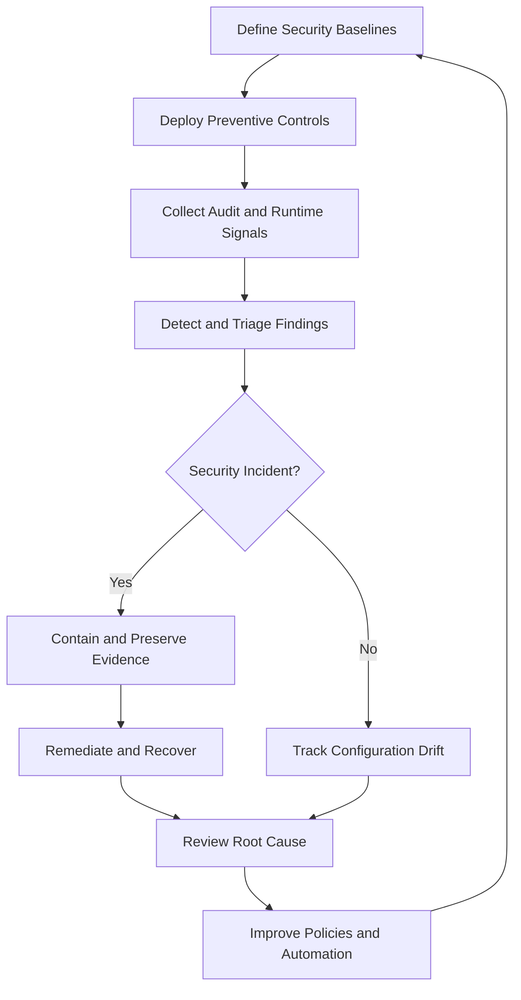

# 05- AWS Security Operational Best Practices

## Overview

AWS security operational best practices define how engineering teams maintain secure cloud environments throughout their lifecycle. They extend security architecture and configuration controls into repeatable operational procedures covering access management, workload deployment, monitoring, incident response, compliance, and recovery.

Security is not a one-time configuration task. Permissions change, workloads are deployed, credentials rotate, network paths evolve, and new vulnerabilities emerge. Production security therefore requires preventive controls, continuous detection, documented response procedures, and evidence that controls remain effective.

For backend systems using Python, Django, FastAPI, PostgreSQL, Redis, Celery, Docker, and AWS managed services, operational security must protect both infrastructure and application behavior.

This document focuses on day-to-day and recurring security operations. Detailed service configuration, troubleshooting, and hardening procedures should remain in their respective topic-specific documents.

## Operational Security Model

A mature AWS security operation combines four complementary activities.

| Activity | Purpose | Typical implementation |
|---|---|---|
| Prevent | Reduce the likelihood of security failures | Least-privilege IAM, SCPs, network restrictions, encryption defaults |
| Detect | Identify suspicious activity and configuration drift | CloudTrail, GuardDuty, Security Hub, AWS Config |
| Respond | Contain active incidents and limit impact | Credential revocation, policy restrictions, workload isolation |
| Recover and improve | Restore trusted service and prevent recurrence | Rebuilds, tested backups, root-cause analysis, control improvements |

These activities should operate as a continuous loop rather than independent projects.



## Establish Security Ownership and Governance

### Define Control Ownership

Every security control should have an accountable owner. Shared ownership without clear responsibility often leads to unreviewed findings, expired exceptions, and incomplete remediation.

| Control area | Typical owner | Operational responsibility |
|---|---|---|
| AWS organization and account governance | Cloud platform or cloud security team | Account boundaries, SCPs, organization-wide controls |
| IAM and privileged access | Identity or security engineering | Federation, role policies, access reviews |
| Application security | Backend engineering | Authentication, authorization, dependency security, safe logging |
| Network security | Platform or network engineering | Routing, security groups, private connectivity |
| Encryption and secrets | Platform, security, and service owners | Key governance, secret rotation, credential lifecycle |
| Detection and response | Security operations or incident response team | Alert triage, investigations, containment |
| Compliance evidence | Control owners and compliance stakeholders | Evidence collection, review, exception management |

Small teams may combine responsibilities, but they should still assign ownership explicitly.

### Operational Governance Checklist

- [ ] Maintain an inventory of AWS accounts, Regions, workloads, data stores, and public endpoints.
- [ ] Define security baselines for production and non-production environments.
- [ ] Document control owners, escalation paths, and incident severity criteria.
- [ ] Establish a process for approving security exceptions.
- [ ] Require an owner, business justification, compensating controls, and expiry date for each exception.
- [ ] Review controls after major architecture changes, incidents, and account migrations.
- [ ] Track remediation work in an auditable issue or change-management system.
- [ ] Ensure emergency access and recovery procedures are documented and tested.

## Identity and Access Operations

Identity failures are a common source of security incidents. Operational access management should cover human identities, application roles, CI/CD identities, cross-account access, and emergency privileges.

### Human Identity Operations

- [ ] Use an approved identity federation mechanism for workforce access.
- [ ] Enforce MFA for privileged access according to organizational policy.
- [ ] Use separate permission sets or roles for routine development and production administration.
- [ ] Review privileged access periodically and after role changes or departures.
- [ ] Remove inactive identities and obsolete credentials.
- [ ] Restrict the ability to create access keys and modify IAM policies.
- [ ] Audit emergency access usage.
- [ ] Validate account and principal identity before sensitive operations.

For routine administration, prefer temporary sessions through IAM Identity Center or an approved federated workflow over long-lived IAM user access keys.

### Workload Identity Operations

- [ ] Assign a dedicated role to each workload or security boundary.
- [ ] Use EC2 instance profiles, Lambda execution roles, ECS task roles, or other supported workload identities.
- [ ] Separate deployment roles from runtime roles.
- [ ] Restrict `iam:PassRole` to approved roles.
- [ ] Review trust policies for unexpected principals.
- [ ] Limit cross-account role assumption to approved source identities.
- [ ] Remove permissions that are no longer required.
- [ ] Monitor changes to privileged policies, trust relationships, and role assignments.

### Verify the Active AWS Identity

The following read-only command confirms the principal and account associated with the current CLI credentials:

```bash
aws sts get-caller-identity
```

Before performing production operations, compare the returned account and ARN with the expected execution context. A successful command does not prove that the principal has only appropriate permissions.

### Investigate IAM Access Denied

When an operation fails with `AccessDenied` or `AccessDeniedException`, use a systematic investigation:

1. Confirm the active principal and account.
2. Identify the exact API action and target resource.
3. Inspect identity-based and resource-based policies.
4. Inspect role trust policies if role assumption is involved.
5. Review applicable SCPs, permission boundaries, session policies, and explicit denies.
6. Check service-specific authorization requirements, including KMS key policies and grants.
7. Inspect CloudTrail evidence when the relevant event is available.
8. Correct the narrowest applicable policy and verify the intended operation.

Useful read-only commands include:

```bash
aws iam get-role \
  --role-name application-runtime-role

aws iam list-attached-role-policies \
  --role-name application-runtime-role

aws iam list-role-policies \
  --role-name application-runtime-role
```

These commands inspect role configuration but do not compute every effective permission across all policy layers. Use IAM Access Analyzer and the policy simulator where applicable.

Never resolve an unexplained access denial by automatically granting administrator access.

## Credential and Secret Lifecycle Management

### Credential Management

- [ ] Prefer temporary credentials and managed credential providers.
- [ ] Avoid embedding AWS keys in application code, Docker images, or infrastructure templates.
- [ ] Use AWS Secrets Manager or Systems Manager Parameter Store for appropriate sensitive configuration.
- [ ] Separate credentials across environments.
- [ ] Define rotation procedures and test the effect on dependent services.
- [ ] Prevent credentials from entering logs, tracing attributes, exception messages, and support tickets.
- [ ] Maintain a documented response for exposed credentials.
- [ ] Verify that secret retrieval failures produce actionable, non-sensitive diagnostics.

### Rotation Operations

Credential rotation is not complete when a new secret version is created. Applications must also transition to the new credential safely.

A production rotation workflow should account for:

- The credential provider or rotation mechanism.
- Whether consumers can temporarily tolerate overlapping credentials.
- Database connection pools and long-running workers.
- Application-side secret caching.
- Retry behavior when a credential becomes invalid.
- Rollback and recovery procedures.
- Monitoring for authentication failures during and after rotation.

For services using PostgreSQL, Django, FastAPI, or Celery, verify that existing connections and newly created connections behave correctly after rotation. Long-lived processes may continue using cached values until they refresh them.

### Safe Secret Retrieval in Python

Use the AWS SDK credential provider chain and retrieve secrets through an approved workload identity.

```python
import json
import logging
import os

import boto3
from botocore.exceptions import BotoCoreError, ClientError

logger = logging.getLogger(__name__)


def load_application_secret() -> dict:
    secret_id = os.environ["APPLICATION_SECRET_ID"]
    region = os.environ["AWS_REGION"]

    client = boto3.client("secretsmanager", region_name=region)

    try:
        response = client.get_secret_value(SecretId=secret_id)
        value = response.get("SecretString")

        if not value:
            raise RuntimeError("Secret value is unavailable as a string")

        secret = json.loads(value)

        if not isinstance(secret, dict):
            raise RuntimeError("Secret payload must be a JSON object")

        return secret

    except (ClientError, BotoCoreError):
        logger.exception("Application secret retrieval failed")
        raise
```

Operational requirements:

- Grant `secretsmanager:GetSecretValue` only for the intended secret.
- Review KMS permissions when a customer-managed key is used.
- Do not log the returned dictionary or include secret values in exception messages.
- Validate the expected fields before initializing dependent clients.
- Use bounded caching where appropriate, with explicit behavior for rotation and revocation.
- Avoid repeatedly retrieving the secret for every HTTP request.

The example intentionally does not implement caching or automatic rotation. Those decisions depend on application lifecycle, availability requirements, and credential-refresh behavior.

## Network and Service Exposure Operations

### Network Review

- [ ] Maintain an inventory of public endpoints and their business purpose.
- [ ] Review security groups for unrestricted inbound access.
- [ ] Restrict database and cache ports to approved application paths.
- [ ] Review route tables, internet gateways, NAT gateways, and cross-VPC connectivity.
- [ ] Remove unused rules and obsolete network paths.
- [ ] Use private endpoints or AWS PrivateLink where supported and appropriate.
- [ ] Review endpoint policies where available.
- [ ] Validate DNS configuration and private hosted zone associations.
- [ ] Ensure administrative access uses approved controlled paths.
- [ ] Monitor changes to network controls.

### Security Group Inspection

```bash
aws ec2 describe-security-groups \
  --group-ids sg-0123456789abcdef0
```

Review ingress and egress rules for:

- SSH or RDP exposed to broad internet ranges.
- Database ports accessible from unnecessary networks.
- Public access that does not match the intended architecture.
- Broad outbound access that creates avoidable risk.
- References to obsolete or overly broad security groups.

The command is read-only. Changes to security-group rules should follow an approved change process and include post-change connectivity and exposure verification.

### Public API Operations

For API Gateway, load balancers, and public backend endpoints:

- [ ] Enforce authentication and authorization for protected operations.
- [ ] Validate request schemas and input sizes.
- [ ] Configure throttling and quotas.
- [ ] Use AWS WAF where appropriate for request filtering and rate-based controls.
- [ ] Monitor blocked requests and false positives.
- [ ] Apply TLS and certificate-management standards.
- [ ] Avoid exposing administrative endpoints unnecessarily.
- [ ] Ensure application authorization remains effective even when requests pass network controls.
- [ ] Test changes against legitimate traffic before enforcing aggressive filtering rules.

AWS WAF and network controls reduce exposure, but they do not replace application-level authorization or protection against insecure business logic.

## Encryption and Key Governance Operations

### Data Protection Checklist

- [ ] Verify encryption at rest for required S3, EBS, RDS, and log resources.
- [ ] Require encrypted transport for public APIs and supported internal connections.
- [ ] Review KMS key policies, grants, and IAM permissions.
- [ ] Define key ownership and administrative separation.
- [ ] Review rotation settings and lifecycle requirements.
- [ ] Protect backups and snapshots.
- [ ] Test recovery procedures for encrypted data.
- [ ] Document dependencies before disabling or scheduling deletion of keys.
- [ ] Monitor sensitive key-management operations.

### KMS Inspection

Inspect key metadata:

```bash
aws kms describe-key \
  --key-id alias/application-data
```

Inspect the key policy:

```bash
aws kms get-key-policy \
  --key-id alias/application-data \
  --policy-name default
```

These read-only commands help identify the key state, metadata, and policy configuration. Review the relevant IAM policies and grants as well; the key policy alone may not explain every authorization outcome.

### Operational Considerations

- A disabled or unavailable key may prevent applications from decrypting dependent data.
- A key policy that is too restrictive can interrupt legitimate application operations.
- An overly permissive key policy can allow unintended cryptographic access.
- Key deletion may be irreversible after the applicable waiting period and can make encrypted data unrecoverable.
- Cross-account use requires appropriate configuration on both sides of the access relationship.

Do not change key policies or key lifecycle state as a generic response to an encryption error. Establish the dependency, authorization path, and recovery implications first.

## Security Monitoring and Alert Operations

### Monitoring Baseline

- [ ] Enable CloudTrail coverage for required accounts and Regions.
- [ ] Centralize audit logs in a protected logging account where appropriate.
- [ ] Enable GuardDuty in relevant accounts and Regions.
- [ ] Aggregate Security Hub findings where centralized security operations are used.
- [ ] Use AWS Config rules or conformance packs to evaluate configuration requirements.
- [ ] Configure alerts for high-risk findings and security-control changes.
- [ ] Define alert ownership and escalation criteria.
- [ ] Test log delivery, alert routing, and notification integrations.
- [ ] Review retention and access controls for audit evidence.
- [ ] Monitor for attempts to disable, alter, or bypass security controls.

### Preventive, Detective, and Responsive Controls

| Category | Examples | Operational purpose |
|---|---|---|
| Preventive | IAM least privilege, SCPs, security groups, S3 Block Public Access | Restrict unsafe actions before they occur |
| Detective | CloudTrail, GuardDuty, Security Hub, AWS Config | Identify suspicious activity and configuration drift |
| Responsive | Credential revocation, network isolation, policy restriction | Contain incidents and reduce ongoing impact |
| Recovery | Trusted rebuilds, restoration tests, control improvements | Return services to a known-good state |

No single service provides complete security coverage. For example, CloudTrail provides API activity records, GuardDuty analyzes supported signals for threats, Security Hub aggregates and evaluates findings, and AWS Config evaluates resource configuration against rules.

### CloudTrail Operations

Inspect configured trails:

```bash
aws cloudtrail describe-trails \
  --include-shadow-trails
```

Investigate recent role-assumption events:

```bash
aws cloudtrail lookup-events \
  --lookup-attributes AttributeKey=EventName,AttributeValue=AssumeRole \
  --max-results 20
```

Review:

- Event time and Region.
- Principal and session identity.
- Event source and event name.
- Source IP and user agent where available.
- Error code and error message.
- Requested resources and relevant request parameters.

CloudTrail Event History generally covers the previous 90 days of management events per Region. Data events require appropriate configuration, and longer retention requires a suitable trail, CloudTrail Lake, or another retained evidence source.

### Finding Triage

For each actionable finding:

1. Confirm the finding and affected resource.
2. Determine exposure, severity, and potential business impact.
3. Correlate it with relevant CloudTrail events, application logs, and configuration changes.
4. Determine whether immediate containment is required.
5. Assign an accountable owner and remediation deadline.
6. Verify the fix and assess whether the original exposure caused an incident.
7. Record evidence and update the finding status.

Do not close a finding solely because the configuration changed. Confirm that the risky condition is absent and that the remediation did not create a new failure.

## Secure CI/CD Operations

CI/CD identities often have broad access because they create infrastructure and deploy applications. Treat deployment pipelines as privileged production systems.

### Deployment Checklist

- [ ] Use OIDC federation or an approved short-lived credential mechanism where supported.
- [ ] Avoid long-lived AWS keys in repository secrets when federation is available.
- [ ] Separate build, deployment, and runtime identities.
- [ ] Restrict deployment roles to approved accounts, Regions, resources, and actions.
- [ ] Restrict `iam:PassRole` to specific roles.
- [ ] Protect production deployment approvals and workflow changes.
- [ ] Pin and review third-party workflow actions according to organizational policy.
- [ ] Scan dependencies, container images, and infrastructure templates.
- [ ] Prevent secrets from appearing in test output and build logs.
- [ ] Validate IAM, encryption, and network configuration before deployment.
- [ ] Retain deployment identity, artifact version, approval, and outcome.
- [ ] Test rollback and recovery procedures.

### Separate Deployment and Runtime Roles

A deployment identity may require permission to update a Lambda function, while the Lambda execution role should contain only the permissions required by the running application.

This separation reduces the impact of a compromised workload. Application code should not inherit permissions to modify its own IAM policies, deploy new versions, or administer unrelated infrastructure unless a documented requirement justifies that access.

### Infrastructure Validation

Where possible, enforce security baselines through infrastructure as code and automated checks. Validate:

- IAM policy scope and trust relationships.
- Public network exposure.
- Encryption settings.
- Logging and monitoring coverage.
- Secret references and credential handling.
- Resource ownership and environment tags.

A successful deployment is not proof of a secure deployment. Security checks should fail the pipeline when a critical, policy-defined requirement is violated.

## Incident Response Operations

### Readiness Checklist

- [ ] Maintain a documented incident response plan.
- [ ] Define severity levels and escalation contacts.
- [ ] Prepare procedures for compromised IAM credentials and role sessions.
- [ ] Document containment options for EC2, Lambda, APIs, and network paths.
- [ ] Preserve CloudTrail events, application logs, snapshots, and relevant evidence.
- [ ] Ensure responders can access centralized logs during an account-level incident.
- [ ] Test recovery from trusted backups.
- [ ] Maintain procedures for exposed secrets and KMS access failures.
- [ ] Conduct tabletop exercises for credential compromise and unauthorized access.
- [ ] Track corrective actions after incidents and exercises.

### Initial Response Procedure

When a suspected compromise is detected:

1. Validate the alert and identify the account, principal, resource, and time window.
2. Determine whether the activity is ongoing and prioritize containment.
3. Revoke or deactivate compromised credentials and restrict affected access paths.
4. Consider the limitations of already-issued temporary credentials and active sessions.
5. Preserve relevant logs and evidence before destructive remediation where feasible.
6. Investigate related API activity, resource changes, data access, and persistence mechanisms.
7. Restore affected workloads from trusted configurations or artifacts when required.
8. Verify recovery, document the incident, and implement preventive controls.

### Incident-Specific Guidance

| Incident | Immediate priorities | Follow-up |
|---|---|---|
| Leaked access key | Identify the principal, revoke or deactivate the credential, inspect recent API activity | Remove the source of leakage and replace static credentials with a safer identity mechanism |
| Suspicious role assumption | Inspect trust policy, session identity, source account, and CloudTrail evidence | Restrict trust relationships and review related access paths |
| Public data exposure | Restrict public access and preserve evidence of the exposure | Determine what data was accessible and review resource policies |
| KMS access failure | Identify the principal, key, operation, policy path, and key state | Correct the narrow authorization issue and verify dependent workloads |
| Suspicious workload behavior | Contain the workload using a documented procedure and preserve relevant evidence | Rebuild from trusted artifacts and investigate the initial access path |
| Unexpected WAF blocks | Inspect matching rules and request samples through approved diagnostic tools | Tune the rule safely and add regression tests where possible |
| Missing audit evidence | Verify trail configuration, Region coverage, selectors, delivery, and retention | Restore coverage and document the evidence gap |

Containment actions can interrupt production workloads. Coordinate with the incident commander and service owners where time permits, but do not delay urgent containment when active harm is occurring.

## Troubleshooting Operational Security Failures

### IAM Access Denied

**Symptoms**

- `AccessDenied`
- `AccessDeniedException`
- An API call fails despite the role having an apparently relevant allow policy.

**Investigation**

1. Run `aws sts get-caller-identity`.
2. Confirm the denied action and resource.
3. Inspect identity-based and resource-based policies.
4. Check SCPs, permission boundaries, session policies, and explicit denies.
5. Inspect service-specific authorization requirements.
6. Review the relevant CloudTrail event where available.

**Correction and verification**

Update only the policy or trust relationship that explains the denial. Retry the original operation and verify that unrelated permissions remain restricted.

### STS Role-Assumption Failure

**Symptoms**

- `AccessDenied` from `AssumeRole`.
- `AccessDenied` due to a trust relationship.
- Expired or invalid security tokens.

**Investigation**

- Verify the source principal using `aws sts get-caller-identity`.
- Inspect the target role using `aws iam get-role`.
- Compare the trust policy with the actual source principal.
- Check required external IDs, MFA conditions, session tags, or organization conditions.
- Verify that the source principal is permitted to call `sts:AssumeRole`.

**Correction and verification**

Correct the narrow trust or identity-policy mismatch, then test the approved role-assumption workflow. Do not remove trust conditions indiscriminately to make the operation succeed.

### Secrets Retrieval Failure

**Symptoms**

- `ResourceNotFoundException`
- `AccessDeniedException`
- Decryption or KMS authorization errors.

**Investigation**

- Verify the secret identifier, account, and Region.
- Confirm that the workload is using the intended principal.
- Inspect the secret metadata without printing the secret value.
- Check `secretsmanager:GetSecretValue` or the applicable Parameter Store permission.
- Review KMS authorization when a customer-managed key is involved.
- Check rotation status and application caching behavior.

**Correction and verification**

Fix the identifier, permission, key configuration, or rotation issue that explains the failure. Verify retrieval using the intended workload identity and confirm that secret values remain absent from logs.

### KMS Authorization Failure

**Symptoms**

- `AccessDeniedException`
- `KMSAccessDeniedException`
- Encryption or decryption fails for a resource that previously worked.

**Investigation**

- Inspect the key state and Region.
- Identify the principal and cryptographic operation.
- Review key policies, IAM policies, grants, and cross-account configuration.
- Check whether the key was disabled or its policy changed.
- Inspect relevant CloudTrail events.

**Correction and verification**

Restore only the required authorization or key state after reviewing dependencies. Verify the intended cryptographic operation and dependent application workflow.

### Missing Audit Evidence

**Symptoms**

- Expected API events do not appear.
- Security investigations lack data-access events.
- Log delivery is delayed or incomplete.

**Investigation**

- Verify trail configuration and Region coverage.
- Determine whether the missing activity is a management event or a data event.
- Check event selectors, delivery configuration, and destination permissions.
- Review retention settings and whether the search covers the correct time window.
- Inspect the relevant log destination and delivery status.

**Correction and verification**

Restore required event coverage, verify new events arrive, and document the historical evidence gap. Do not assume that enabling logging now will recover events that were never recorded.

## Cost, Reliability, and Operational Trade-offs

Security controls introduce cost and operational complexity. The objective is to manage risk proportionately without creating unnecessary failure modes.

| Control | Benefit | Trade-off to manage |
|---|---|---|
| CloudTrail data events | Detailed data-access auditing | Additional event volume and cost |
| GuardDuty and Security Hub | Threat detection and consolidated findings | Finding triage effort and service charges |
| Customer-managed KMS keys | More granular key governance | Policy administration and key lifecycle risk |
| Secrets Manager rotation | Reduced exposure from long-lived credentials | Rotation compatibility and runtime refresh complexity |
| VPC endpoints and PrivateLink | Controlled private service connectivity | Endpoint charges, DNS behavior, and routing complexity |
| Restrictive SCPs | Organization-wide preventive guardrails | Potential disruption of legitimate operations |
| Aggressive WAF rules | Reduced exposure to unwanted traffic | False positives and legitimate request blocking |
| Shorter credential lifetimes | Reduced credential exposure window | More frequent renewal and session-management requirements |

Operational controls should be measured against risk reduction, availability, recovery objectives, and ongoing maintenance costs.

## Security Operations Metrics

Use metrics to identify control degradation and recurring operational problems.

| Metric | What it reveals |
|---|---|
| Time to triage high-severity findings | Effectiveness of alert ownership and response |
| Time to contain confirmed incidents | Operational containment capability |
| Number of overdue critical findings | Remediation backlog and risk acceptance |
| Percentage of accounts with required logging | Audit coverage |
| Percentage of workloads using approved identities | Credential-management maturity |
| Number of stale privileged identities | Access-review effectiveness |
| Number of unresolved security exceptions | Accumulated accepted risk |
| Secret rotation failure rate | Reliability of credential lifecycle automation |
| Repeated authorization failures | Policy drift or incorrect service integration |
| Recovery exercise success rate | Readiness to restore trusted services |

Metrics need clear definitions, ownership, and action thresholds. A large number of findings does not automatically indicate poor security if detection coverage has improved; interpret trends alongside severity, exposure, and remediation performance.

## Operational Review Checklist

### Daily

- [ ] Triage actionable high-severity security findings.
- [ ] Review suspected credential misuse and unauthorized API activity.
- [ ] Verify critical audit and alerting pipelines.
- [ ] Escalate incidents that exceed the team's response authority.

### Weekly

- [ ] Review overdue high-risk findings.
- [ ] Inspect important IAM, network, and public-exposure changes.
- [ ] Review CI/CD security failures and deployment exceptions.
- [ ] Check secret rotation failures and recurring authorization errors.

### Monthly

- [ ] Review privileged identities and obsolete access.
- [ ] Reassess public endpoints and security-group exposure.
- [ ] Review KMS governance and secret-management exceptions.
- [ ] Validate logging coverage and evidence retention.
- [ ] Review accepted risks and approaching exception expirations.

### Quarterly

- [ ] Conduct access recertification.
- [ ] Test incident containment and escalation procedures.
- [ ] Validate backup restoration and recovery assumptions.
- [ ] Review account boundaries and cross-account access.
- [ ] Assess whether security controls remain appropriate for current workloads.

### After Significant Changes

- [ ] Reassess controls after new public endpoints, account migrations, or network redesigns.
- [ ] Review IAM changes associated with new services or deployment workflows.
- [ ] Verify encryption and secret handling for new data flows.
- [ ] Confirm logging, alerting, and incident-response coverage.
- [ ] Record evidence and update operational procedures.

## Key Takeaways

- AWS security operations must continuously prevent unsafe access, detect suspicious behavior, contain incidents, and verify recovery.
- Least privilege, temporary credentials, controlled secret rotation, and clear separation of deployment and runtime identities reduce the impact of compromised principals.
- Centralized audit logging and actionable monitoring are effective only when coverage, retention, alert ownership, and investigation procedures are verified.
- Operational changes to IAM, networking, secrets, and KMS must be evidence-driven, narrowly scoped, and tested against production dependencies.
- Assign owners, measure remediation, document exceptions, and exercise incident and recovery procedures to keep security controls effective over time.