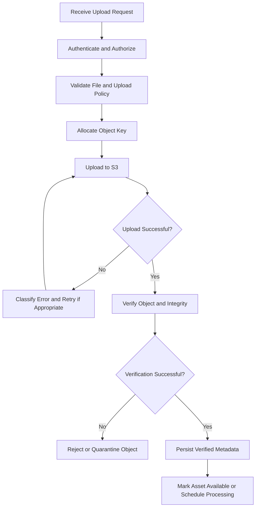
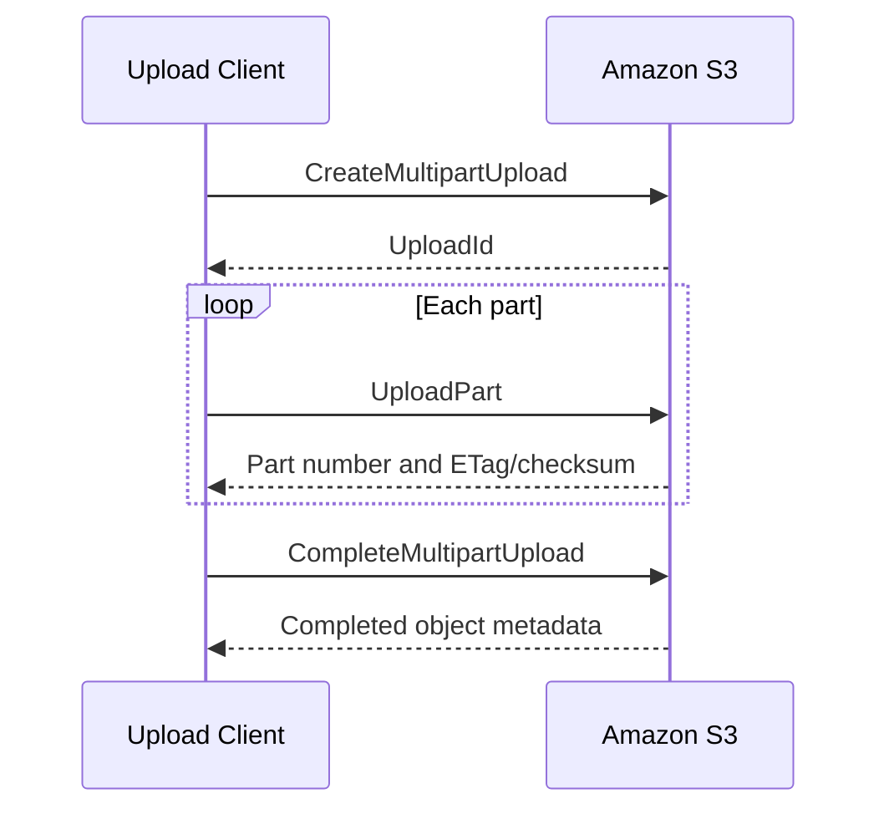

# 01- Uploading Objects

## Overview

Uploading objects is one of the core operational activities in Amazon S3. Backend applications, data pipelines, automation jobs, and administrators use S3 upload APIs to store files, datasets, reports, backups, and generated artifacts.

An upload operation creates an object identified by a bucket and object key. Depending on the operation, it can also specify content type, user-defined metadata, tags, storage class, encryption options, checksums, and conditional-write requirements.

A production upload workflow must consider more than whether the API call succeeds. It should address object naming, data integrity, access control, retries, concurrent writes, multipart transfers, application metadata consistency, and recovery from partial failures.

This document covers operational upload methods, AWS CLI and Boto3 examples, multipart upload behavior, validation, and production considerations.

## Upload Methods

Amazon S3 supports several ways to upload objects. Choose an approach according to object size, application architecture, and reliability requirements.

| Method | Interface | Appropriate use |
|---|---|---|
| Single-part upload | `PutObject` | Small files and objects within the operation's size limit |
| Managed upload | Boto3 `upload_file()` or AWS CLI `s3 cp` | General-purpose file transfers with automatic multipart handling when appropriate |
| Multipart upload | Multipart upload API | Large files, parallel transfer, and recovery at part level |
| Presigned upload | Presigned PUT URL | Direct uploads from browsers, mobile applications, and external clients |
| Conditional upload | Conditional `PutObject` or multipart completion where supported | Preventing unintended overwrites |
| Copy-based upload | S3 copy operations | Moving existing S3 data into a different key or bucket |

For typical Python backend applications, Boto3's managed transfer interface is a practical default. Use explicit multipart APIs when the application needs control over part scheduling, persistence, resumption, or completion.

## Object Upload Lifecycle

A reliable workflow separates transfer execution from application-level acceptance.



For direct-to-S3 uploads, the client performs the transfer and the backend subsequently verifies the object. For backend-proxied uploads, the backend controls the transfer itself.

S3 and a relational database do not participate in one shared transaction. If the object upload succeeds but the database update fails, the object may exist while the application record remains pending. Design the workflow to reconcile such states.

## AWS CLI Uploads

### Verify the target identity and Region

Before running an operational upload, verify the active AWS identity and configured Region.

```bash
aws sts get-caller-identity

aws configure get region
```

For a named development profile:

```bash
aws sts get-caller-identity --profile s3-development

aws s3 ls s3://example-private-bucket/ \
  --profile s3-development \
  --region ap-south-1
```

Use a bucket that already exists and that the selected identity is authorized to access. Do not assume that a successful AWS CLI authentication check proves permission to upload to a particular bucket.

### Upload a single object

```bash
aws s3 cp ./report.pdf \
  s3://example-private-bucket/reports/2026/report.pdf \
  --region ap-south-1
```

The `aws s3 cp` command is a high-level transfer command. For sufficiently large files, the CLI can use multipart upload rather than a single `PutObject` request.

Upload a file with an explicit content type:

```bash
aws s3 cp ./report.pdf \
  s3://example-private-bucket/reports/2026/report.pdf \
  --content-type application/pdf \
  --region ap-south-1
```

The content type is stored as object metadata. Setting it does not validate the file's actual contents; the application must perform any required content inspection separately.

### Upload with object metadata

```bash
aws s3 cp ./report.pdf \
  s3://example-private-bucket/reports/2026/report.pdf \
  --metadata source=report-service,environment=production \
  --region ap-south-1
```

User-defined metadata is useful for small, object-associated values. It should not replace a relational database when the application needs querying, transactions, relationships, or frequently changing business state.

Metadata keys supplied through S3 APIs are represented using HTTP metadata headers. Keep values small and avoid storing secrets or sensitive personal information in object metadata.

### Upload with server-side encryption

For a bucket that requires SSE-KMS, the command can specify the intended encryption key:

```bash
aws s3 cp ./report.pdf \
  s3://example-private-bucket/reports/2026/report.pdf \
  --sse aws:kms \
  --sse-kms-key-id "$S3_KMS_KEY_ARN" \
  --region ap-south-1
```

Set `S3_KMS_KEY_ARN` to the authorized KMS key ARN in the environment before executing the command.

New S3 objects are encrypted at rest by default using S3-managed encryption. Explicitly specify encryption parameters when required by the application's policy or when a particular KMS key must be used.

SSE-KMS operations require appropriate S3 permissions and KMS authorization. An S3 `PutObject` permission alone does not guarantee that the upload can use the selected KMS key.

### Upload with a storage class

```bash
aws s3 cp ./historical-report.pdf \
  s3://example-private-bucket/archive/historical-report.pdf \
  --storage-class STANDARD_IA \
  --region ap-south-1
```

Select a storage class according to retrieval frequency, access latency, minimum storage duration, retrieval fees, and availability requirements. Infrequently accessed classes are not automatically cheaper for every workload.

### Upload multiple files

Upload a local directory recursively:

```bash
aws s3 cp ./exports/ \
  s3://example-private-bucket/exports/ \
  --recursive \
  --region ap-south-1
```

Synchronize a directory with an S3 prefix:

```bash
aws s3 sync ./exports/ \
  s3://example-private-bucket/exports/ \
  --region ap-south-1
```

`sync` compares local and remote objects to determine which transfers are needed. By default, it does not delete destination-only objects. Adding `--delete` changes that behavior and can remove remote data, so use it only when deletion is intentional.

For large directory transfers, account for request volume, concurrency, errors, and incomplete multipart uploads. Test destructive synchronization behavior in a non-production location first.

## Uploading with `s3api`

The high-level CLI is convenient for transferring files. The lower-level `s3api` commands expose individual S3 API operations and more explicit request parameters.

### Single-part `PutObject`

```bash
aws s3api put-object \
  --bucket example-private-bucket \
  --key reports/2026/report.pdf \
  --body ./report.pdf \
  --content-type application/pdf \
  --region ap-south-1
```

This uses the `PutObject` API, whose maximum supported object size is 5 GB. Larger objects require multipart upload.

### Prevent overwriting an existing key

Where supported, a conditional `PutObject` request can require that an object with the same key does not already exist.

```bash
aws s3api put-object \
  --bucket example-private-bucket \
  --key immutable-reports/2026/report.pdf \
  --body ./report.pdf \
  --content-type application/pdf \
  --if-none-match '*' \
  --region ap-south-1
```

The `If-None-Match: *` precondition prevents an ordinary successful write when the key already has a current object. If the condition fails, handle the response as a conflict rather than blindly retrying the same operation.

Conditional writes are useful for immutable artifacts and duplicate-upload protection. They should be part of a complete idempotency strategy, not a substitute for application authorization.

Avoid a check-then-upload sequence that first calls `HeadObject` and then uploads unconditionally. Another writer can create the key between those calls.

Reference: [Uploading objects in Amazon S3](https://docs.aws.amazon.com/AmazonS3/latest/userguide/upload-objects.html).

## Uploading with Boto3

Boto3 is the standard AWS SDK for Python. Keep its use in a storage service so framework handlers can focus on application validation, authorization, and workflow state.

### Configure a client

```python
# app/storage.py

import boto3
from botocore.config import Config
from boto3.s3.transfer import TransferConfig


s3_client = boto3.client(
    "s3",
    region_name="ap-south-1",
    config=Config(
        connect_timeout=5,
        read_timeout=60,
        retries={
            "mode": "standard",
            "total_max_attempts": 4,
        },
    ),
)

TRANSFER_CONFIG = TransferConfig(
    multipart_threshold=64 * 1024 * 1024,
    multipart_chunksize=16 * 1024 * 1024,
    max_concurrency=4,
    use_threads=True,
)
```

The configured transfer threshold and chunk size are illustrative. Benchmark them against real file sizes, available memory, network throughput, and the number of concurrent transfers.

Use the AWS SDK credential provider chain. In production, prefer temporary role credentials over long-lived access keys. The SDK client should be initialized safely within the application's process model; do not blindly share initialized clients across process forks.

### Upload a file using the managed transfer interface

```python
# app/storage.py

from pathlib import Path


def upload_file(
    *,
    file_path: Path,
    bucket_name: str,
    object_key: str,
    content_type: str,
    metadata: dict[str, str] | None = None,
) -> None:
    extra_args = {
        "ContentType": content_type,
        "Metadata": metadata or {},
    }

    s3_client.upload_file(
        Filename=str(file_path),
        Bucket=bucket_name,
        Key=object_key,
        ExtraArgs=extra_args,
        Config=TRANSFER_CONFIG,
    )
```

The managed transfer interface can select multipart upload based on its configured threshold. It handles routine part-level transfer mechanics and retries, reducing the amount of transfer code the application must maintain.

It does not manage the entire business workflow. The application still needs to coordinate its database records, authorization, object verification, retention policy, and any required asynchronous processing.

### Upload with explicit encryption and tags

Additional upload parameters can specify encryption and object tags.

```python
def upload_encrypted_report(
    *,
    file_path: Path,
    bucket_name: str,
    object_key: str,
    kms_key_arn: str,
) -> None:
    s3_client.upload_file(
        Filename=str(file_path),
        Bucket=bucket_name,
        Key=object_key,
        ExtraArgs={
            "ContentType": "application/pdf",
            "ServerSideEncryption": "aws:kms",
            "SSEKMSKeyId": kms_key_arn,
            "Tagging": "purpose=report&environment=production",
        },
        Config=TRANSFER_CONFIG,
    )
```

Use this example only when the application is authorized to use the selected KMS key. The tag query string must be URL-encoded when tag names or values contain characters requiring encoding.

Tags support classification, lifecycle rules, and cost allocation. Enforce an approved tag vocabulary and avoid placing confidential values in tags.

### Upload an in-memory or file-like object

For an existing file-like object, use `upload_fileobj()`:

```python
from typing import BinaryIO


def upload_stream(
    *,
    fileobj: BinaryIO,
    bucket_name: str,
    object_key: str,
    content_type: str,
) -> None:
    s3_client.upload_fileobj(
        Fileobj=fileobj,
        Bucket=bucket_name,
        Key=object_key,
        ExtraArgs={
            "ContentType": content_type,
        },
        Config=TRANSFER_CONFIG,
    )
```

A stream may need to support seeking or other operations depending on the transfer path. Verify the behavior of the chosen stream implementation, especially when multipart transfers are enabled.

Avoid reading a large stream into one `bytes` object before uploading it. Unbounded buffering can exhaust application memory under concurrency.

### Upload with explicit `PutObject`

For a small object that fits within the single-part size limit, `put_object()` exposes request parameters directly:

```python
from pathlib import Path


def put_small_object(
    *,
    file_path: Path,
    bucket_name: str,
    object_key: str,
) -> dict:
    with file_path.open("rb") as fileobj:
        return s3_client.put_object(
            Bucket=bucket_name,
            Key=object_key,
            Body=fileobj,
            ContentType="application/pdf",
            ChecksumAlgorithm="SHA256",
        )
```

Choose this interface when its explicit API semantics are useful, such as request-level conditional writes or checksum settings. For general file transfer, the managed transfer interface is usually more convenient.

## Multipart Upload

Multipart upload divides one logical object into independent parts. S3 assembles the completed object after all required parts have been uploaded and the completion operation succeeds.

Multipart upload is particularly useful for large files, variable network conditions, and parallel transfer.

### Limits and constraints

The commonly documented multipart constraints for general-purpose S3 buckets are:

| Constraint | Limit |
|---|---|
| Maximum object size | 50 TB |
| Maximum number of parts | 10,000 |
| Part numbers | 1 through 10,000 |
| Part size | 5 MiB to 5 GiB |
| Final part | May be smaller than 5 MiB |
| Recommended consideration point | Around 100 MB and above |

Verify current limits in the official AWS documentation before implementing a transfer client or setting operational quotas.

### Lifecycle



A multipart upload is not a completed object until the completion request succeeds. An interrupted upload can leave uploaded parts in S3 without producing the intended object.

Persist the upload ID and the information needed to resume or complete the transfer when the workflow requires recovery across process restarts.

### Multipart operational requirements

- Select a part size that balances request overhead, memory use, concurrency, and retry cost.
- Respect the 10,000-part maximum when computing part sizes.
- Retry failed parts rather than restarting the entire object whenever possible.
- Complete uploads only with the appropriate uploaded parts and part identifiers.
- Abort abandoned uploads when they are no longer needed.
- Configure a lifecycle rule to abort incomplete multipart uploads after an appropriate period.
- Verify the completed object's size and relevant checksum before marking it accepted.
- Avoid running unbounded concurrent uploads from the same worker.

For direct client uploads, a backend can issue presigned URLs for individual multipart operations. It should retain ownership of the upload ID, validate the completion manifest, and prevent clients from completing uploads belonging to other assets.

Reference: [Multipart upload overview](https://docs.aws.amazon.com/AmazonS3/latest/userguide/mpuoverview.html).

## Data Integrity and Checksums

Checksums detect data corruption during transfer and help verify content integrity. They are distinct from authentication, malware scanning, and validation of the file's business meaning.

Amazon S3 supports checksum algorithms including CRC-64/NVME, CRC32, CRC32C, SHA-1, SHA-256, and others documented by AWS. Supported checksum types and multipart behavior vary by algorithm.

### Use S3 checksum validation

AWS SDKs can calculate and send upload checksums, and S3 validates applicable checksum values before accepting the data. Explicitly request an algorithm when the application requires a particular checksum contract.

Example:

```python
from pathlib import Path


def upload_with_checksum(
    *,
    file_path: Path,
    bucket_name: str,
    object_key: str,
) -> dict:
    with file_path.open("rb") as fileobj:
        return s3_client.put_object(
            Bucket=bucket_name,
            Key=object_key,
            Body=fileobj,
            ChecksumAlgorithm="SHA256",
        )
```

For multipart uploads, choose an algorithm and checksum type compatible with the intended upload workflow. Where a full-object checksum is required, make sure the SDK and S3 API operation support that contract.

### Do not treat ETag as a universal checksum

The S3 ETag identifies an object representation, but it is not always the MD5 checksum of the entire file. Multipart uploads and other upload or encryption configurations can produce ETags that do not represent the whole-object MD5 digest.

When an application requires a stable full-content checksum, compute or request the appropriate checksum explicitly and record the algorithm with the value.

### Verify object metadata after upload

Use `HeadObject` to inspect an uploaded object's size, content type, version ID, and available metadata:

```bash
aws s3api head-object \
  --bucket example-private-bucket \
  --key reports/2026/report.pdf \
  --region ap-south-1
```

Retrieving checksum fields may require the appropriate checksum-related API options and permissions. A successful metadata request verifies that the object can be inspected by the caller; it does not independently establish that the file is safe for application use.

Reference: [Checking object integrity for data uploads](https://docs.aws.amazon.com/AmazonS3/latest/userguide/checking-object-integrity-upload.html).

## Upload Security

### Least-privilege access

An upload identity generally needs `s3:PutObject` on its permitted bucket and object prefix. Additional operations can require additional permissions, depending on the upload path, tags, encryption, versioning, or multipart workflow.

Do not grant unrestricted bucket-wide administrative permissions simply to make uploads work. Distinguish upload authorization from read, delete, version-management, and bucket-configuration permissions.

For SSE-KMS, the workload may need relevant KMS permissions, and the key policy must allow the operation. S3 and KMS can independently deny a request.

### Validate content before accepting it

Client-provided filenames, extensions, MIME types, lengths, and metadata are untrusted input.

Apply relevant controls:

- Enforce file size limits before reading or storing large bodies.
- Generate object keys server-side.
- Validate file signatures and use format-specific parsers as appropriate.
- Scan untrusted files when the workload requires malware inspection.
- Keep newly uploaded objects private until validation is complete.
- Prevent one tenant from writing to or replacing another tenant's object.
- Avoid storing secrets or sensitive personal information in object keys, metadata, or tags.

A checksum proves that the bytes match a checksum value. It does not prove that the content is safe or belongs to the claimed format.

### Presigned upload security

A presigned URL is a temporary bearer credential for a particular signed operation. Anyone who obtains it may be able to perform that operation until the URL or its underlying credentials expire, subject to applicable restrictions.

Use a generated object key, a short expiration, the minimum required operation, and only the required signed headers. Verify object existence and relevant metadata before changing application state to `uploaded` or `verified`.

Do not log complete presigned URLs or expose them to users who are not authorized for the corresponding asset.

## Error Handling and Retries

An upload workflow should classify errors and retry only those failures likely to succeed.

| Failure | Recommended action |
|---|---|
| Network timeout | Retry with bounded attempts and backoff |
| Transient S3 service error | Retry according to SDK and application policy |
| Throttling | Back off and reduce excessive concurrency if necessary |
| `AccessDenied` | Diagnose IAM, bucket policy, KMS permissions, and organizational controls |
| `NoSuchBucket` | Verify the bucket name, account, and Region |
| Invalid parameters | Correct the request instead of retrying unchanged |
| Conditional-write conflict | Treat as a duplicate or concurrency conflict |
| Checksum mismatch | Reject the upload and investigate source data or transfer handling |
| Multipart completion failure | Inspect part numbers, ETags or checksums, upload state, and retry eligibility |
| Database update failure after upload | Reconcile the stored object with application metadata |

### Retry without creating duplicate business effects

SDK retries handle certain transient failures at the request level. They do not automatically make a multi-step application workflow idempotent.

For example, a client may lose the response to a successful upload and retry the operation. If the same key is reused, the retry might replace the object. Use immutable keys, conditional writes where appropriate, and application-level idempotency records.

For database-backed workflows, persist upload intent before or as part of the application workflow and reconcile records after partial failures. Avoid holding a database transaction open throughout a long S3 transfer.

### Reconcile incomplete workflows

Periodically inspect:

- Pending upload records older than the expected completion window.
- S3 objects without matching application records.
- Database records whose referenced objects are missing.
- Multipart uploads that have not completed.
- Verification tasks that failed after the object was stored.

Cleanup must respect retention requirements and versioning behavior. Do not delete an object merely because one database lookup fails temporarily.

## Performance and Cost Considerations

Upload performance depends on file size, network throughput, part size, concurrency, application capacity, and retry behavior.

For high-throughput workloads:

- Prefer managed transfer utilities unless explicit multipart control is necessary.
- Tune multipart threshold and chunk size using measured workloads.
- Bound concurrent transfers to avoid exhausting worker memory or connections.
- Separate file transfer from CPU-heavy processing.
- Use direct-to-S3 uploads when routing file bytes through the backend is a bottleneck.
- Monitor retry rates, incomplete multipart uploads, and transfer duration.
- Choose storage classes according to access patterns and total workload cost.

Cost can include storage, PUT and multipart request charges, data transfer, KMS requests, incomplete multipart parts, and downstream processing. A storage class with lower storage pricing may still cost more for workloads with frequent retrieval or early deletion.

## Operational Verification

### Verify upload existence and metadata

```bash
aws s3api head-object \
  --bucket example-private-bucket \
  --key reports/2026/report.pdf \
  --region ap-south-1
```

### List the target prefix

```bash
aws s3 ls \
  s3://example-private-bucket/reports/2026/ \
  --region ap-south-1
```

### Inspect incomplete multipart uploads

```bash
aws s3api list-multipart-uploads \
  --bucket example-private-bucket \
  --prefix reports/ \
  --region ap-south-1
```

A listed multipart upload is not a completed object. Determine whether each upload is still active before aborting it.

### Abort a specific abandoned multipart upload

```bash
aws s3api abort-multipart-upload \
  --bucket example-private-bucket \
  --key reports/large-export.zip \
  --upload-id "UPLOAD_ID" \
  --region ap-south-1
```

This operation removes the specified incomplete multipart upload and its uploaded parts. Confirm the key and upload ID carefully, and do not abort an active transfer.

## Common Mistakes

### Using `PutObject` for every file

A single-part `PutObject` has a 5 GB object limit. Use multipart upload for larger files and consider it for smaller files when throughput or recovery requirements justify the extra requests.

### Assuming a high-level upload is one request

Boto3's managed transfer API and the AWS CLI may split large uploads into parts. Monitor multipart behavior and make sure the application handles completion and abandoned transfers.

### Checking existence before an unconditional write

A separate existence check followed by a normal upload has a race condition. Use a conditional write when the required API operation supports the precondition.

### Trusting ETag as a SHA-256 or universal MD5

ETag behavior depends on how the object was uploaded and other conditions. Use explicit checksums for integrity requirements.

### Ignoring partial database failures

A successful S3 upload can be followed by a failed database write. Keep the state recoverable and implement reconciliation.

### Granting excessive IAM permissions

Upload operations do not inherently require unrestricted bucket access, object deletion, or administrative permissions. Scope access to the required operations and resources.

### Leaving multipart uploads indefinitely

Incomplete parts can incur storage charges. Use explicit cleanup and lifecycle-based abortion as a safeguard.

## Official References

- [Uploading objects in Amazon S3](https://docs.aws.amazon.com/AmazonS3/latest/userguide/upload-objects.html)
- [Boto3 S3 client reference](https://boto3.amazonaws.com/v1/documentation/api/latest/reference/services/s3.html)
- [Boto3 upload_file reference](https://boto3.amazonaws.com/v1/documentation/api/latest/reference/services/s3/client/upload_file.html)
- [Boto3 transfer configuration](https://boto3.amazonaws.com/v1/documentation/api/latest/guide/s3.html)
- [Multipart upload overview](https://docs.aws.amazon.com/AmazonS3/latest/userguide/mpuoverview.html)
- [Multipart upload limits](https://docs.aws.amazon.com/AmazonS3/latest/userguide/qfacts.html)
- [Checking object integrity for data uploads](https://docs.aws.amazon.com/AmazonS3/latest/userguide/checking-object-integrity-upload.html)

## Key Takeaways

- Choose single-part, managed, or multipart uploads according to object size, throughput, and recovery requirements.
- Use Boto3 and AWS CLI managed transfers for routine uploads, with carefully tuned concurrency and chunk sizes for production workloads.
- Validate content and enforce least-privilege permissions; successful transfer and checksum validation do not establish that a file is safe.
- Use explicit checksums and conditional writes where required, and do not assume an ETag is always a full-object MD5 digest.
- Design uploads to tolerate retries and partial database failures, and monitor incomplete multipart uploads, errors, integrity, and cost.