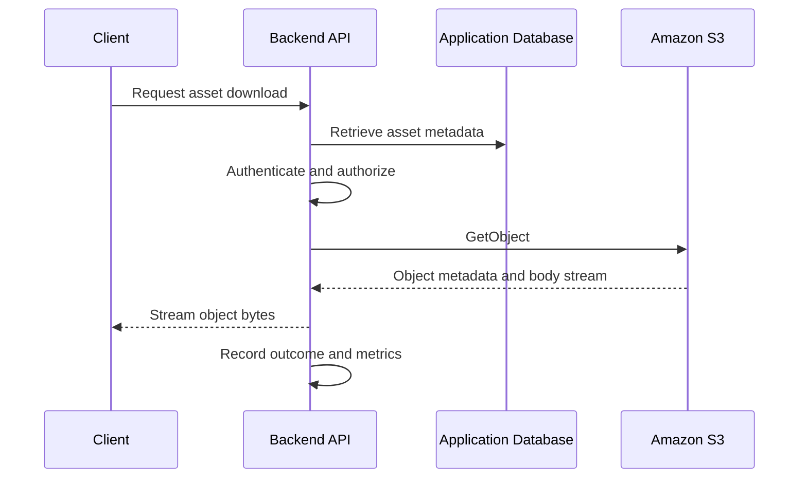

# 02- Downloading Objects

## Overview

Downloading objects is a fundamental Amazon S3 operation used by backend applications, data pipelines, analytics systems, and operational workflows to retrieve stored files.

S3 supports several download patterns, including AWS CLI transfers, Boto3 SDK operations, backend-proxied downloads, presigned URLs, and partial-content retrieval through HTTP range requests.

The appropriate approach depends on object size, access-control requirements, application bandwidth, client capabilities, and whether the backend must inspect or transform the object before delivering it.

A production download workflow should account for:

- Object identity and version selection.
- Authentication and application-level authorization.
- Streaming and memory consumption.
- Network timeouts and interrupted transfers.
- Integrity verification.
- Encryption and IAM permissions.
- Retry behavior and partial-file cleanup.
- Auditability, monitoring, and transfer costs.

S3 object retrieval does not automatically implement application authorization. The application must determine whether the requesting user is permitted to access the specific object before returning its contents or issuing a presigned URL.

## Download Methods

| Method | Interface | Best suited for |
|---|---|---|
| AWS CLI download | `aws s3 cp` | Administrative operations and automation |
| Boto3 managed download | `download_file()` | Downloading objects to local files |
| Boto3 streaming download | `get_object()` | Streaming, inspection, and controlled processing |
| Presigned GET URL | `generate_presigned_url()` | Direct downloads from browsers and clients |
| HTTP range request | `Range` header | Partial downloads, resumable transfers, and media seeking |
| CloudFront delivery | CloudFront URL with appropriate access controls | Frequently accessed content and geographically distributed clients |

Use managed SDK transfers for routine file downloads. Use streaming when data must be processed incrementally or passed directly to an HTTP response. Prefer direct client downloads when routing all file bytes through the application would consume excessive backend resources.

## Download Request Lifecycle

A typical backend-proxied download follows this sequence:



The database provides the mapping between an application asset and its storage location. The API authorizes access before requesting the object, while S3 enforces AWS-level permissions.

For sensitive assets, retrieve the object using the expected S3 version when versioning is enabled. Otherwise, a mutable key might refer to different content between the application's authorization decision and the download.

## AWS CLI Downloads

### Verify the AWS identity

Before downloading an object, verify which AWS identity is active:

```bash
aws sts get-caller-identity
```

For a named profile:

```bash
aws sts get-caller-identity \
  --profile s3-development
```

An authenticated identity does not necessarily have permission to read the requested object. S3 permissions, bucket policies, organization policies, and KMS permissions can independently restrict access.

### Download a single object

```bash
aws s3 cp \
  s3://example-private-bucket/reports/2026/report.pdf \
  ./report.pdf \
  --region ap-south-1
```

The command copies the object from S3 to the local filesystem. The destination directory must exist, and the executing identity must have the required access.

For a named profile:

```bash
aws s3 cp \
  s3://example-private-bucket/reports/2026/report.pdf \
  ./report.pdf \
  --profile s3-development \
  --region ap-south-1
```

### Download an object with `s3api`

The lower-level command exposes the underlying `GetObject` operation:

```bash
aws s3api get-object \
  --bucket example-private-bucket \
  --key reports/2026/report.pdf \
  ./report.pdf \
  --region ap-south-1
```

This approach is useful when scripting API-specific operations or working with object metadata and version identifiers.

### Download a specific object version

If bucket versioning is enabled and the caller needs a historical object version, specify the version ID:

```bash
aws s3api get-object \
  --bucket example-private-bucket \
  --key reports/2026/report.pdf \
  --version-id "VERSION_ID" \
  ./report.pdf \
  --region ap-south-1
```

Replace `VERSION_ID` with the actual version identifier.

Retrieving a particular version generally requires `s3:GetObjectVersion`. Without the version parameter, S3 normally returns the current object version. A current delete marker can make an ordinary object retrieval behave as though the object does not exist.

### Download a directory prefix

```bash
aws s3 cp \
  s3://example-private-bucket/exports/ \
  ./exports/ \
  --recursive \
  --region ap-south-1
```

Synchronize a remote prefix with a local directory:

```bash
aws s3 sync \
  s3://example-private-bucket/exports/ \
  ./exports/ \
  --region ap-south-1
```

The CLI uses object keys and prefixes rather than a real directory hierarchy. Ensure the source prefix and local destination are correct before executing bulk operations.

By default, `sync` downloads objects that are missing or considered out of date locally. It does not normally delete extra local files unless `--delete` is supplied.

## Downloading with Boto3

Boto3 provides both managed file transfers and lower-level streaming APIs.

### Configure an S3 client

```python
# app/storage.py

import boto3
from botocore.config import Config
from boto3.s3.transfer import TransferConfig


s3_client = boto3.client(
    "s3",
    region_name="ap-south-1",
    config=Config(
        connect_timeout=5,
        read_timeout=60,
        retries={
            "mode": "standard",
            "total_max_attempts": 4,
        },
    ),
)

TRANSFER_CONFIG = TransferConfig(
    multipart_threshold=64 * 1024 * 1024,
    multipart_chunksize=16 * 1024 * 1024,
    max_concurrency=4,
    use_threads=True,
)
```

These settings are illustrative. Select connection timeouts, read timeouts, concurrency, and transfer sizes based on object sizes and workload measurements.

Use the AWS credential provider chain rather than embedding long-lived credentials in application code. In production, prefer temporary credentials supplied through an appropriate IAM role or workload identity.

Initialize clients safely according to the process model of the application. For example, avoid sharing initialized clients across process forks without validating the client lifecycle.

### Download to a local file

Use `download_file()` when the application needs a local file or temporary artifact.

```python
from pathlib import Path


def download_file(
    *,
    bucket_name: str,
    object_key: str,
    destination: Path,
    version_id: str | None = None,
) -> None:
    extra_args = {}

    if version_id:
        extra_args["VersionId"] = version_id

    s3_client.download_file(
        Bucket=bucket_name,
        Key=object_key,
        Filename=str(destination),
        ExtraArgs=extra_args or None,
        Config=TRANSFER_CONFIG,
    )
```

The managed transfer interface handles routine download mechanics and can use ranged requests and concurrent transfer operations where appropriate.

For application code, ensure the destination path is trusted. Do not combine a user-controlled filename directly with a filesystem path, because path traversal can cause writes outside the intended directory.

A safer approach is to generate a temporary filename or derive it from a trusted application asset ID. When an incomplete download must not be mistaken for a valid artifact, download to a temporary path and atomically rename it after successful completion and verification.

### Download through `get_object()`

`get_object()` returns response metadata and a streaming body. It is useful when the application needs custom processing, response headers, object metadata, or a bounded-memory transfer.

```python
from pathlib import Path


def download_stream_to_file(
    *,
    bucket_name: str,
    object_key: str,
    destination: Path,
    version_id: str | None = None,
) -> None:
    params = {
        "Bucket": bucket_name,
        "Key": object_key,
    }

    if version_id:
        params["VersionId"] = version_id

    response = s3_client.get_object(**params)
    body = response["Body"]

    temporary_path = destination.with_name(
        f".{destination.name}.part"
    )

    try:
        with temporary_path.open("wb") as fileobj:
            for chunk in body.iter_chunks(chunk_size=1024 * 1024):
                if chunk:
                    fileobj.write(chunk)

        temporary_path.replace(destination)

    except Exception:
        temporary_path.unlink(missing_ok=True)
        raise

    finally:
        body.close()
```

The example downloads incrementally and only promotes the temporary file after the stream finishes successfully. In production, ensure the temporary file is on the same filesystem as the destination when atomic replacement is required, use appropriately restricted temporary directories, and handle destination permissions and cleanup.

For workloads that require a checksum, compute it while streaming and compare it with a trusted expected value or an applicable S3 checksum.

### Inspect object metadata before downloading

A `HeadObject` request retrieves object metadata without downloading the body:

```python
def get_object_metadata(
    *,
    bucket_name: str,
    object_key: str,
    version_id: str | None = None,
) -> dict:
    params = {
        "Bucket": bucket_name,
        "Key": object_key,
    }

    if version_id:
        params["VersionId"] = version_id

    return s3_client.head_object(**params)
```

Metadata can help the application enforce size limits, select a transfer strategy, record content length, or obtain a version identifier.

Do not treat `HeadObject` as a substitute for retrieving and validating content. Metadata may be incorrect for the application's expectations, and object content still requires appropriate validation.

Also avoid a separate metadata lookup followed by an unversioned read when the key may change between requests. Prefer using a known version ID when a workflow requires stable object identity.

## Streaming and Memory Management

### Why streaming matters

Loading a complete object into memory can create substantial memory pressure:

```python
response = s3_client.get_object(
    Bucket=bucket_name,
    Key=object_key,
)

data = response["Body"].read()
```

This pattern may be acceptable for small objects with a strict size limit. It is unsafe as a general approach for large objects or high-concurrency services.

If ten concurrent requests each buffer a 200 MiB object, the object payloads alone can require approximately 2 GiB of memory, excluding Python objects, runtime overhead, and other application allocations.

Streaming reduces the need to buffer complete objects. Read bounded chunks and ensure the response body is closed on success, errors, and client disconnects.

### Backend-proxied versus direct download

| Consideration | Backend-proxied download | Direct S3 download |
|---|---|---|
| Authorization | Checked by the backend for each request | Checked by the backend before URL issuance, then enforced by the signed S3 request |
| Backend bandwidth | Carries the file bytes | Does not carry the file bytes |
| Content transformation | Straightforward within the backend or downstream pipeline | Requires separate processing or delivery architecture |
| Client throughput | Limited partly by application infrastructure | Direct transfer from S3 or CDN |
| URL exposure | No S3 URL needs to be returned | The presigned URL is a bearer credential |
| Large-file scalability | Requires careful connection, memory, and bandwidth planning | Usually scales more efficiently for file delivery |
| Range requests | Must be implemented correctly by the backend | Can be sent directly to S3 when supported by the signed request |

Use a proxy when the application must control the response body or perform transformations. Prefer direct downloads when backend egress is a bottleneck and a temporary access grant is sufficient.

## Implement a Backend Streaming Endpoint

A backend endpoint should authorize the asset, retrieve the expected object, and stream the body without buffering the entire file.

The following FastAPI example assumes that `get_authorized_asset()` is an application-specific query that enforces object ownership and tenant authorization.

```python
from urllib.parse import quote

from botocore.exceptions import ClientError
from fastapi import APIRouter, Depends, HTTPException
from fastapi.responses import StreamingResponse

from app.auth import get_current_user
from app.models import get_authorized_asset
from app.storage import s3_client

router = APIRouter()


def stream_s3_body(body, chunk_size: int = 1024 * 1024):
    try:
        for chunk in body.iter_chunks(chunk_size=chunk_size):
            if chunk:
                yield chunk
    finally:
        body.close()


@router.get("/assets/{asset_id}/download")
def download_asset(
    asset_id: int,
    current_user=Depends(get_current_user),
):
    asset = get_authorized_asset(
        asset_id=asset_id,
        user=current_user,
    )

    params = {
        "Bucket": asset.bucket_name,
        "Key": asset.object_key,
    }

    if asset.version_id:
        params["VersionId"] = asset.version_id

    try:
        response = s3_client.get_object(**params)

    except ClientError as exc:
        error = exc.response.get("Error", {})
        status_code = (
            exc.response.get("ResponseMetadata", {}).get(
                "HTTPStatusCode",
                0,
            )
        )

        if error.get("Code") in {"NoSuchKey", "NoSuchVersion"}:
            raise HTTPException(
                status_code=404,
                detail="Asset not found",
            ) from None

        if status_code == 403:
            raise HTTPException(
                status_code=502,
                detail="Object storage access failed",
            ) from None

        raise HTTPException(
            status_code=502,
            detail="Unable to retrieve asset",
        ) from None

    filename = asset.original_filename or "download"
    safe_filename = filename.replace("\r", "").replace("\n", "")

    headers = {
        "Content-Disposition": (
            "attachment; filename*=UTF-8''"
            + quote(safe_filename, safe="")
        ),
        "X-Content-Type-Options": "nosniff",
    }

    content_length = response.get("ContentLength")

    if content_length is not None:
        headers["Content-Length"] = str(content_length)

    return StreamingResponse(
        stream_s3_body(response["Body"]),
        media_type=asset.content_type or "application/octet-stream",
        headers=headers,
    )
```

Important production considerations:

- The database lookup must enforce authorization, not merely find a matching asset ID.
- S3 access failures should be logged internally with useful context and mapped to controlled client responses.
- A `403` from S3 does not always prove that the caller is unauthorized; it may indicate an application IAM or bucket-policy misconfiguration. Do not expose internal policy details to the client.
- The S3 body is closed in the generator's `finally` block, including when streaming ends with an exception or client disconnect.
- Failures after the response has started may not allow the server to return a replacement HTTP status. Monitor interrupted streams and incomplete transfers.
- Test the response behavior under the actual ASGI server, reverse proxy, and deployment configuration.

For very large files or sustained download traffic, a presigned URL or CloudFront-based delivery may be a better architectural choice than proxying the entire object.

## Presigned Download URLs

A presigned GET URL provides temporary access to a specific S3 object. The URL is signed using the credentials of the identity that generated it.

The backend should authorize the requester before generating the URL. A presigned URL is not a replacement for application authorization; it is the access grant issued after authorization succeeds.

### Generate a presigned GET URL

```python
from urllib.parse import quote

from app.storage import s3_client


def create_download_url(
    *,
    bucket_name: str,
    object_key: str,
    filename: str,
    expires_in: int = 300,
) -> str:
    if not 1 <= expires_in <= 3600:
        raise ValueError("Invalid URL expiration")

    safe_filename = filename.replace("\r", "").replace("\n", "")

    return s3_client.generate_presigned_url(
        ClientMethod="get_object",
        Params={
            "Bucket": bucket_name,
            "Key": object_key,
            "ResponseContentDisposition": (
                "attachment; filename*=UTF-8''"
                + quote(safe_filename, safe="")
            ),
        },
        ExpiresIn=expires_in,
    )
```

This example restricts the requested URL lifetime to one hour. The actual usable period can be shorter if the signing credentials expire or other restrictions invalidate the request.

The backend should load the bucket and key from trusted application metadata. Never allow a caller to request a presigned URL for an arbitrary bucket or key simply by supplying those values.

### Return an authorized download URL

A common API flow is:

1. Authenticate the requester.
2. Retrieve the asset by application ID.
3. Verify ownership, tenant membership, and any relevant business permissions.
4. Generate a short-lived presigned URL for the authorized object.
5. Return the URL and its intended expiration to the client.

Example response:

```json
{
  "asset_id": "4812",
  "download_url": "PRESIGNED_GET_URL",
  "expires_in_seconds": 300
}
```

The URL is a placeholder, not a working address. Handle actual presigned URLs as sensitive credentials and exclude them from logs, analytics events, and exception traces.

### Protect URL usage

Presigned URLs have several important characteristics:

- They grant access through possession of the URL.
- They expire after the configured lifetime or when the underlying signing credentials become invalid, whichever occurs first.
- They can generally be reused while valid; they are not inherently single-use.
- They can be restricted by IAM policies and other applicable controls.
- The signed method, key, and any signed request parameters must match the actual request.

For highly sensitive content, use short expiration periods and avoid forwarding URLs through untrusted services. If access must be re-evaluated continuously, proxy the download or use an architecture that provides the required authorization behavior.

References:
- [Using presigned URLs](https://docs.aws.amazon.com/AmazonS3/latest/userguide/using-presigned-url.html)
- [Downloading objects with presigned URLs](https://docs.aws.amazon.com/AmazonS3/latest/userguide/ShareObjectPreSignedURL.html)

## Partial Downloads and HTTP Range Requests

An HTTP range request retrieves a specific byte range instead of the entire object. This is useful for large-file resumption, seeking within media, and applications that need to inspect selected sections of a file.

S3 supports the `Range` header for `GetObject` requests.

### Retrieve part of an object with Boto3

```python
def download_range(
    *,
    bucket_name: str,
    object_key: str,
    start_byte: int,
    end_byte: int,
    version_id: str | None = None,
) -> bytes:
    if start_byte < 0 or end_byte < start_byte:
        raise ValueError("Invalid byte range")

    params = {
        "Bucket": bucket_name,
        "Key": object_key,
        "Range": f"bytes={start_byte}-{end_byte}",
    }

    if version_id:
        params["VersionId"] = version_id

    response = s3_client.get_object(**params)

    try:
        return response["Body"].read()

    finally:
        response["Body"].close()
```

The example buffers the requested range in memory, which is acceptable only when the range size is bounded. For larger ranges, stream the response body in chunks.

The returned `ContentRange` and `ContentLength` fields can help validate that the expected portion was retrieved. A byte-range end value is inclusive.

### Support HTTP range requests in an API

A backend that implements partial-content downloads must correctly handle:

- Parsing and validating the requested range.
- Verifying the requested byte positions against the object's length.
- Returning `206 Partial Content` for a valid partial response.
- Returning the correct `Content-Range` and `Content-Length` headers.
- Handling unsatisfiable ranges according to HTTP semantics.
- Closing the S3 body after the transfer.
- Preventing ranges from being applied to a different version of the object during a resumed download.

Do not simply forward a client's `Range` header to S3 and return the result as an ordinary `200 OK` response. The backend must construct correct HTTP response semantics.

When direct S3 downloads meet the application's authorization requirements, allowing the client to request ranges from a presigned URL can avoid implementing this behavior in the backend.

## Download Integrity and Version Consistency

A successful `GetObject` response establishes that the service returned object data. Applications with stronger integrity requirements should verify the appropriate checksum or content identity.

### Use a stable object identity

If bucket versioning is enabled, store the object's version ID with the application asset record when that specific version matters. Use the same version ID for metadata inspection and download.

Without version binding, a new write to the same key can change the content between metadata inspection and retrieval.

For immutable or audit-sensitive artifacts, unique object keys and explicit version tracking simplify recovery and investigation.

### Check checksums

Amazon S3 supports multiple checksum algorithms. The correct checksum workflow depends on how the object was uploaded, the available checksum metadata, and whether a full-object or composite checksum is used.

Do not assume an ETag is universally the object's MD5 digest. Multipart uploads and other conditions can produce different ETag semantics.

If the application requires a SHA-256 content hash, compute it over the retrieved byte stream or use a stored trusted checksum that matches the required checksum contract.

Example of computing a digest while streaming to disk:

```python
import hashlib
from pathlib import Path


def download_and_hash(
    *,
    bucket_name: str,
    object_key: str,
    destination: Path,
) -> str:
    response = s3_client.get_object(
        Bucket=bucket_name,
        Key=object_key,
    )

    digest = hashlib.sha256()
    body = response["Body"]

    try:
        with destination.open("wb") as fileobj:
            for chunk in body.iter_chunks(chunk_size=1024 * 1024):
                if chunk:
                    digest.update(chunk)
                    fileobj.write(chunk)

    finally:
        body.close()

    return digest.hexdigest()
```

For production use, download to a temporary path and publish it only after verification succeeds. If a checksum mismatch occurs, quarantine or remove the temporary artifact and record the failure.

A checksum does not prove that a file is safe to parse or that its content satisfies business requirements.

Reference: [Checking object integrity](https://docs.aws.amazon.com/AmazonS3/latest/userguide/checking-object-integrity.html).

## Encryption and Permissions

Downloading an object requires applicable S3 permissions and, for some encryption configurations, separate encryption-key authorization.

| Configuration | Consideration |
|---|---|
| SSE-S3 | S3 handles server-side encryption and decryption |
| SSE-KMS | The caller may require relevant KMS permissions, and the key policy must allow access |
| SSE-C | The appropriate customer-provided encryption key must be supplied for retrieval |
| Version-specific retrieval | Requires permission to access the specified object version |
| Cross-account retrieval | May require permissions on both the caller and resource sides, depending on the access design |

For an ordinary object read, `s3:GetObject` is a common required permission. Version-specific retrieval commonly requires `s3:GetObjectVersion`.

For SSE-KMS, troubleshoot S3 access and KMS authorization separately. A caller can have permission to request an object but still be unable to decrypt it because of the KMS key policy, grants, IAM policy, or organizational restrictions.

Avoid logging encryption keys, temporary credentials, authorization headers, or sensitive object metadata.

## Error Handling and Retries

A production downloader should distinguish between retryable failures and conditions that require correcting the request or permissions.

| Failure | Recommended response |
|---|---|
| Network timeout or connection interruption | Retry within a bounded policy |
| Transient S3 service error | Retry with appropriate backoff |
| Throttling | Back off and review concurrent request volume |
| `NoSuchKey` | Check the key, upload workflow, and current object version |
| `NoSuchVersion` | Verify the recorded version ID and retention state |
| `AccessDenied` | Inspect IAM, bucket policy, organization controls, and KMS permissions |
| Invalid Region or endpoint | Correct the client configuration |
| Expired presigned URL | Authorize the request again and issue a new URL |
| Checksum mismatch | Reject the local artifact and investigate data integrity |
| Local disk full or permission denied | Correct local storage conditions before retrying |
| Client disconnect during streaming | Close resources and allow a controlled client retry |

### Retry correctly

Boto3 can retry certain transient request failures, but the application must still handle larger workflow failures. Do not retry every `ClientError` indiscriminately.

For managed downloads, retrying an interrupted transfer may be possible through the SDK transfer manager. For a manually implemented streaming download, restarting may require reopening the S3 object and discarding or replacing the incomplete local file.

Resuming from a byte offset is safe only when the source object identity remains stable. Use a version ID or another reliable immutability guarantee before appending data from a subsequent range request to an existing partial file.

Never append a newly downloaded full object to an incomplete file; doing so corrupts the result.

### Handle missing-object responses carefully

The exact error information available for a missing object can depend on the caller's permissions and API behavior. Some access-denied responses can also conceal resource existence.

Log the internal AWS error code and request context, but return a stable application response that does not disclose unauthorized object existence or internal storage details.

## Performance and Cost Considerations

### Tune transfer concurrency

Managed downloads can improve throughput by using concurrent ranged requests for suitable objects. Higher concurrency also increases simultaneous connections, resource usage, and potential request volume.

Measure:

- Download duration by object size.
- Throughput and retry rates.
- Worker or API memory usage.
- Open connections and response completion time.
- S3 request costs and data transfer costs.
- Frequency of interrupted or abandoned downloads.

Do not use the same concurrency settings for every deployment without measurement.

### Avoid unnecessary backend egress

If clients download large objects frequently, direct presigned URLs or CloudFront can reduce backend bandwidth consumption and free application resources for business logic.

CloudFront is especially relevant for frequently accessed content, geographically distributed users, and workloads that benefit from caching. Private content requires suitable origin access and viewer authorization controls; a CDN does not eliminate the need for access control.

### Avoid unnecessary repeated downloads

Cache generated derivatives or reusable processing outputs where appropriate. For immutable objects, stable identifiers can make caching easier.

Choose storage classes according to access frequency, retrieval latency requirements, retrieval fees, and minimum storage-duration constraints. Restoring archived content may require an explicit restore process before ordinary retrieval is available.

## Monitoring and Operations

Monitor both S3 operations and application-level outcomes.

| Signal | Operational purpose |
|---|---|
| Download success and failure rate | Detects access, object, and connectivity issues |
| Download latency by object size | Reveals performance regressions |
| Transfer interruption rate | Identifies network or client stability problems |
| `AccessDenied` count | Detects permissions or configuration changes |
| Queue age for asynchronous downloads | Reveals worker backlog |
| Missing referenced objects | Indicates inconsistent database or object state |
| Retry count | Shows transient instability or incorrect retry policy |
| Data transfer volume and charges | Helps identify unexpected cost growth |

Use CloudWatch and relevant AWS metrics for infrastructure-level visibility. Use structured application logs and metrics for user-facing download workflows.

Correlate asset IDs, request IDs, and S3 request identifiers where available. Avoid storing complete presigned URLs or sensitive document identifiers in general-purpose logs.

## Testing Strategy

### Unit tests

Test storage-service behavior using mocked S3 responses. Cover:

- Successful downloads.
- Missing-object and access-denied failures.
- Version-specific retrieval.
- Content length and metadata handling.
- Stream closure.
- Checksum calculation.
- Interrupted transfers and local write errors.
- Presigned URL method, object key, and expiration.
- HTTP headers and filename handling.
- Range validation and response semantics where implemented.

Ensure tests verify failure cleanup, not only the successful path.

### Integration tests

Use a dedicated test bucket and appropriately restricted AWS identity to verify:

- Actual object retrieval.
- Presigned URL behavior.
- Version-specific reads.
- Encryption and KMS permissions.
- Checksum availability and validation.
- Large-object managed downloads.
- HTTP range requests where required.
- Access-denied and expired-URL behavior.

S3-compatible emulators can be useful for local development, but they may not fully reproduce IAM, KMS, versioning, presigned URL, and service-specific semantics. Use real-AWS integration tests for capabilities that depend on genuine AWS behavior.

Do not claim an AWS workflow passed without executing the corresponding tests.

## Common Mistakes

### Loading every object into memory

Calling `Body.read()` without a size may buffer an entire object. Stream large files and set explicit limits for workloads where full buffering is acceptable.

### Downloading without checking application ownership

An unpredictable asset ID or object key is not authorization. Verify tenant membership, user permissions, and object identity before accessing S3 or generating a presigned URL.

### Assuming all failed downloads are retryable

Missing objects, invalid request parameters, and authorization errors usually require diagnosis rather than repeated requests. Classify errors and use bounded retries.

### Treating presigned URLs as single-use

A valid URL may be reused until it expires. Protect it as a bearer credential and avoid relying on URL expiration alone for sensitive-data security.

### Ignoring version IDs

Downloading the current key may retrieve different content from the version associated with an earlier operation. Persist version IDs when stable object identity is required.

### Trusting ETags as universal checksums

Multipart transfer and other upload conditions can produce ETags that are not the complete object's MD5 digest. Use an explicit, appropriate checksum strategy.

### Leaking S3 details to API clients

Raw AWS errors can reveal internal resource identifiers or configuration. Map errors to stable API responses while retaining useful diagnostic information in restricted logs.

### Failing to close the response body

An unclosed streaming body can retain network resources. Use a `finally` block or a context-management pattern supported by the relevant SDK response type.

## Operational Verification Checklist

- [ ] The active AWS identity and Region are correct.
- [ ] The caller has access to the intended bucket, key, and version.
- [ ] The application authorizes the requester before reading the object.
- [ ] The download uses the expected object version where required.
- [ ] Large objects are streamed or downloaded through managed transfers.
- [ ] Temporary files are cleaned up after interrupted or failed downloads.
- [ ] Checksums are verified where data integrity requirements demand them.
- [ ] SSE-KMS and other encryption permissions are configured correctly.
- [ ] Presigned URLs are short-lived and excluded from logs.
- [ ] Retry behavior distinguishes transient errors from permanent failures.
- [ ] Monitoring covers failures, duration, interrupted transfers, and data-transfer costs.

## Official References

- [Downloading objects in Amazon S3](https://docs.aws.amazon.com/AmazonS3/latest/userguide/download-objects.html)
- [Boto3 S3 client reference](https://boto3.amazonaws.com/v1/documentation/api/latest/reference/services/s3.html)
- [Boto3 S3 transfer guide](https://boto3.amazonaws.com/v1/documentation/api/latest/guide/s3.html)
- [Boto3 `get_object` reference](https://boto3.amazonaws.com/v1/documentation/api/latest/reference/services/s3/client/get_object.html)
- [Boto3 `download_file` reference](https://boto3.amazonaws.com/v1/documentation/api/latest/reference/services/s3/client/download_file.html)
- [Using presigned URLs](https://docs.aws.amazon.com/AmazonS3/latest/userguide/using-presigned-url.html)
- [Checking object integrity](https://docs.aws.amazon.com/AmazonS3/latest/userguide/checking-object-integrity.html)

## Key Takeaways

- Use managed Boto3 downloads for routine file transfers and streaming for large objects or incremental processing.
- Authorize every download against application-level ownership and access rules before retrieving the object or issuing a presigned URL.
- Use version-aware reads and appropriate checksums when stable object identity and integrity matter.
- Apply bounded retries, close response bodies reliably, and clean up incomplete local downloads.
- Monitor download latency, error rates, interrupted transfers, authorization failures, and data-transfer costs.