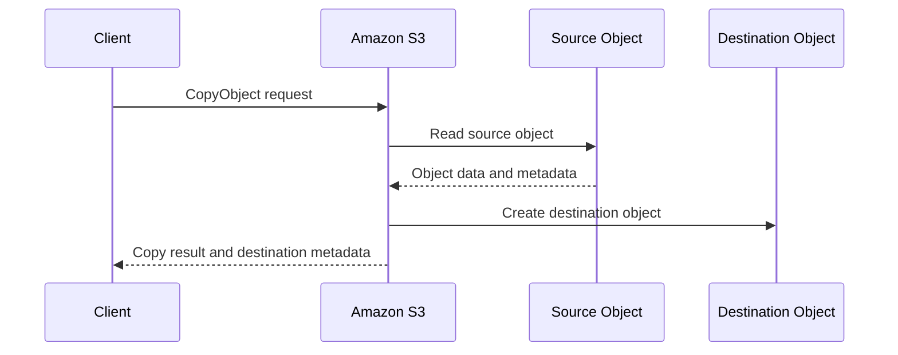
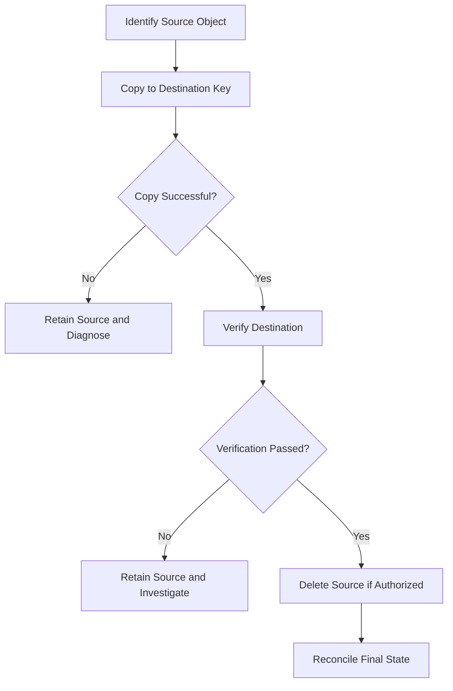

# 03- Copying Objects

## Overview

Amazon S3 object copying creates a new object from an existing S3 object. It supports copying objects within a bucket, between buckets, across AWS Regions, and between accounts when the required permissions and policies are configured.

Copy operations are useful for:

- Renaming objects or changing key prefixes.
- Moving objects between buckets or environments.
- Migrating data between Regions or accounts.
- Changing object metadata, tags, storage class, or encryption settings.
- Creating processed outputs from original files.
- Organizing archives and application-generated artifacts.
- Managing large-scale data migrations.

S3 does not provide an atomic filesystem-style rename. Renaming or moving an object generally requires copying the source to the destination and then deleting the source. These are separate operations, and a failure between them can leave both objects present.

A reliable copy workflow must account for source identity, destination overwrite behavior, metadata preservation, permissions, encryption, object versioning, and verification.

## Copy Operation Fundamentals

The S3 `CopyObject` API creates a destination object using an existing S3 object as the source. The source and destination can refer to the same bucket or different buckets.

Conceptually, the operation follows this flow:



The data transfer is handled by S3 rather than downloading the complete object to the application and uploading it again. This avoids routing the file bytes through application infrastructure.

The caller still needs permission to read the source and write the destination. Cross-account copies, encrypted objects, and copies that alter metadata or tags may require additional permissions.

### Copy operation limits

| Operation | Constraint |
|---|---|
| Single `CopyObject` request | Copies an object up to 5 GB |
| Multipart copy | Required for objects larger than 5 GB |
| Maximum general-purpose S3 object size | 50 TB |
| Same-bucket copy | Creates a new object at the destination key |
| Copy into a versioned destination | Creates a new destination object version |
| Rename or move | Requires a copy followed by a separate delete |
| Large-scale multi-object migration | Consider AWS CLI managed transfers or S3 Batch Operations |

For objects larger than 5 GB, use multipart copy through an appropriate AWS SDK or CLI transfer workflow. Multipart copy reads ranges from the source and assembles the copied object through multipart upload operations.

Check the current AWS documentation for service limits and operation-specific constraints before designing large-object migrations.

Reference: [Copying, moving, and renaming objects](https://docs.aws.amazon.com/AmazonS3/latest/userguide/copy-object.html).

## Copying Objects with the AWS CLI

### Copy within the same bucket

```bash
aws s3 cp \
  s3://example-private-bucket/reports/2026/report.pdf \
  s3://example-private-bucket/archive/2026/report.pdf \
  --region ap-south-1
```

This creates a copy at the destination key. The source remains unchanged.

The operation is useful for key reorganization, archival workflows, and producing another object under a different prefix.

### Copy between buckets

```bash
aws s3 cp \
  s3://source-private-bucket/reports/report.pdf \
  s3://destination-private-bucket/imports/report.pdf \
  --region ap-south-1
```

The source and destination buckets do not need to be identical. The destination bucket must exist, and the caller must have the necessary permissions for both resources.

When copying across Regions, configure the correct Region for the destination operation and ensure the caller can access the source object. Cross-Region transfers may incur data-transfer charges.

### Copy between Regions

```bash
aws s3 cp \
  s3://source-private-bucket/reports/report.pdf \
  s3://destination-private-bucket/reports/report.pdf \
  --source-region us-east-1 \
  --region ap-south-1
```

This example uses a source bucket in `us-east-1` and a destination bucket in `ap-south-1`.

Use the source Region explicitly when necessary, particularly for cross-Region automation. Validate that the source and destination are in the intended AWS accounts and Regions before executing bulk operations.

### Copy an entire prefix

```bash
aws s3 cp \
  s3://source-private-bucket/reports/ \
  s3://destination-private-bucket/archive/reports/ \
  --recursive \
  --region ap-south-1
```

The trailing slash and recursive option define how the source prefix is processed. Review the resulting destination key structure before using this pattern in automation.

For repeated synchronization, consider `aws s3 sync`:

```bash
aws s3 sync \
  s3://source-private-bucket/reports/ \
  s3://destination-private-bucket/archive/reports/ \
  --region ap-south-1
```

`sync` compares objects and transfers those it determines need copying. It is not a transactional migration and does not automatically make the destination an exact mirror. By default, destination-only objects are not deleted.

Add `--delete` only when destination-only object removal is explicitly intended and the source/destination paths have been verified.

### Copy with a different storage class

```bash
aws s3 cp \
  s3://example-private-bucket/reports/report.pdf \
  s3://example-private-bucket/archive/report.pdf \
  --storage-class STANDARD_IA \
  --region ap-south-1
```

This creates the destination object using the selected storage class. The source remains in its original storage class.

Select storage classes according to retrieval patterns, minimum storage-duration requirements, access latency, and retrieval costs. A lower storage rate does not necessarily mean lower total cost for frequently accessed data.

## Using the Low-Level CopyObject API

Use `aws s3api copy-object` when you need explicit API parameters for one object.

```bash
aws s3api copy-object \
  --bucket destination-private-bucket \
  --key archive/report.pdf \
  --copy-source source-private-bucket/reports/report.pdf \
  --region ap-south-1
```

The `--copy-source` argument identifies the existing object to copy. When source keys or version IDs contain special characters, encode the source identifier as required by the API.

A single `CopyObject` request cannot copy an object larger than 5 GB. Use a multipart-copy workflow for larger objects instead.

### Copy a specific source version

For a versioned source bucket, specify the version ID when the destination must represent a particular historical object.

```bash
aws s3api copy-object \
  --bucket destination-private-bucket \
  --key archive/report.pdf \
  --copy-source 'source-private-bucket/reports/report.pdf?versionId=SOURCE_VERSION_ID' \
  --region ap-south-1
```

Replace `SOURCE_VERSION_ID` with the actual source version ID and ensure the source identifier is encoded correctly when necessary.

The source version must be accessible to the caller. Version-specific copy operations commonly require `s3:GetObjectVersion` on the source in addition to the relevant destination permissions.

Without an explicit source version, the copy normally uses the current object version.

## Copying with Boto3

Boto3 offers both a low-level `copy_object()` operation and a higher-level managed `copy()` transfer.

| Method | Behavior | Suitable use |
|---|---|---|
| `copy_object()` | Direct single-request copy, limited to 5 GB | Small objects and explicit API-level control |
| `copy()` | Managed copy transfer that can use multipart copy | General-purpose copying, including large objects |
| Multipart copy APIs | Explicit control over source ranges and part completion | Specialized workflows requiring custom scheduling or resumability |

### Configure the S3 client

```python
# app/storage.py

import boto3
from botocore.config import Config
from boto3.s3.transfer import TransferConfig


s3_client = boto3.client(
    "s3",
    region_name="ap-south-1",
    config=Config(
        connect_timeout=5,
        read_timeout=60,
        retries={
            "mode": "standard",
            "total_max_attempts": 4,
        },
    ),
)

TRANSFER_CONFIG = TransferConfig(
    multipart_threshold=64 * 1024 * 1024,
    multipart_chunksize=16 * 1024 * 1024,
    max_concurrency=4,
    use_threads=True,
)
```

The transfer settings are illustrative. Tune them against observed object sizes, copy duration, memory use, and concurrency requirements.

In production, use the AWS SDK credential provider chain and temporary role credentials. Avoid hardcoding access keys, and initialize clients safely within the application's process model.

### Copy an object with the managed transfer API

```python
def copy_object(
    *,
    source_bucket: str,
    source_key: str,
    destination_bucket: str,
    destination_key: str,
    source_version_id: str | None = None,
) -> None:
    copy_source = {
        "Bucket": source_bucket,
        "Key": source_key,
    }

    if source_version_id:
        copy_source["VersionId"] = source_version_id

    s3_client.copy(
        CopySource=copy_source,
        Bucket=destination_bucket,
        Key=destination_key,
        Config=TRANSFER_CONFIG,
    )
```

The high-level transfer interface handles routine transfer mechanics and can use multipart copy for large objects.

This example retains the normal copy behavior for object metadata and tags, subject to the relevant S3 API behavior and bucket configuration. When a workflow needs a different metadata or tagging policy, specify that policy explicitly.

### Copy and change metadata

S3 object metadata cannot generally be edited in place. Updating metadata requires creating a new object representation, typically by copying the object to itself or to another key with replacement metadata.

```python
def copy_with_replacement_metadata(
    *,
    source_bucket: str,
    source_key: str,
    destination_bucket: str,
    destination_key: str,
    content_type: str,
) -> None:
    s3_client.copy(
        CopySource={
            "Bucket": source_bucket,
            "Key": source_key,
        },
        Bucket=destination_bucket,
        Key=destination_key,
        ExtraArgs={
            "MetadataDirective": "REPLACE",
            "ContentType": content_type,
            "Metadata": {
                "managed-by": "report-service",
            },
        },
        Config=TRANSFER_CONFIG,
    )
```

`MetadataDirective="REPLACE"` means the supplied metadata replaces the source object's user-defined metadata and relevant replaceable metadata fields. Include all metadata values that must be retained, such as content type, cache control, content disposition, or content encoding.

Do not assume the original metadata is automatically retained when using `REPLACE`. An omitted content type can cause the object to use a default type rather than preserving the original type.

A same-key copy that replaces metadata can create a new version when versioning is enabled or replace the current object when versioning is disabled.

## Metadata and Tagging Behavior

By default, a copy generally preserves source object metadata and tags according to S3's copy semantics. If the application changes the metadata or tagging directives, it must explicitly specify the intended destination values.

### Metadata directive

| Directive | Behavior | Typical use |
|---|---|---|
| `COPY` | Preserve source metadata | Ordinary copy without metadata changes |
| `REPLACE` | Replace metadata with supplied values | Set a new content type, cache policy, or user-defined metadata |

Metadata replacement may require the caller to supply all desired replacement values. Review system-defined metadata behavior separately from user-defined metadata, because some fields are controlled by S3 and cannot be set arbitrarily.

### Tagging directive

Object tags are distinct from user-defined metadata. Tags can be used by lifecycle rules, cost allocation, and applicable access-control conditions.

| Directive | Behavior |
|---|---|
| `COPY` | Copy the source object's tags when supported and permitted |
| `REPLACE` | Apply the supplied destination tag set |

For example, copy an object while replacing its tags:

```python
s3_client.copy(
    CopySource={
        "Bucket": "source-private-bucket",
        "Key": "reports/report.pdf",
    },
    Bucket="destination-private-bucket",
    Key="archive/report.pdf",
    ExtraArgs={
        "TaggingDirective": "REPLACE",
        "Tagging": "environment=archive&purpose=retention",
    },
    Config=TRANSFER_CONFIG,
)
```

When tag values contain characters that require encoding, encode the tag query string correctly. Tagging operations may require additional permissions, such as permission to read source tags and to write destination tags.

Do not put secrets or confidential personal data into metadata or tags.

## Copying Encrypted Objects

Copying encrypted objects requires attention to both source decryption and destination encryption behavior.

### Encryption considerations

| Source or destination configuration | Operational requirement |
|---|---|
| SSE-S3 source | Read the source through the appropriate S3 permissions |
| SSE-KMS source | Source reads may require KMS decryption permission |
| SSE-KMS destination | The caller and key policy must allow encryption with the destination key |
| Different source and destination KMS keys | Authorize both source decryption and destination encryption |
| SSE-C source | Supply the required customer-provided encryption parameters for the source |
| Cross-account copy | Verify source access, destination write access, object ownership, and relevant key policies |

Unless explicitly specified, destination encryption behavior can be influenced by the destination bucket's default encryption configuration. For workloads requiring a particular KMS key, configure that key explicitly and verify the resulting object.

### Copy with destination SSE-KMS encryption

```python
def copy_using_destination_kms_key(
    *,
    source_bucket: str,
    source_key: str,
    destination_bucket: str,
    destination_key: str,
    kms_key_arn: str,
) -> None:
    s3_client.copy(
        CopySource={
            "Bucket": source_bucket,
            "Key": source_key,
        },
        Bucket=destination_bucket,
        Key=destination_key,
        ExtraArgs={
            "ServerSideEncryption": "aws:kms",
            "SSEKMSKeyId": kms_key_arn,
        },
        Config=TRANSFER_CONFIG,
    )
```

The identity used by the copy operation must be authorized for the relevant source and destination resources. For SSE-KMS, check IAM permissions, key policies, grants, and organizational controls independently of S3 permissions.

A successful source read does not prove that the destination encryption operation will succeed.

## Cross-Account and Cross-Region Copies

### Cross-account copies

Cross-account copies are used for centralized storage, environment separation, partner integrations, and account migrations.

Before copying, verify:

- The source identity can read the source object or requested version.
- The destination identity is allowed to write to the destination bucket.
- The destination bucket policy permits the intended principal.
- KMS key policies permit the applicable decrypt and encrypt operations.
- The destination uses the intended object ownership and encryption settings.
- Any required source metadata and tags can be read and copied.

Where practical, use explicit IAM roles and temporary credentials. Avoid broad permissions across entire buckets when the migration can be scoped to a prefix.

For large migrations, use a dedicated migration identity and verify access boundaries before transferring production data.

### Cross-Region copies

Cross-Region copies are useful for regional migrations, application-level archival workflows, and controlled data distribution.

Operational considerations include:

- Network and data-transfer costs.
- Destination bucket and KMS configuration.
- Differences in bucket policies or ownership settings.
- Copy duration and retry behavior.
- Regional service availability.
- Source and destination object verification.
- Retention and recovery requirements.

A cross-Region copy is not the same as configuring replication. Copy workflows explicitly create destination objects, while S3 Replication asynchronously applies configured replication rules to eligible objects and versions.

## Renaming and Moving Objects

S3 does not support an atomic rename operation for ordinary objects. A move or rename is generally implemented as:

1. Copy the source object to the new key.
2. Verify that the destination was created as expected.
3. Delete the source if the move policy permits it.



### Use the AWS CLI move command

```bash
aws s3 mv \
  s3://example-private-bucket/reports/old-name.pdf \
  s3://example-private-bucket/reports/new-name.pdf \
  --region ap-south-1
```

The command performs a copy followed by source deletion. It is a convenience operation, not an atomic rename.

If the copy succeeds but source deletion fails, both objects can remain. For recursive moves, some objects may succeed while others fail, so inspect command output and verify results instead of assuming all-or-nothing behavior.

### Safer application-level move

For important application data, separate copy and delete into explicit steps. Verify the destination's key, size, and expected version or checksum before deleting the source.

If the database stores the canonical object key, update application metadata only after the copy is verified. A durable workflow record or reconciliation process is useful when the move can outlive a single request.

With bucket versioning enabled, deleting the source typically creates a delete marker rather than permanently removing all historical versions. Permanent deletion of a particular version is a separate operation and should follow the retention policy.

## Copying Large Objects

A single `CopyObject` request supports source objects up to 5 GB. Larger objects must be copied using multipart upload with the `UploadPartCopy` API.

Multipart copy breaks the source object into ranges. Each range is copied into a part, and the parts are assembled by a multipart completion request.

The managed Boto3 `copy()` interface can perform multipart copying when necessary, according to its transfer configuration. For most applications, this is preferable to implementing the multipart protocol manually.

Manual multipart copy is justified when the application needs explicit control over range scheduling, resumption, concurrency, or durable tracking across process restarts.

Operational requirements include:

- Ensure the chosen part size and number of parts meet S3 limits.
- Preserve the intended source object version throughout the copy.
- Record part identifiers and completion state if resuming transfers.
- Handle failed parts separately from completion failures.
- Abort abandoned destination multipart uploads.
- Verify the final destination object before marking the copy complete.

For data migrations, test large objects separately from small-object workflows; their retry and capacity characteristics differ substantially.

## Copying Many Objects

For a small number of objects, a script or AWS CLI managed transfer may be sufficient. Large migrations require more deliberate planning.

| Method | Best use case | Consideration |
|---|---|---|
| AWS CLI `cp --recursive` | Straightforward one-time prefix copy | Monitor per-object failures and transfer volume |
| AWS CLI `sync` | Repeated synchronization of prefixes | It is not a transaction or full mirroring guarantee |
| Boto3 managed transfer | Application-controlled copy workflow | Requires explicit error handling and observability |
| S3 Batch Operations | Large-scale object processing driven by a manifest or supported inventory workflow | Configure the job, manifest, role, completion reporting, and supported operation limits |
| S3 Replication | Ongoing copies of eligible object versions through configured rules | Not a substitute for every ad hoc migration |

S3 Batch Operations copy has operation-specific restrictions, including a 5 GB maximum per copied object for the Batch Operations Copy operation. For objects larger than this, use an appropriate multipart-copy workflow.

Before running a bulk copy:

- Confirm source and destination bucket identities.
- Estimate request volume, transfer cost, and execution duration.
- Define the overwrite and versioning strategy.
- Verify encryption, tags, metadata, and ownership requirements.
- Ensure the process can resume or safely rerun after partial failure.
- Produce a manifest or other durable record when the migration needs reconciliation.
- Test the migration on a limited prefix before processing production data.

Do not use `sync --delete` as a cleanup shortcut without confirming that destination-only objects are safe to remove.

## Failure Handling and Verification

A copy operation can fail because of source access, destination access, invalid request parameters, encryption permissions, Region configuration, or concurrency conflicts.

| Failure | Diagnostic approach |
|---|---|
| `NoSuchKey` | Verify the source key and current source version |
| `AccessDenied` | Inspect source read, destination write, bucket policies, and organizational controls |
| SSE-KMS error | Check source KMS decryption and destination KMS encryption authorization |
| Copy exceeds operation limit | Use multipart copy for objects larger than 5 GB |
| Metadata unexpectedly changed | Review `MetadataDirective` and supplied replacement fields |
| Tags missing or changed | Review `TaggingDirective` and source/destination tag permissions |
| Destination already exists | Verify overwrite policy, conditional-write support, and versioning behavior |
| Cross-Region request failure | Check source and destination Regions and SDK/CLI configuration |
| Move leaves both objects | Confirm copy success and investigate source deletion separately |
| Multipart copy incomplete | Inspect the task state and abort abandoned multipart uploads when safe |

Use bounded retries for transient network errors and service failures. Do not retry authorization failures or invalid requests indefinitely.

### Verify the destination object

```bash
aws s3api head-object \
  --bucket destination-private-bucket \
  --key archive/report.pdf \
  --region ap-south-1
```

Compare the source and destination metadata where relevant:

```bash
aws s3api head-object \
  --bucket source-private-bucket \
  --key reports/report.pdf \
  --region ap-south-1

aws s3api head-object \
  --bucket destination-private-bucket \
  --key archive/report.pdf \
  --region ap-south-1
```

For a cross-Region copy, use the appropriate Region for each request. Compare object size, required metadata, encryption configuration, version IDs, and applicable checksums.

Do not assume that matching ETags prove byte-for-byte identity in all multipart or encryption scenarios. Use an appropriate checksum strategy when content integrity is a formal requirement.

## Security and Operational Considerations

### Least-privilege permissions

A basic copy generally requires permission to read the source object and write the destination object.

| Operation | Common permission requirement |
|---|---|
| Read source object | `s3:GetObject` |
| Read a specific source version | `s3:GetObjectVersion` |
| Write destination object | `s3:PutObject` |
| Read source tags when required | `s3:GetObjectTagging` or the version-specific equivalent |
| Delete source after a move | `s3:DeleteObject` |
| Permanently delete a specific version | `s3:DeleteObjectVersion` |
| Decrypt an SSE-KMS source | Applicable KMS decryption permission |
| Encrypt an SSE-KMS destination | Applicable KMS encryption permission |

Additional actions may be required by the particular API, transfer configuration, tagging behavior, or destination controls. Validate the actual operation and avoid granting unrelated bucket administration permissions.

### Versioning and Object Lock

When versioning is enabled, a destination copy normally creates a new version. Replacing an object therefore does not necessarily eliminate its historical data.

If Object Lock or retention controls apply, destination writes and source deletion behavior must respect the configured retention and legal-hold requirements. A successful copy does not mean the old version has been removed.

Treat destructive cleanup as a separate operation with its own authorization, audit trail, and retention checks.

### Monitoring and cost control

For operational copies, track:

- Copy success and failure rates.
- Number of objects copied.
- Bytes copied and elapsed time.
- Retry volume and failed multipart operations.
- Destination verification failures.
- Cross-Region data transfer and request charges.
- Unexpected changes in storage class, tags, or encryption configuration.

For critical migrations, maintain a durable record of each source object, intended destination, copy status, and verification result.

## Common Mistakes

### Treating move as an atomic rename

A move requires separate copy and delete operations. Verify the destination before deleting the source and provide a recovery path for partial failure.

### Assuming a single copy request supports every object size

`CopyObject` is limited to 5 GB per request. Use multipart copy for larger objects.

### Accidentally replacing metadata

`MetadataDirective="REPLACE"` replaces metadata instead of automatically preserving every original value. Supply all required replacement fields.

### Ignoring tags

Metadata and tags are separate. Verify `TaggingDirective` and permissions when a copy must preserve or change object tags.

### Overwriting destination objects without a policy

Copies can replace the destination's current contents or create a new version. Define whether the destination is immutable, versioned, or intentionally replaceable.

### Assuming ETag equality proves content integrity

ETags are not universal full-object checksums. Use the appropriate checksum algorithm and verification process.

### Deleting the source before validating the destination

For moves and migrations, retain the source until the destination has been verified and the application metadata is consistent.

### Running bulk copies without reconciliation

Bulk operations can partially succeed. Record results, inspect failures, and design reruns so that already-copied objects are handled safely.

## Official References

- [Copying, moving, and renaming objects](https://docs.aws.amazon.com/AmazonS3/latest/userguide/copy-object.html)
- [CopyObject API reference](https://docs.aws.amazon.com/AmazonS3/latest/API/API_CopyObject.html)
- [Multipart upload limits](https://docs.aws.amazon.com/AmazonS3/latest/userguide/qfacts.html)
- [Copying objects using multipart upload](https://docs.aws.amazon.com/AmazonS3/latest/userguide/CopyingObjectsMPUapi.html)
- [Boto3 S3 client reference](https://boto3.amazonaws.com/v1/documentation/api/latest/reference/services/s3.html)
- [S3 Batch Operations copy](https://docs.aws.amazon.com/AmazonS3/latest/userguide/batch-ops-copy-object.html)
- [Working with object metadata](https://docs.aws.amazon.com/AmazonS3/latest/userguide/UsingMetadata.html)

## Key Takeaways

- Use `CopyObject` for objects up to 5 GB and a managed or explicit multipart-copy workflow for larger objects.
- S3 copies can operate across keys, buckets, Regions, and accounts when the required permissions and destination configuration are in place.
- Metadata and tags have separate copy directives; explicitly preserve required values when using replacement behavior.
- A move is a copy followed by a separate deletion, so verify the destination before removing the source.
- Make migrations recoverable through least-privilege permissions, bounded retries, checksum-aware verification, durable progress records, and operational monitoring.