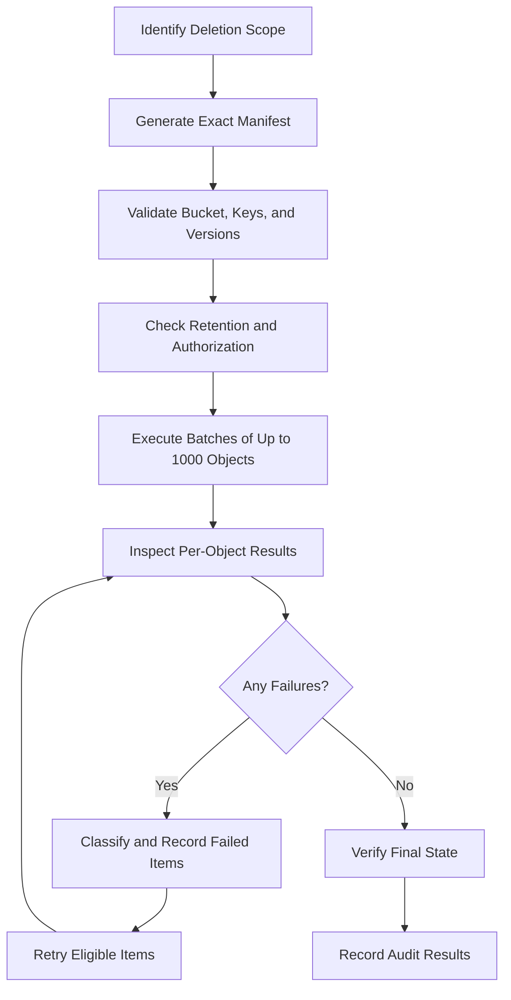
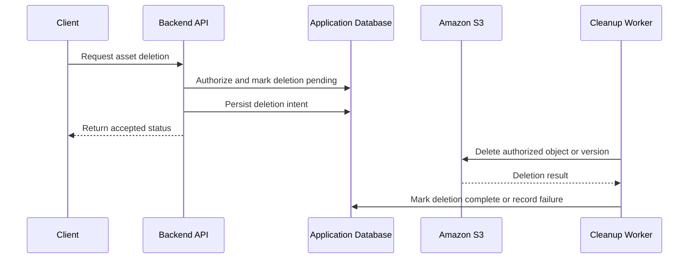

# 04- Deleting Objects

## Overview

Deleting objects in Amazon S3 is an operational task that affects storage costs, application availability, data retention, and recovery capabilities. S3 supports deleting individual objects, deleting multiple objects in a single API request, permanently removing specific object versions, and automatically expiring objects through lifecycle policies.

The meaning of deletion depends on the bucket's versioning configuration. In a bucket without versioning, a successful deletion ordinarily removes the object. In a versioning-enabled bucket, deleting an object without specifying a version ID generally creates a delete marker, hiding the object from ordinary reads while retaining its previous versions.

A production deletion workflow should account for:

- Object identity and versioning behavior.
- Application authorization and least-privilege IAM permissions.
- Retention requirements, legal holds, and Object Lock.
- Retry behavior and partial failures during bulk deletion.
- Database consistency and application references.
- Backup, recovery, and audit requirements.
- Lifecycle policies and storage-cost implications.

The most important operational rule is to distinguish **logical deletion** from **permanent deletion** before executing a destructive command.

## Deletion Behavior

### Versioning determines what deletion means

| Bucket configuration | Delete request without a version ID | Delete request with a version ID |
|---|---|---|
| Versioning disabled | Permanently removes the current object | Not applicable to ordinary unversioned objects |
| Versioning enabled | Creates a delete marker; existing versions remain | Permanently deletes the specified object version or delete marker, subject to retention controls |
| Versioning suspended | Creates a delete marker in the usual case, with special behavior for a current `null` version | Deletes the specified version; a `null` version can be permanently removed |

In a versioning-enabled bucket, a delete marker becomes the current version. Ordinary reads of the key generally behave as if the object is deleted, but older versions remain available to authorized callers.

Removing a delete marker can make the previous object version visible again. Consequently, delete-marker management is a data-recovery concern as well as a storage-management concern.

### Logical deletion versus permanent deletion

Consider an object with three versions:

```text
reports/annual-report.pdf
    Version A: original upload
    Version B: updated upload (current)
```

Deleting the key without a version ID produces the following state:

```text
reports/annual-report.pdf
    Delete Marker: current
    Version B: noncurrent
    Version A: noncurrent
```

The object is hidden from ordinary reads, but the data still exists in previous versions. To permanently remove retained versions, delete those versions individually or use an appropriate lifecycle policy.

Reference: [Deleting Amazon S3 objects](https://docs.aws.amazon.com/AmazonS3/latest/userguide/DeletingObjects.html).

## Deleting Objects with the AWS CLI

### Delete a single object

```bash
aws s3 rm \
  s3://example-private-bucket/reports/old-report.pdf \
  --region ap-south-1
```

This high-level command deletes the specified key according to the bucket's versioning configuration. In a versioning-enabled bucket, the usual result is a delete marker rather than permanent removal of historical versions.

Use a deliberately scoped object key and verify the active AWS identity before executing deletion commands in production.

### Delete a single object with `s3api`

```bash
aws s3api delete-object \
  --bucket example-private-bucket \
  --key reports/old-report.pdf \
  --region ap-south-1
```

The response includes deletion-related information such as a delete marker or version ID when applicable. Retain this information when auditability or recovery is important.

A successful API response does not necessarily mean that all historical versions of the key have been removed.

### Delete a specific object version

For a versioned bucket, specify the exact version ID when permanent deletion of that version is intended.

```bash
aws s3api delete-object \
  --bucket example-private-bucket \
  --key reports/old-report.pdf \
  --version-id "VERSION_ID" \
  --region ap-south-1
```

Replace `VERSION_ID` with the actual version identifier.

Before executing, verify the bucket, key, version ID, retention requirements, and intended deletion scope. Deleting a specific delete-marker version can reveal the previous object version again.

The caller commonly needs `s3:DeleteObjectVersion` to permanently delete a version. Deleting the current key without a version ID commonly requires `s3:DeleteObject`.

### Verify the object state

For an ordinary current object:

```bash
aws s3api head-object \
  --bucket example-private-bucket \
  --key reports/old-report.pdf \
  --region ap-south-1
```

If the object is absent or hidden by a current delete marker, this request may fail with a not-found response. A failure does not prove that all previous versions have been permanently deleted.

Inspect versions and delete markers separately:

```bash
aws s3api list-object-versions \
  --bucket example-private-bucket \
  --prefix reports/old-report.pdf \
  --region ap-south-1
```

The `--prefix` parameter performs prefix matching, not exact-key matching. Review the returned keys carefully before using the results in a destructive workflow.

For precise object-level operations, use a manifest containing the exact keys and version IDs to be deleted.

## Deleting Multiple Objects

S3 supports deleting multiple objects in one API request through `DeleteObjects`. A single multi-object delete request can contain up to 1,000 object identifiers.

This reduces API request overhead compared with deleting each object individually. However, it does not make the entire operation transactional: individual objects can succeed or fail within the same request.

### Delete a prefix with the AWS CLI

```bash
aws s3 rm \
  s3://example-private-bucket/temporary-exports/ \
  --recursive \
  --region ap-south-1
```

The `--recursive` option targets objects under the specified prefix. In a versioned bucket, this normally creates delete markers for the matching current objects rather than removing historical versions.

Check the exact prefix before execution. An incorrect prefix can cause a large unintended deletion.

The AWS CLI high-level command may issue multiple requests, so a recursive operation can partially succeed. Inspect command output and verify the final state.

### Delete objects with `DeleteObjects`

Create a file named `delete-batch.json`:

```json
{
  "Objects": [
    {
      "Key": "temporary-exports/report-001.csv"
    },
    {
      "Key": "temporary-exports/report-002.csv"
    }
  ],
  "Quiet": false
}
```

Execute the request:

```bash
aws s3api delete-objects \
  --bucket example-private-bucket \
  --delete file://delete-batch.json \
  --region ap-south-1
```

With `Quiet` set to `false`, the response reports successful deletions and any per-object errors. Review the errors because a successful overall HTTP request does not guarantee that every requested deletion succeeded.

For permanent removal of specific versions, include the corresponding version IDs:

```json
{
  "Objects": [
    {
      "Key": "temporary-exports/report-001.csv",
      "VersionId": "VERSION_ID_001"
    },
    {
      "Key": "temporary-exports/report-002.csv",
      "VersionId": "VERSION_ID_002"
    }
  ],
  "Quiet": false
}
```

Do not omit version IDs from a manifest when the intention is to delete particular historical versions. Without them, requests against a versioned bucket normally create delete markers instead.

### Bulk deletion workflow



For bulk operations, retain a manifest of intended deletions and record the outcome of each item. Make retry behavior safe by retrying only failed objects and preserving their intended version IDs.

For very large workloads, use S3 Inventory to generate an object inventory and build a controlled deletion process around it. S3 Batch Operations supports large-scale object processing, but does not provide a generic native delete-object operation; a supported custom workflow, such as invoking Lambda, may be appropriate when justified. Such workflows must account for manifest accuracy, per-object failures, permissions, audit reporting, and costs.

Reference: [Deleting multiple objects](https://docs.aws.amazon.com/AmazonS3/latest/userguide/delete-multiple-objects.html).

## Deleting Objects with Boto3

Use Boto3 to implement controlled deletion workflows inside backend services, scheduled jobs, and operational automation.

### Configure an S3 client

```python
# app/storage.py

import boto3
from botocore.config import Config


s3_client = boto3.client(
    "s3",
    region_name="ap-south-1",
    config=Config(
        connect_timeout=5,
        read_timeout=30,
        retries={
            "mode": "standard",
            "total_max_attempts": 4,
        },
    ),
)
```

Use the AWS SDK credential provider chain and temporary credentials. The identity should have only the delete permissions required for the operation.

### Delete one object

```python
def delete_object(
    *,
    bucket_name: str,
    object_key: str,
) -> dict:
    return s3_client.delete_object(
        Bucket=bucket_name,
        Key=object_key,
    )
```

In an unversioned bucket, this ordinarily permanently deletes the current object. In a versioning-enabled bucket, it ordinarily creates a delete marker.

Keep the storage operation separate from authorization and application state updates. The function should receive a trusted bucket and key selected by the application's service layer.

### Delete a specific version

```python
def delete_object_version(
    *,
    bucket_name: str,
    object_key: str,
    version_id: str,
) -> dict:
    return s3_client.delete_object(
        Bucket=bucket_name,
        Key=object_key,
        VersionId=version_id,
    )
```

This targets a specific version instead of creating a new delete marker. Validate the version ID against the application's intended deletion record and retention policy before calling the API.

### Delete multiple objects

```python
from collections.abc import Sequence


def delete_objects(
    *,
    bucket_name: str,
    objects: Sequence[dict[str, str]],
) -> dict:
    if not objects:
        return {"Deleted": [], "Errors": []}

    if len(objects) > 1000:
        raise ValueError("DeleteObjects accepts at most 1000 objects")

    response = s3_client.delete_objects(
        Bucket=bucket_name,
        Delete={
            "Objects": list(objects),
            "Quiet": False,
        },
    )

    errors = response.get("Errors", [])

    if errors:
        # Persist failures for reconciliation or a controlled retry.
        record_deletion_errors(errors)

    return response
```

The `record_deletion_errors()` function represents an application-specific persistence or logging mechanism and must be implemented by the consuming project.

Use object dictionaries with explicit `Key` values. Include `VersionId` for each entry when permanent deletion of specific versions is required.

The caller must inspect per-object errors and retain enough context to reconcile partial success. Do not blindly replay the entire batch when the request has already deleted some objects and other operations have failed.

## Versioning and Delete Markers

### Inspect object versions

```bash
aws s3api list-object-versions \
  --bucket example-private-bucket \
  --prefix archive/ \
  --region ap-south-1
```

The response includes object versions and delete markers. Use it to establish whether a key still has historical data after an ordinary delete request.

### Remove a delete marker

If a versioning-enabled object is hidden by a delete marker, removing that specific marker can reveal the previous version.

```bash
aws s3api delete-object \
  --bucket example-private-bucket \
  --key reports/old-report.pdf \
  --version-id "DELETE_MARKER_VERSION_ID" \
  --region ap-south-1
```

This operation deletes the specified marker, not the underlying previous object version. Use it only when restoring the previous current object is intentional.

### Permanently remove all versions of a key

For complete removal of a versioned key, the workflow must identify and delete every applicable object version and delete marker.

A safe process should:

1. List versions and delete markers for the exact key.
2. Validate the list against the intended deletion scope.
3. Check retention requirements and Object Lock restrictions.
4. Delete specific version IDs in bounded batches.
5. Inspect per-object results.
6. Re-list the key to verify the final state.

For a bucket containing many versions, use a manifest-driven deletion workflow rather than relying on a recursive `aws s3 rm` command.

Versioned deletion can be expensive or operationally disruptive if object versions serve as recovery points. Apply permanent-deletion procedures only when the retention and recovery requirements permit it.

## Emptying a Bucket

Deleting a bucket requires that its contents and applicable versions be removed first. For a versioned general-purpose bucket, removing only current keys or creating delete markers does not empty the bucket of all stored versions.

### Inspect the target bucket

```bash
aws s3api get-bucket-versioning \
  --bucket example-private-bucket \
  --region ap-south-1
```

Review whether versioning is enabled or suspended before preparing the deletion procedure.

List object versions and delete markers:

```bash
aws s3api list-object-versions \
  --bucket example-private-bucket \
  --region ap-south-1
```

For large buckets, account for pagination and use a reliable enumeration method. A single listing response does not necessarily contain every version in the bucket.

### Empty an unversioned bucket

For an intentionally disposable bucket with no retention obligations:

```bash
aws s3 rm \
  s3://example-private-bucket/ \
  --recursive \
  --region ap-south-1
```

Then verify that the bucket is empty before deleting it. Do not use this command on a versioned bucket when permanent removal of all versions is required.

### Delete the bucket after emptying it

```bash
aws s3api delete-bucket \
  --bucket example-private-bucket \
  --region ap-south-1
```

Bucket deletion is a separate operation and should only occur after the resource owner confirms that the bucket is no longer needed.

Before emptying or deleting a production bucket, verify the account, Region, bucket name, data-retention obligations, replication configuration, logging dependencies, and disaster-recovery requirements.

Reference: [Emptying a general-purpose bucket](https://docs.aws.amazon.com/AmazonS3/latest/userguide/empty-bucket.html).

## Lifecycle-Based Deletion

S3 Lifecycle rules can expire objects according to age, prefix, tags, and other supported filters. Lifecycle policies are useful for automated retention and cleanup because they avoid a custom scheduler for every object.

Common applications include:

- Removing temporary exports after a defined period.
- Expiring old logs according to retention policy.
- Permanently deleting noncurrent versions after a defined retention window.
- Removing incomplete multipart uploads.
- Removing eligible expired delete markers.

### Understand lifecycle behavior in versioned buckets

A rule that expires current objects in a versioning-enabled bucket normally creates delete markers. Previous versions remain until separately expired or permanently deleted.

For a complete retention policy, consider separate lifecycle actions for current versions, noncurrent versions, expired delete markers, and incomplete multipart uploads.

Lifecycle expiration is asynchronous. It is not an immediate substitute for a synchronous deletion requirement or a transactional application workflow.

### Example lifecycle policy

The following is an illustrative lifecycle configuration for an ordinary general-purpose bucket. It expires objects under a temporary prefix after seven days and aborts incomplete multipart uploads after seven days.

```json
{
  "Rules": [
    {
      "ID": "ExpireTemporaryExports",
      "Status": "Enabled",
      "Filter": {
        "Prefix": "temporary-exports/"
      },
      "Expiration": {
        "Days": 7
      },
      "AbortIncompleteMultipartUpload": {
        "DaysAfterInitiation": 7
      }
    }
  ]
}
```

Save the configuration as `lifecycle.json`, then apply it:

```bash
aws s3api put-bucket-lifecycle-configuration \
  --bucket example-private-bucket \
  --lifecycle-configuration file://lifecycle.json \
  --region ap-south-1
```

**Important:** In a versioning-enabled bucket, this rule alone does not permanently remove noncurrent versions. Add suitable noncurrent-version expiration and delete-marker rules if permanent cleanup is part of the approved retention design.

Before applying a lifecycle configuration, inspect the bucket's existing rules and merge the intended policy carefully. Replacing the lifecycle configuration without preserving required rules can change the retention behavior of unrelated objects.

References:
- [Managing the lifecycle of objects](https://docs.aws.amazon.com/AmazonS3/latest/userguide/object-lifecycle-mgmt.html)
- [Lifecycle configuration elements](https://docs.aws.amazon.com/AmazonS3/latest/userguide/intro-lifecycle-rules.html)

## Retention, Object Lock, and MFA Delete

### Object Lock

S3 Object Lock can protect object versions using retention periods and legal holds.

A protected version generally cannot be permanently deleted until the applicable protection permits it. Governance-mode retention has specific bypass behavior for principals with the required permissions; compliance-mode retention cannot be bypassed during the retention period.

A legal hold remains in effect until it is removed by an authorized principal. Do not treat a delete marker as proof that retained data was physically removed.

Before permanent deletion, inspect the applicable retention and legal-hold state and follow the organization's approved data-retention procedure.

### MFA Delete

MFA Delete can add multi-factor authentication requirements to certain versioning-related operations, including permanent deletion of object versions, when configured and applicable.

It is a specialized bucket control with operational prerequisites and limitations. Confirm its current availability and setup requirements before incorporating it into a deletion runbook.

Do not disable security controls or bypass retention protections merely to make a deletion command succeed.

Reference: [Troubleshooting versioning](https://docs.aws.amazon.com/AmazonS3/latest/userguide/troubleshooting-versioning.html).

## Application-Level Deletion Workflows

Backend applications often store S3 references in a relational database. Deleting an object therefore requires coordinating two systems that do not share a transaction.

A safer application workflow is:



For business-critical workflows, the deletion intent can be stored in a transactional outbox or dedicated durable job record. A retryable worker processes the intent and updates its state after confirming the operation's outcome.

### Avoid deleting before authorization

The application must validate ownership and business permissions before resolving the object key for deletion. An untrusted caller should not be allowed to provide an arbitrary bucket, key, or version ID.

### Make retries idempotent

Repeated deletes can have different consequences depending on versioning. For example, a repeated key-only delete against a versioning-enabled bucket can create additional delete markers.

Persist the intended deletion mode:

- Delete the current logical object.
- Permanently delete a particular object version.
- Permanently remove every version of an object.
- Delete the object only after a retention or processing condition is satisfied.

Use stable workflow identifiers and explicit version IDs where necessary to keep retries aligned with the original intent.

### Handle partial failures

S3 may successfully delete an object while the database update fails. Conversely, the database might show a pending deletion while an S3 request repeatedly fails due to permissions or retention constraints.

Keep these states recoverable:

```text
ACTIVE
  |
  v
DELETE_PENDING
  |
  +---- S3 delete failure ----> DELETE_FAILED
  |
  +---- S3 delete succeeds ---> DELETE_COMPLETE
```

A reconciler should inspect old pending or failed deletions, determine whether the intended object or version still exists, and resume only the work that is necessary.

Do not automatically mark a deletion complete solely because a retry returned a response. Define completion according to the intended semantics: logical removal, deletion of an exact version, or permanent removal of all targeted versions.

## Security and IAM Permissions

Deletion permissions should be separate from read, upload, and administrative permissions where practical.

| Action | Common permission |
|---|---|
| Delete the current key without a version ID | `s3:DeleteObject` |
| Permanently delete a specific object version | `s3:DeleteObjectVersion` |
| List versions and delete markers | `s3:ListBucketVersions` |
| List objects when preparing a deletion manifest | `s3:ListBucket` |
| Delete a bucket | `s3:DeleteBucket` |
| Inspect or change lifecycle configuration | `s3:GetLifecycleConfiguration` or `s3:PutLifecycleConfiguration` |

The exact required permissions depend on the operation and the bucket configuration. A multi-object delete request may partially succeed when individual object operations are denied; inspect the response for per-object errors.

Additional controls may include:

- IAM conditions restricting deletion to approved prefixes.
- Explicit denies for protected object classes.
- Separate roles for application deletion and administrative cleanup.
- Approval gates for bulk deletion.
- Audit records containing the actor, target, reason, and outcome.
- Retention safeguards for regulated data and backup objects.

For cross-account operations, consider both identity-based and resource-based policies. Do not grant broad deletion privileges simply to simplify automation.

## Failure Handling and Troubleshooting

| Symptom | Likely cause | Diagnostic approach |
|---|---|---|
| `AccessDenied` | Missing delete permission, explicit deny, bucket policy, organizational policy, or Object Lock | Check the exact operation, identity, policies, and retention controls |
| Object appears after deletion | A delete marker was removed, another version became current, or a new upload occurred | Inspect versions and delete markers |
| Deleted object remains in storage | Historical versions or incomplete multipart parts remain | Inspect versions, lifecycle rules, and multipart uploads |
| Multi-object delete reports errors | Individual requests failed while others succeeded | Inspect each entry in `Errors` and retry only eligible failures |
| Bucket cannot be deleted | Objects, versions, delete markers, or other required cleanup remain | Enumerate all required resource state and empty the bucket correctly |
| Lifecycle expiration has not run | Processing is asynchronous or the rule does not match the object | Inspect lifecycle configuration, filters, object age, and versioning state |
| Permanent deletion fails | Object Lock retention, legal hold, MFA Delete, or missing version-delete permission | Inspect the specific version and its protection controls |
| Application says deleted but object remains | Database and S3 state diverged | Reconcile the deletion workflow and retry according to persisted intent |

For each failure, retain the original error code, request context where available, intended operation, and target version. Avoid exposing sensitive policy details or internal resource information to application clients.

## Monitoring and Operational Controls

Monitor deletion as an operational workflow rather than only as a single API request.

Useful metrics and records include:

- Number of delete requests and successful operations.
- Per-object failure counts for multi-object deletion.
- Pending and failed application deletion jobs.
- Age of the oldest incomplete deletion.
- Number of versions and delete markers retained.
- Lifecycle expiration outcomes where observable.
- Incomplete multipart upload counts.
- Storage usage and cost before and after cleanup.
- Audit events for sensitive or bulk deletion operations.

CloudTrail can provide audit information for applicable API calls when the relevant logging is configured. S3 server access logging and other observability mechanisms may provide additional operational evidence, depending on the workflow.

Avoid assuming that a single logging mechanism captures every deletion source. Lifecycle actions, application API calls, administrative commands, and other AWS service behaviors have different observability characteristics.

For bulk or irreversible deletion, use a documented approval process and maintain a record of the exact manifest, execution identity, execution time, failures, and final verification.

## Common Mistakes

### Assuming every delete request permanently removes data

In versioned buckets, a key-only delete usually creates a delete marker. Specify the intended version ID when permanent deletion of a particular version is required.

### Using recursive deletion without verifying the prefix

A small mistake in the bucket name or prefix can affect a large number of objects. Validate the target and use a manifest for high-risk operations.

### Assuming multi-object delete is transactional

Individual objects can succeed or fail independently. Inspect the response and reconcile unsuccessful entries.

### Deleting database records before handling the object

Removing the database reference first can make an undeleted S3 object difficult to locate. Use a durable deletion workflow and reconcile partial failures.

### Ignoring Object Lock and retention policies

A protected version may not be eligible for permanent deletion. Follow retention requirements rather than repeatedly retrying the same request.

### Assuming lifecycle expiry is immediate

Lifecycle actions run asynchronously and may create delete markers rather than permanently remove all versions. Design retention rules for the actual versioning behavior.

### Treating a delete marker as a backup or secure erasure

A delete marker only hides the current object in typical versioned-bucket reads. It is not equivalent to permanent deletion or cryptographic erasure.

### Replaying failed bulk deletes without reviewing the results

Some objects may already have been deleted. Retain a record of per-object outcomes and retry only the operations that still need to be performed.

## Official References

- [Deleting Amazon S3 objects](https://docs.aws.amazon.com/AmazonS3/latest/userguide/DeletingObjects.html)
- [Deleting multiple objects](https://docs.aws.amazon.com/AmazonS3/latest/userguide/delete-multiple-objects.html)
- [DeleteObject API reference](https://docs.aws.amazon.com/AmazonS3/latest/API/API_DeleteObject.html)
- [DeleteObjects API reference](https://docs.aws.amazon.com/AmazonS3/latest/API/API_DeleteObjects.html)
- [Troubleshooting versioning](https://docs.aws.amazon.com/AmazonS3/latest/userguide/troubleshooting-versioning.html)
- [Managing the lifecycle of objects](https://docs.aws.amazon.com/AmazonS3/latest/userguide/object-lifecycle-mgmt.html)
- [Emptying a general-purpose bucket](https://docs.aws.amazon.com/AmazonS3/latest/userguide/empty-bucket.html)
- [S3 Batch Operations](https://docs.aws.amazon.com/AmazonS3/latest/userguide/batch-ops.html)

## Key Takeaways

- Understand the bucket's versioning configuration before deleting objects: key-only deletion in versioned buckets generally creates a delete marker instead of permanently removing data.
- Use explicit version IDs when permanent deletion of a particular version is required, and account for Object Lock and retention constraints.
- Treat bulk deletion as a partially successful operation: inspect per-object errors, persist results, and retry only eligible failures.
- Coordinate S3 deletion with database state using durable intent records, idempotent workflows, and reconciliation.
- Use lifecycle rules for automated retention, monitor cleanup outcomes, and require stronger verification and approval for irreversible bulk deletion.