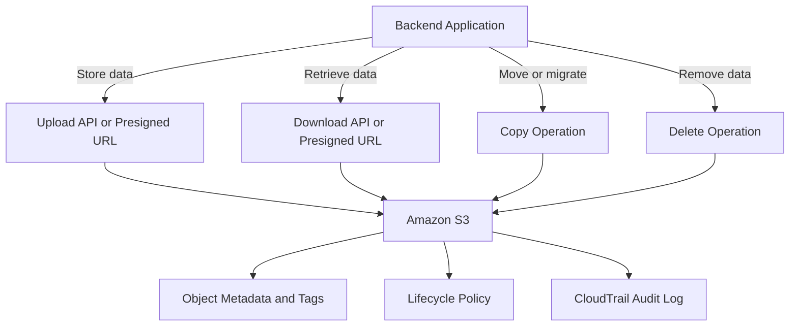

# README

## Overview

Amazon S3 object management covers the operational tasks required to store, retrieve, move, and maintain objects throughout their lifecycle in production environments. It addresses upload workflows, download patterns, copy and migration operations, safe deletion procedures, object tagging for classification and automation, and metadata management for application and storage workflows.

This section of the Backend Engineering Playbook provides a structured reference for backend engineers, platform engineers, and operations teams who manage S3 object data in Python applications, data pipelines, backup systems, and cloud-native architectures.

The focus is on practical object operations: understanding the correct API for each workflow, designing safe and repeatable procedures, managing object attributes consistently, and avoiding common mistakes that lead to data loss, cost overruns, or application failures.

## Navigation

| # | File | Description |
|---|---|---|
| 01 | [01- Uploading Objects](./01-%20Uploading%20Objects.md) | Upload APIs, multipart uploads, presigned URLs, metadata on upload, and reliable upload workflows for backend applications |
| 02 | [02- Downloading Objects](./02-%20Downloading%20Objects.md) | Download APIs, range requests, presigned download URLs, streaming, and retrieval patterns for backend and data pipeline use cases |
| 03 | [03- Copying Objects](./03-%20Copying%20Objects.md) | Intra-bucket, cross-bucket, cross-region, and cross-account object copies, metadata preservation, and copy-based workflows |
| 04 | [04- Deleting Objects](./04-%20Deleting%20Objects.md) | Single and batch deletions, versioned object removal, delete markers, lifecycle expiration, and safe deletion procedures |
| 05 | [05- Object Tagging](./05-%20Object%20Tagging.md) | Key-value tag assignment, lifecycle rule integration, access-control policies, operational automation, and tag management |
| 06 | [06- Managing Object Metadata](./06-%20Managing%20Object%20Metadata.md) | System metadata, user-defined metadata, content type, cache headers, and metadata update workflows |

## Why Object Management Matters

S3 object operations are the core of most backend storage workflows. Treating them as straightforward read-write operations without deliberate design leads to data loss, unexpected costs, application failures, and difficult-to-diagnose operational problems.

Common object management risks include:

- Objects deleted without versioning enabled, making recovery impossible.
- Multipart uploads abandoned mid-process, silently accumulating storage costs indefinitely.
- Metadata set incorrectly on upload, causing browsers, CDNs, and applications to handle objects incorrectly.
- Copy operations that silently drop metadata, encryption settings, or tags because the correct parameters were not specified.
- Batch delete operations executed against the wrong prefix due to missing validation.
- Tags not applied consistently, breaking lifecycle rules, access policies, and cost allocation.

Effective object management combines the correct API selection, safe operational practices, consistent metadata and tagging, and tested procedures for each workflow type.

## Documentation Structure

This section is organized into focused documents covering the full range of object lifecycle operations.

| Area | Primary focus |
|---|---|
| Uploading | API selection, multipart uploads, presigned URLs, metadata on upload, and error handling |
| Downloading | Retrieval APIs, range requests, presigned URLs, and streaming patterns |
| Copying | Intra-bucket and cross-bucket copies, metadata and tag preservation, and copy-based migrations |
| Deleting | Safe deletion procedures, versioning behavior, batch operations, and lifecycle expiration |
| Tagging | Tag design, lifecycle integration, access control, and operational automation |
| Metadata | System and user-defined metadata, content headers, and metadata update workflows |

Each document is intended to be independently maintainable while connecting to the broader S3 operational model. Shared patterns should be referenced rather than duplicated across documents.

## Core Object Management Principles

### Choose the Right Upload API

Use the PutObject API for objects up to 5 GB. Use multipart upload for objects larger than 100 MB to improve throughput, enable resumable transfers, and handle large files reliably. Configure lifecycle rules to abort incomplete multipart uploads and prevent silent storage cost accumulation from abandoned parts.

### Set Metadata Correctly at Upload Time

Object metadata cannot be updated in place after upload without copying the object. Set the correct `Content-Type`, `Content-Disposition`, `Cache-Control`, and any required user-defined metadata at the time of upload. Define metadata conventions in application code rather than relying on correct values being provided at runtime.

### Understand Versioning Before Deleting

On a versioning-enabled bucket, a delete request creates a delete marker rather than permanently removing the object. Permanently deleting a versioned object requires specifying the version ID. Understand which behavior applies before executing deletion operations, especially in production environments.

### Validate Before Bulk Operations

Use `--dryrun` for CLI-based bulk operations and list the affected objects before executing any recursive delete, copy, or move operation. A single incorrect prefix can affect thousands of objects. Verify scope, confirm the operation, then execute.

### Apply Tags Consistently

Tags applied at upload time cost nothing extra and enable lifecycle policies, cost allocation, and attribute-based access control. Define a tagging convention for each object category and enforce it in application code and deployment pipelines rather than applying tags manually after the fact.

## How Object Operations Fit into Backend Workflows

## Recommended Workflow

Use a repeatable process for each object operation type in production environments.

1. **Identify the operation and API.** Select the correct API for the object size, workflow type, and authorization model before writing code or running commands.
2. **Define metadata and tags.** Determine the required metadata and tags for the object category before the first upload. Enforce them in application code.
3. **Validate scope for bulk operations.** List the affected objects before executing any bulk copy, move, or delete. Confirm the prefix and filter are correct.
4. **Execute and verify.** Run the operation and verify the result by listing objects, checking metadata, or confirming application behavior.
5. **Handle errors explicitly.** Do not silently ignore upload failures, partial copies, or incomplete deletions. Implement retry logic with backoff for transient failures.
6. **Monitor for incomplete multipart uploads.** Configure a lifecycle rule to abort incomplete multipart uploads after an appropriate number of days on every production bucket.

## Operational Standards

- **Multipart uploads:** Enable a lifecycle rule to abort incomplete multipart uploads on every bucket where application uploads can fail or be abandoned.
- **Metadata:** Set `Content-Type` explicitly on every upload. Do not rely on S3 to infer the correct value.
- **Versioning:** Know whether versioning is enabled before deleting. Verify that delete operations produce the expected result, whether a delete marker or permanent removal.
- **Bulk operations:** Always validate scope with a list or dry-run before executing recursive deletes, copies, or sync operations.
- **Tags:** Apply tags at upload time using application code. Define a tagging convention per object category and enforce it consistently.
- **Copy operations:** Specify metadata directives and tag directives explicitly when copying objects. Verify that encryption, storage class, and metadata are preserved or updated as intended.
- **Error handling:** Implement retries with exponential backoff for transient S3 errors. Log and alert on persistent failures in upload, copy, and delete workflows.

## Key Takeaways

- Object management requires deliberate API selection, consistent metadata and tagging, and safe operational procedures rather than ad hoc operations.
- Metadata and tags must be set at upload time; updating them later requires copying the object.
- Versioning changes the behavior of delete operations in ways that can cause data loss or unintended retention if not understood.
- Incomplete multipart uploads accumulate costs silently without a lifecycle rule to abort them.
- Bulk operations must be validated before execution, as a single incorrect prefix can affect thousands of objects.
