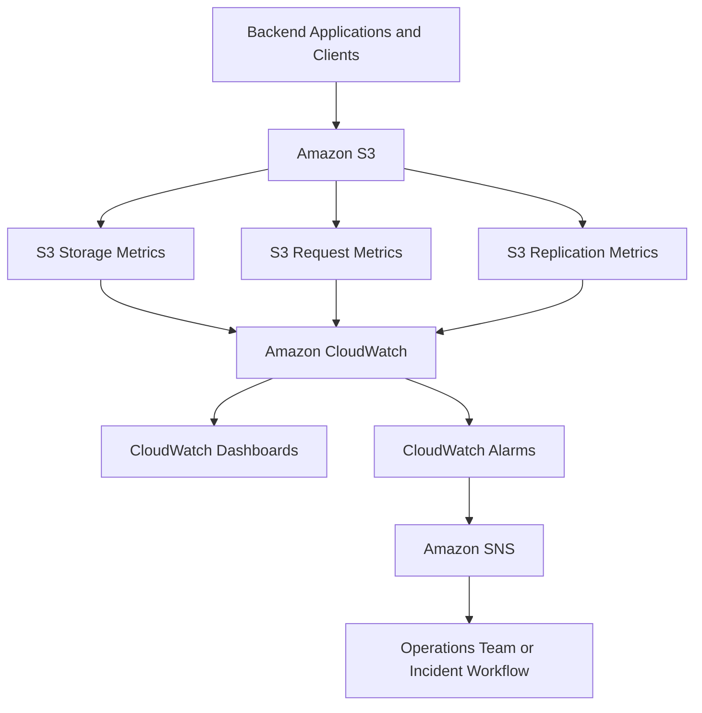
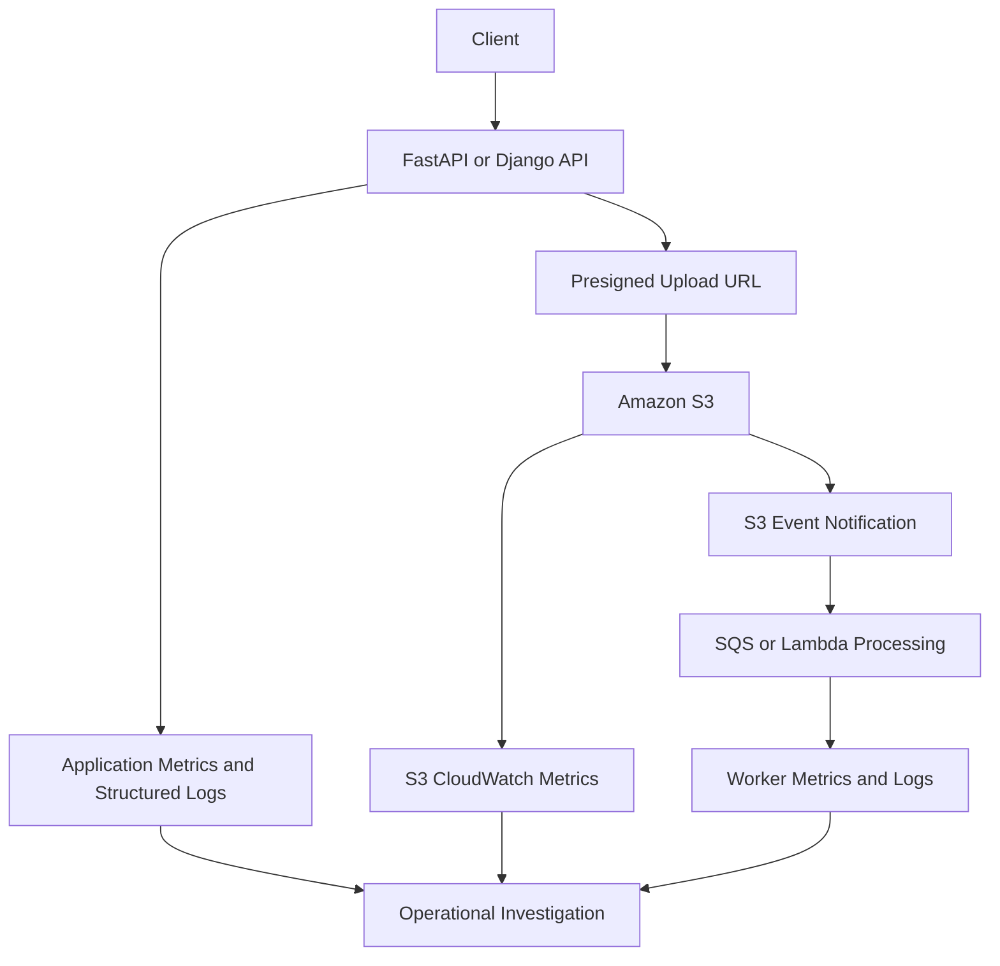

# 01- Amazon CloudWatch

## Overview

Amazon CloudWatch provides monitoring, metrics, dashboards, alarms, and automated notifications for workloads running on AWS. For Amazon S3, CloudWatch helps engineers understand storage growth, request traffic, request failures, latency, data transfer, and replication health.

CloudWatch is particularly useful for production applications that store documents, images, reports, backups, and data-processing artifacts in S3. It enables teams to identify abnormal traffic, detect increases in server errors, monitor replication delays, and establish operational alerts.

S3 publishes native metrics to the `AWS/S3` CloudWatch namespace. Different metric categories have different reporting frequencies, configuration requirements, and costs.

### What CloudWatch helps monitor

- **Storage growth:** Track bucket size and object counts over time.
- **Request activity:** Observe upload, download, listing, and deletion activity.
- **Request failures:** Detect increases in HTTP 4xx and 5xx responses.
- **Performance:** Monitor first-byte and total request latency.
- **Data transfer:** Track bytes uploaded and downloaded.
- **Replication:** Identify pending work, replication latency, and failed replication operations.
- **Operational alerting:** Trigger notifications when metric thresholds indicate a potential incident.

CloudWatch metrics are operational signals. They do not replace CloudTrail auditing, S3 Inventory, Storage Lens, or application-level monitoring.

## S3 and CloudWatch Architecture

S3 publishes native metrics to CloudWatch. Engineers visualize the metrics using dashboards, define alarms against selected metrics, and route notifications through services such as Amazon SNS.



Component responsibilities:

| Component | Responsibility |
|---|---|
| Amazon S3 | Produces supported storage, request, and replication metrics. |
| CloudWatch Metrics | Stores metric time series for querying and visualization. |
| CloudWatch Dashboards | Presents selected metrics in a shared operational view. |
| CloudWatch Alarms | Evaluates metric thresholds and changes alarm state. |
| Amazon SNS | Distributes alarm notifications to configured subscribers. |
| CloudTrail | Records supported API activity for auditing and investigation. |
| Application telemetry | Provides context such as tenant IDs, workflow IDs, and business-level outcomes. |

## S3 CloudWatch Metric Categories

S3 metrics are published under the `AWS/S3` namespace, although S3 Storage Lens metrics use `AWS/S3/Storage-Lens`.

| Metric category | Reporting behavior | Primary use |
|---|---|---|
| Daily storage metrics | Reported approximately once per day | Storage growth and object-count analysis |
| Request metrics | Available at one-minute intervals after processing latency | Request traffic, errors, latency, and transfer activity |
| Replication metrics | Available at minute-level granularity when enabled | Replication backlog, latency, and failures |
| Storage Lens metrics | Depends on the Storage Lens configuration | Broader storage usage and activity analysis |

Daily bucket storage metrics are available at no additional CloudWatch metric charge. Request metrics and replication metrics are billed at applicable CloudWatch rates.

S3 request metrics are delivered on a best-effort basis. They can be delayed or incomplete and should not be treated as a complete accounting of requests. Consult current AWS pricing and service documentation before enabling metrics across many buckets.

## Daily Storage Metrics

S3 automatically provides daily storage metrics for buckets. You do not need to create a request-metrics configuration to obtain them.

### Important storage metrics

| Metric | Meaning | Typical use |
|---|---|---|
| `BucketSizeBytes` | Storage consumed, including applicable object and metadata overhead | Storage growth and capacity-cost analysis |
| `NumberOfObjects` | Object count, including applicable noncurrent objects, delete markers, and incomplete multipart-upload parts for general purpose buckets | Object-count trends and storage hygiene |

Storage metrics use the `BucketName` and `StorageType` dimensions.

For `BucketSizeBytes`, `StorageType` identifies a storage class or a specific storage-related overhead category. Use the relevant dimension when analyzing a particular storage class.

For `NumberOfObjects`, use `StorageType=AllStorageTypes` to query the aggregate object count.

These metrics can include data that is not immediately obvious from the current object listing. For example, versioned objects and incomplete multipart uploads can contribute to storage consumption.

### Inspect bucket storage metrics

You can query daily storage data using the AWS CLI.

```bash
aws cloudwatch get-metric-statistics \
  --namespace AWS/S3 \
  --metric-name BucketSizeBytes \
  --dimensions \
    Name=BucketName,Value=example-prod-uploads \
    Name=StorageType,Value=StandardStorage \
  --start-time 2026-10-01T00:00:00Z \
  --end-time 2026-10-15T00:00:00Z \
  --period 86400 \
  --statistics Average \
  --region ap-south-1
```

Replace the bucket name, Region, and time range with your actual values.

The response contains timestamped measurements in bytes. A daily reporting interval does not mean that every requested day is guaranteed to contain a datapoint. Check the timestamps returned by CloudWatch.

To inspect the aggregate object count:

```bash
aws cloudwatch get-metric-statistics \
  --namespace AWS/S3 \
  --metric-name NumberOfObjects \
  --dimensions \
    Name=BucketName,Value=example-prod-uploads \
    Name=StorageType,Value=AllStorageTypes \
  --start-time 2026-10-01T00:00:00Z \
  --end-time 2026-10-15T00:00:00Z \
  --period 86400 \
  --statistics Average \
  --region ap-south-1
```

Use these measurements to identify sustained storage growth, unexpected object accumulation, and possible retention or multipart-upload cleanup issues. For detailed object-level analysis, use S3 Inventory or another appropriate inventory workflow.

## Request Metrics

Request metrics provide operational visibility into S3 traffic and performance. Unlike daily storage metrics, they must be enabled through a bucket metrics configuration.

### Common request metrics

| Metric | Interpretation |
|---|---|
| `AllRequests` | Total HTTP requests represented by the metrics configuration |
| `GetRequests` | Object GET requests |
| `PutRequests` | Object PUT requests |
| `DeleteRequests` | DELETE requests, including `DeleteObjects` requests; this counts requests, not individual objects deleted |
| `HeadRequests` | HEAD requests |
| `ListRequests` | Requests that list bucket contents |
| `BytesDownloaded` | Bytes returned in response bodies |
| `BytesUploaded` | Bytes submitted in request bodies |
| `4xxErrors` | Client-error responses |
| `5xxErrors` | Server-error responses |
| `FirstByteLatency` | Time from receipt of the complete request until S3 begins returning the response |
| `TotalRequestLatency` | Elapsed time from the first request byte received until the last response byte is sent |

S3 also publishes other operation-specific metrics, including metrics for supported POST and Select operations.

Request metrics are useful for detecting traffic changes and service-response problems. They do not explain the application-level reason for a request or identify an individual application user.

### Enable request metrics for a bucket

Create a request-metrics configuration covering all objects in the bucket:

```bash
aws s3api put-bucket-metrics-configuration \
  --bucket example-prod-uploads \
  --id all-requests \
  --metrics-configuration '{"Id":"all-requests"}' \
  --region ap-south-1
```

This command configures request metrics for the entire bucket. It does not modify object data or bucket contents.

The configuration ID, `all-requests`, is used when retrieving the request metrics for this configuration.

Verify the configuration:

```bash
aws s3api get-bucket-metrics-configuration \
  --bucket example-prod-uploads \
  --id all-requests \
  --region ap-south-1
```

After configuration, allow time for metrics to appear. AWS documentation notes that request metrics may take approximately 15 minutes to become visible.

### Filter request metrics

You can configure metrics for a subset of objects using a prefix, object tag, or access point. This helps isolate traffic for different applications or workflows that share a bucket.

Example: monitor requests for objects under `uploads/`.

```bash
aws s3api put-bucket-metrics-configuration \
  --bucket example-prod-uploads \
  --id uploads-metrics \
  --metrics-configuration \
    '{"Id":"uploads-metrics","Filter":{"Prefix":"uploads/"}}' \
  --region ap-south-1
```

Useful filter strategies include:

- **Prefix:** Separate request activity for paths such as `uploads/`, `reports/`, or `processed/`.
- **Object tags:** Track eligible requests associated with a classification or processing workflow.
- **Access point:** Isolate requests made through a specific access point.

For combined filters, an object must satisfy all specified filter elements. Some operations, including certain listing and bulk-deletion operations, are not represented in filtered metrics in the same way as individual object operations.

A bucket can have up to 1,000 metrics configurations. Choose filters deliberately because additional metric series can increase cost and complexity.

Reference: [S3 CloudWatch metrics configurations](https://docs.aws.amazon.com/AmazonS3/latest/userguide/metrics-configurations.html).

## Retrieving Request Metrics

CloudWatch metrics can be queried using the console, AWS CLI, or SDKs.

### Inspect server errors

```bash
aws cloudwatch get-metric-statistics \
  --namespace AWS/S3 \
  --metric-name 5xxErrors \
  --dimensions \
    Name=BucketName,Value=example-prod-uploads \
    Name=FilterId,Value=all-requests \
  --start-time 2026-10-15T09:00:00Z \
  --end-time 2026-10-15T10:00:00Z \
  --period 300 \
  --statistics Sum Average \
  --region ap-south-1
```

For request metrics configured with a filter ID, the `BucketName` and `FilterId` dimensions identify the relevant metric series.

The response includes data points for the specified period when available:

- `Sum` provides the number of reported errors over the period.
- `Average` provides the reported error rate as a fraction for the period.

For example, an average of `0.02` corresponds to a reported error rate of 2% for the period.

The request must specify timestamps in UTC. Do not interpret an empty result as proof that no errors occurred; verify that the metrics configuration, dimensions, Region, time range, and metric availability are correct.

### Retrieve latency percentiles

For latency analysis, percentiles can be more useful than averages because a small number of slow requests can be hidden by a low mean.

```bash
aws cloudwatch get-metric-statistics \
  --namespace AWS/S3 \
  --metric-name TotalRequestLatency \
  --dimensions \
    Name=BucketName,Value=example-prod-uploads \
    Name=FilterId,Value=all-requests \
  --start-time 2026-10-15T09:00:00Z \
  --end-time 2026-10-15T10:00:00Z \
  --period 300 \
  --extended-statistics p95 p99 \
  --region ap-south-1
```

Use `p95` and `p99` to investigate tail latency. Interpret them alongside request counts, application response times, network behavior, and client-side timeouts.

## CloudWatch Alarms for S3

A CloudWatch alarm evaluates a metric or expression against configured thresholds. Its state can be `OK`, `ALARM`, or `INSUFFICIENT_DATA`.

An alarm can notify an operations team, invoke supported notification workflows, or participate in automated incident response.

### Recommended alarm candidates

| Condition | Metric | Example purpose |
|---|---|---|
| Increasing S3 server errors | `5xxErrors` | Detect service-response issues |
| Unexpected client failures | `4xxErrors` | Detect permission problems, invalid requests, or application regressions |
| Increasing request latency | `TotalRequestLatency` | Identify slow object-transfer behavior |
| Unexpected traffic growth | `AllRequests` | Detect workload changes or traffic anomalies |
| Storage growth beyond a target | `BucketSizeBytes` | Identify unexpected storage accumulation |
| Replication backlog | `BytesPendingReplication` | Detect an increasing replication backlog |
| Replication delay | `ReplicationLatency` | Identify delayed replication |
| Failed replication operations | `OperationsFailedReplication` | Detect replication failures |

Choose thresholds based on observed workload behavior and service expectations. Avoid using one fixed threshold for buckets with very different traffic patterns.

### Create an alarm for elevated 5xx error rates

The following example creates an alarm when the reported average S3 5xx error rate exceeds 5% for two consecutive five-minute periods.

```bash
aws cloudwatch put-metric-alarm \
  --alarm-name s3-prod-uploads-high-5xx-rate \
  --namespace AWS/S3 \
  --metric-name 5xxErrors \
  --dimensions \
    Name=BucketName,Value=example-prod-uploads \
    Name=FilterId,Value=all-requests \
  --statistic Average \
  --period 300 \
  --evaluation-periods 2 \
  --datapoints-to-alarm 2 \
  --threshold 0.05 \
  --comparison-operator GreaterThanThreshold \
  --treat-missing-data missing \
  --alarm-actions \
    arn:aws:sns:ap-south-1:123456789012:prod-alerts \
  --region ap-south-1
```

Replace the example account ID, bucket name, and SNS topic ARN with actual resources.

The SNS topic must exist and be configured with appropriate permissions and subscribers. An alarm's existence alone does not establish that notifications are delivered successfully.

The example uses `missing` as the missing-data treatment. Choose the treatment according to the alert's purpose and expected traffic. Missing metrics may result from low traffic, incorrect configuration, or delayed publication, rather than a healthy service.

For low-volume workloads, consider the number of actual requests in addition to the error rate. A high error percentage from one request has a different operational meaning from the same percentage across thousands of requests.

### Alarm design recommendations

- Select metric dimensions explicitly and verify that data is being published.
- Use evaluation periods to reduce noisy alerts from transient conditions.
- Test alarm actions and notification delivery.
- Distinguish a request failure from a missing or delayed metric.
- Document ownership, severity, response instructions, and escalation paths.
- Review thresholds as workload patterns change.
- Avoid triggering automated destructive actions from a single noisy metric.

## Monitoring Replication

S3 replication metrics provide visibility into replication progress when the relevant replication metrics are enabled. Replication metrics are also enabled automatically when S3 Replication Time Control is configured for the rule.

### Important replication metrics

| Metric | Description |
|---|---|
| `BytesPendingReplication` | Bytes waiting to be replicated |
| `OperationsPendingReplication` | Number of replication operations waiting to complete |
| `ReplicationLatency` | Maximum delay, in seconds, between the source and destination for the relevant replication rule |
| `OperationsFailedReplication` | Number of failed replication operations |

Replication metrics use dimensions that identify the source bucket, destination bucket, and replication rule.

Replication metrics are not a guarantee that every source object is replicated successfully. They must be interpreted alongside replication configuration, object-level replication status, and appropriate recovery procedures.

### Operational investigation

When replication latency increases:

1. Inspect the source bucket's replication rules and their filters.
2. Check the pending-byte and pending-operation metrics.
3. Review failed replication operations.
4. Verify the IAM role and destination permissions.
5. Check applicable encryption and KMS permissions.
6. Inspect object replication status and relevant failure events.
7. Confirm that the destination bucket and required configuration are available.

A low pending-byte count alone does not prove that replication is healthy. For example, incorrectly configured rules or permissions can prevent expected work from being scheduled.

When creating replication alarms, AWS recommends treating missing metric data as `ignore` so that an alarm maintains its existing state when data is missing. Review the current AWS guidance for the selected replication metrics and alarm configuration.

References:

- [Using S3 Replication metrics](https://docs.aws.amazon.com/AmazonS3/latest/userguide/repl-metrics.html)
- [S3 metrics and dimensions](https://docs.aws.amazon.com/AmazonS3/latest/userguide/metrics-dimensions.html)

## CloudWatch Dashboards for S3

A CloudWatch dashboard brings related metrics together so that operators can assess the health of a storage workload without querying each metric separately.

A production dashboard for a file-storage service should typically include:

| Dashboard section | Suggested metrics |
|---|---|
| Traffic | `AllRequests`, `GetRequests`, `PutRequests`, `DeleteRequests` |
| Reliability | `4xxErrors`, `5xxErrors` |
| Performance | `FirstByteLatency`, `TotalRequestLatency` |
| Data movement | `BytesUploaded`, `BytesDownloaded` |
| Storage | `BucketSizeBytes`, `NumberOfObjects` |
| Replication | `BytesPendingReplication`, `OperationsPendingReplication`, `ReplicationLatency`, `OperationsFailedReplication` |

Use separate dashboards or dashboard sections for different environments, critical workloads, or replication paths.

Request metrics should be configured for buckets or object subsets where this visibility is operationally valuable. Storage metrics are available independently of request-metrics configuration.

When building dashboards, ensure that each graph uses the intended metric dimensions and statistic. Comparing metrics with different aggregation periods or unrelated dimensions can produce misleading conclusions.

## CloudWatch and Application Monitoring

S3 metrics describe storage-service activity, but backend engineers also need application-level context.

For example, a document API might report successful upload initiation while the subsequent direct client-to-S3 upload fails. A bucket-level view alone might not identify which application workflow failed.

A complete monitoring design correlates CloudWatch with application logs and metrics.



The application should record useful identifiers such as:

- Internal asset or document ID.
- Workflow or job ID.
- Object key, where appropriate.
- Expected object version ID when version-specific behavior matters.
- Processing stage and outcome.
- Retry count and failure category.

Avoid putting credentials, presigned URLs, sensitive file contents, or unnecessary personal data in logs.

CloudWatch can aggregate application metrics alongside S3 metrics, allowing engineers to distinguish storage-service behavior from problems in API validation, authorization, queue processing, database transactions, or downstream consumers.

## CloudWatch Metrics vs. S3 Auditing

CloudWatch and CloudTrail solve different operational problems.

| Requirement | Recommended mechanism |
|---|---|
| Near-real-time request traffic trends | S3 request metrics in CloudWatch |
| Daily bucket-size and object-count trends | S3 daily storage metrics |
| Alerting on request failures or latency | CloudWatch alarms |
| API activity investigation | CloudTrail |
| Detailed access-request records where configured | S3 server access logging |
| Organization-wide storage analysis | S3 Storage Lens |
| Object-level inventory and classification analysis | S3 Inventory |
| Business workflow status and tenant attribution | Application telemetry and database records |

CloudWatch is not a security audit log. Its request metrics do not identify the complete sequence of API operations performed by a principal.

For security investigations, enable and configure the appropriate CloudTrail events, including S3 data events when object-level API auditing is required. Review the associated costs and retention requirements.

## Security and Permissions

Use least-privilege permissions for metric configuration, dashboards, alarm creation, and operational investigation.

Monitoring permissions should be separated from permissions that modify objects or change bucket security settings.

Common operational considerations include:

- Grant only authorized operators the ability to change monitoring configuration.
- Restrict who can modify alarms and SNS notification destinations.
- Apply least privilege to the roles used by automated monitoring workflows.
- Protect audit logs and operational data according to the organization's retention requirements.
- Avoid embedding AWS credentials in scripts or CI/CD configuration.
- Review access to dashboards when they expose sensitive workload information.

The bucket's Region and the CloudWatch Region used for metric queries must align with where the relevant S3 metrics are published. Ensure the operator is querying the correct AWS account and Region when debugging missing data.

## Cost and Scalability Considerations

CloudWatch monitoring costs depend on the metric type, alarm count, dashboards, API usage, and notification or processing services.

Daily S3 storage metrics are provided without an additional CloudWatch metric charge. Request metrics and replication metrics are chargeable under applicable CloudWatch pricing. Additional dashboard, alarm, logging, and notification features may also incur charges.

For large S3 estates:

- Enable detailed request metrics selectively based on operational requirements.
- Use prefixes, object tags, or access points to separate meaningful workloads.
- Avoid creating redundant metric configurations for the same monitoring objective.
- Monitor the number of alarms and dashboards as infrastructure grows.
- Reassess metric coverage when new services or buckets are introduced.
- Use Storage Lens for broader estate-level storage analysis where appropriate.
- Review CloudWatch charges as part of routine cost management.

Metrics should support a defined operational decision. Avoid collecting expensive, high-cardinality telemetry that has no owner, alert, dashboard, or investigation use case.

## Troubleshooting Missing or Unexpected Metrics

Use a consistent diagnostic process rather than assuming that an empty graph indicates a healthy bucket.

### Check the metric namespace and Region

Confirm that you are querying `AWS/S3` in the Region where the bucket's metrics are published, and that you selected the correct AWS account.

### Verify the metrics configuration

For request metrics, retrieve the configuration:

```bash
aws s3api get-bucket-metrics-configuration \
  --bucket example-prod-uploads \
  --id all-requests \
  --region ap-south-1
```

Confirm that the configuration exists and that its filter matches the intended request scope.

### Verify metric dimensions

For request metrics, check the `BucketName` and `FilterId` dimensions. For storage metrics, verify `BucketName` and the appropriate `StorageType`.

A valid metric name with incorrect dimensions can return no data even when the bucket is active.

### Check the reporting interval and time range

Request metrics are near-real-time metrics, not synchronous request records. They can be delayed or omitted because delivery is best effort.

Daily storage metrics have a much lower reporting frequency and should not be expected to show minute-by-minute changes.

### Distinguish permission problems from metric-delivery behavior

Verify that the operator can query CloudWatch and inspect the relevant S3 metrics configuration. A permissions error should be investigated separately from an empty metric result.

For unexpected request errors, correlate CloudWatch trends with application logs and CloudTrail rather than treating aggregate metrics as the full failure record.

## Operational Best Practices

- Define metrics and alarms based on service-level objectives and actual workload behavior.
- Monitor request error rates, tail latency, and traffic trends for important buckets.
- Use daily storage metrics for growth analysis, not real-time capacity alerts.
- Enable replication metrics when replication health is operationally important.
- Verify that alarms notify the correct team and include actionable response instructions.
- Use CloudTrail for auditing and CloudWatch for operational metrics and alerting.
- Document metric configurations and alarms as infrastructure where appropriate.
- Test monitoring changes in a lower environment before applying them to production.
- Review thresholds, metric coverage, and monitoring costs periodically.
- Preserve an application-level view of workflow success, retry behavior, and business impact.

## Official References

- [Monitoring metrics with Amazon CloudWatch](https://docs.aws.amazon.com/AmazonS3/latest/userguide/cloudwatch-monitoring.html)
- [S3 metrics and dimensions](https://docs.aws.amazon.com/AmazonS3/latest/userguide/metrics-dimensions.html)
- [S3 CloudWatch metrics configurations](https://docs.aws.amazon.com/AmazonS3/latest/userguide/metrics-configurations.html)
- [Creating filtered S3 metrics configurations](https://docs.aws.amazon.com/AmazonS3/latest/userguide/metrics-configurations-filter.html)
- [Using S3 Replication metrics](https://docs.aws.amazon.com/AmazonS3/latest/userguide/repl-metrics.html)
- [Using CloudWatch alarms](https://docs.aws.amazon.com/AmazonCloudWatch/latest/monitoring/AlarmThatSendsEmail.html)
- [Amazon CloudWatch pricing](https://aws.amazon.com/cloudwatch/pricing/)
- [Amazon S3 monitoring and logging](https://docs.aws.amazon.com/AmazonS3/latest/userguide/Welcome.html)

## Key Takeaways

- S3 publishes daily storage metrics automatically, while request metrics require an explicit metrics configuration.
- Use request counts, error rates, transfer volume, latency, and replication metrics to monitor operational health; interpret them with their reporting frequency and best-effort delivery behavior in mind.
- CloudWatch alarms should use deliberate thresholds, correct metric dimensions, and verified notification paths.
- CloudWatch metrics support operational monitoring but do not replace CloudTrail auditing, S3 Inventory, Storage Lens, or application-level telemetry.
- Monitor cost, protect monitoring configuration, and ensure every production alert has an owner and a documented response.