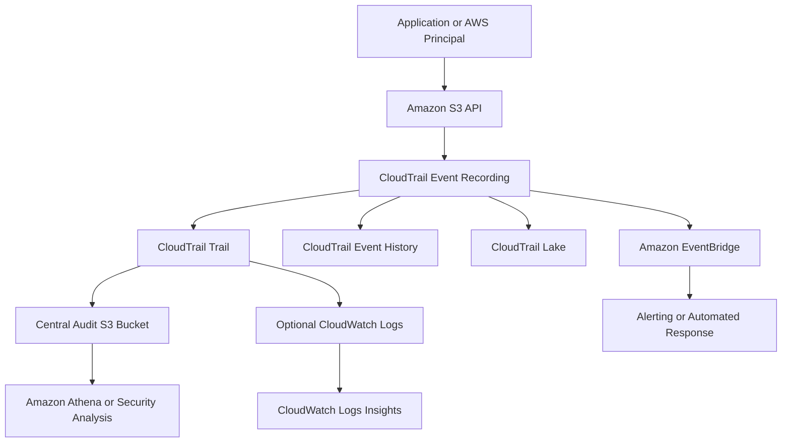

# 02- AWS CloudTrail

## Overview

AWS CloudTrail records activity performed through AWS accounts, services, and supported APIs. For Amazon S3, CloudTrail provides an audit trail of actions such as bucket configuration changes, object uploads, downloads, deletions, and changes to access controls.

CloudTrail is essential for security investigations, compliance, operational troubleshooting, and accountability. It helps engineers determine which identity performed an action, when the action occurred, which resource was involved, and whether the request succeeded or failed.

CloudTrail is different from CloudWatch. CloudWatch primarily provides metrics, logs, dashboards, and alarms, whereas CloudTrail records AWS API activity for auditing and investigation.

### Why CloudTrail matters for S3

Use CloudTrail to answer questions such as:

- Who changed a bucket policy that caused an application to receive `AccessDenied`?
- Which IAM role deleted a document?
- Which principal downloaded a sensitive object?
- When was bucket versioning disabled or encryption configuration changed?
- Which API request changed an object's metadata or tags?
- Did a request originate from the expected application role, account, or network address?
- Which API calls occurred before an unexpected object modification?

CloudTrail does not record the contents of uploaded or downloaded objects. It records event information associated with supported API activity.

## CloudTrail Event Categories

CloudTrail events are commonly organized into management events, data events, and Insights events.

| Event category | Purpose | S3 examples |
|---|---|---|
| Management events | Record control-plane operations that manage AWS resources | `CreateBucket`, `PutBucketPolicy`, `PutBucketVersioning`, `PutBucketEncryption` |
| Data events | Record data-plane operations performed on or within resources | `GetObject`, `PutObject`, `DeleteObject`, `CopyObject` |
| Insights events | Identify unusual API activity patterns for supported activity types | Unusual increases in supported S3 write API activity |

Network activity events are another CloudTrail capability for supported AWS network operations. They are distinct from ordinary S3 object data events.

### Management events

Management events record changes to AWS resource configuration and other supported control-plane activity.

Examples include:

- Creating or deleting a bucket.
- Changing a bucket policy.
- Updating versioning or encryption configuration.
- Changing lifecycle or replication settings.
- Modifying supported IAM resources.

Management events are generally enabled for newly created trails, but operators should verify the trail's event selectors and coverage instead of assuming that every desired event is captured.

### Data events

Data events record operations against objects and other supported data-plane resources.

Common S3 examples include:

- `GetObject`
- `PutObject`
- `DeleteObject`
- `CopyObject`
- `CompleteMultipartUpload`

Data events are not logged by default for trails or CloudTrail Lake event data stores. They must be explicitly configured, and additional charges apply.

This distinction is critical: a trail that records bucket configuration changes does not necessarily record who downloaded or deleted an object.

### Insights events

CloudTrail Insights can help identify unusual API activity patterns, such as unexpected changes in the rate of supported write operations.

Insights should complement ordinary event logging, not replace it. A normal-looking API rate does not prove that individual object operations are authorized or appropriate.

Reference: [CloudTrail event categories](https://docs.aws.amazon.com/awscloudtrail/latest/userguide/cloudtrail-concepts.html).

## How CloudTrail Records S3 Activity

CloudTrail observes supported API activity, records event details, and makes those events available through configured delivery and analysis mechanisms.

A production architecture commonly sends events to an S3 audit bucket, with optional CloudWatch Logs integration for operational searches and EventBridge integration for event-driven responses.



Component responsibilities:

| Component | Responsibility |
|---|---|
| CloudTrail | Records supported AWS API activity and associated event details |
| Event History | Provides recent management-event lookup in the console and supported APIs |
| Trail | Delivers selected events to configured destinations, usually an S3 bucket |
| CloudWatch Logs | Supports log searching, correlation, and operational investigation |
| CloudTrail Lake | Stores selected events in event data stores and supports SQL-based analysis |
| EventBridge | Matches supported CloudTrail events for routing and automation |
| Athena | Queries CloudTrail log files stored in S3 after the appropriate table and schema are configured |

These mechanisms have different retention, availability, cost, and query characteristics. Choose them according to audit retention, investigation speed, and compliance requirements.

## CloudTrail Event History vs. Trails vs. CloudTrail Lake

| Feature | Event History | Trail | CloudTrail Lake |
|---|---|---|---|
| Primary purpose | Recent event investigation | Durable delivery of selected audit events | Managed event storage and querying |
| Default access | Available in the CloudTrail console and supported lookup APIs | Must be configured for the desired destination and coverage | Requires an event data store |
| Management events | Supported | Supported when selected | Supported when selected |
| S3 object data events | Not available through ordinary Event History lookup | Supported when configured | Supported when configured |
| Long-term retention | Event History retains 90 days of management events | Determined by destination and lifecycle configuration | Determined by event data store settings and pricing option |
| Custom analysis | Limited lookup and filtering | Can integrate with Athena and other log-processing tools | SQL queries against supported stored event data |
| Cost considerations | Basic management-event history is provided without an additional Event History charge | Additional copies of management events and paid event types can incur charges | Ingestion, retention, and query charges apply |

Use Event History for quick investigation of recent management activity. Use trails for durable audit delivery and CloudTrail Lake when managed event storage and SQL-based investigation justify the additional cost.

A trail should not be treated as a substitute for an explicit data-event logging configuration.

References:

- [CloudTrail Event History](https://docs.aws.amazon.com/awscloudtrail/latest/userguide/view-cloudtrail-events.html)
- [CloudTrail Lake](https://docs.aws.amazon.com/awscloudtrail/latest/userguide/cloudtrail-lake.html)

## S3 Management Events vs. Object Data Events

The distinction between management and data events should guide both audit design and troubleshooting.

| Operation | Typical category | Audit purpose |
|---|---|---|
| `CreateBucket` | Management | Identify bucket creation |
| `PutBucketPolicy` | Management | Investigate access-control changes |
| `PutBucketVersioning` | Management | Audit versioning configuration changes |
| `PutBucketEncryption` | Management | Audit encryption configuration changes |
| `GetObject` | Data | Investigate object access |
| `PutObject` | Data | Investigate uploads and overwrites |
| `DeleteObject` | Data | Investigate object deletion |
| `CopyObject` | Data | Investigate object-copy operations |
| `PutObjectTagging` | Data | Investigate object-tag changes |

The exact event names and fields depend on the API operation. For multipart uploads, SDKs may perform multiple API calls, each of which can produce its own data event when covered by the configured selectors.

Do not assume that an application-level operation corresponds to exactly one CloudTrail event.

For example, an application upload may involve initiation, multiple part uploads, and multipart completion. Auditing only one event name can leave important parts of the workflow outside the selected scope.

## Creating an S3 Audit Trail

A trail delivers selected CloudTrail events to a configured destination. For production environments, use a dedicated audit bucket with access restrictions and an appropriate retention policy.

### Prerequisites

Before creating a trail:

- Confirm the AWS account and Region.
- Choose an audit bucket in an approved location.
- Define the management and data events that must be recorded.
- Determine whether CloudWatch Logs, CloudTrail Lake, or EventBridge integration is required.
- Configure appropriate delivery permissions.
- Define retention, access, and deletion controls for audit records.

For organization-wide environments, prefer an appropriately managed organization trail and centralized audit storage when supported by the organization's account structure.

### Create a multi-Region trail

The following example creates a trail that delivers logs to an existing S3 bucket and enables log-file integrity validation.

```bash
aws cloudtrail create-trail \
  --name s3-audit-trail \
  --s3-bucket-name org-audit-cloudtrail-123456789012 \
  --is-multi-region-trail \
  --enable-log-file-validation \
  --region ap-south-1
```

Replace the example bucket name with your audit bucket.

The destination bucket must permit CloudTrail to deliver logs. Confirm the bucket policy, encryption configuration, Region requirements, and other applicable prerequisites.

A multi-Region trail is generally suitable for account-wide auditing because it captures supported activity across enabled Regions. Confirm that its event selectors include the S3 resources and operations relevant to your audit requirements.

### Start logging

```bash
aws cloudtrail start-logging \
  --name s3-audit-trail \
  --region ap-south-1
```

Starting a trail does not, by itself, ensure that S3 object-level data events are enabled. Configure the required event selectors separately.

### Verify trail configuration

```bash
aws cloudtrail get-trail \
  --name s3-audit-trail \
  --region ap-south-1
```

Inspect the configured event selectors:

```bash
aws cloudtrail get-event-selectors \
  --trail-name s3-audit-trail \
  --region ap-south-1
```

Check the trail status:

```bash
aws cloudtrail get-trail-status \
  --name s3-audit-trail \
  --region ap-south-1
```

Verify that logging is enabled and that delivery errors are not being reported. A configured trail is not sufficient evidence that the required events are reaching the audit destination.

## Configuring S3 Object Data Events

Use event selectors to define which resources and operations CloudTrail records.

CloudTrail supports basic and advanced event selectors for trails. Advanced selectors provide finer-grained filtering, including filtering by event name, resource ARN, and read/write behavior.

A trail can use basic selectors or advanced selectors, but not both at the same time. Before changing an existing trail, inspect its current selectors because replacing them can remove existing coverage.

### Create an advanced event selector

Create a file named `s3-data-event-selectors.json`:

```json
[
  {
    "Name": "Production S3 object writes and deletes",
    "FieldSelectors": [
      {
        "Field": "eventCategory",
        "Equals": ["Data"]
      },
      {
        "Field": "resources.type",
        "Equals": ["AWS::S3::Object"]
      },
      {
        "Field": "resources.ARN",
        "StartsWith": [
          "arn:aws:s3:::example-prod-uploads/"
        ]
      },
      {
        "Field": "eventName",
        "Equals": [
          "PutObject",
          "CopyObject",
          "DeleteObject",
          "CompleteMultipartUpload",
          "AbortMultipartUpload"
        ]
      }
    ]
  }
]
```

This example selects specified object operations under the `example-prod-uploads` bucket. It does not capture every operation that could occur within the bucket.

The trailing slash after the bucket name is significant when filtering S3 object ARNs.

Apply the selectors:

```bash
aws cloudtrail put-event-selectors \
  --trail-name s3-audit-trail \
  --advanced-event-selectors file://s3-data-event-selectors.json \
  --region ap-south-1
```

Retrieve the selectors again to verify the configuration:

```bash
aws cloudtrail get-event-selectors \
  --trail-name s3-audit-trail \
  --region ap-south-1
```

### Selector design considerations

- Include only the API operations required by the audit use case.
- Add relevant buckets and prefixes explicitly.
- Include read events such as `GetObject` when investigating object access is required.
- Include relevant multipart operations when the upload workflow requires their audit records.
- Use `resources.ARN` filters to scope logging to intended resources.
- Review selector changes before applying them to an existing trail.

For advanced selectors, use supported comparison operators such as `Equals`, `StartsWith`, `NotStartsWith`, `EndsWith`, and `NotEndsWith`. Wildcards such as `*` are not supported as selector matching syntax.

Logging every object operation across every bucket can produce substantial event volume and cost. Start from security and compliance requirements rather than enabling broad logging without a defined purpose.

Reference: [Logging S3 data events with CloudTrail](https://docs.aws.amazon.com/awscloudtrail/latest/userguide/logging-data-events-with-cloudtrail.html).

## Inspecting Recent Events

CloudTrail Event History is useful for investigating recent management events.

### Search for bucket policy changes

```bash
aws cloudtrail lookup-events \
  --lookup-attributes \
    AttributeKey=EventName,AttributeValue=PutBucketPolicy \
  --max-results 50 \
  --region ap-south-1
```

This command searches the recent management-event history for `PutBucketPolicy` events.

It does not retrieve arbitrary S3 object data events such as `GetObject` through Event History. Use the configured trail destination, CloudTrail Lake, or another appropriate event-analysis mechanism for those events.

### Investigate a configuration change

For an event returned by `lookup-events`, inspect the serialized event record and look for fields such as:

- `eventTime`
- `eventName`
- `eventSource`
- `awsRegion`
- `sourceIPAddress`
- `userAgent`
- `userIdentity`
- `requestParameters`
- `responseElements`
- `errorCode`
- `errorMessage`
- `resources`

Field availability varies by event type. Some API responses omit request or response fields, and sensitive values may be redacted.

### Identify the acting principal

The `userIdentity` field helps establish which identity performed the operation. Depending on the request, it can contain information about an IAM user, assumed role, AWS service, federated identity, or another supported principal type.

For assumed roles, inspect the session and role context rather than relying on a display name alone. Correlate relevant timestamps and request identifiers with application logs where possible.

CloudTrail records API activity; it does not automatically establish why an application initiated that action or which business transaction it was part of.

## Understanding a CloudTrail Event Record

A typical CloudTrail event contains information that supports identity attribution, request investigation, and correlation.

An illustrative record might look like this:

```json
{
  "eventVersion": "1.11",
  "eventTime": "2026-10-15T09:45:00Z",
  "eventSource": "s3.amazonaws.com",
  "eventName": "PutObject",
  "awsRegion": "ap-south-1",
  "sourceIPAddress": "203.0.113.10",
  "userAgent": "example-application",
  "userIdentity": {
    "type": "AssumedRole",
    "arn": "arn:aws:sts::123456789012:assumed-role/DocumentApiRole/session-123"
  },
  "requestParameters": {
    "bucketName": "example-prod-uploads",
    "key": "documents/asset-123.pdf"
  },
  "responseElements": null,
  "requestID": "EXAMPLE_REQUEST_ID",
  "eventID": "EXAMPLE_EVENT_ID",
  "readOnly": false,
  "eventType": "AwsApiCall",
  "eventCategory": "Data"
}
```

This is an illustrative example, not a guaranteed schema for every S3 event. Real records can contain additional fields or omit optional fields.

Important fields:

| Field | Purpose |
|---|---|
| `eventTime` | Event timestamp |
| `eventSource` | AWS service that received the request |
| `eventName` | API operation name |
| `userIdentity` | Identity context associated with the request |
| `sourceIPAddress` | Source address observed by AWS |
| `userAgent` | Request-client information when available |
| `requestParameters` | Available request parameters |
| `responseElements` | Available response information |
| `requestID` | Request identifier useful for correlation |
| `eventID` | Event identifier |
| `errorCode` | Error classification when present |
| `errorMessage` | Error details when present |
| `resources` | Resource references associated with the event |

Treat event records as structured audit evidence, not as a complete record of object contents or application state.

## Delivering CloudTrail Events to S3

A trail can deliver log files to an S3 bucket for durable storage and analysis.

CloudTrail logs are commonly delivered as compressed files containing JSON event records. Delivery typically occurs within several minutes of an API call, but delivery timing is not guaranteed.

A production audit bucket should have:

- A dedicated purpose and restricted write permissions.
- Read access limited to authorized audit and security principals.
- Appropriate encryption and retention controls.
- Versioning or other recovery controls when required by the audit design.
- Lifecycle policies aligned with legal and compliance requirements.
- Monitoring for delivery failures.
- Appropriate controls against unauthorized deletion or alteration.

Avoid storing audit logs in the same unrestricted location as application uploads. Separation reduces the risk that an application compromise also compromises its audit evidence.

### Verify log delivery

Inspect the trail's configuration and status:

```bash
aws cloudtrail get-trail-status \
  --name s3-audit-trail \
  --region ap-south-1
```

Review status fields related to the latest delivery attempt and any reported errors.

Inspect the configured S3 destination:

```bash
aws s3 ls \
  s3://org-audit-cloudtrail-123456789012/ \
  --recursive
```

The destination may contain account, Region, and date-based path components. Large audit buckets should be investigated with targeted prefixes rather than repeatedly listing every object.

CloudTrail may retry delivery when a destination is temporarily unavailable. A broken trail can lead to prolonged delivery retries and continued charges for applicable events, so alert on persistent delivery failures.

## CloudTrail Log File Integrity Validation

CloudTrail log-file integrity validation helps determine whether delivered log files have been modified or deleted after delivery.

When enabled, CloudTrail delivers digest files that contain cryptographic hashes and integrity information for associated log files. These digests support validation through the CloudTrail validation tooling.

Enabling validation does not prevent an authorized principal from deleting logs. Access controls and retention mechanisms must complement integrity validation.

### Enable integrity validation

The earlier `create-trail` command uses:

```bash
--enable-log-file-validation
```

For an existing trail, verify the configuration and use the appropriate CloudTrail operation or console setting to enable it when necessary.

### Validate logs

After log files and digest files have been delivered, run:

```bash
aws cloudtrail validate-logs \
  --trail-arn arn:aws:cloudtrail:ap-south-1:123456789012:trail/s3-audit-trail \
  --start-time 2026-10-15T00:00:00Z \
  --end-time 2026-10-16T00:00:00Z \
  --region ap-south-1
```

Replace the example ARN and time range with the intended trail and period.

Validation requires the relevant digest files to be available. Interpret validation output according to the tool's findings, including cases where files or digests are missing. Do not treat an unverified period as proof that all audit records are intact.

For high-assurance environments, also restrict audit-bucket deletion, enforce appropriate retention, and separate audit administration from application administration.

Reference: [Validating CloudTrail log file integrity](https://docs.aws.amazon.com/awscloudtrail/latest/userguide/cloudtrail-log-file-validation-intro.html).

## CloudTrail and EventBridge

CloudTrail events can integrate with EventBridge to support near-real-time event-driven workflows.

For example, a security team might want to generate an alert when a sensitive object is deleted or when a bucket policy changes.

The general flow is:

1. CloudTrail records the relevant API activity.
2. The event becomes available to EventBridge when supported.
3. An EventBridge rule matches the event.
4. EventBridge routes the event to a configured target, such as an SNS topic, Lambda function, or queue.
5. The target performs an alerting or response action.

S3 object data events must be configured for the relevant CloudTrail resources and operations. Enabling only management events will not provide a complete object-access stream.

### Example EventBridge rule pattern

The following pattern matches S3 `DeleteObject` API events delivered through CloudTrail:

```json
{
  "source": ["aws.s3"],
  "detail-type": ["AWS API Call via CloudTrail"],
  "detail": {
    "eventSource": ["s3.amazonaws.com"],
    "eventName": ["DeleteObject"],
    "requestParameters": {
      "bucketName": ["example-prod-uploads"]
    }
  }
}
```

Use this as a pattern for a rule on the appropriate EventBridge event bus. Validate the pattern against actual event samples because event fields and values can differ across API operations.

For durable audit requirements, retain CloudTrail records in an appropriate destination. EventBridge automation is a response mechanism, not a substitute for retained audit evidence.

### Event-driven security response

A target might alert an operator when a sensitive object is deleted, initiate an investigation, or record the event in a security workflow.

Automated remediation should be proportional to the event and designed for retries and duplicate delivery. For example, an automated function should not blindly restore every deleted object without checking the authorized workflow, object version, and retention policy.

## CloudTrail Lake and Event Analysis

CloudTrail Lake provides managed storage and SQL-based querying for supported CloudTrail event data.

It is useful when an organization needs more flexible queries than Event History provides without immediately building a separate analytics pipeline over S3 log files.

Potential investigation questions include:

- Which principals deleted objects during a particular incident window?
- Which API operations were performed against a particular bucket?
- Which role sessions performed configuration changes?
- How frequently did a particular type of failure occur?
- Which events correlate with a reported security incident?

A CloudTrail Lake event data store must be configured to ingest the event categories and resources required by the use case. S3 object data events must be selected explicitly.

Costs can include ingestion, retention, and querying. Use appropriately scoped selectors and query time ranges to control both ingestion volume and scan costs.

For long-term analysis of exported logs, Amazon Athena is an alternative when CloudTrail logs are stored in S3 and the appropriate table and schema have been configured.

References:

- [CloudTrail Lake](https://docs.aws.amazon.com/awscloudtrail/latest/userguide/cloudtrail-lake.html)
- [Querying CloudTrail Lake event data](https://docs.aws.amazon.com/awscloudtrail/latest/userguide/query-event-data-store.html)

## Security and Access Control

Audit data is security-sensitive. Attackers who can delete or alter audit records may be able to obscure evidence of unauthorized access.

Apply these controls:

- Restrict access to trail configuration and event selectors.
- Separate application permissions from audit-administration permissions.
- Restrict writes to the audit destination to the required delivery identities and services.
- Limit read access to authorized security, audit, and operations roles.
- Apply encryption and retention controls appropriate to the data classification.
- Consider AWS Organizations controls and a centralized logging account for multi-account environments.
- Monitor changes to trails, event selectors, audit-bucket policies, and retention configuration.
- Use short-lived IAM role credentials rather than hardcoded access keys.
- Test whether object-level data events are actually recorded for sensitive buckets.

CloudTrail and S3 authorization are separate concerns. A CloudTrail record of a denied request does not mean that CloudTrail caused the denial, nor does enabling CloudTrail grant a principal permission to access an object.

### Shared responsibility

AWS operates the underlying CloudTrail service, while the customer remains responsible for configuring event coverage, access permissions, destinations, retention, alerting, and investigation processes.

A secure logging design must protect both the source configuration and the resulting records.

## Cost and Scalability Considerations

CloudTrail costs depend on the event category, number of copies delivered, and the storage and analysis mechanisms selected.

Important considerations include:

- The first copy of management events is generally provided without an additional management-event charge under standard trail pricing rules.
- Additional copies of management events can be charged.
- S3 object data events are chargeable.
- CloudTrail Lake charges can include ingestion, retention, and query costs.
- S3 storage and applicable data-access costs apply to retained log files.
- CloudWatch Logs ingestion, storage, and query operations can introduce additional costs.
- Broad selectors across many high-volume buckets can generate large event volumes.

For cost control:

- Log object-level events for resources with defined audit requirements.
- Use advanced event selectors to restrict unnecessary data events.
- Avoid overlapping audit configurations without a clear purpose.
- Configure retention according to actual compliance and investigation needs.
- Monitor event volume and delivery health.
- Review the current AWS pricing model before deploying organization-wide data-event logging.

Do not reduce security-critical audit coverage solely to minimize cost. Instead, classify workloads by risk and retain the events required for investigation and compliance.

Reference: [AWS CloudTrail pricing](https://aws.amazon.com/cloudtrail/pricing/).

## Troubleshooting CloudTrail

Use a repeatable diagnostic process when required events are missing or audit delivery is failing.

### Object-level events are missing

**Symptoms:** Bucket configuration events appear, but `GetObject` or `PutObject` events cannot be found.

**Likely causes:**

- S3 data events are not enabled.
- The selected bucket or object prefix does not match the request.
- The event name is not included in the selectors.
- The operator is querying Event History rather than the trail destination or CloudTrail Lake.
- The requested account, Region, or time range is incorrect.

**Investigation:**

1. Inspect the trail with `get-event-selectors`.
2. Verify the `eventCategory`, `resources.type`, `resources.ARN`, and `eventName` filters.
3. Confirm that the object operation occurred against the intended bucket.
4. Generate a controlled test request.
5. Inspect the configured trail destination or event data store after allowing for delivery delay.

**Corrective action:** Update selectors to include the required resources and operations. Verify actual event delivery before treating the issue as resolved.

### Events are missing from the S3 destination

**Symptoms:** The trail is configured, but new log files are not appearing.

**Likely causes:**

- Logging is stopped or misconfigured.
- The destination bucket policy does not permit CloudTrail delivery.
- The destination bucket or associated configuration is unavailable.
- The operator is inspecting the wrong bucket, account, Region, or prefix.
- Log delivery is delayed.

**Investigation:**

```bash
aws cloudtrail get-trail-status \
  --name s3-audit-trail \
  --region ap-south-1
```

Check the logging state, latest delivery timestamp, latest delivery error, and other relevant status fields. Then inspect the trail's destination and required S3 permissions.

**Corrective action:** Fix the destination configuration or access policy and verify that delivery resumes. Continue investigating persistent errors rather than relying on the presence of the trail alone.

### An API operation cannot be found through Event History

**Symptoms:** An object deletion is confirmed by an application, but `lookup-events` returns no corresponding event.

**Likely causes:** S3 object-level data events are not available through ordinary Event History lookup, or the relevant trail or event data store does not include them.

**Corrective action:** Inspect the configured data-event selectors and query the retained CloudTrail records or CloudTrail Lake. For supported near-real-time workflows, inspect the corresponding EventBridge event stream.

### Log integrity validation fails

**Symptoms:** CloudTrail validation reports missing or inconsistent log files or digest information.

**Likely causes:**

- Log files or digest files are missing.
- The selected validation period is incorrect.
- Required digest files have not been delivered.
- Logs have been modified or deleted.
- The wrong trail ARN or Region is being used.

**Corrective action:** Preserve available evidence, review the validation output, check permissions and retention history, and investigate any unexplained modification or deletion. Do not assume missing files are harmless.

### EventBridge automation does not run

**Symptoms:** CloudTrail records an operation, but the expected EventBridge target is not invoked.

**Likely causes:**

- The event pattern does not match the actual event structure.
- The required data event was never enabled.
- Target permissions or configuration are incorrect.
- The rule is on the wrong event bus or Region.
- The event was delayed or did not match the configured scope.

**Corrective action:** Compare the rule pattern against a real event sample, verify the configured event source and target permissions, and test with a controlled API request.

## Testing and Operational Readiness

A CloudTrail deployment should be tested against known API actions before it is relied upon for security investigations or compliance.

A practical test plan should include:

- Perform a controlled bucket configuration change and confirm the management event is visible.
- Upload an object and verify that the expected data event is captured.
- Download and delete a test object when the audit policy requires those events.
- Test both successful and denied requests where relevant.
- Confirm the correct principal, bucket, object key, timestamp, and event name.
- Verify that audit logs are delivered to the intended destination.
- Validate that EventBridge rules and notification targets respond as expected.
- Check that retention, access controls, and log-file integrity validation are configured as intended.
- Confirm that an operator can investigate events without receiving unnecessary object-management permissions.

Never claim successful audit coverage solely because a trail exists or its status indicates that logging is enabled.

## Official References

- [AWS CloudTrail User Guide](https://docs.aws.amazon.com/awscloudtrail/latest/userguide/cloudtrail-user-guide.html)
- [Logging S3 data events](https://docs.aws.amazon.com/awscloudtrail/latest/userguide/logging-data-events-with-cloudtrail.html)
- [Filtering data events with advanced event selectors](https://docs.aws.amazon.com/awscloudtrail/latest/userguide/filtering-data-events.html)
- [Viewing CloudTrail events](https://docs.aws.amazon.com/awscloudtrail/latest/userguide/view-cloudtrail-events.html)
- [CloudTrail log file integrity validation](https://docs.aws.amazon.com/awscloudtrail/latest/userguide/cloudtrail-log-file-validation-intro.html)
- [Using CloudTrail with EventBridge](https://docs.aws.amazon.com/eventbridge/latest/userguide/eb-service-event-cloudtrail.html)
- [CloudTrail Lake](https://docs.aws.amazon.com/awscloudtrail/latest/userguide/cloudtrail-lake.html)
- [AWS CloudTrail pricing](https://aws.amazon.com/cloudtrail/pricing/)

## Key Takeaways

- CloudTrail records supported AWS API activity, but S3 object-level data events must be explicitly configured.
- Use management events to audit bucket configuration changes and data events to investigate object operations such as downloads, uploads, and deletions.
- Use trails for durable event delivery, Event History for recent management-event investigation, and CloudTrail Lake for managed SQL-based analysis.
- Protect audit records with least-privilege access, appropriate retention, delivery monitoring, and log-file integrity validation.
- Verify audit coverage through controlled tests and monitor logging configuration, event selectors, delivery status, and associated costs.