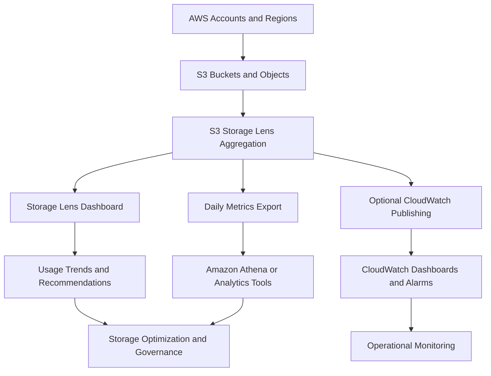
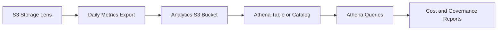

# 03- Amazon S3 Storage Lens

## Overview

Amazon S3 Storage Lens is a cloud-storage analytics capability that provides visibility into object storage usage, activity, and configuration across AWS accounts and Regions. It aggregates metrics into dashboards and reports so that engineering and operations teams can identify storage growth, cost optimization opportunities, data-protection gaps, and workload patterns.

Unlike bucket-level monitoring, Storage Lens is designed to provide a broader view of an organization's S3 estate. It helps answer questions such as:

- Which accounts, Regions, and buckets consume the most storage?
- Which buckets or prefixes are growing fastest?
- Where are storage lifecycle policies missing or ineffective?
- Which buckets lack recommended data-protection configurations?
- Where are large numbers of small objects increasing storage-management overhead?
- Which workloads have unusual request activity or HTTP error patterns?
- Where can storage usage and request activity be optimized?

Storage Lens is particularly useful in organizations running multiple backend services, data pipelines, backup workflows, and document-storage systems across many buckets.

Storage Lens metrics are generated daily. It is intended for storage analytics, governance, and trend analysis rather than second-by-second request monitoring.

Official reference: [Monitoring storage activity with S3 Storage Lens](https://docs.aws.amazon.com/AmazonS3/latest/userguide/storage_lens.html).

## How S3 Storage Lens Works

Storage Lens aggregates supported S3 metrics across the resources included in a dashboard configuration. The metrics are presented in interactive dashboards and can also be exported for analysis using services such as Amazon Athena.



### Component responsibilities

| Component | Responsibility |
|---|---|
| S3 Storage Lens dashboard | Visualizes aggregated usage, activity, and supported recommendations. |
| Dashboard configuration | Defines the scope, metrics tier, aggregation options, and publishing settings. |
| Metrics export | Delivers daily metrics in supported formats for external analysis. |
| Amazon Athena | Queries exported metrics stored in S3 when the appropriate tables and schemas are configured. |
| Amazon CloudWatch | Integrates eligible Storage Lens metrics with operational dashboards, alarms, and metric analysis. |
| AWS Organizations | Supports organization-wide visibility when the appropriate organizational configuration and permissions are in place. |

Storage Lens provides aggregated insights rather than a record of every individual object request. Use CloudWatch request metrics for near-real-time workload monitoring, CloudTrail for API auditing, and S3 Inventory for object-level inventory analysis.

## Default Dashboard and Custom Dashboards

### Default dashboard

S3 provides a default dashboard named `default-account-dashboard`. It is configured to show summarized metrics and trends for the account and is updated daily.

The default dashboard cannot be deleted or reconfigured to use a different scope, but it can be disabled. It can also be upgraded to advanced metrics and configured with optional export settings.

Disabling the dashboard stops new metric updates and exports associated with that dashboard. Historical data remains queryable for a limited period, depending on the metrics tier.

### Custom dashboards

Create custom dashboards when you need to:

- Focus on specific AWS Regions or buckets.
- Analyze an AWS Organization across member accounts.
- Separate production, staging, analytics, or backup storage.
- Enable advanced metrics for selected workloads.
- Export data for scheduled reporting or analytics.
- Publish supported metrics to CloudWatch.

Each dashboard has a home Region in which its configuration and metrics are stored.

A dashboard configuration change can take up to 48 hours to be accurately reflected in the displayed metrics. Account for this delay when validating a new configuration or investigating missing data.

## Free Tier vs. Advanced Tier

Storage Lens provides a free metrics tier and an advanced metrics tier.

| Capability | Free metrics | Advanced metrics |
|---|---|---|
| Account and bucket-level summary metrics | Included | Included |
| Basic cost optimization metrics | Included | Included |
| Basic data-protection metrics | Included | Included |
| Activity metrics | Not included as advanced activity metrics | Available |
| Detailed HTTP status-code metrics | Not included | Available |
| Advanced cost optimization metrics | Not included | Available |
| Advanced data-protection metrics | Not included | Available |
| Prefix-level aggregation | Not included | Available |
| Storage Lens group aggregation | Not included | Available |
| Contextual recommendations | Not included as the advanced recommendation feature | Available |
| CloudWatch metrics publishing | Not available | Available |
| Metrics query history | Up to 14 days | Up to 15 months |
| Additional Storage Lens charges | No additional charge for free metrics | Additional charges apply |

The exact set of available metrics depends on the selected categories and configuration.

Use the free tier for an initial view of storage consumption and basic storage-governance insights. Enable advanced metrics when you need granular prefix analytics, activity metrics, extended history, recommendations, or CloudWatch integration.

Advanced metrics should be enabled based on a defined operational requirement rather than simply because more metrics are available.

References:

- [Understanding S3 Storage Lens](https://docs.aws.amazon.com/AmazonS3/latest/userguide/storage_lens_basics_metrics_recommendations.html)
- [S3 Storage Lens metrics glossary](https://docs.aws.amazon.com/AmazonS3/latest/userguide/storage_lens_metrics_glossary.html)

## Metrics Categories

Storage Lens organizes metrics around storage usage, cost optimization, data protection, access management, performance, and activity.

### Summary metrics

Summary metrics provide a high-level view of the storage estate, including measures such as object count and storage bytes.

Use these metrics to identify:

- Accounts or buckets with significant storage consumption.
- Increasing object counts.
- Differences in usage across Regions and storage classes.
- General trends that require deeper investigation.

### Cost optimization metrics

Cost optimization metrics help identify potential savings opportunities.

Examples include indicators related to storage-class distribution, lifecycle configuration, object-size distribution, and other supported optimization opportunities.

Use these insights to investigate whether objects could be transitioned to lower-cost storage classes or whether unnecessary storage is accumulating.

A recommendation is an investigation starting point, not an instruction to immediately change storage configuration. Validate retrieval patterns, retention requirements, minimum storage-duration considerations, retrieval charges, and application dependencies first.

### Data-protection metrics

Data-protection metrics help identify whether storage resources follow selected protection practices.

Examples include visibility into:

- Bucket versioning configuration.
- Encryption configuration.
- Object Lock adoption.
- Replication-related configuration.
- Other supported data-protection settings.

These metrics are useful for governance and identifying configuration gaps. They do not prove that every object can be recovered or that replication and backup workflows meet their recovery objectives.

### Access-management metrics

Access-management metrics help assess supported access-control configurations and storage exposure risks.

Use these insights to prioritize reviews of bucket policies, public-access settings, and other supported controls. Investigate the actual resource policies and IAM permissions before making authorization changes.

### Performance metrics

Performance-related metrics help identify workload and storage patterns that might affect operational efficiency. Advanced metric options provide additional performance visibility.

Examples of investigation targets include unusual request patterns, high activity, and prefixes containing large numbers of small objects.

Storage Lens does not replace application tracing, per-request diagnostics, or CloudWatch request-metrics analysis.

### Activity and detailed status-code metrics

Advanced metrics can provide activity information such as request counts and data transferred, along with more detailed status-code metrics.

Use these metrics to identify:

- Changes in request volumes.
- Unexpected increases in unsuccessful requests.
- Workloads with unusual access patterns.
- Buckets or prefixes that may benefit from architectural changes.

Because Storage Lens metrics are daily aggregates, use CloudWatch request metrics and application telemetry when a production incident requires finer time resolution.

## Prefix-Level Analysis

An S3 prefix is the portion of an object key that precedes a delimiter. For example, the key `uploads/tenant-123/reports/report.pdf` has hierarchical prefixes such as `uploads/` and `uploads/tenant-123/`.

S3 does not implement a traditional directory hierarchy. Prefixes provide logical grouping within object keys.

Storage Lens advanced metrics can aggregate metrics by prefix, allowing engineers to identify storage growth or workload patterns within logical parts of a bucket.

### Example storage layout

```text
s3://example-prod-uploads/
    uploads/
        tenant-123/
            reports/
            images/
        tenant-456/
            reports/
    processed/
        reports/
        images/
    archive/
        reports/
```

Prefix-level analysis can help answer questions such as:

- Is one workload responsible for most of the bucket's growth?
- Which tenant prefixes consume the most storage?
- Are processed files accumulating unexpectedly?
- Are certain prefixes dominated by small objects?
- Which parts of a bucket have unusual request or error activity?

### Default prefix aggregation

With the default metrics report and prefix aggregation settings, Storage Lens can include prefixes whose objects account for at least a configured percentage of total bucket storage.

The default prefix aggregation supports up to 10 levels of prefix depth.

The minimum storage threshold and maximum depth determine the amount of detail in the report. A higher threshold reduces the number of prefixes included, while a lower threshold provides broader coverage.

Prefix aggregation is an advanced-tier capability.

### Expanded prefixes metrics report

The expanded prefixes metrics report provides more comprehensive prefix-level visibility. It supports prefix analysis up to 50 levels deep and is intended for large-scale prefix analytics.

It can include supported storage-usage, activity, status-code, and data-protection metrics for prefixes across the selected buckets.

The report has its own processing constraints. For example, prefix-level metrics are excluded for a bucket when the combinations of prefixes and storage classes exceed twice the object count.

Use the expanded prefixes report when the default prefix aggregation is too limited for the analysis required.

Reference: [S3 Storage Lens metrics and features](https://docs.aws.amazon.com/AmazonS3/latest/userguide/storage_lens.html).

## Creating a Storage Lens Dashboard

A dashboard can be created through the Amazon S3 console or the AWS CLI.

### Create a dashboard through the console

1. Open the Amazon S3 console.
2. Navigate to **S3 Storage Lens → Dashboards**.
3. Choose **Create dashboard**.
4. Select a unique dashboard name and its home Region.
5. Define the included Regions, buckets, or organizational scope.
6. Select the free or advanced metrics tier.
7. Configure the relevant metric categories.
8. Optionally enable prefix aggregation, Storage Lens group aggregation, metrics export, or CloudWatch publishing.
9. Review the configuration and create the dashboard.

Choose the scope before enabling paid metrics. A focused dashboard can reduce unnecessary metric collection and make the results easier to interpret.

### Create a basic dashboard using the AWS CLI

First, create a file named `storage-lens-config.json`:

```json
{
  "Id": "s3-estate-overview",
  "IsEnabled": true,
  "AccountLevel": {
    "BucketLevel": {}
  }
}
```

This is a minimal example for a custom dashboard using free metrics and the default account-level scope. It does not configure an export destination or enable advanced features.

Create the configuration:

```bash
aws s3control put-storage-lens-configuration \
  --account-id 123456789012 \
  --config-id s3-estate-overview \
  --storage-lens-configuration file://storage-lens-config.json \
  --region ap-south-1
```

Replace the example account ID with the account that owns the configuration. The selected Region is the dashboard's home Region.

The dashboard configuration ID must match the `Id` in the JSON document.

### Verify the dashboard

Retrieve the configuration:

```bash
aws s3control get-storage-lens-configuration \
  --account-id 123456789012 \
  --config-id s3-estate-overview \
  --region ap-south-1
```

Inspect its tags, if applicable:

```bash
aws s3control get-storage-lens-configuration-tagging \
  --account-id 123456789012 \
  --config-id s3-estate-overview \
  --region ap-south-1
```

List configurations:

```bash
aws s3control list-storage-lens-configurations \
  --account-id 123456789012 \
  --region ap-south-1
```

Allow time for metrics to appear. Successful configuration creation does not mean that the first daily report is immediately available.

Reference: [Creating a Storage Lens dashboard](https://docs.aws.amazon.com/AmazonS3/latest/userguide/storage_lens_creating_dashboard.html).

## Exporting Metrics for Analytics

Storage Lens can export daily metrics reports for processing outside its interactive dashboard.

Supported export formats for a general-purpose S3 destination include CSV and Apache Parquet. The destination can also be an AWS-managed S3 table bucket where supported by the selected export configuration.

Exported data is useful for:

- Long-term reporting and trend analysis.
- Organization-wide cost analysis.
- Tracking changes in storage-class distribution.
- Building reports across multiple accounts or Regions.
- Combining Storage Lens metrics with billing or inventory data.
- Automating governance reports.

### Export destinations

| Destination | Suitable use case | Considerations |
|---|---|---|
| General-purpose S3 bucket | Custom data pipelines and conventional data-lake analytics | Configure bucket permissions, encryption, retention, and access controls |
| AWS-managed S3 table bucket | Querying exported metrics using supported table-oriented analytics workflows | Confirm the required S3 Tables integration and access prerequisites |

The destination bucket for a general-purpose export must satisfy the applicable Storage Lens configuration requirements, including the requirement that it be in the same Region as the dashboard's home Region.

### Export format selection

Use CSV when simple inspection and broad tool compatibility are priorities. Use Parquet when analytical workloads benefit from a columnar format.

Parquet can reduce the amount of data read for suitable analytical queries. Query performance and cost still depend on schema design, file layout, partitioning, and the query engine.

### Export security

Before enabling an export, verify:

- CloudTrail and audit expectations for the destination.
- The Storage Lens service's required write permissions.
- Bucket policy requirements.
- Encryption settings.
- KMS permissions if SSE-KMS is used.
- Retention and lifecycle rules.
- The identity that will query the exported data.

If the destination bucket requires encryption, the export configuration must use a compatible encryption option. An encryption-policy mismatch can cause export failures.

### Processing exports with Athena

A common architecture stores Storage Lens reports in a dedicated analytics bucket and queries them through Athena.



The Athena table schema must match the actual exported report schema. Use the manifest file and the applicable Storage Lens export documentation when building an automated ingestion process.

Do not assume that every day's report is represented by a single data file. Large reports can be split into multiple files, and the manifest identifies the export files and related metadata.

Reference: [Viewing Storage Lens metrics through data exports](https://docs.aws.amazon.com/AmazonS3/latest/userguide/storage_lens_view_metrics_export.html).

## Integrating Storage Lens with CloudWatch

CloudWatch publishing allows eligible Storage Lens metrics to be viewed alongside other operational metrics.

This integration is available for dashboards using advanced metrics and recommendations when CloudWatch publishing is enabled.

Published metrics use the `AWS/S3/Storage-Lens` namespace.

### When to use CloudWatch publishing

Use the integration when you need to:

- Combine daily storage analytics with application and infrastructure dashboards.
- Create alarms based on selected Storage Lens metrics.
- Use metric math to derive useful indicators.
- Apply anomaly detection to supported metrics.
- Integrate metric queries with supported monitoring tools.

CloudWatch publishing does not make Storage Lens a real-time telemetry source. Storage Lens metrics are published daily, and initial publication can take up to 24 hours after the option is enabled. After metrics appear in the Storage Lens dashboard, they can take additional hours to appear in CloudWatch.

A CloudWatch query for these daily metrics must use a period of `86400` seconds.

### Important limitations

- Prefix-level Storage Lens metrics are not published to CloudWatch.
- Only supported account-level, organization-level, and bucket-level metrics are available.
- CloudWatch dashboards, alarms, and API operations can incur their own charges.
- CloudWatch access controls do not provide fine-grained restrictions for individual Storage Lens configurations or dimensions in the same way as the dashboard configuration.

Do not build a minute-level incident response process around a daily Storage Lens metric. Use S3 request metrics and application telemetry for that requirement.

Reference: [Monitoring Storage Lens metrics in CloudWatch](https://docs.aws.amazon.com/AmazonS3/latest/userguide/storage_lens_view_metrics_cloudwatch.html).

## Storage Lens Groups

Storage Lens groups allow objects to be grouped for supported analytics using filters such as prefixes, object tags, or other supported criteria.

They can help analyze selected logical datasets that do not align with a single bucket boundary or that need classification independent of the overall dashboard scope.

Examples include:

- Financial documents.
- Customer-generated media.
- Backup datasets.
- Archived application exports.
- Objects associated with a defined business workload.

Storage Lens group aggregation is an advanced-tier capability. A group's filters and aggregation configuration should be designed around a specific analytical objective.

Do not assume that a Storage Lens group behaves like an IAM access-control boundary. It groups objects for analytics; it does not by itself grant or deny object access.

Reference: [Working with S3 Storage Lens groups](https://docs.aws.amazon.com/AmazonS3/latest/userguide/storage-lens-groups.html).

## Organization-Wide Storage Visibility

For organizations with many AWS accounts, Storage Lens can provide a consolidated view when configured with AWS Organizations and the appropriate delegated or management account permissions.

This is useful when storage is spread across:

- Production and non-production accounts.
- Application teams.
- Different AWS Regions.
- Backup and disaster-recovery accounts.
- Data engineering environments.

A centralized dashboard helps identify organization-wide trends and configuration gaps without requiring operators to inspect every bucket manually.

Plan the organization-level scope and permissions carefully. Confirm which accounts and Regions are covered, who owns the dashboard configuration, and who can access the resulting reports.

For multi-account analytics, keep dashboard configuration ownership and destination-bucket permissions explicit. Organization-wide visibility should not automatically imply unrestricted access to the underlying objects or audit records.

Reference: [Using S3 Storage Lens with AWS Organizations](https://docs.aws.amazon.com/AmazonS3/latest/userguide/storage_lens_organization.html).

## Operational Use Cases

### Detect unexpected storage growth

Compare daily storage metrics across buckets and Regions. Identify the largest contributors to growth and drill down into prefixes where advanced aggregation is available.

Investigate whether growth comes from new uploads, retained object versions, backups, incomplete multipart uploads, or data-processing outputs.

Before deleting data or changing retention policies, validate ownership and recovery requirements.

### Identify potential lifecycle improvements

Use cost optimization insights to identify buckets that may lack useful lifecycle configurations.

Check the actual lifecycle rules and evaluate whether objects are eligible for transition or expiration. Account for minimum storage durations, retrieval costs, legal retention, and application access patterns.

Storage Lens can identify candidates for optimization, but the final lifecycle design requires workload and policy analysis.

### Review data-protection posture

Use data-protection insights to identify buckets with missing or inconsistent configurations, such as versioning or replication where required.

Validate the real bucket configuration and verify that the desired protection mechanism works. For example, enabling replication does not by itself prove that existing objects are recoverable or that every replication operation is succeeding.

### Optimize small-object workloads

Use prefix analysis and expanded-prefix exports where appropriate to find workloads with large numbers of small objects.

Investigate whether batching, compaction, or a different storage layout could reduce request overhead and improve data-processing efficiency. Evaluate the trade-offs before changing the application format or object boundaries.

## Security and Permissions

Storage Lens dashboard management, metrics access, and metrics export involve different permissions.

Common operations require permissions such as:

| Operation | Example permission |
|---|---|
| Create or update a Storage Lens configuration | `s3:PutStorageLensConfiguration` |
| Retrieve a configuration | `s3:GetStorageLensConfiguration` |
| List configurations | `s3:ListStorageLensConfigurations` |
| Retrieve configuration tags | `s3:GetStorageLensConfigurationTagging` |
| Update configuration tags | `s3:PutStorageLensConfigurationTagging` |
| Delete a configuration | `s3:DeleteStorageLensConfiguration` |

The exact permission set depends on the actions being performed, the dashboard scope, and whether organization-level features or exports are configured.

Apply least-privilege access:

- Separate dashboard administration from ordinary S3 object administration.
- Restrict who can create, edit, or delete configurations.
- Limit access to exported metrics based on their sensitivity.
- Use approved encryption and retention settings for exports.
- Ensure KMS key policies permit required export operations when SSE-KMS is configured.
- Review dashboard and export tags where they are used for access management or cost allocation.

Metrics are aggregated, but they can still reveal information about system usage, dataset size, business activity, or workload distribution.

## Cost Management

Storage Lens costs depend on the selected tier, metrics features, and related analytics services.

Free metrics are available without an additional Storage Lens metrics charge. Advanced metrics and recommendations introduce additional charges according to current AWS pricing.

Other potential costs include:

- S3 storage for exported reports.
- Requests associated with storing and querying exported data.
- Athena query processing.
- S3 Tables usage where selected.
- CloudWatch dashboards, alarms, and API usage.
- Additional tools used to transform and retain analytics data.

No separate CloudWatch metrics-publishing charge applies to Storage Lens publishing, but other CloudWatch charges can still apply.

### Cost-control practices

- Start with free metrics and upgrade only when advanced capabilities are required.
- Scope custom dashboards to the resources needed for the analysis.
- Enable advanced metric categories selectively.
- Use prefix aggregation when the resulting granularity supports a defined decision.
- Define retention and lifecycle policies for exported reports.
- Monitor query frequency and analytics costs.
- Review whether each advanced metric or report provides actionable value.

Check the current [Amazon S3 pricing page](https://aws.amazon.com/s3/pricing/) before enabling advanced features across large storage estates.

## Troubleshooting

### Dashboard metrics are missing

**Symptoms:** A new dashboard exists, but metrics are absent or incomplete.

**Likely causes:**

- The dashboard was recently created or changed.
- The dashboard is disabled.
- The selected account, Region, or bucket scope is incorrect.
- The metric is unavailable in the chosen tier.
- The expected daily reporting interval has not completed.

**Diagnostic steps:**

1. Retrieve the dashboard configuration.
2. Confirm that `IsEnabled` is `true`.
3. Verify the dashboard scope and home Region.
4. Confirm the selected metrics tier and categories.
5. Allow for daily processing and configuration propagation.
6. Inspect the relevant dashboard metrics and export status.

Do not conclude that the bucket is empty or healthy merely because its metrics are missing.

### Prefix metrics are absent

**Symptoms:** Bucket-level metrics are available, but the expected prefix-level details are not.

**Likely causes:**

- Advanced metrics are not enabled.
- Prefix aggregation is not enabled or its threshold is too restrictive.
- The configured depth does not cover the expected prefix.
- The prefix does not meet the configured selection criteria.
- The requested level of detail requires the expanded prefixes report.

**Corrective action:** Review the aggregation configuration, threshold, and depth. If broader coverage is necessary, evaluate the expanded prefixes report and its associated cost and processing constraints.

### CloudWatch publishing returns no data

**Symptoms:** Storage Lens metrics appear in the S3 dashboard, but no corresponding CloudWatch datapoints are available.

**Diagnostic steps:**

1. Verify that the dashboard uses advanced metrics.
2. Confirm that CloudWatch publishing is enabled.
3. Check the home Region and the account that owns the configuration.
4. Allow up to 24 hours for initial publication.
5. Query using the `AWS/S3/Storage-Lens` namespace and correct dimensions.
6. Use a period of `86400` seconds.
7. Confirm that you are not expecting prefix-level metrics in CloudWatch.

Investigate CloudWatch permissions separately from Storage Lens configuration and publishing delays.

### Metrics export fails

**Symptoms:** The dashboard reports metrics, but the destination bucket does not receive the expected report.

**Likely causes:**

- Incorrect destination configuration.
- Missing delivery permissions.
- A destination bucket policy requiring encryption that the export does not satisfy.
- Incompatible or incorrect KMS key permissions.
- An incorrect export format or destination configuration.

**Corrective action:** Inspect the dashboard export settings and destination-bucket policy. Confirm the required write permissions and encryption configuration, then verify delivery again.

### Dashboard metrics appear stale after a configuration change

Storage Lens updates metrics daily, and configuration changes can take up to 48 hours to be accurately reflected.

Verify the applied configuration and allow for propagation and daily processing before classifying the delay as a service failure. If the delay persists beyond the expected window, investigate dashboard status, scope, and publishing configuration.

## Production Best Practices

- Use the default dashboard for initial account-level visibility.
- Create custom dashboards around defined operational, cost, or governance objectives.
- Enable advanced metrics only when their additional granularity or integrations provide value.
- Use prefix-level analysis to investigate major contributors to growth and activity.
- Export metrics when longer-term reporting or cross-system analysis is required.
- Use CloudWatch publishing for daily metrics that benefit from centralized dashboards or alarms.
- Keep detailed API auditing in CloudTrail and object-level inventory analysis in S3 Inventory.
- Protect dashboard configuration and exported reports using least-privilege permissions.
- Validate recommendations against retention, recovery, and application requirements before changing storage.
- Review dashboard scope, metric selection, export retention, and cost regularly.

## Official References

- [Amazon S3 Storage Lens overview](https://docs.aws.amazon.com/AmazonS3/latest/userguide/storage_lens.html)
- [Understanding Storage Lens metrics and recommendations](https://docs.aws.amazon.com/AmazonS3/latest/userguide/storage_lens_basics_metrics_recommendations.html)
- [Creating a Storage Lens dashboard](https://docs.aws.amazon.com/AmazonS3/latest/userguide/storage_lens_creating_dashboard.html)
- [Storage Lens metrics glossary](https://docs.aws.amazon.com/AmazonS3/latest/userguide/storage_lens_metrics_glossary.html)
- [Viewing metrics through exports](https://docs.aws.amazon.com/AmazonS3/latest/userguide/storage_lens_view_metrics_export.html)
- [Monitoring Storage Lens metrics in CloudWatch](https://docs.aws.amazon.com/AmazonS3/latest/userguide/storage_lens_view_metrics_cloudwatch.html)
- [Storage Lens permissions](https://docs.aws.amazon.com/AmazonS3/latest/userguide/storage_lens_iam_permissions.html)
- [Amazon S3 pricing](https://aws.amazon.com/s3/pricing/)

## Key Takeaways

- S3 Storage Lens provides daily, aggregated visibility into storage consumption, activity, and supported data-protection practices across accounts, Regions, and buckets.
- Free metrics are suitable for initial storage analysis; advanced metrics add prefix-level analytics, recommendations, additional metric categories, and CloudWatch publishing.
- Exported metrics support long-term reporting and analytical workflows, but destination permissions, encryption, retention, and schema handling must be configured correctly.
- Storage Lens recommendations identify investigation opportunities and should be validated against actual workload, security, retention, and recovery requirements.
- Use Storage Lens for estate-wide analytics, CloudWatch for operational monitoring, CloudTrail for API auditing, and S3 Inventory for detailed object-level analysis.