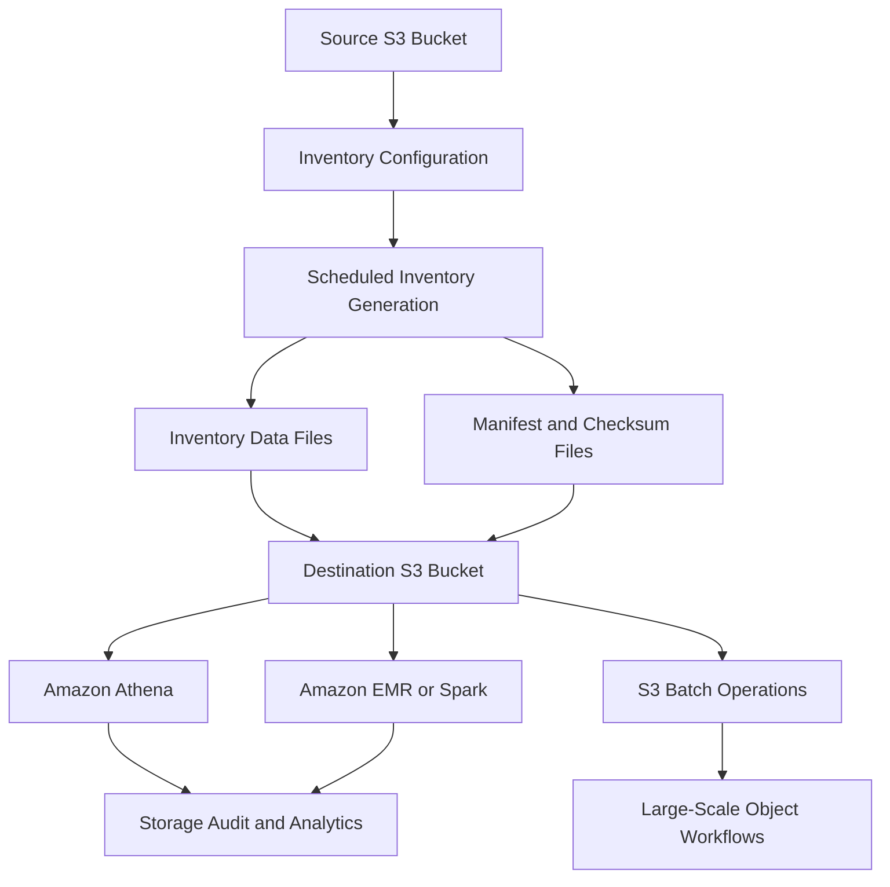

# 04- S3 Inventory

## Overview

Amazon S3 Inventory provides scheduled reports listing objects in an S3 bucket along with selected object metadata. It is designed for large-scale inventory, auditing, storage analysis, and operational workflows that need a periodic view of an S3 estate.

Instead of repeatedly calling `ListObjectsV2` or enumerating object versions through application code, teams can configure S3 Inventory to generate daily or weekly reports and analyze those reports using tools such as Amazon Athena, Amazon Redshift Spectrum, Apache Spark, and S3 Batch Operations.

S3 Inventory is particularly useful when managing millions of objects, auditing encryption and replication status, identifying storage-class distribution, validating retention configurations, or reconciling application records against stored objects.

Typical use cases include:

- Auditing object encryption and replication status.
- Identifying objects that have not been modified recently.
- Finding large objects and analyzing storage-class distribution.
- Auditing object versions and delete markers.
- Identifying objects with Object Lock retention configurations.
- Supporting large-scale data-processing and migration workflows.
- Generating inventory reports for compliance and operational reviews.

S3 Inventory is a scheduled reporting mechanism, not a real-time inventory API. The first report can take up to 48 hours to arrive, and subsequent reports follow the configured schedule.

Official reference: [Cataloging and analyzing your data with S3 Inventory](https://docs.aws.amazon.com/AmazonS3/latest/userguide/storage-inventory.html).

## How S3 Inventory Works

S3 Inventory generates a flat-file report containing the objects selected by an inventory configuration. The report is written to a destination bucket and accompanied by manifest files that describe the report and identify its data files.



### Component responsibilities

| Component | Responsibility |
|---|---|
| Source bucket | Contains the objects or object versions to inventory. |
| Inventory configuration | Specifies the report scope, schedule, format, object versions, metadata fields, and destination. |
| Inventory generation | Produces a scheduled listing without relying on application-driven S3 `List` API enumeration. |
| Inventory data files | Contain the object keys and selected metadata. |
| Manifest files | Identify the report, schema, and associated data files. |
| Destination bucket | Stores the report, manifests, and related artifacts. |
| Analytics tools | Query or process inventory records for auditing, reconciliation, and optimization. |

S3 Inventory does not use S3 `List` API operations to audit the objects in the source bucket. This makes it useful for recurring inventory workflows without generating the application-driven listing traffic that a custom enumeration job might create.

## Inventory Configuration

An inventory configuration controls which objects appear in a report and how the report is generated.

You can configure multiple inventory lists for a general purpose bucket. Each configuration has an identifier and defines the reporting scope.

| Setting | Description |
|---|---|
| Configuration ID | Unique identifier for the inventory configuration within the bucket. |
| Status | Enables or disables inventory generation. |
| Object versions | Includes only current versions or all versions. |
| Prefix filter | Limits inventory to keys beginning with a specified prefix. |
| Frequency | Generates a report daily or weekly. |
| Destination | Specifies the destination bucket and optional prefix. |
| Format | Selects CSV, Apache ORC, or Apache Parquet. |
| Optional fields | Adds selected metadata columns to the report. |
| Encryption | Configures server-side encryption for the report. |

A general purpose bucket can have up to 1,000 inventory configurations.

### Daily vs. weekly inventory

| Frequency | Behavior | Suitable use cases |
|---|---|---|
| Daily | Generates an inventory report daily | Operational reconciliation, recurring compliance checks, frequent storage analysis |
| Weekly | Generates an inventory report weekly; subsequent weekly reports are generated on Sunday in UTC | Lower-frequency governance reports and periodic storage reviews |

Inventory generation is asynchronous. Do not assume that a report is available immediately after enabling a configuration.

A daily schedule also does not make the report a transactionally current representation of the bucket at the moment you query it. Use timestamps and manifest metadata to determine which report you are analyzing.

## Current Versions vs. All Versions

S3 Inventory can include either the current version of each object or all object versions.

| Mode | What it includes | When to use it |
|---|---|---|
| `Current` | Current object versions | Routine inventory, storage-class analysis, current encryption status |
| `All` | All object versions, including version-related records and delete markers | Version audits, historical storage analysis, recovery and retention investigations |

For versioned buckets, the all-versions inventory includes fields such as `VersionId`, `IsLatest`, and `DeleteMarker`.

A current-version inventory is smaller and simpler for many operational tasks. An all-versions inventory is more appropriate when investigating noncurrent versions or understanding the storage impact of versioning.

Consider a bucket containing a current object, two historical versions, and a delete marker. An all-versions inventory can represent these records separately, while a current-version inventory does not provide the same historical detail.

Do not treat the current-version inventory as a complete representation of historical storage or delete-marker state.

## Inventory Output Formats

S3 Inventory supports three output formats.

| Format | Compression | Best suited for |
|---|---|---|
| CSV | GZIP | Interoperability, simple inspection, and supported S3 Batch Operations workflows |
| Apache ORC | ZLIB | Analytical queries over large inventories |
| Apache Parquet | Snappy | Columnar analytics with Athena and other data-processing engines |

CSV is convenient when data must be consumed by general-purpose tools. For analytical workloads, ORC and Parquet often reduce the amount of data that must be read when queries reference only a subset of columns.

For large inventories, Parquet is a practical default for Athena-based reporting. Confirm that the schema and consuming tools support the chosen format.

### Important format considerations

- Inventory reports are not guaranteed to be sorted.
- CSV object keys are URL-encoded and must be decoded when reconstructing the original key.
- ORC and Parquet have format-specific schemas and type representations.
- Do not assume that all optional fields are present unless they were selected in the inventory configuration.
- Use the manifest to determine which report files belong to a particular inventory run.

Reference: [Amazon S3 Inventory lists](https://docs.aws.amazon.com/AmazonS3/latest/userguide/storage-inventory.html).

## Object Metadata Available in Inventory

Every inventory record includes the bucket name and object key. Depending on the configuration, additional metadata can be included.

### Common inventory fields

| Field | Purpose |
|---|---|
| `Bucket` | Source bucket name |
| `Key` | Object key |
| `VersionId` | Object version identifier when all versions are included |
| `IsLatest` | Indicates whether the version is the latest version |
| `DeleteMarker` | Indicates a delete-marker record |
| `Size` | Object size in bytes |
| `LastModifiedDate` | Object creation or last-modified timestamp, as applicable |
| `ETag` | Entity tag associated with the object |
| `StorageClass` | Storage class used for the object |
| `IsMultipartUploaded` | Indicates whether the object was uploaded using multipart upload |
| `ReplicationStatus` | Available object replication status |
| `EncryptionStatus` | Server-side encryption status |
| `BucketKeyStatus` | Indicates whether an S3 Bucket Key applies |
| `ChecksumAlgorithm` | Checksum algorithm associated with the object |
| `ObjectOwner` | Object owner information |
| `ObjectAccessControlList` | Object ACL information |
| `LifecycleExpirationDate` | Applicable lifecycle expiration information |
| `ObjectLockMode` | Object Lock retention mode |
| `ObjectLockRetainUntilDate` | Retention deadline |
| `ObjectLockLegalHoldStatus` | Legal-hold status |
| `IntelligentTieringAccessTier` | Access tier for applicable Intelligent-Tiering objects |

The supported optional fields and their availability can vary by bucket type and service capabilities. Check the current API reference before using a field in an automated compliance workflow.

### Object size is not total storage consumption

The `Size` field reports the object's size in bytes. It does not include incomplete multipart-upload data, object metadata overhead, or delete markers.

Consequently, summing object sizes in an inventory does not necessarily reproduce the total storage usage reported by S3 storage metrics or a billing report.

Use inventory size totals for object-level analysis, and compare them with the appropriate storage metrics and billing data when performing cost reconciliation.

### ETag is not always an MD5 checksum

An ETag can be useful as an object identifier or comparison field, but it must not be treated as a universal MD5 checksum. Multipart uploads and encryption or upload conditions can affect ETag semantics.

Use explicitly supported S3 checksum fields and a defined integrity-verification procedure when content integrity is a requirement.

## Creating an Inventory Configuration

You can create an inventory configuration using the S3 console, AWS CLI, SDKs, or REST API.

### Prerequisites

Before creating the configuration:

1. Select the source bucket and inventory scope.
2. Decide whether current versions or all versions are required.
3. Select the report frequency and format.
4. Choose a destination bucket in the same AWS Region as the source bucket.
5. Configure the destination bucket policy to allow S3 to deliver inventory reports.
6. Select metadata fields and encryption settings.
7. Verify that operators and analytical services have the required permissions to read the reports.

The destination bucket can be in a different AWS account, provided the required permissions and encryption configuration are in place.

### Create a destination bucket policy

For general purpose buckets, a destination bucket policy must allow the S3 service to write the inventory reports.

Example policy:

```json
{
  "Version": "2012-10-17",
  "Statement": [
    {
      "Sid": "AllowS3InventoryDelivery",
      "Effect": "Allow",
      "Principal": {
        "Service": "s3.amazonaws.com"
      },
      "Action": "s3:PutObject",
      "Resource": "arn:aws:s3:::example-inventory-destination/inventory/*",
      "Condition": {
        "ArnLike": {
          "aws:SourceArn": "arn:aws:s3:::example-prod-uploads"
        },
        "StringEquals": {
          "aws:SourceAccount": "123456789012",
          "s3:x-amz-acl": "bucket-owner-full-control"
        }
      }
    }
  ]
}
```

Replace the example bucket names and account ID with the actual source and destination resources.

This example is scoped to an inventory destination prefix of `inventory/`. The prefix in the configuration must match the intended destination path.

Review the destination bucket's existing policy before adding this statement. Do not replace unrelated policy statements, and ensure that explicit denies do not block delivery.

For directory buckets, the relevant permissions and service principal differ. The example above is specifically for general purpose buckets.

### Define the inventory configuration

Create a file named `inventory-config.json`:

```json
{
  "Destination": {
    "S3BucketDestination": {
      "AccountId": "123456789012",
      "Bucket": "arn:aws:s3:::example-inventory-destination",
      "Format": "Parquet",
      "Prefix": "inventory",
      "Encryption": {
        "SSES3": {}
      }
    }
  },
  "IsEnabled": true,
  "Filter": {
    "Prefix": "uploads/"
  },
  "Id": "daily-uploads-inventory",
  "IncludedObjectVersions": "Current",
  "OptionalFields": [
    "Size",
    "LastModifiedDate",
    "StorageClass",
    "ETag",
    "IsMultipartUploaded",
    "EncryptionStatus",
    "ReplicationStatus",
    "BucketKeyStatus",
    "ChecksumAlgorithm"
  ],
  "Schedule": {
    "Frequency": "Daily"
  }
}
```

This example creates a daily inventory of current object versions whose keys begin with `uploads/`. It exports Parquet files to the `inventory/` prefix of the destination bucket using SSE-S3 encryption.

The destination account ID identifies the destination bucket owner. The encryption setting must comply with the destination bucket's policies.

### Apply the configuration

```bash
aws s3api put-bucket-inventory-configuration \
  --bucket example-prod-uploads \
  --id daily-uploads-inventory \
  --inventory-configuration file://inventory-config.json \
  --region ap-south-1
```

The command creates or replaces the inventory configuration identified by `daily-uploads-inventory`.

This example assumes the destination bucket is in `ap-south-1`, matching the source bucket's Region. Configure the source and destination correctly before running the command.

### Verify the configuration

Retrieve the configuration:

```bash
aws s3api get-bucket-inventory-configuration \
  --bucket example-prod-uploads \
  --id daily-uploads-inventory \
  --region ap-south-1
```

List configurations:

```bash
aws s3api list-bucket-inventory-configurations \
  --bucket example-prod-uploads \
  --region ap-south-1
```

The configuration can be present and enabled before the first report becomes available. Allow up to 48 hours for initial delivery, and verify the generated manifest after that period.

Reference: [Configuring Amazon S3 Inventory](https://docs.aws.amazon.com/AmazonS3/latest/userguide/configure-inventory.html).

## Locating Inventory Reports and Manifests

S3 Inventory writes the data files and manifest artifacts to the configured destination prefix.

A typical layout is:

```text
s3://example-inventory-destination/inventory/
    example-prod-uploads/
        daily-uploads-inventory/
            2026-10-15T00-00Z/
                manifest.json
                manifest.checksum
                data/
                    <report-file>.parquet
            hive/
                dt=2026-10-15-00-00/
                    symlink.txt
```

The exact timestamps, folder structure, and filenames depend on the report generation process.

The source bucket name and inventory configuration ID help separate reports when multiple configurations or source buckets share a destination.

### Manifest files

The inventory output can include:

| File | Purpose |
|---|---|
| `manifest.json` | Describes the inventory report, schema, and data files |
| `manifest.checksum` | Contains the MD5 checksum of the manifest file |
| `symlink.txt` | Provides an Apache Hive-compatible manifest where generated |

The manifest lists the report files belonging to the inventory run and includes information such as the source bucket, destination bucket, creation timestamp, file format, schema, and data-file checksums.

Use `manifest.json` to identify the files associated with one report generation rather than assuming that every file under the destination prefix belongs to the same run.

In versioning-enabled destination buckets, new versions of manifest files can be created when those files are overwritten. In addition, S3 may deliver one final inventory report shortly after a configuration is deleted while the change is processed.

### Inspect manifests

```bash
aws s3 cp \
  s3://example-inventory-destination/inventory/example-prod-uploads/daily-uploads-inventory/2026-10-15T00-00Z/manifest.json \
  ./manifest.json
```

The path is illustrative. Use the actual report timestamp and key returned by S3.

The downloaded manifest can be inspected as JSON to determine which data files must be processed.

### Verify manifest contents

For automated ingestion workflows, validate:

- The expected source bucket.
- The inventory configuration ID.
- The report format and schema.
- The manifest's creation timestamp.
- The presence and availability of all referenced data files.
- The relevant file sizes and checksums.

The manifest checksum helps detect corruption of the manifest itself. It is not a replacement for verifying the content integrity of every inventory object.

Reference: [Locating your inventory list](https://docs.aws.amazon.com/AmazonS3/latest/userguide/storage-inventory-location.html).

## Querying Inventory with Amazon Athena

Amazon Athena can query S3 Inventory reports using SQL after the appropriate table definition and schema have been configured.

For large inventories, use ORC or Parquet where practical. These columnar formats are generally more efficient than CSV for queries that read selected columns.

The table definition must match the actual inventory format and selected optional fields. AWS provides supported table-definition templates for CSV, ORC, and Parquet.

Reference: [Querying Amazon S3 Inventory with Athena](https://docs.aws.amazon.com/AmazonS3/latest/userguide/storage-inventory-athena-query.html).

### Find large objects

Assuming an Athena table named `s3_inventory` with lowercase columns corresponding to the report schema:

```sql
SELECT
    key,
    size,
    storage_class,
    last_modified_date
FROM s3_inventory
WHERE size >= 1073741824
ORDER BY size DESC
LIMIT 100;
```

This query identifies objects of at least 1 GiB when the table contains the relevant fields.

### Analyze storage by storage class

```sql
SELECT
    storage_class,
    COUNT(*) AS object_count,
    SUM(size) AS total_bytes
FROM s3_inventory
GROUP BY storage_class
ORDER BY total_bytes DESC;
```

This query estimates the distribution of object sizes across storage classes. It does not calculate a full S3 bill because billing also depends on object versions, minimum storage-duration rules, request activity, retrieval, and other chargeable factors.

### Find objects with unexpected encryption status

If the inventory configuration includes `EncryptionStatus`, use a query such as:

```sql
SELECT
    encryption_status,
    COUNT(*) AS object_count
FROM s3_inventory
GROUP BY encryption_status
ORDER BY object_count DESC;
```

Use this for a broad audit, then apply the actual encryption requirements for the workload. A particular encryption status is not inherently incorrect; the result must be compared with the organization's security policy.

### Find objects with replication failures

If the report includes `ReplicationStatus`, you can inspect the current distribution:

```sql
SELECT
    replication_status,
    COUNT(*) AS object_count
FROM s3_inventory
GROUP BY replication_status
ORDER BY object_count DESC;
```

For all-version inventories, interpret the results together with version-specific replication semantics. Investigate objects with failed replication status using the appropriate replication diagnostics and configuration.

### Query specific report dates

When reports are stored with partitioned layouts, configure Athena to select relevant partitions or use supported partition projection. Querying only the required report date can reduce scanned data.

Do not assume that every inventory destination is automatically registered as an Athena table. The table definition, catalog configuration, schema, and report location must be configured appropriately.

## Using Inventory with S3 Batch Operations

S3 Inventory can serve as an object list for supported S3 Batch Operations workflows.

This enables large-scale operations without building a custom application that enumerates every object and submits individual requests.

Examples include supported operations to:

- Copy objects.
- Replace object tags.
- Invoke supported object-processing operations.
- Apply selected batch operations across large object populations.

The operation must support the chosen manifest format and required metadata. CSV is a common choice for workflows that use inventory reports as batch manifests.

Before creating a batch job:

1. Confirm that the inventory report contains the required object identifiers.
2. Select the correct inventory report and manifest.
3. Review the target objects and intended operation.
4. Verify the IAM permissions required by S3 Batch Operations and the operation being performed.
5. Configure completion reporting and error handling.
6. Start with a small test scope where practical.
7. Reconcile the results before processing the full population.

Inventory reports are periodic, so their contents might not reflect the current state of every key at execution time. Objects can be overwritten or deleted after the report is generated.

Design batch workflows to handle missing objects, changed versions, repeated execution, and partial failures.

Reference: [S3 Batch Operations](https://docs.aws.amazon.com/AmazonS3/latest/userguide/batch-ops.html).

## S3 Inventory vs. Other S3 Monitoring Tools

Different S3 tools address different operational needs.

| Tool | Primary purpose | Typical freshness or scope |
|---|---|---|
| S3 Inventory | Object-level metadata reports | Daily or weekly |
| `ListObjectsV2` | Request-time listing of current objects | Synchronous API result |
| `ListObjectVersions` | Request-time listing of object versions | Synchronous API result |
| S3 Storage Lens | Aggregated storage analytics and trends | Daily metrics |
| CloudWatch S3 request metrics | Request volume, latency, errors, and transfer activity | Near-real-time metrics when enabled |
| CloudTrail | Audit records for supported API activity | Event delivery and history depend on configuration |
| S3 server access logging | Detailed request records where configured | Asynchronous log delivery |

Use `ListObjectsV2` or `ListObjectVersions` when an application needs a request-time listing. Use Inventory for scheduled large-scale reporting, audit, and analytics.

Use CloudWatch for operational monitoring and CloudTrail when you need API-level audit evidence.

Inventory provides a periodic snapshot, not a replacement for real-time event processing or transactionally consistent application state.

## Security and Permissions

Inventory reports can contain sensitive object names and metadata, including ownership information, encryption status, retention settings, and ACL information when these fields are selected.

Access to the report can therefore disclose information even when the principal cannot read the source objects themselves.

### Common permissions

| Operation | Example permission |
|---|---|
| Create or update a general purpose bucket's inventory configuration | `s3:PutInventoryConfiguration` |
| Retrieve an inventory configuration | `s3:GetInventoryConfiguration` |
| List inventory configurations | `s3:ListInventoryConfigurations` |
| Delete an inventory configuration | `s3:PutInventoryConfiguration` or the applicable supported configuration-management authorization, depending on the API action and policy context |
| Read inventory reports | Appropriate `s3:GetObject` access to the destination report objects |
| Query report files with Athena | Appropriate Athena permissions and read access to the source data, plus access to the Athena query-results location |

For exact API authorization requirements, consult the relevant S3 API and IAM documentation. Directory buckets use the corresponding `s3express:` inventory configuration permissions.

### Security practices

- Keep inventory destination buckets private.
- Scope report read permissions to approved operational, security, and analytics roles.
- Limit configuration permissions to authorized administrators.
- Use conditions to constrain the source bucket allowed to deliver reports.
- Specify the expected destination account when configuring cross-account inventory.
- Enable an appropriate encryption configuration for the report.
- Protect KMS key policies when SSE-KMS is used.
- Restrict optional metadata fields when they are not needed.
- Apply retention and lifecycle controls to report data.
- Audit changes to the source configuration and destination policy.

### Encryption considerations

Inventory reports can use SSE-S3 or SSE-KMS with a customer managed KMS key.

The AWS managed KMS key `aws/s3` is not supported for SSE-KMS encryption of S3 Inventory reports.

If using SSE-KMS, grant Amazon S3 the required permission through the customer managed key policy. For cross-account workflows, specify a fully qualified KMS key ARN when required by the configuration.

The destination bucket's default encryption configuration must also be compatible with the inventory delivery process. A destination bucket policy that requires a particular encryption header can cause report delivery to fail if the inventory configuration does not satisfy that requirement.

Reference: [Configuring S3 Inventory and encryption](https://docs.aws.amazon.com/AmazonS3/latest/userguide/configure-inventory.html).

## Performance, Reliability, and Cost

Inventory is designed for large-scale enumeration without requiring your application to issue a synchronous listing request for every object.

It is still a scheduled report, so consumers must tolerate delayed availability and process reports at the granularity they provide.

### Reliability considerations

- The first report can take up to 48 hours to arrive.
- Data files are not guaranteed to be sorted.
- A report may contain multiple data files.
- The manifest should be used to discover the report's data files.
- Inventory delivery is asynchronous.
- A configuration deletion can be followed by one additional report.
- Reports can be based on a view of object state that is no longer current when processing occurs.

For reproducible pipelines, identify each report by its source bucket, configuration ID, and report-generation timestamp. Store processing status and manifest references in durable state when processing must be recoverable.

### Cost considerations

S3 Inventory incurs charges based on the number of objects listed and the applicable inventory pricing. Additional costs can include:

- Destination-bucket storage for reports and manifests.
- Requests to read and process exported reports.
- Athena query processing.
- S3 Batch Operations.
- Encryption-related KMS usage where applicable.
- Retaining old reports and versions of manifest objects.

Use weekly reports when daily freshness is unnecessary. Select only the metadata fields required by the use case and choose a report format that matches the downstream processing workload.

Review the current [Amazon S3 pricing page](https://aws.amazon.com/s3/pricing/) before enabling frequent inventory reports for very large buckets.

## Troubleshooting

### Inventory report has not arrived

**Symptoms:** The configuration exists, but no inventory files appear in the destination bucket.

**Likely causes:**

- The configuration is disabled.
- Initial report generation is still in progress.
- The destination bucket is in a different Region.
- The destination policy does not allow delivery.
- An explicit deny blocks the required destination write.
- The selected destination encryption configuration is incompatible.

**Diagnostic steps:**

1. Retrieve the configuration using `get-bucket-inventory-configuration`.
2. Confirm that `IsEnabled` is `true`.
3. Verify the source and destination Regions.
4. Inspect the destination bucket policy.
5. Check encryption requirements and KMS authorization.
6. Inspect the destination prefix and wait for the initial delivery window.

**Corrective action:** Correct the configuration or destination permissions and verify that the next report is delivered. Do not assume that an enabled configuration means a report has already been generated.

### Inventory report cannot be read

**Symptoms:** The files exist, but an operator or analytics service receives an access-denied error.

**Likely causes:**

- Missing `s3:GetObject` permissions.
- A restrictive bucket policy or explicit deny.
- KMS permissions missing for SSE-KMS encrypted reports.
- The wrong account, Region, or destination prefix.
- An incompatible encryption setting.

**Corrective action:** Separate S3 authorization failures from KMS authorization failures. Verify permissions on the exact report objects and the relevant KMS key policy.

### Athena query returns errors or missing columns

**Symptoms:** Queries fail because a field does not exist or the inventory schema does not match the table definition.

**Likely causes:**

- Optional metadata fields were not selected.
- The Athena table uses the wrong format-specific schema.
- The table points to an incorrect inventory prefix.
- Column names or types do not match the report.
- The query assumes a report layout that differs from the generated files.

**Corrective action:** Inspect `manifest.json`, verify the `fileFormat` and `fileSchema`, and update the table definition to match the exported report. Remove references to optional fields that were not included.

### Inventory and live object state disagree

**Symptoms:** A key shown in inventory no longer exists, or its metadata differs from the current object.

**Likely causes:**

- The object was modified or deleted after the report was generated.
- The report covers current versions while the investigation requires historical versions.
- A versioned object has changed since the snapshot.
- The report is being compared with a live query performed at a different time.

**Corrective action:** Inspect the report-generation timestamp and query the current object or relevant object version directly. Use an all-versions inventory when historical version analysis is necessary.

### Inventory processing produces incomplete analytics

**Symptoms:** A pipeline processes some files but misses records or produces inconsistent counts.

**Likely causes:**

- Only one data file was processed instead of every file listed in the manifest.
- The workflow used an assumed file ordering.
- CSV keys were not URL-decoded.
- The schema changed or the consumer ignored optional fields.
- The report was processed repeatedly without idempotency controls.

**Corrective action:** Use the manifest as the authoritative list of report files, process every listed file, validate the schema, and track completed report identities. Make ingestion idempotent so retries do not duplicate downstream records.

## Production Best Practices

- Use Inventory for scheduled object-level analysis rather than frequent application-driven full-bucket enumeration.
- Select `Current` or `All` versions according to the actual audit and recovery requirement.
- Prefer Parquet or ORC for analytical workflows that benefit from columnar processing.
- Use the manifest to discover every data file in a report.
- Validate report timestamps, schemas, file availability, and checksums.
- Restrict destination access because inventory metadata can reveal sensitive information.
- Treat reports as delayed snapshots, not authoritative real-time object state.
- Use Inventory with Athena for large-scale metadata audits and S3 Batch Operations for supported bulk operations.
- Monitor destination delivery and processing failures.
- Apply lifecycle and retention policies to inventory reports and manifests.
- Document how to recreate a report, reprocess a failed run, and reconcile results with live S3 state.

## Official References

- [Amazon S3 Inventory overview](https://docs.aws.amazon.com/AmazonS3/latest/userguide/storage-inventory.html)
- [Configuring Amazon S3 Inventory](https://docs.aws.amazon.com/AmazonS3/latest/userguide/configure-inventory.html)
- [Locating inventory lists and manifest files](https://docs.aws.amazon.com/AmazonS3/latest/userguide/storage-inventory-location.html)
- [Querying Amazon S3 Inventory with Athena](https://docs.aws.amazon.com/AmazonS3/latest/userguide/storage-inventory-athena-query.html)
- [PutBucketInventoryConfiguration API](https://docs.aws.amazon.com/AmazonS3/latest/API/API_PutBucketInventoryConfiguration.html)
- [S3 Inventory configuration API model](https://docs.aws.amazon.com/AmazonS3/latest/API/API_InventoryConfiguration.html)
- [S3 Batch Operations](https://docs.aws.amazon.com/AmazonS3/latest/userguide/batch-ops.html)
- [Amazon S3 pricing](https://aws.amazon.com/s3/pricing/)

## Key Takeaways

- S3 Inventory provides scheduled, large-scale object and metadata reports without relying on application-driven S3 listing requests.
- Configure report scope, version selection, frequency, format, metadata fields, destination permissions, and encryption according to the workload.
- Use manifest files to identify all report data files, and account for delayed delivery, unsorted records, and stale snapshots.
- Use Athena for metadata analytics and S3 Batch Operations for supported bulk operations, while designing workflows for retries and partial failures.
- Protect inventory exports as sensitive operational data and validate report schemas, permissions, retention, and delivery before relying on them for compliance.