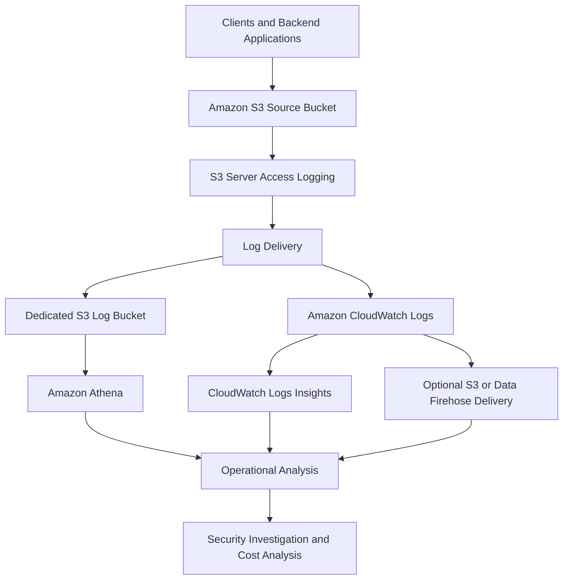
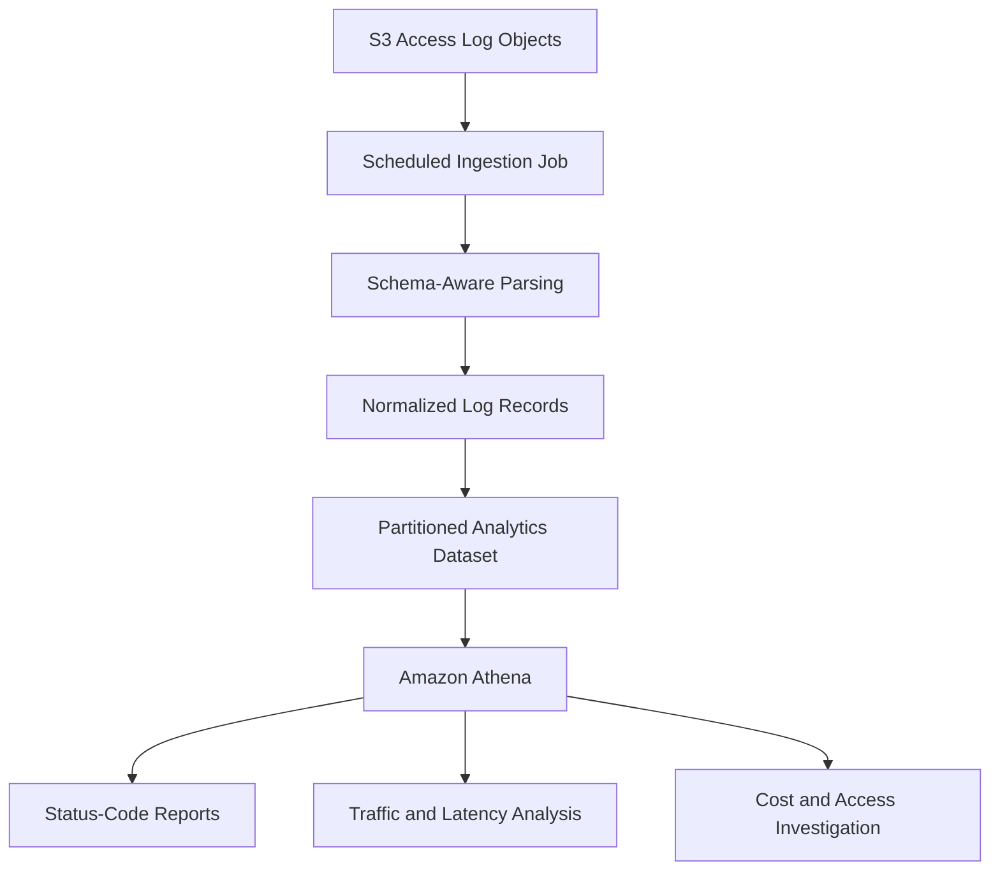

# 05- S3 Server Access Logging

## Overview

Amazon S3 Server Access Logging records detailed information about requests made to an S3 bucket. These records help engineers investigate access patterns, analyze request behavior, identify unexpected activity, and understand how applications interact with stored objects.

Server access logging is disabled by default. When enabled, Amazon S3 periodically collects request records and delivers them to a configured destination.

Common use cases include:

- Investigating unexpected object downloads, uploads, and deletions.
- Analyzing HTTP response codes and request latency.
- Understanding access patterns for document and media storage.
- Identifying applications or clients generating excessive requests.
- Supporting operational reviews and security investigations.
- Analyzing usage patterns that contribute to S3 costs.
- Maintaining request-level operational evidence for selected workloads.

Server access logging is a best-effort logging mechanism. Records can be delayed, duplicated, or missing. It should not be treated as a complete accounting of all requests or as the sole source of audit evidence.

AWS recommends using CloudTrail for logging bucket-level and object-level API activity. Server access logging can complement CloudTrail when detailed request records and traffic analysis are required.

Official reference: [Logging requests with server access logging](https://docs.aws.amazon.com/AmazonS3/latest/userguide/ServerLogs.html).

## How Server Access Logging Works

When logging is enabled, S3 collects supported request information and periodically delivers consolidated log records to the configured destination.

The delivery path determines the log format, available integrations, access-control requirements, and cost model.



### Component responsibilities

| Component | Responsibility |
|---|---|
| Source bucket | Receives the requests being logged. |
| S3 server access logging | Collects and consolidates supported request records. |
| Destination S3 bucket | Stores log files in space-delimited text format. |
| CloudWatch Logs | Receives structured access logs for querying and aggregation. |
| Amazon Athena | Queries log files stored in S3 after the appropriate table schema is configured. |
| CloudWatch Logs Insights | Analyzes logs delivered to CloudWatch Logs. |
| Security and operations workflows | Investigate access patterns, errors, and suspicious activity. |

Logging is asynchronous. Enabling it does not mean that every subsequent request produces an immediately available log record.

## Server Access Logging vs. CloudTrail

Server access logging and CloudTrail provide different forms of request and audit information.

| Capability | S3 Server Access Logging | AWS CloudTrail |
|---|---|---|
| Primary purpose | Detailed request analysis and traffic investigation | AWS API auditing and identity attribution |
| Request details | Includes request URI, HTTP status, bytes transferred, timing, requester information, and other available fields | Includes structured API event details, identity information, request parameters, and errors when available |
| Object-level activity | Supported request records, subject to best-effort delivery | Requires appropriate data-event configuration for applicable object operations |
| Default behavior | Disabled | Event History records recent management events; data events require explicit configuration |
| Delivery reliability | Best effort; records can be delayed, duplicated, or absent | Event delivery and retention depend on the selected CloudTrail mechanism and configuration |
| Querying | Athena for S3-delivered logs; CloudWatch Logs Insights for CloudWatch-delivered logs | Event History, CloudTrail Lake, Athena, and supported integrations |
| Typical use | Traffic analysis, request investigation, operational review | Audit investigations, API activity attribution, and security analysis |

Use CloudTrail when you need to investigate which AWS principal performed an API operation or changed a resource configuration. Use server access logs when detailed request-level information is useful for traffic analysis and operational diagnostics.

For sensitive workloads, both mechanisms can be useful.

Reference: [Logging options for Amazon S3](https://docs.aws.amazon.com/AmazonS3/latest/userguide/logging-with-S3.html).

## Delivery Destinations

S3 server access logs support two primary delivery paths: an S3 general purpose bucket or Amazon CloudWatch Logs.

You can configure either destination or use both.

### Delivery to an S3 bucket

S3 writes space-delimited text log objects to a destination bucket.

The destination bucket must be in the same AWS account and Region as the source bucket for this delivery path.

Use this option when you need durable log files, integration with S3-based analytics, or straightforward archival with lifecycle policies.

Important requirements:

- The destination bucket must allow the S3 logging service to write logs.
- The destination bucket must not have S3 Object Lock enabled.
- The destination bucket must not have a default Object Lock retention period.
- Requester Pays must be disabled on the destination bucket.
- The destination must use SSE-S3 encryption; SSE-KMS default encryption is not supported for this delivery path.
- The destination bucket should not itself have server access logging enabled.
- A dedicated destination bucket is recommended to simplify access control, retention, and log analysis.

### Delivery to CloudWatch Logs

S3 can deliver structured server access logs to CloudWatch Logs.

This option supports structured querying, cross-account aggregation, and cross-Region aggregation through supported delivery configurations. CloudWatch Logs can also deliver logs onward to S3 or Amazon Data Firehose. Optional mirroring to S3 Tables can support SQL analytics.

Use this option when your primary requirement is interactive investigation, cross-account log analysis, or integration with CloudWatch monitoring workflows.

Consider the different cost model: CloudWatch Logs ingestion is billed under applicable vended-log pricing, while direct delivery to an S3 bucket does not incur an additional S3 log-delivery charge.

| Consideration | S3 destination | CloudWatch Logs destination |
|---|---|---|
| Log format | Space-delimited text | Structured JSON in the log group |
| Query interface | Athena or external processing | CloudWatch Logs Insights |
| Cross-account aggregation | Not supported for direct S3 server access log delivery | Supported through applicable CloudWatch Logs delivery configurations |
| Cross-Region aggregation | Not supported for direct S3 server access log delivery | Supported through applicable CloudWatch Logs delivery configurations |
| KMS encryption | Direct server access logs use SSE-S3 | Supported |
| Additional delivery charge | No separate delivery charge | CloudWatch vended-log ingestion charges apply |
| Retention | Controlled through destination-bucket lifecycle and retention design | Controlled through CloudWatch Logs retention configuration and any downstream destination policies |

The two delivery paths have different permissions and configuration requirements. Do not apply the direct-to-S3 bucket restrictions to the CloudWatch Logs delivery path without checking the corresponding documentation.

Reference: [Delivering server access logs to CloudWatch Logs](https://docs.aws.amazon.com/AmazonS3/latest/userguide/sal-cw-enabling.html).

## Preparing a Dedicated Logging Bucket

A dedicated log bucket prevents application data and audit-related records from sharing the same operational boundary.

For example:

```text
example-prod-uploads
example-s3-access-logs
    s3-access-logs/
        example-prod-uploads/
        example-prod-reports/
        example-prod-backups/
```

Use a distinct prefix for each source bucket when consolidating log delivery into one destination.

### Destination bucket configuration

For direct S3 delivery, the destination bucket should:

- Be in the same Region and AWS account as the source bucket.
- Remain private.
- Have S3 Object Lock disabled.
- Have no default Object Lock retention period.
- Have Requester Pays disabled.
- Use SSE-S3 encryption.
- Grant the logging service principal only the required write access.
- Have a suitable lifecycle policy for log retention.
- Have logging disabled to avoid recursive log generation.
- Be monitored for storage growth and delivery problems.

You can use S3 Object Ownership with **Bucket owner enforced**, which disables ACLs, provided that access is granted through the destination bucket policy.

Avoid relying on ACL-based permissions for new deployments when the bucket policy can provide the required access.

## Granting Log Delivery Permissions

For direct S3 delivery, the destination bucket policy must grant the S3 logging service principal permission to write log objects.

The recommended approach is to grant `s3:PutObject` to `logging.s3.amazonaws.com`, constrained to the intended destination prefix and source bucket.

### Example destination bucket policy

The following policy allows log delivery from one source bucket into a dedicated prefix.

```json
{
  "Version": "2012-10-17",
  "Statement": [
    {
      "Sid": "AllowS3ServerAccessLogDelivery",
      "Effect": "Allow",
      "Principal": {
        "Service": "logging.s3.amazonaws.com"
      },
      "Action": "s3:PutObject",
      "Resource": "arn:aws:s3:::example-s3-access-logs/s3-access-logs/example-prod-uploads/*",
      "Condition": {
        "ArnLike": {
          "aws:SourceArn": "arn:aws:s3:::example-prod-uploads"
        },
        "StringEquals": {
          "aws:SourceAccount": "123456789012"
        }
      }
    }
  ]
}
```

Replace the example bucket names and account ID with actual resource identifiers.

The allowed resource prefix must match the destination prefix used in the logging configuration. The `aws:SourceArn` and `aws:SourceAccount` conditions help restrict which source bucket can deliver logs.

Review existing destination-bucket policy statements before applying this change. An explicit `Deny` can still prevent log delivery.

When scripting this setup, apply the destination policy before enabling logging on the source bucket.

Reference: [Granting permissions for server access log delivery](https://docs.aws.amazon.com/AmazonS3/latest/userguide/enable-server-access-logging.html).

## Enabling Server Access Logging with the AWS CLI

The AWS CLI supports server access logging through the `PutBucketLogging` API.

### Configure the source bucket

Create a file named `logging-config.json`:

```json
{
  "LoggingEnabled": {
    "TargetBucket": "example-s3-access-logs",
    "TargetPrefix": "s3-access-logs/example-prod-uploads/",
    "TargetObjectKeyFormat": {
      "PartitionedPrefix": {
        "PartitionDateSource": "EventTime"
      }
    }
  }
}
```

This configuration enables direct S3 log delivery and uses date-based partitioning based on the event time.

The destination prefix identifies the source bucket's logs and helps prevent collisions when several buckets use the same destination.

### Enable logging

```bash
aws s3api put-bucket-logging \
  --bucket example-prod-uploads \
  --bucket-logging-status file://logging-config.json \
  --region ap-south-1
```

The source bucket and destination bucket must meet the requirements for direct S3 delivery.

### Verify the configuration

```bash
aws s3api get-bucket-logging \
  --bucket example-prod-uploads \
  --region ap-south-1
```

The response should contain a `LoggingEnabled` configuration with the expected destination and prefix.

Check the destination bucket policy separately. A successful `put-bucket-logging` request confirms that the configuration was accepted, not that log files have already arrived.

### Inspect the destination

```bash
aws s3 ls \
  s3://example-s3-access-logs/s3-access-logs/example-prod-uploads/ \
  --recursive
```

Log delivery can take a few hours. Verify the expected key prefix and allow for asynchronous delivery before concluding that the configuration is broken.

## Configuring Logging with Boto3

Boto3 can configure logging from a deployment script or infrastructure-management service.

The following example assumes that the destination bucket policy has already granted permission to the logging service principal.

```python
import boto3
from botocore.exceptions import ClientError


def enable_s3_server_access_logging(
    *,
    source_bucket: str,
    destination_bucket: str,
    destination_prefix: str,
    region_name: str,
) -> None:
    s3 = boto3.client("s3", region_name=region_name)

    logging_config = {
        "LoggingEnabled": {
            "TargetBucket": destination_bucket,
            "TargetPrefix": destination_prefix,
            "TargetObjectKeyFormat": {
                "PartitionedPrefix": {
                    "PartitionDateSource": "EventTime"
                }
            },
        }
    }

    try:
        s3.put_bucket_logging(
            Bucket=source_bucket,
            BucketLoggingStatus=logging_config,
        )
    except ClientError:
        raise

    result = s3.get_bucket_logging(Bucket=source_bucket)
    configured = result.get("LoggingEnabled")

    if not configured:
        raise RuntimeError(
            f"Server access logging is not enabled for {source_bucket}"
        )

    if configured.get("TargetBucket") != destination_bucket:
        raise RuntimeError(
            f"Unexpected logging destination for {source_bucket}"
        )
```

The example uses the standard Boto3 credential provider chain. Do not hardcode AWS access keys.

In production, validate destination permissions and bucket constraints before enabling logging. Also verify the destination prefix, selected key format, and expected delivery behavior.

The configuration call does not wait for log files to arrive. A complete deployment workflow should verify configuration immediately and verify delivery separately after allowing sufficient time.

## Understanding the Log Object Key Structure

Direct-to-S3 access logs are delivered as log objects under the configured prefix.

With partitioned object-key formatting, the key structure includes identifiers and date-based components.

An illustrative layout is:

```text
s3://example-s3-access-logs/s3-access-logs/example-prod-uploads/
    123456789012/
        ap-south-1/
            example-prod-uploads/
                2026/
                    10/
                        15/
                            2026-10-15-12-15-00-UNIQUESTRING
```

The exact layout depends on the selected key format and S3's generated object key.

The `EventTime` setting organizes records around request event time. `DeliveryTime` can instead organize logs around the time at which log objects are delivered.

Date partitioning makes it easier to narrow searches to a particular source bucket and time range.

For CloudWatch Logs delivery, the destination layout and format are determined by that integration rather than the direct-to-S3 `TargetPrefix` configuration.

## Understanding S3 Server Access Log Records

Direct S3 access logs use a space-delimited text format. Each record represents a request, and each record is written on a separate line.

An illustrative log entry might resemble:

```text
79a59df900b949e55d96a1e698fbacedfd6e09d98eacf8f8d5218e7cd47ef2be example-prod-uploads [15/Oct/2026:09:45:00 +0000] 203.0.113.10 arn:aws:sts::123456789012:assumed-role/DocumentApiRole/session-123 EXAMPLE123 REST.GET.OBJECT documents/report.pdf "GET /example-prod-uploads/documents/report.pdf HTTP/1.1" 200 - 245760 245760 41 15 "-" "ExampleDocumentService/1.0" - EXAMPLEHOSTID SigV4 TLS_AES_128_GCM_SHA256 AuthHeader example-prod-uploads.s3.ap-south-1.amazonaws.com TLSv1.3 - - ap-south-1
```

This record is illustrative. Real records can contain different values, unavailable fields represented by `-`, or additional fields introduced by AWS.

### Important fields

| Field | Meaning | Investigation use |
|---|---|---|
| Bucket Owner | Canonical identifier of the source bucket owner | Bucket ownership attribution |
| Bucket | Bucket against which the request was processed | Scope analysis |
| Time | Request-received timestamp in UTC | Time-based investigation |
| Remote IP | Apparent requester IP address | Network-origin investigation |
| Requester | Requesting identity information when available | Access investigation |
| Request ID | S3 request identifier | Correlation with support or application diagnostics |
| Operation | S3 operation classification | Identify request type |
| Key | Object key involved in the request | Object-level analysis |
| Request-URI | HTTP request URI | Inspect request path and query parameters |
| HTTP status | HTTP response status | Identify successful and failed requests |
| Error Code | S3 error code, when applicable | Diagnose failures |
| Bytes Sent | Response bytes sent, excluding HTTP protocol overhead | Transfer analysis |
| Object Size | Object size associated with the request | Object-size analysis |
| Total Time | Request duration from S3's server-side perspective | Request-latency analysis |
| Turn-Around Time | Time spent processing the request between request receipt and response start | Service processing analysis |
| Referer | HTTP `Referer` header, when available | Traffic-source investigation |
| User-Agent | Client user-agent string | Identify SDKs and client applications |
| Version Id | Relevant object version identifier, when applicable | Version-specific investigation |
| Host Id | Extended S3 request identifier | Request diagnostics |
| Signature Version | Signature method used for authentication | Authentication diagnostics |
| Cipher Suite | Negotiated TLS cipher for HTTPS requests | Transport-security analysis |
| Authentication Type | Authentication mechanism, such as header-based or query-string authentication | Investigate presigned URL usage |
| Host Header | S3 endpoint used by the request | Endpoint analysis |
| TLS Version | Negotiated TLS protocol version | Transport-security analysis |

Field availability and semantics depend on the request type. Some fields may be missing or inapplicable.

### Do not assume every field is populated

A value of `-` indicates that the field was unknown, unavailable, or not applicable to the request.

Do not treat a missing requester identity, user-agent value, or version ID as proof that the request was malicious. Inspect the operation and other available fields in context.

### Use request identifiers for correlation

Use the request ID and extended request ID when correlating access logs with application errors, AWS support investigations, and other diagnostics.

An S3 request ID identifies a request at the S3 service layer. It is not a substitute for an application request ID or business transaction ID.

Backend services should maintain their own correlation identifiers and record S3 request identifiers when the SDK exposes them.

Reference: [Amazon S3 server access log format](https://docs.aws.amazon.com/AmazonS3/latest/userguide/LogFormat.html).

## Parsing and Analyzing Access Logs

Direct S3 access logs are space-delimited, but their fields include quoted values that can contain spaces. A parser must therefore understand the documented record structure.

Avoid parsing records using a naive `split(" ")` call. Doing so can break fields such as `Request-URI`, `Referer`, and `User-Agent`.

Additional fields can be appended to the log format over time. Parsing code should tolerate trailing fields it does not recognize.

### Recommended processing architecture



For direct-to-S3 log files:

- Discover log objects through their date-based prefixes.
- Track processed object keys and versions where relevant.
- Use a parser designed for the published log format.
- Preserve raw log files for reprocessing.
- Normalize timestamps, status codes, operations, and byte counts.
- Handle records with missing fields and unknown trailing fields.
- Design the ingestion job to tolerate duplicate log records.
- Partition the analytical dataset by event date and other useful dimensions.

The log format can evolve, so processing pipelines should be tested against representative records and updated when AWS extends the schema.

### Investigating HTTP errors

Group records by HTTP status and operation to determine where unsuccessful requests occur.

For example, an increase in `403` responses might indicate missing IAM permissions, an explicit deny, an expired presigned URL, or a relevant bucket-policy restriction. The access log does not always contain sufficient information to identify the precise policy evaluation cause.

Correlate the affected requests with CloudTrail, application logs, and IAM policy analysis.

An increase in `404` responses might indicate incorrect object keys, stale client references, or application code requesting objects that no longer exist.

Treat status codes as diagnostic evidence rather than definitive root-cause classifications.

## Querying Access Logs with Athena

Athena can analyze direct-to-S3 access logs after a suitable table definition is configured.

Because direct S3 server access logs use a space-delimited format with quoted fields, use a parsing approach designed for the AWS log format rather than assuming the records are CSV.

A production workflow may use a supported schema or log-processing approach to convert raw records into a structured Parquet dataset.

### Example analysis queries

Assume a normalized Athena table named `s3_access_logs` with columns matching the names used below.

Find request counts by operation and response status:

```sql
SELECT
    operation,
    http_status,
    COUNT(*) AS request_count
FROM s3_access_logs
WHERE event_date = DATE '2026-10-15'
GROUP BY operation, http_status
ORDER BY request_count DESC;
```

Identify the most frequently accessed object keys:

```sql
SELECT
    object_key,
    COUNT(*) AS request_count
FROM s3_access_logs
WHERE event_date = DATE '2026-10-15'
GROUP BY object_key
ORDER BY request_count DESC
LIMIT 100;
```

Investigate requests with server-error responses:

```sql
SELECT
    event_time,
    operation,
    object_key,
    remote_ip,
    request_id,
    http_status,
    error_code
FROM s3_access_logs
WHERE event_date = DATE '2026-10-15'
  AND http_status BETWEEN 500 AND 599
ORDER BY event_time DESC;
```

These examples require an appropriately normalized dataset and an `event_date` partition or column. They are not drop-in queries against raw space-delimited log files without a table definition and parser.

For CloudWatch Logs delivery, query the structured records directly with CloudWatch Logs Insights instead of first processing the traditional text format.

## Security and Sensitive Information

Server access logs may contain information that should be treated as sensitive operational data.

Examples include:

- Object keys containing customer or business identifiers.
- Requester and network-origin information.
- User-agent strings.
- HTTP request URIs and query parameters.
- Presigned URL-related request information.
- Access patterns involving sensitive documents or media.

### Protect log data

- Keep the destination bucket private.
- Limit read access to authorized operational and security roles.
- Restrict permission to change the logging configuration.
- Encrypt log storage using the encryption method supported by the selected delivery path.
- Apply lifecycle and retention rules appropriate to the audit requirements.
- Audit destination-bucket policy changes.
- Avoid using sensitive values in query parameters or object keys where possible.
- Never store credentials, secrets, or confidential personal data in custom query parameters for logging purposes.

S3 supports custom information in the request URI through appropriate query-string parameters beginning with `x-`. Such parameters can be included in server access log records. Do not use this mechanism to transmit sensitive data.

### Separate application access from log administration

An application role that uploads or downloads objects should not automatically have permission to read or delete the audit logs.

Use separate roles for application access, log analysis, logging configuration, and audit retention management.

This separation reduces the risk that a compromised application can modify its own evidence.

## Best-Effort Delivery and Reliability

S3 server access logging is designed to provide a useful view of request traffic, but it does not guarantee that every request appears in a delivered log.

AWS states that most records arrive within a few hours, but records may arrive late or be duplicated, and some records might never be delivered.

Logging configuration changes also take time to propagate. When changing the destination bucket or disabling logging, records can temporarily appear in the old and new destinations or continue to arrive after a configuration change.

### Operational implications

- Do not treat an absent log record as proof that a request did not occur.
- Do not assume records arrive in chronological order.
- Account for duplicate records in analytics and downstream ingestion.
- Preserve request identifiers and event timestamps.
- Monitor the arrival of expected log files.
- Verify delivery after enabling or modifying logging.
- Use CloudTrail when API audit evidence is required.
- Use AWS billing and cost reports for financial reconciliation rather than assuming access logs contain every billable request.

S3 server access logs also do not record wrong-Region redirect errors for requests involving Regions launched after March 20, 2019. Account for this limitation when analyzing endpoint or Region-selection problems.

## Cost Considerations

For direct delivery to an S3 bucket, enabling server access logging incurs no additional S3 logging-delivery charge. The delivered log files incur normal storage charges, and accessing those files incurs the applicable request and data-transfer charges.

CloudWatch Logs delivery has a different pricing model and incurs charges at applicable vended-log ingestion rates. Storage, query, and downstream delivery costs can also apply.

Other potential costs include:

- Storage for retained raw logs.
- Athena query processing.
- Data transformation and catalog operations.
- S3 requests to inspect or process log files.
- Extended log retention and analytics infrastructure.

### Cost-management practices

- Enable logging according to operational and security requirements.
- Use prefixes that simplify targeted processing and lifecycle configuration.
- Apply retention periods based on policy rather than keeping all raw logs indefinitely without a reason.
- Convert frequently queried datasets into a suitable analytical format.
- Partition Athena datasets to reduce unnecessary scanning.
- Review CloudWatch Logs ingestion volume if using structured log delivery.
- Monitor the growth of the destination bucket.

Do not reduce critical logging coverage solely because log volume is high. Optimize retention, processing, and query costs while maintaining the evidence required for security and compliance.

## Troubleshooting

### No log files are appearing

**Symptoms:** Logging is enabled, but the destination contains no new log objects.

**Likely causes:**

- The configuration is incorrect.
- The destination bucket policy does not permit log delivery.
- A policy `Deny` statement blocks access.
- The destination bucket has Object Lock enabled or an unsupported default retention configuration.
- Requester Pays is enabled on the destination bucket.
- The destination uses SSE-KMS default encryption.
- Log delivery is delayed.
- The wrong destination prefix is being inspected.

**Diagnostic steps:**

1. Retrieve the source bucket logging configuration.
2. Verify the destination bucket and prefix.
3. Inspect the destination bucket policy.
4. Check destination encryption, Object Lock, and Requester Pays settings.
5. Inspect the destination for recently delivered objects.
6. Allow for the expected delivery delay before treating the issue as persistent.

**Corrective action:** Fix the relevant configuration or permissions and verify delivery with real requests. A configured source bucket alone does not prove that log delivery works.

### Logs exist but contain unexpected gaps

**Symptoms:** Some requests appear in logs, while others are missing.

**Likely causes:**

- Best-effort delivery limitations.
- Requests occurring while logging configuration changes were propagating.
- Requests that do not produce supported log records.
- The analysis query excludes records through incorrect filters or partition selection.

**Corrective action:** Check the configuration and parsing pipeline, then correlate relevant operations with CloudTrail and application telemetry. Do not assume that server access logs provide a complete request ledger.

### HTTP errors are increasing

**Symptoms:** Logs show increasing `403`, `404`, or `5xx` responses.

**Diagnostic steps:**

1. Group records by operation and HTTP status.
2. Inspect affected keys, requester context, timestamps, and request identifiers.
3. Correlate the findings with application logs.
4. Use CloudTrail where applicable to inspect API identity and error context.
5. Review bucket policies, IAM permissions, presigned URL behavior, and application object-key generation as appropriate.

**Corrective action:** Address the specific authorization, key-selection, endpoint, or service problem identified by the evidence. Avoid treating every error with the same HTTP status as having the same root cause.

### Athena queries fail against direct S3 log files

**Symptoms:** Queries produce parsing errors, incorrect columns, or malformed records.

**Likely causes:**

- A table definition that does not match the S3 log format.
- Naive parsing that splits quoted values incorrectly.
- New trailing fields in the log format.
- Incorrect date partitions.
- Queries referencing columns absent from the normalized dataset.

**Corrective action:** Use a format-aware parser or a supported Athena table definition for S3 server access logs. Validate schema handling with real records and preserve raw log files for reprocessing.

### Logs cannot be delivered to the destination

**Symptoms:** Logging configuration succeeds, but delivery is not working.

**Likely causes:**

- `logging.s3.amazonaws.com` lacks `s3:PutObject` permission.
- The policy's `aws:SourceArn` or `aws:SourceAccount` condition does not match.
- The destination prefix in the resource ARN is incorrect.
- An explicit bucket-policy deny blocks the delivery.
- A bucket configuration is incompatible with direct S3 delivery.

**Corrective action:** Verify the precise source ARN, account, destination resource path, and required bucket settings. Test after correcting the policy, and allow time for delivery.

## Production Best Practices

- Enable server access logging for buckets where detailed request analysis is operationally valuable.
- Use a dedicated destination bucket for direct S3 log delivery.
- Grant the logging service principal only the required destination write permissions.
- Use prefix partitioning to simplify analysis and retention management.
- Protect logs as potentially sensitive data.
- Treat delivery as best effort and account for delayed or duplicate records.
- Use CloudTrail for API audit requirements and server access logs for complementary request analysis.
- Prefer CloudWatch Logs delivery when structured querying or supported cross-account aggregation is required.
- Design parsing and ingestion workflows to tolerate schema evolution.
- Verify the destination, policy, encryption, and actual log arrival after every configuration change.
- Apply retention and cost controls without removing evidence required by the organization.

## Official References

- [Logging requests with server access logging](https://docs.aws.amazon.com/AmazonS3/latest/userguide/ServerLogs.html)
- [Enabling Amazon S3 server access logging](https://docs.aws.amazon.com/AmazonS3/latest/userguide/enable-server-access-logging.html)
- [Amazon S3 server access log format](https://docs.aws.amazon.com/AmazonS3/latest/userguide/LogFormat.html)
- [Troubleshooting server access logging](https://docs.aws.amazon.com/AmazonS3/latest/userguide/troubleshooting-server-access-logging.html)
- [Delivering server access logs to CloudWatch Logs](https://docs.aws.amazon.com/AmazonS3/latest/userguide/sal-cw-enabling.html)
- [Logging options for Amazon S3](https://docs.aws.amazon.com/AmazonS3/latest/userguide/logging-with-S3.html)
- [Amazon S3 pricing](https://aws.amazon.com/s3/pricing/)
- [Amazon CloudWatch pricing](https://aws.amazon.com/cloudwatch/pricing/)

## Key Takeaways

- S3 Server Access Logging provides detailed request-level records for operational and traffic analysis, but delivery is best effort and not a complete accounting of all requests.
- Direct S3 log delivery requires a compatible destination bucket, correct service-principal permissions, SSE-S3 encryption, and appropriate bucket settings.
- Choose direct S3 delivery for durable text log files and CloudWatch Logs delivery when structured analysis or supported cross-account aggregation is required.
- Use format-aware parsers, tolerate duplicate or delayed records, and preserve request identifiers when investigating failures.
- Combine server access logging with CloudTrail, CloudWatch, and application telemetry to support reliable investigation, audit, and cost analysis.