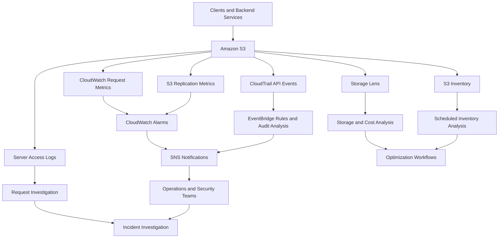
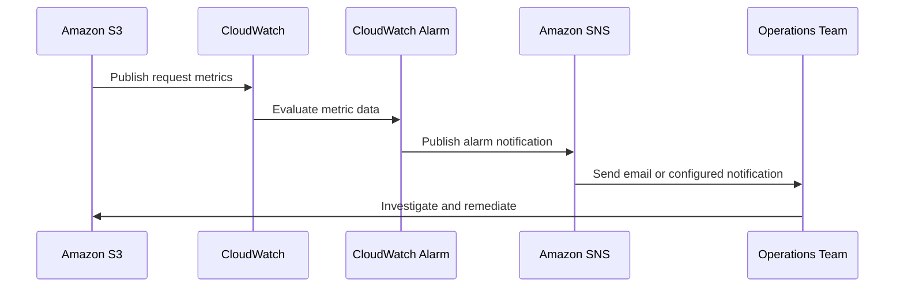
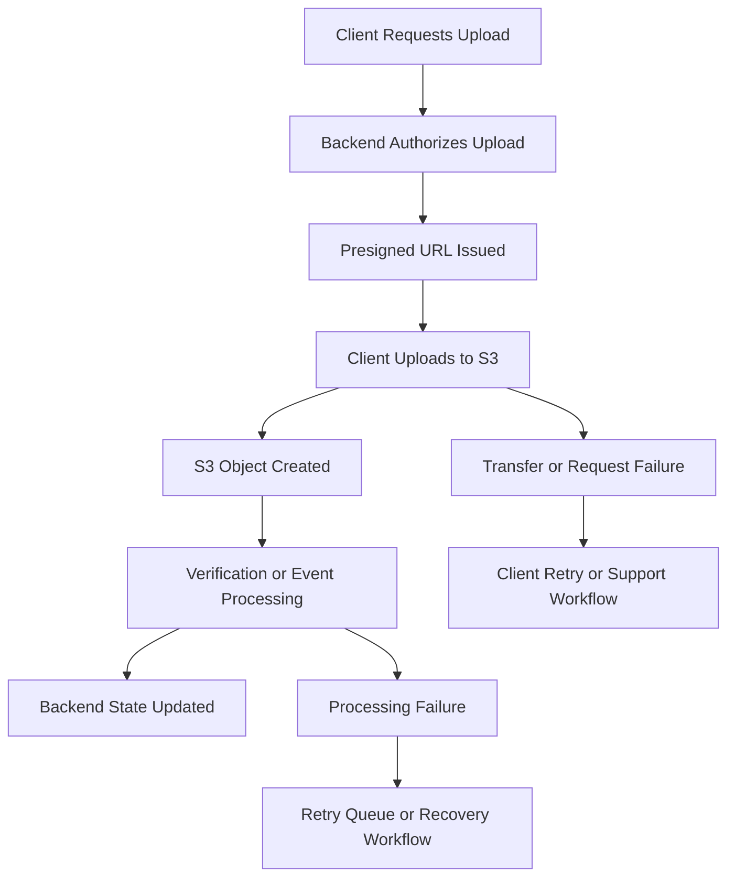

# 06- Monitoring and Alerting Workflows

## Overview

Amazon S3 monitoring and alerting combines storage metrics, request telemetry, audit events, inventory reports, and application-level signals to detect operational problems before they cause significant business impact.

A production monitoring strategy must answer three questions:

- **What is happening?** Measure request traffic, storage growth, failures, replication progress, and processing outcomes.
- **Why is it happening?** Correlate CloudWatch metrics with CloudTrail events, application logs, S3 access logs, and inventory data.
- **What should happen next?** Notify the responsible team, initiate an investigation, or trigger a safe recovery workflow.

S3 monitoring spans several AWS services. No single monitoring mechanism provides complete visibility into request behavior, object state, authorization decisions, and business workflows.

This document defines practical monitoring workflows for backend applications that upload, download, transform, replicate, and retain objects in S3.

## Monitoring Architecture

A useful monitoring architecture combines near-real-time operational signals with periodic storage analytics and API audit records.



### Component responsibilities

| Component | Primary responsibility | Typical timing |
|---|---|---|
| CloudWatch S3 request metrics | Detect request failures, traffic changes, and latency increases | Minute-level metrics after processing latency |
| CloudWatch storage metrics | Track bucket size and object-count trends | Daily |
| CloudWatch alarms | Evaluate thresholds and notify responsible systems | Based on configured metric periods and evaluation rules |
| CloudTrail | Audit supported AWS API operations | Event delivery depends on the selected mechanism |
| EventBridge | Route matching API events to alerting or automation targets | Event-driven |
| S3 Replication metrics | Track replication backlog, latency, and failures | Minute-level metrics when configured |
| S3 Storage Lens | Analyze storage usage, activity, and governance trends | Daily |
| S3 Inventory | Analyze scheduled object-level metadata reports | Daily or weekly |
| S3 Server Access Logging | Investigate detailed request activity | Asynchronous, best-effort delivery |
| Application telemetry | Track business outcomes and workflow failures | Defined by the application instrumentation |

The timing categories matter. A daily storage report cannot replace a minute-level operational alarm, and a missing access-log record cannot prove that a request did not happen.

## Monitoring Strategy by Operational Objective

Monitoring should be designed around the decision that an engineer needs to make, rather than around the number of metrics available.

| Objective | Primary signal | Investigation source | Typical response |
|---|---|---|---|
| Detect S3 server errors | `5xxErrors` | Application logs and CloudTrail where applicable | Investigate service errors and retry behavior |
| Detect authorization failures | `4xxErrors`, application errors | CloudTrail, IAM policies, request context | Correct access configuration or application behavior |
| Detect increased latency | `FirstByteLatency`, `TotalRequestLatency` | Application traces and access logs | Investigate transfers, clients, and request behavior |
| Detect unusual traffic | `AllRequests`, `GetRequests`, `PutRequests` | Application and access logs | Validate the traffic increase and its business purpose |
| Detect unexpected storage growth | `BucketSizeBytes`, Storage Lens | S3 Inventory and billing analysis | Identify growth drivers and retention issues |
| Detect replication delays | `BytesPendingReplication`, `ReplicationLatency` | Replication status and configuration | Investigate permissions, encryption, and replication rules |
| Detect incomplete upload accumulation | Storage Lens metrics and inventory-related analysis | Multipart-upload listings and lifecycle configuration | Inspect abandoned multipart uploads and cleanup policies |
| Detect configuration changes | CloudTrail management events | IAM and bucket configuration history | Verify the change and investigate unexpected principals |
| Reconcile object state | S3 Inventory | Live object APIs and application database | Correct discrepancies or reprocess records |
| Investigate detailed request behavior | Server access logs | Athena or CloudWatch Logs Insights | Analyze requests, response codes, and timing |

## CloudWatch Metrics for S3

S3 publishes native metrics to the `AWS/S3` CloudWatch namespace.

### Request metrics

Request metrics must be enabled through an S3 bucket metrics configuration. They are available at one-minute intervals after processing latency, but their completeness and timeliness are not guaranteed.

| Metric | Use |
|---|---|
| `AllRequests` | Total requests represented by the metrics configuration |
| `GetRequests` | Monitor read traffic |
| `PutRequests` | Monitor object uploads and related PUT activity |
| `DeleteRequests` | Monitor delete-request activity |
| `4xxErrors` | Detect client-error responses |
| `5xxErrors` | Detect server-error responses |
| `FirstByteLatency` | Track time until S3 begins returning the response |
| `TotalRequestLatency` | Track total S3-side request latency |
| `BytesDownloaded` | Analyze response transfer volume |
| `BytesUploaded` | Analyze request transfer volume |

Choose the appropriate statistic for each metric. Request counts generally use `Sum`, while latency analysis often uses percentiles such as `p95` or `p99` where supported.

### Enable request metrics

Create a file named `s3-request-metrics.json`:

```json
{
  "Id": "all-requests"
}
```

Apply the configuration:

```bash
aws s3api put-bucket-metrics-configuration \
  --bucket example-prod-uploads \
  --id all-requests \
  --metrics-configuration file://s3-request-metrics.json \
  --region ap-south-1
```

Verify it:

```bash
aws s3api get-bucket-metrics-configuration \
  --bucket example-prod-uploads \
  --id all-requests \
  --region ap-south-1
```

This configuration enables request metrics for the bucket without filtering by prefix or tags. For large storage estates, use focused configurations when monitoring only selected workloads provides sufficient operational coverage.

### Storage metrics

S3 daily storage metrics include:

- `BucketSizeBytes`
- `NumberOfObjects`

These metrics are useful for trend analysis but are not suitable for immediate incident detection. They are updated daily, and their values can include storage associated with object versions and other storage categories.

Use these metrics for storage-growth monitoring and complement them with Storage Lens, Inventory, and billing data when detailed investigation is required.

Reference: [Monitoring S3 metrics with CloudWatch](https://docs.aws.amazon.com/AmazonS3/latest/userguide/cloudwatch-monitoring.html).

## Defining CloudWatch Alarms

A CloudWatch alarm evaluates a metric against an expected threshold over configured periods.

Alarm states are:

| State | Meaning |
|---|---|
| `OK` | The evaluated metric does not breach the alarm threshold |
| `ALARM` | The configured alarm condition is met |
| `INSUFFICIENT_DATA` | CloudWatch cannot evaluate the condition using sufficient metric data |

An alarm should identify an operational condition that requires a response. Avoid creating alarms for every available metric without defining severity, ownership, and response procedures.

### Alarm design criteria

Consider the following before defining an alarm:

- **Threshold:** What measurement represents an abnormal condition?
- **Evaluation period:** How long must the condition persist?
- **Datapoints to alarm:** How many datapoints must breach the threshold?
- **Missing-data behavior:** Should missing measurements preserve the alarm state, count as breaching, or be treated as non-breaching?
- **Notification target:** Who should be notified?
- **Response procedure:** What should the on-call engineer investigate?
- **Business impact:** Does the condition affect availability, data protection, security, or cost?

For low-volume buckets, a count-based alarm can be more useful than a percentage threshold. For high-volume workloads, an error-rate metric derived from request counts may be more meaningful.

### Example: alarm on S3 server errors

Assume request metrics have been enabled with the configuration ID `all-requests`.

The following command creates an alarm when at least five 5xx responses are observed during a five-minute period for two consecutive evaluation periods.

```bash
aws cloudwatch put-metric-alarm \
  --alarm-name s3-prod-uploads-high-5xx-errors \
  --namespace AWS/S3 \
  --metric-name 5xxErrors \
  --dimensions \
    Name=BucketName,Value=example-prod-uploads \
    Name=FilterId,Value=all-requests \
  --statistic Sum \
  --period 300 \
  --evaluation-periods 2 \
  --datapoints-to-alarm 2 \
  --threshold 5 \
  --comparison-operator GreaterThanOrEqualToThreshold \
  --treat-missing-data missing \
  --alarm-actions arn:aws:sns:ap-south-1:123456789012:prod-alerts \
  --region ap-south-1
```

Replace the bucket, account ID, and SNS topic ARN with actual resources.

This example uses a count-based threshold. It is not a universal service-health threshold: select the threshold based on workload volume, business impact, and historical behavior.

Verify that the SNS topic exists, the alarm references the correct dimensions, and notification delivery is configured. The command creating an alarm does not prove that a notification will reach an operator.

Missing data requires deliberate handling. In a low-traffic bucket, missing metrics might simply mean no requests occurred. In a busy production bucket, missing data might indicate delayed publication or a monitoring configuration problem. Investigate missing data separately rather than automatically interpreting it as healthy.

## Alert Routing and Notifications

Amazon SNS is a common notification mechanism for CloudWatch alarms.

A basic workflow looks like this:



### Create a notification topic

```bash
aws sns create-topic \
  --name prod-alerts \
  --region ap-south-1
```

Record the returned topic ARN. Subscribe an authorized operations address:

```bash
aws sns subscribe \
  --topic-arn arn:aws:sns:ap-south-1:123456789012:prod-alerts \
  --protocol email \
  --notification-endpoint ops@example.com \
  --region ap-south-1
```

The example address and ARN are placeholders. Confirm the subscription through the verification message sent by SNS.

For production use, consider an established incident-management integration, supported chat notification workflow, or a controlled notification service. Email alone may not meet the required response-time objectives.

### Notification quality

A useful alert should contain:

- Environment and bucket identifier.
- Alarm name and affected metric.
- Observed threshold and evaluation interval.
- First observed time and current alarm state.
- Link to the relevant dashboard or runbook.
- Responsible team and severity.
- Instructions for validating the condition.

Use separate notification routes for operational incidents, security findings, and cost-management warnings.

## Replication Monitoring Workflow

S3 replication metrics help detect replication backlogs and failures.

Important metrics include:

| Metric | Purpose |
|---|---|
| `BytesPendingReplication` | Measures bytes waiting to replicate |
| `OperationsPendingReplication` | Counts pending replication operations |
| `ReplicationLatency` | Measures replication delay |
| `OperationsFailedReplication` | Tracks replication failures |

Enable replication metrics in the replication configuration when replication health must be monitored at rule level. Replication Time Control also enables the relevant replication metrics for supported configurations.

### Recommended workflow

1. Monitor pending operations, pending bytes, and replication latency.
2. Alert when backlog or latency remains above a workload-specific threshold.
3. Check failed replication operations.
4. Inspect source and destination bucket configuration.
5. Verify replication IAM permissions and, when applicable, KMS key policies.
6. Inspect object replication status and relevant failure details.
7. Confirm that the expected object versions are available at the destination.
8. Record the incident and verify that the backlog returns to an acceptable level.

A low pending-byte metric does not establish that every expected object replicated successfully. Combine aggregate metrics with object-level status checks and controlled recovery procedures.

Avoid using missing replication data as automatic proof of health. Confirm the configured rule, metric dimensions, and expected workload before closing an alert.

Reference: [Monitoring S3 replication](https://docs.aws.amazon.com/AmazonS3/latest/userguide/replication-metrics.html).

## CloudTrail-Based Security Alerts

CloudTrail records supported API activity, including bucket configuration changes and object-level operations when the appropriate data events are enabled.

Use CloudTrail and EventBridge when an alert must respond to a specific API action rather than an aggregate metric threshold.

Potential alert conditions include:

- Unexpected changes to bucket policies.
- Changes to bucket versioning or encryption configuration.
- Unapproved lifecycle or replication changes.
- Object deletion events for sensitive datasets.
- Changes to monitoring or audit configurations.

### Example: detect bucket policy changes

An EventBridge event pattern can match S3 bucket-policy updates:

```json
{
  "source": ["aws.s3"],
  "detail-type": ["AWS API Call via CloudTrail"],
  "detail": {
    "eventSource": ["s3.amazonaws.com"],
    "eventName": ["PutBucketPolicy"]
  }
}
```

Deploy the pattern as an EventBridge rule and configure an authorized target, such as SNS or a security-processing Lambda function.

This pattern matches bucket-policy changes across resources in the relevant event scope. Add supported filters for account, bucket, principal, or other event fields when the security requirement calls for more specific matching.

For object operations such as `GetObject` and `DeleteObject`, configure CloudTrail S3 data events for the required resources. Ordinary management-event coverage does not automatically capture object-level operations.

### Safe automated response

Event-driven remediation can be useful, but the action must account for duplicate delivery, retries, and partial failures.

For example, an alert about an unexpected bucket-policy change should trigger review or a controlled security workflow. Automatically replacing the policy without understanding the change could interrupt a legitimate deployment or remove an essential access rule.

Preserve the audit record and capture the principal, event time, resource, and request details needed for investigation.

Reference: [Using CloudTrail with EventBridge](https://docs.aws.amazon.com/eventbridge/latest/userguide/eb-service-event-cloudtrail.html).

## Storage Growth and Cost Monitoring

Storage growth should be monitored at multiple levels because daily bucket metrics, Storage Lens, and Inventory answer different questions.

### Recommended signals

| Signal | Source | Investigation |
|---|---|---|
| Total bucket size | CloudWatch storage metrics | Identify growth trends |
| Object count | CloudWatch storage metrics | Detect object accumulation |
| Growth by account, bucket, or storage class | Storage Lens | Identify major contributors |
| Growth by object key and selected metadata | S3 Inventory | Identify object-level contributors |
| Storage and data-transfer charges | AWS billing and cost tools | Validate actual cost impact |
| Incomplete multipart upload data | S3 lifecycle configuration and multipart-upload listings; supported Storage Lens metrics | Investigate abandoned uploads and cleanup policies |

### Storage growth workflow

1. Establish a baseline for storage bytes and object count.
2. Identify buckets whose growth exceeds expected workload patterns.
3. Use Storage Lens to compare accounts, buckets, and storage classes.
4. Use S3 Inventory to identify large objects, old objects, noncurrent versions, and other relevant metadata.
5. Validate retention, lifecycle, backup, and legal requirements before changing storage.
6. Estimate the financial impact using current pricing and billing data.
7. Apply a controlled remediation plan.
8. Verify the effect using subsequent reports.

Daily storage metrics and Storage Lens are not suitable for immediate capacity-style alarms. S3 is designed to scale storage without traditional fixed-capacity planning, so alerts should focus on unexpected growth, cost risk, retention anomalies, or workload-specific constraints rather than assuming that a bucket is approaching a fixed maximum capacity.

## Monitoring Presigned Upload and Download Workflows

Presigned URLs allow clients to transfer objects directly between the client and S3. Because the transfer may bypass the backend API, API-level request metrics alone cannot establish whether the object transfer succeeded.

A useful monitoring workflow combines application state with S3 signals.



### Instrument the application workflow

Record the internal asset ID, workflow ID, object key, expected upload constraints, and upload status.

Do not log the full presigned URL because it contains temporary authorization material.

Useful application metrics include:

- Uploads initiated.
- Uploads confirmed.
- Uploads rejected by validation.
- Upload confirmation timeouts.
- Processing jobs started, completed, and failed.
- Retry counts.
- Objects awaiting verification.
- Uploads abandoned before completion.

Where supported, correlate these metrics with S3 request metrics and CloudTrail data events. Use S3 object verification to confirm that the uploaded content satisfies the application's expectations.

### Handle duplicate events

S3 event notifications can be delivered more than once, and event-processing order is not guaranteed. Design consumers to be idempotent and to use object identity or version information where appropriate.

Do not assume that receiving an object-created event exactly once is guaranteed. If application state is maintained in a database, use durable workflow state and safe retry semantics to reconcile partial failures.

## Inventory and Storage Lens Review Workflow

S3 Inventory and Storage Lens provide complementary periodic views of storage.

- **Storage Lens** identifies trends and aggregates across accounts, buckets, and storage classes.
- **S3 Inventory** provides object-level records with selected metadata.
- **CloudWatch** supports operational metrics and alarms.
- **CloudTrail** records supported API activity for audit investigations.

### Recommended daily or weekly review

1. Review Storage Lens for unexpected storage growth and changes in storage-class distribution.
2. Review inventory reports for policy-relevant object properties, noncurrent versions, and other selected metadata.
3. Compare findings against retention and lifecycle policies.
4. Investigate replication status or encryption findings that violate the intended configuration.
5. Open remediation work items with clear ownership and expected verification.
6. Record the report identity and processing timestamp so that findings can be traced to the relevant snapshot.

Storage Lens and Inventory produce periodic results. A discrepancy must be validated against live S3 state before destructive remediation.

## Server Access Logging Investigation Workflow

S3 Server Access Logging provides detailed request records that can complement CloudTrail and CloudWatch.

Use access logs when you need to analyze request paths, status codes, requester context, byte counts, or request timing.

Because delivery is best effort, records may be delayed, duplicated, or absent.

### Recommended investigation

1. Identify the affected request interval and object key.
2. Locate the relevant source-bucket log prefix.
3. Parse the log format using a parser that understands quoted fields.
4. Filter by operation, status, time, object key, and available requester information.
5. Correlate request IDs and timestamps with application logs and CloudTrail where possible.
6. Determine whether the problem is associated with application behavior, authorization, client retries, or another failure category.
7. Preserve relevant log records and document the findings.

Do not treat the absence of an access-log record as proof that a request did not occur.

Reference: [S3 Server Access Logging](https://docs.aws.amazon.com/AmazonS3/latest/userguide/ServerLogs.html).

## Alert Severity and Ownership

An effective alerting system classifies alerts by urgency and assigns them to an accountable team.

| Severity | Example condition | Expected response |
|---|---|---|
| Critical | Confirmed unauthorized access or a major failure affecting a critical data workflow | Activate the security or incident-response procedure immediately |
| High | Persistent S3 errors or replication failures affecting recovery requirements | Investigate promptly and follow the relevant incident runbook |
| Medium | Sustained request latency increase or growing replication backlog without immediate business failure | Investigate during the defined operational response window |
| Low | Unexpected storage growth or a potential lifecycle optimization opportunity | Create a review task and validate the evidence |

Severity must reflect business impact and recovery objectives, not only the number of metric breaches.

For each alarm, document an owner, notification target, runbook, escalation policy, and a condition for closing the incident.

## Reliability and Alert Quality

### Avoid noisy alarms

Use suitable evaluation periods, `datapoints-to-alarm`, and workload-aware thresholds to reduce notifications caused by transient conditions.

A single failed request may be expected in some workloads. A sustained rise in errors that affects an application SLO requires a different response.

### Distinguish missing data from healthy state

Missing data can result from low traffic, delayed metrics, a configuration error, or unavailable measurements.

Choose the missing-data policy according to the alarm's purpose. For example, an error-rate alarm for a normally busy bucket may warrant investigation when metrics disappear, while a low-traffic bucket may naturally produce no request datapoints.

### Keep monitoring costs under control

- Enable S3 request metrics selectively where detailed request visibility is needed.
- Use focused metric filters where appropriate.
- Avoid redundant alarms and dashboards.
- Apply retention policies to logs and exported reports.
- Review CloudWatch, CloudTrail, Athena, and storage costs regularly.
- Use Storage Lens and Inventory for large-scale analysis instead of repeatedly enumerating every object in custom scripts.

### Make recovery actions safe

Automated actions should be idempotent, observable, and reversible where practical. Keep destructive changes behind suitable authorization and approval controls.

An alert is evidence that a condition may need investigation, not automatic authorization to delete objects, change permissions, or alter retention settings.

## Production Operations Checklist

Use this checklist when validating an S3 monitoring deployment.

- [ ] Request metrics are enabled for critical buckets or prefixes.
- [ ] CloudWatch alarms use the correct namespace, metric dimensions, statistic, and threshold.
- [ ] Alarm actions and notification subscriptions have been tested.
- [ ] Missing-data behavior is explicitly configured and documented.
- [ ] Replication metrics and alerting are enabled for workloads with replication requirements.
- [ ] CloudTrail covers the management events and S3 data events required by the audit policy.
- [ ] Security-sensitive API events are routed to the correct alerting workflow.
- [ ] Storage growth is reviewed through CloudWatch, Storage Lens, and billing data.
- [ ] Inventory reports are processed using their manifests and expected schemas.
- [ ] Access-log delivery and retention are verified where server access logging is used.
- [ ] Application workflows expose upload, processing, and retry outcomes.
- [ ] Every actionable alert has an owner, severity, and runbook.
- [ ] Monitoring configuration and notification permissions follow least-privilege principles.
- [ ] Retention, monitoring, and analytics costs are reviewed periodically.

## Official References

- [Monitoring Amazon S3 with CloudWatch](https://docs.aws.amazon.com/AmazonS3/latest/userguide/cloudwatch-monitoring.html)
- [S3 metrics and dimensions](https://docs.aws.amazon.com/AmazonS3/latest/userguide/metrics-dimensions.html)
- [Creating and managing CloudWatch alarms](https://docs.aws.amazon.com/AmazonCloudWatch/latest/monitoring/AlarmThatSendsEmail.html)
- [Monitoring S3 replication](https://docs.aws.amazon.com/AmazonS3/latest/userguide/replication-metrics.html)
- [Monitoring Storage Lens metrics in CloudWatch](https://docs.aws.amazon.com/AmazonS3/latest/userguide/storage_lens_view_metrics_cloudwatch.html)
- [Logging S3 data events with CloudTrail](https://docs.aws.amazon.com/awscloudtrail/latest/userguide/logging-data-events-with-cloudtrail.html)
- [Using CloudTrail with EventBridge](https://docs.aws.amazon.com/eventbridge/latest/userguide/eb-service-event-cloudtrail.html)
- [S3 Inventory](https://docs.aws.amazon.com/AmazonS3/latest/userguide/storage-inventory.html)
- [S3 Server Access Logging](https://docs.aws.amazon.com/AmazonS3/latest/userguide/ServerLogs.html)
- [Amazon CloudWatch pricing](https://aws.amazon.com/cloudwatch/pricing/)
- [Amazon S3 pricing](https://aws.amazon.com/s3/pricing/)

## Key Takeaways

- Combine CloudWatch metrics, CloudTrail events, Storage Lens, Inventory, access logs, and application telemetry because each answers a different operational question.
- Define alarms around measurable business impact, correct metric dimensions, deliberate missing-data behavior, and actionable response procedures.
- Monitor replication, storage growth, and presigned upload workflows with signals appropriate to their timing and failure characteristics.
- Treat periodic reports and best-effort logging as investigation evidence, not as complete or real-time representations of S3 state.
- Make alerting production-ready through verified notifications, clear ownership, safe automation, least-privilege access, and regular cost reviews.