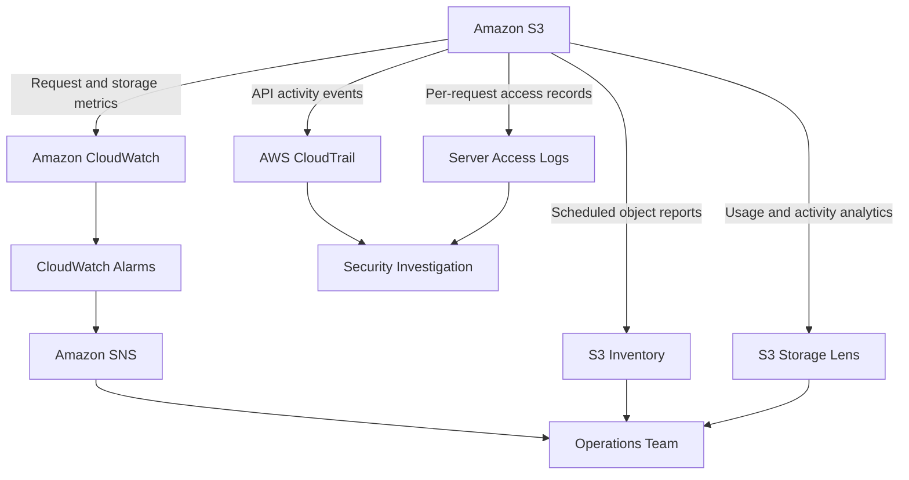

# README

## Overview

Amazon S3 monitoring and auditing covers the tools, metrics, logs, and workflows required to observe storage behavior, detect operational problems, investigate access patterns, and produce audit evidence for production S3 workloads. It addresses CloudWatch metrics and alarms, CloudTrail audit logs, Storage Lens analytics, inventory reporting, server access logging, and end-to-end alerting workflows.

This section of the Backend Engineering Playbook provides a structured reference for backend engineers, platform engineers, and operations teams who need visibility into S3 storage usage, request activity, access patterns, security events, and cost-driving behavior.

The focus is on practical observability engineering: selecting the right signal for each monitoring requirement, configuring reliable audit coverage, building actionable alerting workflows, and diagnosing operational problems systematically using the available telemetry.

## Navigation

| # | File | Description |
|---|---|---|
| 01 | [01- Amazon CloudWatch](./01-%20Amazon%20CloudWatch.md) | S3 storage metrics, request metrics, replication health, CloudWatch dashboards, alarms, and automated notifications |
| 02 | [02- AWS CloudTrail](./02-%20AWS%20CloudTrail.md) | Audit trail for bucket configuration changes, object operations, access control modifications, and security investigation |
| 03 | [03- Amazon S3 Storage Lens](./03-%20Amazon%20S3%20Storage%20Lens.md) | Cross-account storage analytics, usage dashboards, activity metrics, cost optimization insights, and data-protection gaps |
| 04 | [04- S3 Inventory](./04-%20S3%20Inventory.md) | Scheduled object inventory reports, metadata fields, storage analysis, auditing, and large-scale operational workflows |
| 05 | [05- S3 Server Access Logging](./05-%20S3%20Server%20Access%20Logging.md) | Per-request access records, log format, delivery behavior, storage destination configuration, and access pattern analysis |
| 06 | [06- Monitoring and Alerting Workflows](./06-%20Monitoring%20and%20Alerting%20Workflows.md) | End-to-end workflows combining storage metrics, audit events, inventory reports, and application signals to detect problems early |

## Why S3 Monitoring and Auditing Matters

S3 is a foundational storage layer for most backend systems. Without deliberate monitoring and auditing, problems accumulate silently until they cause availability failures, security incidents, cost overruns, or compliance gaps.

Common monitoring and auditing risks include:

- Unexpected storage cost growth that goes undetected until the monthly bill arrives.
- AccessDenied errors from application workflows that fail silently without alerting.
- Unauthorized access or configuration changes that are not investigated because CloudTrail data events were not enabled.
- Replication failures that are not detected until a disaster recovery test exposes missing objects.
- Misconfigured buckets that become publicly accessible without triggering any alert.
- Incomplete audit evidence that makes incident investigation slow and inconclusive.

Effective S3 monitoring and auditing combines metrics-based alerting, comprehensive audit logging, periodic inventory analysis, and documented investigation workflows rather than relying on reactive problem discovery.

## Documentation Structure

This section is organized into focused documents covering each monitoring and auditing capability, followed by an end-to-end workflow document.

| Area | Primary focus |
|---|---|
| CloudWatch | Request metrics, storage metrics, alarms, dashboards, and notification routing |
| CloudTrail | Management and data event logging, log integrity, and security investigation |
| Storage Lens | Organization-wide usage analytics, activity trends, and cost and data-protection insights |
| S3 Inventory | Scheduled object reports, metadata fields, and large-scale storage analysis |
| Server access logging | Per-request access records and access pattern analysis |
| Alerting workflows | Combining signals into actionable operational and security alerting |

Each document is intended to be independently maintainable while connecting to the broader S3 operational and security model. Shared patterns should be referenced rather than duplicated across documents.

## Core Monitoring Principles

### Enable Request Metrics for Production Buckets

S3 storage metrics are available by default at no additional cost. Request metrics require explicit configuration and incur additional charges. Enable request metrics on production buckets where application uploads, downloads, or API errors require operational visibility. Aggregate metrics at the bucket and prefix level based on the workload structure.

### Configure CloudTrail Data Events for Security-Sensitive Buckets

CloudTrail management events record bucket configuration changes by default. Data events — recording individual object-level reads and writes — require explicit configuration and incur additional cost. Enable data events for buckets containing sensitive data, audit evidence, credentials, or objects subject to regulatory requirements.

### Use Storage Lens for Cross-Account Visibility

S3 request metrics and server access logs provide bucket-level visibility. Storage Lens aggregates storage usage and activity across accounts and Regions, making it suitable for identifying organization-wide cost drivers, data-protection gaps, and unusual usage patterns that are not visible at the individual bucket level.

### Treat Server Access Logs as Supplementary Audit Evidence

Server access logs provide detailed per-request records including the requester, operation, object key, response code, and bytes transferred. They complement CloudTrail rather than replace it. CloudTrail provides tamper-evident audit evidence for security investigations; server access logs provide request-level detail for access pattern analysis and application debugging.

### Build Actionable Alerting Workflows

A monitoring signal without a response workflow has limited operational value. Define alert thresholds, routing, escalation paths, and documented response procedures for each alarm. Alerts that fire without a clear response path are ignored or suppressed, which reduces the operational value of the monitoring investment.

## How Monitoring and Auditing Fit Together

## Recommended Monitoring Setup

Apply the following setup when establishing monitoring and auditing coverage for a production S3 workload.

1. **Enable CloudWatch request metrics.** Configure request metrics for production buckets. Create filters for upload and download operations on high-value prefixes.
2. **Configure CloudWatch alarms.** Define alarms for elevated 4xx error rates, 5xx errors, replication lag, and storage growth that exceeds expected thresholds.
3. **Enable CloudTrail data events.** Enable object-level data events for buckets containing sensitive or regulated data. Deliver logs to a protected, versioning-enabled destination bucket.
4. **Configure server access logging.** Enable server access logging on buckets where request-level detail is needed for access pattern analysis or supplementary audit evidence.
5. **Enable Storage Lens.** Configure a Storage Lens dashboard at the organization or account level to track storage usage, request activity, and data-protection settings across buckets.
6. **Schedule S3 Inventory reports.** Configure inventory reports for large buckets to support periodic storage analysis, compliance auditing, and lifecycle verification.
7. **Document alerting workflows.** Define the response procedure for each alarm, including who is notified, what investigation steps apply, and how the incident is escalated or resolved.

## Operational Standards

- **Request metrics:** Enable on production buckets. Scope filters to the prefixes and operations most relevant to each workload.
- **CloudTrail data events:** Enable for security-sensitive buckets. Deliver logs to a write-protected destination with versioning and retention controls.
- **Alarms:** Define thresholds for error rates, storage growth, and replication health. Route alarms to SNS topics with documented response procedures.
- **Server access logging:** Enable on buckets where access pattern analysis or request-level audit evidence is required. Manage log retention with lifecycle rules on the destination bucket.
- **Storage Lens:** Configure at the account or organization level for cross-bucket visibility into cost drivers and data-protection gaps.
- **Inventory:** Schedule inventory reports on large or regulated buckets. Include encryption status, storage class, replication status, and versioning fields.
- **Log retention:** Apply lifecycle rules to CloudTrail log buckets, server access log buckets, and inventory destination buckets to control retention cost.
- **Review frequency:** Review Storage Lens dashboards and CloudWatch metrics regularly, not only during incidents. Incorporate cost and usage trends into engineering planning.

## Key Takeaways

- S3 monitoring requires explicit configuration for request metrics, CloudTrail data events, server access logging, and Storage Lens — defaults provide limited visibility.
- CloudTrail data events are essential for security investigation and compliance auditing of object-level operations on sensitive buckets.
- Storage Lens provides organization-wide visibility that is not available from per-bucket metrics alone.
- Server access logs complement CloudTrail for access pattern analysis but are not a substitute for tamper-evident audit logging.
- Alarms are only operationally useful when paired with documented response workflows and clear escalation paths.
