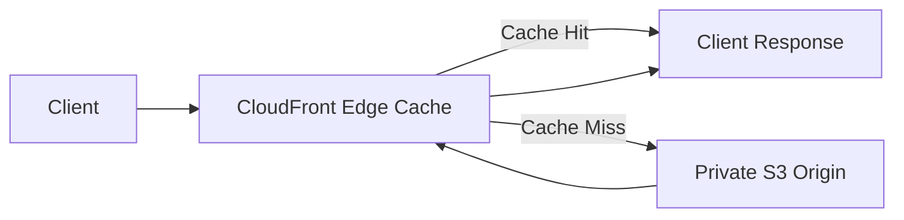

# 01- Amazon S3 Pricing Model

## Overview

Amazon S3 uses a pay-as-you-go pricing model. There is no general upfront storage commitment, and the total cost depends on how much data is stored, which storage classes are used, how objects are accessed, and which management or processing features are enabled.

For production backend systems, S3 storage charges are only one part of the total cost. Request volume, data retrieval, internet egress, cross-Region replication, lifecycle transitions, monitoring, encryption-related requests, and analytics can contribute significantly to the monthly bill.

A cost-effective design must optimize the entire object lifecycle rather than simply select the lowest storage price.

Common cost-management objectives include:

- Estimating storage and request charges before deployment.
- Selecting storage classes according to access frequency and recovery requirements.
- Reducing unnecessary requests and data transfers.
- Preventing storage growth from obsolete objects and historical versions.
- Optimizing lifecycle transitions and archive retrieval.
- Tracking costs across applications, buckets, environments, and AWS accounts.
- Detecting unexpected cost increases before they become significant.

AWS pricing varies by Region, usage type, and feature configuration. Use the official [Amazon S3 pricing page](https://aws.amazon.com/s3/pricing/) and [AWS Pricing Calculator](https://calculator.aws/) when preparing actual estimates.

## Amazon S3 Cost Components

The total S3 cost consists of several independent components.

| Cost component | What is billed | Typical cost drivers |
|---|---|---|
| Storage | Object data retained over time | Data volume, storage class, object versions, storage duration |
| Requests | S3 API and service operations | GET, PUT, COPY, LIST, lifecycle, and other applicable requests |
| Data retrieval | Retrieving data from applicable storage classes | Bytes retrieved, retrieval request count, archive retrieval tier |
| Data transfer | Data transferred between locations or to destinations | Internet egress, cross-Region transfer, acceleration |
| Lifecycle management | Applicable requests to transition or expire objects | Objects processed and transitions performed |
| Storage management and analytics | Selected management and analytics features | Inventory, Storage Lens, tagging, and other enabled features |
| Replication | Destination storage, replication requests, and applicable transfer | Replicated bytes, object updates, Regions involved |
| Specialized features | Additional supported S3 capabilities | Transfer Acceleration, Multi-Region Access Points, transformation, query, and other enabled features |

Related services can introduce separate costs even when the underlying objects are stored in S3. Examples include AWS KMS, CloudWatch, CloudTrail, Athena, Lambda, and CloudFront.

### Cost calculation model

A useful conceptual model is:

\[
\begin{aligned}
C_{\text{total}} \approx{}&
C_{\text{storage}} +
C_{\text{requests}} +
C_{\text{retrieval}}\\
&+ C_{\text{transfer}} +
C_{\text{management}}\\
&+ C_{\text{replication}} +
C_{\text{related services}}
\end{aligned}
\]

The final bill can also include applicable taxes, discounts, credits, and other adjustments.

Each component should be estimated independently and then combined into a workload-level forecast.

## Storage Pricing

Storage pricing is based on the amount of data stored, the applicable storage class, the duration of storage, and the Region.

For ordinary storage classes, the effective cost is generally calculated using the amount of data retained over time, expressed in GB-months or the applicable billing unit.

For example, a workload that retains 500 GB throughout a month generally consumes approximately 500 GB-months of storage before accounting for additional versions, metadata, or class-specific billing rules.

A workload that grows from 100 GB to 500 GB throughout the month does not necessarily incur the same storage charge as one that stores 500 GB for the entire month.

### Storage classes and cost implications

| Storage class | Typical workload | Important cost considerations |
|---|---|---|
| S3 Standard | Frequently accessed application files | Standard storage pricing; no minimum storage duration |
| S3 Intelligent-Tiering | Data with changing or unpredictable access patterns | Monitoring and automation charges for eligible objects; no retrieval charges for its access tiers |
| S3 Standard-IA | Infrequently accessed data requiring rapid retrieval | Retrieval charges, 30-day minimum storage duration, 128 KB minimum billable object size |
| S3 One Zone-IA | Infrequently accessed, reproducible data | Retrieval charges, 30-day minimum duration, 128 KB minimum billable object size; single-AZ storage |
| S3 Glacier Instant Retrieval | Rarely accessed archive data requiring millisecond retrieval | Retrieval charges, 90-day minimum storage duration, 128 KB minimum billable object size |
| S3 Glacier Flexible Retrieval | Long-term archives that can tolerate restoration delays | Retrieval and restore-related charges, 90-day minimum storage duration, additional archive metadata storage |
| S3 Glacier Deep Archive | Long-term retention with infrequent retrieval | Retrieval and restore-related charges, 180-day minimum storage duration, additional archive metadata storage |
| S3 Express One Zone | Latency-sensitive workloads requiring specialized high-performance access | Specialized storage and request pricing; single-AZ storage |

Storage classes have different availability and resilience characteristics. Do not choose a class using storage price alone.

Reference: [Understanding and managing S3 storage classes](https://docs.aws.amazon.com/AmazonS3/latest/userguide/storage-class-intro.html).

### Minimum billable object size

Some infrequent-access and archival classes have a minimum billable object size of 128 KB.

If an object is smaller than that threshold, it can still be stored, but it is billed as though the minimum applicable size were stored.

For example, storing a large number of 10 KB objects in a class with a 128 KB minimum billable size can result in billed storage much greater than the combined size of the object payloads.

This is particularly important for:

- Application-generated JSON files.
- Small thumbnails and image derivatives.
- Event records and telemetry objects.
- Individual log fragments.
- Frequently generated small reports.

For workloads containing millions of small objects, estimate storage costs using the applicable minimum billable size rather than the sum of payload bytes alone.

### Minimum storage duration

Some storage classes have minimum storage durations. Deleting, overwriting, or transitioning an object before its minimum duration expires can result in a prorated charge for the remaining period.

| Storage class | Typical minimum storage duration |
|---|---:|
| S3 Standard-IA | 30 days |
| S3 One Zone-IA | 30 days |
| S3 Glacier Instant Retrieval | 90 days |
| S3 Glacier Flexible Retrieval | 90 days |
| S3 Glacier Deep Archive | 180 days |

These minimums affect the economics of lifecycle rules, frequently overwritten keys, and short-lived temporary objects.

For example, a temporary report that is transitioned to S3 Glacier Deep Archive and deleted shortly afterward can incur charges for the remaining minimum storage period, even though the report no longer exists.

Always calculate the expected residence time of an object before transitioning it to a class with a minimum duration.

### Archive metadata overhead

S3 Glacier Flexible Retrieval and S3 Glacier Deep Archive require additional metadata storage for each archived object.

The documented metadata overhead is 40 KB per object:

- 8 KB billed at S3 Standard rates.
- 32 KB billed at the relevant Glacier storage rate.

This overhead can become significant when a bucket contains millions of small archived objects.

For archive-heavy workloads, estimate total object count as well as payload size. A dataset containing a large number of tiny objects may cost more than expected when per-object overhead and request costs are included.

Reference: [Amazon S3 pricing](https://aws.amazon.com/s3/pricing/).

## Request Pricing

S3 charges for applicable requests according to their operation type, storage class, and Region.

Typical request categories include:

| Request category | Examples | Cost-management consideration |
|---|---|---|
| PUT | Uploading objects | High-frequency ingestion can generate substantial request volume |
| COPY | Copying objects or rewriting metadata | Migration, metadata updates, and copy-based workflows generate requests |
| GET | Downloading object content | Repeated downloads can contribute to request and transfer costs |
| LIST | Listing objects or versions | Excessive application-driven enumeration can increase request volume |
| DELETE | Deleting objects | Bulk cleanup and deletion workflows can generate requests |
| Lifecycle operations | Transitioning or expiring eligible objects | Large-scale lifecycle operations can generate applicable request charges |
| Archive restore | Restoring archived objects | Restore request charges and retrieval-related costs can apply |
| Specialized operations | Applicable tagging, analytics, or other feature requests | Depends on the feature used |

Request pricing differs by operation and storage class. Use the pricing table for the selected Region and workload rather than assuming that all requests have the same unit price.

### Request volume can dominate

Consider a backend service that stores small JSON documents.

Suppose each API operation retrieves five separate S3 objects to construct one response. With 2 million API operations per month, the application could generate approximately 10 million GET requests before accounting for retries, metadata inspection, or other operations.

A design that stores the required data in fewer suitable objects might reduce request volume, although object compaction introduces its own processing and update trade-offs.

Request optimization is especially useful for:

- Applications generating many small objects.
- Services repeatedly reading the same immutable content.
- Large recursive listing workflows.
- Image-processing pipelines with repeated intermediate writes.
- Data pipelines that rewrite objects frequently.

Do not optimize request counts at the expense of authorization boundaries, data integrity, or maintainability.

### Pagination and repeated listing

Applications using `ListObjectsV2` or `ListObjectVersions` may issue multiple requests to enumerate large datasets.

A production inventory job that repeatedly scans a bucket can generate unnecessary LIST requests.

For periodic large-scale analysis, consider S3 Inventory. For frequently accessed immutable content, consider application-level indexes or appropriate caching. For request-time operations, retain pagination where required but avoid repeating complete scans without a business need.

## Data Retrieval Pricing

Some S3 storage classes charge for data retrieval in addition to storage and request charges.

Retrieval costs depend on the storage class, amount of data retrieved, and applicable retrieval mode.

### Classes with retrieval charges

| Storage class | Retrieval consideration |
|---|---|
| S3 Standard | No separate per-GB retrieval fee under the standard storage pricing model |
| S3 Standard-IA | Retrieval charges apply |
| S3 One Zone-IA | Retrieval charges apply |
| S3 Glacier Instant Retrieval | Retrieval charges apply |
| S3 Glacier Flexible Retrieval | Archive retrieval and restore charges depend on the selected retrieval option |
| S3 Glacier Deep Archive | Archive retrieval and restore charges depend on the selected retrieval option |
| S3 Intelligent-Tiering | No retrieval charges for its access tiers, although monitoring and automation charges may apply |

For Glacier Flexible Retrieval and Glacier Deep Archive, the application must generally restore archived objects before reading their content. Retrieval time and price depend on the selected retrieval option.

This creates a meaningful difference between long-term archive cost and the cost of recovering archived data.

### Example: archive retrieval cost

Assume a backup service stores 8 TB of data in an archival class. During an incident, engineers need to restore 2 TB.

The restoration cost may include:

- Retrieval charges for the amount of data requested.
- Restore request charges.
- Temporary storage charges associated with the restored copy, where applicable.
- GET requests used by the recovery application.
- Data-transfer charges if the data moves to a chargeable destination.

The exact total depends on the storage class, retrieval option, Region, restored-copy retention period, and destination.

**Production rule:** Estimate both the cost of keeping data and the cost of recovering it. A cheap archive can become expensive when restoration is frequent or large-scale.

Reference: [Understanding archive retrieval options](https://docs.aws.amazon.com/AmazonS3/latest/userguide/restoring-objects-retrieval-options.html).

## Data Transfer Pricing

Data-transfer charges depend on the source, destination, Region, and transfer method.

Examples include:

- Transferring data from S3 to internet clients.
- Transferring data between AWS Regions.
- Moving data through S3 Transfer Acceleration.
- Using S3 Multi-Region Access Points.
- Delivering content through CloudFront.

### Common data-transfer considerations

| Transfer scenario | Typical cost consideration |
|---|---|
| Internet to S3 | Standard inbound data transfer is generally free |
| S3 to internet | Applicable internet egress charges |
| S3 to a service in the same AWS Region | Generally no standard inter-service data-transfer charge for eligible paths |
| S3 bucket to another bucket in the same Region | Standard same-Region data transfer is generally free, but requests and other applicable charges remain |
| S3 to another AWS Region | Applicable inter-Region transfer charges |
| S3 to CloudFront | Standard S3 data transfer out to CloudFront is not charged |
| S3 Transfer Acceleration | Acceleration data-routing charges in addition to other applicable charges |
| S3 Multi-Region Access Points | Data-routing or acceleration charges can apply in addition to standard request and transfer costs |

The detailed pricing rules depend on the exact architecture and current AWS pricing.

AWS currently provides the first 100 GB per month of internet data transfer out free in aggregate across AWS services and Regions, excluding AWS China Regions and AWS GovCloud Regions. Eligibility and pricing rules can change, so validate the current terms before including this allowance in a forecast.

Reference: [Amazon S3 data-transfer pricing](https://aws.amazon.com/s3/pricing/).

### CloudFront integration

For applications serving static assets, images, videos, or downloads to large numbers of clients, CloudFront can reduce repeated origin requests by caching content at edge locations.

A typical architecture is:



CloudFront reduces repeated S3 GET requests when content is cacheable and the cache hit rate is high. It can also improve delivery latency and reduce origin request volume.

CloudFront has its own pricing model. Include request charges, applicable CloudFront data transfer, invalidations where chargeable, and the S3 origin-request pattern in the overall estimate.

Do not assume that adding CloudFront automatically reduces total cost. The result depends on cacheability, request volume, object size, geographic distribution, and the CloudFront pricing model.

For private origins, use an appropriate access configuration such as CloudFront Origin Access Control instead of exposing the S3 bucket publicly.

## Lifecycle Management Costs

S3 Lifecycle automates storage-class transitions and object expiration based on configured rules.

Lifecycle can reduce storage costs, but lifecycle operations also have economic consequences.

Potential charges include:

- Requests associated with lifecycle transitions.
- Minimum storage-duration charges when objects are transitioned or deleted early.
- Retrieval charges when objects are subsequently accessed from applicable classes.
- Storage for noncurrent versions that remain after current-version expiration.
- Charges associated with incomplete multipart uploads until they are aborted or otherwise removed.

### Evaluate lifecycle rules using the full cost model

Suppose an application uploads reports to S3 Standard and transitions them to S3 Standard-IA after a defined period.

Evaluate the expected benefit using:

- Current storage cost.
- Target storage cost.
- Number of objects transitioned.
- Expected object size distribution.
- Transition request charges.
- Minimum storage duration.
- Retrieval frequency and bytes retrieved.
- Number of versions retained.
- Operational requirements for access latency and recovery.

For very short retention periods, transition costs and minimum duration charges may outweigh the storage savings.

### Example lifecycle configuration

The following rule transitions objects after 30 days and expires them after 365 days.

```json
{
  "Rules": [
    {
      "ID": "reports-retention",
      "Status": "Enabled",
      "Filter": {
        "Prefix": "reports/"
      },
      "Transitions": [
        {
          "Days": 30,
          "StorageClass": "STANDARD_IA"
        }
      ],
      "Expiration": {
        "Days": 365
      }
    }
  ]
}
```

This configuration is illustrative. Before applying it, validate the business retention requirements and ensure the selected storage class is appropriate for the access pattern.

For versioned buckets, current-object expiration and noncurrent-version expiration have different behavior. A lifecycle configuration that expires the current version may create a delete marker rather than permanently remove all historical versions.

Reference: [Managing the S3 object lifecycle](https://docs.aws.amazon.com/AmazonS3/latest/userguide/object-lifecycle-mgmt.html).

## Versioning and Hidden Storage Costs

S3 Versioning allows multiple versions of an object to be retained. This improves recovery options but can substantially increase storage usage.

Consider an application that overwrites the same key every day. With versioning enabled, previous object versions can continue consuming storage even though the application only sees the latest object by default.

Other contributors include:

- Noncurrent object versions.
- Delete markers and version-related records.
- Incomplete multipart uploads.
- Replicated object versions.
- Archived objects with per-object metadata overhead.

### Monitor versioning-related growth

Use CloudWatch storage metrics, S3 Inventory, or Storage Lens to investigate storage trends and historical-version accumulation.

For a versioned bucket, inspect versions and delete markers using:

```bash
aws s3api list-object-versions \
  --bucket example-prod-uploads \
  --prefix reports/ \
  --region ap-south-1
```

This command returns version and delete-marker information for the specified prefix. For large buckets, use the available continuation markers to process results safely.

Do not assume that deleting an object key permanently removes historical data. Define noncurrent-version retention explicitly when historical versions are no longer required.

## Replication Costs

S3 replication copies eligible objects to a destination bucket using Same-Region Replication (SRR) or Cross-Region Replication (CRR).

Replication can improve recovery options, support geographic access, and satisfy data-distribution requirements. It also introduces additional costs.

Common cost components include:

- Destination-bucket storage.
- Replication requests.
- Cross-Region data transfer for applicable replication paths.
- Applicable versioning and storage-retention costs.
- Replication metrics and Replication Time Control charges when enabled.
- Encryption-related requests where applicable.

### Replication cost model

For a replicated workload, estimate the monthly cost as:

\[
C_{\text{replication}} \approx
C_{\text{destination storage}} +
C_{\text{replication requests}} +
C_{\text{transfer}} +
C_{\text{optional features}}
\]

Destination storage is an important consideration. Replication does not eliminate the storage cost of retaining the same data in two locations.

### When replication is worth the cost

Use replication when the business requires regional recovery, data distribution, or other explicit resilience objectives.

Do not configure CRR merely as a storage optimization strategy. It is a resilience and data-distribution mechanism, not a cheaper duplicate-storage mechanism.

Also distinguish replication from backup. Replication can propagate unwanted changes or deletions according to the configured behavior. A recovery design may require separate backup retention, versioning, Object Lock, or controlled restoration procedures.

Reference: [S3 replication pricing](https://aws.amazon.com/s3/pricing/).

## Storage Management and Analytics Costs

S3 offers several management and analytics capabilities. Some features have their own charges based on metrics, objects, requests, or data processed.

Examples include:

- S3 Inventory.
- S3 Storage Lens advanced metrics.
- S3 Storage Class Analysis.
- S3 Object Tagging.
- Other supported storage-management and analytics features.

The precise charging model differs by feature.

### Inventory

S3 Inventory generates scheduled reports containing object-level metadata. Costs can include inventory-report charges, destination storage, report processing, and downstream analytics.

Use Inventory when it replaces expensive or operationally complex custom enumeration workflows, or when scheduled object-level auditing is required.

### Storage Lens

S3 Storage Lens helps identify storage growth and optimization opportunities. Free and advanced metrics have different pricing characteristics.

Use advanced metrics when prefix-level analysis, additional activity visibility, recommendations, or other advanced capabilities provide a defined benefit.

### Object tagging

Object tagging can support lifecycle filters and supported authorization conditions. Evaluate tagging charges and the operational overhead of managing tags across large object populations.

Do not enable storage-management features without deciding how their output will be used.

Reference: [S3 storage management pricing](https://aws.amazon.com/s3/pricing/).

## Encryption and Related-Service Costs

Server-side encryption protects objects but can introduce costs depending on the encryption mechanism.

SSE-S3 and SSE-KMS have different operational and billing implications.

For SSE-KMS, consider:

- Applicable AWS KMS API request charges.
- KMS key charges where applicable.
- Request volume for encrypted object operations.
- Key-policy and permission requirements.
- Bucket Key configuration, where supported and appropriate.

S3 Bucket Keys can reduce the number of KMS requests for eligible workloads. Evaluate the security requirements and configuration before enabling them.

Do not confuse S3 authorization failures with KMS authorization failures. An object operation can be denied because the caller lacks the required S3 permission, the applicable KMS permission, or authorization under the relevant resource policies.

Related services can also produce charges:

| Service | Potential cost source |
|---|---|
| AWS KMS | Key usage and applicable API requests |
| CloudWatch | Metrics, alarms, dashboards, logs, and queries |
| CloudTrail | Chargeable event types, additional copies, or selected analysis features |
| Athena | Amount of data scanned by queries |
| Lambda | Invocations, execution duration, and other applicable resources |
| CloudFront | Requests, transfer, and applicable additional features |
| EventBridge | Applicable event ingestion and processing |
| SQS or SNS | Messaging requests and related usage |

Include these services when estimating the cost of an end-to-end S3 workload.

## Estimating S3 Costs Before Deployment

A cost estimate should be based on expected workload behavior rather than a single storage-capacity figure.

### Define workload assumptions

Record the following:

| Input | Example assumption |
|---|---|
| Initial data volume | 500 GB |
| Monthly upload volume | 100 GB |
| Average object size | 2 MB |
| Monthly download volume | 200 GB |
| Monthly GET requests | 500,000 |
| Monthly PUT requests | 50,000 |
| Expected retention | 365 days |
| Storage class | S3 Standard initially |
| Replication | CRR to a second Region |
| Delivery architecture | CloudFront for suitable content |
| Monitoring | CloudWatch request metrics and CloudTrail |
| Inventory | Daily report for selected buckets |

These values are examples only. Substitute measurements from actual access logs, application telemetry, and expected retention behavior.

### Calculate storage consumption

Model the expected stored volume over time, including versions and replicated data.

For a workload that grows steadily, estimate the average retained volume over the billing period rather than using only the final month's total.

For versioned buckets, include historical versions that remain within the retention policy. For archival classes, include applicable metadata overhead and minimum billable sizes.

### Calculate requests

Estimate requests by operation and storage class:

- GET requests from downloads and metadata reads.
- PUT requests from uploads.
- COPY requests from migrations and metadata rewrites.
- LIST requests from listing and inventory-adjacent application workflows.
- Lifecycle operations and applicable restore requests.
- Replication-related requests.

Include retries, multipart upload operations, and periodic background jobs.

### Calculate transfers

Estimate the volume and destination of data transfers:

- Internet egress.
- Cross-Region transfers.
- Same-Region movement.
- CloudFront-origin traffic.
- Transfer Acceleration, if enabled.
- Replication traffic.

Avoid assuming that all transfers have the same cost.

### Add management and related services

Estimate charges for lifecycle transitions, Inventory, Storage Lens, CloudWatch, CloudTrail data events, KMS, Athena, and any other enabled features.

Finally, validate the full estimate using the [AWS Pricing Calculator](https://calculator.aws/).

## Cost Optimization Strategies

### Select storage classes based on real access patterns

Use S3 Standard for frequently accessed data. Consider S3 Intelligent-Tiering when access patterns are uncertain or change over time. Use infrequent-access and archive classes when retrieval characteristics, minimum duration, and resilience requirements fit the workload.

Do not move data to a cheaper class solely because the objects are old. Their access frequency and recovery requirements matter.

### Reduce unnecessary requests

- Avoid repeatedly scanning entire buckets.
- Cache immutable objects where appropriate.
- Reuse retrieved metadata when safe.
- Batch processing where it does not compromise correctness.
- Avoid repeatedly rewriting large objects to update a small attribute.
- Tune application retries and backoff behavior.
- Review request-heavy workloads using CloudWatch and access logs.

### Manage object size and object count

Applications that create millions of small objects can incur request overhead and class-specific minimum billable storage costs.

Where the application and data format permit it, compaction or packaging can reduce object count. However, large aggregated objects can complicate updates, retrieval, concurrency, and recovery. Measure the trade-off before implementing compaction.

### Apply lifecycle policies carefully

Use lifecycle transitions for objects that genuinely become less frequently accessed. Validate retention, minimum duration, retrieval requirements, and transition costs before rolling out broad policies.

### Reduce data transfer

- Use CloudFront for appropriate cacheable content.
- Avoid unnecessary downloads between services.
- Place compute near the data when practical.
- Avoid moving data repeatedly between Regions.
- Use compression where it reduces transferred bytes without unacceptable processing overhead.
- Evaluate Transfer Acceleration using measured performance rather than assuming it will improve every workload.

### Revisit replication and retention

Replicate only the required objects and use appropriate destination retention controls. Review whether both source and destination copies must be retained for the same period.

Keep resilience requirements explicit. Reducing replication or backup coverage may lower cost but can violate recovery objectives.

## Billing Visibility and Cost Attribution

Use AWS billing tools to understand what actually generated charges.

### Billing and Cost Explorer

Use AWS Billing and Cost Management to inspect service-level charges, trends, and available cost dimensions.

Filter for Amazon S3 and examine applicable usage types, Regions, and time periods.

For deeper analysis, use AWS Cost and Usage Reports or AWS Data Exports to investigate:

- Storage-related usage.
- Request and retrieval charges.
- Data-transfer usage.
- Replication and management features.
- Changes in usage type over time.

### Cost allocation tags

Use consistent resource and project naming conventions, and apply tags where supported for cost-allocation workflows.

Example tags:

```text
Environment = production
Application = document-service
Team = platform
CostCenter = engineering
```

Activate supported cost-allocation tags in the AWS billing system before relying on them in cost reports.

Tags are not a universal per-object billing breakdown. Use the available billing dimensions and usage reports to determine whether the costs you need to attribute can actually be separated.

### Use budgets and anomaly detection

Configure AWS Budgets and appropriate cost anomaly alerts for significant spending changes.

Useful monitoring scenarios include:

- Unexpected storage growth.
- Sudden increases in internet egress.
- Large replication-volume increases.
- Unexpected KMS request volume.
- Higher-than-expected analytics or monitoring charges.
- Unexpected lifecycle transition or retrieval costs.

A budget alert detects spending risk; it does not automatically prevent the underlying usage. Follow it with a defined investigation and remediation procedure.

Reference: [Billing and usage reporting for Amazon S3](https://docs.aws.amazon.com/AmazonS3/latest/userguide/BucketBilling.html).

## Common Pricing Mistakes

### Optimizing storage cost in isolation

A low storage rate can be offset by retrieval charges, archive restores, transition requests, or minimum-duration penalties.

Evaluate the complete lifecycle cost.

### Ignoring historical versions

Versioning can retain previous object contents after overwrite or deletion.

Use lifecycle rules and inventory analysis to understand how much storage is consumed by noncurrent versions and delete markers.

### Using archive storage for frequently accessed files

Archive classes can reduce storage cost, but retrieval delays and restore charges may make them unsuitable for interactive APIs.

Classify objects according to actual access and recovery requirements.

### Transitioning small objects indiscriminately

The minimum billable object size in some classes, archive metadata overhead, and per-request charges can make transitions uneconomical.

Analyze the object-size distribution before applying lifecycle rules.

### Assuming uploads are the main cost

Large download volume, request activity, replication, analytics, and data transfer can be more significant than upload traffic.

Measure the workload rather than optimizing only the ingestion path.

### Treating replication as free redundancy

Replication can introduce additional storage, requests, and transfer charges. Destination retention can also increase total storage over time.

Estimate the complete cost of the replicated architecture.

### Ignoring related-service costs

An S3-based application can generate significant charges through CloudWatch, CloudTrail, KMS, Lambda, Athena, or CloudFront.

Use an end-to-end cost model rather than a storage-only estimate.

## Production Cost-Review Checklist

- [ ] Storage volume and storage-class distribution are reviewed regularly.
- [ ] Object versions and delete markers are included in storage analysis.
- [ ] Request volume is understood for major application workflows.
- [ ] Data transfer and internet egress are included in the estimate.
- [ ] Lifecycle rules reflect actual access patterns and minimum storage durations.
- [ ] Archive restore requirements and recovery costs have been evaluated.
- [ ] Incomplete multipart uploads are monitored and cleaned up appropriately.
- [ ] Replication costs are included where source and destination copies are retained.
- [ ] Inventory, Storage Lens, and other management-feature costs are understood.
- [ ] KMS, CloudWatch, CloudTrail, analytics, and delivery-service costs are included.
- [ ] Cost allocation and billing reports provide sufficient visibility.
- [ ] Budgets or anomaly alerts are configured for material spending changes.
- [ ] Cost optimizations are tested against application behavior, retention, security, and recovery requirements.
- [ ] Actual charges are compared against the original workload assumptions.

## Official References

- [Amazon S3 pricing](https://aws.amazon.com/s3/pricing/)
- [AWS Pricing Calculator](https://calculator.aws/)
- [Understanding and managing S3 storage classes](https://docs.aws.amazon.com/AmazonS3/latest/userguide/storage-class-intro.html)
- [Understanding archive retrieval options](https://docs.aws.amazon.com/AmazonS3/latest/userguide/restoring-objects-retrieval-options.html)
- [S3 lifecycle management](https://docs.aws.amazon.com/AmazonS3/latest/userguide/object-lifecycle-mgmt.html)
- [Billing and usage reporting for Amazon S3](https://docs.aws.amazon.com/AmazonS3/latest/userguide/BucketBilling.html)
- [AWS billing reports for Amazon S3](https://docs.aws.amazon.com/AmazonS3/latest/userguide/aws-billing-reports.html)
- [AWS usage reports for Amazon S3](https://docs.aws.amazon.com/AmazonS3/latest/userguide/aws-usage-report.html)
- [Understanding S3 billing usage types](https://docs.aws.amazon.com/AmazonS3/latest/userguide/aws-usage-report-understand.html)
- [Amazon S3 cost optimization](https://aws.amazon.com/s3/cost-optimization/)

## Key Takeaways

- S3 costs include storage, requests, retrieval, data transfer, management features, replication, and related AWS services.
- Choose storage classes according to actual access patterns, minimum storage duration, minimum billable size, retrieval requirements, and recovery objectives.
- Model object versions, small-object overhead, archive metadata, lifecycle transitions, and replication before estimating production costs.
- Use AWS billing reports, Cost Explorer, cost allocation tags, budgets, and anomaly alerts to understand and control actual spending.
- Optimize the complete data lifecycle rather than storage price alone, and verify that every cost reduction preserves security, reliability, retention, and application requirements.