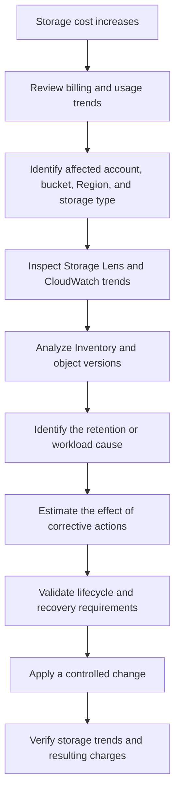

# 02- Storage Costs

## Overview

Amazon S3 storage costs depend on the amount of data retained, the storage class assigned to each object, how long the object remains stored, and additional storage overhead associated with object versions and archival features.

Storage costs are often underestimated because engineers focus on the size of current objects while overlooking historical versions, small-object billing rules, archive metadata, replicated copies, and incomplete multipart uploads.

For production backend systems, storage-cost management should be treated as a data-lifecycle problem. Every object should have an appropriate retention policy, storage class, recovery requirement, and ownership model.

This document focuses on understanding, measuring, and optimizing the cost of retained S3 data. Request pricing, retrieval charges, network transfer, and the overall pricing model are covered separately in the Amazon S3 pricing documentation.

## What Contributes to S3 Storage Costs?

The primary storage-cost drivers are:

- **Stored bytes:** The volume of object data retained in each storage class.
- **Object count:** Important when storage classes impose minimum billable object sizes or per-object overhead.
- **Version history:** Previous object versions can continue consuming storage after an overwrite or deletion.
- **Storage duration:** Some storage classes impose minimum storage durations.
- **Archive overhead:** Certain archival classes require additional metadata storage for each object.
- **Replicated copies:** Objects retained in destination buckets consume additional storage.
- **Incomplete multipart uploads:** Uploaded parts remain billable until the multipart upload is completed or its parts are removed.
- **Noncurrent objects and retention:** Historical data retained for compliance, recovery, or business requirements contributes to ongoing storage consumption.

The relationship between these variables can be expressed conceptually as:

\[
C_{\text{storage}} =
\sum_{i=1}^{n}
B_i \times R_i \times T_i
\]

Where:

- \(B_i\) is the billable storage volume for a category of objects.
- \(R_i\) is the applicable storage rate.
- \(T_i\) is the applicable billing duration.

This simplified model excludes request charges, retrieval charges, and other non-storage costs. Actual billing also depends on applicable billing units, object sizes, storage class rules, and the billing period.

## Understand Billable Storage

The logical size of application data is not always equal to the billable amount of storage.

### Logical size versus billable size

| Storage scenario | Why billable storage may differ |
|---|---|
| Current object in S3 Standard | Generally based on the stored object size and applicable billing rules |
| Small object in S3 Standard-IA | Minimum billable object size of 128 KB |
| Small object in S3 One Zone-IA | Minimum billable object size of 128 KB |
| Small object in S3 Glacier Instant Retrieval | Minimum billable object size of 128 KB |
| Object in S3 Glacier Flexible Retrieval | Additional archive metadata storage applies |
| Object in S3 Glacier Deep Archive | Additional archive metadata storage applies |
| Versioned object | Multiple retained versions consume storage independently |
| Replicated object | Source and destination copies consume storage in their respective buckets |
| Incomplete multipart upload | Uploaded parts consume storage before completion |
| Object in S3 Intelligent-Tiering | Small objects below 128 KB remain in the Frequent Access tier and are not monitored for automatic tiering |

For precise estimates, use the applicable storage-class pricing rules rather than assuming all stored bytes have identical billing behavior.

Reference: [Amazon S3 pricing](https://aws.amazon.com/s3/pricing/).

## Storage Class Selection and Storage Economics

Storage classes offer different combinations of storage rates, access latency, availability, resilience, and minimum storage duration.

A cheaper storage rate does not necessarily produce a lower total cost. Retrieval frequency, object size, retention duration, and additional overhead must be considered.

| Storage class | Minimum storage duration | Minimum billable object size | Storage-cost considerations |
|---|---:|---:|---|
| S3 Standard | None | None | Suitable for frequently accessed data |
| S3 Intelligent-Tiering | None | No minimum billable size; objects below 128 KB are not monitored | Monitoring and automation charges apply to eligible objects; no retrieval charges for its access tiers |
| S3 Standard-IA | 30 days | 128 KB | Lower storage rates may be offset by retrieval charges and minimum-duration penalties |
| S3 One Zone-IA | 30 days | 128 KB | Similar billing considerations to Standard-IA, with single-Availability-Zone storage |
| S3 Glacier Instant Retrieval | 90 days | 128 KB | Suitable for rarely accessed data requiring immediate retrieval |
| S3 Glacier Flexible Retrieval | 90 days | No equivalent 128 KB minimum billable payload size; additional metadata storage applies | Archive storage rates plus per-object metadata overhead and applicable retrieval costs |
| S3 Glacier Deep Archive | 180 days | No equivalent 128 KB minimum billable payload size; additional metadata storage applies | Designed for long-term retention with infrequent access and additional archive overhead |
| S3 Express One Zone | No general-purpose minimum duration assumption should be applied | Validate the current pricing rules | Specialized high-performance storage with a different pricing model |

Minimum duration and minimum size rules apply according to the selected storage class and AWS pricing terms. Confirm the current rules before implementing automated transitions.

### Storage class selection principles

Use S3 Standard when objects are frequently accessed or require predictable low-latency retrieval without infrequent-access charges.

Use S3 Intelligent-Tiering when access patterns are unknown or change over time and automatic tiering can offset its monitoring charges.

Use infrequent-access classes when data remains stored for a sufficiently long period and retrieval is relatively uncommon.

Use Glacier storage classes for workloads whose recovery requirements are compatible with the selected retrieval model.

Avoid moving objects into an archive class simply because they have reached a particular age. Age alone does not determine whether a lower-cost storage class is appropriate.

## Small Objects and Minimum Billable Size

Small objects can create a substantial difference between logical data volume and billable storage.

S3 Standard-IA, S3 One Zone-IA, and S3 Glacier Instant Retrieval have a minimum billable object size of 128 KB. An object smaller than this threshold is billed as though 128 KB were stored in the applicable class.

Consider a workload with 1 million objects, each containing 10 KB of payload data.

The logical payload volume is:

\[
1{,}000{,}000 \times 10\text{ KB}
= 10{,}000{,}000\text{ KB}
\]

If these objects are stored in a class with a 128 KB minimum billable size, the volume used for the minimum-size component of storage billing is approximately:

\[
1{,}000{,}000 \times 128\text{ KB}
= 128{,}000{,}000\text{ KB}
\]

The billable size component is therefore approximately 12.8 times the logical payload size, subject to the applicable billing units and storage-class rules.

This example excludes metadata overhead, requests, and other costs.

### Common small-object workloads

Small objects frequently occur in:

- JSON API responses persisted as files.
- Application event records.
- Per-request logs.
- Small thumbnails and image variants.
- Individual telemetry records.
- Small reports generated by background jobs.
- Data pipelines that write many fragmented outputs.

### Cost-control options

Before transitioning large populations of small objects:

1. Measure the distribution of object sizes.
2. Estimate the storage savings using billable sizes rather than logical sizes.
3. Include transition request charges and minimum storage durations.
4. Consider consolidating compatible data into larger objects when the application can safely support it.
5. Retain small, frequently accessed objects in a suitable class if transition costs outweigh expected savings.

Do not consolidate objects indiscriminately. Aggregation can complicate concurrent updates, object-level access control, retention, partial retrieval, and recovery.

## Archive Metadata Overhead

S3 Glacier Flexible Retrieval and S3 Glacier Deep Archive charge for additional metadata storage associated with archived objects.

For these classes, AWS documents an additional 40 KB of metadata storage per archived object:

- 8 KB billed at S3 Standard storage rates.
- 32 KB billed at the applicable Glacier storage rate.

The overhead supports object listing and archive indexing behavior.

### Example: millions of archived objects

Assume an archive contains 5 million objects, each with an average payload size of 20 KB.

The logical payload size is:

\[
5{,}000{,}000 \times 20\text{ KB}
= 100{,}000{,}000\text{ KB}
\]

The additional metadata storage is:

\[
5{,}000{,}000 \times 40\text{ KB}
= 200{,}000{,}000\text{ KB}
\]

The metadata component is twice the logical payload volume in this example. Its cost is distributed across two storage rates, so it must be calculated using the relevant pricing for each component.

This is an important consideration for archives containing many small documents, event records, or generated files.

### Intelligent-Tiering archive overhead

Objects in the Archive Access and Deep Archive Access tiers of S3 Intelligent-Tiering also incur the documented archive metadata overhead:

- 8 KB billed at S3 Standard rates.
- 32 KB billed at the relevant Glacier storage rate.

For objects below 128 KB, Intelligent-Tiering does not monitor the object for automatic tiering; such objects remain in the Frequent Access tier.

Reference: [Amazon S3 pricing](https://aws.amazon.com/s3/pricing/).

## Storage Costs in Versioned Buckets

S3 Versioning preserves multiple versions of an object under the same key. This supports recovery from accidental overwrites and deletions, but it can increase storage consumption significantly.

Suppose an application uploads a new 100 MB document every day to the same key.

Without versioning, the application normally retains the latest object at that key. With versioning enabled, previous versions remain stored until removed by an applicable lifecycle policy or explicit deletion.

After 30 daily uploads, the retained payload can approach 3,000 MB rather than 100 MB, assuming every version is retained and each version contains the full 100 MB payload.

The actual billed amount also depends on storage classes, retention, and applicable billing rules.

### Understand the storage impact of versioning

| Operation | Effect on retained storage |
|---|---|
| Upload to a new key | Adds an object |
| Overwrite an existing key in a versioned bucket | Creates a new version while prior versions remain |
| Delete an object without specifying a version ID | Typically creates a delete marker; previous versions remain |
| Delete a specific object version | Removes that version, subject to applicable behavior and permissions |
| Expire current objects through lifecycle | In a versioned bucket, may create a delete marker rather than remove all historical versions |
| Expire noncurrent versions through lifecycle | Removes eligible historical versions according to the configured rule |

### Recommended approach

Define separate retention rules for:

- Current object versions.
- Noncurrent object versions.
- Expired delete markers.
- Incomplete multipart uploads.

For example, a document service may retain current documents for one year and noncurrent versions for 90 days. These are example policy values, not universal retention recommendations.

Compliance, legal holds, recovery objectives, and application requirements must determine the actual retention policy.

Do not shorten historical retention solely to reduce cost without evaluating the impact on recovery and compliance.

Reference: [Retaining multiple versions of objects with S3 Versioning](https://docs.aws.amazon.com/AmazonS3/latest/userguide/Versioning.html).

## Replication and Duplicate Storage

S3 replication maintains additional object copies in destination buckets. These copies can support disaster recovery, geographic data distribution, or other resilience requirements.

Replication increases retained storage whenever the destination retains data that is also present in the source.

A replicated workload may incur storage charges for:

- Current versions in the source bucket.
- Historical versions in the source bucket.
- Replicated current versions in destination buckets.
- Replicated historical versions retained at the destination.
- Additional destination objects created by application workflows.

The storage class of the destination objects and the retention configuration also affect cost.

### Example

Consider an application with 2 TB of retained source data and one destination bucket that stores an equivalent 2 TB replica.

The combined retained payload is approximately 4 TB, before accounting for historical versions and additional overhead.

Replication does not necessarily duplicate every historical object automatically under all configurations. Existing objects, new versions, delete markers, replication rules, and lifecycle behavior must be evaluated according to the actual configuration.

### Cost-management guidance

- Replicate data only where resilience or application requirements justify it.
- Apply suitable retention controls to source and destination data.
- Measure destination storage separately.
- Review lifecycle rules and version retention in both locations.
- Include replication in disaster-recovery cost estimates.
- Validate that cost reductions do not undermine required recovery objectives.

Reference: [Amazon S3 replication](https://docs.aws.amazon.com/AmazonS3/latest/userguide/replication.html).

## Incomplete Multipart Uploads

Multipart uploads allow large objects to be uploaded in parts before the final object is assembled.

Parts uploaded during an incomplete multipart upload continue consuming storage until the upload is completed or aborted.

A failed worker, interrupted transfer, or abandoned upload session can therefore leave data that is not visible as a completed object but still contributes to storage costs.

### Identify incomplete uploads

Use the AWS CLI to list multipart uploads:

```bash
aws s3api list-multipart-uploads \
  --bucket example-prod-uploads \
  --region ap-south-1
```

For large workloads, process paginated responses rather than assuming one response contains every upload.

### Prevent long-lived abandoned uploads

Configure an S3 Lifecycle rule to abort incomplete multipart uploads after a period appropriate for the workload.

For example, a general-purpose bucket can use the following rule:

```json
{
  "Rules": [
    {
      "ID": "abort-incomplete-multipart-uploads",
      "Status": "Enabled",
      "Filter": {},
      "AbortIncompleteMultipartUpload": {
        "DaysAfterInitiation": 7
      }
    }
  ]
}
```

This example aborts incomplete multipart uploads after seven days. Adjust the interval to account for expected upload duration, retries, and operational recovery procedures.

Aborting an incomplete multipart upload removes its uploaded parts. It does not delete completed objects.

Reference: [Aborting incomplete multipart uploads using a lifecycle rule](https://docs.aws.amazon.com/AmazonS3/latest/userguide/mpu-abort-incomplete-mpu-lifecycle-config.html).

## Lifecycle Transitions and Minimum Storage Duration

Lifecycle rules can transition eligible objects to lower-cost storage classes or expire objects that have reached the end of their retention period.

However, transitions and deletion can have consequences beyond the new storage rate.

S3 Standard-IA and S3 One Zone-IA have a 30-day minimum storage duration. S3 Glacier Instant Retrieval and S3 Glacier Flexible Retrieval have a 90-day minimum. S3 Glacier Deep Archive has a 180-day minimum.

Deleting, overwriting, or transitioning an object before its applicable minimum storage duration expires can result in a prorated charge for the remaining period.

### Evaluate transitions using the full storage lifecycle

For each rule, establish:

- Average object size.
- Number of eligible objects.
- Expected time spent in each storage class.
- Expected retrieval frequency.
- Expected deletion or overwrite time.
- Applicable transition costs.
- Minimum storage duration.
- Recovery and availability requirements.

A transition may reduce the monthly storage rate but still produce a higher total cost when objects are short-lived or retrieved frequently.

### Small-object transition behavior

S3 Lifecycle prevents objects smaller than 128 KB from being transitioned to any storage class by default under the updated behavior introduced in September 2024.

Custom object-size filters can allow smaller objects to transition when explicitly required. Existing configurations that have not been modified may retain previous default behavior.

Do not assume that every eligible object will transition just because its age satisfies a rule. Validate the configuration and the actual object-size criteria.

Reference: [S3 Lifecycle transition considerations](https://docs.aws.amazon.com/AmazonS3/latest/userguide/lifecycle-transition-general-considerations.html).

## Measuring Storage Consumption

Storage-cost optimization requires reliable measurements of both retained bytes and object counts.

No single metric explains every storage-cost anomaly. Use several sources to understand how data is accumulating.

### CloudWatch storage metrics

S3 publishes daily storage metrics that can help track bucket-level storage by storage class.

Relevant metrics include:

- `BucketSizeBytes`
- `NumberOfObjects`

`BucketSizeBytes` can be examined by the applicable `StorageType` dimension. Storage types distinguish categories such as Standard storage, noncurrent-version storage where available in relevant metrics, archive storage, and certain object-overhead components.

The precise dimensions and metric availability depend on the storage category and reporting configuration.

CloudWatch storage metrics are useful for identifying growth trends, but they should not be treated as a substitute for detailed billing data.

Reference: [S3 CloudWatch metrics and dimensions](https://docs.aws.amazon.com/AmazonS3/latest/userguide/metrics-dimensions.html).

### S3 Storage Lens

S3 Storage Lens provides aggregated visibility into storage usage across accounts, buckets, Regions, prefixes, and supported metric dimensions.

Use it to investigate:

- Fast-growing buckets.
- Storage-class distribution.
- Object-count growth.
- Historical storage patterns.
- Incomplete multipart uploads.
- Prefix-level opportunities to reduce storage cost.
- Buckets that lack suitable lifecycle configuration.

Free metrics provide useful baseline storage insights. Advanced metrics and additional capabilities have separate pricing considerations.

Reference: [Understanding S3 Storage Lens](https://docs.aws.amazon.com/AmazonS3/latest/userguide/storage_lens_basics_metrics_recommendations.html).

### S3 Inventory

S3 Inventory provides scheduled reports containing object-level metadata.

For storage-cost investigations, useful inventory fields can include:

- Object key.
- Object size.
- Storage class.
- Version ID.
- Whether the version is current.
- Whether the entry represents a delete marker.
- Last-modified timestamp.
- Applicable encryption and other selected metadata.

Inventory is useful for analyzing the object population without repeatedly enumerating every object through an application-driven listing workflow.

For versioned buckets, include version information when historical versions are relevant to the investigation.

Use Inventory reports with Athena or another appropriate query engine to aggregate object sizes by prefix, storage class, age, or version status.

Reference: [Amazon S3 Inventory](https://docs.aws.amazon.com/AmazonS3/latest/userguide/storage-inventory.html).

## Investigating Unexpected Storage Growth

Use a repeatable diagnostic workflow instead of immediately deleting data or changing storage classes.

### Diagnostic workflow



### Step: Review billing evidence

Start with AWS Cost Explorer, AWS Cost and Usage Reports, or AWS Data Exports.

Identify the affected S3 storage usage categories, Regions, and time range.

Determine whether the increase is caused by a storage-class change, new ingestion, growing version history, replication, or another storage-related factor.

### Step: Identify the affected bucket

Use the AWS console, Storage Lens, or available bucket-level storage metrics to determine which bucket or group of buckets is growing.

Compare the growth against application deployment dates, ingestion schedules, and retention changes.

### Step: Analyze retained objects

Use S3 Inventory or an appropriate version-aware listing process to inspect object sizes, storage classes, age, and current versus noncurrent versions.

Look for:

- Repeated overwrites of versioned keys.
- Large historical datasets.
- Unexpected replication.
- Small objects assigned to unsuitable storage classes.
- Objects older than the intended retention period.
- Incomplete multipart uploads.

### Step: Determine the corrective action

Choose an action supported by the evidence:

- Add or correct lifecycle rules.
- Reduce unintended historical-version retention.
- Abort incomplete multipart uploads.
- Change storage class for a suitable workload.
- Fix excessive data generation or duplicate ingestion.
- Review replication or retention configuration.

Validate the required retention and recovery behavior before deleting data.

### Step: Verify the result

Check that the configuration has been applied and that subsequent storage metrics follow the expected trend.

Storage metrics and billing reports have different reporting and update intervals. Do not interpret the absence of an immediate billing change as proof that an optimization failed.

## Practical AWS CLI Inspection Commands

These commands help inspect relevant S3 configuration and data. They do not calculate the complete monthly storage bill.

### Inspect versioning configuration

```bash
aws s3api get-bucket-versioning \
  --bucket example-prod-uploads \
  --region ap-south-1
```

Confirm whether versioning is enabled or suspended before evaluating historical-version growth.

### Inspect lifecycle configuration

```bash
aws s3api get-bucket-lifecycle-configuration \
  --bucket example-prod-uploads \
  --region ap-south-1
```

Review current-version expiration, noncurrent-version expiration, transitions, and incomplete multipart upload cleanup.

A bucket without a lifecycle configuration may return a `NoSuchLifecycleConfiguration` error. Treat that as evidence that no lifecycle configuration is present, not as proof that all retained data is unnecessary.

### List current objects in a prefix

```bash
aws s3api list-objects-v2 \
  --bucket example-prod-uploads \
  --prefix reports/ \
  --region ap-south-1
```

This returns a page of current objects and their sizes for the specified prefix. Use continuation tokens for large listings.

For programmatic analysis, aggregate the returned `Size` values across all pages rather than treating one page as the complete dataset.

### Inspect object versions

```bash
aws s3api list-object-versions \
  --bucket example-prod-uploads \
  --prefix reports/ \
  --region ap-south-1
```

Use the version listing to investigate historical versions and delete markers. For large datasets, paginate the results and avoid creating an unbounded in-memory inventory.

### Inspect incomplete multipart uploads

```bash
aws s3api list-multipart-uploads \
  --bucket example-prod-uploads \
  --region ap-south-1
```

Review abandoned upload sessions and verify the responsible workload before taking corrective action.

### Operational cautions

- Listing commands may return paginated results.
- AWS CLI output represents the data returned by the API, not a complete bill.
- Bucket-level configuration does not prove that every object follows the intended policy.
- Destructive operations require explicit validation of object keys, version IDs, and retention requirements.
- Do not assume that an S3 console folder represents a real directory; prefixes organize object keys.

## Designing Storage Retention Policies

Storage retention should be explicit and aligned with business requirements.

A document-processing service might use the following lifecycle design:

| Data category | Example retention approach | Primary storage consideration |
|---|---|---|
| Temporary upload staging data | Short, bounded retention | Prevent abandoned uploads and failed workflows from accumulating |
| Processed documents | Retain according to business requirements | Balance retrieval requirements and storage class |
| Generated thumbnails | Retain while the source or application requires them | Avoid retaining obsolete derivatives |
| Audit records | Retain according to compliance and operational requirements | Ensure storage optimization does not violate retention rules |
| Historical object versions | Retain for a defined recovery period | Prevent version accumulation from becoming unbounded |
| Long-term backups | Retain according to recovery and compliance objectives | Include archive metadata and restoration requirements |

The specific retention period must come from the business, compliance, and recovery requirements. The table describes categories of policy rather than prescribed durations.

### Example: lifecycle configuration

The following example transitions eligible reports to S3 Standard-IA after 30 days and expires them after 365 days.

```json
{
  "Rules": [
    {
      "ID": "reports-storage-lifecycle",
      "Status": "Enabled",
      "Filter": {
        "Prefix": "reports/"
      },
      "Transitions": [
        {
          "Days": 30,
          "StorageClass": "STANDARD_IA"
        }
      ],
      "Expiration": {
        "Days": 365
      }
    }
  ]
}
```

Before applying this configuration, verify:

- Whether the reports are genuinely infrequently accessed.
- Whether the 30-day transition meets the minimum storage-duration and lifecycle rules.
- Whether the application can tolerate retrieval charges.
- Whether current-version expiration satisfies the retention requirement.
- Whether noncurrent versions require a separate rule.
- Whether small-object transition restrictions affect the expected object population.

In a versioned bucket, this configuration does not guarantee that every historical version will be permanently deleted after 365 days.

## Storage Cost Optimization Process

Use an evidence-driven optimization process.

### Establish a baseline

Record storage by bucket, storage class, object count, and version status where available.

Measure monthly changes rather than reviewing a single storage snapshot. A bucket with relatively low current usage can still produce a significant bill if it is growing rapidly.

### Identify the dominant cost driver

Determine whether storage growth comes primarily from:

- Increasing business data volume.
- Noncurrent object versions.
- Replication.
- Long retention periods.
- Objects in higher-cost storage classes.
- Small-object or archival metadata overhead.
- Incomplete multipart uploads.
- Other unexpected retained data.

### Estimate the achievable savings

Calculate the expected effect of each candidate change using the actual object distribution and current AWS prices.

Include minimum storage durations, object-size thresholds, archive metadata, required destination copies, and retention constraints.

Do not treat theoretical storage-rate differences as guaranteed savings.

### Apply a controlled change

Test lifecycle and retention changes in an appropriate environment or on a clearly scoped object population before broad rollout.

For production buckets, review the planned impact, establish rollback or recovery procedures where possible, and ensure that deletion cannot violate retention requirements.

### Verify continuously

Monitor storage metrics and billing trends after the change.

Use budgets and cost anomaly detection to identify unexpected increases. Revisit lifecycle rules when access patterns or business requirements change.

## Common Mistakes

### Choosing the cheapest class without evaluating retention

Objects deleted or transitioned before a minimum storage duration expires can incur additional prorated storage charges.

**Prevention:** Calculate expected residence time before configuring transitions.

### Ignoring noncurrent versions

Overwrites and delete markers can leave historical versions consuming storage.

**Prevention:** Measure versioned storage and configure noncurrent-version retention explicitly.

### Archiving millions of small objects without modeling overhead

Minimum billable sizes, archive metadata, and per-object charges can weaken the expected savings.

**Prevention:** Analyze object size distribution and expected object count before choosing an archival design.

### Assuming lifecycle rules immediately reduce storage

Lifecycle transitions are subject to eligibility and configuration constraints, and storage metrics or billing reports may not update immediately.

**Prevention:** Verify lifecycle configuration, object eligibility, and subsequent storage trends.

### Treating replication as free backup

Destination copies increase retained storage and can have independent retention requirements.

**Prevention:** Include destination storage in the cost model and validate the recovery design.

### Deleting objects to reduce a bill without reviewing retention

Historical records may be required for audits, compliance, incident investigations, or disaster recovery.

**Prevention:** Obtain the appropriate retention and ownership decisions before deleting data.

### Using object listings as a complete billing report

A listing can reveal logical object sizes but may not include all storage overhead or billing-specific adjustments.

**Prevention:** Combine object-level analysis with CloudWatch, Storage Lens, Inventory, and billing data.

## Production Readiness Checklist

- [ ] Storage is measured by bucket and storage class.
- [ ] Object-count growth is tracked alongside stored bytes.
- [ ] Storage classes match real access and recovery requirements.
- [ ] Small-object and archive metadata overhead are included in estimates.
- [ ] Versioning and noncurrent-version retention are explicitly managed.
- [ ] Current-version expiration and delete-marker behavior are understood.
- [ ] Lifecycle rules account for minimum storage duration and object-size restrictions.
- [ ] Incomplete multipart uploads are cleaned up using an appropriate retention interval.
- [ ] Replicated data is included in the total storage estimate.
- [ ] Inventory or Storage Lens is used when object-level analysis is necessary.
- [ ] Cost changes are validated using actual billing and usage reports.
- [ ] Retention changes preserve recovery, security, and compliance requirements.
- [ ] Budgets and anomaly alerts are configured for material cost changes.
- [ ] Destructive cleanup operations are scoped, reviewed, and verified.

## Official References

- [Amazon S3 pricing](https://aws.amazon.com/s3/pricing/)
- [S3 storage classes](https://docs.aws.amazon.com/AmazonS3/latest/userguide/storage-class-intro.html)
- [S3 Lifecycle transition considerations](https://docs.aws.amazon.com/AmazonS3/latest/userguide/lifecycle-transition-general-considerations.html)
- [S3 Versioning](https://docs.aws.amazon.com/AmazonS3/latest/userguide/Versioning.html)
- [S3 Inventory](https://docs.aws.amazon.com/AmazonS3/latest/userguide/storage-inventory.html)
- [Understanding S3 Storage Lens](https://docs.aws.amazon.com/AmazonS3/latest/userguide/storage_lens_basics_metrics_recommendations.html)
- [S3 CloudWatch metrics and dimensions](https://docs.aws.amazon.com/AmazonS3/latest/userguide/metrics-dimensions.html)
- [Aborting incomplete multipart uploads using lifecycle rules](https://docs.aws.amazon.com/AmazonS3/latest/userguide/mpu-abort-incomplete-mpu-lifecycle-config.html)
- [Amazon S3 replication](https://docs.aws.amazon.com/AmazonS3/latest/userguide/replication.html)
- [AWS billing reports for Amazon S3](https://docs.aws.amazon.com/AmazonS3/latest/userguide/aws-billing-reports.html)

## Key Takeaways

- S3 storage cost depends on retained bytes, storage class, object count, historical versions, archive metadata, and minimum storage-duration rules.
- Small objects can have disproportionately high effective storage costs in classes with minimum billable sizes or per-object archive overhead.
- Versioning, replication, and incomplete multipart uploads can increase retained storage even when application-visible data appears unchanged.
- Use CloudWatch, Storage Lens, Inventory, and billing reports together to identify the actual causes of storage growth.
- Optimize storage through controlled lifecycle and retention policies while preserving required recovery, security, and compliance guarantees.