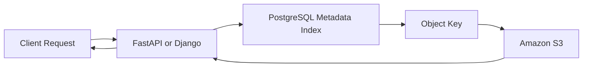
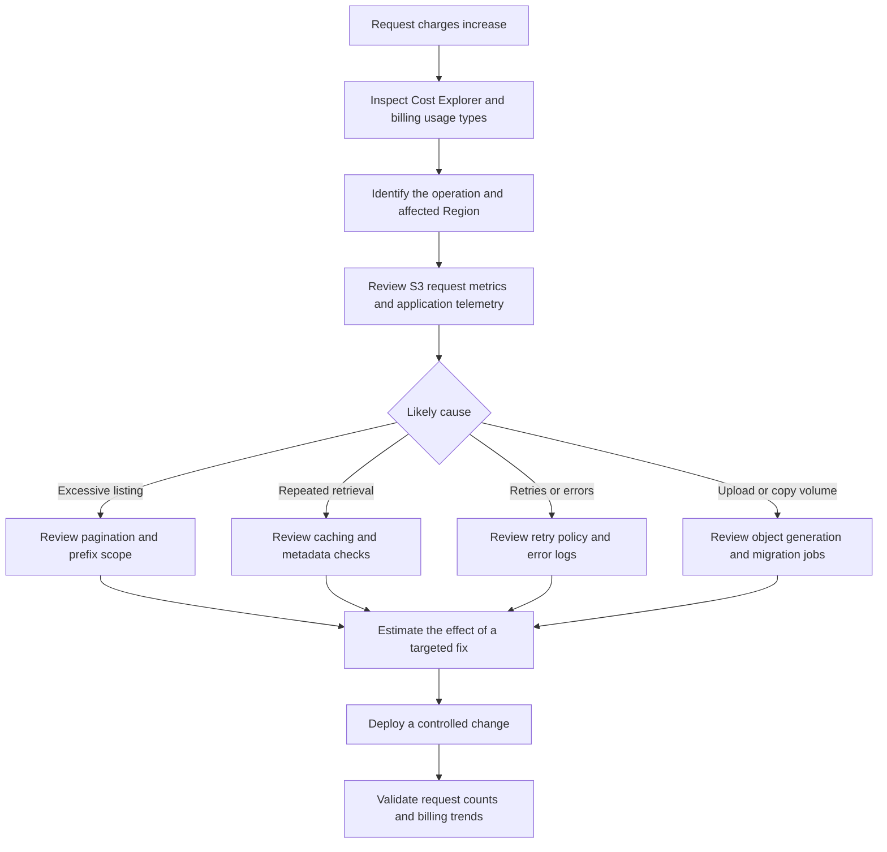

# 03- Request and API Costs

## Overview

Amazon S3 charges for many API requests according to the operation performed, the storage class, the bucket type, and the applicable AWS Region pricing.

Request charges can become significant when a backend application repeatedly lists objects, retrieves metadata, generates small files, retries failed operations, or processes millions of objects through automated workflows.

For example, an API that downloads one document for each user request may generate a manageable number of S3 calls. An API that lists a bucket, performs several metadata checks, and retrieves multiple objects for every user request can generate substantially more traffic.

Request-cost optimization requires understanding the number and type of S3 operations generated by the application's entire request lifecycle.

This document covers:

- S3 API request categories and pricing behavior.
- Request-volume calculations and workload estimation.
- GET, HEAD, LIST, PUT, COPY, POST, and multipart upload costs.
- Pagination, retries, conditional requests, and bulk operations.
- Backend application design patterns that reduce unnecessary requests.
- Monitoring, billing analysis, and production optimization.

The applicable unit prices vary by storage class, bucket type, Region, and feature. Refer to the [official Amazon S3 pricing page](https://aws.amazon.com/s3/pricing/) before making cost estimates.

## How S3 Request Pricing Works

S3 request charges are generally calculated from the number of billable requests and the applicable rate for each request category.

For a request category billed per 1,000 requests:

\[
C_{\text{requests}} =
\frac{N_{\text{requests}}}{1000}
\times R_{\text{per 1000}}
\]

Where:

- \(N_{\text{requests}}\) is the number of billable requests.
- \(R_{\text{per 1000}}\) is the applicable price per 1,000 requests.

For a workload using multiple operation types, calculate each category separately:

\[
C_{\text{total requests}} =
\sum_{i=1}^{n}
\frac{N_i}{1000} \times R_i
\]

The relevant pricing unit may differ for specialized features, so always use the unit shown in the current pricing schedule.

### Important billing principles

- Requests are counted regardless of whether they originate from an AWS SDK, REST API client, AWS CLI, console, or another supported interface.
- Browsing objects in the S3 console can generate billable GET and LIST requests.
- LIST requests for general-purpose S3 buckets are priced at the same rate as S3 Standard PUT, COPY, and POST requests, regardless of the object's storage class.
- DELETE and CANCEL requests are generally free of S3 request charges.
- Data retrieval, storage, and data-transfer charges are separate from applicable request charges.
- Many successful requests and client-error responses are billable. HTTP 5xx server-error responses generally are not billed as requests, subject to the applicable AWS billing rules.
- A single application operation can generate multiple S3 requests, particularly when it uses pagination, multipart uploads, retries, or metadata lookups.

The cost of an API request is not necessarily proportional to the number of bytes returned. A small metadata lookup and a large object download can both incur a request charge, while the download may additionally incur retrieval and data-transfer charges.

## S3 API Request Categories

The following table summarizes common request types for general-purpose S3 buckets. Specialized storage classes and directory buckets can have different pricing schedules.

| Operation | Typical API | Request-cost consideration |
|---|---|---|
| Upload object | `PutObject` | Billed according to the applicable PUT request rate |
| Download object | `GetObject` | Billed according to the applicable GET request rate; retrieval charges may also apply |
| Retrieve object metadata | `HeadObject` | Generally billed at the applicable GET request rate |
| List object keys | `ListObjectsV2` | LIST requests are billed at the applicable listing rate |
| List versions | `ListObjectVersions` | Pagination can generate multiple LIST requests |
| Copy object | `CopyObject` | Billed according to the applicable COPY request rate, with relevant additional costs considered separately |
| Create multipart upload | `CreateMultipartUpload` | Generates a request |
| Upload a multipart part | `UploadPart` | Each part upload generates a request |
| Complete multipart upload | `CompleteMultipartUpload` | Generates a request |
| Abort multipart upload | `AbortMultipartUpload` | CANCEL request category; generally no S3 request charge |
| Delete object | `DeleteObject` | DELETE requests are generally free, although storage-related early-deletion charges can still apply |
| Delete multiple objects | `DeleteObjects` | DELETE request is generally free; the API can remove multiple specified objects in one call |
| Restore archived object | `RestoreObject` | Restore request and applicable retrieval costs depend on the storage class and retrieval option |
| Change storage class | Lifecycle transition or copy operation | Applicable ingestion or transition request charges can apply |
| Execute S3 Select | `SelectObjectContent` | Where supported, request and data-scanning charges may apply |

The API operation, storage class, and feature determine the exact pricing treatment. Do not assume all S3 operations share one universal request rate.

## GET and HEAD Request Costs

GET and HEAD requests are common sources of API charges in backend systems.

### GET requests

`GetObject` retrieves object content. Each application-level object retrieval can generate an S3 GET request.

Common workloads include:

- Downloading documents and images.
- Loading configuration files.
- Retrieving processed reports.
- Reading artifacts from Celery workers.
- Serving files through Django or FastAPI.
- Reading data for ETL and analytics workflows.

A request-heavy application may retrieve the same object repeatedly, even when its content rarely changes.

### HEAD requests

`HeadObject` retrieves object metadata without returning the object body. It is useful when an application needs to inspect information such as the object's size, ETag, last-modified time, or storage class.

However, metadata checks are not automatically free.

Consider this application flow:

1. The API calls `HeadObject` to verify that a file exists.
2. The API calls `GetObject` to download that file.
3. The same workflow repeats for every user request.

The application generates two S3 requests per download instead of one, assuming both calls reach S3 and no other requests occur.

When the metadata check does not influence the application's behavior, it may be unnecessary.

### Avoid redundant metadata checks

Use the following decision criteria:

| Requirement | Recommended approach |
|---|---|
| Retrieve an object whose key is already known and whose existence can be handled through the GET response | Perform GET directly and handle the applicable errors |
| Inspect metadata without downloading content | Use HEAD |
| Retrieve metadata for many objects on a recurring schedule | Consider S3 Inventory or another suitable bulk-analysis approach |
| Check existence on every application request despite already having authoritative metadata | Review whether the additional HEAD request is necessary |
| Cache immutable object metadata safely | Use the cache to avoid repeated metadata requests where appropriate |

Do not remove HEAD requests merely to reduce cost if the application genuinely needs a separate metadata check. Optimize based on correctness, failure handling, and observed request volume.

Reference: [HeadObject API](https://docs.aws.amazon.com/AmazonS3/latest/API/API_HeadObject.html).

## LIST Requests and Pagination

LIST requests enumerate object keys or other S3 resources. They can become a major cost driver when applications repeatedly scan large buckets.

For general-purpose buckets, `ListObjectsV2` returns up to 1,000 objects per response. If additional objects remain, the client must continue using pagination.

### Estimate listing requests

For a simple listing operation that returns \(N\) objects, the theoretical minimum number of pages is:

\[
P = \left\lceil \frac{N}{1000} \right\rceil
\]

This assumes the listing returns the required objects efficiently and does not require additional scans, filtering workflows, retries, or other API calls.

For example, a job scanning 2 million objects can require approximately 2,000 listing requests for a single complete pass.

If this job runs every hour:

\[
2{,}000 \times 24 \times 30 =
1{,}440{,}000
\]

The application would generate approximately 1.44 million LIST requests per 30-day month, before retries or other operations.

### Common causes of excessive listing

- Listing the entire bucket to locate a single object.
- Repeatedly scanning historical objects during API requests.
- Running the same complete inventory job in multiple workers.
- Starting a new listing from the beginning after every failure.
- Using overly broad prefixes.
- Using repeated LIST operations to reconstruct state that already exists in a database.
- Performing frequent object listings when scheduled Inventory reports would be sufficient.

### Better listing design

Use object keys and prefixes to scope requests to the smallest useful dataset.

For example, a document service can organize objects using tenant- and date-oriented prefixes:

```text
documents/
    tenant-123/
        2026/
            10/
                report-a.pdf
                report-b.pdf
    tenant-456/
        2026/
            10/
                report-c.pdf
```

A request scoped to `documents/tenant-123/2026/10/` avoids enumerating unrelated tenants and periods.

This layout is illustrative, not a requirement to encode every business attribute into an object key.

When an application needs efficient lookups by tenant, owner, status, or business identifier, maintain an appropriate database index instead of treating S3 listing as a general-purpose query engine.

Reference: [Listing objects using the AWS SDKs](https://docs.aws.amazon.com/AmazonS3/latest/userguide/ListingObjectKeysUsingAPIs.html).

## PUT, COPY, and POST Request Costs

PUT, COPY, and POST requests are commonly associated with uploading, replacing, and managing objects.

### PUT requests

Every object upload or replacement can generate a PUT request.

Common request sources include:

- Users uploading files.
- Celery jobs producing images or reports.
- ETL pipelines writing partitioned outputs.
- Logging systems writing data to S3.
- Applications rewriting objects to update metadata.
- Data pipelines generating many small files.

A workload producing 10 million small output objects can create substantial request volume even when the combined dataset is relatively small.

Where the data format and access pattern permit it, consolidation can reduce request count. However, evaluate the implications for concurrent updates, partial reads, recovery, and object-level authorization.

### COPY requests

`CopyObject` copies an object or rewrites an object within S3.

Copy-based workflows can arise when:

- Migrating objects to a different key.
- Changing object metadata through a copy-based rewrite.
- Moving objects between prefixes.
- Reorganizing object storage.
- Performing certain storage-class changes.

At the application level, a "move" may be implemented as copy followed by delete. The COPY request remains billable even though the DELETE request is generally free.

Large-scale metadata changes or migrations can therefore produce significant request volume.

Before rewriting millions of objects, estimate the operation count and test the migration procedure on a representative object population.

### POST requests

POST request pricing depends on the operation and applicable pricing schedule. Browser-based form uploads and certain S3 API workflows can generate POST requests.

A browser form upload is different from issuing an ordinary PUT request, but both must be included when estimating ingestion activity.

Use the exact operations performed by the application rather than assuming all uploads generate identical API requests.

## Multipart Upload Request Costs

Multipart uploads improve reliability and throughput for large objects by splitting data into independently uploaded parts.

A multipart upload usually involves:

1. Initiating the multipart upload.
2. Uploading one or more parts.
3. Completing the upload.
4. Aborting the upload if it cannot be completed.

Each API operation contributes to request counts according to the applicable pricing schedule.

For a completed multipart upload using \(k\) parts, the principal request count is approximately:

\[
N_{\text{requests}} = k + 2
\]

This accounts for one initiation request, \(k\) part uploads, and one completion request. It excludes retries, part-listing requests, checksum-related workflows, and other ancillary operations.

For example, uploading a single object using 100 parts produces at least 102 requests in the basic multipart sequence.

A single-request upload ordinarily requires fewer S3 requests, while multipart upload can provide better recovery and throughput for large files.

### Choose multipart upload according to workload requirements

Use multipart uploads for large files and where parallel transfers or part-level retries are beneficial. AWS recommends considering multipart upload for objects around 100 MB or larger.

Do not force multipart upload for every small object. The extra API operations can increase request volume without meaningful performance benefits.

### Control abandoned multipart uploads

An upload that is initiated but never completed or aborted can leave uploaded parts consuming storage.

Configure an appropriate lifecycle rule to abort incomplete multipart uploads after a suitable interval for general-purpose buckets.

This reduces the risk of persistent incomplete uploads and their associated storage charges. Aborting the upload does not create a completed object.

Reference: [Multipart upload overview and pricing considerations](https://docs.aws.amazon.com/AmazonS3/latest/userguide/mpuoverview.html).

## Bulk Operations and Batch Processing

Bulk operations can reduce application overhead, but their pricing and execution behavior must be understood separately.

### DeleteObjects

The `DeleteObjects` API allows an application to request deletion of multiple object keys in a single API call. For general-purpose buckets, a request can contain up to 1,000 object identifiers.

Because DELETE requests are generally free, the principal advantages are reduced round trips, less client-side orchestration, and more efficient processing.

However, deleting a large object population can still have other consequences:

- Early-deletion charges for applicable storage classes.
- Version-related storage remaining after deletion.
- Lifecycle and compliance requirements.
- Additional application or audit processing.
- Potential retries for failed deletions.

A bulk-delete request should inspect the response for per-object errors instead of assuming that every requested deletion succeeded.

### S3 Batch Operations

S3 Batch Operations is intended for large-scale object processing, such as bulk tagging, copying, invoking Lambda, and other supported operations.

It has its own pricing components, including job and object-operation charges, plus the charges for the underlying operations. Some jobs can also incur manifest-related costs.

Use Batch Operations when large-scale object processing benefits from managed execution and completion reports. Do not assume it is always cheaper than a custom worker, a lifecycle rule, or a specialized S3-native capability.

Choose between direct API calls, a custom worker, and Batch Operations according to the required operation, number of objects, execution time, error handling, and cost model.

Reference: [S3 Batch Operations](https://docs.aws.amazon.com/AmazonS3/latest/userguide/batch-ops.html).

## Retries, Failed Requests, and Request Amplification

A single business operation can generate multiple S3 requests because of retries, redirects, and error-handling workflows.

S3 generally bills successful requests and many HTTP 4xx client-error requests. HTTP 5xx server-error responses are generally not billed, subject to documented exceptions and the applicable billing rules.

Even when a failed request is not billed, the application may retry it and produce further requests.

### Common causes of request amplification

- Aggressive retry loops.
- Repeating HEAD followed by GET unnecessarily.
- Restarting an entire listing after a partial failure.
- Uploading the same object repeatedly after ambiguous timeouts.
- Excessive client-side polling.
- Running duplicate background jobs.
- Retrying permanent authorization or validation failures.

### Recommended retry behavior

Use AWS SDK retry support with sensible retry limits and backoff behavior. Configure retries according to the operation's failure characteristics and the application's latency requirements.

For transient failures, retrying can improve reliability. For permanent errors such as invalid input or insufficient permissions, repeated retries usually create unnecessary work.

Make application-level workflows idempotent where possible. An idempotent workflow can safely recover from retries without creating duplicate records, unnecessary object versions, or repeated downstream processing.

### Example: upload retry behavior

```python
from botocore.config import Config
import boto3


def create_s3_client():
    return boto3.client(
        "s3",
        config=Config(
            retries={
                "mode": "standard",
                "total_max_attempts": 4,
            },
            connect_timeout=5,
            read_timeout=60,
        ),
    )
```

This example configures a Boto3 client with standard retry behavior and a bounded number of attempts. The exact retry and timeout settings should be validated against the workload, object size, and expected service latency.

A timeout does not always mean that an operation failed on the server. Before automatically repeating non-idempotent application behavior, determine how the workflow identifies completed operations and reconciles ambiguous outcomes.

## Backend Design Patterns for Lower Request Costs

### Avoid using S3 as the application's query database

S3 is optimized for object storage, not arbitrary relational filtering.

A backend service that searches for documents by tenant, owner, status, or business attributes should usually maintain an index in a database such as PostgreSQL.

The database stores the business metadata and an object key or identifier. S3 stores the object bytes.



This architecture avoids repeatedly listing bucket contents to answer database-style queries.

The database and S3 must still be coordinated correctly. Implement suitable transaction boundaries, idempotency, cleanup, and reconciliation for operations spanning both systems.

### Cache immutable objects where appropriate

For frequently requested immutable objects, cache metadata or content at the application or delivery layer when the consistency requirements permit it.

Potential options include:

- CloudFront for appropriate internet-facing content.
- An application cache for frequently used metadata.
- Redis for selected metadata or lookup results.
- Local caching for immutable build artifacts.

Caching can reduce origin requests, but it introduces invalidation and staleness considerations. Define expiration and versioning strategies before relying on cached data.

### Avoid duplicate object retrievals

If a request needs the same object multiple times, consider whether one retrieval and an appropriate in-process reuse strategy can serve the operation.

For large files, avoid loading entire objects into application memory merely to reuse them. Use streaming or controlled buffering.

### Consolidate small outputs selectively

For ETL, analytics, and logging workloads that produce numerous small objects, a compaction stage can reduce the object count and future request volume.

The design must account for the trade-offs:

| Benefit | Trade-off |
|---|---|
| Fewer future GET and LIST operations | Additional compaction processing |
| Fewer objects to enumerate | More complex partial updates |
| Potentially improved analytics efficiency | Additional compute and temporary storage |
| Lower per-object overhead in applicable storage classes | Reduced object-level granularity |

Consolidation is most useful when the application can naturally process objects in groups, rather than when independent objects require individual access and retention.

## Estimate Monthly API Request Costs

Use measured or expected request counts for each operation category.

Consider the following illustrative workload:

| Operation | Monthly request count | Price variable |
|---|---:|---|
| GET | 3,000,000 | \(R_{\text{GET}}\) |
| HEAD | 500,000 | \(R_{\text{HEAD}}\) |
| PUT | 120,000 | \(R_{\text{PUT}}\) |
| COPY | 20,000 | \(R_{\text{COPY}}\) |
| LIST | 80,000 | \(R_{\text{LIST}}\) |
| POST | 10,000 | \(R_{\text{POST}}\) |

For request categories priced per 1,000 requests:

\[
\begin{aligned}
C_{\text{example}} ={}&
3000R_{\text{GET}} +
500R_{\text{HEAD}} +
120R_{\text{PUT}}\\
&+20R_{\text{COPY}} +
80R_{\text{LIST}} +
10R_{\text{POST}}
\end{aligned}
\]

The rates are variables rather than fixed dollar amounts because actual prices depend on the selected Region, bucket type, and applicable pricing schedule.

This estimate should be expanded to cover multipart upload requests, archive restores, lifecycle transitions, S3 Select where available, and other relevant operations.

It also excludes storage, retrieval, data transfer, CloudWatch, KMS, and other related charges unless explicitly included in the calculation.

### Use actual workload measurements

The best estimate comes from observed request volume rather than assumptions about how many API operations a business transaction should perform.

Collect data from:

- Application-level telemetry.
- S3 CloudWatch request metrics.
- S3 access logging where appropriate.
- AWS Cost Explorer.
- AWS Cost and Usage Reports or AWS Data Exports.

Reconcile the metrics with the request categories shown in billing reports. CloudWatch request metrics are not identical to billing records; for example, certain list-oriented APIs are not included in the `GetRequests` metric.

## Monitor Request Activity

S3 request metrics can help identify excessive traffic, unexpected workload changes, and request errors.

For general-purpose buckets, useful metrics in the `AWS/S3` CloudWatch namespace include:

| Metric | Purpose |
|---|---|
| `AllRequests` | Total HTTP requests covered by the metric configuration |
| `GetRequests` | GET request activity |
| `PutRequests` | PUT request activity |
| `HeadRequests` | HEAD request activity |
| `PostRequests` | POST request activity |
| `DeleteRequests` | DELETE request activity |
| `SelectRequests` | S3 Select request activity where supported |
| `4xxErrors` | Client-error responses |
| `5xxErrors` | Server-error responses |
| `BytesDownloaded` | Downloaded data volume |
| `BytesUploaded` | Uploaded data volume |

Some metrics have configuration requirements, and detailed request metrics can incur additional CloudWatch charges. Confirm which metrics are available for the selected bucket type.

### Identify request-cost anomalies

Monitor for patterns such as:

- A sudden rise in GET or HEAD activity.
- Excessive listing after an application deployment.
- Increased PUT counts caused by duplicate file generation.
- Rising 4xx errors due to a broken client or authorization configuration.
- Repeated requests caused by retry loops.
- Unexpected object-processing jobs or bulk migrations.

A request spike does not automatically indicate a cost problem. Correlate activity with application throughput, data-transfer volume, operation success rates, and billing data.

Reference: [S3 CloudWatch metrics and dimensions](https://docs.aws.amazon.com/AmazonS3/latest/userguide/metrics-dimensions.html).

## Troubleshooting High Request Costs

Use a repeatable diagnostic flow to identify the operation generating the extra usage.

### Diagnostic workflow



### Unexpected GET and HEAD volume

Inspect the application call path and determine whether each GET is preceded by a HEAD request or other lookup that does not influence the outcome.

Check whether CloudFront or an application cache can reduce repeated retrievals for suitable objects.

### Unexpected LIST volume

Inspect listing loops, pagination, prefix filters, and background task schedules.

Determine whether multiple workers are performing the same complete scan or restarting from the beginning after failures.

### Unexpected PUT and COPY volume

Review application logs, batch jobs, deployment operations, and data migration activity.

Look for unnecessary rewrites, duplicate output generation, object metadata changes implemented through copying, or repeated uploads after ambiguous timeouts.

### Unexpected retry activity

Correlate request errors with client logs, timeout settings, and retry behavior.

Resolve permanent errors instead of retrying them indefinitely. For transient failures, use bounded retries and backoff, and verify that repeated operations do not create unwanted data or duplicate application state.

### Verify the outcome

Compare request counts before and after the change using equivalent workload periods.

Account for traffic variation and reporting delays before determining whether a change reduced the bill. Use actual billing records to confirm the cost impact.

## Production Request-Cost Checklist

- [ ] GET and HEAD request volumes are measured separately.
- [ ] LIST operations use appropriate prefixes and pagination.
- [ ] Application workflows avoid unnecessary existence and metadata checks.
- [ ] S3 is not used as a replacement for a database query index.
- [ ] Multipart upload is used where its reliability and throughput benefits justify the additional requests.
- [ ] Incomplete multipart uploads are cleaned up through an appropriate workflow.
- [ ] SDK retries are bounded and configured for transient failures.
- [ ] Permanent client errors are not retried indefinitely.
- [ ] Object-generation and copy workflows are monitored for duplicate operations.
- [ ] Large-scale listing and object processing are evaluated for Inventory or Batch Operations where appropriate.
- [ ] CloudWatch request metrics are configured where they provide sufficient operational value.
- [ ] Request metrics are correlated with billing usage types and application telemetry.
- [ ] Request-cost estimates use the current pricing schedule for the correct Region and bucket type.
- [ ] Cost optimizations preserve correctness, access control, data integrity, and recovery requirements.

## Official References

- [Amazon S3 pricing](https://aws.amazon.com/s3/pricing/)
- [HeadObject API](https://docs.aws.amazon.com/AmazonS3/latest/API/API_HeadObject.html)
- [Listing objects using the AWS SDKs](https://docs.aws.amazon.com/AmazonS3/latest/userguide/ListingObjectKeysUsingAPIs.html)
- [Multipart upload overview](https://docs.aws.amazon.com/AmazonS3/latest/userguide/mpuoverview.html)
- [S3 Batch Operations](https://docs.aws.amazon.com/AmazonS3/latest/userguide/batch-ops.html)
- [S3 CloudWatch metrics and dimensions](https://docs.aws.amazon.com/AmazonS3/latest/userguide/metrics-dimensions.html)
- [Billing for S3 error responses](https://docs.aws.amazon.com/AmazonS3/latest/userguide/ErrorCodeBilling.html)
- [AWS billing reports for Amazon S3](https://docs.aws.amazon.com/AmazonS3/latest/userguide/aws-billing-reports.html)
- [Understanding S3 billing usage reports](https://docs.aws.amazon.com/AmazonS3/latest/userguide/aws-usage-report-understand.html)

## Key Takeaways

- S3 request costs depend on operation type, request count, storage class, bucket type, and Region; use the current pricing schedule for estimates.
- Repeated GET, HEAD, and LIST requests can create avoidable costs when applications perform redundant checks, broad listings, or repeated object retrievals.
- Multipart uploads, retries, pagination, and bulk-processing workflows can generate many more API requests than a single business operation suggests.
- Use application telemetry, CloudWatch request metrics, and AWS billing reports together to identify request-cost drivers.
- Optimize request patterns without compromising error handling, idempotency, data integrity, access controls, or recovery requirements.