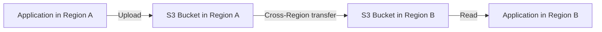
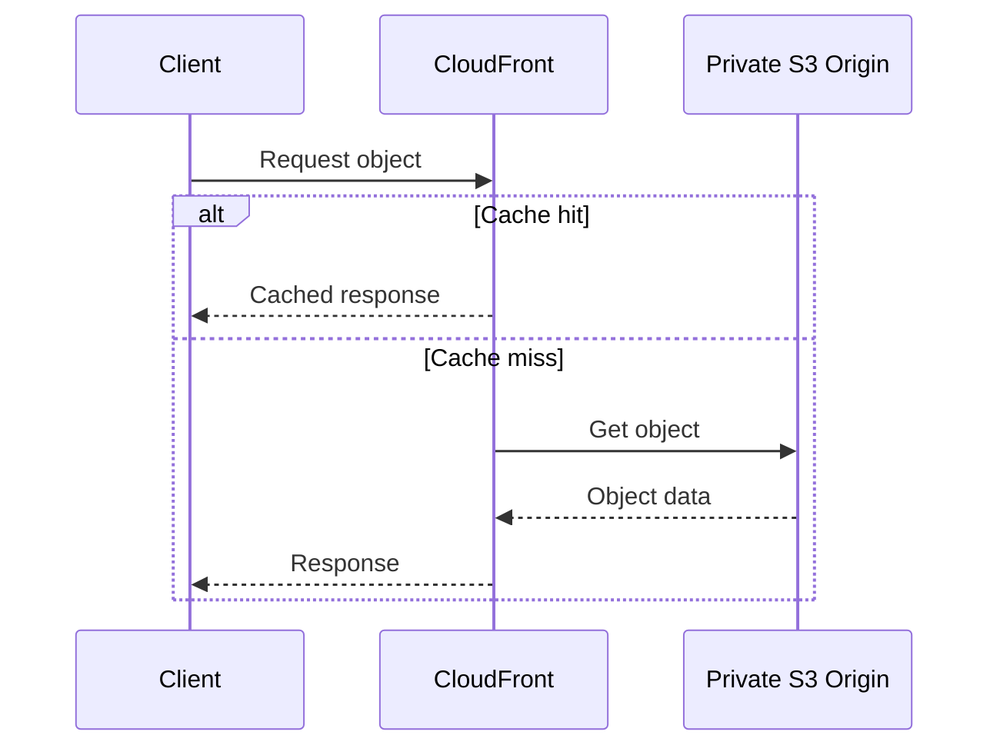
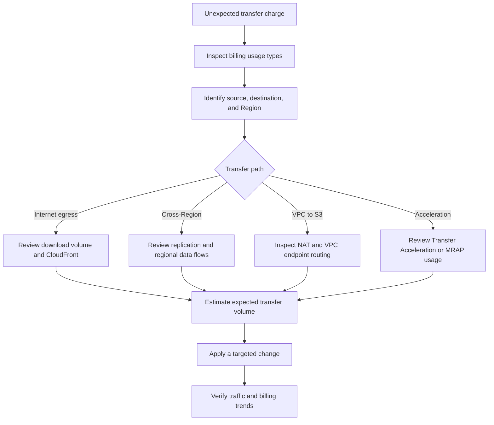

# 04- Data Transfer Costs

## Overview

Amazon S3 data-transfer costs depend on where data originates, where it is delivered, how it moves between AWS Regions, and whether specialized routing or acceleration features are enabled.

For backend applications, downloading files to users, copying objects across Regions, replicating data, and routing traffic through network infrastructure can contribute to the overall cost of an S3-based system.

Data-transfer charges are separate from storage, request, retrieval, and related-service charges. A workload can incur data-transfer costs even when the underlying object remains unchanged.

This document covers:

- Inbound and outbound data transfer.
- Same-Region and cross-Region traffic.
- Internet downloads and CloudFront delivery.
- VPC endpoints and network-path costs.
- Transfer Acceleration and Multi-Region Access Points.
- Replication-related data transfer.
- Cost estimation, monitoring, and troubleshooting.

AWS pricing varies by Region, destination, usage tier, and feature. Validate current rates using the [Amazon S3 pricing page](https://aws.amazon.com/s3/pricing/) and the [AWS Pricing Calculator](https://calculator.aws/).

## Understanding S3 Data-Transfer Pricing

Data-transfer costs are determined primarily by the direction of traffic and the network destination.

| Transfer scenario | General pricing treatment | Additional considerations |
|---|---|---|
| Internet to S3 | Standard inbound data transfer is free | PUT requests, storage, and applicable processing charges still apply |
| S3 to the internet | Applicable outbound transfer charges | The first 100 GB per month of internet data transfer out is currently free in aggregate across AWS services and Regions, excluding AWS China and GovCloud Regions |
| S3 bucket to another bucket in the same Region | Data transfer is generally free | Copy requests, destination storage, and applicable feature charges remain |
| S3 to another AWS service in the same Region | Data transfer is generally free | Request charges and charges from the destination service may apply |
| S3 to an AWS service in another Region | Applicable cross-Region transfer charges | Compute placement and the specific transfer path affect the cost |
| S3 to CloudFront | S3 data transfer out to CloudFront is free | CloudFront delivery and request charges still apply |
| S3 Cross-Region Replication | Applicable cross-Region transfer charges | Replication requests, destination storage, and optional replication features also contribute |
| S3 Transfer Acceleration | Additional acceleration charges can apply | These charges are in addition to standard data-transfer pricing |
| S3 Multi-Region Access Points | Routing and potentially internet-acceleration charges apply | Standard S3 transfer, request, storage, and replication costs can also apply |

These are general pricing rules rather than a complete pricing schedule. Directory buckets, specialized S3 features, AWS Regions, and particular network architectures can have different billing characteristics.

Reference: [Amazon S3 pricing](https://aws.amazon.com/s3/pricing/).

## Data Transfer Into Amazon S3

Standard data transfer from the public internet into S3 is generally free.

This makes S3 suitable for ingestion workloads such as:

- User document uploads.
- Image and video ingestion.
- Application backups.
- Data lake ingestion.
- ETL output uploads.
- Software artifact storage.

However, free inbound data transfer does not mean that uploads are cost-free.

An ingestion workflow can still incur:

- PUT or POST request charges.
- Multipart upload request charges.
- Storage charges.
- Applicable encryption-related charges, such as AWS KMS requests.
- Processing costs from Lambda or other services.
- Additional charges if Transfer Acceleration or other specialized features are used.

### Example: user uploads

Consider a document-management service that accepts 100 GB of user uploads each day.

The standard inbound internet data-transfer component is generally free. However, the application still needs to account for object storage, upload requests, multipart upload operations, encryption, and any downstream processing.

For capacity planning, measure both uploaded bytes and uploaded object count. Two workloads uploading the same volume can have different request and processing costs if their object sizes differ significantly.

## Data Transfer Out to the Internet

Downloading objects from S3 to internet clients is a common source of data-transfer charges.

Examples include:

- Users downloading documents.
- Mobile applications retrieving images.
- APIs returning files.
- Software downloads.
- Public datasets.
- Media delivery.
- Backup recovery to external infrastructure.

### The first 100 GB allowance

The current S3 pricing page identifies the first 100 GB per month of internet data transfer out as free, aggregated across AWS services and Regions, except AWS China and GovCloud Regions.

This is an aggregate AWS allowance, not an independent 100 GB allowance for every S3 bucket or application.

Do not assume the allowance is entirely available to one S3 workload. Other AWS services and applications can consume it.

### Estimate internet egress

For a workload whose monthly outbound volume is \(D\), a simplified estimate of the potentially chargeable amount is:

\[
D_{\text{chargeable}} =
\max(0, D - D_{\text{applicable allowance}})
\]

The actual bill depends on the applicable pricing tiers, Regions, usage aggregation, and any eligible discounts or credits.

The transfer charge is then estimated using the applicable rate schedule:

\[
C_{\text{egress}} =
\sum_{i=1}^{n}
D_i \times R_i
\]

Where:

- \(D_i\) is the billable data volume in a particular pricing tier.
- \(R_i\) is the corresponding rate per billing unit.

For example, assume a service downloads 2 TB of data to internet clients in one month. First determine the applicable free allowance and aggregate usage, then calculate the remaining chargeable volume using the relevant Region's outbound-transfer pricing tiers.

Do not multiply the total volume by a single arbitrary rate when multiple pricing tiers apply.

### Account for interrupted downloads

The quantity billed for outbound data may differ from the amount the client ultimately consumes.

If a client requests a large object and closes the connection early, S3 may continue streaming briefly before stopping the transfer.

For example, a client might request a 10 GB object and terminate the connection after receiving 2 GB. AWS documents that more than 2 GB can be billable because streaming does not stop instantaneously.

For large-download APIs, consider whether clients need full-object downloads or only specific portions of an object.

Use HTTP range requests or the corresponding S3 `Range` option when partial retrieval is sufficient, and avoid repeatedly restarting large downloads from the beginning.

## Same-Region Data Transfer

Data transferred between S3 buckets in the same AWS Region is generally not subject to standard data-transfer charges.

Likewise, data transferred from S3 to eligible AWS services in the same Region is generally free of standard S3 data-transfer charges.

This is useful for architectures in which application compute and object storage operate close to each other.

Examples include:

- EC2 workers reading S3 objects in their own Region.
- Lambda functions processing objects stored in the same Region.
- ECS or EKS workloads accessing regional S3 buckets.
- Data-processing services consuming regional S3 datasets.
- Copying objects between buckets in the same Region.

However, free standard data transfer does not eliminate all associated costs.

The workload can still incur:

- S3 request charges.
- Storage charges.
- KMS charges.
- Compute and processing charges.
- NAT gateway data-processing charges if traffic is routed through a NAT gateway.
- Interface VPC endpoint charges if the architecture uses a chargeable interface endpoint.

### Network path matters

The network path can introduce charges even when the underlying S3 transfer is not charged.

For example, an EC2 instance in a private subnet may access S3 through a NAT gateway. The standard same-Region S3 data-transfer component can be free, but the NAT gateway can incur data-processing and hourly charges.

For eligible same-Region S3 access from a VPC, a gateway VPC endpoint can avoid sending the traffic through a NAT gateway. S3 gateway endpoints have no additional endpoint charge.

Reference: [Gateway endpoints for Amazon S3](https://docs.aws.amazon.com/vpc/latest/privatelink/vpc-endpoints-s3.html).

## Cross-Region Data Transfer

Cross-Region data transfer occurs when data moves between AWS Regions.

Examples include:

- Copying objects from `ap-south-1` to `ap-southeast-1`.
- Sending application data from compute in one Region to an S3 bucket in another.
- Replicating objects between Regions.
- Moving backup data to a disaster-recovery Region.
- Accessing data through a Multi-Region Access Point that routes traffic to a bucket outside the application's Region.

Cross-Region transfer can introduce charges that do not exist for equivalent same-Region workflows.

### Identify every network leg

For an architecture involving multiple Regions, analyze each transfer separately.

Potential charges include:

- Transfer out of the source Region.
- Replication request charges.
- Destination storage.
- GET requests made by the destination application.
- Transfer from the destination application to another location, if applicable.

The same data can incur multiple transfer-related costs as it moves through different parts of a distributed architecture.

### Cross-Region design guidance

Before moving data across Regions, establish:

- Whether the consumer can be deployed in the source Region.
- Whether the destination needs a separate retained copy.
- Whether replication is asynchronous or part of a synchronous application flow.
- Whether data residency requirements constrain Region selection.
- Whether the latency improvement justifies transfer and storage costs.
- Which account owns each resource and bears its associated charges.

Do not move data across Regions simply to reduce latency without evaluating the additional networking and replication costs.

## CloudFront and S3 Data Transfer

CloudFront is useful when an application serves cacheable content to clients distributed across different geographic locations.

CloudFront retrieves objects from an origin, caches eligible responses at edge locations, and serves later requests from those caches.

When using an AWS origin such as S3, transfer from the origin to CloudFront is free. CloudFront still charges for applicable viewer data transfer and HTTP or HTTPS requests.

### Request flow

### Why CloudFront can reduce cost

Suppose an image is downloaded repeatedly by many users.

Without a CDN, each direct download can generate a request to S3, and outbound internet transfer is charged according to S3's pricing rules.

With CloudFront, cache hits are served from the CDN instead of requiring a new S3 origin fetch. S3-to-CloudFront origin transfer is free, and origin request volume can decrease.

The resulting architecture has multiple cost components:

- CloudFront viewer data transfer.
- CloudFront viewer requests.
- S3 origin GET requests on cache misses.
- S3 storage.
- Applicable invalidation and other feature charges.

CloudFront is not automatically cheaper for every workload. It is most useful when caching is effective, delivery volume is substantial, or performance benefits justify its cost.

### Evaluate the cache hit ratio

A high cache hit ratio generally reduces origin requests.

The cache hit ratio can be expressed as:

\[
H =
\frac{N_{\text{cache hits}}}
{N_{\text{cache hits}} + N_{\text{cache misses}}}
\times 100
\]

A workload with a low hit ratio may continue to generate substantial origin traffic because content changes frequently or cache policies are too restrictive.

Evaluate:

- Cache-control headers.
- Time-to-live settings.
- Cache keys.
- Query-string and header forwarding.
- Invalidation frequency.
- Whether content is immutable or frequently overwritten.

### Security considerations

For private content, use an appropriate CloudFront access configuration such as Origin Access Control (OAC) with a private S3 bucket origin.

Do not make an S3 bucket public solely to avoid a perceived origin-access problem.

Use authenticated application flows or signed CloudFront URLs or cookies where appropriate for restricted content.

References:

- [CloudFront pricing and origin data transfer](https://docs.aws.amazon.com/AmazonCloudFront/latest/DeveloperGuide/Introduction.html)
- [Using an S3 bucket as a CloudFront origin](https://docs.aws.amazon.com/AmazonCloudFront/latest/DeveloperGuide/DownloadDistS3AndCustomOrigins.html)

## S3 Transfer Acceleration

S3 Transfer Acceleration improves long-distance transfers between clients and a general-purpose S3 bucket by routing traffic through AWS edge locations and the AWS network.

It is useful when clients are geographically distant from the destination bucket and regular internet routing produces poor throughput or high variability.

Example workloads include:

- Global user uploads.
- Large media ingestion.
- Distributed research datasets.
- Large client-to-S3 transfers from remote regions.

### How it works

The application uses the acceleration endpoint when Transfer Acceleration is enabled and supported by the client and bucket configuration.

### Pricing considerations

Transfer Acceleration adds acceleration charges to the applicable transfer pricing.

The current S3 pricing page lists the following Transfer Acceleration rates for the stated usage categories:

| Transfer category | Currently listed acceleration rate |
|---|---:|
| Internet to S3 through US, European, or Japanese edge locations | $0.04 per GB |
| Internet to S3 through other AWS edge locations | $0.08 per GB |
| S3 to internet through an AWS edge location | $0.04 per GB |
| S3 transfer involving another AWS Region through an AWS edge location | $0.04 per GB |

These are acceleration rates, not a replacement for every applicable standard transfer charge. The pricing schedule, Region, destination, and usage volume determine the final bill. Confirm the latest rates on the official [Amazon S3 pricing page](https://aws.amazon.com/s3/pricing/).

AWS evaluates whether Transfer Acceleration is likely to improve upload performance. If it is not expected to be faster than a standard transfer for that upload, AWS may bypass acceleration and does not charge for acceleration for that transfer.

### When to use Transfer Acceleration

Enable acceleration only when measured performance justifies the added cost.

Test representative upload sizes and client locations using the [S3 Transfer Acceleration speed comparison tool](https://s3-accelerate-speedtest.s3-accelerate.amazonaws.com/).

Compare:

- End-to-end transfer duration.
- Throughput.
- Failure and retry rates.
- Geographic distribution of clients.
- Additional acceleration cost.
- Effects on application timeouts and user experience.

Do not enable Transfer Acceleration merely because an application has users in multiple Regions. For small files or clients close to the bucket, the benefit may be limited.

Reference: [Configuring S3 Transfer Acceleration](https://docs.aws.amazon.com/AmazonS3/latest/userguide/transfer-acceleration.html).

## S3 Multi-Region Access Points

S3 Multi-Region Access Points provide a global endpoint for accessing buckets in multiple AWS Regions.

S3 can route requests to a bucket based on proximity and routing status. Applications can use this model to simplify regional data access and improve resilience.

However, Multi-Region Access Points do not eliminate transfer charges.

### Cost components

A workload using Multi-Region Access Points can incur:

- Data-routing charges.
- Internet-acceleration charges when applicable.
- Standard S3 data-transfer charges.
- S3 request charges.
- Storage in underlying buckets.
- Replication charges where replication is configured.

The S3 pricing page currently lists a data-routing charge of **$0.0033 per GB** for Multi-Region Access Points. Internet-acceleration pricing varies according to the applicable source and destination locations, and standard transfer charges can apply in addition.

Verify the current pricing before using these rates in a production estimate.

### Replication and data consistency

A Multi-Region Access Point routes requests to a selected bucket; it does not inspect every bucket's contents before routing a request.

If the selected bucket does not contain the requested object, a GET request can return `404 Not Found`.

For consistent access to replicated datasets, configure and monitor an appropriate Cross-Region Replication strategy. Include the additional transfer and destination-storage costs in the architecture's cost model.

Multi-Region Access Points are useful when their latency, routing, and resilience benefits justify the extra cost and operational complexity.

References:

- [Multi-Region Access Point pricing](https://aws.amazon.com/s3/pricing/)
- [Multi-Region Access Point request routing](https://docs.aws.amazon.com/AmazonS3/latest/userguide/MultiRegionAccessPointRequestRouting.html)
- [Configuring replication for Multi-Region Access Points](https://docs.aws.amazon.com/AmazonS3/latest/userguide/MultiRegionAccessPointBucketReplication.html)

## Data Transfer in Replication and Backup Architectures

S3 replication can copy objects to destination buckets within the same Region or in another Region.

Same-Region Replication generally avoids standard cross-Region transfer charges. Cross-Region Replication can incur data-transfer-out charges from the source Region to each destination Region.

For a cross-Region replication workload, include:

- Source data ingestion.
- Transfer from the source to each destination.
- Replication requests.
- Destination storage.
- Additional copies or versions retained by the destination.
- Optional replication monitoring and Replication Time Control charges.

### Example: multi-Region backup

Consider an application that stores 2 TB of data in a primary Region and maintains a replica in a recovery Region.

The source and destination each retain their own copy. Cross-Region transfer charges can apply as data is replicated, and the destination consumes additional storage.

If the application rewrites large objects repeatedly, each eligible replication operation can contribute additional transfer usage.

For this reason, measure the volume of **changed data replicated**, not only the total dataset size.

### Recovery traffic also has a cost

During a disaster-recovery event, restoring data from the secondary Region can cause additional traffic:

- Reads from the recovery bucket.
- Data transfer from the recovery Region to the recovery environment.
- Internet egress if data must be sent outside AWS.
- Additional processing and storage required during recovery.

A disaster-recovery cost estimate should include normal replication and storage costs as well as a recovery scenario with realistic data volumes.

Reference: [Amazon S3 replication](https://docs.aws.amazon.com/AmazonS3/latest/userguide/replication.html).

## Estimate Data-Transfer Costs

A reliable estimate starts with traffic volume and the actual network path.

### Define workload assumptions

Record the following for each transfer path:

| Input | Example |
|---|---|
| Source | S3 bucket in `ap-south-1` |
| Destination | Internet clients |
| Monthly transfer volume | 2 TB |
| Access pattern | Repeated downloads of reports and media |
| Delivery method | Direct S3 or CloudFront |
| Cache behavior | Measured cache hit ratio, if using CloudFront |
| Transfer acceleration | Enabled only if justified |
| Replication | Destination bucket in a second Region |
| Additional components | NAT gateway, VPC endpoints, KMS, or processing services where applicable |

These are example assumptions, not actual billing measurements.

### Calculate direct S3 internet egress

Estimate the monthly data sent to internet clients and apply the relevant S3 outbound-transfer pricing tiers.

Account for the applicable free allowance, other AWS service usage, and any regional or usage-specific rules.

### Calculate CloudFront delivery

Estimate CloudFront viewer data transfer and request charges separately from S3 origin request volume.

Use the expected cache hit ratio and content behavior to estimate how many origin fetches occur.

Data transfer from an S3 origin to CloudFront is free, but CloudFront viewer delivery is not universally free.

### Calculate cross-Region traffic

Estimate the actual volume moving between Regions, including replication and cross-Region application access.

Identify whether the architecture requires full replication, incremental replication, or occasional transfers. Consider the cost of destination storage and any downstream reads.

### Calculate specialized-feature charges

Add applicable charges for Transfer Acceleration, Multi-Region Access Points, interface endpoints, NAT gateways, and other infrastructure.

Do not combine these costs into a single assumed S3 data-transfer rate.

### Validate the estimate

Use the [AWS Pricing Calculator](https://calculator.aws/) with the correct Regions, transfer volumes, and selected features.

Then compare the estimate against actual AWS billing data after deployment.

## Monitoring Data-Transfer Costs

Use AWS billing reports and operational metrics together to identify unexpected traffic.

### Billing and Cost Explorer

Inspect Amazon S3 data-transfer usage and any related feature charges using AWS Billing and Cost Management.

Investigate:

- Increased internet data transfer out.
- Unexpected cross-Region transfer.
- Replication-related usage.
- Transfer Acceleration costs.
- Multi-Region Access Point routing and acceleration.
- NAT gateway data-processing charges.
- CloudFront request and delivery costs.

AWS Cost Explorer provides a useful high-level view. AWS Cost and Usage Reports or AWS Data Exports can provide more granular usage details where needed.

### CloudWatch

S3 request metrics and byte metrics can help identify application traffic changes.

Relevant metrics include:

- `BytesDownloaded`
- `BytesUploaded`
- `GetRequests`
- `PutRequests`
- `AllRequests`

Use request metrics to correlate transfers with application throughput and workload changes.

S3's standard storage metrics do not replace billing data. CloudFront, VPC, and related-service costs may require their own service metrics and billing dimensions.

### Set actionable alerts

Consider alerts for:

- Unexpected outbound transfer spikes.
- Higher-than-expected replication volume.
- Significant changes in CloudFront origin requests.
- Unusual NAT gateway data processing.
- Transfer Acceleration usage outside the expected workload.
- Material cost anomalies in S3-related usage types.

Budgets and anomaly alerts help detect problems but do not automatically stop traffic. Define an operational response for each alert.

References:

- [S3 CloudWatch metrics and dimensions](https://docs.aws.amazon.com/AmazonS3/latest/userguide/metrics-dimensions.html)
- [AWS Billing and Cost Management](https://docs.aws.amazon.com/cost-management/latest/userguide/what-is-costmanagement.html)

## Troubleshooting Unexpected Data-Transfer Charges

Follow an evidence-driven workflow before changing the architecture.

### Unexpected internet egress

Check whether an application is serving files directly from S3 when CloudFront caching would be suitable.

Review application logs, delivery volume, content cacheability, and the distribution of downloads.

Determine whether the volume is legitimate user traffic or a repeated-download issue before introducing caching.

### Unexpected cross-Region usage

Inspect replication rules, application configuration, regional compute placement, and cross-Region data access.

Confirm whether the transfer is expected replication, an application reading from a remote Region, or a workload that was accidentally deployed in the wrong Region.

### Unexpected NAT gateway costs

Verify that private-subnet workloads accessing same-Region S3 use the intended route.

For supported VPC architectures, consider an S3 gateway endpoint so traffic does not need to pass through a NAT gateway.

Validate routing and access policies carefully. A gateway endpoint does not automatically make the bucket public or bypass authorization.

### Unexpected acceleration charges

Check whether Transfer Acceleration or Multi-Region Access Points are enabled for the affected workload.

Compare the actual performance and cost against standard S3 requests. Disable optional acceleration only after validating the operational impact.

### Verify the correction

Compare equivalent billing periods and transfer volumes before and after the change.

Correlate billing usage with CloudWatch metrics, application logs, and service-specific cost information. Allow for reporting delays and normal workload variation.

## Production Cost-Optimization Checklist

- [ ] Internet downloads are measured and included in the monthly forecast.
- [ ] The aggregate AWS internet data-transfer allowance is not counted separately for each bucket.
- [ ] Same-Region application and S3 traffic follows an appropriate network path.
- [ ] Private-subnet access to S3 is evaluated for a gateway endpoint where suitable.
- [ ] NAT gateway data-processing costs are included when applicable.
- [ ] CloudFront is evaluated for frequently accessed, cacheable content.
- [ ] CloudFront delivery charges are distinguished from free S3-to-CloudFront origin transfer.
- [ ] Cross-Region replication and destination-region traffic are included in the cost model.
- [ ] Disaster-recovery transfer and restoration costs are estimated.
- [ ] Transfer Acceleration is enabled only when measured performance justifies the added cost.
- [ ] Multi-Region Access Point routing and internet-acceleration charges are understood.
- [ ] AWS Billing, Cost Explorer, and relevant service metrics are used to diagnose increases.
- [ ] Cost alerts are connected to clear investigation and remediation procedures.
- [ ] Network-path optimizations preserve required security, reliability, and data-residency controls.

## Official References

- [Amazon S3 pricing](https://aws.amazon.com/s3/pricing/)
- [AWS Pricing Calculator](https://calculator.aws/)
- [Configuring S3 Transfer Acceleration](https://docs.aws.amazon.com/AmazonS3/latest/userguide/transfer-acceleration.html)
- [Multi-Region Access Point request routing](https://docs.aws.amazon.com/AmazonS3/latest/userguide/MultiRegionAccessPointRequestRouting.html)
- [S3 replication](https://docs.aws.amazon.com/AmazonS3/latest/userguide/replication.html)
- [Gateway endpoints for Amazon S3](https://docs.aws.amazon.com/vpc/latest/privatelink/vpc-endpoints-s3.html)
- [NAT gateway pricing](https://docs.aws.amazon.com/vpc/latest/userguide/nat-gateway-pricing.html)
- [CloudFront introduction and pricing](https://docs.aws.amazon.com/AmazonCloudFront/latest/DeveloperGuide/Introduction.html)
- [S3 CloudWatch metrics](https://docs.aws.amazon.com/AmazonS3/latest/userguide/metrics-dimensions.html)
- [AWS Cost Explorer](https://docs.aws.amazon.com/cost-management/latest/userguide/what-is-costmanagement.html)

## Key Takeaways

- S3 data-transfer costs depend on traffic direction, destination, Region, and specialized routing or acceleration features.
- Standard inbound internet transfer and eligible same-Region transfers are generally free, but requests, storage, network infrastructure, and related services can still incur charges.
- CloudFront can reduce S3 origin requests and improve delivery, but its viewer-transfer and request costs must be included in the overall estimate.
- Cross-Region replication, Transfer Acceleration, and Multi-Region Access Points can introduce additional costs that must be justified by resilience, performance, or business requirements.
- Use billing reports, service metrics, and actual workload measurements to identify data-transfer costs and verify that optimizations preserve security and reliability.