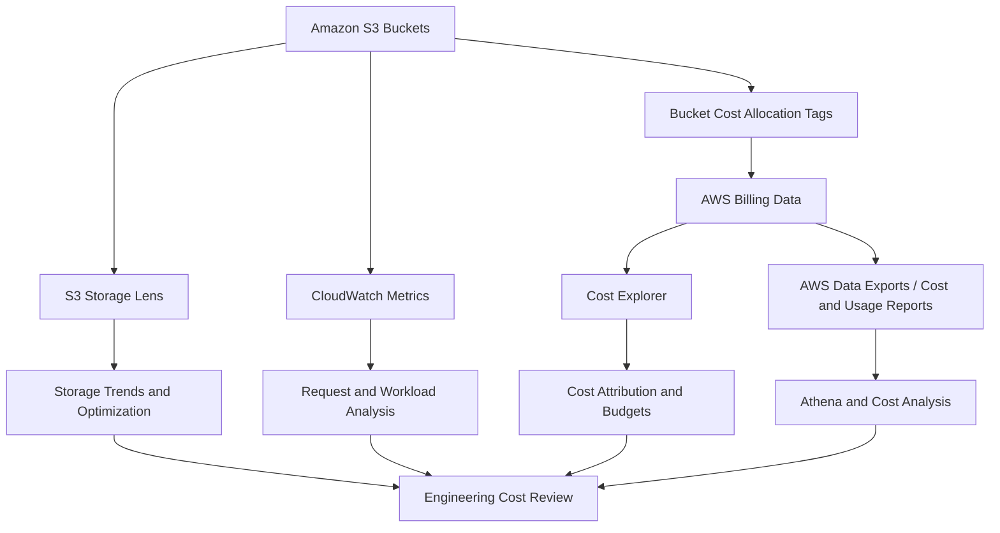
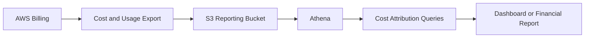

# 05- Cost Allocation and Visibility

## Overview

Amazon S3 cost allocation and visibility help engineering and finance teams understand which applications, projects, environments, and business units generate storage and usage costs.

Without a consistent cost attribution strategy, an organization may know its total S3 bill but struggle to determine whether the increase came from production uploads, historical object versions, data replication, analytics pipelines, or a development workload.

Production cost management requires three complementary capabilities:

- **Cost allocation:** Attribute eligible resource costs to owners, applications, projects, or cost centers.
- **Cost visibility:** Understand how storage, requests, data transfer, and related features contribute to spending.
- **Cost accountability:** Establish ownership, budgets, alerts, and review procedures that lead to corrective action.

AWS provides resource tags, AWS Cost Explorer, AWS Data Exports and Cost and Usage Reports, Amazon S3 Storage Lens, CloudWatch, and other capabilities to support these objectives.

An important limitation is that **S3 bucket cost allocation tags classify bucket-level costs; they do not automatically provide exact billing attribution for individual objects, prefixes, or API calls inside a shared bucket**. Use the appropriate combination of billing reports, workload telemetry, and storage analytics to investigate costs at the required level.

## Cost Visibility Architecture

A production cost-management workflow combines billing data with S3 usage analytics and application-level telemetry.



Each component provides a different perspective.

| Component | Primary purpose | Typical use |
|---|---|---|
| S3 bucket tags | Classify eligible resource costs | Assign buckets to applications, environments, or cost centers |
| AWS Cost Explorer | Explore and group cost and usage data | Identify spending trends and major cost contributors |
| AWS Data Exports / Cost and Usage Reports | Provide detailed billing and usage records | Build cost reports, investigate usage types, and perform deeper analysis |
| Amazon S3 Storage Lens | Analyze storage usage and activity | Identify growing buckets, historical versions, and storage optimization opportunities |
| Amazon CloudWatch | Monitor operational metrics | Correlate request activity and data-transfer patterns with cost changes |
| AWS Budgets | Set spending thresholds and alerts | Detect budget overruns and unusual spending patterns |
| Amazon Athena | Query suitable billing or storage-analysis datasets | Perform detailed analysis using SQL |
| AWS Cost Anomaly Detection | Identify unusual spending patterns | Investigate unexpected changes in AWS expenditure |

## S3 Cost Allocation Tags

AWS cost allocation tags are key-value pairs used to classify resource costs for reporting.

For example, a bucket belonging to a document-management application could have the following tags:

```text
Application = document-service
Environment = production
Team = platform
CostCenter = engineering
DataClassification = confidential
```

The values are examples. Define a standard tagging vocabulary that aligns with the organization's ownership and financial reporting requirements.

### Why bucket tags matter

Bucket tags allow eligible S3 costs to be associated with business or operational dimensions in AWS billing reports.

A consistent tagging strategy helps answer questions such as:

- How much does the production document service cost?
- Which engineering cost center owns a particular bucket?
- How much S3 usage belongs to development and testing?
- Which applications are responsible for storage growth?
- Which projects need to review their retention policies?

Tags do not change the underlying storage rate or automatically reduce the bill. Their purpose is to improve classification and accountability.

### Important constraints

For general-purpose S3 buckets:

- A bucket can have up to 50 tags.
- Tag keys are case-sensitive.
- Tag values are also case-sensitive.
- A key must be unique within a bucket's tag set.
- Adding a tag with an existing key replaces its value.
- Resource tags and cost allocation tags are not identical concepts.
- Applying a bucket tag does not automatically tag its objects.
- Cost allocation tag keys must be activated in AWS Billing and Cost Management before they appear in the relevant billing reports.

S3 also supports tags for other purposes, including attribute-based access control (ABAC). Do not assume that a tag used for authorization is automatically activated for billing.

Reference: [Using cost allocation S3 bucket tags](https://docs.aws.amazon.com/AmazonS3/latest/userguide/CostAllocTagging.html).

## Design a Consistent Tagging Strategy

Tagging becomes difficult to maintain when different teams use incompatible keys, spelling, capitalization, or values.

For example, these keys represent different tags:

```text
Application
application
app
ApplicationName
```

A reporting workflow cannot reliably group these under the same dimension without additional normalization.

### Recommended tag schema

| Tag key | Example value | Purpose |
|---|---|---|
| `Application` | `document-service` | Identifies the owning application |
| `Environment` | `production` | Separates production, staging, development, and test |
| `Team` | `platform` | Identifies the responsible engineering team |
| `CostCenter` | `engineering` | Supports financial allocation |
| `BusinessUnit` | `operations` | Maps resources to organizational units |
| `ManagedBy` | `terraform` | Identifies the provisioning mechanism |
| `DataClassification` | `confidential` | Records a data classification where appropriate |

Use a minimal mandatory schema rather than adding tags indiscriminately.

The required tag set should reflect the organization's reporting model. For example, `Application`, `Environment`, and `CostCenter` may be mandatory for managed production buckets, while `BusinessUnit` may be optional.

Do not place passwords, access tokens, customer identifiers, personal data, or other sensitive values in resource tags. Tags are metadata, not a secret-storage mechanism.

### Environment separation

When workloads have materially different security, retention, or cost requirements, separate buckets can improve operational isolation and cost attribution.

For example:

```text
document-service-dev
document-service-staging
document-service-prod
```

These names are illustrative and must follow S3 naming constraints.

Separate buckets allow different resource tags and make it easier to apply environment-specific lifecycle, access, and operational policies.

However, bucket separation should follow architecture and isolation requirements rather than cost allocation alone.

### Shared-bucket limitation

Suppose one bucket contains objects for five different applications:

```text
shared-storage/
    application-a/
    application-b/
    application-c/
    application-d/
    application-e/
```

A bucket-level `Application` tag can identify only the bucket's classification at a time. It cannot independently represent the five applications' exact storage consumption through bucket cost allocation tags.

When multiple applications share one bucket, consider:

- S3 Inventory for object-level metadata and storage analysis.
- S3 Storage Lens prefix aggregation or appropriate Storage Lens groups.
- Application-level upload, download, and ownership telemetry.
- A database mapping object keys to tenants or applications.
- Separate buckets when independent cost attribution and isolation justify the additional resources.

Do not infer exact per-application charges by dividing a shared bucket's bill equally among its prefixes.

## Apply Tags Using the AWS CLI

The following example applies tags to a general-purpose bucket.

### Create the tag configuration

Create a local file named `bucket-tags.json`:

```json
{
  "TagSet": [
    {
      "Key": "Application",
      "Value": "document-service"
    },
    {
      "Key": "Environment",
      "Value": "production"
    },
    {
      "Key": "Team",
      "Value": "platform"
    },
    {
      "Key": "CostCenter",
      "Value": "engineering"
    }
  ]
}
```

Apply the tag set:

```bash
aws s3api put-bucket-tagging \
  --bucket example-prod-documents \
  --tagging file://bucket-tags.json \
  --region ap-south-1
```

This operation replaces the bucket's existing tag set. Include all tags that must remain assigned to the bucket.

For buckets using S3 ABAC, use the supported resource-tagging APIs as required by the current bucket configuration. Validate the authorization model before changing tag-management workflows.

### Verify the tags

```bash
aws s3api get-bucket-tagging \
  --bucket example-prod-documents \
  --region ap-south-1
```

Expected output includes the configured keys and values.

The successful API response confirms the bucket tags. It does not prove that the corresponding cost allocation tag keys have been activated or that they have appeared in billing reports.

### Operational precautions

- Check existing tags before replacing the tag set.
- Prefer infrastructure-as-code for tags on managed buckets.
- Apply the same vocabulary across environments.
- Verify permissions before automating tag updates.
- Avoid exposing confidential business information through tag values.
- Do not assume that tagging a bucket retroactively creates per-object or per-prefix billing records.

Official reference: [AWS CLI put-bucket-tagging](https://docs.aws.amazon.com/cli/latest/reference/s3api/put-bucket-tagging.html).

## Activate Cost Allocation Tags

Creating resource tags is not sufficient for cost reporting. User-defined cost allocation tag keys must be activated in AWS Billing and Cost Management.

### Activation workflow

1. Apply the agreed tag schema to the relevant S3 buckets.
2. Open the AWS Billing and Cost Management console.
3. Navigate to **Cost allocation tags**.
4. Locate the user-defined tag keys that need to appear in cost reports.
5. Activate the required keys.
6. Allow time for tags to become available and for billing data to update.
7. Verify the resulting dimensions in Cost Explorer or the applicable cost and usage export.

AWS documents that tag keys can take up to 24 hours after creation and application to appear on the cost allocation tags page for activation. Cost and usage reporting has its own processing and update intervals.

Tag activation is a billing-configuration step, not a substitute for applying tags to the appropriate resources.

Reference: [Activating user-defined cost allocation tags](https://docs.aws.amazon.com/us_en/awsaccountbilling/latest/aboutv2/activating-tags.html).

## AWS Cost Explorer for S3

AWS Cost Explorer provides interactive analysis of AWS spending and usage.

For S3, it helps investigate which periods, Regions, usage categories, and activated tag values contribute to reported costs.

### Useful analysis dimensions

| Dimension | Question it helps answer |
|---|---|
| Service | How much does Amazon S3 contribute to overall AWS spending? |
| Region | Which Regions have the highest reported S3 costs? |
| Usage type | Are costs concentrated in storage, requests, data transfer, or other usage categories? |
| Linked account | Which AWS account incurs the cost in a multi-account organization? |
| Cost allocation tag | Which tagged applications, environments, or cost centers are associated with eligible costs? |
| Time period | When did the increase begin? |
| Charge type | Is the change related to usage, discounts, credits, or another billing component? |

Available dimensions depend on the report, account configuration, and billing data.

### Recommended investigation sequence

When S3 costs increase unexpectedly:

1. Select Amazon S3 as the service.
2. Compare the affected period with a previous equivalent period.
3. Group costs by usage type and Region.
4. Filter or group by activated cost allocation tags where available.
5. Identify the largest change in spending.
6. Investigate the corresponding bucket or workload using storage analytics and application telemetry.
7. Verify whether the change was expected and implement corrective action if necessary.

Use both absolute cost and percentage change. A large percentage increase on a tiny baseline may be less urgent than a smaller increase in an expensive production workload.

### Cost metric selection

Distinguish between unblended, amortized, and other cost views when evaluating spending.

For example, a cost report based on unblended cost is not necessarily equivalent to an amortized view of commitments and discounts. Select the cost metric that matches the financial question being asked.

Do not compare reports using different cost metrics without accounting for the difference.

Official reference: [AWS Cost Explorer](https://docs.aws.amazon.com/cost-management/latest/userguide/ce-what-is.html).

## Query Cost Explorer Through the AWS CLI

The Cost Explorer API supports programmatic retrieval of cost and usage data.

The following command retrieves monthly unblended S3 costs for a completed reporting period.

```bash
aws ce get-cost-and-usage \
  --time-period Start=2026-09-01,End=2026-10-01 \
  --granularity MONTHLY \
  --metrics UnblendedCost \
  --filter '{
    "Dimensions": {
      "Key": "SERVICE",
      "Values": [
        "Amazon Simple Storage Service"
      ]
    }
  }'
```

The example uses a historical monthly period. The end date is exclusive, so the period covers September 2026.

The response includes cost results and the currency unit. It is a service-level view; it does not automatically attribute every cost to an application.

### Group by an activated cost allocation tag

The following example groups monthly costs by the `Application` cost allocation tag.

```bash
aws ce get-cost-and-usage \
  --time-period Start=2026-09-01,End=2026-10-01 \
  --granularity MONTHLY \
  --metrics UnblendedCost \
  --group-by Type=TAG,Key=user:Application \
  --filter '{
    "Dimensions": {
      "Key": "SERVICE",
      "Values": [
        "Amazon Simple Storage Service"
      ]
    }
  }'
```

The `user:Application` dimension refers to a user-defined cost allocation tag key. The tag must be activated and available in the billing data for meaningful grouping.

### Interpret results carefully

Cost Explorer is a billing-analysis tool, not a real-time S3 object inventory.

A tag-grouped report does not guarantee that every S3 charge will map to a specific application. Untagged or otherwise unattributed costs may remain, and some charges may be represented at a different resource or usage level.

Investigate unallocated costs instead of silently assigning them to a tagged application.

Reference: [AWS CLI get-cost-and-usage](https://docs.aws.amazon.com/cli/latest/reference/ce/get-cost-and-usage.html).

## AWS Data Exports and Cost and Usage Reports

For deeper analysis, use detailed AWS billing exports.

AWS Data Exports and Cost and Usage Reports can provide cost and usage records suitable for processing with Amazon Athena, Amazon Redshift, or other analytics systems.

Depending on the selected export and configuration, the dataset can contain fields relating to:

- Service and usage type.
- Usage quantity and billing unit.
- Linked account.
- Region.
- Cost allocation tags.
- Resource identifiers where supported.
- Discounts, credits, and other billing adjustments.

The detailed billing dataset is useful when the organization needs repeatable reporting or more granular investigation than the Cost Explorer console provides.

### Example architecture



The reporting bucket has its own storage, query, and management considerations. Apply suitable retention and access controls to exported billing data.

### Athena-based cost analysis

Athena can query suitably structured billing exports stored in S3. The exact SQL depends on the export schema and table definition.

A generic example of a report against a prepared table is:

```sql
SELECT
    line_item_usage_account_id AS account_id,
    product_region AS region,
    line_item_usage_type AS usage_type,
    SUM(line_item_unblended_cost) AS unblended_cost
FROM cost_usage_export
WHERE
    product_product_name = 'Amazon Simple Storage Service'
    AND line_item_usage_start_date >= TIMESTAMP '2026-09-01 00:00:00'
    AND line_item_usage_start_date < TIMESTAMP '2026-10-01 00:00:00'
GROUP BY
    line_item_usage_account_id,
    product_region,
    line_item_usage_type
ORDER BY
    unblended_cost DESC;
```

This query assumes a prepared table with the displayed column names and compatible data types. Actual export schemas vary, so adapt the database, table, columns, and date predicates to the dataset.

For production analytics, partition the dataset appropriately and avoid scanning the entire export for each dashboard refresh.

### Billing-data security

Detailed billing exports can reveal application ownership, project activity, account structure, and spending patterns.

Restrict access to the reporting bucket, Glue Data Catalog resources where used, Athena queries, and exported reports according to the organization's financial-data access requirements.

Official references:

- [AWS Cost and Usage Reports](https://aws.amazon.com/aws-cost-management/aws-cost-and-usage-reporting/)
- [AWS Data Exports](https://docs.aws.amazon.com/cur/latest/userguide/what-is-data-exports.html)

## Amazon S3 Storage Lens

S3 Storage Lens provides aggregated storage usage and activity metrics across buckets, accounts, and supported organization-level views.

It is especially useful when the goal is to determine why the amount of stored data is increasing, rather than simply identifying the amount charged in a billing period.

### Questions Storage Lens helps answer

- Which buckets contain the largest amount of data?
- Which buckets are growing fastest?
- Which storage classes account for the current storage distribution?
- Where are noncurrent versions accumulating?
- Which buckets have incomplete multipart uploads?
- Which buckets may benefit from lifecycle configuration?
- Which prefixes contribute substantially to storage usage?

Storage Lens provides free metrics and optional advanced metrics. Advanced capabilities can incur additional charges, so enable them when their extra visibility provides a clear operational benefit.

### Free and advanced metrics

| Capability | Free metrics | Advanced metrics |
|---|---|---|
| Bucket-level storage visibility | Available | Available |
| Storage and object-count trends | Available | Available |
| Additional activity metrics | Limited | Expanded |
| Prefix-level aggregation | Limited or unavailable depending on the feature | Available with applicable configuration |
| Additional metrics retention | Shorter query history | Extended query history |
| CloudWatch publishing | Not included as an advanced feature | Available with supported configuration |
| Additional cost | No charge for free metrics | Additional charges apply |

Current documented query-history availability is 14 days for free metrics and up to 15 months for advanced metrics. Validate feature availability and billing details against the current AWS documentation.

### Recommended use

Use Storage Lens to find unusual storage growth and potential optimization opportunities. Use billing reports to validate the financial impact of that growth.

A bucket containing a large amount of data is not necessarily the most expensive bucket. Storage class, object count, retention, and other charges affect total cost.

References:

- [Understanding S3 Storage Lens](https://docs.aws.amazon.com/AmazonS3/latest/userguide/storage_lens_basics_metrics_recommendations.html)
- [Using S3 Storage Lens to optimize storage costs](https://docs.aws.amazon.com/AmazonS3/latest/userguide/storage-lens-optimize-storage.html)

## Prefix-Level and Object-Level Cost Visibility

Bucket-level cost allocation tags are insufficient when a bucket is shared by several workloads.

To investigate smaller portions of a bucket, combine storage analytics and application metadata with the billing data.

### S3 Inventory

S3 Inventory produces scheduled object-level reports with selected fields such as object key, size, storage class, version information, and last-modified time.

It supports analysis of:

- Object count and size by prefix.
- Historical-version growth.
- Storage-class distribution.
- Old objects that may be candidates for lifecycle review.
- Data retained beyond expected business requirements.

Inventory reports help explain storage usage but do not provide an exact itemized billing record for each object.

### Storage Lens aggregation

Depending on the configured metrics and aggregation features, Storage Lens can provide insights at supported bucket and prefix levels. Storage Lens groups can also classify objects according to supported criteria.

These are analytical views and should not be confused with direct billing attribution for every prefix or object.

### Application-level metadata

For multi-tenant document services, maintain an application-side mapping such as:

```text
tenant_id
application_id
object_key
object_size_bytes
created_at
storage_class
retention_policy
```

This metadata can help estimate storage consumption by tenant or application.

However, calculating `object_size_bytes` totals does not reproduce the exact AWS bill. A billing estimate must also account for storage-class pricing rules, versions, applicable minimum billable sizes, archive overhead, and other relevant factors.

### Choose the appropriate visibility layer

| Requirement | Suitable approach |
|---|---|
| Allocate eligible bucket costs among applications | Bucket cost allocation tags |
| Identify which bucket is responsible for a spending increase | Cost Explorer and billing exports |
| Analyze storage usage by prefix | Storage Lens and S3 Inventory |
| Estimate usage for individual tenants | Application metadata plus inventory or telemetry |
| Investigate request volume | CloudWatch and application-level request telemetry |
| Analyze detailed usage and financial adjustments | AWS billing exports |
| Estimate exact object-level charges | Requires a custom attribution model; standard bucket cost allocation tags do not provide this directly |

## Multi-Account Cost Allocation

Large organizations commonly separate workloads into AWS accounts for environments, business units, and production systems.

AWS Organizations and consolidated billing provide a way to analyze costs across linked accounts under a management or payer account, subject to the organization's billing configuration and permissions.

### Example account model

```text
AWS Organization
    |
    +-- Production Account
    |      +-- Document Service
    |      +-- Media Service
    |
    +-- Development Account
    |      +-- Testing Workloads
    |
    +-- Analytics Account
           +-- Data Lake
           +-- Reporting Exports
```

Separate accounts can improve isolation and simplify account-level reporting. Bucket tags provide additional classification within each account.

### Account-level versus tag-level allocation

| Dimension | Account-level allocation | Tag-level allocation |
|---|---|---|
| Primary purpose | Separate costs between accounts | Classify eligible costs within an account or organization |
| Typical owner | Platform or cloud-finance team | Application or resource owner |
| Main dependency | Organization and billing setup | Consistent resource tags and activation |
| Typical limitation | Several applications may share one account | Untagged resources and unsupported cost dimensions may remain unattributed |

A practical approach is to combine account boundaries with a standardized tag schema.

For example, production and development may use separate accounts, while applications within the production account use `Application` and `CostCenter` tags.

Do not treat account separation as a replacement for resource-level tagging where several workloads share an account.

## Budgets and Cost Anomaly Detection

Cost visibility is more useful when unexpected expenditure produces an actionable alert.

### AWS Budgets

AWS Budgets lets teams establish budget thresholds for cost or usage and configure notifications.

Examples include:

- A monthly S3 budget for a production application.
- A separate budget for nonproduction workloads.
- A budget for an analytics or archive account.
- An alert when actual or forecasted spending approaches an agreed threshold.

Budget filters and grouping capabilities depend on the selected dimensions and available billing data.

Budget notifications do not automatically stop workload activity. An operational procedure must define who investigates the alert and what action is allowed.

### AWS Cost Anomaly Detection

Cost Anomaly Detection uses cost patterns to identify unusual spending.

It is useful for finding unexpected changes that may not be captured by a fixed threshold.

An anomaly might be caused by:

- A sudden increase in data downloads.
- Unexpected replication activity.
- A new batch-processing workload.
- A misconfigured application repeatedly issuing requests.
- A change in retention or storage-class usage.
- A related AWS service generating additional charges.

Cost Anomaly Detection identifies unusual cost behavior; engineers must correlate the alert with usage evidence before changing infrastructure.

### Recommended alert design

| Alert | Suggested response |
|---|---|
| Monthly budget forecast exceeded | Review current usage, business demand, and planned workloads |
| Unusual S3 storage growth | Investigate storage classes, versions, replication, and retention |
| Unexpected request-cost increase | Review request metrics, retries, listing loops, and batch jobs |
| Significant cross-Region transfer increase | Verify replication and regional application traffic |
| Large unallocated-cost increase | Review tagging coverage and unclassified usage categories |

Reference: [AWS Cost Anomaly Detection](https://docs.aws.amazon.com/cost-management/latest/userguide/manage-ad.html).

## Establish a Cost-Allocation Operating Model

Cost allocation must be maintained as part of the engineering lifecycle.

A useful operating model assigns responsibilities across platform engineering, application teams, and finance.

| Responsibility | Typical owner |
|---|---|
| Define mandatory tag keys and allowed values | Cloud platform or FinOps |
| Apply tags through Terraform, CloudFormation, CDK, or provisioning workflows | Infrastructure owners |
| Activate cost allocation tag keys | Billing administrator |
| Investigate usage-type changes | Platform and application teams |
| Establish application budgets | Application owner and finance |
| Review storage growth and lifecycle policies | Service owner |
| Maintain billing exports and dashboards | FinOps or data platform team |
| Approve material retention or replication changes | Data owner and platform team |

### Automate tagging

Prefer defining tags alongside S3 bucket resources in infrastructure-as-code.

For example, a Terraform-managed general-purpose bucket can apply consistent labels:

```hcl
resource "aws_s3_bucket" "documents" {
  bucket = var.bucket_name

  tags = {
    Application       = "document-service"
    Environment       = var.environment
    Team              = "platform"
    CostCenter        = "engineering"
    ManagedBy         = "terraform"
  }
}
```

The value of `var.environment` should be set through environment-specific configuration rather than hardcoded differently throughout the repository.

This fragment configures bucket tags. It does not activate cost allocation tags in the AWS billing system; activation remains a separate billing-administration step.

### Validate tags in CI/CD

A deployment pipeline can enforce mandatory tags before infrastructure changes are applied.

Examples of validation rules include:

- Required `Application`, `Environment`, and `CostCenter` tags.
- Approved values for environments and ownership groups.
- No unexpected capitalization variants.
- No confidential values in tags.
- No production resources without an assigned owner.

Preventing missing tags at provisioning time is more reliable than trying to reconstruct ownership after costs have accumulated.

## Common Mistakes

### Assuming resource tags are immediately available in billing

Tags must be applied and activated for cost allocation. Billing data also requires processing time.

**Prevention:** Include tag activation in the onboarding checklist for new cost dimensions.

### Treating bucket tags as object-level billing attribution

Bucket tags classify the bucket. They do not directly allocate exact costs to individual prefixes, objects, or tenants.

**Prevention:** Use appropriate analytics and application metadata when finer-grained attribution is required.

### Using inconsistent tag names

Differences in spelling and capitalization fragment reporting.

**Prevention:** Maintain a centrally defined tag schema and validate it in infrastructure-as-code pipelines.

### Assuming Storage Lens is a billing report

Storage Lens helps explain storage usage and activity, but its metrics are not a replacement for financial billing records.

**Prevention:** Correlate Storage Lens with Cost Explorer or billing exports.

### Ignoring untagged costs

Some resources or charges may not appear under the expected application tag.

**Prevention:** Track unallocated costs as an explicit category and investigate material changes.

### Using one shared bucket for unrelated workloads without an ownership model

Shared buckets can complicate isolation, lifecycle management, and cost analysis.

**Prevention:** Define clear application ownership and select an appropriate storage layout. Separate buckets where isolation or reporting benefits justify it.

### Creating dashboards without an operational response

A dashboard may show rising costs without identifying who should act.

**Prevention:** Assign owners and response procedures to budgets, anomaly alerts, and recurring cost reviews.

## Production Readiness Checklist

- [ ] General-purpose S3 buckets use a consistent tag schema.
- [ ] Mandatory tag keys and allowed values are documented.
- [ ] User-defined cost allocation tag keys are activated in AWS Billing and Cost Management.
- [ ] Tagging is automated through infrastructure-as-code where possible.
- [ ] Untagged and unallocated costs are monitored.
- [ ] Cost Explorer reports group costs by service, Region, account, usage type, and relevant tags.
- [ ] Detailed billing exports are available when deeper cost analysis is required.
- [ ] Storage Lens is used for storage growth and optimization analysis.
- [ ] Inventory or application telemetry is available for supported finer-grained investigations.
- [ ] Budgets and anomaly alerts have assigned operational owners.
- [ ] Shared buckets have explicit ownership and cost-allocation limitations documented.
- [ ] Billing dashboards use clearly defined cost metrics and reporting periods.
- [ ] Billing data and reports are protected by appropriate access controls.
- [ ] Cost-allocation coverage is reviewed when applications, accounts, or business ownership changes.

## Official References

- [Using cost allocation S3 bucket tags](https://docs.aws.amazon.com/AmazonS3/latest/userguide/CostAllocTagging.html)
- [Tagging for cost allocation and ABAC](https://docs.aws.amazon.com/AmazonS3/latest/userguide/tagging.html)
- [Activating user-defined cost allocation tags](https://docs.aws.amazon.com/us_en/awsaccountbilling/latest/aboutv2/activating-tags.html)
- [AWS Cost Explorer](https://docs.aws.amazon.com/cost-management/latest/userguide/ce-what-is.html)
- [AWS Cost and Usage Reports](https://aws.amazon.com/aws-cost-management/aws-cost-and-usage-reporting/)
- [AWS Data Exports](https://docs.aws.amazon.com/cur/latest/userguide/what-is-data-exports.html)
- [Understanding S3 Storage Lens](https://docs.aws.amazon.com/AmazonS3/latest/userguide/storage_lens_basics_metrics_recommendations.html)
- [S3 Inventory](https://docs.aws.amazon.com/AmazonS3/latest/userguide/storage-inventory.html)
- [AWS Budgets](https://docs.aws.amazon.com/cost-management/latest/userguide/budgets-managing-costs.html)
- [AWS Cost Anomaly Detection](https://docs.aws.amazon.com/cost-management/latest/userguide/manage-ad.html)
- [AWS CLI get-cost-and-usage](https://docs.aws.amazon.com/cli/latest/reference/ce/get-cost-and-usage.html)

## Key Takeaways

- S3 bucket cost allocation tags help classify eligible costs by application, environment, team, or cost center, but they must be activated in AWS Billing and Cost Management.
- Bucket tags do not automatically provide exact per-object or per-prefix billing attribution; use Inventory, Storage Lens, application metadata, and billing exports for deeper analysis.
- Cost Explorer supports interactive analysis, while detailed billing exports enable repeatable SQL-based reporting and deeper cost investigations.
- Combine billing data with storage and request metrics to distinguish financial changes from underlying workload behavior.
- Automate tagging, assign owners to unallocated costs, and connect budgets and anomaly alerts to actionable operational procedures.