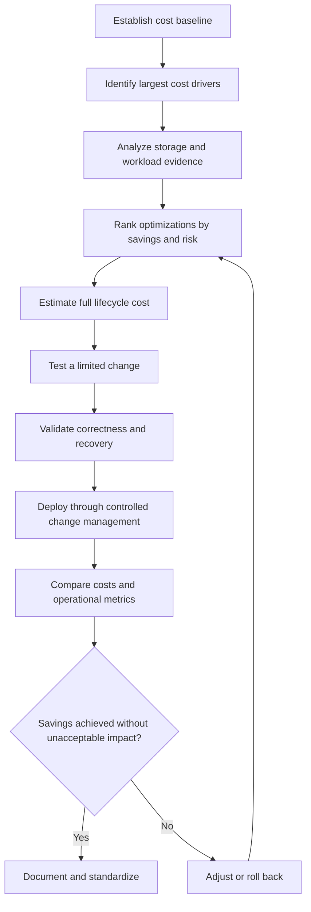

# 06- Cost Saving Strategies

## Overview

Amazon S3 cost optimization is the process of reducing unnecessary storage, request, retrieval, transfer, and management expenses without compromising security, reliability, performance, or data-retention requirements.

The most effective strategy is to optimize how data is created, accessed, retained, and deleted throughout its lifecycle. Choosing a cheaper storage class is only one part of that process. Excessive object versions, small objects, abandoned multipart uploads, repeated downloads, broad replication, and unnecessary analytics can offset expected savings.

A production cost-optimization strategy should establish a measurable baseline, identify the dominant cost drivers, implement targeted changes, and verify the financial impact using AWS billing data.

This document focuses on practical, cross-cutting strategies. Detailed pricing models, storage-cost analysis, request-cost optimization, data-transfer charges, and cost allocation are addressed in their dedicated documents within this section.

## Establish a Cost Optimization Baseline

Before changing S3 configuration, understand where the current expenditure originates.

### Identify the largest cost drivers

Review the following categories:

| Cost driver | Evidence to collect | Potential optimization |
|---|---|---|
| Storage | Stored bytes by class, bucket, and version status | Lifecycle policies, retention adjustments, class selection |
| Requests | GET, HEAD, LIST, PUT, and COPY volume | Eliminate redundant operations and excessive listing |
| Retrieval | Retrieved bytes and archive restore activity | Select suitable storage classes and cache repeated reads |
| Data transfer | Internet egress and cross-Region traffic | CloudFront, regional placement, transfer-path improvements |
| Historical versions | Current versus noncurrent storage | Noncurrent-version lifecycle policies |
| Incomplete multipart uploads | Number and age of incomplete uploads | Lifecycle-based cleanup |
| Replication | Replicated bytes and destination storage | Scope replication to justified recovery and distribution requirements |
| Management features | Inventory, Storage Lens, logging, and analytics usage | Retain features that produce measurable operational value |
| Related services | KMS, CloudWatch, Lambda, Athena, CloudFront, and network charges | Optimize the end-to-end architecture |

Use AWS Cost Explorer and billing exports to identify the financial impact, then use S3 Storage Lens, CloudWatch, S3 Inventory, and application telemetry to determine the underlying cause.

### Use a measurable baseline

Record the following metrics before deploying optimizations:

- Monthly S3 cost by account, Region, and usage category.
- Stored bytes and object counts by bucket and storage class.
- Current and noncurrent version storage where available.
- Monthly request counts by operation.
- Monthly data-transfer volume.
- Replication activity and destination storage.
- Number and age of incomplete multipart uploads.
- Percentage of costs that remain unattributed to an owning application.

A baseline helps distinguish an actual improvement from normal workload variation.

## Optimize Storage Class Selection

Storage classes have different storage rates, retrieval charges, access characteristics, and minimum storage-duration requirements.

The right class depends on how frequently objects are accessed, how quickly they must be recovered, and how long they remain stored.

| Workload | Candidate approach | Main consideration |
|---|---|---|
| Frequently accessed application files | S3 Standard | Avoid unnecessary retrieval restrictions |
| Unknown or changing access patterns | S3 Intelligent-Tiering | Monitoring charges versus potential automatic savings |
| Infrequently accessed documents | S3 Standard-IA | Retrieval costs and minimum storage duration |
| Reproducible, infrequently accessed data where single-AZ storage is acceptable | S3 One Zone-IA | Lower resilience characteristics must be acceptable |
| Rarely accessed archives requiring immediate retrieval | S3 Glacier Instant Retrieval | Retrieval charges and minimum storage duration |
| Long-term archives with flexible recovery timing | S3 Glacier Flexible Retrieval | Restore requirements and archive economics |
| Long-term retention with very infrequent recovery | S3 Glacier Deep Archive | Longer restore times and minimum storage duration |

### Use S3 Intelligent-Tiering for uncertain access patterns

S3 Intelligent-Tiering automatically moves eligible objects between access tiers based on access patterns.

It can be useful when the application cannot reliably predict which objects will become infrequently accessed.

However, it introduces a monitoring and automation charge for eligible objects. Objects smaller than 128 KB are not monitored for automatic tiering and remain in the Frequent Access tier.

Before moving a large object population to Intelligent-Tiering, compare monitoring costs against the expected storage savings.

Reference: [Managing storage costs with S3 Intelligent-Tiering](https://docs.aws.amazon.com/AmazonS3/latest/userguide/intelligent-tiering.html).

### Avoid choosing a storage class based on age alone

An object that is 90 days old might still be accessed every day. Another object created yesterday might never be accessed again.

Use business retention requirements and observed access patterns to determine transitions.

For archival data, include the consequences of restoring objects and the possibility of early-deletion charges when applicable.

Reference: [Amazon S3 storage classes](https://docs.aws.amazon.com/AmazonS3/latest/userguide/storage-class-intro.html).

## Apply Lifecycle Policies Deliberately

S3 Lifecycle allows objects to transition to other storage classes or expire according to defined rules.

Lifecycle policies are one of the most scalable ways to automate retention and storage optimization, particularly for logs, generated reports, temporary files, and long-term archives.

### Example: transition and expiration

The following configuration transitions eligible objects under `reports/` to S3 Standard-IA after 30 days and expires them after 365 days.

```json
{
  "Rules": [
    {
      "ID": "reports-retention",
      "Status": "Enabled",
      "Filter": {
        "Prefix": "reports/"
      },
      "Transitions": [
        {
          "Days": 30,
          "StorageClass": "STANDARD_IA"
        }
      ],
      "Expiration": {
        "Days": 365
      }
    }
  ]
}
```

This is an illustrative policy. Validate access patterns, object-size restrictions, retention requirements, versioning behavior, and minimum storage duration before applying it to production data.

For a versioned bucket, expiration of a current object can create a delete marker rather than permanently remove every historical version. Configure noncurrent-version expiration separately when appropriate.

### Prevent uneconomical transitions

Lifecycle transitions can introduce per-object request charges and minimum storage-duration consequences.

For general-purpose buckets, S3 Lifecycle's current default behavior prevents objects smaller than 128 KB from transitioning to any storage class. Explicit size filters can permit smaller objects to transition when required. Older configurations may retain previous behavior until their lifecycle configuration is modified.

Before enabling broad transitions:

- Analyze the size distribution of objects.
- Estimate the number of transitions.
- Include minimum storage duration and retrieval costs.
- Test the rule against a representative workload.
- Verify the effect after deployment.

Reference: [Transitioning objects using S3 Lifecycle](https://docs.aws.amazon.com/AmazonS3/latest/userguide/lifecycle-transition-general-considerations.html).

## Control Versioning and Historical Data Growth

Versioning protects against accidental overwrites and deletions, but previous object versions continue consuming storage until they are removed by lifecycle rules or explicit deletion.

Historical data can become a major storage expense in workloads that repeatedly overwrite the same keys.

### Recommended strategies

- Define a retention policy for noncurrent versions.
- Expire eligible historical versions after the recovery window.
- Remove expired delete markers where appropriate.
- Monitor storage consumed by historical versions.
- Retain versions longer when compliance or recovery requirements justify it.

For example, a document service may retain current documents for its required business period and noncurrent versions for a separate recovery window. The actual durations should come from the service's recovery objectives and retention obligations.

Do not disable versioning or delete historical data simply to reduce cost without evaluating its impact on recovery.

Reference: [Using S3 Versioning](https://docs.aws.amazon.com/AmazonS3/latest/userguide/Versioning.html).

## Reduce Costs from Small Objects

Millions of small objects can introduce substantial request overhead and, in certain storage classes, disproportionate billable storage.

S3 Standard-IA, S3 One Zone-IA, and S3 Glacier Instant Retrieval have a 128 KB minimum billable object size. Glacier Flexible Retrieval and Glacier Deep Archive have additional per-object metadata storage requirements.

### Practical strategies

- Measure object-size distribution before selecting storage classes.
- Consolidate compatible small outputs when the workload permits it.
- Use suitable file formats and batch sizes for analytics pipelines.
- Avoid creating unnecessary intermediate artifacts.
- Apply lifecycle size filters where they improve the economics of transitions.
- Keep independently managed objects separate when access, permissions, or retention require that granularity.

Aggregation is not universally beneficial. A single large object can be more expensive to update partially at the application level and can complicate concurrent writes, selective reads, and recovery.

Evaluate total cost alongside operational complexity.

## Clean Up Incomplete Multipart Uploads

Multipart uploads improve reliability and throughput for large objects, but abandoned uploads leave parts consuming storage.

Common causes include interrupted clients, failed workers, process termination, and upload sessions that never reach completion.

### Configure automatic cleanup

For a general-purpose bucket, the following lifecycle rule aborts incomplete multipart uploads after seven days.

```json
{
  "Rules": [
    {
      "ID": "abort-incomplete-uploads",
      "Status": "Enabled",
      "Filter": {},
      "AbortIncompleteMultipartUpload": {
        "DaysAfterInitiation": 7
      }
    }
  ]
}
```

Choose the interval according to expected upload duration and retry behavior. Verify that it will not interfere with legitimate long-running transfers.

This rule removes incomplete multipart uploads and their uploaded parts. It does not delete completed objects.

Reference: [Aborting incomplete multipart uploads](https://docs.aws.amazon.com/AmazonS3/latest/userguide/mpu-abort-incomplete-mpu-lifecycle-config.html).

## Reduce Unnecessary API Requests

S3 requests can become a substantial cost driver when applications perform redundant lookups, repeatedly enumerate object keys, or generate too many small objects.

### Avoid unnecessary HEAD and GET combinations

If an application already knows the object key and can handle the GET response correctly, a separate HEAD request may not be necessary.

Use HEAD when metadata inspection is genuinely required. Do not remove it when it protects an important workflow invariant.

### Avoid repeated full-bucket listings

Use specific prefixes and pagination to limit object enumeration.

If a backend needs to search by tenant, document status, owner, or business identifier, maintain an appropriate database index instead of repeatedly scanning S3.

For recurring analysis across large populations, consider S3 Inventory.

### Optimize retries

Use bounded SDK retries and appropriate backoff for transient failures. Avoid endlessly retrying permanent errors such as invalid input or missing permissions.

Ensure retryable workflows are idempotent so a retry does not create unwanted duplicate objects, application records, or processing jobs.

### Consolidate output selectively

ETL jobs that write millions of small files may benefit from compaction into larger objects. Consider this when the data can naturally be read and processed in groups.

Measure the additional processing costs and the trade-offs for partial reads, concurrent updates, and error recovery before adopting compaction.

## Optimize Data Transfer and Delivery

Internet downloads and cross-Region traffic can contribute significant costs even when the stored objects do not change.

### Use CloudFront for suitable content

CloudFront can cache frequently accessed objects near users and reduce origin request volume.

For an S3 origin, data transfer from S3 to CloudFront is free, but CloudFront viewer delivery and request charges still apply.

CloudFront is particularly useful for:

- Static assets.
- Images and other immutable media.
- Frequently downloaded files.
- Public content distributed across geographic regions.
- Private content delivered through an appropriate signed-access design.

Do not assume CloudFront reduces costs for every workload. Its benefit depends on cacheability, request volume, object size, viewer locations, and the pricing model.

For a private S3 origin, use an appropriate configuration such as Origin Access Control rather than making the bucket public.

Reference: [Using an S3 bucket as a CloudFront origin](https://docs.aws.amazon.com/AmazonCloudFront/latest/DeveloperGuide/DownloadDistS3AndCustomOrigins.html).

### Keep compute close to data

Place application workloads near their S3 buckets when practical.

For eligible same-Region traffic, standard data-transfer charges are generally free. However, indirect network paths can still introduce costs.

For private-subnet workloads, evaluate an S3 gateway VPC endpoint when appropriate. It can avoid routing supported S3 traffic through a NAT gateway, whose data-processing and hourly charges may otherwise apply.

Reference: [Gateway endpoints for Amazon S3](https://docs.aws.amazon.com/vpc/latest/privatelink/vpc-endpoints-s3.html).

### Evaluate transfer acceleration using measurements

S3 Transfer Acceleration can improve transfer performance for some geographically distant clients but introduces additional acceleration charges.

Benchmark representative clients and file sizes before enabling it broadly. Keep it when the measured performance improvement justifies the additional cost.

## Optimize Replication and Recovery Costs

Replication supports resilience, regional data access, and other distribution requirements. It can also increase storage and transfer expenses.

### Strategies

- Replicate only the data required by the recovery or distribution design.
- Include destination storage in the budget.
- Review historical-version retention at source and destination.
- Measure the volume of changed data replicated each month.
- Monitor replication failures and backlog.
- Include restoration traffic in disaster-recovery cost estimates.

Do not remove replication to save money without validating recovery objectives and compliance requirements.

Replication is not identical to backup. Depending on the configuration, unwanted changes or deletions can affect replicated data. Use separate backup retention or other appropriate safeguards when required.

Reference: [Amazon S3 replication](https://docs.aws.amazon.com/AmazonS3/latest/userguide/replication.html).

## Review Storage Management and Analytics Features

S3 Inventory, Storage Lens, access logging, and other management capabilities improve visibility but can introduce storage, request, monitoring, or analytics charges.

Use each feature for a defined operational purpose.

| Feature | Cost-saving consideration |
|---|---|
| S3 Inventory | Scheduled object-level analysis can help identify retained data and avoid repeated custom enumerations |
| S3 Storage Lens | Use free metrics for baseline visibility; enable advanced metrics when additional insights justify their charges |
| CloudWatch request metrics | Enable detailed request monitoring where it supports meaningful investigation and alerting |
| Server access logging | Account for destination storage and query-processing costs |
| Athena | Optimize queries and data layouts to avoid scanning unnecessary data |
| AWS Cost and Usage exports | Apply appropriate retention and partitioning to control reporting-storage and query costs |

Do not remove useful monitoring merely because it has a cost. A modest monitoring expense may prevent a much larger storage or transfer problem from going undetected.

## Improve Cost Allocation and Accountability

Savings are harder to sustain when no team owns the affected resources or expenditure.

### Standardize tags

Use a consistent tagging scheme for managed buckets:

```text
Application = document-service
Environment = production
Team = platform
CostCenter = engineering
ManagedBy = terraform
```

Activate eligible user-defined cost allocation tags in AWS Billing and Cost Management.

Bucket tags help classify eligible bucket costs but do not automatically give exact cost attribution to every object or prefix inside a shared bucket.

For finer-grained analysis, combine billing exports with S3 Inventory, Storage Lens, and application-level metadata.

### Use budgets and anomaly detection

Configure budgets and cost anomaly alerts for material spending changes.

Assign an owner and response procedure to each alert. An alert can detect unusual spending, but it does not automatically stop the underlying workload.

Review unexplained increases in storage, request volume, transfer, replication, and related-service charges.

Reference: [AWS Cost Anomaly Detection](https://docs.aws.amazon.com/cost-management/latest/userguide/manage-ad.html).

## A Prioritized Cost-Optimization Workflow

Use an evidence-driven sequence rather than applying every possible optimization at once.



### Prioritize by impact and risk

| Priority | Strategy | Why |
|---|---|---|
| High | Remove unintended retention and version growth | Can reduce ongoing storage consumption |
| High | Abort stale incomplete multipart uploads | Removes unused uploaded parts |
| High | Correct unexpectedly high transfer or request volume | Addresses potentially avoidable usage |
| High | Apply lifecycle rules to suitable retained data | Automates recurring cost optimization |
| Medium | Review storage-class suitability | Can reduce long-term storage rates |
| Medium | Improve application caching and object lookup patterns | May reduce requests and transfer |
| Medium | Review replication scope | Can reduce duplicated storage and transfer if resilience requirements permit |
| Medium | Consolidate small objects selectively | May reduce request and object-overhead costs |
| Variable | Enable advanced analytics or acceleration features | Justified only when their operational or performance benefits outweigh their charges |

Actual priority depends on measured spending, expected savings, engineering effort, and risk.

## Estimate Savings Before Implementation

Estimate the expected savings for each candidate change using actual workload data and current prices.

A conceptual model is:

\[
S_{\text{net}} =
C_{\text{before}} -
C_{\text{after}} -
C_{\text{implementation}}
\]

For recurring cloud workloads, the implementation component may represent one-time engineering expenditure, additional processing, migration costs, or other implementation effects rather than a direct AWS invoice charge.

Evaluate at least the following:

- Current monthly cost.
- Expected cost after the change.
- Request and transition charges.
- Retrieval and data-transfer effects.
- Minimum storage-duration consequences.
- Related-service charges.
- Engineering effort and operational risk.
- Recovery, compliance, and retention constraints.

A storage-class transition that reduces storage rates may still increase total expenditure if retrieval becomes frequent or the data is deleted before the minimum storage duration expires.

Do not report estimated savings as realized savings until actual billing data supports the claim.

## Verify Optimizations After Deployment

Use both operational and financial measurements.

### Operational measurements

- Storage volume by class.
- Object count and version distribution.
- Request counts by operation.
- Data-transfer volume.
- Replication volume and status.
- Number of incomplete multipart uploads.
- Application latency, errors, and retries.

### Financial measurements

- S3 cost by usage type and Region.
- Cost by activated allocation tags where available.
- Related-service costs.
- Actual monthly cost compared with the baseline.
- Anomalies and unallocated charges.

Billing data may be delayed, so an immediate absence of a cost change does not necessarily prove that an optimization failed.

Compare equivalent reporting periods and account for differences in traffic, data volume, and billing adjustments.

## Common Cost-Optimization Mistakes

### Optimizing storage rates without measuring total cost

Cheaper storage can introduce retrieval charges, transition requests, or minimum-duration penalties.

**Prevention:** Estimate the full cost of the object's lifecycle before changing storage classes.

### Applying lifecycle rules to every object

A rule that works for large documents may be uneconomical for millions of small files or inappropriate for frequently accessed content.

**Prevention:** Use prefixes, tags, size filters, and representative testing to scope transitions.

### Deleting historical versions indiscriminately

Version cleanup can reduce storage, but may remove recovery capabilities or violate retention obligations.

**Prevention:** Define retention requirements and validate recovery behavior before deleting versions.

### Making a bucket public to avoid delivery costs

Public exposure is a security risk and does not remove the need to evaluate data-transfer and request charges.

**Prevention:** Use appropriate access controls and delivery architectures such as CloudFront with a private origin.

### Replicating data without a defined recovery objective

Unnecessary replicas increase storage and transfer expenditure.

**Prevention:** Tie replication scope to documented resilience, regional access, and compliance requirements.

### Enabling every monitoring feature by default

Advanced monitoring may be valuable, but its cost should correspond to an operational requirement.

**Prevention:** Start with baseline metrics and introduce additional features when their benefits justify the expense.

### Assuming budget alerts control spending

Budgets and anomaly detection provide visibility but do not necessarily stop an expensive operation.

**Prevention:** Define alert ownership, investigation steps, and approved remediation actions.

## Production Cost-Optimization Checklist

- [ ] A monthly cost baseline exists for each important S3 workload.
- [ ] The major storage, request, transfer, retrieval, and management cost drivers are understood.
- [ ] Storage classes reflect observed access patterns and recovery requirements.
- [ ] Lifecycle rules account for object size, minimum storage duration, retention, and versioning.
- [ ] Historical-version growth is monitored and managed.
- [ ] Incomplete multipart uploads are cleaned up using an appropriate lifecycle policy.
- [ ] Request and transfer patterns are reviewed for avoidable work.
- [ ] CloudFront, regional placement, and VPC endpoints are evaluated where appropriate.
- [ ] Replication remains aligned with documented resilience objectives.
- [ ] Analytics and monitoring features have defined operational purposes.
- [ ] Buckets use consistent cost allocation tags.
- [ ] Budgets and anomaly alerts have assigned owners.
- [ ] Proposed savings are estimated before implementation.
- [ ] Changes are tested and deployed through controlled change management.
- [ ] Actual billing and workload metrics are checked after deployment.
- [ ] Optimizations preserve security, data integrity, retention, and recovery requirements.

## Official References

- [Amazon S3 pricing](https://aws.amazon.com/s3/pricing/)
- [AWS Pricing Calculator](https://calculator.aws/)
- [S3 storage classes](https://docs.aws.amazon.com/AmazonS3/latest/userguide/storage-class-intro.html)
- [S3 Intelligent-Tiering](https://docs.aws.amazon.com/AmazonS3/latest/userguide/intelligent-tiering.html)
- [S3 Lifecycle transition considerations](https://docs.aws.amazon.com/AmazonS3/latest/userguide/lifecycle-transition-general-considerations.html)
- [S3 Lifecycle management](https://docs.aws.amazon.com/AmazonS3/latest/userguide/object-lifecycle-mgmt.html)
- [S3 Versioning](https://docs.aws.amazon.com/AmazonS3/latest/userguide/Versioning.html)
- [Aborting incomplete multipart uploads](https://docs.aws.amazon.com/AmazonS3/latest/userguide/mpu-abort-incomplete-mpu-lifecycle-config.html)
- [S3 replication](https://docs.aws.amazon.com/AmazonS3/latest/userguide/replication.html)
- [Gateway endpoints for Amazon S3](https://docs.aws.amazon.com/vpc/latest/privatelink/vpc-endpoints-s3.html)
- [AWS Cost Anomaly Detection](https://docs.aws.amazon.com/cost-management/latest/userguide/manage-ad.html)

## Key Takeaways

- Establish a measurable cost baseline before optimizing, and prioritize the largest verified cost drivers.
- Use appropriate storage classes, lifecycle rules, historical-version retention, and incomplete multipart upload cleanup to control ongoing storage growth.
- Reduce unnecessary requests and transfers through better application design, caching, regional placement, and selective object consolidation.
- Preserve security, retention, reliability, and recovery requirements when changing replication, lifecycle, or storage configuration.
- Verify savings using actual billing data and operational metrics, and assign owners to cost reviews, budgets, and anomaly alerts.