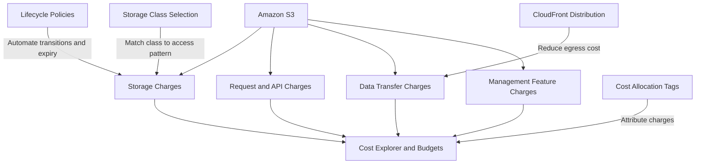

# README

## Overview

Amazon S3 cost management covers the pricing model, cost drivers, allocation strategies, and optimization techniques required to operate S3-backed systems efficiently in production. It addresses the S3 pricing structure, storage class costs, request and API charges, data transfer fees, cost allocation and tagging, and practical strategies for reducing unnecessary expenditure without compromising reliability, security, or performance.

This section of the Backend Engineering Playbook provides a structured reference for backend engineers, platform engineers, and engineering managers who need to understand, attribute, and control S3 costs in production environments.

The focus is on practical cost engineering: understanding what generates cost, designing systems that minimize waste from the start, using the right tools to track and attribute spending, and applying targeted optimization strategies as workloads evolve.

## Navigation

| # | File | Description |
|---|---|---|
| 01 | [01- Amazon S3 Pricing Model](./01-%20Amazon%20S3%20Pricing%20Model.md) | Pay-as-you-go pricing structure, cost dimensions, free tier, and the factors that determine total S3 expenditure |
| 02 | [02- Storage Costs](./02-%20Storage%20Costs.md) | Per-GB storage charges, storage class pricing differences, versioning overhead, and minimum storage duration requirements |
| 03 | [03- Request and API Costs](./03-%20Request%20and%20API%20Costs.md) | Per-request charges by operation type and storage class, high-request workload patterns, and API cost optimization |
| 04 | [04- Data Transfer Costs](./04-%20Data%20Transfer%20Costs.md) | Egress charges, cross-region transfer fees, CloudFront and VPC endpoint cost reduction, and transfer acceleration pricing |
| 05 | [05- Cost Allocation and Visibility](./05-%20Cost%20Allocation%20and%20Visibility.md) | Cost allocation tags, Storage Lens, Cost Explorer, cost attribution by team or environment, and budget alerts |
| 06 | [06- Cost Saving Strategies](./06-%20Cost%20Saving%20Strategies.md) | Lifecycle policies, storage class selection, egress optimization, request reduction, and multipart upload cleanup |

## Why S3 Cost Management Matters

S3 costs accumulate continuously across storage, requests, and data transfer. Without deliberate cost management, production workloads develop unbounded cost growth from retained objects that are no longer needed, incorrect storage class assignments, high-volume egress patterns, and abandoned multipart upload parts.

Common cost management risks include:

- Unbounded object accumulation without lifecycle policies, generating ongoing storage charges for data that is no longer accessed.
- Objects stored in the wrong storage class, paying general-purpose prices for infrequently accessed or archival data.
- Incomplete multipart upload parts accumulating silently because no lifecycle rule aborts them.
- High egress costs from serving large objects directly from S3 rather than through CloudFront or VPC endpoints.
- Cost spikes from high-volume small-object request patterns that generate significant API charges.
- No cost attribution, making it impossible to identify which application, team, or environment is responsible for a cost increase.

Effective S3 cost management combines upfront storage class selection, lifecycle automation, egress optimization, consistent cost tagging, and regular cost reviews rather than relying on default configurations.

## Documentation Structure

This section is organized into focused documents covering each cost dimension, followed by allocation visibility and optimization strategies.

| Area | Primary focus |
|---|---|
| Pricing model | Cost dimensions, pricing structure, and the factors that drive total expenditure |
| Storage costs | Per-GB charges, storage class selection, versioning, and minimum duration requirements |
| Request costs | Per-operation charges, storage class request pricing differences, and API cost patterns |
| Data transfer costs | Egress charges, cross-region fees, and transfer cost reduction strategies |
| Cost allocation | Tagging, attribution, dashboards, and budget management |
| Cost saving strategies | Lifecycle policies, storage class optimization, egress reduction, and request minimization |

Each document is intended to be independently maintainable while connecting to the broader S3 operational model. Shared patterns should be referenced rather than duplicated across documents.

## Core Cost Management Principles

### Assign Storage Classes Deliberately

The default general-purpose storage class is the most expensive option for objects that are accessed infrequently or not at all. Assign storage classes based on the expected access pattern for each object category. Use lifecycle policies to transition objects automatically as their access frequency declines rather than relying on manual reclassification.

### Apply Lifecycle Policies from Day One

Objects without lifecycle policies remain in their initial storage class indefinitely. Define expiration and transition rules for every object category at bucket or prefix level before storing objects. Retroactively applying lifecycle policies to large object inventories is operationally complex and leaves cost waste in place during the transition period.

### Abort Incomplete Multipart Uploads

Incomplete multipart upload parts are charged at the standard storage rate for the uploaded parts, even though the object is never completed. Configure a lifecycle rule to abort incomplete multipart uploads after an appropriate number of days on every bucket where multipart uploads are possible.

### Reduce Egress Through Architecture

Data transfer from S3 to the internet is a significant cost driver for workloads that serve content to end users. Route content delivery through CloudFront to benefit from regional pricing and cache efficiency. Access S3 from within the same AWS Region using VPC endpoints to eliminate inter-service egress charges.

### Tag Objects for Cost Attribution

Without cost allocation tags, S3 charges appear as a single line item in Cost Explorer that cannot be attributed to a specific application, team, or environment. Apply consistent tags at the bucket level and object level. Enable cost allocation tags in Billing and Cost Management so that tagged costs appear in Cost Explorer reports.

## How Cost Dimensions Relate

## Recommended Cost Management Workflow

Apply the following process when designing or reviewing S3 cost management for a production workload.

1. **Understand the cost profile.** Identify which cost dimensions — storage, requests, transfer, or management features — dominate the workload's S3 expenditure.
2. **Assign storage classes.** Map each object category to the appropriate storage class based on access frequency, retrieval latency requirements, and minimum duration constraints.
3. **Define lifecycle policies.** Write lifecycle rules for every object category covering transitions, expiration, and incomplete multipart upload abort before objects are stored.
4. **Configure cost allocation.** Apply consistent tags at the bucket level. Enable cost allocation tags. Set up Cost Explorer and budget alerts.
5. **Reduce egress.** Route content delivery through CloudFront. Access S3 from EC2, Lambda, or ECS using VPC endpoints.
6. **Monitor and review.** Review Cost Explorer reports and Storage Lens dashboards regularly. Identify storage classes, prefixes, or buckets with unexpected cost growth.
7. **Optimize iteratively.** Apply targeted optimizations based on review findings rather than making broad changes that could affect application behavior.

## Operational Standards

- **Lifecycle policies:** Define transition and expiration rules for every object category at bucket creation. Include an abort incomplete multipart upload rule on every bucket.
- **Storage class selection:** Document the intended storage class for each object category. Review assignments when access patterns change.
- **Egress:** Use CloudFront for public content delivery. Use VPC endpoints for intra-AWS access. Avoid unnecessary cross-region transfers.
- **Cost tagging:** Apply `Environment`, `Application`, and `Team` tags to every bucket. Enable cost allocation tags in Billing and Cost Management.
- **Budget alerts:** Configure AWS Budgets alerts for S3 spend at the account and project level. Investigate alerts promptly.
- **Request optimization:** Batch small operations where possible. Avoid listing entire large buckets unnecessarily. Cache frequently retrieved objects at the application layer.
- **Review cadence:** Review S3 costs in Cost Explorer monthly. Include storage growth trends and egress patterns in engineering planning discussions.

## Key Takeaways

- S3 costs accumulate across storage, requests, data transfer, and management features; each dimension requires deliberate management.
- Lifecycle policies must be defined at bucket creation for every object category — retroactive application is operationally complex and leaves waste in place.
- Incomplete multipart upload parts generate ongoing charges silently without a lifecycle abort rule.
- Egress is one of the largest controllable cost drivers; CloudFront and VPC endpoints reduce it significantly.
- Cost attribution requires consistent tagging from day one; without tags, cost growth cannot be attributed to a specific application or team.
