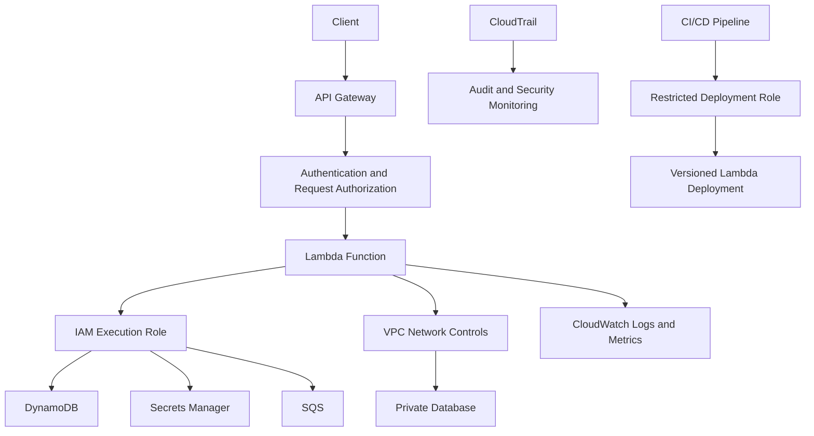

# 01- Lambda Security Overview

## Overview

AWS Lambda security is the combination of identity and access management, invocation authorization, network isolation, secret management, software supply-chain security, runtime configuration, and operational monitoring required to run serverless workloads safely.

Lambda removes much of the infrastructure-management burden, but it does not remove application security responsibilities. A vulnerable handler, an overly permissive execution role, an exposed function URL, or an insecure deployment pipeline can compromise an otherwise well-managed serverless application.

For backend engineers building Python APIs, asynchronous workers, and event-driven microservices, Lambda security must be designed across the complete request and event lifecycle.

This document establishes the security model and foundational controls for Lambda. Detailed implementation guidance belongs in the focused documents covering execution roles, resource-based policies, cross-account invocation, secrets, networking, artifact security, and deployment permissions.

## Why Lambda Security Matters

A Lambda application typically interacts with several independently secured components:

- API Gateway, Application Load Balancer, or Lambda function URLs.
- AWS services such as S3, SQS, EventBridge, and DynamoDB.
- Databases, caches, and internal APIs.
- Secrets Manager and Systems Manager Parameter Store.
- Deployment pipelines, artifact repositories, and observability systems.

Each integration introduces a separate trust relationship or authorization boundary.

Consider a Python Lambda function that processes customer orders. The API endpoint must authenticate and authorize callers, the function must have only the permissions required to process orders, database credentials must remain protected, and the asynchronous worker must not trust unvalidated event data.

Security therefore requires more than attaching an IAM role to a function. It requires controlling who can invoke the function, what the function can access, which systems it can reach, what data it handles, and how changes to the function are deployed.

## Lambda Security Model

Lambda security follows the AWS shared responsibility model. AWS manages the underlying service infrastructure, while customers remain responsible for their application code, configuration, permissions, data, and deployment practices.

| Security area | AWS responsibility | Customer responsibility |
|---|---|---|
| Underlying infrastructure | Operate and protect the managed Lambda service infrastructure. | Configure the function appropriately for the workload. |
| Execution environment | Provide managed execution environments and isolation mechanisms. | Avoid unsafe assumptions about environment reuse and isolate application data correctly. |
| Identity and access | Provide IAM and Lambda authorization mechanisms. | Define least-privilege roles, trust policies, and invocation permissions. |
| Application security | Provide the execution platform. | Validate inputs, enforce business authorization, handle errors safely, and maintain dependencies. |
| Networking | Provide VPC and Lambda networking capabilities. | Configure routes, security groups, endpoints, and access to private resources. |
| Data protection | Provide encryption and access-control capabilities. | Classify data, protect secrets, configure access, and prevent sensitive-data exposure. |
| Monitoring and auditing | Provide services such as CloudWatch and CloudTrail. | Enable appropriate telemetry, create alerts, investigate events, and retain evidence. |
| Deployment | Provide supported deployment mechanisms and integrations. | Secure source code, artifacts, CI/CD credentials, and release permissions. |

The exact responsibility boundary depends on the services and integrations involved. Using a managed service does not automatically make its configuration secure.

## Core Security Boundaries

A production Lambda application should distinguish the following controls.

| Boundary | Primary control | Security question |
|---|---|---|
| Caller to function | Invocation authorization and application authentication | Who is allowed to invoke this function? |
| Function to AWS service | Execution role and IAM policies | Which AWS resources and actions can the function access? |
| Function to private network | VPC configuration and network controls | Which network destinations can the function reach? |
| Function to database or external API | Database credentials, application authorization, TLS, and network policy | Can the function access only the intended data and operations? |
| Function to secrets | Secrets Manager or Parameter Store permissions | Which identities can retrieve sensitive configuration? |
| Developer or pipeline to AWS | Deployment roles and federated credentials | Who can change function code, configuration, and permissions? |
| Application to observability systems | Logging permissions and data-handling controls | What information can be recorded, accessed, and retained? |

These boundaries are related but not interchangeable. For example, allowing a function to connect to a database does not authenticate it to the database. Similarly, granting a function permission to read an S3 object does not authorize external callers to invoke the function.

## Lambda Security Architecture

The following architecture illustrates a typical secured serverless backend.



The diagram separates application access from deployment access. In a mature environment, the deployment identity and the runtime execution identity should have different responsibilities.

For example, a runtime role may permit reading specific configuration secrets and writing order records. A deployment role may update function code and publish versions but should not automatically inherit unrestricted access to production customer data.

## Identity and Access Management

IAM is central to Lambda security, but two distinct authorization paths must be considered.

### Execution permissions

The Lambda execution role defines which AWS API operations the function can perform. Lambda assumes this role when running the function, and the resulting credentials are made available to the runtime through the AWS credential provider chain.

For example, an order-processing function may need to:

- Read a specific secret from Secrets Manager.
- Read and write records in a specific DynamoDB table.
- Write logs to its configured CloudWatch Logs resources.
- Send messages to a designated SQS queue.

It should not receive unrestricted access to all S3 buckets, DynamoDB tables, or IAM resources merely because the application runs in AWS.

### Invocation permissions

Invocation authorization determines who or what may call the function. Depending on the integration, authorization may involve:

- IAM identity-based policies.
- Lambda resource-based policies.
- API Gateway authorization.
- Function URL authorization settings.
- Service principals and source-resource restrictions.
- Cross-account permissions.

An execution role does not automatically authorize callers to invoke the function.

### Least-privilege example

An execution policy should scope permissions to the resources and operations the application actually requires.

```json
{
  "Version": "2012-10-17",
  "Statement": [
    {
      "Sid": "ReadOrderConfiguration",
      "Effect": "Allow",
      "Action": [
        "secretsmanager:GetSecretValue"
      ],
      "Resource": "arn:aws:secretsmanager:ap-south-1:123456789012:secret:production/orders/config-EXAMPLE"
    }
  ]
}
```

The ARN is illustrative and must be replaced with the actual secret ARN. The policy may also require appropriate KMS permissions when a customer-managed KMS key is used.

This statement grants access to one secret rather than every secret in the account. Additional statements should be introduced only for required application operations.

Avoid policies such as:

```json
{
  "Effect": "Allow",
  "Action": "*",
  "Resource": "*"
}
```

Broad permissions increase the impact of compromised application code, malicious dependencies, injection vulnerabilities, and deployment mistakes.

## Application-Level Security

IAM cannot replace application authorization. A function can have perfectly scoped AWS permissions and still expose customer data if it trusts caller-supplied identifiers or accepts unvalidated events.

For HTTP APIs, application security should include:

- Authentication and authorization appropriate to the endpoint.
- Input validation and schema enforcement.
- Object-level authorization for customer-owned resources.
- Safe handling of query parameters, headers, and request bodies.
- Parameterized database queries.
- Request-size and execution-time controls.
- Safe error responses that do not disclose internal implementation details.
- Rate limiting and abuse controls at the appropriate integration layer.

For event-driven functions, validate the event structure and treat event content as untrusted unless its origin and integrity are established. A trusted event source does not necessarily mean every field is safe to use in SQL queries, shell commands, file paths, or authorization decisions.

For example, an SQS message may have been produced by another application component with a different trust level. The consumer should validate the message schema and enforce business invariants before changing persistent state.

## Secret and Configuration Protection

Credentials, API tokens, private keys, and database passwords must not be embedded in source code or committed to version control.

Use AWS Secrets Manager or Systems Manager Parameter Store when their capabilities fit the application's requirements. Grant the function permission to retrieve only the necessary secret or parameter.

Environment variables are appropriate for non-sensitive configuration such as feature flags, service names, and non-secret identifiers. Sensitive environment variables require additional care because anyone with sufficient configuration-inspection permissions may be able to retrieve their values.

Lambda environment variables are encrypted at rest, but encryption does not replace access control. Use appropriate KMS controls when required by the security design, and restrict access to function configuration and decryption permissions.

Production recommendations:

- Keep secrets out of source code, deployment manifests, logs, and exception messages.
- Scope secret-reading permissions to specific resources.
- Use rotation mechanisms appropriate to the credential and dependent service.
- Cache retrieved secrets only when the application's freshness and rotation requirements permit it.
- Never assume that base64 encoding or an ordinary environment variable provides confidentiality.
- Separate development, test, and production secrets and permissions.

## Network Security

Lambda functions do not require VPC attachment merely because they use AWS services. Many AWS service integrations are available through service APIs without placing the function in a VPC.

VPC attachment is appropriate when a function needs access to private resources, such as an internal database or service. It introduces additional network design responsibilities.

| Concern | Security consideration |
|---|---|
| Subnets | Select subnets that provide the required routes and address capacity. |
| Security groups | Permit only the required inbound and outbound traffic. |
| Routing | Verify the path to databases, endpoints, and external destinations. |
| DNS | Ensure private and public name resolution behaves as intended. |
| Private AWS service access | Use appropriate VPC endpoints where supported and justified. |
| Outbound internet access | Configure suitable egress architecture when external connectivity is required. |
| Database access | Combine network restrictions with database authentication and authorization. |

Attaching Lambda to a VPC does not automatically provide internet access or make every destination private. Routing, security groups, DNS, and endpoint policies must be evaluated together.

For database-backed applications, also consider connection exhaustion. A scaling event can create many concurrent execution environments, each potentially opening connections to the same database. Connection reuse, concurrency limits, and services such as RDS Proxy may help when appropriate to the database architecture.

## Deployment and Supply-Chain Security

A secure Lambda function can still be compromised through an insecure deployment process. Source repositories, build dependencies, deployment artifacts, container images, and CI/CD credentials are part of the application security boundary.

A production deployment process should:

- Restrict who can modify production workflows and deployment configuration.
- Use short-lived AWS credentials through an appropriate federation mechanism, such as GitHub Actions OIDC, instead of long-lived access keys where possible.
- Separate deployment permissions from runtime permissions.
- Pin and review third-party dependencies.
- Scan dependencies and container images using suitable security tooling.
- Prevent secrets from entering build logs and artifacts.
- Restrict write access to artifact repositories.
- Publish and deploy reviewed artifacts.
- Use Lambda versions and aliases to control releases.
- Verify the deployment before shifting production traffic.
- Maintain a documented rollback procedure.

ZIP packages and container images have different packaging and lifecycle considerations. Security checks should match the chosen deployment model rather than assuming the same artifact validation process applies identically to both.

## Logging, Auditing, and Monitoring

Security controls must produce enough evidence to investigate suspicious behavior and identify configuration drift.

Use CloudWatch Logs and metrics to monitor application behavior, and use CloudTrail to audit relevant AWS API activity. Additional security services and organization-level controls may provide centralized detection and governance.

Monitor for:

- Unexpected invocation spikes or unusual traffic patterns.
- Increased authorization failures.
- Repeated function errors and timeouts.
- Changes to execution roles and resource policies.
- Unexpected modifications to function code or configuration.
- Unusual secret-access activity.
- Unexpected deployment activity.
- Excessive data access or suspicious application behavior.

Avoid logging passwords, access tokens, session identifiers, full authorization headers, or unnecessary sensitive customer data. Structured logs should include useful diagnostic fields, such as request identifiers and operation names, without disclosing secrets.

Application logs, Lambda service metrics, and CloudTrail events serve different purposes. CloudTrail does not replace application-level logs, and application logs do not provide a complete audit trail of AWS API activity.

## Common Security Mistakes

| Mistake | Risk | Mitigation |
|---|---|---|
| Using `Action: "*"` and `Resource: "*"` unnecessarily | A compromised function can affect a much larger set of resources. | Scope actions and resource ARNs to actual requirements. |
| Confusing execution permissions with invocation permissions | Functions may be exposed or legitimate integrations may fail. | Review both the execution role and invocation authorization path. |
| Exposing a function URL without appropriate authorization | Unintended callers may invoke the function. | Choose authorization deliberately and add application controls where required. |
| Trusting all event payload fields | Malformed or malicious data can trigger unsafe operations. | Validate schemas and enforce business authorization. |
| Storing credentials in source code | Credentials may leak through repositories, logs, or artifacts. | Use managed secret storage and restricted access. |
| Assuming VPC attachment blocks all external access | Incorrect routes or egress assumptions can create unintended connectivity or outages. | Review routing, security groups, endpoints, and DNS explicitly. |
| Reusing a powerful deployment role at runtime | Runtime compromise can gain deployment or administrative capabilities. | Separate deployment and execution identities. |
| Logging complete request payloads | Logs may expose credentials or sensitive customer data. | Apply data minimization, redaction, and access controls. |
| Assuming retries cannot duplicate business operations | Repeated events can cause duplicate payments, records, or notifications. | Implement idempotency and source-appropriate failure handling. |
| Treating encryption as a replacement for authorization | Unauthorized principals may still access encrypted data through permitted APIs. | Combine encryption with least-privilege access and appropriate key policies. |

## Security Review Checklist

Use this checklist during architecture reviews and before production deployment.

### Identity and authorization

- [ ] The execution role follows least privilege.
- [ ] The role trust policy permits the intended service to assume it.
- [ ] Invocation permissions are scoped to the intended callers and resources.
- [ ] Cross-account access has an explicit trust and authorization design.
- [ ] Deployment and runtime permissions are separated.
- [ ] Resource policies and applicable organizational controls have been reviewed.

### Application and data

- [ ] HTTP requests and event payloads are validated.
- [ ] Object-level and business-level authorization are enforced.
- [ ] Secrets are not embedded in code or logs.
- [ ] Database queries and external command execution use safe input handling.
- [ ] Sensitive data is minimized in logs and error responses.
- [ ] Duplicate processing and retry behavior are addressed.

### Networking and dependencies

- [ ] VPC access is enabled only when needed.
- [ ] Security groups, routes, DNS, and endpoints are reviewed.
- [ ] Database access combines network controls and authentication.
- [ ] Dependencies and deployment artifacts are reviewed and scanned.
- [ ] Container images, when used, follow an appropriate build and patching process.

### Operations and deployment

- [ ] CloudWatch logs, metrics, and alarms are configured.
- [ ] CloudTrail provides appropriate audit visibility.
- [ ] Security-relevant changes and access failures can be investigated.
- [ ] CI/CD uses restricted, preferably short-lived credentials.
- [ ] Releases are verified and rollback procedures are documented.
- [ ] Security controls are reviewed periodically and after material architecture changes.

## Verification Approach

Security reviews should verify actual deployed configuration rather than relying only on source code or infrastructure definitions.

Useful read-only AWS CLI checks include the following. Replace placeholders with the relevant function and Region.

Inspect the function configuration:

```bash
aws lambda get-function-configuration \
  --function-name <function-name> \
  --region <region>
```

Inspect the execution role and other function configuration details returned by the API. Avoid printing or sharing sensitive environment-variable values in tickets or logs.

Retrieve the execution role ARN and inspect its attached managed policies:

```bash
aws iam list-attached-role-policies \
  --role-name <execution-role-name>
```

Inspect inline policies attached to the role:

```bash
aws iam list-role-policies \
  --role-name <execution-role-name>
```

Inspect the function's resource-based policy, if one exists:

```bash
aws lambda get-policy \
  --function-name <function-name> \
  --region <region>
```

A function may have no resource-based policy, and some invocation paths rely on other authorization mechanisms. Interpret the output in the context of the actual integration rather than treating the absence of a policy as proof that the function is inaccessible.

These commands inspect configuration; they do not prove that the entire application is secure. Complete verification also requires reviewing API authorization, database permissions, secret access, networking, application behavior, deployment identity, and organization-level controls.

For detailed policy analysis, use the IAM policy simulator where applicable, inspect service-specific resource policies, and test intended and unintended access paths in a controlled environment.

## Related Documentation

The following documents should provide the detailed implementation guidance for this security area:

| Document | Responsibility |
|---|---|
| [Execution Roles and Least Privilege](02- Execution Roles and Least Privilege.md) | Runtime permissions, trust policies, and policy scoping. |
| [Resource-Based Policies](03- Resource-Based Policies.md) | Invocation authorization and resource-level access. |
| [Cross-Account Invocation](04- Cross-Account Invocation.md) | Cross-account trust and permission configuration. |
| [Secrets Manager and Parameter Store](05- Secrets Manager and Parameter Store.md) | Secret retrieval, rotation, and access control. |
| [Environment Variables and Encryption](06- Environment Variables and Encryption.md) | Configuration protection and encryption considerations. |
| [VPC and Network Security](07- VPC and Network Security.md) | Private networking, security groups, endpoints, and routing. |
| [Dependency and Artifact Security](08- Dependency and Artifact Security.md) | Dependency integrity, artifact scanning, and image security. |
| [CloudTrail and Security Monitoring](09- CloudTrail and Security Monitoring.md) | Audit visibility and security monitoring. |
| [Secure CI/CD and Deployment Permissions](10- Secure CI-CD and Deployment Permissions.md) | Deployment identities, federation, and pipeline security. |

## Official References

- [AWS Lambda security](https://docs.aws.amazon.com/lambda/latest/dg/lambda-security.html)
- [AWS Lambda permissions](https://docs.aws.amazon.com/lambda/latest/dg/lambda-permissions.html)
- [AWS Lambda execution role](https://docs.aws.amazon.com/lambda/latest/dg/lambda-intro-execution-role.html)
- [IAM best practices](https://docs.aws.amazon.com/IAM/latest/UserGuide/best-practices.html)
- [AWS Lambda in a VPC](https://docs.aws.amazon.com/lambda/latest/dg/configuration-vpc.html)
- [AWS Secrets Manager documentation](https://docs.aws.amazon.com/secretsmanager/latest/userguide/intro.html)
- [AWS CloudTrail documentation](https://docs.aws.amazon.com/awscloudtrail/latest/userguide/cloudtrail-user-guide.html)

## Key Takeaways

- Lambda security depends on coordinated controls for invocation authorization, execution permissions, networking, application behavior, data protection, and deployment.
- Execution roles and invocation policies serve different purposes; review both independently and apply least privilege.
- Managed execution does not eliminate application security responsibilities, including input validation, business authorization, idempotency, and safe error handling.
- Secure secrets, network boundaries, deployment artifacts, and CI/CD identities are essential parts of the Lambda security model.
- Validate deployed configuration and operational evidence regularly, using AWS audit and monitoring capabilities alongside application-level testing.