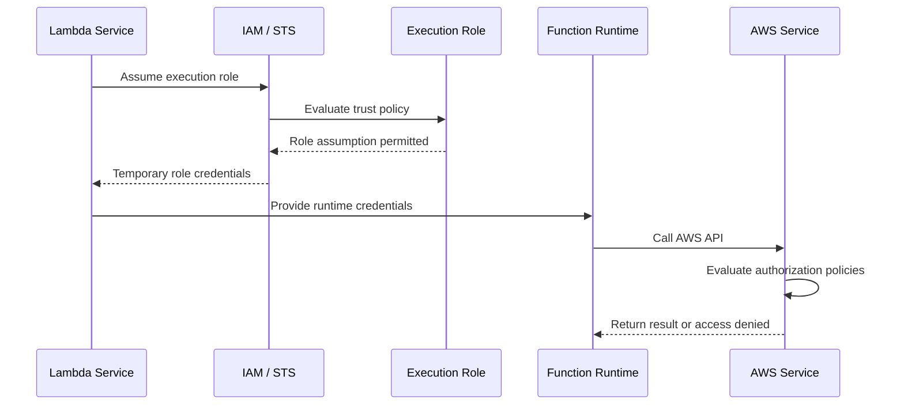
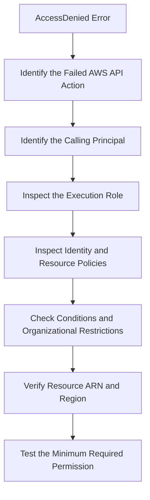

# 02- IAM Execution Roles and Permissions

## Overview

AWS Lambda execution roles define the AWS permissions available to a function while it runs. They determine which AWS APIs the function can call, which resources it can access, and which operations it can perform using its runtime credentials.

Every Lambda function that interacts with AWS services should use an appropriately scoped execution role. For example, a Python Lambda function that processes orders may need permission to read a configuration secret, write records to DynamoDB, publish messages to SQS, and write application logs to CloudWatch.

The execution role is a security boundary between application code and AWS resources. If a function is compromised through vulnerable dependencies, malicious input, or an application-level flaw, the role's permissions help determine the potential impact.

This document explains execution roles, trust policies, permission policies, least-privilege design, AWS-managed policies, troubleshooting, and production verification.

## What Is a Lambda Execution Role?

An execution role is an IAM role that the Lambda service assumes to obtain temporary AWS credentials for a function's execution environment.

The role has two distinct policy components:

- **Trust policy:** Determines which principal is allowed to assume the role.
- **Permissions policies:** Determine which AWS actions the assumed role can perform on which resources.

These policies solve different problems. A trust policy allowing Lambda to assume a role does not grant the function permission to read S3 objects. Likewise, an S3 permissions policy does not allow Lambda to assume a role unless the trust relationship permits it.

### Execution role lifecycle



The runtime uses temporary credentials rather than requiring developers to embed long-lived IAM access keys in application code. AWS manages credential delivery and refresh for the execution environment.

Application code should use the AWS SDK's standard credential provider chain instead of manually retrieving or hardcoding credentials.

## Why Execution Roles Matter

Execution roles provide several important security and operational benefits.

| Benefit | Engineering impact |
|---|---|
| Least privilege | Restricts the resources and operations available to application code. |
| Temporary credentials | Avoids distributing long-lived AWS access keys to the runtime. |
| Service isolation | Allows different functions to use different permission boundaries. |
| Auditing | Helps identify which role performed an AWS API operation. |
| Operational control | Permissions can be reviewed and updated independently of application code. |
| Incident containment | Narrow permissions reduce the potential impact of a compromised function. |

A common mistake is assigning one powerful role to every Lambda function in an application. This makes permissions easier to manage initially but increases the blast radius of a vulnerability.

Prefer separate execution roles based on workload responsibility and required access.

For example:

- `orders-api-role`: Reads and writes order records.
- `orders-worker-role`: Reads queue messages and updates order-processing status.
- `reporting-role`: Reads the datasets required to generate reports.

Each role should have only the permissions needed by its function.

## Trust Policies

A trust policy defines who can assume an IAM role. For a standard Lambda execution role, the trusted service principal is `lambda.amazonaws.com`.

### Example trust policy

```json
{
  "Version": "2012-10-17",
  "Statement": [
    {
      "Effect": "Allow",
      "Principal": {
        "Service": "lambda.amazonaws.com"
      },
      "Action": "sts:AssumeRole"
    }
  ]
}
```

This policy allows the Lambda service to assume the role. It does not grant access to DynamoDB, S3, Secrets Manager, or other application resources.

### Create a trust policy file

Save the preceding JSON as `lambda-trust-policy.json`.

Create the role:

```bash
aws iam create-role \
  --role-name orders-worker-role \
  --assume-role-policy-document file://lambda-trust-policy.json
```

This command creates an IAM role and may affect billable or managed-resource configurations indirectly through your broader AWS setup. Review the role name and account before executing it in a production environment.

Inspect the trust policy:

```bash
aws iam get-role \
  --role-name orders-worker-role
```

### Trust policy considerations

- Trust only the principals that should assume the role.
- Avoid broad trust relationships that allow unintended AWS accounts or principals to assume the role.
- For cross-account role assumption, define the required account or principal trust explicitly.
- Apply appropriate confused-deputy protections where relevant to the integration.
- Do not confuse the Lambda service principal with the application's calling identity.

A Lambda execution role is not the same as a developer's IAM role or the role used by a CI/CD pipeline to deploy the function.

## Permissions Policies

Permissions policies specify the actions an assumed role can perform.

A policy statement commonly contains:

| Element | Purpose |
|---|---|
| `Effect` | Specifies `Allow` or `Deny`. |
| `Action` | Identifies AWS API actions. |
| `Resource` | Specifies the resources to which the statement applies. |
| `Condition` | Adds constraints to when the statement applies. |
| `Sid` | Optional identifier for the statement. |

For example, an order-processing function might need permission to write records to one DynamoDB table without accessing other tables in the account.

### Example: DynamoDB write access

```json
{
  "Version": "2012-10-17",
  "Statement": [
    {
      "Sid": "WriteOrderRecords",
      "Effect": "Allow",
      "Action": [
        "dynamodb:PutItem",
        "dynamodb:UpdateItem"
      ],
      "Resource": "arn:aws:dynamodb:ap-south-1:123456789012:table/Orders"
    }
  ]
}
```

Replace the example account ID, Region, and table name with the actual resource identifiers.

This policy permits the specified operations on the `Orders` table. It does not grant unrestricted access to all DynamoDB tables or automatically authorize reads, scans, deletes, or other operations.

Attach the policy as an inline policy:

```bash
aws iam put-role-policy \
  --role-name orders-worker-role \
  --policy-name OrdersTableWriteAccess \
  --policy-document file://orders-write-policy.json
```

This is a mutating command. For production deployments, prefer managing policies through version-controlled Infrastructure as Code and your approved deployment process.

## Identity-Based Policies and Resource-Based Policies

Lambda permissions can involve both identity-based and resource-based policies.

| Policy type | Attached to | Typical purpose |
|---|---|---|
| Identity-based policy | IAM user, group, or role | Specifies what the identity may do. |
| Resource-based policy | A supported resource, including a Lambda function | Specifies which principals may access that resource and under what conditions. |
| Trust policy | IAM role | Specifies which principals may assume the role. |

For Lambda, the execution role's identity-based policies control what the function can access. The Lambda function's resource-based policy can authorize principals or AWS services to invoke it.

For example, allowing an execution role to call `lambda:InvokeFunction` does not automatically permit another principal to invoke that function. Invocation authorization must be evaluated separately.

Cross-account access can involve both sides of a trust or resource relationship. The exact evaluation depends on the service and access pattern.

## AWS-Managed Policies

AWS provides managed policies for common execution-role requirements. One frequently used policy is `AWSLambdaBasicExecutionRole`.

It grants permissions needed for common CloudWatch Logs operations, including creating log groups and streams and writing log events.

Attach it to the execution role:

```bash
aws iam attach-role-policy \
  --role-name orders-worker-role \
  --policy-arn arn:aws:iam::aws:policy/service-role/AWSLambdaBasicExecutionRole
```

Verify the attachment:

```bash
aws iam list-attached-role-policies \
  --role-name orders-worker-role
```

### AWS-managed versus customer-managed policies

| Aspect | AWS-managed policy | Customer-managed policy |
|---|---|---|
| Maintenance | AWS maintains the policy. | Your team maintains the policy. |
| Customization | Cannot directly modify its contents. | Can be tailored to the application. |
| Reuse | Suitable for common permission requirements. | Suitable for organization-specific permission patterns. |
| Risk | Policy updates may change effective permissions. | Incorrect maintenance can leave permissions too broad or incomplete. |
| Best use | Common baseline permissions where appropriate. | Resource-specific application access and tightly controlled permissions. |

AWS-managed policies are convenient, but their scope may be broader than the application's actual requirements. Review the policy document before attaching it.

For production workloads, consider a customer-managed policy when resource-level restrictions or application-specific permissions are required.

## Least-Privilege Design

Least privilege means granting only the permissions required for a workload to perform its intended operations.

A practical process is:

1. Identify every AWS service the function interacts with.
2. List the API actions required for each operation.
3. Identify the exact resources involved.
4. Add conditions where they provide meaningful additional restrictions.
5. Test expected operations and verify that unintended operations are denied.
6. Review permissions when application behavior or architecture changes.

### Example permission matrix

Consider a function that processes SQS messages and updates an order in DynamoDB.

| Requirement | Example permission | Resource scope |
|---|---|---|
| Write logs | CloudWatch Logs write actions | Appropriate log groups |
| Receive queue messages | `sqs:ReceiveMessage` | Specific queue |
| Delete processed messages | `sqs:DeleteMessage` | Specific queue |
| Inspect queue attributes | `sqs:GetQueueAttributes` | Specific queue |
| Update order status | `dynamodb:UpdateItem` | Specific table |

The required permissions depend on the event source mapping, logging configuration, application implementation, and deployment setup. For example, Lambda's polling service and the function's execution role have distinct responsibilities, and the required SQS permissions depend on the chosen integration.

Avoid copying a permission list from another function without verifying the actual execution path.

### Avoid unrestricted policies

An overly broad policy may look like this:

```json
{
  "Version": "2012-10-17",
  "Statement": [
    {
      "Effect": "Allow",
      "Action": "*",
      "Resource": "*"
    }
  ]
}
```

This permits an extensive range of actions across resources where the applicable AWS authorization model accepts the statement. It should not be used as a routine solution to permission errors.

A better approach is to identify the denied action, confirm the target resource, and grant the smallest required permission.

## Permissions Required by AWS Integrations

Different integrations require different permission models. Do not assume all permissions belong to the Lambda execution role.

| Integration | Common permission concern |
|---|---|
| CloudWatch Logs | The execution role needs appropriate logging permissions. |
| S3 event notifications | The bucket's configuration and Lambda resource-based policy must permit the intended notification integration. |
| SQS event source mapping | The execution role generally needs the queue-polling permissions required by the mapping. |
| EventBridge rule targeting Lambda | The function's resource policy commonly authorizes the EventBridge service to invoke it. |
| DynamoDB Streams | The execution role needs the required stream-reading permissions for the event source mapping. |
| API Gateway | Invocation authorization depends on the configured integration and API authorization model. |
| Secrets Manager | The execution role needs permission to retrieve the specific secret; customer-managed KMS encryption may require additional authorization. |
| VPC-connected Lambda | The role may require EC2 network-interface permissions for Lambda's VPC networking operations. |

Some integrations also require resource policies, service-linked roles, deployment-time permissions, or configuration on the source resource.

For example, the permission for EventBridge to invoke a function is not equivalent to the execution role permission for the function to publish events to EventBridge.

### VPC networking permissions

Lambda functions configured for VPC access commonly require the permissions included in `AWSLambdaVPCAccessExecutionRole` to manage the necessary network interfaces.

Attach the policy when appropriate:

```bash
aws iam attach-role-policy \
  --role-name orders-worker-role \
  --policy-arn arn:aws:iam::aws:policy/service-role/AWSLambdaVPCAccessExecutionRole
```

Review the current policy document and the function's actual networking requirements before using it. The policy includes EC2 permissions associated with network-interface management, so its effective scope should be understood as part of the security review.

Do not assume that removing these permissions after initial setup is always harmless. Validate the current Lambda VPC configuration, lifecycle requirements, and AWS guidance before changing them.

## Temporary Credentials and AWS SDK Usage

Lambda provides temporary execution-role credentials to the runtime. Use the AWS SDK's standard credential resolution rather than hardcoding credentials.

Example using Python and Boto3:

```python
import os

import boto3


dynamodb = boto3.resource("dynamodb")
orders_table = dynamodb.Table(os.environ["ORDERS_TABLE_NAME"])


def lambda_handler(event, context):
    order_id = event["order_id"]

    response = orders_table.get_item(
        Key={"order_id": order_id}
    )

    return {
        "statusCode": 200,
        "body": {
            "order": response.get("Item")
        },
    }
```

This example assumes that the table's primary key is `order_id`, that the event has been validated, and that the function has permission to perform `dynamodb:GetItem` on the intended table.

For a production HTTP API, also validate the request, enforce caller authorization, handle missing records, and serialize the response according to the integration's expected contract.

Do not embed access keys in the code:

```python
# Do not use hardcoded credentials.
boto3.client(
    "dynamodb",
    aws_access_key_id="EXAMPLE_ACCESS_KEY",
    aws_secret_access_key="EXAMPLE_SECRET_KEY",
)
```

Hardcoded credentials can leak through source control, logs, artifacts, and developer machines. Use the execution role for AWS API access.

## IAM Policy Evaluation and Explicit Deny

AWS authorization is not determined by one `Allow` statement alone. The effective result depends on the applicable identity-based policies, resource-based policies, permissions boundaries, session policies, service-specific authorization rules, and organizational controls.

An applicable explicit `Deny` overrides an `Allow`.

For example, a role may have permission to access a DynamoDB table in its identity-based policy but still be denied because an applicable service control policy or permissions boundary restricts the operation.

When diagnosing access failures, inspect the complete authorization path rather than repeatedly adding broad permissions.

Important distinctions:

- An identity policy grants permissions to an identity.
- A resource policy can grant access to a resource, subject to the applicable authorization model.
- A permissions boundary limits the maximum permissions available to an identity.
- An AWS Organizations service control policy can restrict permissions available to member accounts.
- A key policy can affect access to resources encrypted using a customer-managed KMS key.
- A VPC endpoint policy can restrict requests made through the endpoint.

The exact interaction depends on the service and principal type. Consult the relevant AWS authorization documentation when evaluating complex cross-account or resource-based access.

## Inspecting Execution Roles with AWS CLI

Use read-only inspection commands to understand a function's effective configuration and role attachments.

### Retrieve the function configuration

```bash
aws lambda get-function-configuration \
  --function-name <function-name> \
  --region <region> \
  --query '{FunctionName:FunctionName,Role:Role,Runtime:Runtime,State:State}'
```

The output identifies the execution role ARN and selected function configuration fields.

### Inspect the IAM role

```bash
aws iam get-role \
  --role-name <role-name>
```

Review the trust policy and role metadata.

### List attached managed policies

```bash
aws iam list-attached-role-policies \
  --role-name <role-name>
```

### List inline policies

```bash
aws iam list-role-policies \
  --role-name <role-name>
```

### Retrieve an inline policy

```bash
aws iam get-role-policy \
  --role-name <role-name> \
  --policy-name <policy-name>
```

### Retrieve a customer-managed policy

First inspect the policy metadata and available versions:

```bash
aws iam get-policy \
  --policy-arn <policy-arn>
```

Then retrieve the relevant policy version:

```bash
aws iam get-policy-version \
  --policy-arn <policy-arn> \
  --version-id <version-id>
```

These commands inspect policy configuration but do not independently prove that a particular request will succeed. Other policies, conditions, resource policies, endpoint restrictions, or service-specific rules may affect the result.

## Troubleshooting AccessDenied Errors

Use a consistent diagnostic workflow rather than immediately attaching administrative policies.

### Diagnostic process



### Common causes

| Symptom | Possible cause | Corrective action |
|---|---|---|
| `AccessDeniedException` from DynamoDB | Missing action or incorrect table ARN | Verify the operation and grant the required action on the correct table. |
| Secret retrieval fails | Missing secret permission or KMS authorization | Inspect the secret ARN, role policy, and customer-managed key policy. |
| Function cannot write logs | Missing logging permissions or incorrect log-group configuration | Verify the execution role and log destination. |
| SQS event processing fails | Missing queue permissions, queue policy issues, or incorrect mapping configuration | Inspect the event source mapping, role permissions, and queue settings. |
| EventBridge cannot invoke the function | Missing or incorrect Lambda resource-based permission | Verify the rule target and invocation policy. |
| VPC-related operations fail | Missing networking permissions or incorrect VPC configuration | Inspect the role, subnet selection, security groups, and networking setup. |
| Permission remains denied after adding `Allow` | Explicit deny, permissions boundary, SCP, endpoint policy, or another restriction | Identify all applicable authorization controls. |

### Verify the caller and failed action

Start with the Lambda logs and the exact exception. Identify:

- The AWS service and API action that failed.
- The resource ARN involved.
- The Region and account.
- The principal reported in the error, when available.
- Whether the failure occurred during deployment, initialization, invocation, or an event source mapping operation.

Use CloudTrail when the relevant API activity is recorded there and available for the account and event type. The CloudTrail event can help identify the caller, action, resource, and authorization context.

After identifying the cause, make the smallest policy change required and retest the original operation.

## Production Best Practices

### Use separate roles for separate workloads

Avoid using one shared, highly privileged role for unrelated functions. Separate roles reduce blast radius and make access reviews more meaningful.

### Manage policies as code

Store IAM policies alongside the infrastructure definitions that own them. Review changes through pull requests, validate templates, and deploy using an approved CI/CD process.

### Minimize wildcard permissions

Wildcards can be appropriate in limited cases, but they should be deliberate. Prefer specific actions and resource ARNs whenever supported.

Some AWS operations require `"Resource": "*"` because the action does not support resource-level permissions. In those cases, use supported condition keys and other applicable restrictions rather than inventing an unsupported resource scope.

### Separate runtime and deployment permissions

The runtime role should access application resources. The deployment role should create or update infrastructure and function configurations as required. Neither role should automatically receive the other's full permission set.

### Review policy changes regularly

Review execution roles when:

- New AWS integrations are introduced.
- Functions gain new business responsibilities.
- Resources are renamed or replaced.
- A security incident occurs.
- Organization-level security controls change.
- AWS-managed policy updates affect the effective permission set.

### Test both permitted and denied operations

A policy review should verify that intended operations succeed and unintended operations fail. Test in a controlled environment and avoid using production data to prove access restrictions unnecessarily.

## Common Mistakes

- **Using the trust policy to grant AWS service access:** Trust policies control role assumption; permissions policies authorize operations.
- **Using an execution role as an invocation policy:** Runtime access and caller authorization are separate concerns.
- **Granting `AdministratorAccess` to resolve a single error:** This can turn a minor application vulnerability into a broad account-level risk.
- **Assuming attached policies show all effective permissions:** Resource policies, boundaries, session policies, SCPs, and service-specific controls may also matter.
- **Hardcoding AWS credentials:** Lambda already supports temporary execution-role credentials.
- **Sharing one role across every function:** This increases the blast radius and complicates auditing.
- **Removing VPC-related permissions without validation:** Networking lifecycle requirements must be understood before modifying the role.
- **Assuming a successful policy update guarantees access:** Authorization can still fail because of resource ARNs, conditions, explicit denies, KMS policies, or integration configuration.

## Related Documentation

| Document | Purpose |
|---|---|
| [Lambda Security Overview](01- Lambda Security Overview.md) | Security boundaries and the overall Lambda security model. |
| [Resource-Based Policies](03- Resource-Based Policies.md) | Invocation authorization and resource-level permissions. |
| [Cross-Account Invocation](04- Cross-Account Invocation.md) | Cross-account trust and authorization patterns. |
| [Secrets Manager and Parameter Store](05- Secrets Manager and Parameter Store.md) | Secret retrieval, rotation, and access control. |
| [Environment Variables and Encryption](06- Environment Variables and Encryption.md) | Configuration protection and encryption. |
| [VPC and Network Security](07- VPC and Network Security.md) | Private networking, security groups, and endpoints. |
| [Secure CI/CD and Deployment Permissions](10- Secure CI-CD and Deployment Permissions.md) | Deployment roles, federated credentials, and runtime/deployment separation. |

## Official References

- [Lambda execution role](https://docs.aws.amazon.com/lambda/latest/dg/lambda-intro-execution-role.html)
- [Lambda permissions](https://docs.aws.amazon.com/lambda/latest/dg/lambda-permissions.html)
- [IAM roles](https://docs.aws.amazon.com/IAM/latest/UserGuide/id_roles.html)
- [IAM policies and permissions](https://docs.aws.amazon.com/IAM/latest/UserGuide/access_policies.html)
- [AWS managed policy: AWSLambdaBasicExecutionRole](https://docs.aws.amazon.com/aws-managed-policy/latest/reference/AWSLambdaBasicExecutionRole.html)
- [AWS managed policy: AWSLambdaVPCAccessExecutionRole](https://docs.aws.amazon.com/aws-managed-policy/latest/reference/AWSLambdaVPCAccessExecutionRole.html)
- [IAM policy evaluation logic](https://docs.aws.amazon.com/IAM/latest/UserGuide/reference_policies_evaluation-logic.html)

## Key Takeaways

- A Lambda execution role consists of a trust relationship that permits role assumption and permissions policies that authorize AWS operations.
- Use separate, least-privilege execution roles for functions with different responsibilities to reduce blast radius and improve auditability.
- Invocation authorization, execution permissions, network reachability, and application-level authorization are distinct security controls.
- Diagnose `AccessDenied` errors by identifying the failed action and evaluating all applicable policies and restrictions before changing permissions.
- Manage IAM policies through reviewed Infrastructure as Code, use temporary credentials, and verify both allowed and denied access paths.