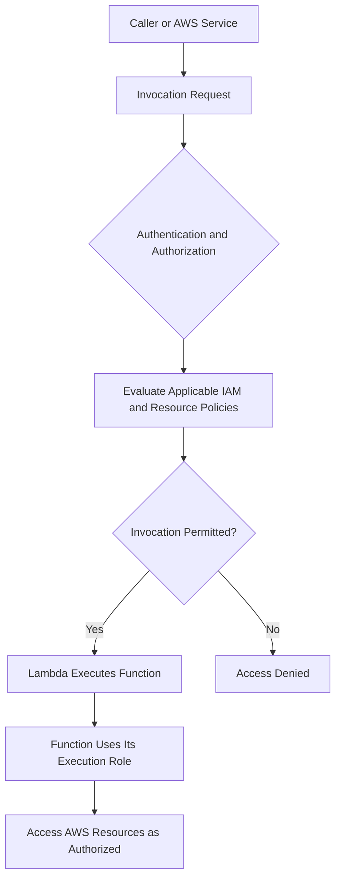

# 03- Resource-Based Policies and Invocation Permissions

## Overview

AWS Lambda resource-based policies control which principals can access a function through supported resource-level authorization mechanisms. They are particularly important when AWS services, external AWS accounts, or other principals need permission to invoke a Lambda function.

An execution role answers the question:

> What can this function access while it runs?

A resource-based policy helps answer a different question:

> Which principals are allowed to invoke or otherwise access this function through the supported resource policy?

These permissions are independent. Giving a Lambda execution role access to SQS does not automatically allow SQS to invoke the function. Likewise, allowing EventBridge to invoke a function does not grant the function permission to publish events to EventBridge.

This document covers Lambda resource-based policies, invocation authorization, service integrations, cross-account considerations, AWS CLI operations, and common permission failures.

## Resource-Based Policies

A resource-based policy is attached to a supported AWS resource and identifies principals that may access it under specified conditions.

For Lambda, the function's resource-based policy can authorize invocation by AWS services, AWS accounts, IAM principals, or other supported principals, subject to the relevant authorization model.

A policy statement commonly contains:

| Element | Purpose |
|---|---|
| `Effect` | Allows or denies the specified access. |
| `Principal` | Identifies the principal to which the statement applies. |
| `Action` | Specifies the permitted or denied operation, such as `lambda:InvokeFunction`. |
| `Resource` | Identifies the target function or qualified function resource. |
| `Condition` | Adds restrictions based on supported request attributes. |
| `Sid` | Optional identifier for the statement. |

### Example resource-based policy statement

The following example authorizes EventBridge to invoke a particular Lambda function when the invocation originates from a specified rule.

```json
{
  "Version": "2012-10-17",
  "Statement": [
    {
      "Sid": "AllowOrdersRuleInvocation",
      "Effect": "Allow",
      "Principal": {
        "Service": "events.amazonaws.com"
      },
      "Action": "lambda:InvokeFunction",
      "Resource": "arn:aws:lambda:ap-south-1:123456789012:function:process-orders",
      "Condition": {
        "ArnLike": {
          "AWS:SourceArn": "arn:aws:events:ap-south-1:123456789012:rule/orders-processing-rule"
        },
        "StringEquals": {
          "AWS:SourceAccount": "123456789012"
        }
      }
    }
  ]
}
```

The account ID, Region, function name, and rule name are illustrative. Replace them with the actual resource identifiers.

The source ARN and source account conditions restrict which EventBridge resource can use the permission. Such restrictions help reduce confused-deputy risks.

In practice, the policy can be managed through the Lambda API, AWS CLI, Infrastructure as Code, or the integration's supported configuration workflow.

## How Lambda Invocation Authorization Works

Invocation authorization depends on the identity of the caller, the integration, the target resource, and the applicable AWS authorization rules.



The execution role becomes relevant when the function runs and calls other services. It is not a substitute for authorization of the original invocation.

### Typical invocation paths

| Invocation path | Authorization considerations |
|---|---|
| IAM-authenticated direct invocation | The caller needs appropriate identity-based permissions, with any applicable resource policies and restrictions evaluated. |
| EventBridge rule targeting Lambda | A Lambda resource-based permission commonly authorizes the EventBridge service to invoke the function. |
| S3 event notification | The bucket configuration and Lambda resource policy must permit the intended notification integration. |
| API Gateway integration | Invocation authorization depends on the configured integration and API authorization model. |
| Lambda function URL | The URL's authorization mode and applicable IAM or application-level controls determine who can access it. |
| Cross-account invocation | The caller's permissions and the target function's authorization configuration must support the cross-account request. |

Do not assume every integration uses the same authorization mechanism. Check the documentation for the specific integration and invocation mode.

## Granting an AWS Service Permission to Invoke Lambda

AWS service integrations commonly require an explicit permission allowing the service to invoke the target function.

For example, EventBridge may need permission to invoke a function when a matching event arrives.

### Add an EventBridge invocation permission

The following is a mutating AWS CLI command:

```bash
aws lambda add-permission \
  --function-name process-orders \
  --statement-id AllowOrdersEventBridgeRule \
  --action lambda:InvokeFunction \
  --principal events.amazonaws.com \
  --source-arn arn:aws:events:ap-south-1:123456789012:rule/orders-processing-rule \
  --source-account 123456789012 \
  --region ap-south-1
```

Replace the example values with the target function, rule ARN, account ID, and Region.

The command adds a statement to the function's resource-based policy. It does not create the EventBridge rule or configure its target.

### Verify the policy

```bash
aws lambda get-policy \
  --function-name process-orders \
  --region ap-south-1
```

The response includes the resource policy as a JSON string. Inspect the statement's principal, action, resource scope, and conditions.

### Remove a permission

If the statement is no longer needed, remove it using its statement ID:

```bash
aws lambda remove-permission \
  --function-name process-orders \
  --statement-id AllowOrdersEventBridgeRule \
  --region ap-south-1
```

This operation changes the function's authorization configuration and may interrupt the integration that depends on it. Verify that the permission is no longer required before removal.

## Restricting Service Principals with Source Conditions

A service principal identifies an AWS service, such as `events.amazonaws.com` or `s3.amazonaws.com`. Allowing a service principal without adequate restrictions may permit unintended resources to use the permission, depending on the service and policy configuration.

Where supported, constrain service invocation using conditions such as:

- `AWS:SourceArn` to identify the intended source resource.
- `AWS:SourceAccount` to restrict the originating account.

For example, an S3 notification permission should generally identify the intended bucket rather than granting broad access to all S3 resources.

A narrowly scoped S3 invocation permission can be created as follows:

```bash
aws lambda add-permission \
  --function-name process-upload \
  --statement-id AllowUploadsBucket \
  --action lambda:InvokeFunction \
  --principal s3.amazonaws.com \
  --source-arn arn:aws:s3:::example-upload-bucket \
  --source-account 123456789012 \
  --region ap-south-1
```

The bucket and account identifiers are examples. Confirm the bucket's Region and the supported policy conditions for the integration before applying the command.

Also configure the S3 event notification to target the function. The invocation permission alone does not create the notification.

## Resource-Based Policies Versus Execution Roles

These two authorization mechanisms address different parts of the request lifecycle.

| Concern | Resource-based policy | Execution role |
|---|---|---|
| Primary purpose | Authorizes supported access to a Lambda resource. | Authorizes AWS operations performed by the running function. |
| Typical example | Allow EventBridge to invoke a function. | Allow the function to read from DynamoDB. |
| Principal | A caller, AWS service, account, or other supported principal. | The role assumed by the Lambda service for function execution. |
| Managed through | Lambda resource policy and related integration configuration. | IAM role trust policy and identity-based permissions policies. |
| Failure example | An AWS service cannot invoke the function. | The function receives `AccessDenied` when calling an AWS API. |

A useful diagnostic rule is to determine whether the request is failing before the handler executes or during an AWS API operation performed by the handler.

An invocation failure generally points toward the caller's authorization, resource policy, integration configuration, or request path. An `AccessDenied` exception from inside the handler generally requires inspection of the execution role and the target service's authorization rules.

## Direct Invocation and Event-Driven Integrations

Different invocation mechanisms have different delivery and failure semantics. Resource-based policies determine whether invocation is authorized; they do not define the complete retry or delivery behavior.

### EventBridge

EventBridge rules can route matching events to Lambda functions. The Lambda resource policy commonly grants the EventBridge service permission to invoke the target function.

Consider:

```text
Application → EventBridge → Rule → Lambda → DynamoDB
```

There are separate security checks for event publication, rule configuration, Lambda invocation, and the function's DynamoDB access.

### Amazon S3

S3 event notifications can invoke Lambda when configured events occur. The bucket configuration and Lambda resource policy must allow the intended integration.

For object-processing workloads, validate event data, handle duplicate notifications safely, and ensure the function's execution role can access only the required objects.

### Amazon SQS

Lambda event source mappings poll SQS queues and invoke the function with batches of messages. The execution role generally needs the permissions required for the event source mapping to poll and process the queue.

This differs from a service directly invoking Lambda through a resource-based permission. Do not add an SQS service principal to the Lambda resource policy merely because SQS is the event source for an event source mapping.

### API Gateway

API Gateway invokes Lambda through its configured integration. Depending on the setup, Lambda resource-based permissions may authorize API Gateway to invoke the function.

API authentication and authorization are separate from Lambda's invocation permission. Allowing API Gateway to invoke a function does not mean every external caller should be permitted to access the API.

## Lambda Function URLs

Function URLs provide HTTP(S) endpoints for Lambda functions. Their authorization behavior depends on the configured `AuthType` and applicable AWS authorization rules.

Two authorization modes are commonly used:

| Mode | Behavior | Security consideration |
|---|---|---|
| `AWS_IAM` | Requests must satisfy the applicable IAM authorization requirements. | Scope caller permissions and function access carefully. |
| `NONE` | The URL does not require AWS IAM authentication for requests. | Treat the endpoint as publicly reachable unless additional application or network controls restrict access. |

A function URL configured with `NONE` should not be treated as private simply because the function has a restricted execution role.

For public endpoints, implement appropriate application-level authentication and authorization, validate inputs, and apply rate limiting or abuse controls through suitable components. Confirm the current function URL resource-policy behavior and any applicable organization-level restrictions before deployment.

## Cross-Account Invocation

Cross-account invocation allows a principal in one AWS account to invoke a function in another account when the applicable authorization configuration permits it.

For example:

```text
Account A
  Application Role
       |
       | lambda:InvokeFunction
       v
Account B
  Lambda Function
       |
       | Execution Role
       v
  Application Resources
```

The caller's permissions and the target function's resource policy must be configured appropriately for the selected cross-account access pattern. Additional restrictions may apply through AWS Organizations, permission boundaries, session policies, and service-specific authorization rules.

### Caller-side permission example

A role in the calling account may need an identity-based policy granting invocation access to a specific target function:

```json
{
  "Version": "2012-10-17",
  "Statement": [
    {
      "Effect": "Allow",
      "Action": "lambda:InvokeFunction",
      "Resource": "arn:aws:lambda:ap-south-1:210987654321:function:process-orders"
    }
  ]
}
```

The target account must also configure the authorization required for the intended principal and access pattern. The example policy alone does not establish the complete cross-account relationship.

Use the narrowest principal and function ARN possible. Avoid granting cross-account access to an entire account unless that scope is explicitly required and governed.

For detailed trust relationships and cross-account patterns, see the dedicated cross-account invocation documentation.

## IAM Policy Evaluation Considerations

A resource-based `Allow` does not mean every invocation will succeed. AWS evaluates the applicable authorization controls for the particular principal, resource, and request.

Relevant controls can include:

- Identity-based policies.
- Lambda resource-based policies.
- Permissions boundaries.
- Session policies.
- AWS Organizations service control policies.
- Resource-specific conditions.
- Service-specific authorization behavior.

An applicable explicit `Deny` overrides an `Allow`. Some authorization interactions vary by principal type and resource, especially for cross-account requests and resource policies.

When diagnosing a failure, identify the principal and exact request before modifying policies. Avoid attempting to solve every authorization error by attaching broader permissions.

## Troubleshooting Invocation Permission Errors

Follow a consistent diagnostic sequence:

**Symptom → Caller and target identification → Policy inspection → Integration verification → Root cause confirmation → Minimal corrective change → Retest**

### Common failure scenarios

| Symptom | Likely causes | Investigation |
|---|---|---|
| EventBridge rule does not trigger Lambda | Missing invocation permission, incorrect target, disabled rule, or mismatched event pattern | Inspect the rule, target, function policy, and event metrics. |
| S3 notification cannot invoke Lambda | Missing or incorrectly scoped resource policy, invalid notification configuration, or Region mismatch | Inspect the bucket notification and function policy. |
| API Gateway returns an integration error | Incorrect integration configuration, invocation authorization failure, or handler response issue | Inspect API Gateway logs and the Lambda invocation path. |
| Direct invocation returns `AccessDenied` | Caller lacks required invocation permissions or another applicable policy restricts access | Inspect caller identity, identity policy, resource policy, and organization controls. |
| Cross-account invocation fails | Missing caller-side permission, target-side authorization, or a restricting policy | Verify both accounts' relevant authorization configuration. |
| Function URL returns authorization errors | Incorrect URL authorization mode, missing IAM permissions, or application-level rejection | Inspect URL configuration, policy, caller credentials, and handler behavior. |
| Invocation succeeds but AWS API access fails | Execution role lacks the required downstream permission | Inspect the failed action and the execution role. |

### Inspect the resource policy

```bash
aws lambda get-policy \
  --function-name <function-name> \
  --region <region>
```

If the function is accessed through a published version or alias, inspect the applicable qualified resource and verify which version or alias the integration invokes.

### Inspect function configuration

```bash
aws lambda get-function-configuration \
  --function-name <function-name> \
  --region <region> \
  --query '{FunctionName:FunctionName,Role:Role,State:State}'
```

This command provides configuration context. It does not, by itself, establish whether a particular caller is authorized.

### Inspect the caller's identity

For a caller using AWS credentials, run:

```bash
aws sts get-caller-identity
```

This read-only command identifies the account and principal associated with the active credentials. It is useful for detecting accidental use of the wrong AWS profile or role.

### Verify the actual invocation path

Confirm:

- The source resource points to the intended function.
- The integration is enabled and correctly configured.
- The invocation uses the expected function ARN, version, or alias.
- The source ARN and account conditions match the real source resource.
- No applicable identity, resource, or organization-level restriction blocks access.
- The execution role has the required permissions if the handler executes but fails on a downstream API call.

Make the smallest correction possible and repeat the original request.

## Production Best Practices

### Keep invocation permissions narrow

Use a specific principal and source-resource conditions when supported. Avoid unrestricted service-principal permissions when the integration can be constrained to a known source.

### Separate invocation and execution permissions

Review resource-based policies independently from execution-role permissions. This makes authorization failures easier to diagnose and limits unnecessary access.

### Manage permissions through Infrastructure as Code

Define invocation policies with the resources they protect. This helps prevent manual configuration drift and ensures that policy changes are reviewed alongside integration changes.

### Review qualified resources

Lambda supports versions and aliases. A permission attached to one function resource should not be assumed to cover every qualified invocation target. Verify the policy and ARN used by the actual integration.

### Monitor changes to invocation access

Use appropriate CloudTrail auditing and configuration review to detect unexpected changes to function policies, integration targets, and invocation permissions.

### Test both allowed and denied callers

Verify that intended callers can invoke the function and that unintended principals cannot. Test the real integration path instead of relying exclusively on a policy document review.

### Avoid confusing authentication with invocation permission

A service being permitted to invoke a Lambda function does not necessarily mean the end user is authenticated or authorized to perform the underlying business operation. API and application security remain necessary.

## Related Documentation

| Document | Purpose |
|---|---|
| [Lambda Security Overview](01- Lambda Security Overview.md) | Overall Lambda security boundaries and foundational controls. |
| [IAM Execution Roles and Permissions](02- IAM Execution Roles and Permissions.md) | Trust policies, execution permissions, and least privilege. |
| [Cross-Account Invocation](04- Cross-Account Invocation.md) | Cross-account authorization and trust patterns. |
| [Secrets Manager and Parameter Store](05- Secrets Manager and Parameter Store.md) | Secure configuration and secret access. |
| [VPC and Network Security](07- VPC and Network Security.md) | Network boundaries and private resource access. |
| [CloudTrail and Security Monitoring](09- CloudTrail and Security Monitoring.md) | Audit events and security monitoring. |

## Official References

- [AWS Lambda permissions](https://docs.aws.amazon.com/lambda/latest/dg/lambda-permissions.html)
- [Using resource-based policies for Lambda](https://docs.aws.amazon.com/lambda/latest/dg/access-control-resource-based.html)
- [AWS Lambda API: AddPermission](https://docs.aws.amazon.com/lambda/latest/api/API_AddPermission.html)
- [AWS Lambda API: GetPolicy](https://docs.aws.amazon.com/lambda/latest/api/API_GetPolicy.html)
- [AWS IAM policy evaluation logic](https://docs.aws.amazon.com/IAM/latest/UserGuide/reference_policies_evaluation-logic.html)
- [Using Lambda with Amazon EventBridge](https://docs.aws.amazon.com/lambda/latest/dg/with-eventbridge.html)
- [Using Lambda with Amazon S3](https://docs.aws.amazon.com/lambda/latest/dg/with-s3.html)
- [Lambda function URLs](https://docs.aws.amazon.com/lambda/latest/dg/urls-intro.html)

## Key Takeaways

- Lambda resource-based policies authorize supported access to the function, while execution roles govern AWS operations performed by the running function.
- Service integrations such as EventBridge and S3 commonly require explicit invocation permissions scoped to the intended source resource.
- Cross-account invocation requires the appropriate authorization on the caller and target sides, subject to applicable AWS policy evaluation rules.
- Diagnose invocation failures by inspecting the actual caller, target ARN, resource policy, integration configuration, and applicable restrictions before broadening access.
- Keep invocation permissions narrow, manage them through reviewed infrastructure definitions, and test both intended and unintended access paths.