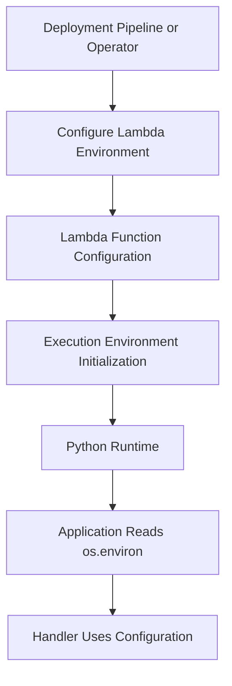
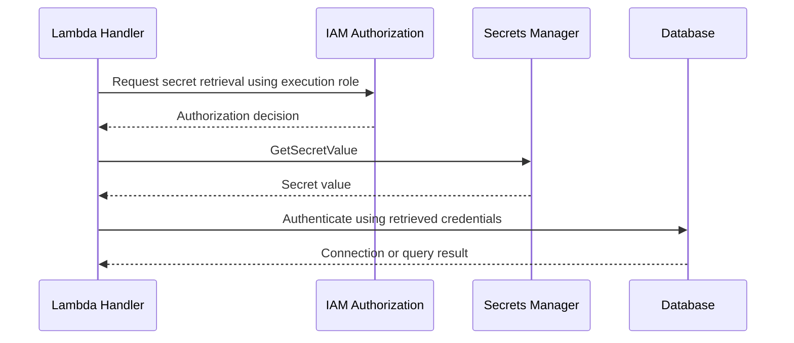

# 04- Environment Variables and Secrets Protection

## Overview

AWS Lambda environment variables provide a configuration mechanism for passing application settings to a function without embedding environment-specific values in application code. They are useful for configuring database endpoints, feature flags, resource identifiers, application modes, and references to secrets.

However, environment variables are not a complete secrets-management solution. Although Lambda encrypts environment variables at rest, sensitive values still require careful access control, lifecycle management, rotation, and protection against accidental disclosure.

For production workloads, distinguish between **configuration** and **secrets**:

- **Configuration** describes how an application behaves, such as a DynamoDB table name, log level, or API endpoint.
- **Secrets** grant access or contain sensitive information, such as database passwords, API tokens, private keys, and credentials.

A practical design uses Lambda environment variables for non-sensitive configuration and secret identifiers, while retrieving sensitive values from AWS Secrets Manager or AWS Systems Manager Parameter Store when appropriate.

## Environment Variables in Lambda

Lambda environment variables are key-value pairs configured for a function. They are available to the runtime during initialization and invocation.

For Python functions, Lambda exposes them through `os.environ`.

```python
import os

ORDERS_TABLE = os.environ["ORDERS_TABLE"]
LOG_LEVEL = os.environ.get("LOG_LEVEL", "INFO")


def lambda_handler(event, context):
    return {
        "statusCode": 200,
        "body": f"Using table: {ORDERS_TABLE}"
    }
```

The example demonstrates configuration access, but production handlers should normally use a structured response format and avoid returning internal resource identifiers unless required.

### Common configuration values

| Variable | Example | Sensitive? | Recommended handling |
|---|---|---|---|
| `LOG_LEVEL` | `INFO` | No | Environment variable |
| `ORDERS_TABLE` | `orders-prod` | Usually no | Environment variable |
| `AWS_REGION` | `ap-south-1` | No | Use the runtime-provided value when appropriate |
| `API_BASE_URL` | `https://api.example.com` | Usually no | Environment variable |
| `DATABASE_SECRET_ARN` | Secrets Manager ARN | Usually not a credential, but sensitive operational metadata | Environment variable with restricted access |
| `DATABASE_PASSWORD` | Actual database password | Yes | Prefer a secrets-management service |
| `THIRD_PARTY_API_TOKEN` | Actual API token | Yes | Prefer a secrets-management service |

Do not treat a secret ARN as equivalent to the secret itself. The ARN identifies a resource; IAM permissions still determine whether the function can retrieve its contents.

## How Environment Variables Work

Environment variables are part of a Lambda function's configuration. Lambda makes the configured values available to the execution environment, allowing application code to read them without making a separate configuration API request for every access.



Environment variables are particularly useful when the same application artifact must run in development, staging, and production with different settings.

### Configuration lifecycle

A typical deployment workflow is:

1. Define the environment-specific configuration.
2. Apply the configuration to the Lambda function.
3. Publish a version when an immutable deployment snapshot is required.
4. Route traffic through the intended version or alias.
5. Verify the deployed configuration and application behavior.

Environment-variable changes update the function's configuration and can affect the execution environments used by subsequent invocations. Published Lambda versions capture their configuration, including environment variables, at publication time. A published version is immutable; changing the configuration of the unpublished function does not modify an already published version.

For predictable deployments, manage configuration changes alongside the corresponding infrastructure and application release.

## Encryption and Environment Variable Protection

Lambda encrypts environment variables at rest using AWS Key Management Service (AWS KMS). By default, Lambda uses an AWS-managed key for this purpose. You can configure a customer-managed KMS key when you need additional control over key policy, access, auditing, or key lifecycle.

Encryption at rest does not eliminate the need for access control. Principals with sufficient permissions to inspect or decrypt configuration may be able to access sensitive values.

### Default encryption and customer-managed keys

| Consideration | AWS-managed key | Customer-managed KMS key |
|---|---|---|
| Key administration | Managed by AWS | Managed by your organization |
| Key policy customization | Limited compared with customer-managed keys | Available |
| Access governance | Primarily through the service's supported authorization model | Can incorporate key policy and IAM permissions |
| Key lifecycle control | AWS-managed | Organization controls key lifecycle and rotation settings |
| Operational complexity | Lower | Higher |
| Appropriate use | Standard workloads without specialized key-control requirements | Workloads requiring explicit key governance or separation of duties |

A customer-managed key is not automatically more secure in every deployment. It introduces additional policy and availability dependencies that must be managed correctly.

### Configure a customer-managed KMS key

A function can be configured to use a customer-managed KMS key through the Lambda configuration API or AWS CLI.

```bash
aws lambda update-function-configuration \
  --function-name orders-api \
  --kms-key-arn arn:aws:kms:ap-south-1:123456789012:key/11111111-2222-3333-4444-555555555555 \
  --region ap-south-1
```

This is a mutating command. Replace the example ARN with a valid KMS key in the appropriate account and Region.

Verify the resulting configuration:

```bash
aws lambda get-function-configuration \
  --function-name orders-api \
  --region ap-south-1 \
  --query '{FunctionName:FunctionName,KMSKeyArn:KMSKeyArn,State:State}'
```

Ensure the relevant principals have the required permissions to use the key and that its key policy permits the intended operations. Incorrect KMS permissions can prevent configuration updates or interfere with access to encrypted values.

## Secrets Management Options

AWS provides dedicated services for storing and controlling access to sensitive values.

### AWS Secrets Manager

Secrets Manager is designed for storing, retrieving, rotating, and auditing secrets such as database credentials and API tokens.

Use it when you need features such as:

- Managed secret storage and retrieval.
- Integration with supported rotation workflows.
- Fine-grained IAM access control.
- Versioning and staging labels for secret versions.
- Integration with supported AWS services and applications.

Secrets Manager has service charges, including charges based on stored secrets and API usage. Review current pricing and expected request volume before choosing a retrieval strategy.

### AWS Systems Manager Parameter Store

Parameter Store provides hierarchical configuration storage. It supports standard and advanced parameters, including `SecureString` values protected using KMS.

It can be appropriate for application configuration and selected secrets, depending on the required access patterns, operational features, parameter tier, and security requirements.

| Requirement | Environment variables | Secrets Manager | Parameter Store |
|---|---|---|---|
| Ordinary application configuration | Strong fit | Usually unnecessary | Strong fit |
| Store secret values | Possible, but generally less suitable for long-lived secrets | Strong fit | Supported through `SecureString` |
| Managed secret rotation | Not provided by environment variables themselves | Supported for applicable integrations and configurations | Requires an appropriate rotation workflow |
| Runtime retrieval | Available through the process environment | API call or supported integration | API call or supported integration |
| Fine-grained access control | Primarily through Lambda configuration permissions and relevant encryption controls | IAM and resource/key policies as applicable | IAM and KMS controls as applicable |
| Dynamic secret updates | Requires configuration or deployment changes if stored directly | Retrieve the current appropriate version | Retrieve the current appropriate parameter version |
| Typical use | Resource identifiers, flags, non-sensitive settings | Database passwords, tokens, credentials | Hierarchical configuration and selected encrypted values |

The right choice depends on rotation requirements, access patterns, cost, latency, and governance. Do not store secrets in a configuration service merely because it is convenient; define the lifecycle and access model first.

## Retrieving Secrets from AWS Secrets Manager

A common production pattern is to place the secret ARN in a Lambda environment variable and retrieve the actual secret at runtime.



The function's execution role must be authorized to retrieve the specific secret. If the secret uses a customer-managed KMS key, the relevant KMS authorization must also permit decryption through the supported access path.

### Example environment configuration

```text
DATABASE_SECRET_ARN=arn:aws:secretsmanager:ap-south-1:123456789012:secret:prod/orders-db-AbCdEf
```

Store the ARN or other non-secret identifier in the environment, not the database password.

### Python implementation

The following example retrieves a JSON-formatted secret from Secrets Manager.

```python
import json
import os
from functools import lru_cache

import boto3

secrets_client = boto3.client("secretsmanager")
DATABASE_SECRET_ARN = os.environ["DATABASE_SECRET_ARN"]


@lru_cache(maxsize=1)
def get_database_credentials() -> dict[str, str]:
    response = secrets_client.get_secret_value(
        SecretId=DATABASE_SECRET_ARN
    )

    secret_string = response.get("SecretString")
    if not secret_string:
        raise RuntimeError("Expected a string-formatted database secret")

    secret = json.loads(secret_string)

    required_fields = {"username", "password", "host", "dbname"}
    missing_fields = required_fields - secret.keys()
    if missing_fields:
        raise ValueError(
            f"Database secret is missing fields: {sorted(missing_fields)}"
        )

    return {
        "username": secret["username"],
        "password": secret["password"],
        "host": secret["host"],
        "dbname": secret["dbname"],
    }
```

The cache avoids retrieving the secret on every invocation within the same execution environment. It is not a durable or globally shared cache.

Production considerations:

- The cache can retain credentials after a rotation. Define a refresh or cache-expiration strategy when credentials rotate.
- A Lambda execution environment can be reused for multiple invocations, but reuse is not guaranteed.
- Never log the returned secret or include it in an exception message.
- Validate the secret schema and handle service failures deliberately.
- Use connection-management strategies appropriate to the database and Lambda concurrency model.
- Consider Secrets Manager's supported database integrations and rotation workflows when applicable.

The example intentionally returns credentials only to the application. Database connection creation, transaction management, retries, and cleanup should be implemented using the database driver's appropriate lifecycle semantics.

## Least-Privilege Permissions for Secret Retrieval

The Lambda execution role should grant access only to the required secret and only to the operations needed by the function.

### Example IAM policy

```json
{
  "Version": "2012-10-17",
  "Statement": [
    {
      "Sid": "ReadOrdersDatabaseSecret",
      "Effect": "Allow",
      "Action": "secretsmanager:GetSecretValue",
      "Resource": "arn:aws:secretsmanager:ap-south-1:123456789012:secret:prod/orders-db-AbCdEf"
    }
  ]
}
```

Replace the example ARN with the actual secret ARN. Secrets Manager ARNs commonly include a generated suffix; use the ARN returned by AWS rather than guessing it.

If the secret uses a customer-managed KMS key, the function may also require `kms:Decrypt`, subject to the key policy and the service's authorization path. Do not automatically grant broad KMS access; scope permissions to the required key and validate the complete authorization configuration.

### Common permission failures

| Error or symptom | Likely cause | Corrective action |
|---|---|---|
| `AccessDeniedException` from Secrets Manager | Execution role lacks `secretsmanager:GetSecretValue`, or another policy blocks access | Inspect the execution role and applicable policy restrictions. |
| KMS access denied | The relevant key policy or IAM permissions do not allow the required operation | Review the customer-managed key policy and required KMS permissions. |
| Secret not found | Incorrect ARN, Region, account, or secret identifier | Verify the identifier and Region. |
| Timeout while retrieving a secret | Network, DNS, endpoint, service, or timeout issue | Inspect VPC connectivity and relevant service access paths. |
| Application keeps using an old password | Cached credentials were not refreshed after rotation | Implement an appropriate cache-expiration and credential-refresh strategy. |

## Accessing SecureString Parameters from Parameter Store

For workloads using Parameter Store, a `SecureString` parameter can store encrypted sensitive values.

A typical parameter retrieval command is:

```bash
aws ssm get-parameter \
  --name "/prod/orders/database-password" \
  --with-decryption \
  --region ap-south-1
```

This is a read operation, but the response contains the decrypted parameter value. Avoid running such commands in shared terminals, CI logs, or environments where output could be captured.

For production applications, retrieve the parameter through the AWS SDK and ensure the function's execution role has only the required permissions, such as `ssm:GetParameter` for the specific parameter. KMS permissions may also be required depending on the key and authorization configuration.

Do not print the complete SDK response to application logs because it can include the decrypted value.

## Environment Variables in Python Applications

Lambda initializes the runtime and makes configured environment variables available to the Python process. Read configuration during initialization when it is stable for the lifetime of the execution environment.

```python
import os

ORDERS_TABLE = os.environ["ORDERS_TABLE"]
APP_ENV = os.environ.get("APP_ENV", "production")


def lambda_handler(event, context):
    if APP_ENV != "production":
        # Apply environment-specific behavior only when explicitly required.
        pass

    return {
        "statusCode": 200,
        "body": "Request processed"
    }
```

Using `os.environ["ORDERS_TABLE"]` causes a clear failure during initialization if the required variable is missing. This is preferable to allowing a missing configuration value to cause an obscure failure later in request processing.

Use `os.environ.get()` when a setting has a deliberate default. Avoid silently defaulting security-sensitive settings to permissive values.

### Configuration validation

Validate required settings early:

```python
import os


def required_env(name: str) -> str:
    value = os.environ.get(name)
    if value is None or not value.strip():
        raise RuntimeError(f"Missing required environment variable: {name}")
    return value


ORDERS_TABLE = required_env("ORDERS_TABLE")
DATABASE_SECRET_ARN = required_env("DATABASE_SECRET_ARN")
```

This validation reports configuration names, not their values. Never include a secret's contents in validation errors.

For larger applications, centralize configuration loading and validation so that handlers, service classes, and repositories do not each implement their own environment-variable logic.

## Updating Environment Variables with AWS CLI

Lambda configuration updates should be treated as deployment operations because they can change application behavior and affect the execution environments used by requests.

### Inspect current configuration

```bash
aws lambda get-function-configuration \
  --function-name orders-api \
  --region ap-south-1 \
  --query '{FunctionName:FunctionName,Environment:Environment.Variables,LastModified:LastModified}'
```

This command displays environment variable values. Do not share its output publicly or store it in unrestricted CI artifacts if the function contains sensitive values.

### Update environment variables

The `update-function-configuration` API replaces the environment variable map supplied in the request. To preserve existing variables, include all desired key-value pairs.

A safe workflow is to prepare a complete environment configuration file, review it, apply it, and verify the resulting configuration. Avoid copying secret values into shell history or terminal logs.

Example configuration file:

```json
{
  "Variables": {
    "APP_ENV": "production",
    "ORDERS_TABLE": "orders-prod",
    "DATABASE_SECRET_ARN": "arn:aws:secretsmanager:ap-south-1:123456789012:secret:prod/orders-db-AbCdEf",
    "LOG_LEVEL": "INFO"
  }
}
```

Apply it using:

```bash
aws lambda update-function-configuration \
  --function-name orders-api \
  --environment file://environment.json \
  --region ap-south-1
```

The JSON file is configuration input and must be protected according to its contents. The command modifies the function configuration; it does not automatically publish a new immutable version.

Verify the update:

```bash
aws lambda get-function-configuration \
  --function-name orders-api \
  --region ap-south-1 \
  --query '{FunctionName:FunctionName,LastModified:LastModified,LastUpdateStatus:LastUpdateStatus}'
```

Check that the update has completed successfully before running deployment verification or routing traffic to a new version.

## Secret Rotation and Cache Invalidation

Secret rotation changes the credential value stored by the secret-management system. Applications must be able to use the new value without relying indefinitely on stale cached credentials.

A safe rotation design considers:

- How the secret is rotated.
- Whether old and new credentials overlap during the transition.
- How application instances discover updated credentials.
- Whether database connections remain authenticated using old credentials.
- How failures are retried without causing a connection storm.
- Whether a rollback requires restoring a prior secret version or deploying a compatible application version.

Caching improves performance and reduces API calls, but it introduces a consistency trade-off. A long-lived cache can continue using an old credential after rotation. Fetching the secret on every request reduces staleness but increases latency, API traffic, and cost.

Choose a bounded cache lifetime based on the rotation policy and operational risk. Ensure the application can refresh credentials after authentication failures without repeatedly retrying an invalid value.

For database-backed applications, credential refresh may require establishing new connections. Existing connection pools should not be assumed to adopt new credentials automatically.

## Network and VPC Considerations

A Lambda function running in a VPC may need a supported network path to access Secrets Manager or Parameter Store.

Depending on the architecture, that path can use:

- Appropriate outbound connectivity through a configured network path.
- A supported VPC interface endpoint for the relevant service.
- Correct security group rules, subnet routing, DNS resolution, and endpoint policies.

Attaching a function to a VPC does not automatically provide internet access. If a function must access public endpoints, verify the routing and egress architecture rather than assuming that private subnet placement provides connectivity.

When a secret retrieval call times out, distinguish authorization errors from connectivity errors. A permission failure and a network timeout require different corrective actions.

## Preventing Secret Exposure

Secret protection is not limited to encryption. Secrets can leak through logs, error messages, debugging output, deployment artifacts, shell history, or overly broad access to configuration APIs.

### Logging

Do not log environment dictionaries, SDK responses containing decrypted values, or connection strings containing credentials.

Avoid patterns such as:

```python
import os

# Unsafe: may expose credentials or tokens.
print(dict(os.environ))
```

Prefer structured, non-sensitive operational context:

```python
import logging
import os

logger = logging.getLogger()
logger.setLevel(os.environ.get("LOG_LEVEL", "INFO"))


def lambda_handler(event, context):
    logger.info(
        "Processing request",
        extra={
            "aws_request_id": context.aws_request_id,
            "function_name": context.function_name,
        },
    )

    return {"statusCode": 200, "body": "Processed"}
```

Ensure the logging configuration and log-processing pipeline preserve the intended structured fields. Do not include raw request bodies or headers without a clear need and appropriate redaction.

### Deployment pipelines

CI/CD systems should avoid exposing secrets in:

- Build output and shell tracing.
- Generated environment files.
- Deployment command arguments.
- Debug logs and test failure output.
- Artifacts containing rendered infrastructure configuration.
- Pull request logs from untrusted code.

Use an appropriate federated or short-lived deployment identity where supported. Separate the deployment role, which changes infrastructure and configuration, from the Lambda execution role, which accesses runtime resources.

### Access control

Restrict permissions to inspect function configuration and retrieve secrets. Review permissions such as `lambda:GetFunctionConfiguration`, `lambda:UpdateFunctionConfiguration`, and `secretsmanager:GetSecretValue` according to operational responsibilities.

A principal that can modify a function's configuration or deployment may be able to influence application behavior or expose data indirectly. Protect deployment permissions as carefully as direct secret-read permissions.

## Common Mistakes and Production Pitfalls

| Mistake | Why it is dangerous | Better approach |
|---|---|---|
| Storing long-lived credentials directly in environment variables | Increases the number of configuration and deployment paths through which secrets may be exposed | Store secrets in Secrets Manager or another appropriate secret store. |
| Logging `os.environ` | Can expose tokens, passwords, and internal configuration | Log only explicitly approved, non-sensitive fields. |
| Giving the execution role `secretsmanager:*` on `*` | Grants broader access than the function requires | Scope actions and resources to the intended secret. |
| Assuming encrypted environment variables are automatically safe | Encryption does not replace authorization or output controls | Restrict configuration access and prevent secret disclosure in logs. |
| Updating only one environment variable while unintentionally dropping others | Lambda environment updates replace the supplied variable map | Apply a complete, reviewed configuration map. |
| Caching credentials indefinitely | Rotation can leave the application using stale credentials | Use bounded caching and a refresh strategy. |
| Assuming a VPC-attached function can reach AWS service endpoints automatically | Routing, DNS, endpoints, and egress may be missing | Validate the network path and endpoint configuration. |
| Using one secret for unrelated applications | Expands the impact of compromise and complicates rotation | Separate secrets according to application and access boundaries. |
| Publishing versions before configuration is ready | A version can retain an incorrect configuration snapshot | Validate configuration before publishing and moving aliases. |
| Treating secret retrieval failures as empty credentials | Can hide configuration failures and cause confusing downstream errors | Fail explicitly and emit sanitized diagnostic information. |

## Production Readiness Checklist

Before deploying a Lambda function that consumes sensitive configuration, verify the following:

- [ ] Non-sensitive settings and secret values are clearly separated.
- [ ] Secrets are stored in an appropriate secret-management service.
- [ ] Environment variables contain secret identifiers rather than unnecessary raw credentials.
- [ ] The execution role has narrowly scoped secret-read permissions.
- [ ] Customer-managed KMS key policies and required permissions are verified where applicable.
- [ ] VPC routing, DNS, endpoints, and security group rules support the required service access.
- [ ] Secret caching and rotation behavior are documented and tested.
- [ ] Logs, metrics, errors, and traces do not expose credentials.
- [ ] CI/CD avoids printing secrets or publishing sensitive configuration artifacts.
- [ ] Configuration changes are reviewed and deployed through a repeatable workflow.
- [ ] Published versions and aliases point to the intended configuration.
- [ ] Secret access failures and unexpected authorization changes can be diagnosed through appropriate logs and audit events.

## Official References

- [Lambda environment variables](https://docs.aws.amazon.com/lambda/latest/dg/configuration-envvars.html)
- [Lambda configuration and deployment](https://docs.aws.amazon.com/lambda/latest/dg/configuration.html)
- [Using AWS Secrets Manager with Lambda](https://docs.aws.amazon.com/lambda/latest/dg/with-secrets-manager.html)
- [AWS Secrets Manager User Guide](https://docs.aws.amazon.com/secretsmanager/latest/userguide/intro.html)
- [AWS Systems Manager Parameter Store](https://docs.aws.amazon.com/systems-manager/latest/userguide/systems-manager-parameter-store.html)
- [AWS Key Management Service](https://docs.aws.amazon.com/kms/latest/developerguide/overview.html)
- [Lambda execution roles](https://docs.aws.amazon.com/lambda/latest/dg/lambda-intro-execution-role.html)
- [Lambda networking](https://docs.aws.amazon.com/lambda/latest/dg/configuration-vpc.html)

## Key Takeaways

- Use Lambda environment variables for application configuration and secret identifiers; prefer a dedicated secrets-management service for sensitive credential values.
- Encryption at rest does not replace least-privilege access controls, safe logging, or secure deployment practices.
- Scope execution-role permissions to the required secret and verify any associated customer-managed KMS key authorization.
- Design secret caching and rotation together so that execution environments can transition safely to updated credentials.
- Treat configuration changes, deployment permissions, network access, and secret retrieval failures as production security and reliability concerns.