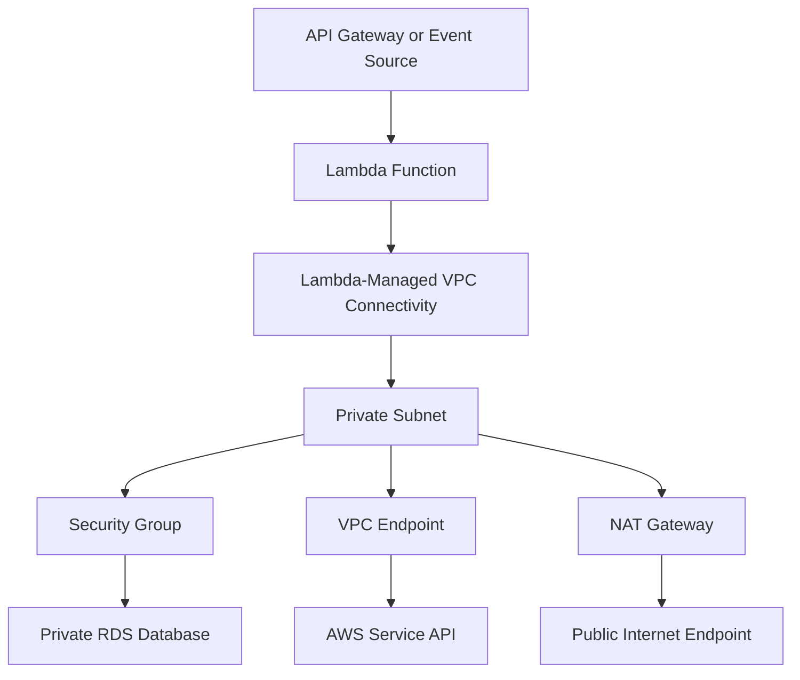
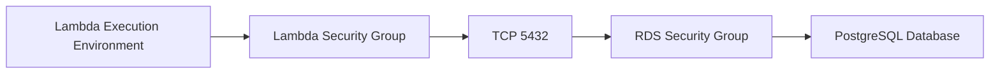
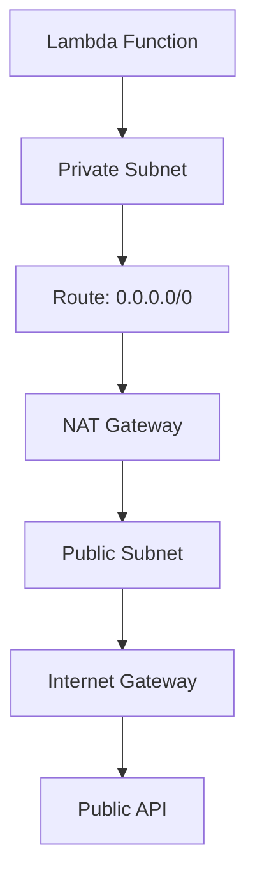
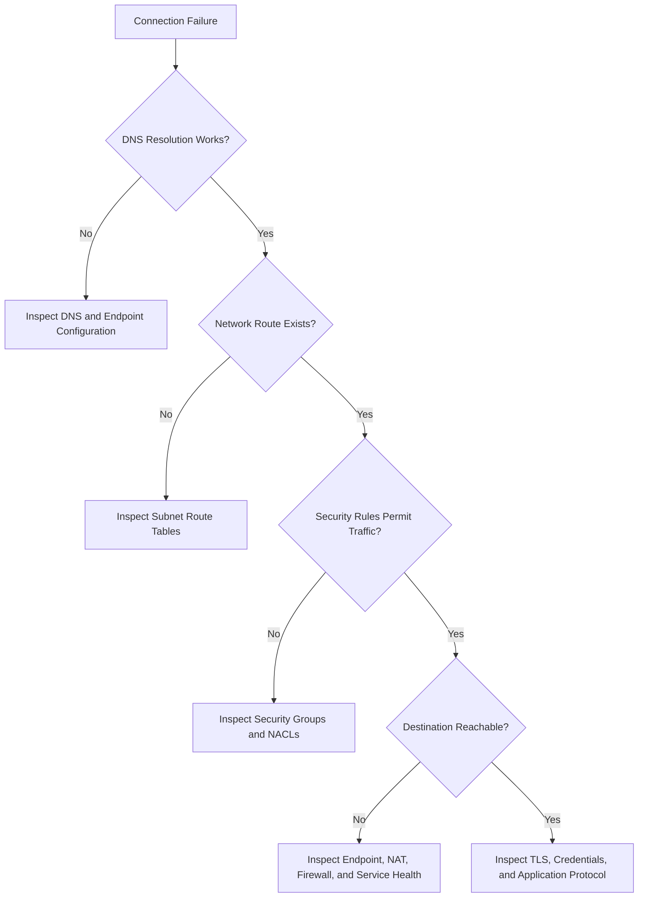

# 05- VPC and Network Security

## Overview

AWS Lambda can execute functions outside a customer-managed VPC or connect them to a VPC to access private resources such as Amazon RDS, Amazon ElastiCache, internal services, and private endpoints. Choosing the correct networking model is important because it affects security boundaries, connectivity, latency, scalability, operational complexity, and cost.

By default, Lambda functions execute in an AWS-managed networking environment. A function does not need to be attached to a VPC simply because it accesses AWS services; many AWS service integrations use service APIs without requiring the function to reside inside the service's VPC.

VPC attachment is primarily required when the function must access resources reachable through a specific VPC network, such as a private database or an internal service.

A production networking design should answer four questions:

- Which resources must the function reach?
- Which network paths are required to reach those resources?
- Which identities and network rules authorize the connections?
- How will connectivity failures, capacity constraints, and security changes be diagnosed?

## Lambda Networking Architecture

### Lambda without VPC attachment

A Lambda function that is not attached to a customer-managed VPC runs in Lambda-managed networking. It can communicate with supported AWS service APIs through the available service access paths and can access public endpoints as supported by its execution environment.

It does not automatically gain access to private resources inside a customer VPC.

Typical use cases include:

- Processing EventBridge events.
- Consuming SQS messages.
- Handling API requests that access DynamoDB through its service API.
- Processing S3 objects through the AWS SDK.
- Running lightweight scheduled jobs that do not need private network resources.

### Lambda with VPC attachment

When a function is configured for VPC access, Lambda creates and manages Hyperplane network interfaces to provide connectivity from its execution environments into the selected VPC subnets. The function can then reach resources permitted by the relevant network configuration.

A typical architecture looks like this:



The diagram illustrates possible paths, not mandatory components. A VPC endpoint and NAT Gateway serve different purposes and are not interchangeable.

For example, a Lambda function accessing only a private RDS instance and DynamoDB through a suitable VPC endpoint may not need a NAT Gateway. A function that must call arbitrary public APIs generally needs an appropriate outbound internet path.

## VPC Fundamentals for Lambda

A Lambda networking design depends on several standard VPC components.

| Component | Responsibility | Lambda-specific consideration |
|---|---|---|
| VPC | Defines an isolated virtual network | Provides the network boundary for private resources |
| Subnet | Divides a VPC IP address range into smaller ranges | Select subnets that provide the required routes and availability |
| Route table | Determines the next hop for network traffic | Controls access to local VPC resources, endpoints, NAT, and other networks |
| Security group | Stateful virtual firewall associated with network interfaces or resources | Controls permitted inbound and outbound connections |
| Network ACL | Stateless subnet-level traffic filter | Must allow the relevant traffic in both directions, including return traffic |
| Internet Gateway | Enables internet connectivity for appropriately routed public subnets | Does not automatically give a Lambda function internet access |
| NAT Gateway | Provides outbound IPv4 connectivity for private subnet resources | Can introduce hourly and data-processing charges |
| VPC endpoint | Provides private connectivity to supported AWS services | Can reduce the need for NAT-based access to those services |
| DNS resolution | Resolves service names to IP addresses | Must work for private resources and private service endpoints |
| VPC peering or Transit Gateway | Connects VPCs or networks | Requires correct routes, addressing, and security rules |

## Selecting Subnets

Lambda VPC configuration requires subnet IDs and security group IDs. For production workloads, select subnets based on the resources the function must access and the required availability and routing characteristics.

### Private subnets

Private subnets are a common choice for Lambda functions that access internal databases or services. They avoid placing the function's network interfaces in public subnets merely to attempt internet access.

A private subnet typically has routes for local VPC traffic and may have routes to NAT Gateways, VPC endpoints, or other private networks.

### Public subnets

Selecting a public subnet does not assign a public IP address to the Lambda function's network interfaces or automatically provide internet access. Lambda VPC connectivity does not work like launching an EC2 instance with a public IP in a public subnet.

If the function needs outbound access to public services, configure a valid egress architecture.

### Multi-AZ subnet selection

For high availability, select appropriate subnets across multiple Availability Zones where the target architecture supports them.

For a private database deployment, ensure the selected subnets can reach the database's network location and that the database itself has suitable availability and failover configuration. Subnet selection alone does not make a database highly available.

## Security Groups

Security groups are stateful virtual firewalls. They control permitted traffic to and from associated network interfaces or resources.

For a Lambda function connecting to a database, use security group rules that permit only the necessary traffic.

### Example: Lambda to PostgreSQL

Assume the following architecture:

- Lambda security group: `sg-lambda-orders`
- RDS security group: `sg-rds-orders`
- PostgreSQL port: `5432`

Configure the RDS security group to allow inbound TCP port `5432` from `sg-lambda-orders`, rather than allowing access from an entire VPC CIDR range.

The resulting authorization path is:



The database security group must allow the inbound connection, and the Lambda security group must permit the required outbound traffic. Security groups are stateful, so response traffic for an allowed connection is automatically permitted by the stateful tracking behavior.

### Example security group configuration

Create a dedicated security group for the Lambda function and another for the database. The exact VPC and security group IDs must be obtained from the target account.

```bash
aws ec2 describe-security-groups \
  --group-ids sg-lambda-orders sg-rds-orders \
  --region ap-south-1
```

This is a read-only inspection command.

When configuring the database security group, permit the database port from the Lambda security group. For example:

```bash
aws ec2 authorize-security-group-ingress \
  --group-id sg-rds-orders \
  --protocol tcp \
  --port 5432 \
  --source-group sg-lambda-orders \
  --region ap-south-1
```

This command changes the security group configuration. It can fail if the rule already exists, the group IDs are invalid, or the caller lacks permission. Verify the resulting rules before testing connectivity.

```bash
aws ec2 describe-security-groups \
  --group-ids sg-rds-orders \
  --region ap-south-1 \
  --query 'SecurityGroups[0].IpPermissions'
```

Avoid allowing PostgreSQL or other database ports from `0.0.0.0/0`. Restrict access to the intended source security group or other narrowly defined network source.

## Network ACLs

Network ACLs operate at the subnet boundary and are stateless. Unlike security groups, they require explicit rules for both directions of traffic.

For a TCP connection, the network ACL must permit the request traffic and the corresponding return traffic. Return traffic generally uses ephemeral ports on the client side.

If security groups appear correct but connections still time out, inspect the network ACLs associated with both the source and destination subnets.

| Property | Security group | Network ACL |
|---|---|---|
| Scope | Associated network interfaces or resources | Subnet |
| Stateful | Yes | No |
| Return traffic | Automatically allowed for tracked connections | Must be allowed by applicable rules |
| Rules | Allow rules | Allow and deny rules |
| Common use | Resource-level network access control | Additional subnet-level traffic filtering |

Use security groups as the primary resource-level control in most Lambda-to-database designs. Add network ACL restrictions when they address a specific network security requirement and can be maintained without disrupting legitimate traffic.

## Internet Access from a VPC-Connected Lambda

A VPC-attached Lambda function does not automatically have outbound internet connectivity. Internet access depends on the selected subnet routes and the associated network infrastructure.

### NAT Gateway architecture

A common IPv4 egress design is:

1. The Lambda function is configured with private subnets.
2. Those subnets have a default route to a NAT Gateway.
3. The NAT Gateway resides in a public subnet.
4. The public subnet has a route to an Internet Gateway.
5. Security groups, network ACLs, DNS, and the destination endpoint permit the connection.



A NAT Gateway enables outbound connectivity for supported traffic. It does not make the Lambda function directly reachable from the internet.

For resilience, evaluate NAT Gateway placement and routing across Availability Zones. A single NAT Gateway may become a dependency for traffic from multiple Availability Zones and can introduce cross-AZ data transfer costs. A multi-AZ design may use NAT Gateways in each relevant AZ, subject to cost and architecture requirements.

### VPC endpoints

A VPC endpoint can provide private access to supported AWS services without routing that service traffic through a NAT Gateway.

For example, a suitable interface VPC endpoint may allow a private Lambda function to call Secrets Manager through the AWS service's private endpoint.

A gateway endpoint is available for supported services such as Amazon S3 and DynamoDB. Its route-table configuration differs from an interface endpoint.

| Requirement | Typical option |
|---|---|
| Access S3 privately | S3 gateway endpoint or another suitable supported endpoint design |
| Access DynamoDB privately | DynamoDB gateway endpoint |
| Access Secrets Manager privately | Secrets Manager interface endpoint |
| Access Systems Manager APIs privately | Appropriate Systems Manager interface endpoints for the APIs used |
| Access arbitrary public APIs | NAT-based or another supported outbound connectivity architecture |

Endpoint support, endpoint policies, DNS configuration, and service-specific behavior must be checked for the intended service and Region.

## DNS and Private Connectivity

DNS is often overlooked during Lambda networking troubleshooting. A function may have correct routes and security group rules but still fail because the hostname resolves incorrectly or cannot be resolved.

Check the following:

- VPC DNS support and DNS hostnames settings where required.
- Route 53 private hosted zones and their VPC associations.
- Private DNS configuration for interface VPC endpoints.
- Database endpoint names and the actual endpoint being used.
- Custom DNS resolver and forwarding rules, if present.
- Security group and network ACL rules for the relevant DNS traffic where custom paths require them.

For a private database, use the database endpoint provided by the service rather than hardcoding an IP address. Database failover and endpoint changes can make hardcoded IP addresses unreliable.

## Configuring Lambda for VPC Access

The Lambda execution role and the function's VPC configuration serve different purposes.

- The execution role grants the function permission to call AWS APIs and access other resources.
- VPC configuration specifies the network location and security groups used for VPC connectivity.
- Network rules and routing determine whether a connection can reach its destination.

### Required permissions

The principal configuring VPC access needs the permissions required by the Lambda configuration operation and the associated EC2 network-interface operations. Lambda's service-managed network interfaces may require EC2 permissions such as `ec2:CreateNetworkInterface`, `ec2:DescribeNetworkInterfaces`, and `ec2:DeleteNetworkInterface` during configuration and lifecycle management.

AWS provides the managed policy `AWSLambdaVPCAccessExecutionRole` for the relevant execution-role permissions, including network-interface operations and CloudWatch Logs permissions. Review the current managed policy before applying it, and consider a carefully scoped policy when organizational requirements demand tighter permissions.

Do not confuse permissions required to configure or manage VPC access with permissions required by application code to query a database or retrieve a secret.

### Inspect existing VPC configuration

```bash
aws lambda get-function-configuration \
  --function-name orders-api \
  --region ap-south-1 \
  --query '{VpcConfig:VpcConfig,State:State,LastUpdateStatus:LastUpdateStatus}'
```

This is a read-only operation.

### Configure VPC access

The following command changes the function configuration. Use subnet and security group IDs belonging to the intended VPC.

```bash
aws lambda update-function-configuration \
  --function-name orders-api \
  --vpc-config SubnetIds=subnet-11111111,subnet-22222222,SecurityGroupIds=sg-11111111 \
  --region ap-south-1
```

The IDs above are placeholders. Replace them with valid resource IDs. Include all intended subnet and security group IDs in the configuration.

Wait for the update to finish and verify the resulting state:

```bash
aws lambda wait function-updated \
  --function-name orders-api \
  --region ap-south-1

aws lambda get-function-configuration \
  --function-name orders-api \
  --region ap-south-1 \
  --query '{VpcConfig:VpcConfig,State:State,LastUpdateStatus:LastUpdateStatus}'
```

An update can fail if the caller lacks required permissions, the configuration references invalid resources, or service-side requirements are not met.

## Database Connectivity and Connection Management

VPC-connected Lambda functions commonly access Amazon RDS, Aurora, or self-managed databases hosted on private infrastructure.

The network path is only one part of the design. Lambda's concurrency model can cause database connection exhaustion if every execution environment opens connections without limits.

For example, if a function reaches 500 concurrent execution environments and each environment opens several database connections, the database may receive far more connections than expected.

### Recommended design

- Reuse database clients or connections where the driver and application lifecycle permit it.
- Avoid creating unnecessary connections on every invocation.
- Set connection and query timeouts.
- Size Lambda concurrency with database connection capacity in mind.
- Use Amazon RDS Proxy where appropriate for supported RDS and Aurora workloads.
- Ensure connection pools are small and bounded.
- Close transactions and release resources reliably.
- Test behavior during traffic spikes, database failover, and credential rotation.

A reused execution environment is not guaranteed to persist, so connection reuse is an optimization rather than a durable state-management mechanism.

### Connection capacity planning

A rough upper-bound estimate is:

\[
\text{Potential connections}
\approx
\text{Concurrent environments}
\times
\text{Connections per environment}
\]

This is a planning approximation, not an exact prediction. Actual connection usage depends on driver behavior, pooling, invocation overlap, and the number of active environments.

For example, if a function has 200 concurrent environments and each environment can open up to 3 connections, the theoretical upper bound is approximately 600 connections. Validate the actual pattern under load and ensure the database or proxy can handle the expected connection volume.

## Security Boundaries and Least Privilege

VPC attachment is not a substitute for IAM authorization. Network access and AWS API access are separate controls.

For example, a Lambda function may be able to reach a Secrets Manager endpoint at the network layer but still receive `AccessDeniedException` because its execution role is not authorized to retrieve the secret.

Similarly, permission to retrieve a secret does not mean the function can reach a private database. The database network path and security group rules must also permit the connection.

Use defense in depth:

- Restrict database ingress to the intended Lambda security group.
- Avoid broad inbound rules on private databases.
- Limit outbound connectivity when a clear and maintainable restriction is possible.
- Use endpoint policies where supported and appropriate.
- Apply least-privilege IAM policies for AWS service access.
- Keep secrets in a dedicated secret store.
- Enable relevant CloudTrail and CloudWatch monitoring.
- Review VPC, security group, route, endpoint, and IAM changes.
- Use TLS for database and service connections where supported and required.

For cross-VPC access, also validate CIDR overlap, routes, DNS behavior, security group rules, network ACLs, and any intermediary network controls.

## Observability and Network Troubleshooting

Lambda does not provide a general-purpose shell inside a live execution environment. Network diagnosis usually combines application-level connection tests, CloudWatch logs and metrics, VPC Flow Logs, and inspection of network configuration.

### Diagnostic workflow



### Useful AWS CLI commands

Inspect the VPC configuration:

```bash
aws lambda get-function-configuration \
  --function-name orders-api \
  --region ap-south-1 \
  --query 'VpcConfig'
```

Inspect a subnet's route table associations and routes:

```bash
aws ec2 describe-route-tables \
  --filters Name=association.subnet-id,Values=subnet-11111111 \
  --region ap-south-1
```

Inspect security groups:

```bash
aws ec2 describe-security-groups \
  --group-ids sg-11111111 sg-22222222 \
  --region ap-south-1
```

Inspect network ACLs associated with a subnet:

```bash
aws ec2 describe-network-acls \
  --filters Name=association.subnet-id,Values=subnet-11111111 \
  --region ap-south-1
```

These commands are read-only. Replace the example identifiers with the actual resources.

### VPC Flow Logs

VPC Flow Logs capture information about IP traffic to and from supported network interfaces. They can help identify whether traffic is accepted or rejected by relevant network controls.

Flow Logs do not capture packet payloads and do not independently explain every application-level failure. Combine them with DNS checks, application logs, database logs, route inspection, and security group configuration.

Monitor at least:

- Lambda `Errors`, `Throttles`, `Duration`, and `ConcurrentExecutions`.
- Timeout patterns and connection failures in application logs.
- Database connection counts and resource utilization.
- Relevant VPC Flow Logs and endpoint-related diagnostics.
- Changes to security groups, routes, and VPC configuration.

Avoid logging credentials or complete connection strings while diagnosing failures.

## Common Failure Scenarios

| Symptom | Possible cause | Diagnostic approach | Corrective action |
|---|---|---|---|
| Database connection times out | Missing route, blocked security group, NACL restriction, or unreachable database | Inspect subnet routes, security groups, NACLs, and Flow Logs | Correct the network path and permitted traffic |
| Public API call times out | Private subnet lacks a working egress path | Inspect routes, NAT Gateway, Internet Gateway, and DNS | Configure suitable egress or a supported private endpoint |
| AWS service API times out | Missing endpoint or incorrect egress path | Inspect endpoint configuration, DNS, routing, and connectivity | Add or correct the appropriate access path |
| `AccessDeniedException` | IAM or endpoint policy denies the API operation | Inspect the execution role, resource policy, key policy, and endpoint policy where applicable | Grant only the required permissions |
| DNS lookup fails | Incorrect DNS settings, private zone association, or endpoint DNS configuration | Inspect VPC DNS settings and resolver configuration | Correct DNS configuration |
| Connection refused | Destination reachable but no service is accepting the connection, or the wrong port is used | Verify hostname, port, listener, and service health | Correct the endpoint or service configuration |
| Database connections are exhausted | Excessive concurrent environments or connections per environment | Inspect Lambda concurrency and database connection metrics | Limit concurrency, reduce connections, or use an appropriate proxy |
| Lambda configuration update fails | Missing permissions or invalid VPC resources | Inspect the update status and configuration operation errors | Correct IAM permissions or resource IDs |
| Function works outside VPC but fails after attachment | Required network path was lost or not configured | Compare routes, endpoints, DNS, and egress before and after attachment | Restore the required connectivity |
| Unexpected network charges | Excessive NAT processing, cross-AZ traffic, or unnecessary endpoints | Review network architecture and billing metrics | Optimize routing and endpoint placement |

## Availability, Scalability, and Cost

### Availability

For production functions, select subnets across appropriate Availability Zones and verify the availability of downstream dependencies. Lambda's scaling capabilities do not eliminate dependencies on database capacity, NAT Gateways, DNS, or private network infrastructure.

A function can scale successfully while overwhelming a database or concentrating traffic through a constrained network path.

### Scalability

Plan for concurrency-driven network and connection demand. Test connection establishment under realistic concurrency, particularly for database-backed functions.

Consider reserved concurrency when it is necessary to protect a downstream system or isolate workloads. Concurrency controls do not replace database connection limits or a sound network architecture.

### Cost

VPC networking may introduce costs beyond Lambda invocation and compute charges.

| Component | Potential cost consideration |
|---|---|
| NAT Gateway | Hourly charges and data processing |
| VPC interface endpoints | Endpoint-hour charges and data processing where applicable |
| Cross-AZ traffic | Potential data transfer charges |
| VPC Flow Logs | Log ingestion, storage, and analysis costs depending on destination |
| RDS Proxy | Additional service charges where applicable |
| CloudWatch Logs | Ingestion, retention, and query costs |

Check current AWS pricing for the relevant Region before choosing between NAT-based egress, VPC endpoints, and alternative architectures.

Do not add a NAT Gateway solely because a Lambda function is attached to a VPC. First identify which destinations require internet access and whether private service endpoints can satisfy the requirement.

## Production Best Practices

- Use private subnets for Lambda workloads that access private resources.
- Select subnets across suitable Availability Zones and validate the complete routing design.
- Restrict database ingress to the Lambda security group rather than broad CIDR ranges.
- Use VPC endpoints for supported AWS service traffic when appropriate.
- Configure NAT-based egress only when required by the destination and architecture.
- Verify DNS, routing, security groups, network ACLs, and endpoint policies independently.
- Separate IAM authorization from network authorization during troubleshooting.
- Bound database connections and coordinate Lambda concurrency with downstream capacity.
- Use TLS and validate certificates for sensitive network connections.
- Monitor timeouts, connection failures, database utilization, and network flow information.
- Test failure scenarios such as database failover, unavailable endpoints, and restricted egress.
- Review network architecture and costs as traffic patterns change.

## Key Takeaways

- VPC attachment allows Lambda to reach private resources, but it does not automatically provide internet access or authorize AWS API operations.
- Subnet routing, security groups, network ACLs, DNS, VPC endpoints, and NAT infrastructure must be designed as one connectivity path.
- Use least-privilege security group rules and IAM policies; network reachability and service authorization are separate controls.
- Plan database connections around Lambda concurrency and consider RDS Proxy when appropriate for supported database workloads.
- Diagnose network failures systematically using configuration inspection, application logs, VPC Flow Logs, and downstream service metrics.