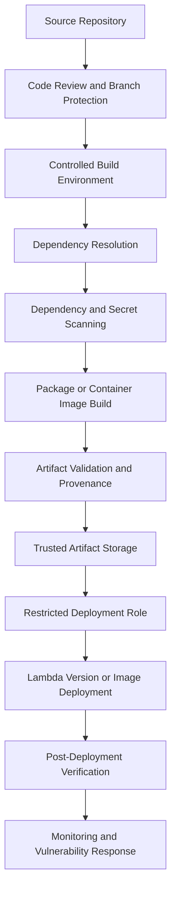
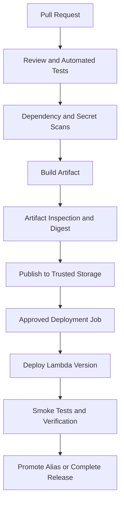

# 06- Dependency and Deployment Package Security

## Overview

AWS Lambda deployment package security covers the integrity, provenance, dependency safety, and runtime behavior of the code delivered to a function. A Lambda function can have correct IAM permissions and secure networking yet remain vulnerable because of a compromised dependency, an exposed credential embedded in a package, an untrusted container image, or an unauthorized deployment.

A Lambda deployment typically uses one of two packaging approaches:

- **ZIP deployment package:** Application code and dependencies are uploaded as a ZIP archive, optionally supplemented by Lambda layers.
- **Container image:** Application code, runtime components, and dependencies are packaged into a container image stored in Amazon Elastic Container Registry (Amazon ECR).

Both approaches require controls throughout the software supply chain, from dependency selection and build execution to artifact storage, deployment, and runtime monitoring.

The primary security objectives are:

- Prevent vulnerable or malicious dependencies from entering production.
- Ensure deployment artifacts originate from trusted source code and build processes.
- Prevent credentials and other sensitive data from being embedded in packages.
- Restrict who can build, publish, configure, and deploy Lambda functions.
- Verify that production executes an approved artifact.
- Maintain a practical process for vulnerability remediation and emergency rollback.

## Lambda Deployment Package Security Model

A secure deployment pipeline treats source code, dependencies, build tools, artifacts, and deployment permissions as separate trust boundaries.



Each stage should enforce a specific control. Passing a dependency scan does not establish artifact provenance, and a trusted build does not guarantee that every dependency is vulnerability-free.

### Security boundaries

| Component | Main risk | Relevant controls |
|---|---|---|
| Source repository | Unauthorized or malicious code changes | Branch protection, reviews, restricted write access |
| Dependency manifests | Vulnerable or compromised packages | Version constraints, lock files, vulnerability scanning |
| Build environment | Compromised tools or stolen credentials | Isolated runners, pinned tooling, short-lived credentials |
| ZIP package | Exposed secrets or unexpected files | Artifact inspection, secret scanning, deterministic packaging where practical |
| Lambda layers | Shared vulnerable or malicious code | Restricted publishing, immutable layer versions, compatibility checks |
| Container image | Vulnerable base image or compromised image layers | Trusted base images, image scanning, digest verification |
| Artifact storage | Unauthorized artifact replacement | Restricted write access, retention, versioning where appropriate |
| Deployment role | Unauthorized production changes | Least privilege, federated identity, environment approvals |
| Lambda configuration | Unexpected handler, runtime, or artifact changes | Configuration review, audit events, deployment verification |

## ZIP Deployment Package Structure

For Python Lambda functions, the ZIP archive must contain the handler module and its runtime dependencies in locations that Lambda can import.

A typical package looks like this:

```text
orders-function/
    lambda_function.py
    orders_service.py
    requirements.txt
    boto3_dependencies/
```

The actual deployment ZIP should contain only the files required at runtime. The example directory is illustrative; it is not a requirement to include a directory named `boto3_dependencies`.

For dependencies installed into a packaging directory, the ZIP generally needs the installed modules at the archive root or in an importable layout.

Example:

```bash
mkdir -p package

python -m pip install \
  --requirement requirements.txt \
  --target package/

cp lambda_function.py package/
cp orders_service.py package/

cd package
zip -r ../function.zip .
cd ..
```

This command builds a package but does not establish that its dependencies are safe. Dependency installation should use a controlled environment, reviewed requirements, and appropriate scanning.

### Package correctness and security

Validate the archive before deployment:

```bash
unzip -l function.zip
```

Inspect the package for:

- Unexpected files and directories.
- `.env` files, private keys, tokens, and credentials.
- Development tools and test artifacts not required in production.
- Unintended source archives or nested ZIP files.
- Duplicate modules that could shadow expected dependencies.
- Dependencies compiled for an incompatible runtime or architecture.

Use `.gitignore` to keep local secrets out of source control, but do not treat `.gitignore` as a packaging security boundary. Build commands may include ignored files unless the packaging process explicitly excludes them.

## Python Dependency Management

Python dependencies are a major component of Lambda's software supply chain. A package can contain a vulnerability even when the application code itself has no known issues.

### Pin and lock dependencies

A dependency manifest describes intended dependencies. A lock file or fully pinned dependency specification records the resolved versions used by a build.

For example:

```text
requests==2.32.4
```

The version above is illustrative; verify the currently appropriate version and vulnerability status before using it in production.

Pinning improves reproducibility but does not make a dependency safe. A pinned version can still contain a vulnerability or become subject to a supply-chain compromise.

Use a deliberate dependency-update workflow:

1. Declare direct dependencies.
2. Resolve and record transitive dependencies.
3. Scan the resolved dependency set.
4. Review material upgrades and breaking changes.
5. Run automated tests.
6. Rebuild and deploy through the approved pipeline.

Avoid installing unbounded dependency versions directly in production deployment jobs.

### Direct and transitive dependencies

A direct dependency is explicitly selected by the application. A transitive dependency is installed because another dependency requires it.

Both can introduce vulnerabilities.

For example:

```text
orders-api
    └── HTTP client library
        └── URL parsing library
```

Even if the application never imports the URL parsing library directly, a vulnerability in that library may affect the HTTP client's behavior.

Dependency scanning must therefore evaluate the resolved dependency graph rather than only the packages explicitly listed by developers.

### Dependency confusion and typosquatting

Supply-chain attacks can exploit package-name mistakes, public packages that resemble internal packages, or incorrect package-index configuration.

Mitigations include:

- Verify package names and maintainers before adopting new dependencies.
- Use trusted package indexes and controlled dependency sources.
- Configure internal package repositories carefully.
- Avoid ambiguous public and private package-name resolution.
- Review dependency changes in pull requests.
- Restrict build credentials and package publishing permissions.
- Monitor dependency advisories and suspicious package releases.

A package's popularity or download count is not proof that it is trustworthy.

## Runtime and Platform Compatibility

Lambda deployment packages must match the target runtime, architecture, and operating system environment where native components are used.

Python dependencies containing native extensions may depend on:

- Linux distribution and compatible system libraries.
- Python version and ABI.
- CPU architecture, such as `x86_64` or `arm64`.
- Compatible shared libraries and compiled binaries.

A package built on an incompatible operating system may fail at import time or during execution.

### Build for the target environment

Use a compatible Linux build environment or an appropriate Lambda-compatible container image when dependencies contain native components.

For example, build dependencies for Python 3.12 and the intended architecture rather than assuming a package built on Windows will work unchanged in Lambda.

Example using Docker:

```bash
docker run --rm \
  --platform linux/amd64 \
  --entrypoint /bin/bash \
  -v "$PWD":/var/task \
  -w /var/task \
  public.ecr.aws/lambda/python:3.12 \
  -c "python -m pip install -r requirements.txt -t package"
```

This is an illustrative build command. Confirm that the chosen image, runtime, architecture, and build tooling are appropriate for the target function. For stricter supply-chain controls, pin the build image by digest and use a controlled, approved image source.

Do not assume that a successful dependency installation proves runtime compatibility. Test the resulting package in an environment representative of Lambda.

## Dependency Vulnerability Scanning

Dependency scanning identifies known vulnerabilities in packages, operating-system libraries, and related components. It is a key control, but its coverage depends on the scanner, vulnerability database, package metadata, and artifact type.

Useful controls include:

- Scan direct and transitive dependencies.
- Scan source repositories and resolved manifests.
- Scan the final deployment artifact where supported.
- Scan container images for operating-system and application dependencies.
- Set a policy for severity thresholds and exceptions.
- Re-scan when new vulnerability intelligence becomes available.
- Track remediation owners and deadlines.

### Example scanning workflow

For Python projects, a dependency scanner can be included in CI. One possible tool is `pip-audit`.

```bash
python -m pip install pip-audit
pip-audit -r requirements.txt
```

Use a pinned scanner version in a controlled CI environment. For a production pipeline, prefer a committed lock file or another reproducible dependency input supported by the chosen scanner.

The command checks dependencies against known vulnerability information. It does not prove that a package is free from malicious behavior or unknown vulnerabilities.

### Handling findings

| Finding | Recommended response |
|---|---|
| Critical vulnerability in a reachable production dependency | Prioritize immediate remediation and assess exposure |
| High-severity vulnerability in an indirectly used dependency | Evaluate exploitability, affected paths, and upgrade options |
| Vulnerability with no available fixed version | Apply mitigations, isolate exposure, track an exception, and monitor advisories |
| Scanner reports a package that is not present in the deployed artifact | Validate scanner scope and artifact contents before closing the finding |
| False positive | Document evidence, obtain appropriate review, and define an expiration or re-evaluation date |

Do not silently suppress findings to make CI pass. Exceptions should have an owner, rationale, risk assessment, and review date.

## Secret Scanning and Artifact Hygiene

A deployment package can accidentally contain credentials even if the source repository is private.

Examples include:

- AWS access keys.
- Database passwords.
- Third-party API tokens.
- Private keys and certificates.
- `.env` files.
- Debug configuration containing credentials.
- Test fixtures containing production data.

Prefer runtime secret retrieval through AWS Secrets Manager or Systems Manager Parameter Store rather than embedding sensitive values in source files or deployment archives.

### Inspect ZIP contents

List archive entries:

```bash
unzip -l function.zip
```

Extract into a temporary inspection directory when deeper analysis is required:

```bash
mkdir -p /tmp/lambda-package-review
unzip -q function.zip -d /tmp/lambda-package-review
```

Run approved secret scanners against the extracted files and review unexpected entries. Ensure temporary inspection directories are handled according to the sensitivity of their contents.

Avoid dumping every file or environment value into CI logs. Scan results should identify the affected file and location without exposing the full secret.

### If a secret is discovered

Removing the secret from the next build is not sufficient if the exposed credential remains valid or prior artifacts are retained.

1. Revoke or rotate the affected credential.
2. Determine where it was exposed, including repository history, build logs, and stored artifacts.
3. Restrict access to affected artifacts and logs where appropriate.
4. Review CloudTrail and service-specific audit data for suspicious use.
5. Remove the secret from source and future artifacts.
6. Rebuild and deploy through the approved pipeline.
7. Review the process that allowed the secret into the package.

Treat any potentially exposed production credential as compromised until its exposure has been assessed.

## Lambda Layers and Shared Dependencies

Lambda layers allow shared libraries and other supported files to be distributed separately from the function's main deployment package.

They can simplify dependency reuse, but they also introduce a shared supply-chain boundary. A vulnerable or malicious layer can affect every function that uses the affected layer version.

### Layer security practices

- Publish layers through a restricted deployment process.
- Review dependencies before publishing a new layer version.
- Use explicit layer version ARNs in function configuration.
- Test compatibility with the target runtime and architecture.
- Track which functions consume each layer version.
- Rebuild and migrate consumers when a vulnerability is identified.
- Avoid putting secrets in layers.
- Avoid granting broad layer-publishing permissions.

Layer versions are immutable. Publishing a corrected layer does not automatically update functions already configured to use an older version.

### Layer inventory

Maintain an inventory containing:

| Field | Purpose |
|---|---|
| Layer name and version | Identifies the shared artifact |
| Artifact digest or provenance reference | Supports integrity verification |
| Supported runtimes and architectures | Prevents incompatible deployment |
| Dependency inventory | Enables vulnerability assessment |
| Publishing role or pipeline | Establishes ownership and provenance |
| Consuming functions | Enables impact analysis and coordinated remediation |

A layer is useful for genuinely shared dependencies, but it is not always the best choice. Bundling dependencies with the function may provide clearer version ownership and reduce coordination overhead.

## Container Image Security for Lambda

Lambda also supports container images stored in Amazon ECR. Container images are useful when applications need a custom runtime environment, substantial dependencies, or a container-oriented build workflow.

A Lambda container image is not an unrestricted long-running container. It must comply with Lambda's supported image and runtime requirements.

### Container image security controls

- Use trusted and maintained base images.
- Pin important build inputs, including base image digests where appropriate.
- Minimize installed operating-system packages.
- Scan application and operating-system dependencies.
- Avoid embedding credentials in image layers.
- Restrict ECR push and deployment permissions.
- Verify the image digest used by the deployment.
- Rebuild images when base images or dependencies require security updates.
- Test the image with the intended Lambda runtime interface and architecture.

### Example Dockerfile

```dockerfile
FROM public.ecr.aws/lambda/python:3.12

COPY requirements.txt ${LAMBDA_TASK_ROOT}/
RUN python -m pip install \
    --no-cache-dir \
    -r ${LAMBDA_TASK_ROOT}/requirements.txt

COPY lambda_function.py ${LAMBDA_TASK_ROOT}/

CMD ["lambda_function.lambda_handler"]
```

This is a minimal structural example, not a complete supply-chain-hardened build. For production, pin the base image by a verified digest, use controlled dependency inputs, scan the resulting image, and validate the image architecture and runtime compatibility.

Avoid copying the entire development workspace into the image. Explicitly copy only required files to reduce accidental inclusion of credentials, test data, local configuration, and unrelated artifacts.

### ECR scanning and image lifecycle

Amazon ECR supports image scanning capabilities whose coverage and behavior depend on the configured scanning mode and current service capabilities. Verify the scanning configuration and supported package types for the target repository.

Scanning is not a substitute for trusted builds or artifact integrity verification. A clean scan means no applicable known findings were identified by that scanner at that time; it does not establish that an image is safe.

When deploying container images, record the image digest associated with the release and ensure the deployment process uses the intended artifact. Mutable tags alone are insufficient as an audit record because a tag can be moved to a different image.

## Artifact Integrity and Provenance

Artifact integrity establishes whether the deployed package is the artifact that was approved and produced by the intended build process. Provenance provides information about where and how the artifact was built.

Useful controls include:

- Build from a reviewed source revision.
- Record the source commit and build identity.
- Record dependency lock files and relevant build-tool versions.
- Store artifact digests.
- Restrict artifact write permissions.
- Verify the artifact before deployment.
- Separate build and deployment permissions where practical.
- Retain release metadata for investigation and rollback.

### Compute a ZIP digest

```bash
sha256sum function.zip
```

Store the resulting digest in release metadata and compare it with the artifact selected for deployment.

A digest detects a change only when compared against a trusted expected digest. If an attacker can replace both the artifact and the recorded digest, the digest alone does not establish trust.

For higher-assurance supply chains, consider signed build provenance or software bills of materials (SBOMs) supported by the chosen build and verification ecosystem.

### Software bill of materials

An SBOM records components included in a software artifact. It can support:

- Dependency inventory.
- Vulnerability impact analysis.
- Identification of affected functions.
- Compliance and audit evidence.
- Coordinated remediation across shared dependencies.

An SBOM is useful only when it accurately represents the artifact being deployed and is maintained as dependencies change.

## Secure CI/CD for Lambda

A secure deployment pipeline must protect both the artifact and the authority to deploy it.

For GitHub Actions, prefer short-lived AWS credentials obtained through OpenID Connect (OIDC) and an appropriately restricted AWS IAM role rather than long-lived AWS access keys stored as repository secrets.

### Recommended pipeline stages



Separate build permissions from deployment permissions where practical. A test job should not need unrestricted production deployment privileges simply because it runs in the same workflow.

### CI/CD security checklist

- Require review for changes to production deployment workflows.
- Restrict production deployment to trusted branches and approved environments.
- Use OIDC with a trust policy restricted to the intended repository and workflow context.
- Grant the deployment role only the permissions needed for the release.
- Avoid exposing deployment credentials to untrusted pull requests.
- Pin third-party GitHub Actions to verified commit SHAs when appropriate.
- Scan dependencies and artifacts before production deployment.
- Record the source revision, artifact digest, and deployment result.
- Verify the deployed function or image after release.
- Protect workflow files and infrastructure definitions as production code.

A pipeline can still be compromised through a malicious dependency, a compromised action, or an overly permissive role. Security must cover the entire build and deployment chain.

## Deployment Permissions and Runtime Permissions

The deployment role and Lambda execution role should have different responsibilities.

| Role | Typical responsibility | Example permissions |
|---|---|---|
| CI build identity | Build and validate artifacts | Access to approved build resources |
| Deployment role | Publish or update Lambda resources | Required Lambda deployment operations and artifact access |
| Lambda execution role | Access runtime resources | Read a specific secret, write to a designated queue, or access a specific table |
| Layer publishing role | Publish approved shared dependencies | Required layer publication operations |
| ECR publishing role | Push approved images | Required repository upload and image publishing operations |

Avoid giving the Lambda execution role permission to update the function's own code or configuration unless that behavior is explicitly required and carefully controlled.

Likewise, the deployment role should not automatically inherit broad permissions to access every database, secret, and queue used by the application.

This separation limits the impact of a compromised runtime or build process.

## Runtime and Dependency Lifecycle Management

Dependency security is a continuous process rather than a one-time deployment check.

A dependency that has no known vulnerability today may receive a security advisory tomorrow. A Lambda runtime may also approach deprecation, requiring an upgrade and compatibility testing.

Maintain a process for:

- Tracking supported Lambda runtime versions.
- Monitoring dependency advisories.
- Rebuilding artifacts when vulnerabilities are discovered.
- Updating native dependencies for the correct runtime and architecture.
- Retesting behavior after dependency upgrades.
- Identifying all functions using vulnerable shared layers.
- Replacing deprecated runtime or base-image components.
- Retaining a tested rollback artifact that is not itself known to be unsafe.

Rollback is not always the correct response to a failed security deployment. Reverting to an older version may reintroduce a known vulnerability. Prefer a safe forward fix when the previous artifact is no longer acceptable.

## Deployment Package Size and Attack Surface

Package size is primarily a performance and operational concern, but it also affects security. Unnecessary dependencies increase the amount of code that must be maintained, scanned, and trusted.

Reduce the attack surface by:

- Removing unused libraries.
- Avoiding unnecessary development dependencies.
- Excluding local credentials, tests, and sample datasets.
- Minimizing operating-system packages in container images.
- Keeping dependency ownership and upgrade paths clear.
- Avoiding redundant layers that introduce overlapping libraries.

Smaller packages are not automatically safer. A minimal package can still contain a compromised dependency, while a larger package may be justified by the application's requirements.

Use dependency minimization to improve maintainability and reduce unnecessary components, not as a substitute for scanning and provenance controls.

## Verification and Operational Monitoring

After deployment, verify both the intended artifact and the resulting Lambda configuration.

For a ZIP-based function, inspect the function configuration:

```bash
aws lambda get-function-configuration \
  --function-name orders-api \
  --region ap-south-1 \
  --query '{FunctionName:FunctionName,Runtime:Runtime,Handler:Handler,CodeSha256:CodeSha256,LastModified:LastModified,State:State}'
```

This is a read-only command. Compare the returned artifact hash and configuration against the approved release metadata.

For a container-image function, inspect the deployed code configuration:

```bash
aws lambda get-function \
  --function-name orders-api \
  --region ap-south-1 \
  --query '{Code:Code,Configuration:Configuration}'
```

Review the image URI and relevant configuration fields. For image deployments, correlate the configured image reference with the approved ECR image digest and release record.

### Audit and monitoring

Use appropriate AWS audit and monitoring services to identify unexpected changes:

- AWS CloudTrail for relevant API activity.
- Amazon CloudWatch Logs for application diagnostics.
- Amazon CloudWatch metrics and alarms for function behavior.
- ECR scanning and repository controls for container artifacts.
- Dependency scanning and vulnerability-management systems for package risks.
- Release metadata and artifact digests for deployment verification.

Monitor for unexpected code or configuration changes, unusual deployment activity, increased error rates after dependency upgrades, and newly disclosed vulnerabilities affecting deployed packages.

Do not rely on application logs alone to establish deployment integrity.

## Common Mistakes and Production Pitfalls

| Mistake | Risk | Mitigation |
|---|---|---|
| Installing unpinned dependencies during every deployment | Builds can change without a source change | Use reviewed, reproducible dependency inputs |
| Scanning only direct dependencies | Vulnerable transitive packages may be missed | Scan the resolved dependency graph and final artifact where supported |
| Building native dependencies on an incompatible platform | Runtime import failures or unexpected behavior | Build and test for the target Lambda runtime and architecture |
| Assuming private source control makes a package safe | Malicious code or credentials can still enter the repository | Enforce reviews, scanning, and build controls |
| Reusing an unverified third-party layer | Shared code can introduce a supply-chain compromise | Verify ownership, provenance, dependencies, and version |
| Embedding secrets in ZIP archives or image layers | Credentials may persist in artifacts and build caches | Retrieve secrets at runtime and rotate exposed credentials |
| Deploying a mutable image tag without recording its digest | The deployed image may differ from the reviewed image | Record and verify the approved image digest |
| Giving CI unrestricted production access | A compromised build can modify unrelated resources | Use short-lived credentials and least-privilege roles |
| Treating a successful scan as proof of safety | Unknown vulnerabilities and malicious behavior may remain | Combine scanning with provenance, review, testing, and monitoring |
| Rolling back automatically to a vulnerable release | A failed deployment can restore known security exposure | Use a security-aware rollback decision and safe forward fixes when necessary |
| Updating a layer without updating consumers | Functions can continue using a vulnerable version | Inventory consumers and deploy updated configurations |
| Ignoring runtime lifecycle notices | Unsupported runtimes can create security and maintenance risks | Track runtime support and plan upgrades |

## Production Readiness Checklist

### Source and dependency controls

- [ ] Production changes require review and use protected branches.
- [ ] Direct and transitive dependencies are recorded in reproducible dependency inputs.
- [ ] Vulnerability scanning runs before deployment.
- [ ] Dependency exceptions have an owner, rationale, and review date.
- [ ] Build tools and third-party actions are controlled and reviewed.

### Artifact controls

- [ ] ZIP archives contain only intended runtime files.
- [ ] Secret scanning covers source code and deployment artifacts.
- [ ] Native dependencies target the correct runtime and architecture.
- [ ] Container images use trusted, maintained base images.
- [ ] Artifacts have recorded digests and sufficient release metadata.
- [ ] Layer versions and container image digests are tracked.

### Deployment controls

- [ ] CI/CD uses short-lived credentials where supported.
- [ ] Deployment and runtime permissions are separated.
- [ ] Production deployment permissions are narrowly scoped.
- [ ] Artifact storage is protected against unauthorized replacement.
- [ ] Post-deployment verification checks the intended artifact and configuration.
- [ ] Rollback procedures consider security advisories and vulnerable releases.

### Operations

- [ ] Dependency and runtime updates have clear ownership.
- [ ] Security findings can be mapped to affected functions and layers.
- [ ] Unexpected deployments and configuration changes can be investigated.
- [ ] Incident procedures cover credential exposure and compromised artifacts.
- [ ] Retained release artifacts are governed by appropriate access and retention policies.

## Official References

- [Lambda deployment packages](https://docs.aws.amazon.com/lambda/latest/dg/gettingstarted-package.html)
- [Python Lambda deployment packages](https://docs.aws.amazon.com/lambda/latest/dg/python-package.html)
- [Lambda layers](https://docs.aws.amazon.com/lambda/latest/dg/chapter-layers.html)
- [Lambda container images](https://docs.aws.amazon.com/lambda/latest/dg/images-create.html)
- [Lambda code signing](https://docs.aws.amazon.com/lambda/latest/dg/configuration-codesigning.html)
- [Amazon ECR image scanning](https://docs.aws.amazon.com/AmazonECR/latest/userguide/image-scanning.html)
- [GitHub Actions OpenID Connect with AWS](https://docs.github.com/en/actions/security-for-github-actions/security-hardening-your-deployments/configuring-openid-connect-in-amazon-web-services)
- [AWS Lambda runtimes](https://docs.aws.amazon.com/lambda/latest/dg/lambda-runtimes.html)
- [AWS shared responsibility model](https://aws.amazon.com/compliance/shared-responsibility-model/)

## Key Takeaways

- Treat Lambda packages, layers, container images, dependencies, and build tools as part of the application's software supply chain.
- Use reproducible dependency inputs, vulnerability scanning, secret scanning, and runtime-compatible builds, while recognizing that scanning cannot prove an artifact is safe.
- Verify artifact integrity and provenance, restrict artifact storage, and deploy through controlled pipelines using least-privilege, short-lived credentials where supported.
- Separate deployment permissions from runtime permissions and track shared layer versions and container image digests.
- Continuously monitor dependency advisories, runtime support, deployment activity, and remediation status; avoid rolling back to a release known to be vulnerable.