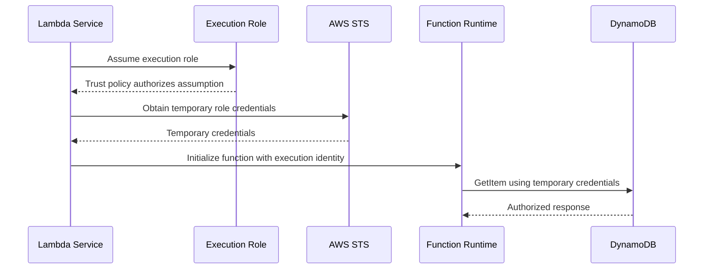
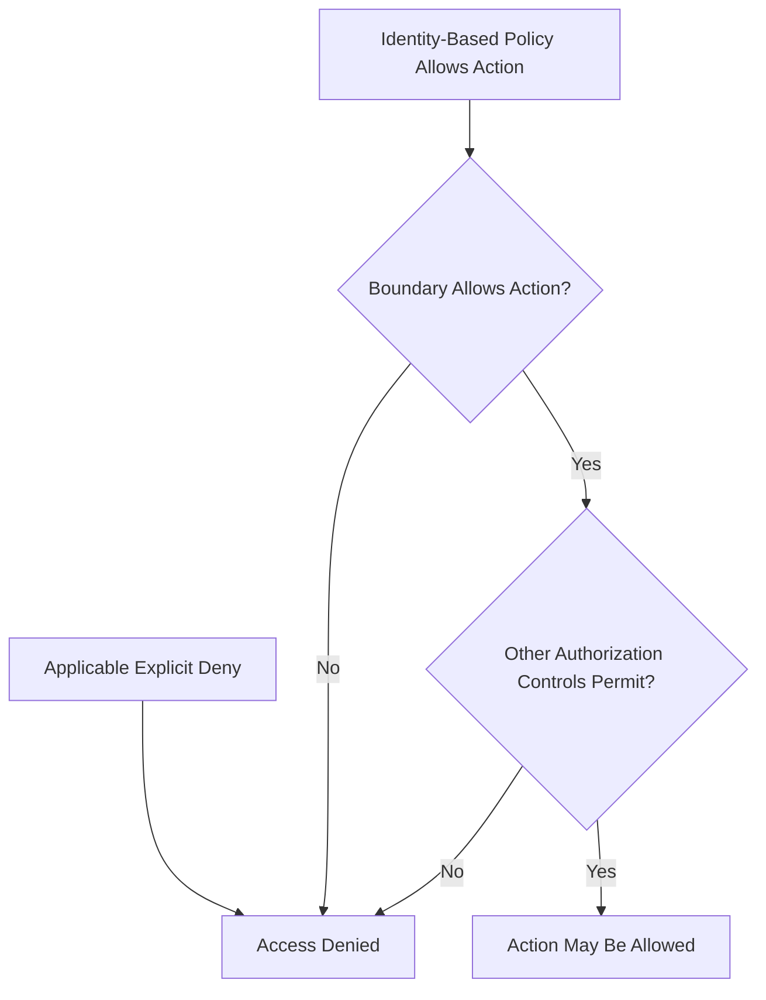
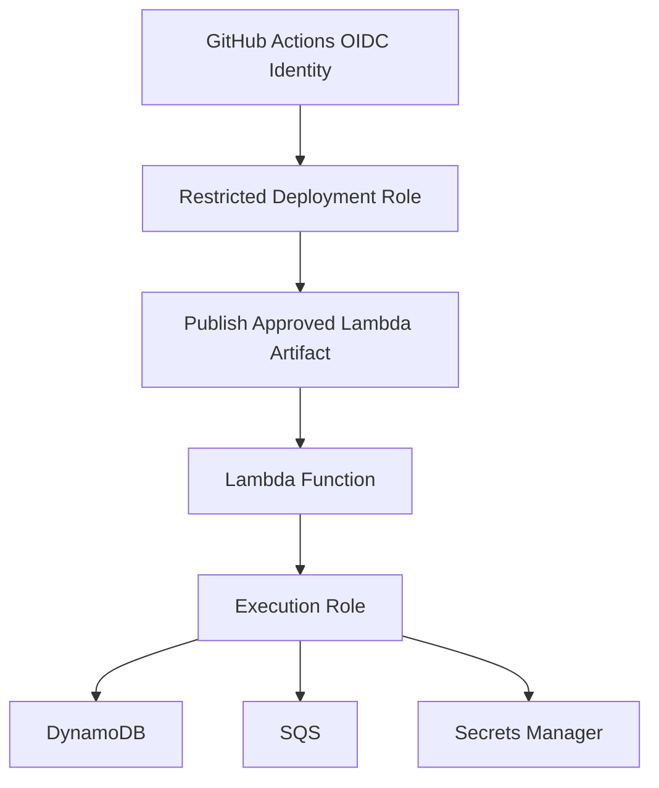

# 07- Least Privilege and Permission Boundaries

## Overview

AWS Lambda security depends on controlling which identities can invoke a function, modify its configuration, access its resources, and perform operations through its execution environment. Least privilege limits these permissions to the minimum required for a specific responsibility.

AWS Identity and Access Management (IAM) provides the primary authorization mechanisms used with Lambda, including identity-based policies, resource-based policies, trust policies, permissions boundaries, and service control policies (SCPs).

These mechanisms serve different purposes. An execution role determines which AWS API operations the function can perform. A resource-based policy can authorize principals to invoke a function. A trust policy determines which principals can assume a role. A permissions boundary limits the permissions an IAM identity can receive through identity-based policies, while an SCP establishes the maximum permissions available to principals within applicable AWS Organizations accounts.

A production security design should separate these concerns and evaluate them independently.

## Lambda Permission Model

Lambda uses multiple authorization layers because different actors interact with a function in different ways.

Typical actors include:

- Developers and administrators who create or modify functions.
- CI/CD identities that deploy approved artifacts.
- AWS services that invoke functions in response to events.
- Application clients that invoke an API-backed function.
- Lambda execution roles that authorize calls to other AWS services.

### Core IAM components

| Component | Purpose | Typical Lambda use |
|---|---|---|
| Identity-based policy | Grants permissions to an IAM user, group, or role | Allow the execution role to read a specific DynamoDB table |
| Resource-based policy | Grants access to a resource from a specified principal or service | Allow S3 to invoke a function |
| Trust policy | Determines which principals may assume an IAM role | Allow the Lambda service to assume the execution role |
| Permissions boundary | Sets the maximum permissions an IAM identity can receive through identity-based policies | Limit a developer or deployment role |
| Service control policy | Sets permission guardrails for applicable principals in an AWS Organizations account or organizational unit | Prevent certain administrative actions across member accounts |
| Session policy | Further restricts permissions for a role session where supported | Limit a temporary deployment session |
| VPC security group | Controls permitted network traffic | Allow Lambda to connect to a private database |

IAM authorization and network access are separate. A security group does not grant permission to call DynamoDB, and an IAM policy does not create a route to a private database.

## Least Privilege

Least privilege means granting only the permissions required to perform an explicitly defined responsibility.

For Lambda, this principle applies to both runtime and deployment identities.

Consider an order-processing function that needs to:

- Read order records from one DynamoDB table.
- Send messages to one SQS queue.
- Retrieve one database secret.
- Write operational logs.

The execution role should not automatically receive administrative access to DynamoDB, SQS, Secrets Manager, or Lambda itself.

### Overly broad policy

The following policy is an example of an unsafe pattern:

```json
{
  "Version": "2012-10-17",
  "Statement": [
    {
      "Effect": "Allow",
      "Action": "*",
      "Resource": "*"
    }
  ]
}
```

This grants broad AWS permissions and can substantially increase the impact of a compromised function or vulnerable dependency.

### Improved policy

A narrower policy might allow reads from a specific table and message publishing to a specific queue:

```json
{
  "Version": "2012-10-17",
  "Statement": [
    {
      "Sid": "ReadOrders",
      "Effect": "Allow",
      "Action": [
        "dynamodb:GetItem",
        "dynamodb:Query"
      ],
      "Resource": [
        "arn:aws:dynamodb:ap-south-1:123456789012:table/orders",
        "arn:aws:dynamodb:ap-south-1:123456789012:table/orders/index/*"
      ]
    },
    {
      "Sid": "PublishOrderEvents",
      "Effect": "Allow",
      "Action": "sqs:SendMessage",
      "Resource": "arn:aws:sqs:ap-south-1:123456789012:order-events"
    }
  ]
}
```

Replace the example account, Region, table, index, and queue identifiers with actual resource identifiers.

This policy intentionally omits unrelated permissions. Add other actions only when the application's implementation requires them. For example, a function that creates or updates order records would need the relevant write actions.

The policy does not grant permission to invoke the function. Invocation authorization is a separate concern.

### How to derive permissions

Use the following process:

1. Identify the AWS API operations the application actually calls.
2. Map each operation to its required IAM action.
3. Identify the resources on which those actions operate.
4. Scope resources to specific ARNs whenever the service and action support resource-level permissions.
5. Use conditions to restrict access further when appropriate.
6. Test normal operations and expected failure paths.
7. Review CloudTrail and other available evidence to refine permissions.

Do not assume every IAM action supports resource-level restrictions. Some operations require `"Resource": "*"`, while others support resource ARNs and conditions. Verify the service authorization reference before designing the policy.

## Lambda Execution Roles

An execution role is the IAM role Lambda assumes to obtain temporary credentials for the function's runtime operations.

For example, a function that reads from DynamoDB uses its execution role's permissions when its AWS SDK client calls DynamoDB.



The diagram is conceptual: Lambda manages the execution environment and its role credentials; application code should not implement this role-assumption lifecycle itself for ordinary execution-role access.

### Trust policy

The execution role's trust policy commonly allows the Lambda service principal to assume the role.

```json
{
  "Version": "2012-10-17",
  "Statement": [
    {
      "Effect": "Allow",
      "Principal": {
        "Service": "lambda.amazonaws.com"
      },
      "Action": "sts:AssumeRole"
    }
  ]
}
```

This trust policy identifies Lambda as an allowed principal. It does not grant the function permission to read a database, retrieve a secret, or publish a message.

Those permissions belong in the role's permission policies.

### Runtime permissions

A production execution role should contain only the actions needed by the function. Common examples include:

- CloudWatch Logs permissions for application logging.
- DynamoDB actions for specific tables.
- SQS actions for specific queues.
- `secretsmanager:GetSecretValue` for required secrets.
- KMS permissions where required for customer-managed keys.
- Additional service-specific permissions for the actual workload.

The AWS-managed policy `AWSLambdaBasicExecutionRole` provides common CloudWatch Logs permissions. It does not automatically grant application access to DynamoDB, SQS, or Secrets Manager.

The managed policy `AWSLambdaVPCAccessExecutionRole` provides permissions relevant to Lambda VPC access and CloudWatch Logs. Review the current policy definition and your organization's security requirements before attaching it.

### Inspect the execution role

Retrieve the function's configured execution role:

```bash
aws lambda get-function-configuration \
  --function-name orders-api \
  --region ap-south-1 \
  --query 'Role'
```

This is a read-only command.

Then inspect the role's attached and inline policies:

```bash
aws iam list-attached-role-policies \
  --role-name orders-api-execution-role

aws iam list-role-policies \
  --role-name orders-api-execution-role
```

Review each policy document rather than relying only on its name. Managed policies can change, and a policy name does not prove that the granted permissions are appropriate.

## Resource-Based Policies and Invocation Permissions

A Lambda resource-based policy controls which principals may access the function through supported resource-level permissions. It is commonly used to authorize AWS services to invoke functions.

For example, an S3 bucket can invoke a Lambda function when the function's resource policy permits the appropriate S3 service principal and restricts the grant to the intended bucket and account.

An execution role does not replace the function's invocation policy. The two answer different questions:

- **Resource-based policy:** Who may invoke or access the function?
- **Execution role:** What can the function do after it runs?

### Example: Allow S3 to invoke Lambda

A representative resource-based policy statement is:

```json
{
  "Sid": "AllowOrdersBucketInvocation",
  "Effect": "Allow",
  "Principal": {
    "Service": "s3.amazonaws.com"
  },
  "Action": "lambda:InvokeFunction",
  "Resource": "arn:aws:lambda:ap-south-1:123456789012:function:orders-processor",
  "Condition": {
    "StringEquals": {
      "AWS:SourceAccount": "123456789012"
    },
    "ArnLike": {
      "AWS:SourceArn": "arn:aws:s3:::orders-upload-bucket"
    }
  }
}
```

This example illustrates the intended restrictions. In practice, use the Lambda API or infrastructure-as-code tooling to manage the policy and ensure the resulting resource policy is valid for the target configuration.

The source account and source ARN conditions help prevent unintended principals from using the service authorization grant. Use the actual source resource and account.

### Add invocation permission using AWS CLI

The following command modifies the Lambda resource policy:

```bash
aws lambda add-permission \
  --function-name orders-processor \
  --statement-id AllowOrdersBucketInvocation \
  --action lambda:InvokeFunction \
  --principal s3.amazonaws.com \
  --source-arn arn:aws:s3:::orders-upload-bucket \
  --source-account 123456789012 \
  --region ap-south-1
```

Replace the example identifiers before execution. The statement ID must be unique within the function's resource policy.

Verify the policy:

```bash
aws lambda get-policy \
  --function-name orders-processor \
  --region ap-south-1
```

This is a read-only operation. A duplicate statement ID can cause the permission update to fail. Do not remove existing permissions without understanding which integrations depend on them.

For cross-account invocation, validate the caller's authorization and the target function's resource-based policy. The exact authorization requirements depend on the principal type and invocation mechanism.

## Identity-Based Policies Versus Resource-Based Policies

These policy types complement one another.

| Concern | Identity-based policy | Resource-based policy |
|---|---|---|
| Attached to | IAM identity | Supported AWS resource |
| Primary purpose | Grants permissions to an identity | Grants access through a resource's policy |
| Common Lambda example | Execution role can read a DynamoDB table | S3 can invoke a Lambda function |
| Defines role trust? | No | No |
| Can restrict actions? | Yes | Yes |
| Can use conditions? | Yes, when supported | Yes, when supported |
| Typical failure | Missing runtime permission | Missing invocation permission |

A function may need both types of policies. For example, S3 needs permission to invoke the function, while the function's execution role needs permission to write processing results to DynamoDB.

Do not assume that granting an action to the execution role authorizes every external service to invoke the function.

## Permissions Boundaries

A permissions boundary is an IAM policy that sets the maximum permissions an IAM user or role can receive through identity-based permission policies.

It does not grant permissions by itself.

For a permission to be allowed, the identity must have an applicable allow and must not be blocked by an applicable explicit deny or other governing restriction. A permissions boundary can prevent an identity-based policy from granting access beyond the boundary.

### Example

Suppose a deployment role has an identity-based policy that allows Lambda updates and broad IAM operations. An administrator applies a permissions boundary that allows only the intended deployment operations and selected supporting actions.

The deployment role's effective permissions are limited by both its identity-based policies and the boundary, along with other applicable authorization controls.



This is a conceptual model rather than a complete representation of every IAM evaluation rule. Resource policies, session policies, SCPs, and principal type can affect the final decision.

### When to use permissions boundaries

Permissions boundaries are useful when:

- Developers can create or update IAM roles but must remain within centrally defined limits.
- Delegated teams manage their own Lambda deployment roles.
- A platform team provides a standard maximum permission set.
- An organization wants to reduce privilege escalation risk from role creation or policy modification.

A boundary must be applied and managed correctly. A policy that permits unrestricted IAM policy attachment or boundary removal can undermine the intended control.

### Example boundary policy

The following is an illustrative boundary for a delegated role that may work with selected Lambda functions but must not receive unrestricted administrative permissions:

```json
{
  "Version": "2012-10-17",
  "Statement": [
    {
      "Sid": "AllowSelectedLambdaOperations",
      "Effect": "Allow",
      "Action": [
        "lambda:GetFunction",
        "lambda:GetFunctionConfiguration",
        "lambda:UpdateFunctionCode",
        "lambda:UpdateFunctionConfiguration",
        "lambda:PublishVersion"
      ],
      "Resource": "arn:aws:lambda:ap-south-1:123456789012:function:orders-*"
    }
  ]
}
```

This boundary is intentionally narrow and illustrative. It limits the maximum identity-based permissions within the shown scope; it does not grant those permissions by itself or guarantee that every required deployment workflow will work.

A real deployment role may need additional permissions for artifact access, version aliases, logging, or supporting infrastructure. Add those deliberately and verify their resource-level support.

## Service Control Policies

Service control policies (SCPs) are AWS Organizations controls that define maximum available permissions for principals in applicable member accounts.

An SCP does not grant access. IAM policies and other authorization mechanisms must still permit the action.

SCPs are useful for organization-wide guardrails, such as preventing member-account principals from disabling selected security controls or performing prohibited operations.

For Lambda, an organization might restrict who can modify production functions, remove required security configuration, or change critical logging resources. Such controls should be designed carefully to avoid blocking required service operations or incident response.

### SCP considerations

- SCPs apply according to AWS Organizations hierarchy and account membership.
- They do not replace identity-based policies or resource-based policies.
- They generally do not restrict principals in the management account in the same way they restrict member-account principals.
- Exceptions and service-linked-role behavior have specific rules; verify the current AWS Organizations documentation.
- A denied operation may originate from an SCP even when the IAM role's policy appears to allow it.

Use the IAM policy simulator and organization-level policy inspection where applicable, but verify the actual request context and applicable policies when diagnosing a denial.

## Explicit Deny and Policy Evaluation

An explicit deny overrides an applicable allow. This is a central IAM security property.

For example, an identity policy may allow access to a resource, but another applicable policy may explicitly deny that operation.

Common sources of restrictions include:

- Identity-based policies.
- Resource-based policies.
- Permissions boundaries.
- Session policies.
- Service control policies.
- VPC endpoint policies for requests that traverse those endpoints.
- Service-specific resource policies and authorization requirements.

The precise evaluation behavior depends on the principal, resource, request context, and applicable policy types. Avoid reducing every IAM decision to a simple intersection of policies without accounting for resource-based grants and principal-specific rules.

### Example explicit deny

```json
{
  "Version": "2012-10-17",
  "Statement": [
    {
      "Sid": "DenyDeletingProductionTable",
      "Effect": "Deny",
      "Action": "dynamodb:DeleteTable",
      "Resource": "arn:aws:dynamodb:ap-south-1:123456789012:table/orders-prod"
    }
  ]
}
```

If this statement applies to the request, an allow elsewhere does not override it.

Use explicit denies for carefully defined guardrails, not as a substitute for clear, least-privilege allow policies. Broad denies can unintentionally block operational recovery or required service workflows.

## Cross-Account Access

Cross-account Lambda access requires careful separation of caller permissions and target-resource authorization.

For example, an application in Account A may need to invoke a function in Account B.

A typical authorization design includes:

1. The caller's identity is authorized to invoke the target function.
2. The target function's resource-based policy permits the relevant cross-account principal when required.
3. Applicable organization policies, boundaries, and other authorization controls do not block the operation.
4. The target account's deployment and runtime permissions remain separately controlled.

For service-to-service integrations, use the supported service principal and source-resource restrictions rather than granting broad access to an entire account when narrower authorization is available.

For role assumption across accounts, use an appropriate trust policy and tightly scoped permissions. Do not distribute long-lived credentials between accounts when a suitable role-based approach is available.

## Secure Role Creation and Delegated Administration

A common privilege-escalation risk occurs when a principal can create or modify IAM roles and attach powerful policies without appropriate restrictions.

For example, a developer who can create a role trusted by Lambda and attach an administrator policy may be able to deploy a function that exercises those privileges.

Controls should address the complete workflow:

- Who can create IAM roles?
- Which trust policies may be configured?
- Which policies may be attached?
- Who can set, replace, or remove permissions boundaries?
- Who can update Lambda code and configuration?
- Who can pass an IAM role to Lambda?
- Who can publish versions and move production aliases?

### `iam:PassRole`

The `iam:PassRole` permission allows a principal to pass an IAM role to an AWS service that supports role assignment. It does not itself allow the principal to assume that role directly.

When configuring a Lambda function, a deployment principal may need permission to pass the intended execution role to Lambda.

Scope `iam:PassRole` to approved roles and use supported conditions, such as restricting the service to which the role can be passed.

A broad `iam:PassRole` permission combined with the ability to modify Lambda code or configuration can allow a deployment principal to cause a function to exercise permissions that the principal does not directly possess.

### Example scoped PassRole policy

```json
{
  "Version": "2012-10-17",
  "Statement": [
    {
      "Sid": "PassOrdersExecutionRoleToLambda",
      "Effect": "Allow",
      "Action": "iam:PassRole",
      "Resource": "arn:aws:iam::123456789012:role/orders-api-execution-role",
      "Condition": {
        "StringEquals": {
          "iam:PassedToService": "lambda.amazonaws.com"
        }
      }
    }
  ]
}
```

Replace the example account and role identifiers. This policy limits which role can be passed and to which service. It does not grant permission to create or update the function; those operations require their own permissions.

## Lambda Deployment and Runtime Separation

Deployment identities and execution identities should have distinct responsibilities.



The deployment role manages releases. The execution role authorizes application behavior at runtime.

This separation limits the damage caused by compromised application code. A function should not normally be able to rewrite its own deployment or grant itself additional permissions.

### Deployment role responsibilities

Depending on the release process, the deployment role may need permissions to:

- Read approved deployment artifacts.
- Update Lambda code or configuration.
- Publish versions.
- Update approved aliases.
- Pass the designated execution role.
- Access the specific supporting resources required by the deployment system.

Avoid granting unrestricted IAM policy management or account-wide administrative access simply to make a deployment pipeline work.

### Runtime role responsibilities

The runtime role should contain only the permissions required by application behavior, such as:

- Reading selected database secrets.
- Reading or writing specific DynamoDB tables.
- Sending messages to selected queues.
- Writing application logs.
- Accessing specific S3 prefixes or objects.

Do not automatically grant deployment permissions to the runtime role.

## Auditing and Troubleshooting IAM Denials

IAM failures should be diagnosed by identifying the exact API call, principal, resource, and applicable authorization context.

### Diagnostic workflow

1. Identify the failed API action from the error message or application logs.
2. Identify the principal or role session making the request.
3. Identify the target resource and Region.
4. Inspect the identity-based policy and relevant resource-based policy.
5. Check permissions boundaries, session policies, SCPs, and endpoint policies where applicable.
6. Review CloudTrail for the relevant API event when available.
7. Reproduce the authorization test safely and apply the narrowest required correction.

### Common errors

| Symptom | Possible cause | Investigation |
|---|---|---|
| Lambda cannot read a DynamoDB table | Missing action, incorrect table ARN, or applicable deny | Inspect the execution role and relevant policy evaluation context |
| S3 cannot invoke Lambda | Missing or incorrect Lambda resource-based permission | Inspect the function policy and source bucket restrictions |
| Deployment fails when assigning an execution role | Missing `iam:PassRole` or role trust configuration issue | Inspect the deployment identity and execution role |
| Role creation succeeds but access remains restricted | Permissions boundary or SCP limits effective permissions | Inspect boundary and organization policies |
| Cross-account invocation is denied | Caller authorization or target resource policy is insufficient | Inspect both accounts' relevant permissions |
| Secret retrieval fails despite network connectivity | Missing secret-read or KMS permission | Inspect execution-role, secret, and key policies |
| An operation is denied despite an allow policy | Explicit deny or another applicable authorization control | Inspect the complete authorization context |
| A function unexpectedly has excessive access | Broad execution-role policy or overly permissive delegated role | Review attached and inline policies and remove unnecessary permissions |

### Policy simulation

The IAM policy simulator can help evaluate supported policy scenarios:

```bash
aws iam simulate-principal-policy \
  --policy-source-arn arn:aws:iam::123456789012:role/orders-api-execution-role \
  --action-names dynamodb:GetItem \
  --resource-arns arn:aws:dynamodb:ap-south-1:123456789012:table/orders
```

This is a diagnostic operation. Replace the role and resource ARNs with actual values.

Simulation is useful but does not reproduce every real-world authorization context, service integration, resource policy, or runtime condition. Confirm important decisions against the actual configuration and available audit events.

### CloudTrail auditing

Use CloudTrail to investigate relevant IAM, Lambda, and service API activity. Look for unexpected policy changes, role modifications, deployment actions, and denied requests when those events are recorded.

CloudTrail event availability and detail vary by operation and configuration. Do not assume that every application-level failure will have a corresponding event containing the full explanation.

## Production Best Practices

- Create a separate execution role for each function or closely related workload with a clearly justified shared responsibility.
- Grant only the required service actions and scope resources to specific ARNs wherever supported.
- Keep execution roles separate from deployment roles.
- Restrict `iam:PassRole` to approved roles and intended services.
- Use resource-based policies for invocation access with appropriate source restrictions.
- Use permissions boundaries when delegated IAM administration requires a centrally enforced maximum permission set.
- Use SCPs for organization-level guardrails, recognizing that they do not grant permissions.
- Review explicit denies and other applicable authorization controls during troubleshooting.
- Prefer temporary credentials and role-based access over long-lived access keys.
- Audit IAM and Lambda changes and regularly review unused or overly broad permissions.
- Test least-privilege policies using representative success and failure scenarios.
- Maintain a controlled process for permission changes, emergency access, and policy exceptions.

## Production Readiness Checklist

### Execution and invocation

- [ ] Every function has an appropriate execution role.
- [ ] Runtime permissions are limited to the required actions and resources.
- [ ] Invocation permissions are explicitly configured for intended callers.
- [ ] Resource policies restrict service invocations to the correct source resources and accounts where supported.
- [ ] Cross-account access has been reviewed in both the caller and target contexts.

### Delegated administration

- [ ] Deployment roles have only the required release permissions.
- [ ] `iam:PassRole` is scoped to approved execution roles.
- [ ] Role creation and policy attachment are governed.
- [ ] Permissions boundaries are applied and protected where required.
- [ ] SCPs and other organization controls have been tested against operational workflows.

### Monitoring and operations

- [ ] IAM and Lambda changes can be investigated through available audit records.
- [ ] Common authorization failures have a documented diagnostic process.
- [ ] Policy changes are reviewed and tested before production rollout.
- [ ] Overly broad permissions are periodically identified and remediated.
- [ ] Emergency access and rollback procedures do not depend on unrestricted everyday roles.

## Official References

- [AWS IAM policies and permissions](https://docs.aws.amazon.com/IAM/latest/UserGuide/access_policies.html)
- [IAM policy evaluation logic](https://docs.aws.amazon.com/IAM/latest/UserGuide/reference_policies_evaluation-logic.html)
- [Permissions boundaries for IAM entities](https://docs.aws.amazon.com/IAM/latest/UserGuide/access_policies_boundaries.html)
- [AWS Organizations service control policies](https://docs.aws.amazon.com/organizations/latest/userguide/orgs_manage_policies_scps.html)
- [Lambda execution roles](https://docs.aws.amazon.com/lambda/latest/dg/lambda-intro-execution-role.html)
- [Lambda resource-based policies](https://docs.aws.amazon.com/lambda/latest/dg/access-control-resource-based.html)
- [IAM PassRole](https://docs.aws.amazon.com/IAM/latest/UserGuide/id_roles_use_passrole.html)
- [IAM policy simulator](https://docs.aws.amazon.com/IAM/latest/UserGuide/access_policies_testing-policies.html)
- [AWS CloudTrail](https://docs.aws.amazon.com/awscloudtrail/latest/userguide/cloudtrail-user-guide.html)

## Key Takeaways

- Least privilege applies to invocation, runtime access, deployment, role assumption, and delegated administration; these are distinct authorization responsibilities.
- Execution roles authorize application operations, while resource-based policies can authorize invocation and trust policies determine which principals may assume roles.
- Permissions boundaries limit the permissions an identity can receive through identity-based policies, whereas SCPs impose organization-level permission guardrails without granting access.
- Scope `iam:PassRole`, Lambda deployment permissions, and execution-role policies carefully to reduce privilege-escalation and compromise risks.
- Diagnose IAM failures by examining the actual principal, action, resource, and applicable policies rather than assuming an identity-based allow policy guarantees access.