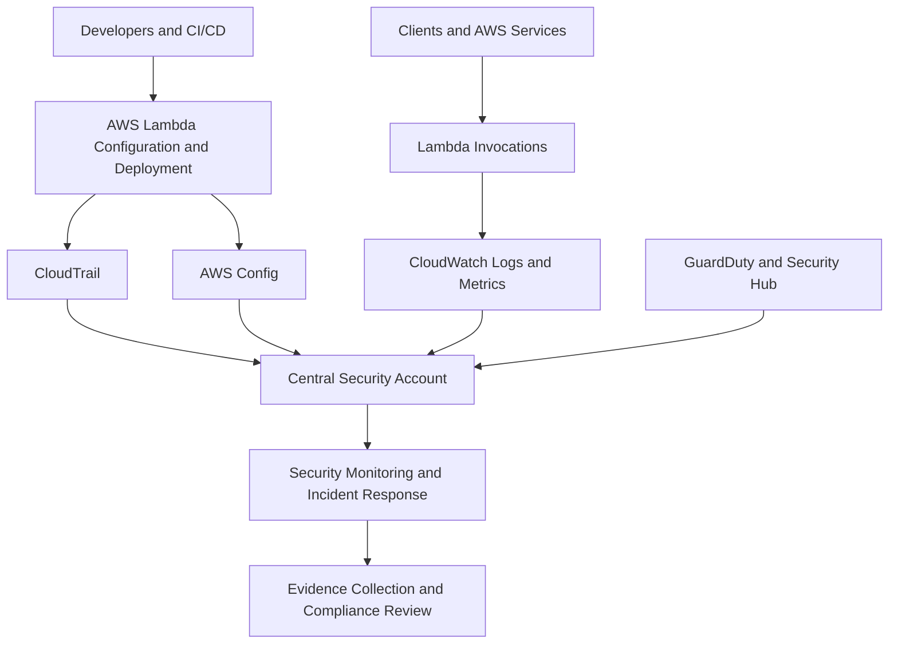
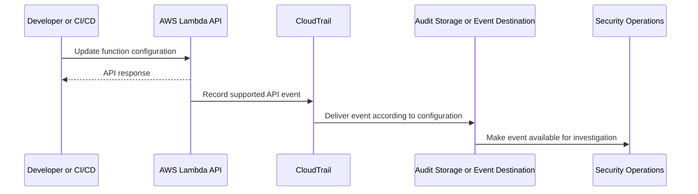
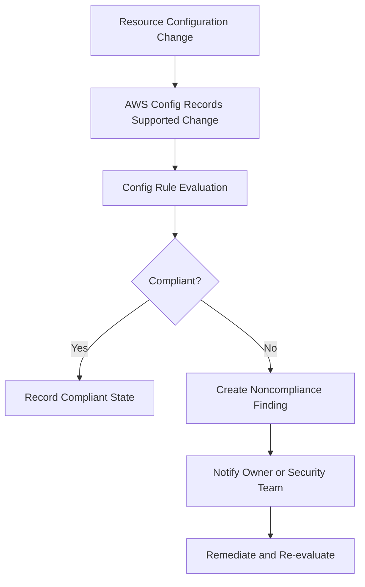
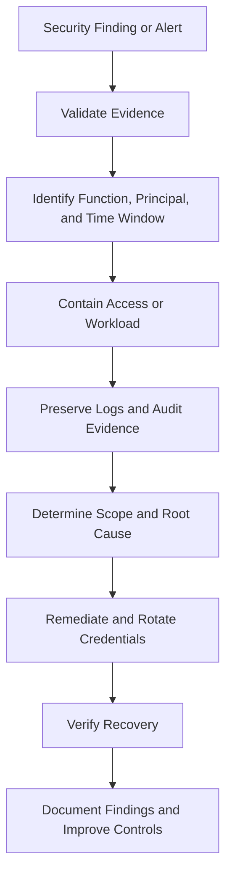

# 08- Security Auditing and Compliance

## Overview

AWS Lambda security auditing provides visibility into who invokes functions, who changes their configuration, which permissions are granted, and how functions access downstream resources. Compliance requires more than enabling logging: organizations need reliable evidence, controlled access, defined retention, continuous monitoring, and repeatable verification procedures.

A production Lambda security strategy should combine:

- **AWS CloudTrail** for recording relevant AWS API activity and investigating administrative or service actions.
- **Amazon CloudWatch Logs** for application logs and runtime diagnostics.
- **AWS Config** for recording resource configuration changes and evaluating supported configuration rules.
- **Amazon GuardDuty** for detecting supported suspicious activity and threats.
- **AWS Security Hub** for consolidating supported security findings and security posture information.
- **AWS IAM and AWS Organizations** for access control and organization-level guardrails.
- **AWS KMS** for encryption-key management where applicable.
- **AWS Audit Manager** where supported assessment frameworks and evidence-collection capabilities fit the organization's compliance process.

These services have different purposes and coverage. Enabling one does not replace the others, and no single service proves that a Lambda workload is fully compliant.

## Security Auditing Architecture

A typical architecture combines control-plane auditing, application observability, configuration evaluation, and centralized security findings.



The exact integration depends on the enabled services, account structure, Region coverage, and organizational requirements.

### Audit domains

| Domain | What to audit | Primary evidence |
|---|---|---|
| Identity and access | Role changes, policy changes, permission grants, and denied operations where recorded | CloudTrail events, IAM policies, organization policies |
| Function configuration | Runtime, execution role, environment configuration, VPC settings, and other security-relevant changes | CloudTrail, Lambda configuration, AWS Config where supported |
| Invocation behavior | Errors, timeouts, throttling, and unusual traffic patterns | CloudWatch metrics and application logs |
| Resource access | Calls to databases, queues, secrets, storage, and other AWS services | CloudTrail service events where recorded, application telemetry |
| Deployment integrity | Code updates, version publication, alias changes, and image references | CloudTrail, release records, artifact digests |
| Network security | Security group changes, routing changes, and relevant network flows | CloudTrail, VPC Flow Logs, configuration records |
| Secret protection | Secret access, policy changes, rotation activity, and key usage where recorded | CloudTrail, Secrets Manager events, KMS events |
| Compliance posture | Resource configuration and security-control status | AWS Config rules, Security Hub findings, approved assessment evidence |

Not every application operation generates an equivalent audit event. For example, application-level business actions may require explicit structured logging in addition to AWS API auditing.

## AWS CloudTrail

CloudTrail records supported AWS account activity, including many management operations performed through the AWS Management Console, AWS CLI, SDKs, and AWS service integrations.

It is essential for investigating who changed a Lambda function, which identity modified an execution role, or when a resource policy was updated.

### Management events and data events

CloudTrail distinguishes management events from data events.

| Event category | Purpose | Lambda-related examples |
|---|---|---|
| Management events | Record supported control-plane operations | Creating functions, updating function configuration, changing permissions, publishing versions |
| Data events | Record supported data-plane operations for selected resource types | Invoking Lambda functions when the relevant Lambda data events are configured |

Data events are not automatically equivalent to management-event coverage. Their collection must be configured for supported resource types and operations, and they may incur additional charges.

For Lambda, do not assume that every invocation appears in CloudTrail by default. Configure the required data-event selectors when invocation-level audit records are necessary, and verify the resulting event coverage.

### CloudTrail event lifecycle



The diagram is conceptual. Delivery timing, supported event coverage, and destination behavior depend on the CloudTrail configuration and selected integration.

### Create a trail

A trail can deliver CloudTrail events to Amazon S3 and optionally integrate with CloudWatch Logs. Use infrastructure as code or a controlled administrative workflow for production audit configuration.

The following example creates a trail. It modifies AWS resources and requires a valid S3 bucket with an appropriate access policy.

```bash
aws cloudtrail create-trail \
  --name security-audit-trail \
  --s3-bucket-name company-audit-logs \
  --is-multi-region-trail \
  --enable-log-file-validation \
  --region ap-south-1
```

Replace `company-audit-logs` with the approved destination bucket. Configure the bucket policy and encryption according to the organization's audit-storage requirements.

Start logging:

```bash
aws cloudtrail start-logging \
  --name security-audit-trail \
  --region ap-south-1
```

This is a mutating operation. Verify that the trail is logging:

```bash
aws cloudtrail get-trail-status \
  --name security-audit-trail \
  --region ap-south-1
```

Review the trail configuration:

```bash
aws cloudtrail get-trail \
  --name security-audit-trail \
  --region ap-south-1
```

These verification commands are read-only.

A multi-Region trail helps collect supported management events across enabled Regions in the account. Validate organizational requirements for organization trails, excluded Regions, event selectors, and service-specific data events rather than assuming the example covers every audit requirement.

### Configure Lambda invocation data events

If invocation-level CloudTrail evidence is required, configure the appropriate Lambda data-event selector on the trail or event data store.

For example, a trail can use advanced event selectors to collect supported Lambda invocation events for selected functions. Event selectors must be designed carefully because overly broad data-event collection can increase cost.

After configuration, invoke a test function and verify that the expected event is available in the configured audit destination.

Review the current [CloudTrail event selection documentation](https://docs.aws.amazon.com/awscloudtrail/latest/userguide/logging-data-events-with-cloudtrail.html) before applying selectors, especially when using organization-wide collection.

## AWS CloudTrail Event Investigation

A CloudTrail event commonly contains fields such as:

- `eventTime`
- `eventSource`
- `eventName`
- `awsRegion`
- `userIdentity`
- `sourceIPAddress`
- `requestParameters`
- `responseElements`
- `errorCode`
- `errorMessage`

The exact fields depend on the event and service. Some request or response fields may be omitted, redacted, or unavailable.

### Example investigation questions

| Question | Relevant evidence |
|---|---|
| Who changed the execution role? | IAM policy or role-change events and `userIdentity` |
| Who updated Lambda configuration? | Lambda configuration API events |
| Who added invocation permission? | Lambda resource-policy modification events |
| Why did a deployment fail? | Relevant API events, error fields, and CI/CD logs |
| Was an unexpected version published? | Version-publication events and release records |
| Who changed a security group? | EC2 security group modification events |
| Was a secret accessed unexpectedly? | Relevant Secrets Manager events, where recorded |
| Was a KMS key policy changed? | Relevant KMS API events |

A CloudTrail event identifies an API operation, not necessarily the complete business reason behind it. Correlate it with deployment records, application logs, change approvals, and incident timelines.

### Querying CloudTrail event history

The following command retrieves available recent management-event history for a specific API operation:

```bash
aws cloudtrail lookup-events \
  --lookup-attributes AttributeKey=EventName,AttributeValue=UpdateFunctionConfiguration \
  --max-results 20 \
  --region ap-south-1
```

This is a read-only query. CloudTrail Event History has a limited retention window and does not replace a trail or event data store designed for longer-term audit requirements. Event History is also not a substitute for explicitly configured data-event collection.

For long-term investigations, use the organization's approved CloudTrail storage, query, and retention architecture.

## CloudTrail Integrity and Audit Storage

Audit records are useful only if they remain available and their integrity is protected.

For production audit storage:

- Use a dedicated or centrally governed S3 bucket.
- Restrict write and delete permissions.
- Enable appropriate encryption and access logging where required.
- Use S3 Object Lock when retention or immutability requirements justify it.
- Configure lifecycle and retention policies that satisfy legal and operational requirements.
- Enable CloudTrail log file validation where appropriate.
- Monitor changes to trail configuration and audit-storage permissions.
- Restrict who can disable logging or alter event selectors.
- Separate audit administration from routine application deployment.

CloudTrail log file validation helps verify the integrity of delivered log files and detect certain forms of modification or deletion. It does not by itself prevent an authorized administrator from changing the overall audit architecture.

For stronger protection, combine integrity verification with restrictive IAM policies, organization guardrails, immutable retention where appropriate, and independent monitoring of audit configuration.

## Amazon CloudWatch Logs

CloudWatch Logs stores application output and runtime diagnostic messages from Lambda. It is primarily an operational observability mechanism, although its records can also support security investigations.

Application logs should explain relevant events without exposing credentials, personal data, or unnecessary business-sensitive information.

### Structured logging in Python

```python
import json
import logging
import os

logger = logging.getLogger()
logger.setLevel(os.environ.get("LOG_LEVEL", "INFO"))


def lambda_handler(event, context):
    logger.info(
        json.dumps(
            {
                "event": "order_processing_started",
                "request_id": context.aws_request_id,
                "function_name": context.function_name,
            }
        )
    )

    return {
        "statusCode": 200,
        "body": json.dumps({"status": "accepted"}),
    }
```

This example emits structured JSON content through Python logging. In production, use a logging format that your CloudWatch Logs queries and observability pipeline can parse consistently.

Do not log complete event payloads by default. Events may contain authorization headers, customer information, uploaded content, or other sensitive fields.

### Recommended logging fields

| Field | Purpose |
|---|---|
| `event` | Stable event or operation name |
| `request_id` | Correlates logs with the Lambda invocation |
| `function_name` | Identifies the function |
| `correlation_id` | Links work across service boundaries |
| `duration_ms` | Supports latency investigation |
| `outcome` | Indicates success or failure |
| `error_type` | Categorizes a failure without exposing secrets |

Include only fields that are useful, safe, and consistent with the organization's data-handling requirements.

### Retrieve Lambda logs

Read recent log events:

```bash
aws logs filter-log-events \
  --log-group-name /aws/lambda/orders-api \
  --start-time 1791676800000 \
  --region ap-south-1
```

The timestamp is an illustrative Unix epoch value in milliseconds. Replace it with the intended time range.

This command is read-only. For large log groups, narrow the time range and use filter patterns to reduce returned data and investigation time.

### Retention and access

CloudWatch Logs retention should be configured intentionally. Indefinite retention may increase cost and preserve sensitive data longer than required; excessively short retention may prevent effective incident investigation.

Define:

- Retention by environment and workload criticality.
- Who can read, export, delete, or modify log groups.
- Whether sensitive fields must be redacted before logging.
- Whether logs need centralized storage or long-term archival.
- How log access is audited.
- Which metrics and alarms are derived from log data.

Restrict log access because operational logs can reveal internal architecture, resource names, customer identifiers, and security failures.

## AWS Config and Configuration Compliance

AWS Config records supported resource configuration changes and can evaluate resources against supported rules. It is useful for identifying configuration drift and checking selected security requirements.

Examples of Lambda-related controls include reviewing:

- Whether functions use approved execution roles.
- Whether security-sensitive configurations follow organizational standards.
- Whether functions are associated with approved VPC configurations where required.
- Whether resource policies or related resources meet defined rules.
- Whether supported encryption or logging requirements are configured.

Not every security requirement has a built-in Config rule, and custom rules may be needed for organization-specific requirements.

### Configuration evaluation workflow



AWS Config evaluates configuration against rules. It does not prove that application code is secure or that every runtime interaction is compliant.

### Example compliance policy

Suppose an organization requires production Lambda functions to use approved execution roles. A custom rule could compare a function's configured role ARN with an approved role naming convention or centrally managed allowlist.

A production implementation should consider:

- Whether the rule is evaluated on configuration changes or periodically.
- How exceptions are approved and expired.
- Whether the rule supports the resource type and configuration field being evaluated.
- How false positives are handled.
- Whether remediation is safe to automate.

Do not automatically replace execution roles without validating application dependencies. An incorrect automated remediation can cause production outages.

### Inspect configuration

Use the AWS Config CLI to inspect compliance results for a known rule:

```bash
aws configservice describe-compliance-by-config-rule \
  --config-rule-names approved-lambda-execution-role \
  --region ap-south-1
```

This is a read-only command. Replace the rule name with a configured rule in the target account and Region.

If the rule does not exist, the command will not create it. Configure AWS Config and the relevant rule before relying on the result.

## GuardDuty and Security Hub

### Amazon GuardDuty

GuardDuty analyzes supported telemetry and data sources to identify suspicious activity and potential threats. Depending on enabled protection plans and supported coverage, findings may relate to unusual behavior involving AWS identities, resources, or workloads.

GuardDuty is not a general-purpose source-code scanner and should not be treated as proof that Lambda code or dependencies are safe.

Use GuardDuty findings as signals for investigation, correlate them with CloudTrail and workload telemetry, and verify whether the observed activity is expected.

### AWS Security Hub

Security Hub can aggregate and prioritize supported security findings and evaluate security posture using supported standards and controls.

It can help teams maintain a centralized view of findings across accounts and Regions, depending on configuration and service support.

A Security Hub finding does not automatically imply a confirmed compromise. Establish severity, affected resource, evidence, and remediation requirements before taking disruptive action.

### Service responsibilities

| Service | Primary purpose | Not a substitute for |
|---|---|---|
| CloudTrail | Audit supported API activity | Application-level logs or all invocation telemetry |
| CloudWatch Logs | Runtime and application diagnostics | Immutable control-plane auditing |
| AWS Config | Configuration history and rule evaluation | Code review or runtime threat detection |
| GuardDuty | Supported threat detection | Comprehensive application security testing |
| Security Hub | Centralized supported findings and posture management | Complete compliance certification |
| IAM Access Analyzer | Identifying supported external access and policy findings | Full authorization review of every runtime path |

Enable and configure only the capabilities relevant to the required security posture, and verify their coverage in each account and Region.

## IAM Access Auditing

IAM permissions can change over time as teams deploy new functions, attach policies, or modify trust relationships. Regular access reviews help identify excessive privileges and unintended access paths.

Review:

- Lambda execution roles and their attached policies.
- Inline policies and permissions boundaries.
- Resource-based invocation policies.
- Trust policies and role-assumption relationships.
- `iam:PassRole` permissions.
- Deployment roles and CI/CD identities.
- Cross-account access grants.
- Permissions for audit services and log destinations.
- Unused or overly broad permissions, where evidence is available.

### Inspect a Lambda execution role

First retrieve the role ARN:

```bash
aws lambda get-function-configuration \
  --function-name orders-api \
  --region ap-south-1 \
  --query 'Role'
```

Then inspect the role's attached managed policies:

```bash
aws iam list-attached-role-policies \
  --role-name orders-api-execution-role
```

Inspect inline policies:

```bash
aws iam list-role-policies \
  --role-name orders-api-execution-role
```

These commands are read-only. Review the policy documents and relevant boundaries rather than relying only on the attached policy names.

For larger environments, automate inventory collection and compare the results against approved role patterns and resource ownership metadata.

## Security Monitoring and Alerting

Audit events are most useful when relevant changes or suspicious patterns trigger actionable investigation.

Examples of security signals include:

- Unexpected changes to Lambda execution roles.
- Changes to resource-based invocation policies.
- Function code or configuration updates outside approved deployment windows.
- Unexpected publication of a function version.
- Changes to CloudTrail trails, selectors, or destinations.
- Attempts to disable or weaken security controls.
- Unusual access to secrets or encryption keys.
- Large changes in invocation volume or error rates.
- Unexpected public exposure of a function URL or related endpoint.
- New or modified security group rules affecting private workloads.

Not every signal indicates malicious activity. Deployment automation and authorized maintenance can produce similar events. Correlate the signal with approved change records and the identity that performed the operation.

### Alert design

| Signal | Detection source | Example response |
|---|---|---|
| Unapproved function configuration change | CloudTrail event processing | Verify change approval and compare with release records |
| Audit trail disabled | CloudTrail configuration monitoring | Investigate immediately and restore approved audit coverage |
| Unexpected policy broadening | IAM policy monitoring or configuration analysis | Review permissions and revert unauthorized changes |
| Lambda error spike | CloudWatch metrics and alarms | Inspect deployment history and application logs |
| Suspicious identity activity | GuardDuty and CloudTrail | Validate the finding and follow incident-response procedures |
| Configuration noncompliance | AWS Config and Security Hub where supported | Assign an owner and remediate the underlying resource |

Avoid alerts that produce high volumes of low-value notifications. Define ownership, severity, escalation criteria, and response procedures for each production alert.

## Incident Response for Lambda

A Lambda security incident may involve a compromised execution role, malicious deployment, exposed credential, unauthorized invocation, or vulnerable dependency.

A practical incident workflow is:



### Investigation checklist

1. Identify the affected function, account, Region, version, and alias.
2. Establish the incident timeline from CloudTrail, application logs, and deployment records.
3. Identify the principals and credentials involved.
4. Review changes to execution roles, resource policies, environment configuration, and networking.
5. Determine whether sensitive data or downstream resources may have been accessed.
6. Preserve relevant logs and artifacts before performing destructive cleanup.
7. Contain the incident using the least disruptive effective control.
8. Rotate exposed credentials and remove unauthorized permissions.
9. Deploy a verified, trusted artifact where code compromise is suspected.
10. Validate recovery and document corrective actions.

### Containment trade-offs

Disabling a function, removing invocation permissions, or restricting its execution role can reduce exposure but may interrupt production traffic.

Choose containment actions based on incident severity, evidence, business impact, and available fallback paths. Do not delete resources or erase logs before collecting necessary evidence.

For credential exposure, rotate or revoke the credential rather than merely removing it from application code. For a compromised deployment pipeline, investigate both the deployed artifact and the authority used to publish it.

## Compliance Frameworks and Evidence

Compliance requirements depend on the organization, industry, contract, data classification, and applicable legal obligations. AWS service features support control implementation and evidence collection, but using those features does not automatically establish compliance.

Common assessment areas include:

- Identity lifecycle and access reviews.
- Change management and deployment approvals.
- Audit-log generation, protection, and retention.
- Encryption and key management.
- Vulnerability management.
- Incident response and escalation.
- Backup, recovery, and continuity.
- Data minimization and retention.
- Network segmentation and access restrictions.
- Monitoring coverage and alert handling.

### Evidence mapping

| Control objective | Potential evidence | Important limitation |
|---|---|---|
| Restrict production changes | IAM policies, deployment-role configuration, approval records | A policy alone does not prove approvals were followed |
| Record administrative activity | CloudTrail configuration and sample events | Event coverage must be verified |
| Protect audit records | S3 policy, retention configuration, Object Lock settings where used | Storage controls must be tested and independently governed |
| Review configuration drift | AWS Config rule results and remediation records | Only covered resources and rules are evaluated |
| Monitor suspicious activity | GuardDuty findings and response records | Detection depends on supported coverage and configuration |
| Protect secrets | IAM policies, secret configuration, rotation records | Configuration evidence does not prove all application paths avoid exposure |
| Validate deployment integrity | Build metadata, artifact digest, release record | A digest is useful only when compared with a trusted reference |
| Respond to incidents | Incident timeline, evidence records, remediation actions | Documentation must reflect actual execution, not merely planned procedures |

For formal assessments, map technical controls to the exact requirements of the applicable framework. Avoid claiming a compliance certification based solely on service configuration.

### AWS Audit Manager

AWS Audit Manager can support assessments by collecting and organizing evidence for supported controls and frameworks. Its usefulness depends on the selected framework, evidence sources, account configuration, and service coverage.

Treat generated evidence as input to an assessment process. Validate whether it satisfies the relevant control and whether additional manual evidence is required.

## Retention, Privacy, and Data Handling

Audit data may contain IP addresses, identity metadata, resource names, customer identifiers, and application-specific fields. Retention and access policies should account for both investigation requirements and data-minimization obligations.

Define separate retention policies for:

- CloudTrail audit events.
- CloudWatch application logs.
- Security findings and incident records.
- Build and deployment artifacts.
- Configuration history.
- Evidence collected for compliance assessments.

Retention periods should be based on legal, contractual, security, and operational requirements rather than one universal duration.

Use appropriate encryption, restrictive access policies, controlled export paths, and documented deletion procedures. Test that retention and lifecycle policies behave as intended, including for archived data.

## Multi-Account and Multi-Region Auditing

Organizations operating several AWS accounts or Regions should avoid relying on isolated, manually maintained audit configurations.

A centralized design can provide:

- Organization-level CloudTrail collection where appropriate.
- A protected central audit account.
- Centralized security findings.
- Standardized log-retention policies.
- Shared configuration rules and guardrails.
- Account and Region coverage inventories.
- Central alerting and incident ownership.

The central account should be governed separately from application deployment accounts. Routine application teams should not have unrestricted ability to delete centralized audit records or disable organization-wide monitoring.

Verify coverage whenever accounts, Regions, or workloads are added. Organization-level configuration still requires appropriate permissions, supported features, and correct destination policies.

## Cost and Operational Considerations

Security auditing introduces costs for log ingestion, storage, data-event collection, analysis, findings processing, and long-term retention.

Common cost drivers include:

- CloudTrail data events and additional event-data-store ingestion.
- CloudWatch Logs ingestion, retention, and query workloads.
- S3 storage and data retrieval.
- AWS Config recording and rule evaluations.
- Security monitoring and optional protection capabilities.
- Centralized cross-account data movement and analysis.

Optimize cost without removing required security coverage.

- Collect data events for the resources and operations that need them.
- Use deliberate log retention periods.
- Apply lifecycle policies to eligible audit archives.
- Avoid logging entire payloads when structured fields are sufficient.
- Review high-volume log groups and unnecessary debug output.
- Monitor audit pipeline health and ingestion gaps.
- Budget for incident investigation and long-term evidence retrieval.

Pricing and feature availability vary by service, Region, and configuration. Validate current AWS pricing and account-specific requirements before changing audit coverage.

## Common Mistakes and Production Pitfalls

| Mistake | Why it is problematic | Better approach |
|---|---|---|
| Assuming CloudTrail records every Lambda invocation by default | Invocation-level data events require appropriate configuration | Verify data-event selectors and test actual event coverage |
| Using CloudWatch application logs as the only audit source | Application code cannot reliably record every control-plane change | Use CloudTrail for supported API auditing |
| Leaving audit storage writable by ordinary deployment roles | A compromised deployment identity may tamper with evidence | Restrict audit administration and use appropriate retention controls |
| Retaining logs indefinitely without review | Increases cost and may preserve sensitive data unnecessarily | Define retention according to legal and operational requirements |
| Enabling a security service without verifying coverage | Some accounts, Regions, resource types, or event categories may remain uncovered | Maintain a coverage inventory and test the resulting evidence |
| Treating Security Hub findings as confirmed incidents | Findings may require contextual validation | Triage findings and correlate them with other evidence |
| Automatically remediating every configuration finding | Automated changes may break valid production dependencies | Use tested remediation policies and exception handling |
| Logging complete request payloads | Can expose credentials or sensitive customer data | Log approved fields and redact sensitive values |
| Ignoring changes to logging configuration | Attackers or misconfiguration may reduce future visibility | Monitor trail, log-group, selector, and destination changes |
| Assuming a compliance dashboard proves certification | Service findings cover only configured controls and supported evidence | Map evidence to the exact assessment requirements |
| Failing to test incident procedures | Teams may lack access or lose evidence during an incident | Run controlled exercises and validate response ownership |

## Production Readiness Checklist

### Audit coverage

- [ ] CloudTrail records the required management events.
- [ ] Required Lambda invocation data events are explicitly configured and verified.
- [ ] Relevant AWS Regions and accounts are covered.
- [ ] CloudWatch Logs capture useful, structured application diagnostics.
- [ ] AWS Config rules cover the intended configuration requirements where supported.
- [ ] Security findings are routed to an owned monitoring workflow.

### Integrity and access

- [ ] Audit storage has restrictive write and delete permissions.
- [ ] Audit administration is separated from routine application deployment.
- [ ] Required encryption and retention controls are configured.
- [ ] Log access is restricted to approved roles.
- [ ] Changes to audit configuration are monitored.
- [ ] CloudTrail log file validation and immutable retention are considered where appropriate.

### Incident response and compliance

- [ ] Security alerts have defined owners and escalation paths.
- [ ] Incident procedures preserve evidence before destructive actions.
- [ ] Credential rotation and compromised-artifact remediation are documented.
- [ ] Audit evidence is mapped to actual compliance requirements.
- [ ] Log retention and privacy requirements are reviewed periodically.
- [ ] Audit coverage and incident-response procedures are tested.
- [ ] Security and logging costs are monitored.

## Official References

- [AWS CloudTrail User Guide](https://docs.aws.amazon.com/awscloudtrail/latest/userguide/cloudtrail-user-guide.html)
- [CloudTrail management and data events](https://docs.aws.amazon.com/awscloudtrail/latest/userguide/logging-data-events-with-cloudtrail.html)
- [CloudTrail log file integrity validation](https://docs.aws.amazon.com/awscloudtrail/latest/userguide/cloudtrail-log-file-validation-intro.html)
- [Amazon CloudWatch Logs](https://docs.aws.amazon.com/AmazonCloudWatch/latest/logs/WhatIsCloudWatchLogs.html)
- [AWS Config Developer Guide](https://docs.aws.amazon.com/config/latest/developerguide/WhatIsConfig.html)
- [Amazon GuardDuty User Guide](https://docs.aws.amazon.com/guardduty/latest/ug/what-is-guardduty.html)
- [AWS Security Hub User Guide](https://docs.aws.amazon.com/securityhub/latest/userguide/what-is-securityhub.html)
- [IAM Access Analyzer](https://docs.aws.amazon.com/IAM/latest/UserGuide/what-is-access-analyzer.html)
- [AWS Audit Manager](https://docs.aws.amazon.com/audit-manager/latest/userguide/what-is.html)
- [AWS Well-Architected Framework: Security Pillar](https://docs.aws.amazon.com/wellarchitected/latest/security-pillar/welcome.html)

## Key Takeaways

- Use CloudTrail for supported AWS API auditing and configure Lambda data events explicitly when invocation-level audit evidence is required.
- Combine CloudTrail, CloudWatch Logs, AWS Config, and supported security findings because they cover different control-plane, application, configuration, and threat-detection concerns.
- Protect audit integrity through restrictive access, deliberate retention, appropriate encryption, and monitoring of changes to logging infrastructure.
- Treat security findings and compliance evidence as inputs to investigation and assessment, not automatic proof of compromise or certification.
- Build repeatable incident-response procedures that preserve evidence, contain exposure, rotate compromised credentials, verify recovery, and record corrective actions.