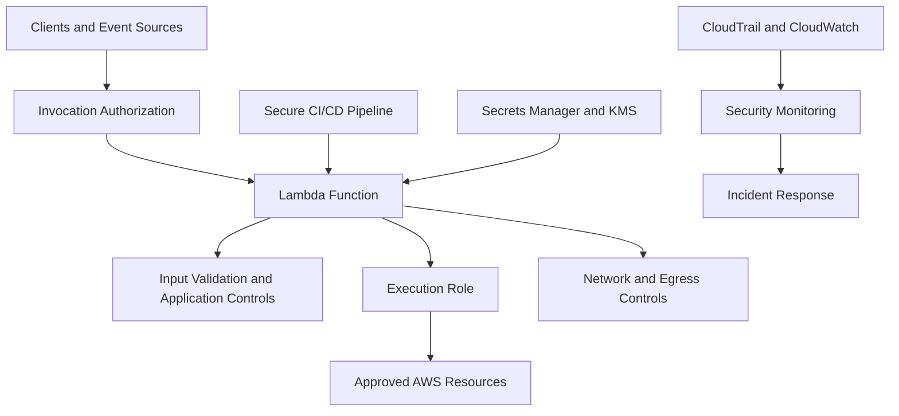
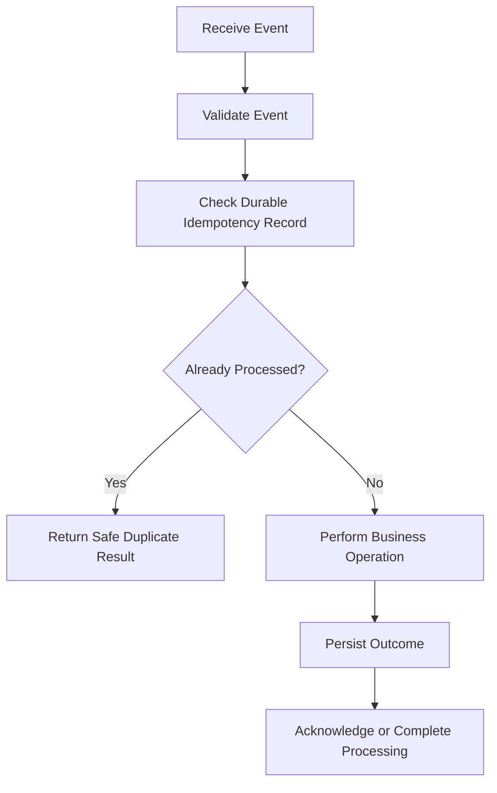
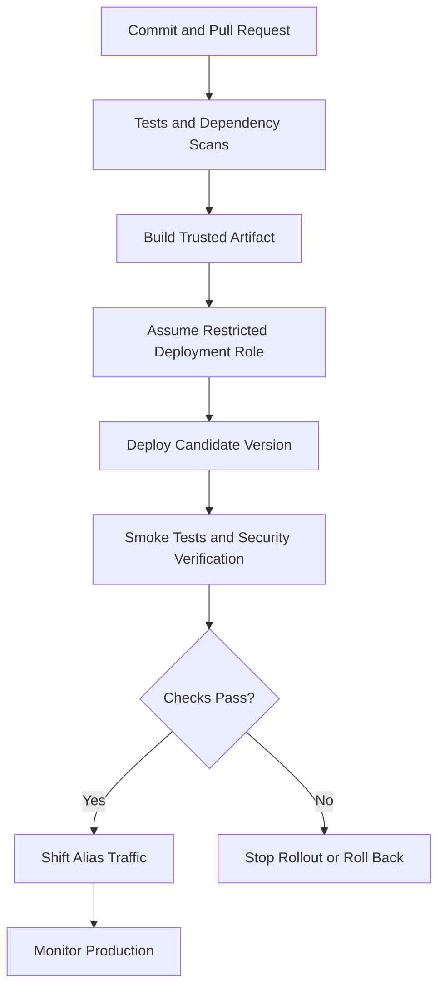

# 09- Lambda Security Best Practices

## Overview

AWS Lambda security best practices focus on reducing the impact of compromised code, stolen credentials, unauthorized invocations, vulnerable dependencies, and misconfigured infrastructure. A secure Lambda deployment requires controls across identity, code, configuration, networking, event processing, observability, and the deployment pipeline.

Lambda operates under the AWS shared responsibility model. AWS manages the underlying infrastructure and execution environment infrastructure, while the application owner remains responsible for function code, permissions, data protection, dependency management, configuration, and workload-level security.

A production security strategy should prioritize the following principles:

- **Least privilege:** Grant each function only the permissions required for its workload.
- **Defense in depth:** Combine IAM, resource policies, network controls, input validation, and monitoring.
- **Credential protection:** Use managed secret stores and temporary credentials instead of embedded secrets.
- **Secure deployment:** Publish trusted artifacts through a controlled CI/CD pipeline.
- **Resilient event processing:** Assume retries, duplicate events, malformed input, and partial failures.
- **Continuous verification:** Detect configuration drift, investigate security findings, and regularly test controls.

## Security Layers in Lambda

Lambda security is not a single configuration setting. It consists of several independent boundaries.



| Security layer | Primary responsibility | Typical control |
|---|---|---|
| Invocation | Determine who can invoke the function | IAM authorization and resource-based policies |
| Application | Prevent unsafe processing and business-logic abuse | Input validation, authorization, safe parsing |
| Execution identity | Restrict what the function can access | Least-privilege execution role |
| Network | Limit reachable resources and traffic paths | VPC security groups, routing, endpoints, and egress controls |
| Data | Protect secrets and sensitive information | Secrets Manager, KMS, encryption, and data minimization |
| Dependencies | Reduce supply-chain risk | Dependency pinning, vulnerability scanning, trusted artifacts |
| Deployment | Prevent unauthorized or unverified releases | Federated CI/CD identity, approvals, artifact integrity |
| Observability | Detect and investigate suspicious activity | CloudTrail, CloudWatch, GuardDuty, and Security Hub where appropriate |

These layers are complementary. For example, placing a function in a VPC does not automatically restrict all outbound traffic, and encrypting environment variables does not prevent authorized code from reading their plaintext values.

## Least-Privilege IAM

The Lambda execution role determines which AWS API operations a function can perform. Overly broad permissions increase the potential impact of application vulnerabilities or compromised dependencies.

### Separate execution and deployment permissions

Use distinct identities for runtime operations and deployment operations.

| Identity | Responsibility | Example permissions |
|---|---|---|
| Lambda execution role | Used by the function at runtime | Read a specific secret, write to a designated queue |
| CI/CD deployment role | Used by the deployment pipeline | Update approved functions, publish versions |
| Developer identity | Used for development and investigation | Read logs and inspect configuration as authorized |
| Security audit role | Used for security review | Inspect IAM policies, function configuration, and audit evidence |

Avoid granting runtime roles permission to create IAM users, attach policies, change execution roles, or deploy arbitrary code unless a specific, reviewed design requires those capabilities.

### Example: overly broad policy

The following policy grants access to every S3 bucket and object in the account:

```json
{
  "Version": "2012-10-17",
  "Statement": [
    {
      "Effect": "Allow",
      "Action": "s3:*",
      "Resource": "*"
    }
  ]
}
```

This is inappropriate for a function that only needs to read objects from one approved bucket.

A narrower policy might be:

```json
{
  "Version": "2012-10-17",
  "Statement": [
    {
      "Sid": "ReadApprovedInputObjects",
      "Effect": "Allow",
      "Action": [
        "s3:GetObject"
      ],
      "Resource": "arn:aws:s3:::company-input-data/orders/*"
    }
  ]
}
```

This policy allows object reads under the specified prefix. Add bucket-level permissions only when required by the actual API operations. If the workload needs to list objects, define a separate `s3:ListBucket` permission on the bucket ARN and restrict it using suitable conditions where possible.

For encrypted objects, the role may also need appropriate KMS permissions, depending on the encryption configuration and key policy.

### IAM review checklist

- [ ] Every function has a dedicated role or a deliberately shared role with equivalent trust and permission requirements.
- [ ] Actions are limited to the required API operations.
- [ ] Resources are restricted to approved ARNs wherever supported.
- [ ] Wildcards are justified and documented.
- [ ] Cross-account access is explicitly reviewed.
- [ ] Permissions boundaries and organization policies are considered where applicable.
- [ ] Role changes are audited.
- [ ] Unused permissions are reviewed using appropriate evidence and testing.

Do not remove a permission merely because it was unused during a short observation period. Some permissions may support scheduled, recovery, or infrequent operational paths.

## Invocation Authorization

A function's execution role controls what the function can do after invocation. It does not, by itself, determine who may invoke the function.

Review the authorization mechanism for each entry point:

- API Gateway authorization and resource configuration.
- Lambda resource-based policies.
- IAM-authorized direct invocations.
- Function URL authentication configuration.
- Service principals used by AWS event sources.
- Cross-account invocation grants.

### Avoid unintended public access

A public endpoint can be appropriate for a public API, but it must have an intentional authentication and authorization design.

For a Lambda function URL, review the configured authentication type and resource policy. `AWS_IAM` requires authorized callers to sign requests appropriately. `NONE` allows unauthenticated invocation at the URL's authentication layer, so access must be considered carefully alongside applicable resource policies and other controls.

Do not assume that a secret URL is a security boundary.

For event-driven functions, grant invocation permission only to the required service principal and, where supported and appropriate, constrain it using the source resource ARN and account.

### Example: scoped service invocation permission

The following command adds permission for an S3 bucket to invoke a Lambda function. It modifies the function's resource-based policy.

```bash
aws lambda add-permission \
  --function-name process-upload \
  --statement-id AllowApprovedBucketInvocation \
  --action lambda:InvokeFunction \
  --principal s3.amazonaws.com \
  --source-arn arn:aws:s3:::company-approved-uploads \
  --source-account 123456789012 \
  --region ap-south-1
```

Replace the account ID, bucket ARN, function name, and Region with the actual values.

Verify the policy:

```bash
aws lambda get-policy \
  --function-name process-upload \
  --region ap-south-1
```

The verification command is read-only. Also verify the event source configuration and confirm that the intended bucket is the one configured to send notifications.

## Secure Handling of Secrets

Do not hardcode passwords, API tokens, database credentials, or long-lived access keys in source code, deployment packages, container images, or version-controlled configuration.

Prefer:

- AWS Secrets Manager for managed secrets and rotation workflows.
- AWS Systems Manager Parameter Store for configuration and suitable parameter-management use cases.
- IAM roles and temporary credentials for AWS API access.
- KMS-backed encryption where required by the data-protection design.

### Example: retrieve a secret from Secrets Manager

```python
import json
import os

import boto3

secrets_client = boto3.client("secretsmanager")


def get_database_credentials() -> dict:
    secret_arn = os.environ["DATABASE_SECRET_ARN"]

    response = secrets_client.get_secret_value(
        SecretId=secret_arn
    )

    return json.loads(response["SecretString"])
```

The function's execution role must have permission to retrieve the specific secret. Depending on the secret's encryption configuration, additional KMS permissions may be required.

Production considerations:

- Cache secrets carefully to reduce repeated API calls.
- Define how rotation interacts with cached credentials and database connections.
- Never log the returned secret or the complete response.
- Restrict access to secret versions and rotation operations.
- Consider network connectivity when accessing endpoints from a VPC.
- Use an appropriate failure policy when the secret service is temporarily unavailable.

Environment variables can hold non-sensitive configuration and secret identifiers. They should not be treated as a substitute for a managed secret store when credentials require rotation, centralized lifecycle management, or fine-grained access control.

## Environment Variables and Encryption

Lambda encrypts environment variables at rest using AWS-managed encryption by default, with supported options for configuring a customer-managed KMS key.

Encryption at rest does not prevent authorized function code from reading environment-variable values at runtime.

Best practices include:

- Store secret identifiers instead of secret values when practical.
- Restrict access to function configuration and update operations.
- Protect KMS key policies and grants.
- Avoid exposing environment variables in diagnostic output.
- Use separate configuration and secrets for development, staging, and production.
- Review environment-variable changes through CloudTrail and deployment records.

When using a customer-managed key, ensure that the identities responsible for configuring and operating the function have the required KMS permissions. Test the complete deployment and invocation flow after changing key policies.

## Dependency and Supply-Chain Security

Lambda deployment packages and container images can contain vulnerable libraries, compromised artifacts, or unnecessary dependencies.

A secure dependency strategy should include:

- Pinning application dependencies to reviewed versions.
- Using lock files and reproducible builds where appropriate.
- Scanning dependencies for known vulnerabilities.
- Reviewing transitive dependencies.
- Keeping runtime and operating-system components current.
- Using trusted package registries and base images.
- Generating software bills of materials where required.
- Recording artifact digests and release metadata.
- Restricting who can publish deployment artifacts.

### Python dependency management

Use a controlled dependency manifest and build the deployment artifact in a repeatable environment.

```text
boto3==1.40.0
requests==2.32.4
```

These versions are illustrative pins, not a recommendation to use those versions indefinitely. Select versions that are currently supported, reviewed, and compatible with the target runtime.

Do not assume that pinning a version makes a dependency secure. Review vulnerability reports, release notes, and maintenance status.

For ZIP deployments, verify that native dependencies are compatible with the target Lambda runtime and execution architecture. For container-image deployments, scan the image and control the source, build process, and publication permissions.

## Secure Input Validation

Treat events from API Gateway, S3, SQS, EventBridge, and other integrations as untrusted input unless their provenance and schema have been validated.

An AWS service invoking a function does not guarantee that every field in the event is valid for the application's business rules.

### Validation principles

- Validate required fields, data types, sizes, and allowed values.
- Reject malformed or unsupported input explicitly.
- Enforce authorization independently of input validation.
- Avoid unsafe deserialization and dynamic code execution.
- Restrict file types and sizes when processing uploaded content.
- Validate object keys and identifiers before using them.
- Apply rate limits and abuse controls at the appropriate entry point.
- Keep error messages useful without revealing internal implementation details.

### Example: validating an API request

```python
import json
from decimal import Decimal, InvalidOperation


def lambda_handler(event, context):
    try:
        body = json.loads(event.get("body") or "{}")
    except (TypeError, json.JSONDecodeError):
        return {
            "statusCode": 400,
            "body": json.dumps({"error": "Invalid JSON"}),
        }

    if not isinstance(body, dict):
        return {
            "statusCode": 400,
            "body": json.dumps({"error": "Invalid request"}),
        }

    order_id = body.get("order_id")
    amount = body.get("amount")

    if not isinstance(order_id, str) or not order_id.strip():
        return {
            "statusCode": 400,
            "body": json.dumps({"error": "Invalid order_id"}),
        }

    try:
        amount_value = Decimal(str(amount))
    except (InvalidOperation, ValueError):
        return {
            "statusCode": 400,
            "body": json.dumps({"error": "Invalid amount"}),
        }

    if not amount_value.is_finite() or amount_value <= 0:
        return {
            "statusCode": 400,
            "body": json.dumps({"error": "Invalid amount"}),
        }

    return {
        "statusCode": 202,
        "body": json.dumps({"status": "accepted"}),
    }
```

This example demonstrates basic parsing and validation, not a complete production API. A production endpoint must also implement authentication, authorization, request-size limits, business constraints, idempotency, and appropriate error handling.

## VPC and Network Security

A Lambda function attached to a VPC can access resources reachable through its configured subnets and routing. VPC attachment does not automatically make the function private in every respect or prevent all outbound access.

Review:

- Subnet selection and route tables.
- Security group ingress and egress rules.
- Network ACLs where applicable.
- DNS configuration and resolution.
- Private connectivity to AWS services through supported VPC endpoints.
- NAT or other egress architecture where required.
- Database reachability and connection limits.
- Network flow logging where justified.
- Separation between application and data-layer security groups.

Use security groups to express the minimum required network communication. For example, a database security group can allow connections from the Lambda security group on the database port rather than allowing broad access from an entire network range.

### VPC security review

| Risk | Mitigation |
|---|---|
| Broad outbound rules | Restrict egress where practical and validate required destinations |
| Unintended public exposure | Review endpoint authentication and resource policies separately from VPC configuration |
| Database reachable by unrelated workloads | Restrict database ingress to approved security groups |
| Missing service connectivity | Validate routes, DNS, endpoints, and egress requirements |
| Connection exhaustion | Limit concurrency, reuse connections safely, and consider appropriate pooling solutions |
| Unobserved network failures | Use relevant logs, metrics, and flow evidence |

Network controls should complement IAM. A function that can reach a database should still use database-level authentication and least-privilege database permissions.

## Idempotency and Event Security

Lambda event sources can retry processing, and some integrations deliver duplicate events. Security-sensitive operations must not assume that each event is delivered exactly once.

Examples include:

- Creating or refunding a payment.
- Provisioning a user account.
- Updating access permissions.
- Processing an uploaded document.
- Triggering a downstream workflow.

Use an idempotency key derived from a stable event or business identifier, and persist processing state in a durable store when the operation requires deduplication across execution environments.



The business operation and idempotency record must be designed for failure between steps. A naive check-then-write sequence can race under concurrent invocations. Use conditional writes, transactions, or an appropriate idempotency library and storage design.

For SQS event source mappings, configure visibility timeout and retry behavior appropriately, and use partial batch responses when supported and needed. Failed messages should have a defined retry and dead-letter handling strategy.

## Concurrency and Downstream Protection

Lambda can scale rapidly, which is useful for bursty workloads but can overwhelm downstream databases, APIs, or third-party services.

Security and reliability controls should include:

- Reserved concurrency where isolation or capacity protection is required.
- Appropriate timeout and memory settings.
- Queue-based buffering for workloads that can be processed asynchronously.
- Rate limiting at API entry points.
- Downstream connection and request limits.
- Retry policies that avoid synchronized retry storms.
- Alarms for throttling, errors, queue age, and downstream failures.

A function's concurrency can be approximated using Little's Law:

\[
\text{Concurrency} \approx \text{Request rate} \times \text{Average duration}
\]

For example, 100 requests per second with an average duration of 0.5 seconds implies approximately 50 concurrent executions under steady-state assumptions. Bursts, latency distributions, retries, and downstream constraints can increase the required capacity.

Do not increase Lambda concurrency blindly to solve throttling. Determine whether the limiting factor is Lambda capacity, account quotas, reserved concurrency, or a downstream dependency.

## Logging, Monitoring, and Security Auditing

Security controls require observable evidence. Maintain a deliberate division of responsibility between audit logs, application logs, metrics, and findings.

| Signal | Recommended use |
|---|---|
| CloudTrail management events | Investigate supported API and configuration changes |
| CloudTrail data events | Audit supported data-plane operations when explicitly configured |
| CloudWatch application logs | Diagnose function behavior and application failures |
| CloudWatch metrics and alarms | Detect error spikes, throttling, latency, and capacity issues |
| AWS Config | Evaluate supported configuration requirements |
| GuardDuty findings | Investigate supported suspicious activity |
| Security Hub findings | Consolidate supported security findings and posture information |

Best practices:

- Use structured logs with request and correlation identifiers.
- Redact credentials and sensitive request fields.
- Configure log retention based on security and operational requirements.
- Restrict log-group access and audit-log administration.
- Monitor changes to logging configuration and destinations.
- Test alarms and incident escalation paths.
- Ensure the relevant accounts and Regions are covered.

CloudTrail does not replace application-level audit events. If the business requires evidence that a payment was approved or a user permission was changed by application logic, record that business event explicitly with appropriate access and integrity controls.

## Secure CI/CD and Deployment

A compromised deployment pipeline can undermine otherwise strong runtime security controls. The pipeline should authenticate securely, deploy only approved artifacts, and have narrowly scoped permissions.

### Deployment recommendations

- Prefer GitHub Actions OpenID Connect federation to long-lived AWS access keys where supported by the deployment design.
- Restrict the IAM trust policy to the intended repository, branch, environment, or workflow identity.
- Separate build, deployment, and runtime permissions.
- Protect production environments with appropriate approval controls.
- Pin third-party workflow actions to reviewed immutable references where practical.
- Run tests, dependency scans, and security checks before deployment.
- Use immutable artifacts and verify artifact provenance.
- Publish a version and direct production traffic through a controlled alias.
- Test rollback and post-deployment verification.
- Audit changes to roles, policies, function code, configuration, and aliases.

### Safe release workflow



A rollback to an earlier version does not reverse database migrations, external side effects, or changes to IAM and other infrastructure unless those changes are explicitly addressed by the recovery procedure.

## Advanced Security Considerations

### Lambda layers

Layers can simplify dependency sharing but create a shared supply-chain dependency. Review layer ownership, permissions, versioning, compatibility, and update procedures.

Avoid granting access to untrusted publishers or relying on an unreviewed layer simply because it is available in the same account.

### Container images

For container-image Lambda functions:

- Use trusted base images and maintain them.
- Scan images for known vulnerabilities.
- Restrict ECR push permissions.
- Deploy immutable image digests where practical.
- Avoid placing secrets in image layers.
- Rebuild and redeploy when base images or dependencies require security updates.

An image scan is a point-in-time assessment and does not guarantee the absence of vulnerabilities.

### Extensions

Extensions can access resources and interact with the execution environment. Evaluate their publisher, permissions, data handling, network behavior, and impact on initialization and invocation performance.

### SnapStart and initialization

For runtimes and configurations that support Lambda SnapStart, verify current compatibility requirements before enabling it. Initialization snapshots can preserve initialized application state, so ensure that credentials, random values, temporary identifiers, and other state are safe under snapshot restoration semantics.

Do not assume that SnapStart is available for every runtime or configuration, or that it replaces provisioned concurrency in every latency-sensitive workload.

### Recursive invocation

A function that triggers itself directly or indirectly can generate repeated invocations and unexpected cost. Review event routing, destination configuration, and event filters to avoid recursive loops.

Use supported recursive-loop detection where applicable, but do not treat it as a substitute for architecture review, idempotency, bounded retries, and monitoring.

## Testing Lambda Security Controls

Security controls should be tested as part of normal development and production readiness.

| Test category | Example verification |
|---|---|
| IAM | Confirm an unapproved API operation is denied |
| Invocation | Verify unauthorized callers cannot invoke protected endpoints |
| Input validation | Test malformed JSON, unexpected types, oversized input, and invalid identifiers |
| Secrets | Confirm logs and error responses do not expose credentials |
| Network | Verify only approved network paths can reach protected resources |
| Event processing | Test duplicate events, retry behavior, poison messages, and partial batch failures |
| Dependencies | Run vulnerability and license checks according to organizational policy |
| Deployment | Confirm only approved identities can publish and release production code |
| Audit | Verify expected changes appear in CloudTrail and required logs reach their destination |
| Recovery | Exercise rollback, credential rotation, and incident response procedures |

Use isolated test environments and synthetic data. Avoid destructive testing against production resources unless the activity has explicit authorization and a reviewed test plan.

## Production Security Review Checklist

### Identity and access

- [ ] Execution roles use least privilege.
- [ ] Invocation permissions are intentional and scoped.
- [ ] Cross-account access is reviewed.
- [ ] Deployment permissions are separate from runtime permissions.
- [ ] `iam:PassRole` and IAM administration permissions are constrained.
- [ ] Changes to IAM and Lambda policies are audited.

### Code and data

- [ ] Dependencies are reviewed, pinned, and scanned.
- [ ] Deployment artifacts are produced through a trusted pipeline.
- [ ] Input validation and application authorization are implemented.
- [ ] Secrets are stored and accessed through approved mechanisms.
- [ ] Logs do not expose credentials or unnecessary sensitive data.
- [ ] Idempotency and duplicate-event handling are implemented where required.

### Network and resilience

- [ ] VPC routes, security groups, and endpoints are reviewed.
- [ ] Database and downstream access are restricted.
- [ ] Timeouts, retries, and concurrency are configured intentionally.
- [ ] Dead-letter handling or failure destinations are configured where appropriate.
- [ ] Recursive invocation risks are addressed.
- [ ] Failure-path and recovery tests have been performed.

### Monitoring and operations

- [ ] CloudTrail covers required management activity.
- [ ] Required data events are explicitly configured and verified.
- [ ] Application logs, metrics, and alarms are operational.
- [ ] Audit records have appropriate access and retention controls.
- [ ] Security findings have owners and response procedures.
- [ ] Deployment rollback and incident response have been tested.
- [ ] Cost and quota usage are monitored.

## Official References

- [AWS Lambda Security](https://docs.aws.amazon.com/lambda/latest/dg/lambda-security.html)
- [Lambda execution roles](https://docs.aws.amazon.com/lambda/latest/dg/lambda-intro-execution-role.html)
- [Lambda resource-based policies](https://docs.aws.amazon.com/lambda/latest/dg/access-control-resource-based.html)
- [Lambda environment variables](https://docs.aws.amazon.com/lambda/latest/dg/configuration-envvars.html)
- [Lambda VPC configuration](https://docs.aws.amazon.com/lambda/latest/dg/configuration-vpc.html)
- [AWS Secrets Manager User Guide](https://docs.aws.amazon.com/secretsmanager/latest/userguide/intro.html)
- [AWS CloudTrail User Guide](https://docs.aws.amazon.com/awscloudtrail/latest/userguide/cloudtrail-user-guide.html)
- [AWS Well-Architected Framework: Security Pillar](https://docs.aws.amazon.com/wellarchitected/latest/security-pillar/welcome.html)

## Key Takeaways

- Secure Lambda through multiple independent controls: least-privilege IAM, invocation authorization, input validation, network restrictions, and protected data.
- Treat deployment artifacts, dependencies, CI/CD identities, layers, and container images as part of the security boundary.
- Design event processing for duplicate delivery, retries, malformed input, concurrency spikes, and downstream failures.
- Use CloudTrail, CloudWatch, configuration evaluation, and supported security findings together, and verify that required audit coverage is actually enabled.
- Make security operational through automated checks, tested incident response, controlled deployments, periodic access reviews, and continuous monitoring.