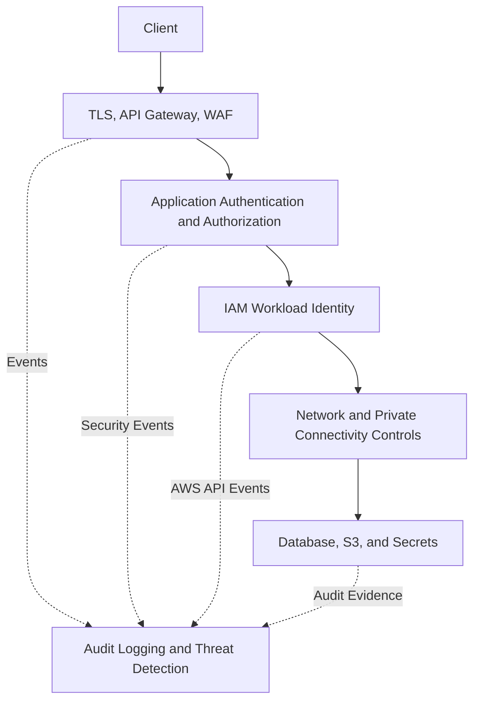
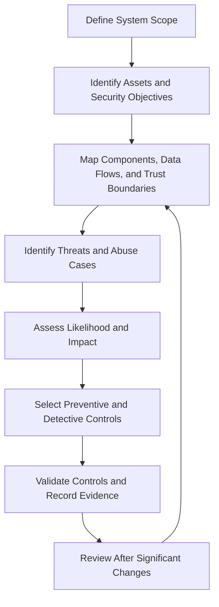
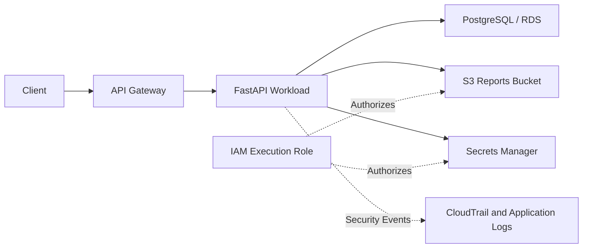

# 01- Security Fundamentals and Threat Modeling

## Overview

AWS security fundamentals provide the foundation for designing, implementing, and operating secure cloud workloads. Threat modeling applies these principles systematically by identifying assets, trust boundaries, attack surfaces, threats, and mitigations before they become production incidents.

For backend systems built with Django, FastAPI, API Gateway, Lambda, EC2, PostgreSQL, Redis, and microservices, security must be designed across the entire request lifecycle. Protecting an API endpoint alone is insufficient if its workload identity has excessive IAM permissions, its secrets are exposed, its network boundaries are weak, or its audit evidence can be deleted.

This document establishes the security principles and threat-modeling practices used throughout the AWS Security engineering reference.

## AWS Shared Responsibility Model

The AWS Shared Responsibility Model defines how security responsibilities are divided between AWS and the customer. The exact division depends on the service, deployment model, and configuration.

### Responsibilities of AWS

AWS is responsible for security **of the cloud**, including the underlying infrastructure that operates AWS services.

Examples include:

- Physical security of AWS data centers.
- Security of the underlying hardware and facilities.
- Infrastructure components managed by AWS.
- Virtualization and foundational infrastructure controls managed by AWS.
- Security operations for the AWS-managed portions of its services.

### Customer responsibilities

Customers are responsible for security **in the cloud**, with the exact scope depending on the service.

Typical responsibilities include:

- IAM identities, policies, trust relationships, and credential management.
- Application code, dependencies, authentication, and authorization.
- Network configuration and resource exposure.
- Data classification, access controls, and encryption configuration.
- Secret storage, rotation, and prevention of credential leakage.
- Logging, monitoring, incident response, and compliance configuration.
- Operating-system and runtime security where the customer manages those components.

### Responsibility by service model

| Service or deployment model | AWS responsibility | Customer responsibility |
|---|---|---|
| EC2 | Physical infrastructure, underlying virtualization, and managed infrastructure components | Guest OS, application runtime, patching, IAM, network configuration, and data |
| Lambda | Underlying infrastructure, managed execution environment, and service operation | Function code, dependencies, execution-role permissions, configuration, and data handling |
| Amazon RDS | Managed database infrastructure and service operations within AWS's responsibility | Database access, application permissions, data classification, configuration choices, and applicable database maintenance responsibilities |
| Amazon S3 | Storage infrastructure and service operation | Bucket policies, access controls, data classification, encryption choices, and public-access configuration |
| IAM | Operation of the IAM service | Identity lifecycle, permissions, trust relationships, and access reviews |

The table is a practical overview rather than a complete service contract. Consult the service-specific AWS documentation to determine the precise division of responsibilities.

### Why this matters

Using a managed service reduces infrastructure-management responsibilities; it does not make the workload automatically secure.

For example, AWS operates the infrastructure supporting Lambda, but a function can still expose sensitive data if its execution role grants excessive S3 permissions or its application code logs credentials.

**Engineering rule:** Identify the security responsibilities that remain with the customer for every AWS service in the architecture.

## Core Security Principles

### Least privilege

Least privilege means granting an identity only the permissions required for its intended responsibilities.

A backend service that reads a specific S3 prefix should not automatically receive write access to every bucket in the account.

Use least privilege for:

- Human users and federated identities.
- EC2 instance profiles and Lambda execution roles.
- CI/CD deployment roles.
- Cross-account access roles.
- Security monitoring and incident-response automation.
- Application access to S3, KMS, Secrets Manager, and other AWS services.

For example, a Lambda function that reads a particular configuration object should receive only the required S3 action on the relevant object ARN.

```json
{
  "Version": "2012-10-17",
  "Statement": [
    {
      "Sid": "ReadApplicationConfiguration",
      "Effect": "Allow",
      "Action": [
        "s3:GetObject"
      ],
      "Resource": "arn:aws:s3:::<CONFIG_BUCKET>/application/config.json"
    }
  ]
}
```

This policy grants the specified object-level action. It does not automatically grant access to bucket listing, other objects, or KMS decryption if a customer-managed key requires separate authorization.

**Advantages:**
- Reduces the impact of compromised credentials.
- Limits accidental changes to unrelated resources.
- Makes access reviews and audit investigations easier.

**Limitations and trade-offs:**
- Requires understanding actual application behavior.
- Can require additional work when workloads or resource structures change.
- Overly narrow permissions can break legitimate workflows if dependencies are not identified.

**Production guidance:** Derive permissions from required operations, validate them in a non-production environment, monitor denied requests, and review policies as workloads evolve.

### Defense in depth

Defense in depth uses multiple complementary controls so that failure of one control does not automatically expose the entire system.

A backend API might use:

- TLS for transport protection.
- API Gateway authentication and throttling.
- AWS WAF for selected request filtering.
- Application-level authorization.
- IAM roles for AWS service access.
- Private network paths to internal dependencies.
- KMS encryption for sensitive data.
- CloudTrail and application logging for investigation.

Each layer has a different purpose. WAF does not replace authorization, encryption does not prevent an authorized principal from misusing data, and logging does not prevent unauthorized access.



**Production consideration:** Evaluate controls for independence. Two controls that depend on the same compromised identity or administrative account may fail together.

### Zero-trust principles

Zero trust avoids treating network location alone as proof that an identity or request should be trusted.

A request should be evaluated using relevant identity, authorization, resource, and contextual controls.

For AWS backend systems:

- Authenticate users and workloads explicitly.
- Authorize each sensitive operation.
- Use workload roles rather than shared static credentials.
- Restrict service-to-service access.
- Validate tenant ownership and object-level permissions in application code.
- Avoid assuming that traffic from a private subnet is inherently authorized.

Zero trust is an architectural approach, not a single AWS service or a requirement to add authentication independently to every internal hop regardless of the threat model.

### Secure by default

Secure-by-default configuration minimizes unnecessary exposure and privileges from the beginning.

Examples include:

- Keep S3 Block Public Access enabled unless a reviewed use case requires otherwise.
- Avoid public database endpoints when private connectivity is appropriate.
- Use restrictive security-group rules.
- Require TLS for sensitive communication paths.
- Enable encryption for supported data stores.
- Use short-lived credentials and workload identities.
- Avoid logging secret values or authentication headers.
- Restrict privileged access and require appropriate MFA controls.

Defaults should be verified rather than assumed. AWS service defaults and account-level settings differ, and an explicitly configured resource can override an intended organizational baseline.

## Security Boundaries and Attack Surfaces

### Security boundaries

A security boundary separates components with different trust levels or administrative responsibilities.

Common AWS boundaries include:

| Boundary | Example | Primary security concern |
|---|---|---|
| Account boundary | Production account versus development account | Administrative isolation and blast radius |
| IAM boundary | Application role versus deployment role | Permission scope and privilege escalation |
| Network boundary | Public subnet versus private subnet | Reachability and exposure |
| Application boundary | Public API versus internal service | Authentication and authorization |
| Data boundary | General application data versus sensitive records | Confidentiality and access governance |
| Administrative boundary | Workload account versus log archive account | Preventing workload administrators from controlling all audit evidence |

A boundary is effective only when the policies and trust relationships enforcing it are correct.

For example, separate AWS accounts do not provide meaningful isolation if a broadly trusted role allows untrusted principals to assume administrative access across both accounts.

### Attack surface

An attack surface consists of the interfaces, identities, resources, and dependencies that an attacker could exploit.

Typical AWS backend attack surfaces include:

- Public API endpoints and load balancers.
- IAM roles, access keys, and trust policies.
- S3 bucket policies and object access.
- Secrets stored in environment variables, deployment systems, or logs.
- Exposed SSH, database, or management ports.
- Vulnerable application dependencies and container images.
- CI/CD workflows with excessive AWS permissions.
- Cross-account trust relationships.
- Administrative APIs and automation roles.
- Logging and monitoring configurations that can be disabled or modified.

### Attack-surface inventory

Maintain an inventory that identifies each exposed component, its trust boundary, its owner, and the controls protecting it.

| Asset or interface | Threat | Example mitigation |
|---|---|---|
| Public REST API | Unauthorized access, injection, abuse | Authentication, application authorization, input validation, WAF where appropriate, throttling |
| Lambda execution role | Excessive AWS permissions | Least-privilege policy, scoped resource access, access reviews |
| S3 data bucket | Unintended disclosure | Block Public Access, restrictive bucket policy, encryption, access monitoring |
| CI/CD deployment role | Supply-chain or pipeline compromise | Federated identity, constrained trust policy, environment-specific permissions |
| Database endpoint | Unintended network access | Private connectivity, restrictive security groups, database authentication |
| Application secrets | Credential theft | Secrets Manager or Parameter Store, restricted IAM access, rotation, log redaction |
| Audit logging configuration | Evidence destruction or monitoring gaps | Separate log archive account, restricted administration, configuration monitoring |

## Threat Modeling

### What threat modeling provides

Threat modeling is a structured process for identifying how a system could be attacked and deciding which risks require mitigation.

It should happen during architecture design and be revisited when significant changes introduce new identities, data flows, public interfaces, or trust relationships.

Threat modeling helps teams:

- Discover security risks before deployment.
- Identify missing trust boundaries.
- Prioritize mitigations based on risk.
- Define monitoring and incident-response requirements.
- Document accepted risks and their owners.
- Avoid relying on generic security checklists without understanding the system.

A threat model is not proof that a system is secure. It is a maintained engineering artifact whose quality depends on the accuracy of its assumptions and the implementation of its mitigations.

### Threat-modeling workflow



### Define scope and assets

Start by identifying what must be protected and what outcomes would be harmful.

Examples include:

- Customer personal or financial data.
- Authentication tokens and application secrets.
- Production database records.
- AWS credentials and privileged roles.
- Availability of public APIs.
- Integrity of deployment artifacts.
- Audit evidence required for incident investigation.

Classify data according to confidentiality, integrity, availability, and applicable business or regulatory requirements.

### Map components and data flows

Document the important components and how data moves between them.

For a typical backend workload, this might include:

- Client to API Gateway.
- API Gateway to Lambda or a private application service.
- Application to RDS or PostgreSQL.
- Application to S3.
- Application to Secrets Manager.
- Workload identity to AWS services through IAM authorization.
- AWS activity and application logs to centralized monitoring.

Identify where authentication occurs, where authorization is enforced, which identities are used, and which components cross account or network boundaries.

### Identify trust boundaries

Mark transitions between components with different security assumptions.

Examples include:

- Internet to API Gateway.
- API Gateway to backend application.
- Application role to S3.
- Production account to a shared services account.
- Deployment system to a production AWS role.
- Application to a third-party API.

At each boundary, ask:

- Who can initiate the request?
- How is the caller authenticated?
- What authorization decision is made?
- Which data can cross the boundary?
- How are failures logged?
- Can a compromised component bypass the intended control?

### Identify threats and abuse cases

Threats should describe a plausible unwanted action or outcome, not merely a generic category such as "security issue."

Examples:

- An attacker uses a leaked access key to read production objects.
- A compromised deployment workflow modifies a Lambda execution role.
- A user accesses another tenant's records by changing an object identifier.
- An attacker exploits a public endpoint to exhaust application resources.
- A workload administrator disables logging before making unauthorized changes.
- A service retrieves a secret it does not need because its IAM policy is too broad.

Consider both external attackers and misuse or compromise involving legitimate identities.

## STRIDE Threat Classification

STRIDE is a framework for categorizing threats. It is useful during threat discovery but should be applied to actual system components and data flows rather than used as a substitute for risk analysis.

| Category | Security property affected | AWS backend example | Potential mitigation |
|---|---|---|---|
| Spoofing | Authentication | A caller uses stolen credentials or impersonates a workload | Strong authentication, short-lived credentials, scoped trust policies |
| Tampering | Integrity | An unauthorized principal changes a bucket policy or deployment artifact | Least privilege, protected artifact pipelines, audit monitoring |
| Repudiation | Accountability | An administrator denies performing a sensitive operation | CloudTrail, protected audit logs, application-level audit records |
| Information disclosure | Confidentiality | A public S3 policy exposes sensitive objects | Block Public Access, restrictive policies, encryption, exposure monitoring |
| Denial of service | Availability | Request flooding exhausts API or application capacity | Throttling, WAF controls, scaling, quotas, DDoS protections |
| Elevation of privilege | Authorization | A deployment role modifies a privileged role's policy | Constrained permissions, trust-policy controls, permission boundaries, SCPs where appropriate |

Not every threat can be eliminated. Some risks require additional monitoring, operational limits, recovery procedures, or documented acceptance.

## Risk Assessment and Prioritization

### Assess likelihood and impact

Evaluate threats using the system's actual exposure, required privileges, exploitability, affected data, and operational consequences.

A simple qualitative model can be useful during architecture reviews:

| Likelihood | Impact | Example treatment |
|---|---|---|
| High | High | Prioritize mitigation before production or require an explicit release decision |
| High | Low | Reduce exposure, automate controls, and monitor residual risk |
| Low | High | Validate assumptions, add preventive controls, and prepare a response procedure |
| Low | Low | Document the decision and reassess if the system changes |

This matrix is a prioritization aid, not a formal risk score or substitute for a required organizational assessment method.

### Evaluate blast radius

For each threat, determine what an attacker could reach after compromising the affected component.

Ask:

- Can the identity access other accounts?
- Can it read or modify unrelated data?
- Can it change IAM policies or trust relationships?
- Can it disable logging or alter security controls?
- Can it access KMS keys or secrets used by other workloads?
- Can it move from development into production?
- Can the compromise disrupt critical services?

Blast-radius analysis often reveals that reducing permissions and separating administrative responsibilities provide more protection than adding another isolated detection rule.

### Document the threat model

A practical threat-model entry should include:

| Field | Description |
|---|---|
| Threat ID | Stable identifier for tracking |
| Asset | Resource or business capability at risk |
| Threat scenario | Specific unwanted action or outcome |
| Preconditions | Required access, exposure, or vulnerability |
| Impact | Confidentiality, integrity, availability, or business effect |
| Likelihood | Qualitative or formally assessed likelihood |
| Mitigations | Preventive and detective controls |
| Evidence | Tests, policy reviews, logs, or configuration checks |
| Owner | Person or team responsible |
| Status | Open, mitigated, accepted, or under review |
| Review date | Date for reassessment or exception expiry |

Record residual risk after controls are applied. A threat should not be marked mitigated merely because a policy was written; verify that the deployed configuration enforces the intended behavior.

## Example: Threat Modeling a Backend API

Consider a FastAPI service exposed through API Gateway. It reads customer records from PostgreSQL and stores generated reports in S3.

### Simplified architecture



### Assets and trust boundaries

**Assets:**

- Customer records in PostgreSQL.
- Generated reports in S3.
- Database credentials and application configuration.
- IAM execution-role credentials.
- Audit evidence.

**Trust boundaries:**

- Client to API Gateway.
- API Gateway to FastAPI.
- FastAPI to PostgreSQL.
- FastAPI to S3 and Secrets Manager.
- Application workload to AWS identity and authorization services.

### Threat scenarios

| Threat | Potential impact | Preventive controls | Detective or responsive controls |
|---|---|---|---|
| User changes a report ID to access another customer's report | Cross-tenant disclosure | Application-level ownership checks and scoped database queries | Audit sensitive report access and investigate anomalous patterns |
| Lambda or application role is compromised | Unauthorized S3 access or secret retrieval | Least-privilege execution role, restricted network access, short-lived credentials | CloudTrail, GuardDuty, finding aggregation, credential containment |
| Database credential is leaked | Unauthorized database access | Secrets Manager, rotation, network restrictions, database least privilege | Database audit logs where configured, secret-access monitoring, incident response |
| Deployment pipeline is compromised | Unauthorized code or permission changes | Federated deployment identity, restricted role trust, artifact controls | CloudTrail, deployment audit records, security findings |
| Reports bucket becomes public | Sensitive report disclosure | Block Public Access, restrictive bucket policy, encryption | AWS Config checks, policy-change monitoring, access investigation |

### Key engineering decisions

- Enforce tenant authorization in the application and database query design; AWS IAM does not automatically enforce customer-level business ownership.
- Give the workload access only to the required S3 bucket and object paths.
- Retrieve secrets through an approved secret-management mechanism rather than embedding them in source code.
- Restrict database connectivity to the application workload's required network path.
- Monitor changes to IAM policies, resource policies, and logging configuration.
- Ensure incident responders can investigate the workload without relying solely on permissions controlled by the potentially compromised workload account.

## Threat Modeling CI/CD and Deployment Identities

CI/CD pipelines are high-value targets because deployment identities can often change production code, infrastructure, or runtime permissions.

### Common threats

- Long-lived AWS access keys stored in repository secrets.
- A pull request from an untrusted branch gaining access to privileged deployment credentials.
- A deployment role able to modify unrelated production resources.
- A compromised build artifact promoted without integrity checks.
- A pipeline changing the trust policy of its own role.
- Secrets exposed in command output, build logs, or generated artifacts.

### Recommended controls

- Use federated identity such as OIDC-based role assumption when supported by the CI/CD platform.
- Restrict role trust conditions to the intended repository, branch, environment, or workflow context.
- Separate build, test, and production deployment permissions.
- Require approval for sensitive production deployment paths where appropriate.
- Avoid exposing privileged credentials to untrusted pull-request workflows.
- Limit deployment roles to the resources and operations required by the pipeline.
- Protect build artifacts and verify the intended artifact is deployed.
- Monitor role assumptions, policy changes, and deployment operations.

A pipeline role should not have unrestricted administrative access simply because deployment occasionally fails. Investigate the required actions and resources, then update the role narrowly.

## Preventive, Detective, and Responsive Security

A threat model should identify controls for prevention, detection, and response rather than assuming that one category is sufficient.

| Control type | Purpose | AWS and backend examples |
|---|---|---|
| Preventive | Block or constrain unsafe behavior | IAM least privilege, SCPs, security groups, resource policies, application authorization |
| Detective | Identify suspicious activity or configuration | CloudTrail, GuardDuty, Security Hub, AWS Config, CloudWatch |
| Responsive | Contain incidents and restore trusted operation | Restrict compromised credentials, isolate workloads, remediate policies, restore from trusted backups |

A control can serve different purposes depending on how it is implemented. For example, AWS Config can detect a noncompliant security group; automated remediation may then change the rule, but the remediation workflow introduces its own permissions and failure modes.

For high-impact systems, define both the intended control and the evidence that demonstrates it works.

## Practical Threat Modeling Exercise

### Objective

Create a threat model for an API that accepts authenticated requests, retrieves a secret, reads customer data, and writes reports to S3.

### Prerequisites

- A system diagram or documented request flow.
- An inventory of IAM roles and resource policies.
- A list of sensitive data and secrets.
- Access to non-production configuration or policy evidence.
- A defined process for tracking risks and assigning owners.

### Procedure

1. Draw the system's components and data flows.
2. Identify sensitive assets and classify their confidentiality, integrity, and availability requirements.
3. Mark trust boundaries between the client, API, application, AWS services, and database.
4. List at least five concrete abuse scenarios.
5. Classify each scenario using STRIDE where useful.
6. Assess likelihood, impact, and potential blast radius.
7. Select preventive, detective, and responsive controls.
8. Assign an owner to each unresolved risk.
9. Verify deployed controls through policy inspection, configuration checks, or safe non-production tests.
10. Record residual risks and establish review dates.

### Verification questions

- Can the application role access data unrelated to its purpose?
- Can one tenant retrieve another tenant's records?
- Can a compromised deployment identity change production IAM permissions?
- Can workload administrators delete or disable all relevant audit evidence?
- Would a secret leak be detectable, and how would it be rotated?
- Can the team contain a compromised identity without granting responders unrestricted access?
- What evidence would establish whether the threat actually occurred?

### Cleanup and cost considerations

This exercise can be completed through architecture diagrams, policy reviews, and read-only inspection without deploying additional AWS resources.

If testing uses real resources, use a non-production account, avoid destructive changes, restore temporary configuration changes, and remove any resources created solely for testing. Account for possible charges if enabling logging, threat detection, configuration recording, or additional data-event collection.

## Common Mistakes and Pitfalls

### Treating private networking as authorization

A request from a private subnet can still be unauthorized. Enforce application-level permissions and IAM authorization independently of network placement.

### Treating encryption as a complete security solution

Encryption protects data under particular threat conditions, but an authorized compromised identity may still retrieve plaintext. Combine encryption with least privilege, key governance, monitoring, and data-access controls.

### Relying only on preventive controls

Preventive controls can be misconfigured or bypassed. Maintain audit evidence, detection rules, incident procedures, and tested recovery mechanisms.

### Writing generic threat descriptions

"An attacker compromises the application" does not identify a useful engineering action. Describe the preconditions, target asset, exploit path, expected impact, and specific mitigation.

### Assuming AWS managed services eliminate customer responsibility

Managed infrastructure reduces some operational responsibilities but does not remove responsibility for identities, policies, application logic, data access, or secure configuration.

### Granting broad permissions to resolve deployment failures

An access-denied error should be investigated by identifying the denied action, target resource, caller identity, and relevant authorization policies. Grant only the permissions required by the intended operation.

### Treating a threat model as a one-time document

Architecture changes can introduce new trust boundaries and attack surfaces. Review the threat model when adding public endpoints, changing identity relationships, introducing sensitive data flows, or modifying deployment privileges.

## Key Takeaways

- The AWS Shared Responsibility Model defines the security responsibilities that remain with the customer for each service and deployment model.
- Least privilege, defense in depth, zero trust, and secure-by-default configuration reduce risk when implemented across identity, network, application, and data boundaries.
- Threat modeling should map assets, data flows, trust boundaries, abuse scenarios, mitigations, evidence, and residual risks.
- STRIDE helps classify threats, while likelihood, impact, and blast-radius analysis guide mitigation priorities.
- A threat model is effective only when controls are verified, risks have owners, and the model is reviewed as the architecture changes.
```