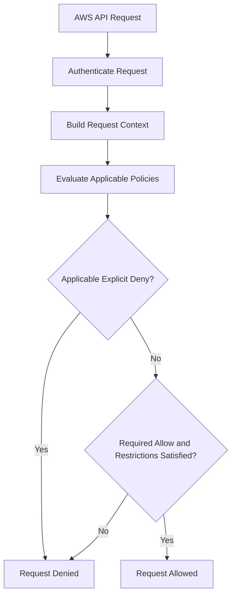
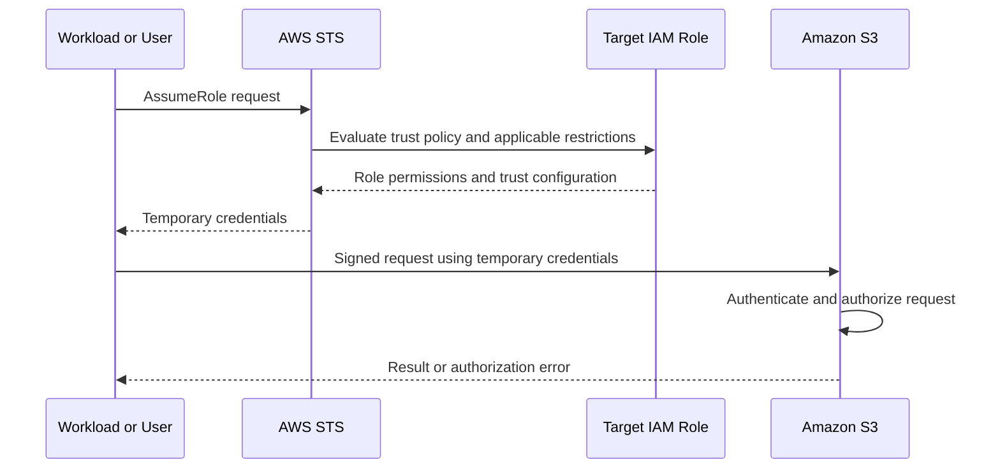

# 02- IAM and Access Control

## Overview

AWS Identity and Access Management (IAM) controls who can authenticate to AWS, which actions they can perform, and which resources they can access. It is a foundational security control for backend applications, infrastructure automation, CI/CD pipelines, and cross-account architectures.

IAM security is not limited to attaching policies to users or roles. Production-grade access control requires correctly defining principals, trust relationships, resource permissions, permission boundaries, organizational restrictions, and temporary credential lifecycles.

For backend systems using EC2, Lambda, API Gateway, S3, RDS, and microservices, IAM should enforce least privilege while keeping application identities separate from human and deployment identities.

This document covers IAM's authorization model, policy evaluation, role assumption, cross-account access, workload identities, operational inspection, and common access failures.

## IAM Core Components

### Principals, resources, and actions

IAM authorization evaluates whether a principal is permitted to perform an action on a resource under the applicable policies and request context.

| Component | Meaning | Example |
|---|---|---|
| Principal | The identity making a request | IAM role session, IAM user, federated identity, AWS service |
| Action | The operation being requested | `s3:GetObject`, `kms:Decrypt`, `secretsmanager:GetSecretValue` |
| Resource | The AWS object or service resource being accessed | S3 object ARN, KMS key ARN, secret ARN |
| Policy | A document expressing permissions or restrictions | Identity-based policy or resource-based policy |
| Condition | Additional criteria for evaluating a statement | Requested Region, principal ARN, source VPC endpoint |
| Session | Temporary credentials and associated context used to make requests | STS role session |

An authenticated identity is not automatically authorized to perform every action. Authorization depends on the applicable policies and the service's authorization behavior.

### IAM users

An IAM user is a long-lived identity within an AWS account. It can have console credentials, access keys, or both, depending on its configuration.

IAM users may still be required for specific legacy integrations, but they should not be the default identity model for new workloads.

Prefer federated human access and temporary credentials where supported.

### IAM groups

IAM groups organize IAM users and can receive identity-based policies. Groups do not serve as principals that can independently assume roles, and they are not a replacement for workload identities.

Use groups when managing permissions for IAM users in environments that still require them. For workforce access, use the organization's federated identity approach where possible.

### IAM roles

An IAM role is an identity with permissions that can be assumed by an authorized principal. Role assumption provides temporary credentials rather than requiring a long-lived access key for routine operations.

Common roles include:

- EC2 instance roles.
- Lambda execution roles.
- ECS task roles.
- EKS workload roles.
- Cross-account access roles.
- CI/CD deployment roles.
- Security investigation and incident-response roles.

A role contains two important policy concepts:

- **Trust policy:** Determines which principals may assume the role and under what conditions.
- **Permissions policies:** Define what an assumed role session may do, subject to applicable authorization controls.

A valid trust relationship does not grant permission to access S3, KMS, or other resources by itself.

### IAM policies

IAM policies are JSON documents that define permissions or restrictions.

The main policy categories are:

| Policy type | Purpose |
|---|---|
| Identity-based policy | Grants or denies actions for an identity |
| Resource-based policy | Defines access to a supported resource |
| Trust policy | Defines who may assume a role |
| Permissions boundary | Limits the maximum permissions available to an identity |
| Service control policy (SCP) | Defines maximum available permissions for principals in applicable organization accounts |
| Session policy | Further restricts permissions for a supported temporary session |
| Resource control policy (RCP) | Defines maximum available permissions on supported resources within an organization |

These policy types do not all behave identically. Some grant permissions, while others establish permission ceilings or restrictions. Their interactions depend on the principal, resource, service, and applicable policy evaluation rules.

## IAM Policy Structure

A typical identity-based policy contains a version, one or more statements, actions, resources, and optional conditions.

```json
{
  "Version": "2012-10-17",
  "Statement": [
    {
      "Sid": "ReadReports",
      "Effect": "Allow",
      "Action": [
        "s3:GetObject"
      ],
      "Resource": "arn:aws:s3:::<REPORTS_BUCKET>/reports/*"
    }
  ]
}
```

### Important fields

| Field | Purpose |
|---|---|
| `Version` | Identifies the policy language version |
| `Statement` | Contains one or more permission statements |
| `Sid` | Optional statement identifier |
| `Effect` | Specifies `Allow` or `Deny` |
| `Action` | Specifies API actions |
| `NotAction` | Specifies actions excluded from a statement's action set |
| `Resource` | Specifies resource ARNs to which the statement applies |
| `NotResource` | Specifies resources excluded from a statement's resource set |
| `Condition` | Adds request-context requirements |
| `Principal` | Identifies principals in policy types that support it, such as resource-based policies and trust policies |

`Principal` is not normally used in an identity-based permissions policy. The structure of a policy must match the policy type in which it is used.

### Use resource-level permissions

Avoid `Resource: "*"` when the action supports narrower resource-level authorization.

For example, an application that reads a defined set of reports should not receive access to every object in every bucket.

However, some actions do not support resource-level permissions and require `"Resource": "*"`. Check the service authorization reference before narrowing a policy.

### Add conditions where they enforce real requirements

Conditions can restrict permissions based on supported request context, such as:

- Requested AWS Region.
- Principal ARN or organization identity.
- Source VPC endpoint.
- Required encryption parameters.
- MFA-related context for supported operations.
- Requested tags or resource attributes where supported.

Conditions should enforce a defined security requirement. Avoid adding conditions that accidentally block legitimate AWS service integrations or make policies difficult to operate without improving security.

## IAM Policy Evaluation Logic

### The authorization model

AWS evaluates applicable policies to determine whether a request is allowed. An explicit deny overrides an allow, while the absence of an applicable allow generally results in an implicit deny.

The exact evaluation path depends on the principal type, resource type, action, and applicable organization and session controls.



This is a conceptual flow. AWS policy evaluation includes policy-type-specific rules and service-specific behavior that cannot be fully represented by a single linear diagram.

### Explicit deny

An explicit deny is a matching statement with `"Effect": "Deny"`.

For example:

```json
{
  "Version": "2012-10-17",
  "Statement": [
    {
      "Sid": "DenyProductionBucketDeletion",
      "Effect": "Deny",
      "Action": [
        "s3:DeleteBucket"
      ],
      "Resource": "arn:aws:s3:::<PRODUCTION_BUCKET>"
    }
  ]
}
```

If this statement applies to the request, an allow elsewhere does not override it.

Explicit denies are useful for enforcing restrictions, but broad deny statements can break legitimate operations. Test policy changes and understand their scope before deploying them.

### Implicit deny

An implicit deny occurs when the request does not have an applicable allow.

For example, a role with permission to call `s3:GetObject` does not automatically receive permission to call `s3:PutObject`.

Implicit deny is the default authorization outcome when the required allow is missing.

### Policy interaction overview

| Policy or control | General behavior |
|---|---|
| Identity-based policy | Can grant permissions to the identity |
| Resource-based policy | Can grant access to supported resources and principals |
| Permissions boundary | Limits permissions available to an identity; does not grant permissions by itself |
| SCP | Limits permissions available to principals in applicable organization accounts; does not grant permissions |
| RCP | Limits permissions available on supported resources in applicable organization accounts; does not grant permissions |
| Session policy | Restricts permissions available to the relevant temporary session |
| Explicit deny | Denies a matching request despite an otherwise applicable allow |

A useful operational rule is to distinguish **permission grants** from **permission ceilings**. Adding an allow policy cannot bypass an applicable explicit deny or an applicable maximum-permissions restriction.

Do not assume that all policy types are simple intersections in every scenario. Resource-based grants to certain principal forms, role sessions, and service-specific authorization rules can affect evaluation. Consult the IAM policy evaluation documentation for the exact principal and resource type involved.

## IAM Roles and Trust Policies

### How role assumption works

Role assumption creates temporary credentials for a principal that is authorized to assume the target role.



The caller must be permitted to call the relevant STS operation, and the target role's trust policy must permit the caller to assume the role. Applicable organization controls, conditions, and service-specific requirements may impose additional restrictions.

### Example trust policy

The following example allows a specific role in another account to assume a target role.

```json
{
  "Version": "2012-10-17",
  "Statement": [
    {
      "Sid": "TrustApprovedApplicationRole",
      "Effect": "Allow",
      "Principal": {
        "AWS": "arn:aws:iam::<SOURCE_ACCOUNT_ID>:role/<SOURCE_ROLE_NAME>"
      },
      "Action": "sts:AssumeRole"
    }
  ]
}
```

This is only the target role's trust policy. The source principal must also have the necessary permission to call `sts:AssumeRole` on the target role, unless a supported authorization arrangement makes that grant unnecessary.

For cross-account access, both accounts' authorization configuration must be considered.

### Trust-policy conditions

Trust policies can be strengthened with supported conditions, including organization restrictions, principal identity constraints, external IDs for applicable third-party access patterns, and federation-specific claims.

For third-party access, use an external ID when appropriate to mitigate the confused-deputy problem. It is not a substitute for verifying the trusted principal and constraining its permissions.

For OIDC-based CI/CD, restrict the role's trust policy to the intended identity provider and relevant claims, such as repository, branch, or environment, according to the provider's supported claims.

### Inspect a role

The following commands are read-only inspection operations:

```bash
aws iam get-role \
  --role-name <ROLE_NAME>

aws iam list-attached-role-policies \
  --role-name <ROLE_NAME>

aws iam list-role-policies \
  --role-name <ROLE_NAME>
```

Use `get-role` to inspect role metadata and its trust policy. The other commands list managed and inline permissions policies attached to the role.

To inspect an inline policy:

```bash
aws iam get-role-policy \
  --role-name <ROLE_NAME> \
  --policy-name <POLICY_NAME>
```

To inspect a managed policy, first retrieve its default version ID, then retrieve the policy version:

```bash
aws iam get-policy \
  --policy-arn <POLICY_ARN>

aws iam get-policy-version \
  --policy-arn <POLICY_ARN> \
  --version-id <VERSION_ID>
```

Interpret these results together. A role's attached policies do not necessarily reveal all restrictions imposed by boundaries, SCPs, session policies, resource policies, or service-specific controls.

## Temporary Credentials and AWS STS

### Why temporary credentials matter

Temporary credentials reduce the need for long-lived access keys and limit the time during which exposed credentials can be used.

AWS STS provides temporary credentials through operations such as:

- `AssumeRole`
- `AssumeRoleWithWebIdentity`
- `AssumeRoleWithSAML`
- `GetSessionToken`
- `GetFederationToken`

Use the operation appropriate to the identity and federation model. Workload identity integrations and AWS SDK credential providers can often obtain or refresh credentials without application code handling the underlying exchange.

### Credential lifecycle

A typical workload credential lifecycle is:

1. The workload obtains credentials through an attached role or supported identity provider.
2. The AWS SDK signs service requests with those credentials.
3. The SDK refreshes credentials through its provider when needed.
4. The workload continues using the refreshed credentials without embedding static keys in application code.

Temporary credentials include an access key ID, secret access key, and session token. The session token must be included in signed requests when required by the credential set.

### Prefer SDK credential providers

For a workload running on EC2, Lambda, ECS, or another supported AWS compute environment, use its configured role-based identity.

Python example:

```python
import boto3

s3 = boto3.client("s3")

response = s3.get_object(
    Bucket="<REPORTS_BUCKET>",
    Key="reports/report.json",
)

body = response["Body"].read()
```

Boto3 uses its credential provider chain. In a correctly configured AWS workload, it can obtain credentials from the supported runtime identity without hardcoding access keys.

Do not manually copy temporary credentials into source code, container images, or configuration files. Also avoid forcing an unintended local credential profile in production.

### Verify the current identity

```bash
aws sts get-caller-identity
```

The response includes the AWS account and ARN associated with the current credentials. Use this command before sensitive operations to verify that the CLI is using the intended identity.

## Cross-Account Access

### When to use it

Cross-account roles are useful for:

- Centralized security administration.
- Shared services.
- Controlled access to production resources.
- CI/CD deployments into workload accounts.
- Centralized log collection and investigation.
- Workload-to-workload access across organizational boundaries.

They allow identities in one account to obtain scoped access in another account without requiring permanent credentials for the target account.

### Authorization requirements

A typical cross-account role-assumption design requires:

1. A target role with a trust policy permitting the intended source principal.
2. Appropriate source-side permission to call `sts:AssumeRole`.
3. Target-role permissions for the intended resource operations.
4. No applicable explicit deny or organization restriction that blocks the request.
5. Correct resource policies and service-specific permissions where required.

### Operational recommendations

- Use specific role principals instead of trusting an entire account when practical.
- Restrict trust relationships using conditions where appropriate.
- Use distinct roles for deployment, read-only inspection, and incident response.
- Monitor role assumptions and sensitive actions through CloudTrail.
- Avoid role chains that make identity provenance and troubleshooting unnecessarily complex.
- Document role ownership and the expected caller for every cross-account trust relationship.

### Troubleshoot a failed assumption

A failed role assumption may produce an error such as `AccessDenied`.

Inspect:

```bash
aws sts get-caller-identity

aws iam get-role \
  --role-name <TARGET_ROLE_NAME>
```

Check the following:

- Is the current caller the expected source identity?
- Does the target trust policy permit that principal?
- Does the source identity have the necessary `sts:AssumeRole` permission?
- Do trust-policy conditions match the actual request?
- Are organization policies or explicit denies blocking the request?
- Is the target role ARN correct?
- Is the caller using the intended account and credential profile?

Correct the specific trust or permission issue. Do not resolve the error by granting unrestricted administrative access.

## Workload Identity Patterns

### EC2 instance profiles

EC2 workloads should use an instance profile associated with an IAM role instead of static access keys.

The role should contain only the permissions needed by the application. If multiple applications with different trust levels run on the same instance, consider separate compute isolation rather than giving all processes access to the same instance role.

### Lambda execution roles

Lambda uses its execution role to access AWS services during function execution.

Separate function roles when functions have materially different permissions. A report-generation function should not inherit the permissions required by an unrelated administrative function merely because both belong to the same application.

### Container workloads

Use the supported workload identity mechanism for the selected container platform, such as ECS task roles or EKS workload identity integrations.

Avoid sharing node-level credentials among unrelated applications. A compromised container should not automatically inherit access to every resource reachable through a shared, broadly privileged node identity.

### CI/CD deployment roles

A deployment role should be separate from the runtime role used by the deployed application.

For example:

- The deployment role can publish approved artifacts and update the intended service configuration.
- The runtime role can access the application's data and secrets.
- A security role can investigate findings and inspect configuration.
- A break-glass role can perform narrowly governed emergency actions.

This separation reduces the impact of compromised build systems and limits unnecessary privilege accumulation.

## Permission Boundaries, SCPs, and Session Policies

### Permissions boundaries

A permissions boundary defines the maximum permissions an IAM user or role can receive through identity-based permissions.

It does not grant permissions by itself.

Use boundaries when delegating IAM role or user creation to teams that must operate within a predefined permission envelope. A boundary can help prevent a delegated administrator from creating an identity with permissions beyond an approved scope.

### Service control policies

SCPs define maximum available permissions for principals in member accounts of an AWS Organization, subject to the policy's attachment and inheritance behavior.

SCPs do not grant permissions. A request still needs an applicable permission grant, and an SCP restriction can block an action that an identity policy otherwise allows.

Common uses include:

- Restricting access to approved Regions.
- Preventing member accounts from disabling selected security services.
- Restricting high-risk administrative actions.
- Enforcing organization-wide boundaries on available permissions.

Before deploying an SCP, verify the impact on required AWS service operations and administrative recovery paths. An overly broad SCP can prevent legitimate workloads or emergency responders from operating.

### Session policies

Session policies can further restrict the permissions of supported temporary role sessions. They do not expand the role's permissions.

They are useful when a caller needs a narrower session than the role's general permissions provide. Ensure that the session policy is applied through a supported API or federation flow and that the resulting permissions are tested.

### RCPs

Resource control policies establish maximum permissions on supported resources in applicable organization accounts. They do not grant access and do not apply uniformly to every AWS resource type.

Use them where supported to enforce organization-level resource access boundaries. Validate the affected services, resources, and policy behavior before relying on an RCP as a universal restriction.

## Authentication, Authorization, and Request Signing

These concepts solve different security problems.

| Concept | Question answered | Example |
|---|---|---|
| Authentication | Who or what is making the request? | Valid AWS credentials or a validated application token |
| Authorization | Is this principal allowed to perform this action on this resource? | IAM permits `s3:GetObject` for the requested object |
| Request signing | Has the request been signed using the expected credentials and request details? | AWS Signature Version 4 |
| Transport security | Is the communication channel protected against interception and tampering? | HTTPS using TLS |

A correctly signed request does not guarantee authorization. Valid AWS credentials can still receive `AccessDenied` if the action is not permitted.

Likewise, TLS protects the transport but does not decide whether a user is authorized to read another tenant's records.

## AWS Signature Version 4 and IAM

### Purpose

AWS Signature Version 4 (SigV4) signs supported AWS API requests. The signature is derived from request details, credential information, and a secret signing key.

The receiving service validates the signature and uses the associated identity to evaluate authorization.

A simplified SigV4 process includes:

1. Canonicalizing the HTTP method, URI, query string, and selected headers.
2. Constructing the canonical request.
3. Creating a string to sign that includes the algorithm, timestamp, credential scope, and request hash.
4. Deriving a signing key from the secret access key, date, Region, service, and the AWS request-signing terminator.
5. Computing the signature.
6. Sending the signed request with the required authentication headers and, for temporary credentials, the session token.

### Common failures

| Symptom | Possible cause | Investigation |
|---|---|---|
| `SignatureDoesNotMatch` | Canonical request mismatch, modified headers, incorrect payload hash, or signing-key derivation error | Compare the signed request components and SDK configuration |
| `InvalidSignatureException` | Incorrect signature or request signing configuration | Verify service, Region, timestamp, and canonicalization |
| Expired-token error | Temporary credentials have expired | Inspect the credential provider and refresh behavior |
| Credential-scope error | Incorrect date, Region, service, or credential scope | Verify the endpoint and SDK client configuration |
| Clock-skew error | Client time differs significantly from expected service time | Verify system time synchronization |

Prefer AWS SDK signing implementations rather than manually implementing SigV4 unless a protocol integration explicitly requires custom signing.

## Access Denied Troubleshooting

An `AccessDenied` response is not enough to identify the policy that caused the denial. Use a structured investigation rather than broadening permissions immediately.

### Isolation procedure

1. Verify the caller identity.
2. Identify the exact action and target resource ARN.
3. Inspect identity-based policies and relevant managed or inline policy versions.
4. Inspect resource-based policies where applicable.
5. Check permissions boundaries, SCPs, RCPs, and session policies where applicable.
6. Check role trust policies if the failure occurs during role assumption.
7. Inspect KMS key policies and grants if encryption or decryption is involved.
8. Check service-specific conditions, endpoint policies, and request context.
9. Use available authorization diagnostics and CloudTrail evidence.
10. Apply the smallest policy change that addresses the confirmed cause.
11. Retest the intended request and verify that unrelated access remains restricted.

### Useful inspection commands

```bash
aws sts get-caller-identity

aws iam list-attached-role-policies \
  --role-name <ROLE_NAME>

aws iam list-role-policies \
  --role-name <ROLE_NAME>

aws iam get-role \
  --role-name <ROLE_NAME>
```

For supported policy-evaluation scenarios, IAM Access Analyzer and the IAM policy simulator can help identify missing permissions or policy conflicts. Simulator results are not a universal guarantee of runtime behavior: some service-specific context, resource policies, and cross-account details may not be represented completely.

Use CloudTrail to identify the actual caller, action, resource, and available error context. Not every authorization failure provides a complete explanation of all applicable policy layers.

## IAM Access Reviews and Governance

### Review objectives

IAM access reviews should identify unnecessary privileges, stale identities, excessive trust, and changes that increase blast radius.

Review:

- Human identities and federation assignments.
- Access keys and their owners.
- Role trust policies and cross-account relationships.
- Managed and inline policy attachments.
- Permissions boundaries.
- Deployment and runtime role separation.
- Unused or overly broad permissions.
- Emergency access procedures.
- Service-linked roles and service-managed integrations where applicable.

### Use IAM Access Analyzer

IAM Access Analyzer can help identify external access to supported resources and validate IAM policies. Depending on its configuration and features, it can also support policy generation and access analysis.

It complements manual review and testing; it does not prove that every possible authorization risk has been eliminated.

### Monitor sensitive IAM changes

Consider monitoring events such as:

- `CreateAccessKey`
- `AttachRolePolicy`
- `PutRolePolicy`
- `UpdateAssumeRolePolicy`
- `CreatePolicyVersion`
- `SetDefaultPolicyVersion`
- `DeleteRole`
- `DeleteAccessKey`

Use CloudTrail and your security-monitoring architecture to detect unexpected changes. Ensure that the monitoring and log storage controls are not solely administered by the same identities whose activity they monitor.

## Practical Exercise: Assume a Role and Verify Access

### Objective

Assume an authorized role, verify the resulting identity, and confirm access to an approved resource.

### Prerequisites

- An AWS CLI profile with permission to assume a designated test role.
- A target role whose trust policy permits that profile's principal.
- A target role permissions policy granting a narrowly scoped read operation.
- A non-production resource for testing.

### Procedure

Inspect the current identity:

```bash
aws sts get-caller-identity
```

Assume the role:

```bash
aws sts assume-role \
  --role-arn arn:aws:iam::<ACCOUNT_ID>:role/<TEST_ROLE_NAME> \
  --role-session-name iam-access-review
```

The response includes temporary credential fields. Treat the output as sensitive and do not paste it into logs, tickets, or shared terminals.

For routine application use, prefer SDK or CLI profile-based role assumption so credentials can be managed by the configured provider chain rather than manually copied.

Verify the resulting identity using the assumed-role profile:

```bash
aws sts get-caller-identity \
  --profile <ASSUMED_ROLE_PROFILE>
```

Then execute the approved read operation against the test resource.

### Expected outcome

- The role assumption succeeds only when the caller and trust relationship are authorized.
- The resulting identity identifies the assumed role session.
- The resource operation succeeds only when the effective permissions allow it.
- Unauthorized operations remain denied.

### Cleanup and cost considerations

No additional infrastructure is required if an existing test role and resource are used. Remove temporary local credential material if the exercise involved manual credential handling, and remove any test-only policies or resources created for the exercise.

## Common Mistakes and Pitfalls

### Using long-lived access keys for workloads

Static keys can leak through source code, images, environment files, build logs, and developer machines. Use supported role-based identities and temporary credentials.

### Confusing trust policies with permissions policies

A trust policy determines who can assume a role. It does not grant the assumed role permission to access S3, KMS, or other resources.

### Assuming an IAM allow always wins

An applicable explicit deny or permissions ceiling can block a request even when an identity policy contains an allow. Investigate the full authorization path.

### Granting `Action: "*"` and `Resource: "*"` to resolve errors

Broad permissions increase blast radius and conceal the actual missing permission. Identify the required action and resource, then make the smallest justified change.

### Treating an SCP as a permission grant

An SCP defines an organizational permission boundary. It does not grant access to an action that the identity otherwise lacks permission to perform.

### Ignoring resource policies

An identity policy alone may not explain the authorization outcome. Inspect the resource policy, trust policy, key policy, endpoint policy, and other applicable controls.

### Sharing one role across unrelated services

A shared role gives every workload using it the combined effective permissions. Separate roles when workloads have different trust levels or responsibilities.

### Assuming policy simulation guarantees runtime success

Policy simulators can help with analysis, but runtime authorization may depend on resource policies, request context, service-specific behavior, and controls not fully represented by the simulation.

## Senior-Level Interview Questions

### Core IAM concepts

**Why should backend workloads use IAM roles instead of static access keys?**

Roles support temporary credentials and avoid embedding long-lived secrets in source code or deployment configuration. They also allow permissions to be managed centrally and tied to workload identity. The role still needs least-privilege permissions and correct trust configuration.

**What is the difference between an IAM trust policy and an identity-based policy?**

A trust policy controls which principals can assume a role. An identity-based policy controls what an identity can do after authorization is evaluated. Both are important, but they answer different questions.

**What is the difference between an implicit deny and an explicit deny?**

An implicit deny occurs when the required permission is not granted. An explicit deny is a matching deny statement that overrides an otherwise applicable allow. Both result in denial, but the corrective action differs.

### Policy evaluation and access control

**A role has `s3:GetObject` permission, but the request fails. What do you inspect?**

Verify the caller, action, and resource ARN. Inspect the identity policy, bucket policy, applicable explicit denies, permissions boundary, SCP, session policy, endpoint policy, and any KMS permissions required by the object. Use CloudTrail and available policy-analysis tools to narrow the cause.

**Does a permissions boundary grant permissions?**

No. A permissions boundary limits the maximum permissions available to an identity. The identity still requires an applicable permission grant.

**Can an SCP allow an action that an identity policy does not allow?**

No. An SCP does not grant permissions. It defines the maximum permissions available under the applicable organizational controls.

### Role assumption and cross-account access

**A cross-account `AssumeRole` request fails. What do you check?**

Verify the source identity, the source-side `sts:AssumeRole` permission, the target trust policy, relevant conditions, account and role ARNs, and applicable organization restrictions or explicit denies. Do not add unrestricted permissions without identifying the failure.

**How would you secure a CI/CD deployment role?**

Use federated credentials where supported, constrain trust to the intended repository or workflow context, separate deployment and runtime roles, scope permissions to the target environment, and monitor sensitive deployment operations.

### Senior-level reasoning

**How would you investigate an unexplained `AccessDenied` error without granting administrator access?**

Establish the caller and exact denied operation, inspect the resource and all relevant policy layers, review request context and CloudTrail evidence, identify the specific missing grant or applicable restriction, apply a minimal correction, and test both the intended operation and unrelated access boundaries.

**How do you reduce the blast radius of a compromised workload identity?**

Use separate roles for different responsibilities, narrow resource permissions, restrict cross-account trust, separate administrative and audit boundaries, monitor sensitive API activity, and prepare a tested credential-containment procedure.

## Key Takeaways

- IAM authorization depends on the principal, action, resource, request context, and all applicable policy grants and restrictions.
- Roles and temporary credentials are the preferred foundation for supported workload identity patterns; trust policies and permissions policies serve different purposes.
- Explicit denies, permissions boundaries, SCPs, RCPs, and session policies can restrict access, but they do not all grant permissions or behave identically.
- Troubleshoot access failures by identifying the exact denied operation and inspecting the complete authorization path instead of granting broad permissions.
- Treat IAM governance as an ongoing process involving least privilege, access reviews, trust-policy validation, monitoring, and tested incident-response procedures.
```