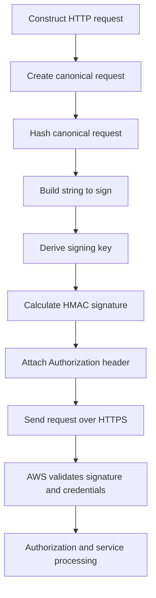
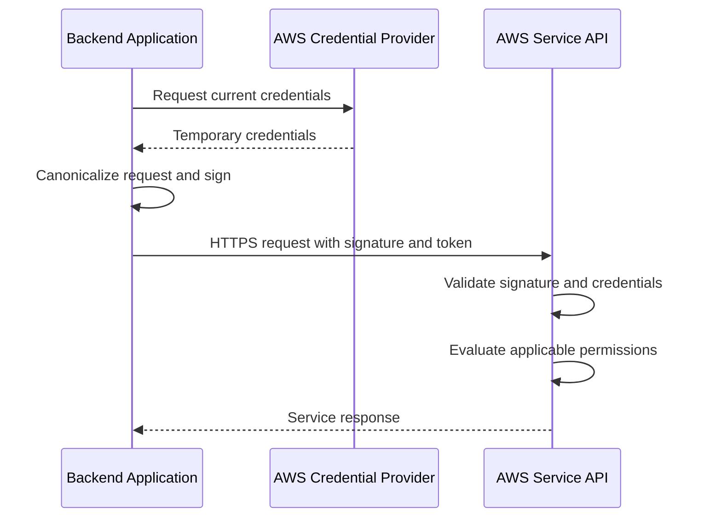
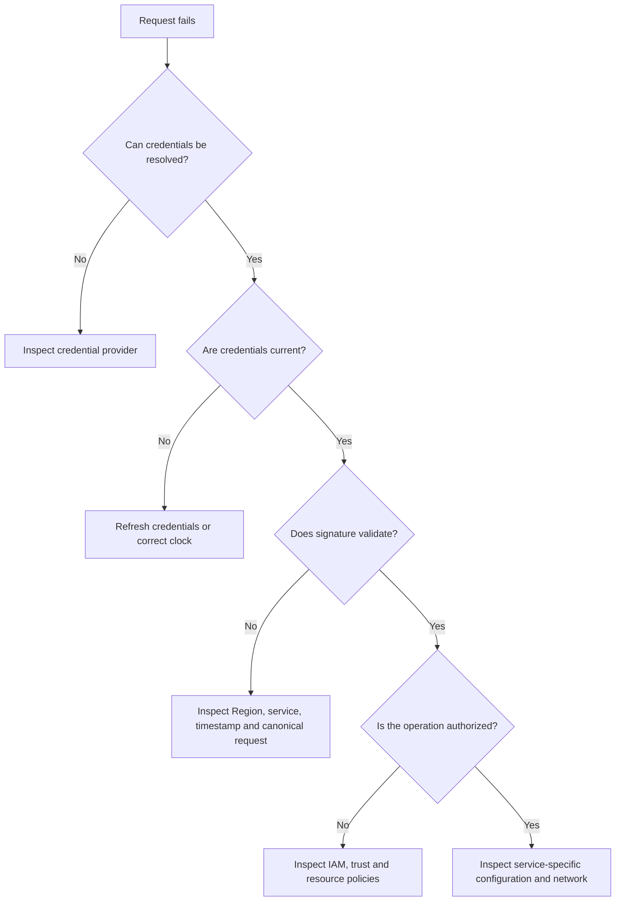

# 03- API Authentication and Signature Version 4

## Overview

AWS API authentication establishes the identity making a request, while authorization determines whether that identity can perform the requested operation. AWS Signature Version 4 (SigV4) provides a cryptographic mechanism for authenticating requests made with AWS credentials and protecting signed request components against tampering.

For backend engineers, these mechanisms are important when integrating Python services with AWS APIs, calling AWS services directly over HTTP, implementing cross-account workflows, debugging `403 Forbidden` responses, and designing secure service-to-service communication.

AWS API security involves four distinct concerns:

| Concern | Purpose | Typical mechanism |
|---|---|---|
| Authentication | Establish the caller's identity | IAM credentials, AWS STS temporary credentials |
| Authorization | Determine permitted operations and resources | IAM policies, resource policies, permissions boundaries, SCPs |
| Request signing | Authenticate a request and protect signed components from modification | AWS Signature Version 4 |
| Transport security | Protect data while traveling over a network | TLS using HTTPS |

These mechanisms complement each other. SigV4 does not grant permissions, IAM authorization does not replace TLS, and TLS alone does not prove that an AWS API caller possesses valid AWS credentials.

## Overview of AWS API Authentication

AWS services support different authentication and authorization mechanisms depending on the service and endpoint. SigV4 is the standard signing protocol for many AWS service APIs, including S3, DynamoDB, STS, and many AWS control-plane APIs.

Other interfaces, such as API Gateway endpoints configured with IAM authorization, can also use SigV4. However, not every AWS-facing endpoint requires SigV4. For example, an API Gateway endpoint using a JWT authorizer or a Lambda function using a supported resource-based invocation policy may have different authentication requirements.

### Credential types

| Credential type | Components | Typical use |
|---|---|---|
| Long-term IAM user credentials | Access key ID and secret access key | Limited legacy or specialized integrations |
| Temporary STS credentials | Access key ID, secret access key, session token | Assumed roles, federated access, temporary sessions |
| IAM role credentials | Temporary credentials delivered through a supported AWS credential provider | EC2, Lambda, ECS, EKS, and other AWS workloads |
| Federated credentials | Credentials obtained through a supported identity federation flow | Workforce and external workload access |

An AWS access key ID identifies the credential set. The secret access key is used to derive the cryptographic signature. When temporary credentials are used, the session token is also required.

**Never treat an access key ID as a secret equivalent to the secret access key, but do not expose credential metadata unnecessarily.** The secret access key and session token must be protected, and a leaked temporary credential set can still be used until it expires or is otherwise invalidated.

### Prefer workload identities over embedded credentials

Backend applications running on AWS should obtain credentials through the appropriate AWS SDK credential provider chain rather than embedding credentials in source code, Docker images, configuration files, or deployment manifests.

| Workload | Preferred approach |
|---|---|
| EC2 application | Attach an appropriately scoped instance profile |
| Lambda function | Assign a least-privilege execution role |
| ECS task | Use a task role for application permissions |
| EKS workload | Use EKS Pod Identity or IAM Roles for Service Accounts (IRSA), as appropriate |
| Local development | Use AWS IAM Identity Center or another approved credential provider |
| External workload | Use federation or an approved mechanism for obtaining temporary credentials |

The application should request only the permissions needed for its operations. A credential provider determines how credentials are obtained; IAM policies determine what those credentials can do.

## AWS Signature Version 4

### What SigV4 does

SigV4 is a request-signing protocol that uses a secret access key to derive a signing key and generate an HMAC-SHA256 signature.

The signature is calculated from a canonical representation of the request and a credential scope that identifies the signing date, AWS Region, and target service. AWS validates the request signature against the credentials and signing information before allowing the request to proceed.

SigV4 provides:

- Cryptographic authentication of signed requests.
- Integrity protection for the request components covered by the signature.
- A binding between the signature and its credential scope.
- Time-bound signing information that limits the useful lifetime of a signed request.

SigV4 is not encryption. An observer who can read an HTTP request can still see its unsigned contents. Use HTTPS to protect requests and responses in transit.

### High-level signing flow



The client and AWS must agree on the request representation, credential scope, and signing algorithm. Differences in URL encoding, headers, payload hashing, or the selected Region can cause signature validation to fail.

### Components of a signed request

A typical SigV4 request uses the following information:

- HTTP method, such as `GET`, `POST`, or `PUT`.
- Canonical URI.
- Canonical query string.
- Canonical headers.
- Signed headers.
- Payload hash, or a supported service-specific payload-signing mode.
- Credential scope.
- Timestamp.
- Access key ID and, when applicable, session token.

A signed request commonly includes an `Authorization` header similar to this structural example:

```http
Authorization: AWS4-HMAC-SHA256 Credential=EXAMPLEACCESSKEYID/20261012/ap-south-1/execute-api/aws4_request, SignedHeaders=host;x-amz-date, Signature=EXAMPLE_SIGNATURE
X-Amz-Date: 20261012T120000Z
```

The values above are illustrative placeholders. A real request must use the correct access key, timestamp, service identifier, Region, signed headers, and calculated signature.

When temporary credentials are used, the request must also include the session token, commonly in the `X-Amz-Security-Token` header. Some supported presigned-request flows place authentication information in query parameters instead.

### Canonical request

The canonical request is the normalized representation that the client hashes before generating the signature.

Its general structure is:

```text
HTTPMethod
CanonicalURI
CanonicalQueryString
CanonicalHeaders

SignedHeaders
HashedPayload
```

For example, a request might contain:

```http
GET /v1/orders?status=pending&limit=50 HTTP/1.1
Host: api.example.amazonaws.com
X-Amz-Date: 20261012T120000Z
```

The canonical request includes the method, normalized path, canonicalized query parameters, canonical headers, signed-header names, and payload hash.

Important implementation details include:

- HTTP header names are canonicalized to lowercase.
- Canonical headers must follow the required normalization and ordering rules.
- Query parameters must be encoded and sorted according to SigV4 rules.
- URI path encoding must match the target service's signing requirements.
- The payload hash must correspond to the payload-signing mode being used.
- The canonicalization process must be consistent with the actual transmitted request.

Do not assume that manually sorting query parameters or using a generic URL encoder is sufficient. Different services can have specific path-handling requirements, particularly S3.

### Credential scope

The credential scope binds the request to a date, Region, service, and signing terminator.

Its structure is:

```text
YYYYMMDD/region/service/aws4_request
```

Example:

```text
20261012/ap-south-1/execute-api/aws4_request
```

| Component | Meaning |
|---|---|
| Date | UTC date used for signing |
| Region | AWS Region associated with the request |
| Service | AWS service identifier used in signing |
| `aws4_request` | SigV4 request-signing terminator |

The service identifier is not necessarily the endpoint's hostname. Use the identifier documented for the target service.

For example, API Gateway commonly uses `execute-api`, while S3 uses `s3` and STS uses `sts`.

A request signed for the wrong Region or service will generally fail signature validation, even if the credentials themselves are valid.

### String to sign

After hashing the canonical request, the signer builds a string to sign containing:

1. The signing algorithm.
2. The UTC timestamp.
3. The credential scope.
4. The hexadecimal hash of the canonical request.

Conceptually:

```text
AWS4-HMAC-SHA256
20261012T120000Z
20261012/ap-south-1/execute-api/aws4_request
HEX_ENCODED_CANONICAL_REQUEST_HASH
```

The signer then derives a signing key and computes an HMAC-SHA256 signature over this string.

### Signing key derivation

SigV4 derives a signing key through a sequence of HMAC operations rather than directly using the secret access key as the final request-signing key.

The conceptual derivation is:

```text
kDate    = HMAC("AWS4" + SecretAccessKey, Date)
kRegion  = HMAC(kDate, Region)
kService = HMAC(kRegion, Service)
kSigning = HMAC(kService, "aws4_request")
Signature = HMAC(kSigning, StringToSign)
```

These are conceptual steps; implementations must use the exact byte encodings and cryptographic operations specified by AWS.

The derived signing key is specific to the signing date, Region, and service. This scope limits the reuse of the final signing key across unrelated signing contexts.

**Production recommendation:** Use an AWS SDK or a maintained SigV4 implementation rather than implementing the algorithm yourself. Manual implementations introduce risks around canonicalization, payload hashing, Unicode encoding, and request mutation.

## Request Signing and Validation Lifecycle

A backend request typically follows this lifecycle:

1. The application prepares the HTTP request.
2. A credential provider supplies the current credentials.
3. The signer canonicalizes the request and calculates its signature.
4. The client sends the signed request over HTTPS.
5. AWS validates the signing information and credential status.
6. AWS evaluates authorization policies and applicable security controls.
7. The service executes the operation if the request is accepted.

The exact internal processing sequence varies by AWS service and endpoint. Signature validation, authentication, authorization, and service-specific checks should be treated as distinct failure categories when troubleshooting.

### Request lifecycle with temporary credentials



The credential provider may refresh credentials before they expire. Applications should rely on supported SDK providers rather than copying temporary credentials into static configuration and assuming they remain valid indefinitely.

### Signed request integrity and replay considerations

A SigV4 signature protects the components included in the signature, but it does not make an application-level operation inherently idempotent or prevent every possible replay scenario.

The timestamp and credential lifetime constrain request validity. Service-specific authentication rules and presigned URL expiration further affect the acceptance window.

For operations that create orders, transfer funds, or trigger irreversible workflows, also implement application-level controls such as idempotency keys, deduplication, authorization checks, and appropriate audit logging.

## Using SigV4 in Python Backend Applications

### Prefer the AWS SDK

For ordinary AWS service calls, use `boto3` or the appropriate AWS SDK. It automatically handles SigV4 signing and integrates with supported credential providers.

Install the SDK in the application's managed environment:

```bash
python -m pip install boto3
```

Example: calling STS to inspect the current caller identity.

```python
import boto3


def get_caller_identity() -> dict[str, str]:
    session = boto3.Session()
    sts = session.client("sts")
    response = sts.get_caller_identity()

    return {
        "account": response["Account"],
        "arn": response["Arn"],
        "user_id": response["UserId"],
    }


if __name__ == "__main__":
    identity = get_caller_identity()
    print(identity)
```

This operation requires valid credentials and network connectivity to STS. The caller must be permitted to invoke `sts:GetCallerIdentity` where applicable; AWS documents special authorization behavior for this operation, including its ability to return identity information even when an explicit allow is not granted.

The returned ARN and account are useful for verifying that a workload is running under the expected identity. Do not log credentials or session tokens while diagnosing identity problems.

### Calling an IAM-authenticated API Gateway endpoint

When API Gateway is configured with `AWS_IAM` authorization, a client must sign requests with credentials authorized to invoke the relevant API, stage, method, and resource.

The following example uses `requests` with the `requests-aws4auth` package. It demonstrates a standard signed request, but it is not a replacement for a full AWS SDK when an SDK operation is available.

Install the dependencies:

```bash
python -m pip install requests requests-aws4auth boto3
```

Implementation:

```python
import os

import boto3
import requests
from requests_aws4auth import AWS4Auth


def call_iam_protected_api() -> dict:
    api_url = os.environ["API_URL"]
    region = os.environ["AWS_REGION"]

    session = boto3.Session(region_name=region)
    credentials = session.get_credentials()

    if credentials is None:
        raise RuntimeError("No AWS credentials are available")

    frozen_credentials = credentials.get_frozen_credentials()

    auth = AWS4Auth(
        frozen_credentials.access_key,
        frozen_credentials.secret_key,
        region,
        "execute-api",
        session_token=frozen_credentials.token,
    )

    response = requests.get(
        api_url,
        auth=auth,
        timeout=(3.05, 15),
    )
    response.raise_for_status()

    return response.json()
```

Configuration:

```bash
export API_URL="https://EXAMPLE.execute-api.ap-south-1.amazonaws.com/prod/orders"
export AWS_REGION="ap-south-1"
```

Important considerations:

- Configure the endpoint URL and Region through deployment configuration.
- Use a supported credential provider and avoid static credentials in environment variables in production unless an approved external integration specifically requires them.
- The example freezes credentials for a single request. For long-running applications, account for credential refresh and avoid indefinitely retaining a frozen credential snapshot.
- Configure connect and read timeouts appropriate to the application's latency budget.
- Add bounded retries only where safe. Retrying non-idempotent requests can duplicate side effects.
- Keep the signing library updated and verify its support for the target AWS service.
- Do not log the `Authorization` header, secret access key, or session token.

For applications that issue frequent requests, prefer a supported AWS SDK or a well-maintained client integration that handles credential refresh and signing consistently.

## Temporary Credentials, STS, and Role Assumption

### Why temporary credentials matter

Temporary credentials reduce the need to distribute long-lived secrets. They are issued for a limited duration and can be used to sign requests until expiration or other invalidation conditions apply.

AWS STS supports operations such as `AssumeRole`, which allows an authorized principal to obtain credentials for a role.

The resulting credentials contain:

- Access key ID.
- Secret access key.
- Session token.
- Expiration timestamp.

The caller needs permission to assume the role, and the target role's trust policy must permit the principal to assume it. Additional controls such as external IDs, MFA requirements, session policies, and organization-level restrictions may apply.

### Assume a role using boto3

```python
import boto3


def assume_role_session(
    role_arn: str,
    session_name: str = "backend-service-session",
) -> boto3.Session:
    source_session = boto3.Session()
    sts = source_session.client("sts")

    response = sts.assume_role(
        RoleArn=role_arn,
        RoleSessionName=session_name,
        DurationSeconds=3600,
    )

    credentials = response["Credentials"]

    return boto3.Session(
        aws_access_key_id=credentials["AccessKeyId"],
        aws_secret_access_key=credentials["SecretAccessKey"],
        aws_session_token=credentials["SessionToken"],
    )
```

This function illustrates the STS exchange and creates a session from the returned temporary credentials. It does not automatically refresh those credentials after expiration. For a long-running production service, use a supported role profile, credential provider, or SDK configuration that refreshes assumed-role credentials automatically.

Avoid returning raw credentials from helper functions, serializing them, or including them in application logs.

### Trust policy and permission policy are different

| Policy | Purpose |
|---|---|
| Trust policy | Defines which principals may assume a role and under what conditions |
| Identity-based permission policy | Defines what the assumed role can do |
| Resource-based policy | Controls access to a supported target resource |
| Session policy | Can restrict permissions for an assumed-role session |
| Permissions boundary | Sets the maximum permissions that identity policies can grant to a principal |

A successful `AssumeRole` call does not imply that the role can access a particular S3 bucket, KMS key, or API. The assumed role's permissions and the target resource's policies still matter.

### Session duration and refresh

Temporary credentials expire. If an application stores a session token in a long-lived object and continues using it after expiration, signed requests may fail.

Production applications should:

- Use SDK-supported credential refresh mechanisms.
- Avoid hardcoding expiration assumptions.
- Refresh credentials before they are required for critical operations.
- Handle credential-provider failures separately from authorization failures.
- Ensure that background workers and long-running processes can recover when a credential refresh fails.
- Avoid creating excessive STS sessions without a clear architectural need.

Role chaining and service-specific limits can constrain the maximum session duration. Verify the target role's configured maximum session duration and the rules for the relevant STS operation.

## Authentication, Authorization, and SigV4 Troubleshooting

### Diagnostic approach

When an AWS request fails, identify which security layer rejected it before changing permissions.



A `403` response alone is insufficient to conclude that an IAM policy is missing. Signature errors, resource policies, endpoint configuration, explicit denies, and service-specific access controls can all produce authorization-looking failures.

### Common failure categories

| Symptom | Likely causes | Diagnostic approach |
|---|---|---|
| `Unable to locate credentials` | No credentials resolved by the provider chain | Inspect the runtime identity and provider configuration |
| `ExpiredToken` | Temporary credentials or session token expired | Refresh credentials and inspect the provider |
| `InvalidClientTokenId` | Invalid, inactive, or incorrectly supplied credentials | Verify credential source and active identity |
| `SignatureDoesNotMatch` | Incorrect canonical request, signature, payload hash, or signing parameters | Check method, URI, query, headers, body, service, and Region |
| `AuthorizationHeaderMalformed` | Malformed authorization information or incorrect signing scope | Inspect the authorization header structure and credential scope |
| `RequestTimeTooSkewed` or a time-related signature error | Clock skew or stale timestamp | Synchronize the host clock and inspect UTC timestamps |
| `AccessDenied` | Missing permission, explicit deny, trust issue, resource policy, or service-specific control | Identify the exact action and resource, then inspect relevant policies |
| `InvalidSignatureException` | Invalid signature or signing configuration | Verify the signing library, endpoint, timestamp, and credential state |
| `403` from API Gateway with IAM authorization | Invalid signature, wrong Region, missing `execute-api:Invoke`, resource-policy restriction, or incorrect API resource | Verify request signing and the full API ARN |

Exact error names and messages vary by service. Preserve the original service error code and request ID for investigation.

### Verify the current identity

Use the AWS CLI to inspect the credentials currently selected by the CLI:

```bash
aws sts get-caller-identity \
  --region ap-south-1
```

Expected output resembles:

```json
{
  "UserId": "EXAMPLE_USER_ID",
  "Account": "123456789012",
  "Arn": "arn:aws:sts::123456789012:assumed-role/ExampleRole/example-session"
}
```

The account ID, user ID, and ARN above are illustrative. Confirm that the returned principal is the identity expected for the environment.

The CLI and the application may use different credential providers or configuration. A successful CLI request does not prove that a Python process uses the same credentials.

### Inspect credential configuration

```bash
aws configure list
```

This command displays the CLI's active configuration and the sources of settings such as credentials and Region. It can help identify whether credentials originate from a profile, environment variables, or another provider.

Treat diagnostic output as sensitive operational information. Do not paste credential values or tokens into tickets or shared logs.

### Verify the target Region

```bash
aws sts get-caller-identity \
  --region ap-south-1
```

The Region supplied to the CLI selects the endpoint for the STS call, but it does not by itself prove that an application signed a different service request with the correct Region. Verify the actual endpoint and signing scope used by the failing request.

For API Gateway, confirm that the endpoint hostname, deployment Region, stage, and `execute-api` signing service identifier match.

### Inspect an IAM policy

For an identity-based policy attached to a role:

```bash
aws iam list-attached-role-policies \
  --role-name ExampleBackendRole
```

To inspect inline role policies:

```bash
aws iam list-role-policies \
  --role-name ExampleBackendRole
```

Retrieve a particular inline policy:

```bash
aws iam get-role-policy \
  --role-name ExampleBackendRole \
  --policy-name ExampleInlinePolicy
```

These commands inspect policy attachments and policy documents. They do not show every applicable authorization control, such as all resource policies, SCPs, session policies, permissions boundaries, endpoint policies, or service-specific restrictions.

For managed policies, retrieve the default policy version and inspect its document separately. A policy attachment alone does not establish that a request is authorized.

### Diagnose an IAM-authorized API Gateway request

An API Gateway invocation permission generally has an ARN shaped like:

```text
arn:aws:execute-api:REGION:ACCOUNT_ID:API_ID/STAGE/METHOD/RESOURCE_PATH
```

Inspect the target API's authorization configuration and ensure the caller is permitted to execute the required API method. Verify:

- The correct account, API ID, stage, HTTP method, and resource path.
- The identity's `execute-api:Invoke` permissions.
- The API's resource policy, if configured.
- Organization-level and permissions-boundary restrictions.
- The SigV4 Region and service identifier.
- Any endpoint, routing, or deployment differences between environments.

Use the narrowest permission scope that supports the intended API calls.

## SigV4 with Presigned URLs

A presigned URL allows a client to access a supported resource for a limited period without receiving the signing credentials directly.

The URL contains signed authentication parameters, including a signature, credential scope, signed headers, timestamp, and expiration. For temporary credentials, the signing session token must also be represented in the supported request format.

Presigned URLs are useful for:

- Direct browser uploads to S3.
- Temporary downloads.
- Delegating narrowly scoped access without sharing AWS credentials.
- Reducing backend bandwidth for large file transfers.

### Generate an S3 presigned URL

```python
import boto3


def create_upload_url(
    bucket_name: str,
    object_key: str,
    expiration_seconds: int = 300,
) -> str:
    s3 = boto3.client("s3")

    return s3.generate_presigned_url(
        ClientMethod="put_object",
        Params={
            "Bucket": bucket_name,
            "Key": object_key,
        },
        ExpiresIn=expiration_seconds,
        HttpMethod="PUT",
    )
```

The caller's credentials must permit the relevant S3 operation. Bucket policies, object ownership settings, encryption requirements, and other controls can still prevent the upload.

For production use:

- Keep expiration short enough for the workflow.
- Restrict the object key and operation.
- Avoid exposing the URL in logs, analytics events, referrer headers, or public error messages.
- Validate the intended upload's content type, size, and file format through appropriate controls.
- Consider required headers when signing uploads with specific content or encryption requirements.
- Understand that temporary credentials may expire before the URL's configured expiration, making the URL unusable earlier.
- Treat the URL as a bearer capability: anyone possessing it may be able to perform the permitted operation until its effective expiration or other applicable restrictions prevent access.

A presigned URL does not create a new IAM identity or bypass the permissions of the credentials that signed it.

## Security Best Practices

### Credential management

- Prefer IAM roles, federation, and temporary credentials over long-lived IAM user keys.
- Use the AWS SDK credential provider chain rather than manually retrieving credentials from configuration.
- Avoid storing secret access keys or session tokens in source control, container images, application logs, CI/CD output, or support tickets.
- Rotate or revoke compromised credentials according to the relevant credential type and incident procedure.
- Avoid copying temporary credentials into static environment configuration for long-running workloads.
- Restrict access to runtime metadata and credential-provider endpoints, especially in containerized and multi-tenant environments.

### Request-signing correctness

- Use HTTPS for all requests carrying credentials or sensitive application data.
- Use a maintained SDK or signing library.
- Sign requests for the correct Region and service.
- Keep system clocks synchronized.
- Ensure the signed headers and payload match the request actually transmitted.
- Do not mutate a request after signing if the mutation changes signed components.
- Avoid logging full signed requests, presigned URLs, session tokens, or authorization headers.

### Authorization design

- Grant only the API actions and resource scopes required by the workload.
- Separate role trust configuration from permission policies.
- Review explicit denies, SCPs, permissions boundaries, resource policies, and session policies when investigating failures.
- Use cross-account role assumption for controlled access rather than distributing long-lived credentials.
- Restrict presigned URL operations, object keys, and expiration.
- Apply additional application-level authorization for user-specific resources; a valid AWS signature does not prove that an end user is entitled to access a particular business object.

### Monitoring and incident response

Log useful security context without recording credentials:

- AWS request ID.
- Service and operation.
- Application correlation ID.
- Region and endpoint.
- Error code and HTTP status.
- Expected workload identity or role name.
- Timestamp and relevant resource identifier.

Use CloudTrail to investigate supported AWS API activity. Combine audit events with application logs and service-specific diagnostics. CloudTrail coverage, event availability, and retention depend on configuration, event type, Region, and delivery path.

If credentials are suspected to be compromised, contain the incident by revoking or disabling the affected credentials where supported, restricting role access, investigating relevant API activity, and rotating dependent secrets. Preserve logs and evidence before making destructive changes when operationally feasible.

## Practical Exercise: Diagnose a SigV4 Failure

### Objective

Identify whether a failed AWS API request is caused by missing credentials, expired temporary credentials, incorrect signing parameters, or insufficient authorization.

### Prerequisites

- An AWS CLI installation with an approved credential provider.
- Permission to inspect the current caller identity.
- Access to a test AWS service endpoint.
- A known-good request or SDK operation for comparison.

### Steps

Verify the current identity:

```bash
aws sts get-caller-identity \
  --region ap-south-1
```

Confirm the CLI configuration sources:

```bash
aws configure list
```

Make a read-only request to a service for which the current identity is authorized. For example, if the identity is permitted to list a specific test bucket:

```bash
aws s3api list-objects-v2 \
  --bucket EXAMPLE_TEST_BUCKET \
  --max-keys 5 \
  --region ap-south-1
```

If the request fails, preserve the error code and request ID. Do not immediately broaden the identity's permissions.

Inspect the relevant role policies and trust relationship:

```bash
aws iam get-role \
  --role-name ExampleBackendRole
```

```bash
aws iam list-attached-role-policies \
  --role-name ExampleBackendRole
```

```bash
aws iam list-role-policies \
  --role-name ExampleBackendRole
```

If the failing operation uses a resource policy, inspect that policy through the relevant service's read-only API. For S3, for example:

```bash
aws s3api get-bucket-policy \
  --bucket EXAMPLE_TEST_BUCKET
```

This command succeeds only when the caller and bucket configuration permit policy inspection. A missing bucket policy does not automatically mean that the bucket is insecure or inaccessible; authorization may be controlled by other mechanisms.

### Interpretation

| Observation | Next step |
|---|---|
| No identity can be resolved | Fix the credential provider configuration |
| The caller ARN is unexpected | Correct the profile, role, or workload identity |
| Credentials are expired | Restore the supported refresh mechanism |
| A signed request fails but SDK requests succeed | Compare the custom request's canonicalization and signing configuration |
| Signature validation succeeds but the service returns `AccessDenied` | Inspect applicable identity and resource policies |
| The request succeeds in one Region but not another | Verify resource location, endpoint, signing Region, and Region-specific policies |

### Cleanup

The exercise uses read-only inspection commands and does not intentionally modify AWS resources. If a test role, bucket, or temporary environment was created specifically for the exercise, remove it using the approved environment cleanup procedure.

### Cost and operational considerations

Identity inspection calls are generally low-cost operational actions, but service requests, logging, and test resources can have charges. Use an isolated test environment and avoid repeated diagnostic requests that create unnecessary audit volume.

## Common Mistakes

### Treating a valid signature as authorization

A correctly signed request can still be rejected because the caller lacks the required action or resource permission. Inspect authorization separately from signature validation.

### Using credentials from a different environment

A developer's CLI profile may use different credentials from a Docker container, CI runner, ECS task, or Lambda function. Verify the identity from the failing runtime.

### Forgetting the session token

Temporary credentials require the session token as well as the access key ID and secret access key. Omitting the token can produce authentication failures even when the other values are correct.

### Signing for the wrong Region or service

A valid credential set cannot compensate for an incorrect signing scope. Confirm the endpoint and service identifier used by the signer.

### Modifying a request after signing

Changing the body, path, query parameters, or signed headers after calculating the signature can invalidate the request. Complete request construction before signing.

### Implementing SigV4 manually

Custom implementations often fail on URL encoding, header normalization, payload hashes, or service-specific signing behavior. Prefer an AWS SDK or a maintained signing library.

### Logging authorization material

Authorization headers, session tokens, and presigned URLs can enable unauthorized access. Redact them from application logs, reverse-proxy logs, tracing systems, and error reports.

### Using broad permissions to fix signing failures

Adding permissions cannot repair an invalid signature. First determine whether the failure is credential resolution, signature validation, authorization, or service configuration.

## Key Takeaways

- Authentication, authorization, SigV4 request signing, and TLS solve different security problems and must be diagnosed independently.
- SigV4 signs a canonical request using a key derived from the secret access key, date, Region, and service; small request or scope mismatches can invalidate the signature.
- Prefer AWS SDKs, supported credential providers, temporary credentials, and workload identities over hardcoded secrets and custom signing implementations.
- A valid signature does not guarantee access: IAM policies, trust relationships, resource policies, and other applicable controls determine whether the operation is permitted.
- Protect authorization headers, session tokens, and presigned URLs; use structured diagnostics and CloudTrail evidence without exposing credential material.