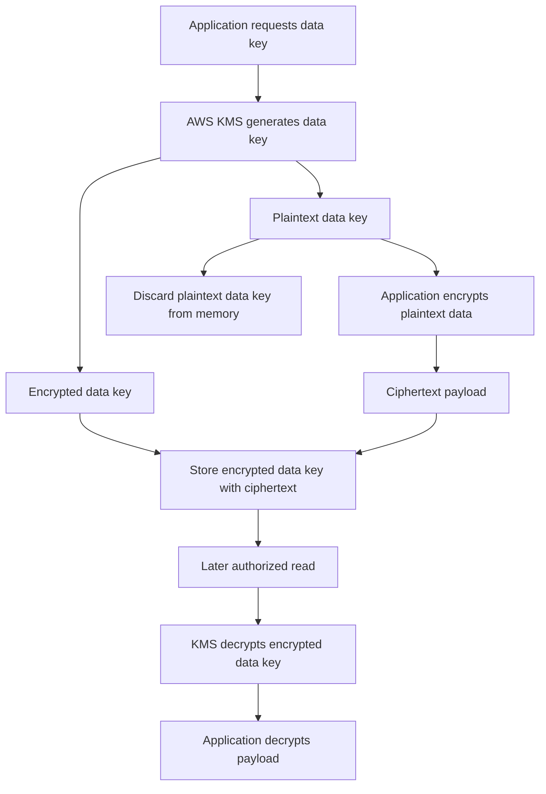
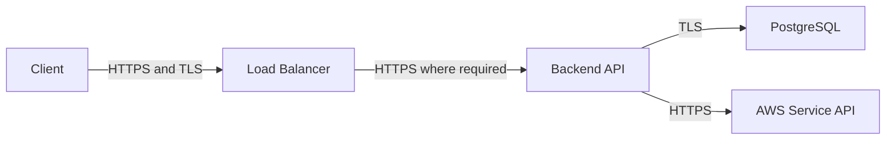

# 04- Encryption at Rest and In Transit

## Overview

Encryption protects sensitive data against unauthorized disclosure when it is stored or transmitted. In AWS environments, encryption is a foundational security control for databases, object storage, block volumes, application logs, message queues, backups, and service-to-service communication.

Encryption does not replace authentication, authorization, network isolation, or secure application design. An attacker using an authorized application identity may still access decrypted data if that identity has excessive permissions or the application exposes the data.

AWS encryption architecture typically combines:

- **Encryption at rest:** Protecting stored data using service-managed encryption or application-level cryptography.
- **Encryption in transit:** Protecting network communications using TLS and HTTPS.
- **Key management:** Controlling cryptographic keys, permissions, rotation, and lifecycle through AWS Key Management Service (AWS KMS) or an approved external key-management system.
- **Access control:** Restricting which identities and services can use keys or access plaintext data.
- **Audit and monitoring:** Recording key usage, detecting configuration changes, and investigating unauthorized access.

This document focuses on encryption implementation and operational decisions. IAM fundamentals, request signing, and broader security architecture are covered separately in the AWS Security documentation.

## Encryption Fundamentals

### Encryption at rest

Encryption at rest transforms stored plaintext into ciphertext using cryptographic keys. Data is decrypted when an authorized application or service needs to use it.

Typical use cases include:

- S3 objects and backups.
- EBS volumes and snapshots.
- RDS database storage and automated backups.
- CloudWatch Logs log groups.
- Secrets Manager secrets and Systems Manager Parameter Store `SecureString` parameters.
- Application-managed sensitive fields.

Encryption at rest helps protect data from unauthorized access to underlying storage media, snapshots, backups, and other stored representations. Its effectiveness depends on the storage service, key configuration, permissions, and threat model.

### Encryption in transit

Encryption in transit protects data exchanged between clients, services, and infrastructure components while it travels over a network.

TLS is the standard mechanism for protecting HTTP-based communication. It provides confidentiality and integrity and, when certificate validation succeeds, authenticates the server to the client. Mutual TLS (mTLS) additionally authenticates clients using certificates when configured appropriately.

Typical use cases include:

- Browser-to-API communication.
- Python application-to-AWS API requests.
- Application-to-PostgreSQL connections.
- Service-to-service HTTP or gRPC communication.
- Connections between workloads and supported AWS service endpoints.

TLS does not automatically encrypt every network protocol or every connection. Each client and server must negotiate and enforce the intended security configuration.

### Comparison

| Property | Encryption at rest | Encryption in transit |
|---|---|---|
| Primary objective | Protect stored data | Protect network communications |
| Common mechanisms | AES-based service encryption, envelope encryption | TLS |
| Key considerations | KMS keys, data keys, key policies | Certificates, private keys, trust chains |
| Typical failures | KMS access denied, disabled key, inaccessible encrypted backup | Certificate errors, protocol mismatch, expired certificates |
| Performance impact | Storage and cryptographic processing overhead, often managed by AWS services | Handshake latency, encryption processing, connection management |
| Common misconception | Encrypted storage prevents authorized users from reading data | HTTPS guarantees application-level authorization |

A production system generally needs both.

## AWS Key Management Service

### What AWS KMS provides

AWS KMS is a managed service for creating and controlling cryptographic keys and performing supported cryptographic operations. It integrates with AWS services such as S3, EBS, RDS, CloudWatch Logs, Secrets Manager, and Systems Manager Parameter Store.

KMS is responsible for protecting and managing KMS keys, while integrated AWS services commonly handle the encryption and decryption of their stored data.

Common KMS capabilities include:

- Customer-managed and AWS-managed KMS keys.
- Key policies and IAM policy integration.
- Grants for delegated key usage.
- Key rotation.
- Cryptographic operations such as encryption, decryption, and data-key generation.
- CloudTrail audit events for supported KMS API activity.
- Regional key management and controls for key lifecycle operations.

KMS is not a general-purpose storage system for application secrets, and it is not a replacement for IAM. It provides cryptographic capabilities subject to key policies, IAM permissions, grants, and applicable organizational controls.

### KMS key types

| Key type | Management model | Typical use |
|---|---|---|
| AWS-owned key | Owned and managed by AWS; not managed in the customer's account as a customer key | Encryption for supported services where AWS-owned keys are used |
| AWS-managed KMS key | Managed by AWS within the customer's account | Convenient encryption for supported services |
| Customer-managed KMS key | Created and controlled by the customer | Custom key policies, access governance, auditability, and lifecycle control |

AWS-owned keys are not the same as AWS-managed KMS keys. AWS-owned keys generally do not appear as customer-managed KMS resources, while AWS-managed KMS keys can be inspected within the account.

Customer-managed keys provide more control over key policies, grants, rotation settings, and lifecycle decisions. That control also introduces operational responsibilities and potential failure modes.

### Choosing a key strategy

| Requirement | Typical approach | Trade-off |
|---|---|---|
| Straightforward encryption with minimal key administration | Service default encryption or an AWS-managed KMS key, where supported | Less granular key-management control |
| Separate permissions for sensitive data | Customer-managed KMS key | More policy and lifecycle administration |
| Different teams or workloads need independent key access | Separate customer-managed keys or carefully scoped grants | Increased key count and governance complexity |
| Regulatory evidence requires explicit key governance | Customer-managed keys with documented ownership and audit procedures | Additional operational controls and review effort |
| Application must perform field-level encryption | Application-level envelope encryption using KMS-protected data keys | Application must manage ciphertext formats, data keys, and compatibility |

The correct choice depends on the threat model, service capabilities, compliance obligations, and operational maturity. Customer-managed keys are not automatically required for every workload.

## KMS Keys, Key Policies, and Grants

### Key policies

A KMS key policy is the primary resource-based policy mechanism governing access to a KMS key. IAM policies can also grant KMS permissions when the key policy enables the relevant IAM authorization model.

A key policy that does not allow the intended authorization path can prevent an otherwise valid IAM permission from being effective.

When designing key policies:

- Define who administers the key separately from who uses it for cryptographic operations.
- Avoid broad access to `kms:*`.
- Scope permissions to the required key and operations.
- Preserve a supported administrative recovery path.
- Review cross-account access explicitly.
- Avoid accidental removal of all effective administrative access.
- Test policy changes in a controlled environment.

Key administration and key usage are different responsibilities. A workload that needs to decrypt data should not automatically receive permission to schedule key deletion or modify the key policy.

### Grants

KMS grants provide a mechanism for delegating specified cryptographic permissions to a grantee. Grants can be useful for integrated AWS services and controlled access delegation without repeatedly modifying a key policy.

A grant defines permitted operations and may include constraints. Grant creation, revocation, and propagation behavior should be considered when designing service integrations.

Do not assume that every KMS integration uses the same authorization mechanism. Some services require specific key-policy statements, grants, or service-linked access patterns. Follow the target service's documented KMS integration requirements.

### Key policy versus IAM policy

| Mechanism | Main purpose | Operational consideration |
|---|---|---|
| KMS key policy | Establishes access to the key at the resource-policy layer | Incorrect statements can prevent expected access |
| IAM identity policy | Grants a principal permission to call KMS operations | Must work with the applicable key policy and other restrictions |
| KMS grant | Delegates specified key operations | Requires lifecycle and ownership management |
| SCP | Restricts permissions available within governed organization accounts | Does not directly grant permissions |
| Permissions boundary | Limits permissions that identity policies can grant | Does not grant the underlying permission |

A successful KMS operation requires all applicable authorization and service conditions to be satisfied.

## Envelope Encryption

### Why envelope encryption exists

Encrypting large data payloads directly with a KMS key is not the usual approach for application-managed bulk encryption. KMS cryptographic APIs have payload limits, and large datasets require efficient local cryptographic processing.

Envelope encryption uses two layers:

- A **data key** encrypts the application data.
- A **KMS key** protects the data key.

The application or integrated service encrypts the plaintext using the data key and stores the encrypted data key alongside the ciphertext. When decryption is required, the authorized consumer asks KMS to decrypt the encrypted data key and then uses the plaintext data key to decrypt the payload.



The diagram shows the logical process. AWS services such as S3 and EBS generally implement their own service-managed encryption workflows rather than requiring application code to orchestrate each step.

### Advantages

- Efficient encryption of large payloads.
- Separation between data encryption and key administration.
- Ability to protect many data objects using a controlled key hierarchy.
- Easier key governance without using KMS as a bulk-data encryption API.
- Support for application-level encryption when storage-service encryption alone is insufficient.

### Limitations and production considerations

- Applications must protect plaintext data keys in memory.
- Encrypted data keys and ciphertext must remain correctly associated.
- Decryption depends on the availability and authorization of the relevant KMS key.
- Key deletion or disabling can make stored data inaccessible.
- Encryption context must be supplied consistently when used.
- Application-managed encryption introduces format versioning, rotation, and recovery responsibilities.

Use established cryptographic libraries and supported KMS APIs. Do not invent a custom encryption algorithm or reuse data keys beyond the lifecycle and usage model appropriate for the application.

## Generate and Use a Data Key with boto3

The following example demonstrates envelope encryption for a small application payload. It uses a customer-managed KMS key and AES-GCM for authenticated encryption.

Install the AWS SDK:

```bash
python -m pip install boto3
```

Example implementation:

```python
import base64
import json
import os

import boto3
from cryptography.hazmat.primitives.ciphers.aead import AESGCM


def encrypt_payload(payload: dict, record_id: str) -> dict:
    kms_key_id = os.environ["KMS_KEY_ID"]
    kms = boto3.client("kms")

    encryption_context = {
        "application": "orders-api",
        "record_id": record_id,
    }

    response = kms.generate_data_key(
        KeyId=kms_key_id,
        KeySpec="AES_256",
        EncryptionContext=encryption_context,
    )

    plaintext_data_key = response["Plaintext"]
    encrypted_data_key = response["CiphertextBlob"]

    try:
        nonce = os.urandom(12)
        plaintext = json.dumps(
            payload,
            separators=(",", ":"),
        ).encode("utf-8")

        ciphertext = AESGCM(plaintext_data_key).encrypt(
            nonce,
            plaintext,
            record_id.encode("utf-8"),
        )

        return {
            "version": 1,
            "record_id": record_id,
            "nonce": base64.b64encode(nonce).decode("ascii"),
            "ciphertext": base64.b64encode(ciphertext).decode("ascii"),
            "encrypted_data_key": base64.b64encode(
                encrypted_data_key
            ).decode("ascii"),
        }
    finally:
        del plaintext_data_key
```

This example demonstrates the basic flow, but production systems need additional controls:

- Install and pin a maintained `cryptography` dependency.
- Use a stable, documented ciphertext format and migration strategy.
- Validate record identifiers and the serialized payload schema.
- Restrict KMS permissions to the intended key and operations.
- Treat encryption context values as non-secret metadata.
- Never log the plaintext data key, plaintext payload, or decrypted sensitive fields.
- Understand that deleting a Python reference does not guarantee immediate memory zeroization.
- Store ciphertext and the encrypted data key durably before considering the write complete.
- Use a transactional or recovery strategy if encrypted payload persistence fails.
- Ensure the application can still decrypt data after key policy, IAM, deployment, or regional changes.

### Decryption

A matching decryption function must pass the original encryption context to KMS and use the same authenticated-encryption associated data supplied to AES-GCM.

```python
import base64
import json
import os

import boto3
from cryptography.hazmat.primitives.ciphers.aead import AESGCM


def decrypt_payload(encrypted_record: dict) -> dict:
    kms = boto3.client("kms")

    record_id = encrypted_record["record_id"]
    encryption_context = {
        "application": "orders-api",
        "record_id": record_id,
    }

    encrypted_data_key = base64.b64decode(
        encrypted_record["encrypted_data_key"],
        validate=True,
    )

    nonce = base64.b64decode(
        encrypted_record["nonce"],
        validate=True,
    )

    ciphertext = base64.b64decode(
        encrypted_record["ciphertext"],
        validate=True,
    )

    response = kms.decrypt(
        CiphertextBlob=encrypted_data_key,
        EncryptionContext=encryption_context,
    )

    plaintext_data_key = response["Plaintext"]

    try:
        plaintext = AESGCM(plaintext_data_key).decrypt(
            nonce,
            ciphertext,
            record_id.encode("utf-8"),
        )

        return json.loads(plaintext.decode("utf-8"))
    finally:
        del plaintext_data_key
```

The example expects the record format produced by the encryption function. In production, validate the record version, enforce payload size limits, and handle malformed data and cryptographic failures without leaking plaintext.

The encryption context supplied to KMS must match the original context. AES-GCM authentication also fails if the ciphertext, nonce, key, or associated data is incorrect.

## Encryption Context

An encryption context is a set of non-secret key-value pairs that AWS KMS can bind to supported cryptographic operations. It provides additional authenticated context for operations such as data-key generation, encryption, and decryption.

Example:

```python
encryption_context = {
    "application": "orders-api",
    "record_id": "order-123",
}
```

Encryption context can be useful for associating ciphertext with a workload or record identifier. It is not encrypted by KMS and should not contain passwords, access tokens, personal secrets, or other sensitive values.

For KMS operations that support encryption context:

- Use consistent, deterministic values.
- Pass the matching context during decryption.
- Avoid including sensitive metadata.
- Use context-aware key-policy conditions where appropriate.
- Understand that changing a context value can make ciphertext undecryptable with the supplied context.

Encryption context is not a substitute for application authorization. A caller that can use a key and knows or obtains the required context may still be able to decrypt the associated data, subject to applicable controls.

## Key Rotation and Lifecycle Management

### Key rotation

Key rotation changes the backing cryptographic material used by a KMS key according to the applicable rotation mechanism. For supported symmetric encryption KMS keys, automatic rotation can be enabled, and AWS KMS retains the historical key material required to decrypt data encrypted under earlier material.

Rotation does not mean that all existing ciphertext is automatically decrypted and re-encrypted under a newly created KMS key.

| Approach | Behavior | Considerations |
|---|---|---|
| Automatic rotation of a supported customer-managed KMS key | KMS rotates backing key material according to its supported schedule | Existing ciphertext remains decryptable through the same KMS key |
| On-demand rotation, where supported | Rotation is requested according to the key's supported configuration | Availability and restrictions depend on key type and configuration |
| New KMS key migration | Data is re-encrypted or rewrapped under a different KMS key | Requires migration planning, access validation, and rollback strategy |
| Application data-key rotation | Application generates or adopts new data keys | Requires a ciphertext migration or versioned-key strategy |

Key rotation capabilities and schedules depend on key type and configuration. Verify the supported behavior for the specific KMS key rather than assuming every key supports the same rotation options.

### Key deletion and disabling

Disabling a KMS key can prevent cryptographic operations that require the key. Scheduling deletion introduces a recovery window before permanent deletion, subject to KMS rules and key type. After deletion, ciphertext that depends on the deleted key may become permanently unrecoverable.

Before disabling or deleting a key:

- Identify dependent S3 objects, EBS snapshots, database backups, log groups, and application ciphertext.
- Confirm whether data can be re-encrypted or restored under another key.
- Validate retention and disaster-recovery requirements.
- Confirm that cross-account consumers and workloads have been migrated.
- Review grants, aliases, key policies, and service integrations.
- Require an approved change and recovery plan.

Key lifecycle actions are high-impact operations and should be protected by least privilege, monitoring, and change control.

## Encryption at Rest in AWS Services

### Amazon S3

S3 supports server-side encryption options for objects. For current S3 usage, server-side encryption with Amazon S3-managed keys (SSE-S3) is the default for new object uploads, while SSE-KMS supports integration with AWS KMS for additional key-management control.

| Option | Key management | Typical consideration |
|---|---|---|
| SSE-S3 | Amazon S3 manages the encryption keys | Operationally simple default encryption |
| SSE-KMS with an AWS-managed KMS key | AWS manages the KMS key in the account | KMS integration with less customer key administration |
| SSE-KMS with a customer-managed KMS key | Customer controls the KMS key configuration and policy | More granular access control and governance |
| Client-side encryption | Application or client encrypts data before upload | Greater application responsibility for key management and data format |

S3 bucket default encryption is useful, but it does not prevent every unencrypted or unauthorized data path in every possible workflow. Validate the bucket policy, encryption requirements, access policies, replication behavior, and upload clients against the required security posture.

Example: inspect bucket encryption configuration.

```bash
aws s3api get-bucket-encryption \
  --bucket EXAMPLE_BUCKET \
  --region ap-south-1
```

The response identifies the configured default encryption rules. A missing configuration and the service's effective encryption behavior must be interpreted in the context of current S3 defaults and bucket settings.

For a bucket that requires a specific customer-managed KMS key, use an appropriately scoped bucket policy and verify all relevant upload and replication workflows. Do not assume default encryption alone enforces the required key selection.

### Amazon EBS

EBS encryption protects supported volume data, snapshots, and data transferred between an encrypted EBS volume and its attached EC2 instance according to AWS's service implementation.

EBS encryption integrates with KMS. When an encrypted volume is created, AWS uses the configured KMS key and service-managed data-key mechanisms.

Production considerations:

- Enable EBS encryption by default in each relevant Region.
- Select a customer-managed key when governance or key access requirements justify it.
- Verify that snapshots and restored volumes retain the intended encryption configuration.
- Check key permissions before copying or sharing encrypted snapshots.
- Account for cross-account and cross-Region key requirements during disaster recovery.
- Validate the encryption state of existing resources, not just new resources.

Inspect a volume:

```bash
aws ec2 describe-volumes \
  --volume-ids vol-EXAMPLE \
  --region ap-south-1 \
  --query 'Volumes[].{VolumeId:VolumeId,Encrypted:Encrypted,KmsKeyId:KmsKeyId,State:State}'
```

The output reports the encryption flag and associated KMS key identifier when applicable. Confirm the expected key and volume state before relying on the resource for a sensitive workload.

### Amazon RDS

RDS encryption at rest can protect database storage, automated backups, snapshots, and other supported storage components. The exact scope and limitations depend on the database engine and RDS configuration.

Consider:

- Enabling encryption when creating the database.
- Selecting an appropriate KMS key.
- Verifying encryption requirements for snapshots and replicas.
- Planning encrypted migrations when an existing database cannot be encrypted in place.
- Testing restore and failover procedures.
- Confirming key availability in disaster-recovery Regions.
- Using TLS for database client connections separately from storage encryption.

Inspect a database instance:

```bash
aws rds describe-db-instances \
  --db-instance-identifier EXAMPLE_DB \
  --region ap-south-1 \
  --query 'DBInstances[].{Identifier:DBInstanceIdentifier,Encrypted:StorageEncrypted,KmsKeyId:KmsKeyId}'
```

The output identifies whether storage encryption is enabled and which KMS key is associated with the instance.

An encrypted database does not guarantee that every database client connection uses TLS. Configure and validate connection encryption independently.

### Amazon CloudWatch Logs

CloudWatch Logs encrypts log data at rest using service-managed encryption by default. Customer-managed KMS keys can be configured for supported log groups when additional control is required.

Operational considerations include:

- Confirming the configured KMS key for sensitive log groups.
- Ensuring the relevant service and workload permissions are correct.
- Maintaining access to the key for the required retention period.
- Understanding that disabling or deleting the key can affect access to encrypted logs.
- Avoiding secrets and personal data in logs even when the log group is encrypted.

Inspect a log group's encryption configuration:

```bash
aws logs describe-log-groups \
  --log-group-name-prefix "/aws/example-service" \
  --region ap-south-1 \
  --query 'logGroups[].{Name:logGroupName,KmsKeyId:kmsKeyId,RetentionDays:retentionInDays}'
```

The presence of a `kmsKeyId` indicates a customer-managed KMS key configured for that log group. Its absence does not mean the logs are stored without encryption.

### Service encryption overview

| Service | Encryption at rest | Key-management considerations |
|---|---|---|
| S3 | SSE-S3 by default for new object uploads; SSE-KMS and client-side encryption are also supported | Bucket policies, key policies, replication, and object-level requirements |
| EBS | Supported volume and snapshot encryption | Default encryption settings, snapshot sharing, recovery, and regional keys |
| RDS | Supported database storage and backup encryption | Snapshot restoration, replication, migration, and key availability |
| CloudWatch Logs | Service-managed encryption by default | Customer-managed keys for supported log groups and long-term log access |
| Secrets Manager | Encrypted secret values | KMS key permissions, rotation, and retrieval authorization |
| Systems Manager Parameter Store | `SecureString` values use KMS encryption | Key selection, IAM access, parameter tier, and retrieval permissions |

Encryption support varies by service, resource type, and configuration. Validate the exact behavior for the target service and Region.

## Encryption in Transit with TLS

### TLS fundamentals

TLS protects communication between a client and server. A typical HTTPS connection includes:

1. DNS resolution and network connection establishment.
2. TLS handshake and protocol negotiation.
3. Certificate validation and server authentication.
4. Session-key establishment.
5. Encrypted HTTP request and response exchange.

TLS does not automatically encrypt application data at rest or protect data after it reaches an authorized endpoint.

### Production TLS requirements

- Use HTTPS for public and internal APIs carrying sensitive information.
- Validate server certificates and hostnames.
- Disable obsolete protocol versions and weak cipher configurations where the endpoint allows configuration.
- Use supported TLS configurations and monitor certificate expiration.
- Use mTLS when client-certificate authentication is appropriate for the trust model.
- Avoid disabling certificate verification to resolve connection failures.
- Ensure internal traffic remains encrypted across load balancers, proxies, service meshes, and application instances where required.
- Protect private keys and restrict certificate issuance and renewal permissions.

### TLS termination and backend encryption

TLS may terminate at an Application Load Balancer, API Gateway, Nginx, or another proxy. Traffic from that component to the application is a separate connection and must be evaluated independently.



A TLS-terminating load balancer can simplify certificate management and centralize public ingress controls. However, if the threat model requires encryption between the load balancer and application, the backend connection must also use TLS.

The correct design depends on the network trust boundary, workload isolation, compliance requirements, and supported service capabilities.

## TLS for Python Backend Applications

### Use certificate validation

Python HTTP clients should verify TLS certificates by default. Avoid settings such as `verify=False` in production because they disable certificate validation and expose the application to man-in-the-middle attacks.

Example with `requests`:

```python
import requests


def fetch_customer_profile(api_url: str) -> dict:
    response = requests.get(
        api_url,
        timeout=(3.05, 10),
        verify=True,
    )
    response.raise_for_status()
    return response.json()
```

For public HTTPS endpoints, the system's trusted certificate store is normally sufficient. For private certificate authorities, configure the appropriate CA bundle rather than disabling verification.

```python
response = requests.get(
    "https://internal-api.example",
    timeout=(3.05, 10),
    verify="/etc/ssl/certs/internal-ca-bundle.pem",
)
response.raise_for_status()
```

The CA bundle path is an example and must match the deployed environment. Manage the bundle through a controlled deployment process.

### PostgreSQL TLS

For PostgreSQL connections, configure the driver to validate the server certificate and hostname according to the selected connection method.

A typical libpq-based connection string uses:

```text
host=db.example.internal
dbname=application
sslmode=verify-full
sslrootcert=/etc/ssl/certs/database-ca.pem
```

`verify-full` requires TLS and validates the certificate chain and hostname. The server certificate must match the hostname used by the client, and the configured CA bundle must trust the issuing certificate authority.

For Django, configure the database connection through managed environment-specific settings and ensure the selected PostgreSQL driver honors the TLS parameters. Do not assume that enabling TLS on the database server automatically forces every client connection to use it.

## Mutual TLS and Service-to-Service Communication

mTLS requires both sides of a connection to authenticate using certificates. It can be useful for private service-to-service communication where workload identity must be established at the transport layer.

Potential use cases include:

- Internal APIs with strict client authentication.
- gRPC services.
- Service-mesh workloads.
- Private integrations where certificate-based identity is part of the architecture.

mTLS introduces additional operational responsibilities:

- Certificate issuance and identity binding.
- Private-key protection.
- Certificate rotation and expiration monitoring.
- Trust-bundle distribution.
- Revocation or rapid containment procedures.
- Compatibility during certificate and trust-chain changes.

mTLS should complement application-level authorization. A valid client certificate does not automatically grant unrestricted access to all API operations.

For AWS service integrations, use the authentication mechanisms supported by the specific service. Do not assume that every AWS API endpoint supports arbitrary customer-configured mTLS.

## KMS Operational Workflows

### Inspect KMS keys

List customer-managed and AWS-managed KMS keys visible to the caller:

```bash
aws kms list-keys \
  --region ap-south-1
```

This returns key identifiers and ARNs. It does not by itself reveal each key's policy, rotation status, or operational dependencies.

Inspect a specific key:

```bash
aws kms describe-key \
  --key-id arn:aws:kms:ap-south-1:123456789012:key/EXAMPLE-KEY-ID \
  --region ap-south-1
```

The response contains key metadata, including key state, key manager, key usage, and other supported attributes. Confirm that the key is enabled and appropriate for the intended operation.

### Inspect a key policy

```bash
aws kms get-key-policy \
  --key-id arn:aws:kms:ap-south-1:123456789012:key/EXAMPLE-KEY-ID \
  --policy-name default \
  --region ap-south-1
```

This retrieves the selected key policy if the caller has permission. Review both the policy's principal scope and the actions it permits.

### Inspect rotation status

```bash
aws kms get-key-rotation-status \
  --key-id arn:aws:kms:ap-south-1:123456789012:key/EXAMPLE-KEY-ID \
  --region ap-south-1
```

The result reports rotation status for supported key configurations. Rotation support differs by key type; interpret errors and output according to the key's configuration.

### Enable rotation

The following command modifies a key's configuration and is not a read-only operation:

```bash
aws kms enable-key-rotation \
  --key-id arn:aws:kms:ap-south-1:123456789012:key/EXAMPLE-KEY-ID \
  --region ap-south-1
```

Use this only after verifying that the key supports the requested rotation configuration and that the change is approved. Enabling rotation is not the same as migrating ciphertext to a different KMS key.

### Inspect grants

```bash
aws kms list-grants \
  --key-id arn:aws:kms:ap-south-1:123456789012:key/EXAMPLE-KEY-ID \
  --region ap-south-1
```

This helps identify delegated access. Review grant grantees, operations, and constraints before changing grants that may be used by AWS services or dependent workloads.

## Troubleshooting Encryption Failures

### KMS access denied

**Symptoms**

- `AccessDeniedException`.
- `AccessDenied` when accessing an encrypted resource.
- `kms:Decrypt` or `kms:GenerateDataKey` authorization failures.

**Likely causes**

- Missing IAM permission.
- Key policy does not permit the intended access path.
- A grant is missing or incorrectly scoped.
- An explicit deny or organization restriction applies.
- The workload uses the wrong key or account.
- A required encryption context does not match.

**Isolation steps**

1. Identify the principal used by the failing workload.
2. Identify the exact KMS key ARN and Region.
3. Determine the required KMS operation.
4. Inspect the key policy and relevant IAM policy.
5. Check grants and applicable explicit denies.
6. Verify the encryption context and the resource's key configuration.
7. Review CloudTrail for the failed KMS request.

Read-only inspection commands include:

```bash
aws sts get-caller-identity
```

```bash
aws kms describe-key \
  --key-id EXAMPLE_KEY_ID \
  --region ap-south-1
```

```bash
aws kms get-key-policy \
  --key-id EXAMPLE_KEY_ID \
  --policy-name default \
  --region ap-south-1
```

**Corrective action**

Grant only the required operation to the correct principal and key, using the appropriate authorization mechanism. Do not grant broad KMS access or administrator privileges as a diagnostic shortcut.

**Verification**

Retry the original operation with the intended workload identity and confirm that the application can perform the required encryption or decryption without receiving additional unrelated permissions.

**Prevention**

Add policy validation, integration tests, key-policy reviews, and alerts for unexpected key-access failures.

### Encrypted resource becomes inaccessible

**Symptoms**

- An application can no longer read encrypted objects.
- A database restore or snapshot copy fails.
- KMS reports a disabled key or authorization failure.

**Likely causes**

- Key disabled or scheduled for deletion.
- Permissions changed.
- Resource copied across accounts or Regions without the correct key access.
- Key lifecycle changes were not coordinated with dependent services.

**Isolation and remediation**

Inspect the key state, identify all dependent resources, and review recent KMS and service-level API activity. If the key was disabled, restore access only after confirming the reason and authorization to do so. If deletion is scheduled, follow the approved recovery process while the key remains recoverable.

Do not create a replacement key and assume existing ciphertext will automatically become decryptable under it. Migration or re-encryption is a separate operation.

### TLS certificate validation failure

**Symptoms**

- `CERTIFICATE_VERIFY_FAILED`.
- Hostname mismatch errors.
- TLS handshake failures.

**Likely causes**

- Expired or incorrectly issued certificate.
- Wrong hostname or endpoint.
- Missing private CA certificate.
- Incorrect trust-bundle configuration.
- Unsupported protocol or cipher configuration.

**Isolation steps**

1. Confirm the exact endpoint hostname.
2. Inspect certificate validity and certificate-chain details.
3. Verify the configured CA bundle.
4. Check the client and server TLS configuration.
5. Confirm that proxies and load balancers present the expected certificates.

For OpenSSL-based diagnostics:

```bash
openssl s_client \
  -connect internal-api.example:443 \
  -servername internal-api.example \
  -verify_return_error
```

The output includes certificate-chain and handshake information. Use the actual target hostname and port.

**Corrective action**

Renew or replace the certificate, correct the hostname, update the trusted CA bundle, or fix the TLS configuration. Never disable certificate validation as a production workaround.

**Verification**

Repeat the connection with certificate verification enabled and test the same path from the actual application runtime.

### Database TLS is not enforced

**Symptoms**

- Some application clients connect without TLS.
- A database connection succeeds despite an expected TLS requirement.

**Likely causes**

- Client configuration does not require TLS.
- Server-side enforcement is missing.
- Different applications use different connection parameters.
- A proxy or connection pool changes the effective connection path.

**Corrective action**

Enforce TLS through the database's supported server-side controls and configure clients to validate certificates. Test all connection pools, migration jobs, background workers, and administrative tools before tightening production enforcement.

**Verification**

Inspect database connection metadata or supported server diagnostics to confirm that the connection is encrypted and that certificate validation is functioning as intended.

## Security, Monitoring, and Compliance

### Audit KMS usage

CloudTrail records supported KMS API activity. Audit data can help determine who requested a cryptographic operation, which key was involved, when the request occurred, and whether it succeeded.

Useful events include:

- `Decrypt`.
- `Encrypt`.
- `GenerateDataKey`.
- `CreateGrant`.
- `PutKeyPolicy`.
- `DisableKey`.
- `ScheduleKeyDeletion`.

Not every data-encryption operation generates an application-visible KMS API call. AWS services may use data keys and perform cryptographic operations within their own infrastructure. Interpret audit events according to the service's encryption implementation and CloudTrail event coverage.

Example: look for recent KMS events in CloudTrail Event History.

```bash
aws cloudtrail lookup-events \
  --lookup-attributes AttributeKey=EventSource,AttributeValue=kms.amazonaws.com \
  --max-results 20 \
  --region ap-south-1
```

The command returns matching recorded events within the supported Event History window. Event History is not a substitute for a configured trail or event data store with the retention and coverage required by the organization.

### Monitor key lifecycle changes

Security monitoring should detect unexpected changes to:

- Key policies.
- Key state.
- Rotation configuration.
- Grants.
- Key deletion schedules.
- Encryption settings on sensitive resources.

Investigate changes against approved deployment and change-management activity. A legitimate rotation or migration can generate similar events to suspicious activity, so alerts should include the actor, key ARN, Region, request ID, and change context.

### Compliance and recovery

Encryption is one control within a broader compliance program. Evidence may need to show that:

- Sensitive data is encrypted using approved algorithms and configurations.
- Keys have clear owners and controlled access.
- Rotation and key lifecycle procedures are documented.
- Access to plaintext is restricted.
- TLS is enforced on relevant network paths.
- Audit logs are retained and protected.
- Backup restoration and key recovery procedures are tested.

Encryption at rest does not by itself establish compliance. Requirements may also cover retention, data residency, access reviews, monitoring, incident response, and recovery testing.

## Production Implementation Checklist

### Encryption at rest

- [ ] Verify encryption settings for S3, EBS, RDS, and CloudWatch Logs.
- [ ] Use customer-managed KMS keys where explicit key governance is required.
- [ ] Define separate administrative and cryptographic usage permissions.
- [ ] Review key policies, grants, and cross-account access.
- [ ] Confirm backups and snapshots retain the intended encryption properties.
- [ ] Test restoration when the original workload or Region is unavailable.
- [ ] Monitor key disabling, policy changes, and deletion scheduling.
- [ ] Document key ownership, retention requirements, and recovery procedures.

### Encryption in transit

- [ ] Enforce HTTPS on public APIs.
- [ ] Validate certificates and hostnames in backend clients.
- [ ] Require TLS for sensitive database and service-to-service connections.
- [ ] Evaluate whether internal connections require mTLS.
- [ ] Monitor certificate expiration and renewal failures.
- [ ] Keep protocol and cipher configurations within supported security requirements.
- [ ] Test TLS configuration from the deployed workload, not just a developer workstation.

### Application cryptography

- [ ] Prefer AWS service encryption when it satisfies the threat model.
- [ ] Use envelope encryption for application-managed payload encryption when justified.
- [ ] Protect plaintext data keys and avoid logging sensitive payloads.
- [ ] Version ciphertext formats and test compatibility during key migrations.
- [ ] Use encryption context consistently without placing secrets in it.
- [ ] Test failure behavior when KMS is unavailable or authorization is denied.

## Practical Exercise: Encrypt and Decrypt an Application Record

### Objective

Implement envelope encryption for a small application payload and verify that the ciphertext can be decrypted only when the correct KMS key permissions, encryption context, and application cryptographic parameters are available.

### Prerequisites

- An isolated AWS test account.
- A customer-managed symmetric KMS key suitable for encryption and decryption.
- AWS CLI configured through an approved credential provider.
- Python, `boto3`, and `cryptography`.
- A test role with narrowly scoped KMS permissions.

### Implementation steps

1. Configure `KMS_KEY_ID` with the ARN or identifier of the test key.
2. Use the encryption function in this document to encrypt a non-sensitive test record.
3. Store the returned ciphertext, nonce, encrypted data key, record identifier, and format version in a test file or database.
4. Run the decryption function with the same record.
5. Confirm that the decrypted payload matches the original.
6. Change the encryption context or tamper with the ciphertext in a controlled test and confirm that decryption fails.
7. Remove temporary test data according to the environment's cleanup requirements.

### Required permissions

The workload typically needs `kms:GenerateDataKey` to encrypt the payload and `kms:Decrypt` to recover the data key. The key policy and other applicable controls must permit the operations.

Restrict access to the specific key and use additional conditions when supported and appropriate.

### Expected outcome

The original payload can be recovered using the matching key and encryption context. Incorrect context or modified authenticated ciphertext causes decryption to fail.

### Verification

Inspect the key configuration:

```bash
aws kms describe-key \
  --key-id "$KMS_KEY_ID" \
  --region ap-south-1
```

Review CloudTrail for the relevant KMS activity and confirm that successful and failed operations are consistent with the test.

### Cleanup and cost considerations

Remove temporary ciphertext files and test records when they are no longer required. Do not schedule deletion of a shared or production key as part of exercise cleanup.

KMS requests, storage, logging, and test infrastructure may incur charges. Use a dedicated test key and avoid unnecessary repeated cryptographic operations.

## Common Mistakes

### Assuming encryption at rest protects against compromised application identities

An application that is authorized to decrypt data can often read the plaintext. Limit application permissions, secure runtime identities, and audit access to sensitive data.

### Treating encryption as a replacement for authorization

Encryption does not determine whether a user should access a particular order, document, or customer record. Enforce business-level authorization independently.

### Disabling a KMS key without dependency analysis

A key may protect resources used by several services or accounts. Disabling it without a dependency inventory can interrupt production access or recovery.

### Assuming key rotation re-encrypts every object

Automatic KMS key rotation generally retains historical backing material needed for decryption. Migrating ciphertext to a different KMS key is a separate process.

### Disabling TLS verification to fix certificate errors

This removes an important security control and can expose sensitive traffic. Correct the certificate, hostname, or trust configuration instead.

### Assuming all internal traffic is trusted

Private subnets and internal load balancers do not automatically guarantee end-to-end confidentiality or authorization. Apply TLS and identity-based controls according to the threat model.

### Storing sensitive metadata in encryption context

Encryption context is not secret. Use it for non-sensitive identifiers and policy conditions, not passwords, tokens, or confidential application data.

### Forgetting disaster recovery dependencies

An encrypted backup is useful only if the organization can access the required key and restore the data. Test key availability, permissions, and restoration across the intended recovery boundaries.

## Key Takeaways

- Encryption at rest protects stored data, while TLS protects data in transit; neither replaces identity controls or application-level authorization.
- AWS KMS centralizes cryptographic key management, and key policies, IAM permissions, grants, and lifecycle controls determine whether cryptographic operations are available.
- Envelope encryption combines efficient local data encryption with KMS-protected data keys; applications must protect plaintext keys and maintain consistent encryption context and ciphertext formats.
- Key rotation, disabling, deletion, and cross-account recovery require dependency analysis because incorrect lifecycle changes can make encrypted data inaccessible.
- Production encryption requires verified TLS configurations, least-privilege key access, CloudTrail monitoring, tested recovery procedures, and prevention of sensitive-data leakage.
```