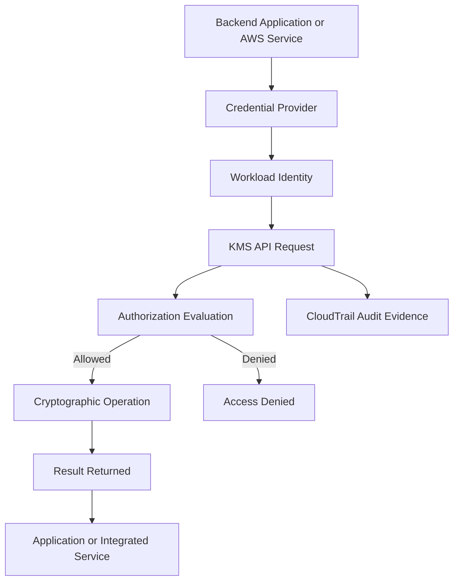
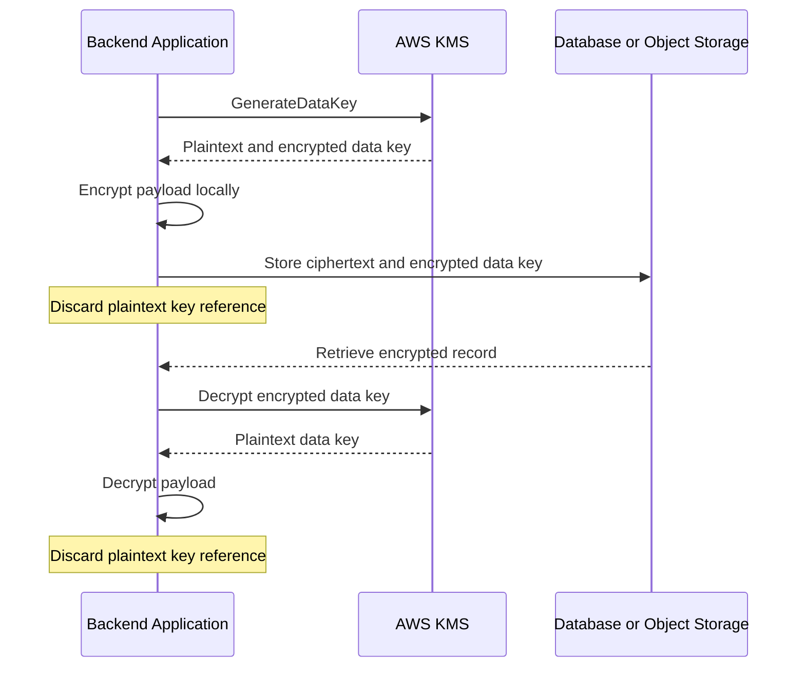

# 05- AWS KMS and Cryptographic Key Management

## Overview

AWS Key Management Service (AWS KMS) is a managed service for creating, controlling, and using cryptographic keys across AWS workloads. It integrates with services such as Amazon S3, Amazon EBS, Amazon RDS, Amazon CloudWatch Logs, AWS Secrets Manager, and AWS Systems Manager Parameter Store.

For backend engineers, KMS is both a cryptographic service and an access-control boundary. Its design affects data confidentiality, application availability, compliance, auditability, and disaster recovery.

A production KMS implementation must establish:

- Which identities can administer keys.
- Which workloads can encrypt or decrypt data.
- How AWS services receive permission to use keys.
- How key rotation, disabling, deletion, and recovery are managed.
- How cross-account and cross-Region access works.
- How cryptographic activity is audited.
- How encrypted data remains recoverable throughout its retention period.

KMS complements IAM, TLS, storage encryption, and application-level authorization. Encryption alone does not prevent an authorized but compromised application from accessing plaintext.

## KMS Architecture and Core Concepts

### How KMS works

KMS exposes managed cryptographic operations through AWS APIs. Applications and integrated services can request operations such as generating data keys, encrypting supported payloads, and decrypting previously encrypted data keys.

The underlying KMS key material is managed according to the key type and AWS service implementation. Applications generally interact with KMS through key identifiers and cryptographic APIs rather than directly accessing the underlying KMS key material.



The diagram represents a logical request flow. The exact processing and authorization path depend on the KMS operation, caller identity, key configuration, and service integration.

Creating a KMS key does not automatically encrypt application data. The application or integrated AWS service must invoke an appropriate encryption workflow.

### Core terminology

| Term | Meaning | Engineering significance |
|---|---|---|
| KMS key | A logical cryptographic key managed by KMS | Defines key identity, configuration, authorization, and lifecycle |
| Key material | Cryptographic material associated with a key | Protected and managed according to the key type |
| Key ARN | ARN identifying a KMS key | Used in policies, configuration, and audit records |
| Alias | A friendly name pointing to a KMS key | Simplifies configuration and key selection |
| Data key | A key used to encrypt application data | Enables efficient local encryption |
| Envelope encryption | Encrypting data with a data key and protecting that key with a KMS key | Supports application-managed encryption of larger payloads |
| Key policy | Resource-based policy associated with a KMS key | Defines the key's resource-level authorization rules |
| Grant | Delegation of specified KMS permissions | Supports controlled access delegation |
| Encryption context | Non-secret metadata associated with supported cryptographic operations | Provides authenticated context and can support policy conditions |
| Key rotation | Changing backing key material or migrating to a different logical key | Requires understanding how existing ciphertext is affected |

## KMS Key Types and Selection

### AWS-owned, AWS-managed, and customer-managed keys

AWS supports different key-management models with different levels of customer control.

| Key type | Management | Customer control | Typical use |
|---|---|---|---|
| AWS-owned key | Owned and managed by AWS | Limited direct visibility and configuration | Encryption paths supported by AWS services |
| AWS-managed KMS key | Managed by AWS within the customer's account | Limited control over key configuration and lifecycle | Convenient service-integrated encryption |
| Customer-managed KMS key | Customer controls configuration; AWS operates the service | Greater control over policies, grants, rotation settings, and lifecycle | Workloads requiring explicit key governance |

AWS-owned keys and AWS-managed KMS keys are not interchangeable terms. AWS-managed KMS keys are visible KMS resources in the customer's account, while AWS-owned keys generally are not managed as customer-account key resources.

### When to use customer-managed keys

Customer-managed keys are useful when an organization needs:

- Explicit control over key policies and delegated access.
- Independent access boundaries for sensitive workloads.
- Auditable key lifecycle and rotation configuration.
- Controlled cross-account access.
- Defined ownership and recovery procedures.
- Additional governance for regulated or high-sensitivity data.

They also introduce operational responsibilities. Incorrect policies, accidental key disabling, or premature deletion can make production data inaccessible.

Use service defaults or AWS-managed keys when they satisfy the security requirements. Do not create separate customer-managed keys for every resource without a clear access-control, governance, or lifecycle reason.

### Symmetric and asymmetric KMS keys

| Key type | Capabilities | Typical considerations |
|---|---|---|
| Symmetric encryption key | Supported symmetric cryptographic operations | Common choice for storage encryption and envelope encryption |
| Asymmetric key | Supported public/private-key operations | Useful for selected signing, verification, encryption, or decryption workflows |
| HMAC key | Keyed hashing and verification operations | Useful for applications requiring a KMS-managed HMAC key |

Supported algorithms and operations depend on the key specification and usage configuration. Choose the key type according to the cryptographic requirement rather than assuming all keys support all operations.

For most integrated AWS storage encryption and application envelope-encryption workflows, symmetric encryption keys are the standard choice.

## KMS Authorization

### Key policies

A KMS key policy is a resource-based policy attached to a key. It is central to KMS authorization and determines which principals can access the key through the configured authorization model.

An IAM identity policy granting `kms:Decrypt` is not necessarily sufficient by itself. The key policy must allow the relevant authorization path, and additional restrictions may apply.

A key policy should distinguish:

- Key administrators.
- Workloads permitted to perform cryptographic operations.
- AWS services that require delegated key access.
- Cross-account principals.
- Principals allowed to change the policy or schedule deletion.

### Example: restricted key usage

The following is an illustrative policy statement for a customer-managed key. It permits a specific role to decrypt data and generate data keys.

```json
{
  "Version": "2012-10-17",
  "Statement": [
    {
      "Sid": "AllowOrdersServiceCryptographicOperations",
      "Effect": "Allow",
      "Principal": {
        "AWS": "arn:aws:iam::123456789012:role/OrdersBackendRole"
      },
      "Action": [
        "kms:Decrypt",
        "kms:GenerateDataKey"
      ],
      "Resource": "*"
    }
  ]
}
```

Within a KMS key policy, `"Resource": "*"` refers to the key to which that policy is attached. It does not mean every KMS key in the account.

This is only a policy fragment. A complete policy must retain an approved administrative access path and any required service-integration permissions. Verify the principal ARN, required operations, and recovery access before deployment.

### IAM policies, key policies, and grants

| Mechanism | Responsibility |
|---|---|
| KMS key policy | Establishes resource-level authorization rules for the key |
| IAM identity policy | Grants a principal permission to call KMS operations when the key's authorization model permits it |
| KMS grant | Delegates specified operations to a grantee |
| Permissions boundary | Limits permissions that identity policies can grant |
| Service control policy (SCP) | Restricts permissions available within governed organization accounts |
| Session policy | Can further restrict permissions for an assumed-role session |

A successful KMS operation depends on the full authorization context. Explicit denies, key state, encryption context, and service-specific conditions can still cause failures.

### Separate administration from cryptographic usage

A workload that needs `kms:Decrypt` should not automatically receive `kms:PutKeyPolicy`, `kms:DisableKey`, or `kms:ScheduleKeyDeletion`.

Key administrators may need lifecycle permissions without requiring routine access to plaintext application data. However, administrators who can change policies may be able to grant themselves additional access. Protect administrative permissions with least privilege, separation of duties, approval workflows, and monitoring.

## Cross-Account KMS Access

Cross-account KMS access requires configuration in both the caller's authorization context and the key-owning account.

A common pattern is:

1. A workload assumes an authorized role.
2. The role receives permission for the required KMS operation.
3. The target key policy permits the relevant external account or principal.
4. The workload uses the correct key ARN and Region.
5. Applicable organization restrictions and service-specific controls are satisfied.

An identity policy in the caller's account does not independently grant access to a key in another account. The target key's policy must permit the cross-account access path.

### Production considerations

- Prefer explicit role ARNs over broad account-wide principals where practical.
- Restrict permissions to required operations.
- Review role trust policies and session restrictions.
- Verify the account, Region, and key ARN.
- Audit changes in both the workload and key-owning accounts.
- Test recovery independently of normal application access.

Cross-account key usage is different from copying ciphertext or an encrypted snapshot into another account. Some workflows require additional grants, resource policies, or re-encryption.

## Envelope Encryption

### Why envelope encryption is needed

KMS is not intended to be a general-purpose bulk-data encryption engine. Envelope encryption allows applications to encrypt larger payloads locally while KMS protects the data-encryption key.

The process is:

1. The application requests a data key from KMS.
2. KMS returns a plaintext data key and an encrypted copy.
3. The application encrypts the payload using the plaintext data key.
4. The application stores the ciphertext and encrypted data key.
5. The application discards its reference to the plaintext data key.
6. During a later read, the application requests decryption of the encrypted data key.
7. The application decrypts the payload using the recovered data key.



### Benefits

- Efficient encryption of larger payloads.
- Reduced need to invoke KMS for every byte encrypted.
- Centralized control over the key protecting data keys.
- Ability to encrypt application fields independently of storage encryption.
- Support for application-level encryption when the threat model requires it.

### Limitations

- Applications must manage ciphertext formats and data-key associations.
- Plaintext data keys exist in application memory during cryptographic operations.
- Decryption depends on KMS availability and authorization.
- Incorrect encryption context can prevent data-key recovery.
- Key migration and ciphertext versioning require explicit planning.
- Deleting the protecting KMS key can make stored data unrecoverable.

For ordinary S3, EBS, or RDS encryption, prefer the service's native encryption mechanism unless application-level encryption is specifically required.

## Encryption Context

Encryption context is non-secret metadata associated with supported KMS cryptographic operations. KMS authenticates the context as part of those operations, and the matching context must be supplied when decrypting data encrypted with it.

Example:

```python
encryption_context = {
    "application": "orders-api",
    "record_id": "order-123",
}
```

Useful context values include application identifiers, record identifiers, and non-sensitive data classifications.

Do not place passwords, access tokens, private data, or other secrets in encryption context. Context is not encrypted as secret metadata and may appear in audit records.

Encryption context can also be used in applicable key-policy conditions to constrain cryptographic operations. Ensure the policy matches the actual context used by the application or integrated service.

## Implementing Envelope Encryption in Python

### Prerequisites

Install the AWS SDK and a maintained cryptographic library:

```bash
python -m pip install boto3 cryptography
```

Configure the workload to obtain credentials through an approved provider, such as an IAM role. Set the key identifier through deployment configuration rather than embedding it in source code.

```bash
export KMS_KEY_ID="arn:aws:kms:ap-south-1:123456789012:key/EXAMPLE-KEY-ID"
export AWS_REGION="ap-south-1"
```

### Encrypt a payload

```python
import base64
import json
import os

import boto3
from cryptography.hazmat.primitives.ciphers.aead import AESGCM


def encrypt_payload(payload: dict, record_id: str) -> dict:
    kms = boto3.client(
        "kms",
        region_name=os.environ["AWS_REGION"],
    )

    encryption_context = {
        "application": "orders-api",
        "record_id": record_id,
    }

    response = kms.generate_data_key(
        KeyId=os.environ["KMS_KEY_ID"],
        KeySpec="AES_256",
        EncryptionContext=encryption_context,
    )

    data_key = response["Plaintext"]
    encrypted_data_key = response["CiphertextBlob"]

    try:
        nonce = os.urandom(12)
        plaintext = json.dumps(
            payload,
            separators=(",", ":"),
        ).encode("utf-8")

        ciphertext = AESGCM(data_key).encrypt(
            nonce,
            plaintext,
            record_id.encode("utf-8"),
        )

        return {
            "version": 1,
            "record_id": record_id,
            "nonce": base64.b64encode(nonce).decode("ascii"),
            "ciphertext": base64.b64encode(ciphertext).decode("ascii"),
            "encrypted_data_key": base64.b64encode(
                encrypted_data_key
            ).decode("ascii"),
        }
    finally:
        del data_key
```

This example uses AES-256-GCM authenticated encryption. A randomly generated 96-bit nonce is appropriate for this illustrative design with a fresh data key per record, but high-volume systems must assess collision probability and the total number of encryptions performed with each key.

Deleting a Python reference does not guarantee secure memory zeroization.

### Decrypt a payload

```python
import base64
import json
import os

import boto3
from cryptography.hazmat.primitives.ciphers.aead import AESGCM


def decrypt_payload(encrypted_record: dict) -> dict:
    kms = boto3.client(
        "kms",
        region_name=os.environ["AWS_REGION"],
    )

    record_id = encrypted_record["record_id"]

    encryption_context = {
        "application": "orders-api",
        "record_id": record_id,
    }

    encrypted_data_key = base64.b64decode(
        encrypted_record["encrypted_data_key"],
        validate=True,
    )
    nonce = base64.b64decode(
        encrypted_record["nonce"],
        validate=True,
    )
    ciphertext = base64.b64decode(
        encrypted_record["ciphertext"],
        validate=True,
    )

    response = kms.decrypt(
        CiphertextBlob=encrypted_data_key,
        EncryptionContext=encryption_context,
    )

    data_key = response["Plaintext"]

    try:
        plaintext = AESGCM(data_key).decrypt(
            nonce,
            ciphertext,
            record_id.encode("utf-8"),
        )
        return json.loads(plaintext.decode("utf-8"))
    finally:
        del data_key
```

The decryption function expects the format produced by the encryption function. Production implementations should validate record versions, enforce payload size limits, handle malformed data safely, and avoid exposing plaintext through exceptions or logs.

### Required permissions

The workload generally needs:

- `kms:GenerateDataKey` for encryption.
- `kms:Decrypt` for decryption.

The key policy and other applicable authorization controls must permit these operations. Restrict access to the intended key and use encryption-context conditions where appropriate.

### Operational considerations

- Persist ciphertext and the encrypted data key together.
- Version the stored encryption format.
- Test decryption before deploying key-policy changes.
- Define a migration process for ciphertext protected by different keys.
- Do not log plaintext payloads, data keys, or sensitive context values.
- Plan for KMS throttling, service failures, and bounded retries.
- Ensure database writes remain consistent if persistence fails after encryption.
- Account for KMS request costs and latency when selecting the design.

## KMS Integration with AWS Services

### Service encryption patterns

| AWS service | Encryption approach | KMS considerations |
|---|---|---|
| Amazon S3 | SSE-S3 by default for new object uploads; SSE-KMS and client-side encryption are also available | Bucket policies, key permissions, replication, and object-level requirements |
| Amazon EBS | Supported volume and snapshot encryption | Key access during creation, copying, restoration, and recovery |
| Amazon RDS | Supported database storage and backup encryption | Key availability, snapshots, replicas, migration, and restoration |
| Amazon CloudWatch Logs | Service-managed encryption by default; customer-managed keys are supported for eligible log groups | Key access, retention, and the impact of lifecycle changes |
| AWS Secrets Manager | Secret values encrypted using KMS | Retrieval permissions, configured key, and rotation |
| Systems Manager Parameter Store | `SecureString` values encrypted using KMS | Parameter tier, key permissions, and retrieval path |
| Amazon SQS | Server-side encryption options, including KMS-integrated options where supported | Key policies and producer/consumer permissions |

Exact behavior varies by resource type and service configuration. Validate the target service's documentation before designing policies or assuming a particular encryption workflow.

### S3: inspect encryption configuration

```bash
aws s3api get-bucket-encryption \
  --bucket EXAMPLE_BUCKET \
  --region ap-south-1
```

The output describes configured default encryption rules. Interpret the result in light of current S3 default encryption behavior and any bucket-policy enforcement requirements.

For a bucket requiring a specific customer-managed key, review both the bucket policy and key policy. Default encryption does not replace authorization controls or guarantee that every workflow meets a particular key-selection requirement.

### EBS: inspect a volume

```bash
aws ec2 describe-volumes \
  --volume-ids vol-EXAMPLE \
  --region ap-south-1 \
  --query 'Volumes[].{VolumeId:VolumeId,Encrypted:Encrypted,KmsKeyId:KmsKeyId,State:State}'
```

The output identifies the volume's encryption state and associated KMS key when applicable. Review snapshot-copy and recovery behavior before changing key lifecycle settings.

### RDS: inspect database encryption

```bash
aws rds describe-db-instances \
  --db-instance-identifier EXAMPLE_DB \
  --region ap-south-1 \
  --query 'DBInstances[].{Identifier:DBInstanceIdentifier,Encrypted:StorageEncrypted,KmsKeyId:KmsKeyId}'
```

Storage encryption does not enforce TLS for database clients. Configure client-side TLS and server-side requirements independently.

### CloudWatch Logs: inspect log-group encryption

```bash
aws logs describe-log-groups \
  --log-group-name-prefix "/aws/example-service" \
  --region ap-south-1 \
  --query 'logGroups[].{Name:logGroupName,KmsKeyId:kmsKeyId,RetentionDays:retentionInDays}'
```

A configured `kmsKeyId` indicates a customer-managed KMS key associated with the log group. Its absence does not mean that log data is stored without encryption.

## Key Rotation and Lifecycle Management

### Automatic rotation

For supported symmetric customer-managed KMS keys, automatic rotation changes backing key material according to KMS rotation behavior while preserving the logical key identity. KMS retains historical backing material needed to decrypt data encrypted under earlier material.

Rotation does not mean that every stored object is automatically decrypted and re-encrypted under a different logical KMS key.

Rotation support and configuration vary by key type. Verify the capabilities of the specific key before relying on automatic rotation.

### Rotation versus key migration

| Operation | What changes | Effect on existing ciphertext |
|---|---|---|
| Automatic KMS key rotation | Backing key material for a supported logical key | Existing ciphertext remains decryptable through the same KMS key |
| Application data-key rotation | Data keys used to encrypt application payloads | Existing payloads may require explicit re-encryption |
| Migration to a different KMS key | Logical KMS key protecting data or data keys | May require an explicit migration or re-encryption workflow |
| Alias reassignment | Key referenced by an alias | Does not automatically re-encrypt ciphertext or update every resource reference |

Aliases simplify configuration, but changing an alias does not rewrite ciphertext or guarantee that services referencing a key ARN will use the new target.

### Inspect rotation status

```bash
aws kms get-key-rotation-status \
  --key-id EXAMPLE_KEY_ID \
  --region ap-south-1
```

This reports rotation status for supported key configurations. Unsupported key types or configurations may return an error.

### Enable rotation

The following command modifies key configuration:

```bash
aws kms enable-key-rotation \
  --key-id EXAMPLE_KEY_ID \
  --region ap-south-1
```

Use it only after confirming that the key supports the operation and the change is approved. Enabling rotation is not a substitute for migrating ciphertext to a different logical key.

### Disabling and deleting keys

Disabling a key can prevent cryptographic operations that depend on it. Scheduling deletion introduces a waiting period before permanent deletion, subject to applicable KMS rules. After deletion, dependent ciphertext may be permanently unrecoverable.

Before disabling or deleting a key:

- Identify dependent services, data, snapshots, backups, and application ciphertext.
- Confirm retention and disaster-recovery requirements.
- Verify replacement keys and migration procedures where required.
- Check cross-account consumers and regional dependencies.
- Review key policies, grants, aliases, and recent usage.
- Obtain required approvals and maintain a recovery plan.

Key deletion should be treated as a high-impact security operation, not routine resource cleanup.

## Monitoring and Auditing KMS

### CloudTrail events

CloudTrail records supported KMS API activity. Relevant events can include:

- `GenerateDataKey`.
- `Decrypt`.
- `Encrypt`.
- `CreateGrant`.
- `PutKeyPolicy`.
- `DisableKey`.
- `ScheduleKeyDeletion`.
- `EnableKeyRotation`.

Not every application data-encryption operation produces an individual KMS API event. Integrated AWS services may use data keys and perform encryption operations within their own infrastructure. Interpret event coverage according to the service's documented implementation.

### Inspect recent KMS events

```bash
aws cloudtrail lookup-events \
  --lookup-attributes AttributeKey=EventSource,AttributeValue=kms.amazonaws.com \
  --max-results 20 \
  --region ap-south-1
```

The command retrieves matching events from CloudTrail Event History within its supported time window. It is useful for initial investigation but is not a replacement for a configured trail or event data store with the required retention and coverage.

Review:

- Caller identity.
- Event name and timestamp.
- Key ARN and Region.
- Request parameters.
- Error code and message.
- Source IP or service context where available.
- Request ID and related application logs.

Treat event data as potentially sensitive and follow the organization's audit-data access controls.

### Monitoring priorities

| Signal | Security concern | Suggested response |
|---|---|---|
| Unexpected `PutKeyPolicy` | Access-control modification | Validate the actor and change approval |
| Unexpected `ScheduleKeyDeletion` | Potential loss of decryptability | Escalate and cancel deletion where authorized and appropriate |
| Repeated `AccessDenied` | Misconfiguration or unauthorized access attempts | Identify principal, key, operation, and policy context |
| Unexpected `CreateGrant` | Delegated access may have changed | Inspect grantee, operations, and constraints |
| Unexpected `DisableKey` | Production data or services may become inaccessible | Assess impact and follow the approved recovery process |
| Unusual decryption activity | Potential misuse of an authorized principal | Correlate identity, workload, resource, and application activity |

Monitoring should distinguish approved changes from suspicious activity. Alerts need enough context to investigate without exposing plaintext or credentials.

## High Availability and Disaster Recovery

KMS is managed infrastructure, but the application remains responsible for designing recoverable data and access workflows.

### Regional considerations

KMS keys are Regional resources unless using a supported multi-Region key configuration. A disaster-recovery design must account for the Region in which ciphertext and keys reside.

For regional recovery:

- Identify the keys required to restore data.
- Verify that the required keys are available in the recovery Region.
- Plan cross-Region snapshot and backup copy procedures.
- Ensure the recovery workload has the required permissions.
- Test restoration from actual encrypted backups.
- Document dependencies on aliases, key policies, grants, and encryption context.

Multi-Region KMS keys support selected cross-Region cryptographic use cases, but they do not automatically replicate every encrypted resource or eliminate recovery planning.

### Recovery testing

A successful backup operation does not prove that encrypted data can be restored. Recovery testing should verify both the data and the key-access path.

1. Select a representative encrypted backup.
2. Restore it in the intended recovery environment.
3. Verify that the recovery identity can use the required key.
4. Validate application-level decryption and data integrity.
5. Confirm that restored workloads meet operational requirements.
6. Record recovery time and any required policy or configuration changes.

Key lifecycle management must be coordinated with data retention. A backup is not useful if its required key has been permanently deleted.

## KMS Troubleshooting

### Access denied during decryption

**Symptoms**

- `AccessDeniedException`.
- `AccessDenied` from an encrypted AWS service operation.
- Failures involving `kms:Decrypt` or `kms:GenerateDataKey`.

**Likely causes**

- Missing IAM permission.
- Key policy does not permit the intended authorization path.
- Incorrect or missing grant.
- Explicit deny or organization-level restriction.
- Wrong account, Region, or key identifier.
- Encryption context mismatch.

**Isolation procedure**

1. Verify the caller identity.
2. Identify the exact key ARN and Region.
3. Determine which KMS operation failed.
4. Inspect the key state and key policy.
5. Review relevant IAM policies and grants.
6. Check applicable explicit denies and organizational restrictions.
7. Verify the encryption context and service configuration.
8. Correlate the failure with CloudTrail events.

Useful read-only commands:

```bash
aws sts get-caller-identity
```

```bash
aws kms describe-key \
  --key-id EXAMPLE_KEY_ID \
  --region ap-south-1
```

```bash
aws kms get-key-policy \
  --key-id EXAMPLE_KEY_ID \
  --policy-name default \
  --region ap-south-1
```

**Corrective action:** Grant only the required operation to the correct principal through the appropriate policy or grant. Do not resolve a KMS permission problem by granting unrestricted administrative permissions.

**Verification:** Retry the original operation using the intended workload identity and verify that no unrelated permissions were added.

**Prevention:** Test key policies, review authorization changes, and alert on unexpected key-access failures.

### KMS key is disabled

**Symptoms**

- Cryptographic operations fail against an existing key.
- Encrypted resources become inaccessible.
- Service operations report key-state-related errors.

**Likely causes**

- Key was disabled during a change.
- Automated cleanup or incident response disabled the key.
- A deployment changed key lifecycle configuration.

**Isolation procedure**

Inspect the key metadata:

```bash
aws kms describe-key \
  --key-id EXAMPLE_KEY_ID \
  --region ap-south-1
```

Review CloudTrail for relevant key-state changes and identify dependent resources.

**Corrective action:** Re-enable the key only after confirming that it is the correct key, the change is authorized, and restoring it does not conflict with an active security incident.

**Verification:** Repeat the original operation and confirm that dependent services recover.

**Prevention:** Restrict lifecycle permissions, require change approval, and monitor key-state changes.

### Encrypted data cannot be recovered after migration

**Symptoms**

- New data can be encrypted, but old records cannot be decrypted.
- Snapshot restoration fails after a key change.
- A service references a different KMS key than expected.

**Likely causes**

- Alias changed without migrating ciphertext.
- Old key disabled or deleted.
- Required key permissions were not migrated.
- Ciphertext metadata or encryption context was lost.

**Corrective action:** Identify the original protecting key and restore the approved access path where possible. Re-encrypt or migrate data through a tested process if a new logical key is required.

**Prevention:** Version ciphertext formats, preserve key identifiers, test restoration, and maintain a key dependency inventory.

### Unexpected KMS cost or latency

**Symptoms**

- Higher-than-expected KMS request volume.
- Increased application latency around encryption or decryption.
- Throttling or retry-related failures.

**Likely causes**

- KMS called unnecessarily for every small operation.
- Duplicate retries.
- Application design does not use an appropriate data-key strategy.
- Traffic or workload concurrency increased.

**Corrective action:** Profile request volume, review retry policies, and assess whether envelope encryption or a suitable data-key caching design is justified. Any cache must account for plaintext key exposure, tenant isolation, expiration, and revocation expectations.

**Prevention:** Establish request-volume baselines, apply bounded retries, load-test the cryptographic path, and monitor costs and service quotas.

## Practical Exercise: KMS Key Inspection and Access Validation

### Objective

Inspect a customer-managed KMS key, verify its authorization configuration, and investigate a controlled decryption failure.

### Prerequisites

- An isolated AWS test account.
- A customer-managed symmetric KMS key.
- An approved workload role with narrowly scoped KMS permissions.
- AWS CLI configured through an approved credential provider.
- CloudTrail access appropriate for the investigation.

### Steps

Verify the caller identity:

```bash
aws sts get-caller-identity
```

Inspect the key metadata:

```bash
aws kms describe-key \
  --key-id EXAMPLE_KEY_ID \
  --region ap-south-1
```

Inspect the key policy:

```bash
aws kms get-key-policy \
  --key-id EXAMPLE_KEY_ID \
  --policy-name default \
  --region ap-south-1
```

Inspect rotation status when supported:

```bash
aws kms get-key-rotation-status \
  --key-id EXAMPLE_KEY_ID \
  --region ap-south-1
```

Review recent KMS events:

```bash
aws cloudtrail lookup-events \
  --lookup-attributes AttributeKey=EventSource,AttributeValue=kms.amazonaws.com \
  --max-results 20 \
  --region ap-south-1
```

If test ciphertext is available, perform a controlled cryptographic operation using the intended test role. Do not change production policies or disable production keys to create a failure.

### Expected outcomes

- The key's account, Region, state, and key type are understood.
- The workload identity is verified.
- The authorization path for the required operation is identified.
- The operator can distinguish a missing permission from a key-state or encryption-context problem.

### Cleanup and cost considerations

The inspection commands are read-only. Remove temporary test resources according to the approved cleanup process, but do not delete a shared key or any key that protects retained data.

KMS API usage, CloudTrail storage, and supporting test resources may incur charges. Use a dedicated test environment and avoid unnecessary repeated requests.

## Production Checklist

### Key governance

- [ ] Assign an owner to every customer-managed key.
- [ ] Document the data and workloads protected by each key.
- [ ] Separate key administration from routine cryptographic usage.
- [ ] Restrict key policies, grants, and lifecycle permissions.
- [ ] Review cross-account access and organizational restrictions.
- [ ] Enable supported rotation where required.
- [ ] Alert on unexpected key-policy, grant, state, and deletion changes.

### Application integration

- [ ] Prefer service-native encryption when it satisfies the threat model.
- [ ] Use envelope encryption for application payloads only when justified.
- [ ] Protect plaintext data keys and avoid logging sensitive data.
- [ ] Version ciphertext formats and validate metadata.
- [ ] Test authorization and failure behavior in non-production environments.
- [ ] Account for KMS latency, request quotas, retries, and costs.

### Recovery and compliance

- [ ] Inventory dependencies before disabling or deleting keys.
- [ ] Test restoration of encrypted backups.
- [ ] Verify cross-account and cross-Region recovery paths.
- [ ] Maintain access to required keys throughout data retention.
- [ ] Preserve and review CloudTrail audit evidence.
- [ ] Include key access and lifecycle controls in security reviews.

## Common Mistakes

### Granting every workload unrestricted KMS permissions

This increases the impact of compromised workloads and makes data-access boundaries difficult to enforce. Scope operations to the exact workload and key.

### Treating IAM permission as the complete authorization decision

Key policies, grants, explicit denies, and other controls affect the final result. Review the full authorization path.

### Confusing rotation with re-encryption

Automatic backing-key rotation does not automatically migrate ciphertext to a different logical KMS key. Plan explicit migration when changing keys.

### Deleting keys as ordinary cleanup

Deleting a key can permanently destroy access to dependent data. Maintain ownership records, dependency inventories, and recovery procedures.

### Ignoring encryption context

Context mismatch can make a valid decryption request fail. Treat context fields as required metadata and keep them stable.

### Assuming managed service encryption removes application responsibility

Applications must still enforce authorization, avoid logging plaintext, protect credentials, and handle cryptographic failures safely.

### Caching plaintext data keys without a threat model

Caching can reduce latency and cost, but it increases the time plaintext key material remains available in application memory. Define cache scope, expiration, tenant isolation, concurrency behavior, and revocation expectations.

### Testing backups without testing key access

Encrypted backups require their protecting keys and the correct authorization path. Test restoration end to end rather than validating backup completion alone.

## Key Takeaways

- AWS KMS centralizes cryptographic key management, but secure operation depends on correctly designed key policies, IAM permissions, grants, and lifecycle controls.
- Envelope encryption protects application payloads efficiently by using data keys while KMS protects those keys; applications must handle plaintext key material and ciphertext metadata safely.
- Key rotation, alias changes, migration, disabling, and deletion are distinct operations with different effects on existing ciphertext.
- Cross-account access, regional recovery, and integrated AWS service encryption require explicit validation of key permissions and dependencies.
- Monitor KMS usage and key lifecycle events through CloudTrail, test recovery regularly, and never assume encrypted backups remain recoverable without their required keys.