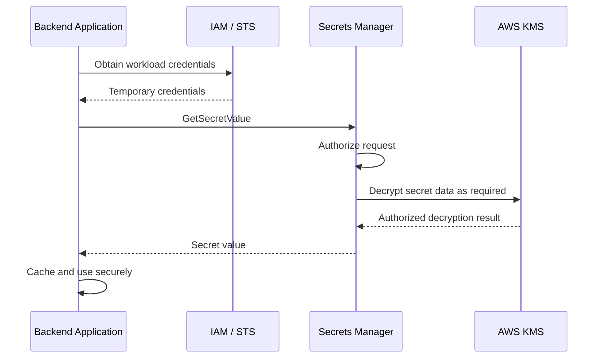
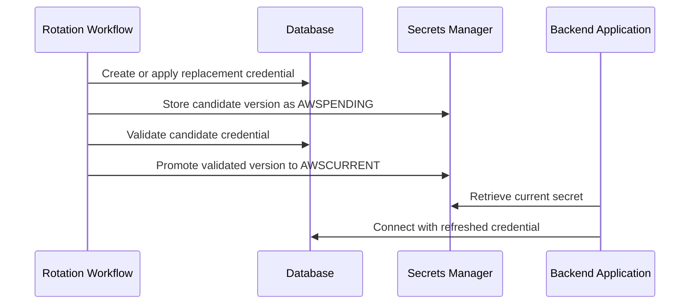

# 06- Secrets Manager and Parameter Store

## Overview

AWS Secrets Manager and AWS Systems Manager Parameter Store provide centralized storage and controlled retrieval of application configuration and sensitive values. They help backend systems avoid embedding credentials in source code, container images, deployment manifests, and configuration files.

Both services integrate with AWS Identity and Access Management (IAM), AWS Key Management Service (KMS), CloudTrail, and AWS workloads. They differ in their primary use cases, lifecycle management capabilities, and operational trade-offs.

Secrets management should be treated as part of application security architecture rather than simply a mechanism for storing strings.

### Why Secrets Management Matters

Backend applications commonly require:

- Database usernames and passwords.
- Third-party API tokens.
- OAuth client secrets.
- Signing keys and application credentials.
- Redis authentication values.
- Private service credentials.
- Environment-specific configuration.

Embedding these values directly into applications creates several risks:

- Credentials can leak through Git history, logs, CI/CD output, or container images.
- Rotating a credential may require rebuilding and redeploying applications.
- Multiple workloads may share credentials without appropriate access boundaries.
- Auditing who accessed a secret becomes difficult.
- Long-lived credentials can remain valid after a workload is compromised.

A centralized secrets-management service provides encrypted storage, IAM-controlled retrieval, auditability, and, depending on the service and integration, lifecycle and rotation capabilities.

### Secrets Manager vs. Parameter Store

| Capability | AWS Secrets Manager | Systems Manager Parameter Store |
|---|---|---|
| Primary purpose | Manage sensitive credentials and their lifecycle | Store application configuration and parameters, including sensitive values |
| Encryption | Secrets are encrypted using AWS KMS | `SecureString` parameters use AWS KMS |
| Automatic rotation | Supports managed rotation workflows and Lambda-based rotation | Does not provide an equivalent built-in secret rotation workflow |
| Versioning | Supports secret versions and staging labels | Supports parameter versions |
| Hierarchical organization | Secret names can use path-like naming conventions | Native hierarchical parameter names |
| Dynamic references | Supported by integrating services and application code | Supported by integrating services and application code |
| Cross-account access | Supported through resource policies and appropriate KMS permissions | Supported through supported sharing mechanisms, including advanced parameters |
| Pricing | Separate pricing for stored secrets and API usage | Standard and advanced parameter tiers have different limits and pricing |
| Typical use cases | Database credentials, API tokens, credentials requiring rotation | Application settings, feature configuration, non-secret parameters, encrypted configuration |

Neither service automatically makes an application secure. The workload still needs appropriate IAM permissions, secure network communication, careful logging, and a strategy for refreshing credentials.

## Secrets and Configuration Design

### Separate Configuration from Secrets

Configuration describes how an application should operate. Secrets are sensitive values whose disclosure could enable unauthorized access.

Examples:

| Value | Typical classification | Recommended storage |
|---|---|---|
| Application log level | Non-sensitive configuration | Environment variable or Parameter Store |
| Database hostname | Usually non-secret configuration | Parameter Store or deployment configuration |
| Database password | Secret | Secrets Manager or encrypted `SecureString` |
| Third-party API token | Secret | Secrets Manager or encrypted `SecureString` |
| Feature flag | Usually non-secret configuration | Parameter Store or a dedicated feature-flag service |
| Private signing key | Highly sensitive cryptographic material | KMS or a dedicated key-management system when supported; otherwise tightly controlled secret storage |

A hostname is not necessarily secret, but it may still reveal internal architecture. Classification should consider the application's threat model and exposure requirements.

### Naming Conventions

Use consistent, environment-specific names that support least-privilege access and operational discovery.

Examples:

```text
/prod/orders/database/username
/prod/orders/database/password
/prod/orders/redis/auth-token
/prod/orders/payment-provider/api-key

/prod/orders/LOG_LEVEL
/prod/orders/FEATURE_NEW_CHECKOUT
```

Secrets Manager names can use a similar convention:

```text
prod/orders/database
prod/orders/payment-provider
staging/orders/database
```

Recommended naming practices:

- Include the environment and workload.
- Use consistent separators and casing.
- Avoid placing actual credentials or personal data in names.
- Keep ownership and access boundaries clear.
- Avoid unnecessarily exposing internal identifiers in names.
- Design names around operational ownership, not temporary deployment details.

Parameter Store hierarchy is useful for grouping configuration, but hierarchical naming is not itself a security boundary.

### Configuration Delivery Patterns

There are several ways to deliver configuration and secrets to an application.

| Pattern | Advantages | Limitations |
|---|---|---|
| Retrieve at application startup | Simple, explicit initialization | Secret retrieval can prevent startup when the service is unavailable |
| Retrieve on demand | Can obtain fresh values when needed | Adds latency and API dependency to request paths |
| Cache in application memory | Reduces API calls and latency | Cached values may become stale after rotation |
| Inject through a deployment platform | Keeps retrieval logic outside application code | Secret exposure depends on the platform's injection mechanism |
| Retrieve through a sidecar or dedicated agent | Can centralize refresh and delivery | Adds operational components and failure modes |

For most backend applications, use workload IAM credentials, retrieve required secrets during initialization, and cache them for a bounded period. Use a refresh strategy when credentials can rotate during the application's lifetime.

Avoid calling a secrets service on every HTTP request unless the workload has a specific requirement that justifies the latency, cost, and dependency.

## AWS Secrets Manager

### What It Is

AWS Secrets Manager is a managed service for storing, retrieving, rotating, and controlling access to sensitive values.

It supports secret versions and integrates with AWS KMS for encryption. Rotation can be implemented using Lambda-based workflows or supported managed rotation integrations.

Common use cases include:

- Database credentials.
- Third-party API credentials.
- Application integration secrets.
- Credentials that need periodic rotation.
- Secrets shared with authorized workloads across accounts.

### How It Works

At a high level, an application retrieves a secret through an authenticated AWS API request.



The application normally does not need to call KMS directly to retrieve a secret. Secrets Manager handles the underlying encryption and decryption workflow after the relevant authorization checks succeed.

A successful retrieval depends on more than the existence of the secret. The caller must be authorized by applicable IAM policies, and KMS permissions and key policies must allow the necessary operation.

### Secret Values and Versions

Secrets Manager maintains versions of a secret. Staging labels identify which versions serve particular lifecycle roles.

| Staging label | Purpose |
|---|---|
| `AWSCURRENT` | The current secret version |
| `AWSPREVIOUS` | The previous current version, when available |
| `AWSPENDING` | A version used by a rotation workflow before promotion |

Applications should normally retrieve `AWSCURRENT`.

```bash
aws secretsmanager get-secret-value \
  --secret-id prod/orders/database \
  --version-stage AWSCURRENT \
  --region ap-south-1
```

**Security warning:** `get-secret-value` returns plaintext secret data when authorized. Do not use this command in shared terminals, diagnostic scripts, CI logs, or automated workflows that print command output.

Secret versions and staging labels support rotation, but they do not guarantee that consumers immediately switch to a new credential. Application caching, connection pools, and downstream systems determine how quickly rotation takes effect.

### Secret Structure

A secret can contain a JSON string or another supported secret representation.

Example JSON structure:

```json
{
  "username": "orders_app",
  "password": "<database-password>",
  "host": "<database-host>",
  "port": 5432,
  "dbname": "orders"
}
```

The example uses placeholders. Store actual secret values only in the intended secret-management system.

Structured secrets are convenient when a set of credentials must be updated together. However, placing unrelated credentials in one secret increases the impact of granting access to that secret.

Prefer grouping values according to a common access boundary and rotation lifecycle.

### Advantages

- Built-in secret versioning and staging labels.
- Supported rotation workflows.
- Integration with IAM, KMS, and CloudTrail.
- Centralized secret lifecycle management.
- Resource policies for supported cross-account access patterns.

### Limitations

- Retrieval calls can add latency and service dependency.
- API calls and stored secrets incur charges.
- Rotation can fail because of database permissions, network access, or application assumptions.
- Rotation does not automatically update every consumer or connection pool.
- A compromised workload with permission to retrieve a secret can still disclose it.

## Systems Manager Parameter Store

### What It Is

Systems Manager Parameter Store stores configuration values and application parameters. It supports plain strings, string lists, and encrypted `SecureString` parameters.

It is useful when applications need centrally managed configuration with IAM-controlled access.

Typical use cases include:

- Environment-specific configuration.
- Application feature flags.
- Service endpoints.
- Non-sensitive operational parameters.
- Encrypted credentials when its lifecycle capabilities meet the workload's requirements.

### Parameter Types

| Type | Purpose | Encryption behavior |
|---|---|---|
| `String` | Plain-text configuration | Not encrypted as a `SecureString` |
| `StringList` | Comma-separated string values | Not encrypted as a `SecureString` |
| `SecureString` | Sensitive configuration | Encrypted using AWS KMS |

Use `SecureString` for sensitive values. Do not assume that a value is protected merely because it is stored in Parameter Store.

A `String` parameter containing a password remains a plaintext parameter from the service's storage-model perspective.

### Parameter Hierarchy

A hierarchy provides a structured way to organize configuration.

```text
/prod/
    orders/
        database/
            host
            username
            password
        redis/
            endpoint
            auth-token
        feature-flags/
            new-checkout
    payments/
        provider/
            api-key
```

Hierarchies improve organization and can support access policies. They do not automatically enforce isolation between applications.

For example, granting `ssm:GetParametersByPath` on a parent path may allow a caller to retrieve descendants. Review recursive access carefully when sensitive and non-sensitive parameters share a hierarchy.

### Creating a Secure Parameter

The following command creates an encrypted parameter using the default AWS-managed key for Systems Manager unless a different supported key is specified.

```bash
aws ssm put-parameter \
  --name "/prod/orders/database/password" \
  --type SecureString \
  --value "<database-password>" \
  --region ap-south-1
```

The placeholder is not a usable credential. In an actual environment, avoid putting secret values directly into shell history, process arguments, build logs, or shared terminal sessions.

For production provisioning, use an approved deployment mechanism that can submit secret values without exposing them in source control or logs.

### Standard and Advanced Parameters

Parameter Store offers standard and advanced parameter tiers with different quotas, capabilities, and pricing.

The appropriate tier depends on parameter size, throughput requirements, policies, and sharing needs. Check current AWS quotas and pricing before choosing a tier for a high-volume production workload.

Do not assume that a parameter's tier changes the application's fundamental access-control requirements. IAM and KMS permissions remain central to security.

### Advantages

- Useful for application configuration and hierarchical organization.
- Supports encrypted `SecureString` values.
- Integrates with IAM, KMS, CloudTrail, and AWS deployment services.
- Can reduce the need for a separate configuration service.

### Limitations

- Does not provide an equivalent built-in rotation workflow to Secrets Manager.
- Parameter hierarchy can create overly broad access if IAM policies are not carefully scoped.
- API throughput and parameter quotas must be considered.
- Consumers still need cache invalidation and configuration refresh strategies.

## Choosing Between the Services

Use Secrets Manager when the primary requirement is managing sensitive credentials and their lifecycle, especially when rotation is important.

Use Parameter Store when the primary requirement is centralized application configuration, including encrypted parameters, and its versioning, sharing, quota, and lifecycle features meet the workload's needs.

A system may use both services:

- Parameter Store for environment-specific configuration.
- Secrets Manager for database passwords and external API credentials.
- KMS for key-management requirements.
- IAM roles for workload access.

Avoid splitting a single logical configuration across services without a clear ownership or lifecycle reason. Doing so can introduce partial updates and consistency problems.

## IAM Permissions and Access Boundaries

### Workload Identity

Backend applications running on AWS should normally retrieve secrets using their workload's IAM role rather than long-lived IAM user access keys.

Examples include:

- EC2 instance profiles.
- Lambda execution roles.
- ECS task roles.
- EKS workload identities, such as IAM roles for service accounts or EKS Pod Identity where supported.

The workload receives temporary credentials through its configured identity mechanism. The AWS SDK uses those credentials to sign API requests.

Do not embed access keys in source code, Docker images, Kubernetes manifests, or application configuration.

### Secrets Manager IAM Policy

The following identity-based policy illustrates access to one secret. Replace the placeholders with the intended account, region, and secret ARN.

```json
{
  "Version": "2012-10-17",
  "Statement": [
    {
      "Sid": "ReadOrdersDatabaseSecret",
      "Effect": "Allow",
      "Action": [
        "secretsmanager:GetSecretValue"
      ],
      "Resource": "arn:aws:secretsmanager:ap-south-1:<account-id>:secret:prod/orders/database-<suffix>"
    }
  ]
}
```

Important considerations:

- Use the actual secret ARN, including its generated suffix where applicable.
- Avoid wildcards that grant access to unrelated secrets.
- Grant `DescribeSecret` only when the application or operational workflow needs metadata.
- Add `kms:Decrypt` only when the KMS authorization model requires it for the caller.
- Review the KMS key policy and grants as well as IAM policies.

Secrets Manager commonly uses an AWS-managed KMS key by default. A customer-managed key gives the organization more direct control over key policy, grants, and key lifecycle, but it adds governance and operational responsibility.

### Parameter Store IAM Policy

Example policy for reading one parameter:

```json
{
  "Version": "2012-10-17",
  "Statement": [
    {
      "Sid": "ReadOrdersDatabasePassword",
      "Effect": "Allow",
      "Action": [
        "ssm:GetParameter"
      ],
      "Resource": "arn:aws:ssm:ap-south-1:<account-id>:parameter/prod/orders/database/password"
    }
  ]
}
```

If the workload uses `SecureString` with a customer-managed KMS key, ensure the caller is authorized for the required KMS decryption operation.

Prefer `ssm:GetParameter` for a known parameter, `ssm:GetParameters` for a bounded set, and `ssm:GetParametersByPath` only when hierarchy-based retrieval is actually required.

### Separate Runtime and Administrative Permissions

Runtime applications usually need read access, not secret-management permissions.

| Runtime permission | Administrative permission |
|---|---|
| `secretsmanager:GetSecretValue` | `secretsmanager:CreateSecret` |
| `ssm:GetParameter` | `ssm:PutParameter` |
| `ssm:GetParameters` | `secretsmanager:RotateSecret` |
| Required KMS decryption permission | KMS key-policy and lifecycle administration |

Do not grant secret creation, deletion, rotation administration, or broad KMS permissions to every application that consumes a secret.

### Cross-Account Access

Cross-account secret retrieval requires explicit configuration. Depending on the service and design, this may involve:

- A resource policy on the secret.
- An identity-based policy on the caller.
- A customer-managed KMS key and compatible key policy.
- Appropriate role assumption or other supported cross-account identity configuration.
- Network connectivity to the service endpoint.

For shared production secrets, define the owning account, permitted consumer roles, rotation responsibility, and incident-response procedure before enabling access.

## Secure Retrieval with Python

### Prerequisites

The examples use Boto3 and the AWS SDK credential provider chain.

Install Boto3 in the application's environment:

```bash
pip install boto3
```

The application must have a configured AWS workload identity and the least-privilege permissions needed for the selected secret.

### Retrieve a Secret from Secrets Manager

```python
import json
import logging
import os
from functools import lru_cache

import boto3
from botocore.exceptions import BotoCoreError, ClientError

logger = logging.getLogger(__name__)


def create_secrets_client():
    region = os.environ.get("AWS_REGION", "ap-south-1")
    return boto3.client("secretsmanager", region_name=region)


@lru_cache(maxsize=1)
def get_database_config() -> dict[str, object]:
    secret_id = os.environ["DATABASE_SECRET_ID"]
    client = create_secrets_client()

    try:
        response = client.get_secret_value(
            SecretId=secret_id,
            VersionStage="AWSCURRENT",
        )
        secret_string = response.get("SecretString")

        if not secret_string:
            raise RuntimeError(
                "The database secret does not contain a SecretString"
            )

        secret = json.loads(secret_string)

        required_fields = {"username", "password", "host", "dbname"}
        missing_fields = required_fields.difference(secret)

        if missing_fields:
            raise RuntimeError(
                "The database secret is missing required fields"
            )

        return secret

    except (BotoCoreError, ClientError):
        logger.exception("Unable to retrieve database configuration")
        raise
```

This example demonstrates initialization-time retrieval and process-local caching. It is a starting point, not a complete rotation-aware implementation.

Production considerations:

- Do not log the secret response or parsed configuration.
- Avoid including sensitive values in exception messages.
- Validate the structure before passing credentials to a database driver.
- Do not assume `lru_cache` refreshes a secret after rotation.
- A process restart clears the cache, but restarting all instances is not a complete rotation strategy for every workload.
- Consider how the application should behave if secret retrieval fails during startup.
- Use an explicit refresh policy if secrets can change while the application is running.

The example logs AWS SDK exception details for diagnostics. Review the application's logging configuration and any error-reporting integrations to ensure request metadata or other sensitive context is not exposed.

### Retrieve a SecureString Parameter

```python
import os

import boto3
from botocore.exceptions import BotoCoreError, ClientError


def get_parameter_value(name: str) -> str:
    client = boto3.client(
        "ssm",
        region_name=os.environ.get("AWS_REGION", "ap-south-1"),
    )

    try:
        response = client.get_parameter(
            Name=name,
            WithDecryption=True,
        )
        return response["Parameter"]["Value"]

    except (BotoCoreError, ClientError):
        raise RuntimeError(
            "Unable to retrieve the required application parameter"
        ) from None
```

`WithDecryption=True` instructs Parameter Store to return the decrypted value for a `SecureString` when the caller is authorized. It does not bypass IAM or KMS controls.

The function suppresses the underlying exception context when raising a generic error to avoid accidental disclosure through a higher-level traceback. In production, record only sanitized diagnostic information through an approved logging strategy.

### Django and FastAPI Integration

For Django, retrieve required configuration during a controlled application initialization phase, and provide it to the database configuration layer. Avoid network calls from frequently executed settings-dependent code or request handlers.

For FastAPI, load required settings during application lifespan initialization or through a dedicated configuration provider. Keep retrieval, caching, and refresh behavior separate from individual route handlers.

In both frameworks:

- Fail startup when a mandatory credential cannot be obtained and the application cannot operate safely.
- Use bounded retries with backoff for transient service failures.
- Avoid retrying authorization failures indefinitely.
- Do not expose configuration values in health endpoints or exception responses.
- Use a coordinated refresh strategy when credentials rotate.
- Ensure every worker process has an understood cache lifecycle.

## Caching, Rotation, and Connection Pools

### Why Caching Matters

Secret retrieval adds an external API dependency. Repeated retrieval can increase latency, API costs, throttling risk, and failure exposure.

Caching reduces repeated calls, but it creates a consistency trade-off.

| Strategy | Benefit | Risk |
|---|---|---|
| Cache indefinitely | Minimal retrieval overhead | Stale credentials can persist indefinitely |
| Cache with a TTL | Bounded staleness under normal refresh behavior | Rotation may not propagate immediately |
| Refresh on authentication failure | Can recover after a credential change | Incorrectly classified failures can cause retry storms |
| Restart workloads after rotation | Simple for some deployment models | Restart coordination and downtime risks |
| Dynamic refresh with connection-pool replacement | Supports rotation without a full application restart | More complex lifecycle management |

A TTL bounds how long a value remains cached only if the application actually refreshes it after expiration. It does not guarantee that every consumer changes credentials simultaneously.

### Rotation Lifecycle

Secret rotation commonly involves coordinating the secret store and the downstream system.



The exact sequence depends on the rotation strategy and target service. Some database rotation strategies coordinate alternating users or overlapping credentials to reduce connection disruption.

### Rotation Failure Modes

Common failures include:

- The rotation function cannot connect to the database.
- The rotation role lacks permission to update the target credential.
- The candidate password is stored but fails validation.
- The application caches the old credential.
- Existing database connections remain open while new connections use the rotated password.
- A secret is promoted before all required consumers can use it.
- Network rules prevent the rotation workflow from reaching the database.

A safe rotation design must address both credential replacement and consumer adoption.

### Recommended Rotation Strategy

1. Define which component owns the downstream credential.
2. Confirm the rotation mechanism supports the target service.
3. Validate the candidate credential before promoting it.
4. Ensure the application can refresh cached configuration.
5. Recreate failed database connections when authentication fails.
6. Monitor rotation status and application authentication errors.
7. Test recovery from a failed rotation in a non-production environment.

Avoid implementing arbitrary retries for all database errors. Retry only errors that are understood to be transient or related to credential refresh, and use bounded backoff.

## KMS Integration and Encryption

### Encryption Model

Secrets Manager encrypts stored secret data using AWS KMS. Parameter Store encrypts `SecureString` values using KMS.

The KMS key can be AWS-managed or customer-managed, depending on the service configuration and requirements.

| Key type | Advantages | Trade-offs |
|---|---|---|
| AWS-managed key | Lower operational burden and simpler setup | Less direct control over key policy and lifecycle |
| Customer-managed key | Greater control over policy, grants, rotation configuration, and auditability | Additional governance, policy management, and operational responsibility |

Use customer-managed keys when policy control, separation of duties, cross-account design, or compliance requirements justify the additional work.

### KMS Permissions

A successful secret retrieval may depend on permissions at multiple layers:

- Permission to retrieve the secret or parameter.
- Permission to decrypt using the applicable customer-managed KMS key, when required.
- A compatible KMS key policy or grant.
- Any relevant organizational controls or explicit denies.

An IAM allow statement alone does not guarantee access to a customer-managed key. KMS key policies are a central part of the authorization model.

### Encryption Context

KMS encryption context is additional authenticated data associated with certain cryptographic operations. It is not secret and may appear in audit records.

When a service uses encryption context, authorization policies can sometimes constrain KMS operations based on relevant context keys. The supported context depends on the service and operation.

Do not invent or require an encryption-context value unless the integration actually supplies it. An incorrect condition can cause decryption failures.

### Key Lifecycle

For customer-managed keys:

- Restrict key administration separately from key usage.
- Review key policies and grants periodically.
- Monitor key disablement and deletion scheduling.
- Understand the consequences of key unavailability.
- Document recovery requirements and dependencies.
- Use key rotation where appropriate for the selected key type and cryptographic workflow.

Disabling or deleting a key can make dependent encrypted data unavailable. Key lifecycle operations should be treated as production changes with explicit ownership and recovery procedures.

## Environment Variables and Secret Exposure

Environment variables are useful for passing configuration, but they are not a secret-management system.

Depending on the runtime and platform, values may be exposed through:

- Process inspection by sufficiently privileged users.
- Debugging tools and diagnostic dumps.
- Container or task configuration.
- Crash reports.
- CI/CD logs.
- Application diagnostics.
- Misconfigured monitoring integrations.

Passing a secret as an environment variable may be acceptable when the deployment platform's security model supports it, but it does not eliminate the need for access controls and leakage prevention.

Prefer retrieving secrets using workload identity and keeping them in memory only as long as necessary. Avoid writing plaintext secrets to local files unless the workload has a deliberate, secure file-delivery design.

## Networking and Private Connectivity

Secrets Manager and Systems Manager APIs are AWS service endpoints. A workload in a private subnet needs a valid network path to those endpoints.

Options include:

- NAT-based outbound connectivity.
- Supported VPC interface endpoints for the relevant services.
- Appropriate VPC DNS resolution and endpoint security-group rules.
- IAM policies and, where applicable, VPC endpoint policies.

Private connectivity reduces dependence on public network paths, but it does not replace identity-based authorization or TLS.

When diagnosing failures, distinguish network connectivity from service authorization. A timeout and an `AccessDeniedException` indicate different classes of failure.

## AWS CLI Operational Workflows

The following commands use placeholders for account IDs, regions, and resource names. They are primarily inspection commands unless explicitly identified as modifying operations.

### Verify the Active AWS Identity

```bash
aws sts get-caller-identity \
  --region ap-south-1
```

Purpose:

- Confirms which AWS identity the CLI is using.
- Helps identify an unexpected profile, role, or account.
- Returns the account ID and caller ARN.

Interpret the ARN before diagnosing access failures. A policy intended for an application role may not apply to the IAM user or role currently used by the CLI.

### Inspect Secret Metadata

```bash
aws secretsmanager describe-secret \
  --secret-id prod/orders/database \
  --region ap-south-1
```

Purpose:

- Inspects secret metadata and version information.
- Helps verify the resource identifier and rotation configuration.
- Does not return the secret's plaintext value.

To inspect version staging labels:

```bash
aws secretsmanager list-secret-version-ids \
  --secret-id prod/orders/database \
  --region ap-south-1
```

Review `VersionIds`, `VersionStages`, and rotation-related metadata to understand which version is current and whether the expected lifecycle state exists.

### Inspect Parameter Metadata

```bash
aws ssm describe-parameters \
  --parameter-filters \
    "Key=Name,Option=Equals,Values=/prod/orders/database/password" \
  --region ap-south-1
```

This command lists parameter metadata. It does not retrieve the plaintext value of the parameter.

To inspect a parameter's metadata and type:

```bash
aws ssm get-parameter \
  --name /prod/orders/database/password \
  --no-with-decryption \
  --region ap-south-1
```

For a `SecureString`, this avoids requesting plaintext decryption. The caller still needs permission to read the parameter.

### Inspect a KMS Key

```bash
aws kms describe-key \
  --key-id <kms-key-arn> \
  --region ap-south-1
```

Purpose:

- Confirms key metadata and state.
- Helps identify a disabled or otherwise unusable key.
- Does not prove that the caller can decrypt a particular secret.

Inspect the key policy when authorized:

```bash
aws kms get-key-policy \
  --key-id <kms-key-arn> \
  --policy-name default \
  --region ap-south-1
```

Key policy output can contain sensitive internal access design. Treat it as security configuration and avoid sharing it indiscriminately.

### Inspect CloudTrail Events

For a recent secret retrieval event:

```bash
aws cloudtrail lookup-events \
  --lookup-attributes \
    AttributeKey=EventName,AttributeValue=GetSecretValue \
  --max-results 20 \
  --region ap-south-1
```

For Parameter Store access:

```bash
aws cloudtrail lookup-events \
  --lookup-attributes \
    AttributeKey=EventName,AttributeValue=GetParameter \
  --max-results 20 \
  --region ap-south-1
```

Review event timestamps, principals, source IP addresses, and relevant request details. Event availability and lookup scope depend on CloudTrail configuration and the service's event-recording behavior.

Do not assume that every data event is available through the same lookup workflow. Check the relevant trail, event selector, region, and event type when evidence is missing.

## Troubleshooting

### Secrets Manager Access Denied

**Symptoms**

- `AccessDeniedException`
- A workload cannot retrieve a secret that exists.

**Likely causes**

- The workload uses the wrong IAM role.
- The identity policy does not permit `secretsmanager:GetSecretValue`.
- A resource policy denies access or does not allow the required principal.
- An organizational control or permissions boundary restricts access.
- KMS authorization fails for a customer-managed key.

**Isolation steps**

1. Run `aws sts get-caller-identity` in the same execution context.
2. Confirm the secret ARN, region, and account.
3. Inspect the role's attached and inline policies.
4. Inspect the secret resource policy where applicable.
5. Inspect the KMS key policy and grants.
6. Review CloudTrail for the failed API call.

**Corrective action**

Grant only the missing permission on the required resource and verify that no explicit deny or organizational restriction applies.

**Verification**

Retry the retrieval using the actual workload identity, then verify that the application can initialize without exposing the returned value.

### Parameter Store Retrieval Failure

**Symptoms**

- `ParameterNotFound`
- `AccessDeniedException`
- A `SecureString` cannot be decrypted.

**Likely causes**

- Incorrect parameter name or region.
- Missing `ssm:GetParameter` permission.
- Missing KMS decryption authorization.
- An incorrect recursive-path access assumption.
- The parameter was deleted or renamed.

**Isolation steps**

1. Verify the active identity and region.
2. Inspect parameter metadata using `describe-parameters`.
3. Confirm the exact parameter ARN.
4. Inspect the IAM policy and KMS key policy if relevant.
5. Review CloudTrail events.

**Corrective action**

Fix the identifier or grant the narrowest missing permission. Do not replace a scoped policy with broad access to every parameter.

**Verification**

Retrieve the parameter through the application's intended identity and validate its type and configuration without printing its value.

### Rotation Failure

**Symptoms**

- Rotation reports failure.
- The application continues using an old credential.
- New database connections fail after rotation.

**Likely causes**

- The rotation function cannot reach the database.
- Rotation permissions are incomplete.
- The candidate credential is invalid.
- The application has no cache refresh mechanism.
- Connection pools retain sessions that cannot recover.

**Isolation steps**

1. Inspect rotation status and recent secret-version staging labels.
2. Review rotation-function logs for sanitized failure details.
3. Confirm network access from the rotation environment to the database.
4. Validate the target service's credential state through an approved procedure.
5. Check application authentication failures and connection-pool behavior.

**Corrective action**

Restore the intended credential state, correct the rotation workflow, and implement a tested refresh or reconnection strategy.

**Verification**

Perform a controlled rotation test and confirm that new connections succeed using the current credential.

### KMS Decryption Failure

**Symptoms**

- `AccessDeniedException`
- `DecryptionFailure`
- A `SecureString` cannot be read with decryption enabled.

**Likely causes**

- Missing `kms:Decrypt` permission.
- Incompatible key policy or grant.
- The key is disabled or unavailable.
- A policy condition does not match the actual request.
- The wrong key, region, or parameter is being used.

**Isolation steps**

1. Identify the KMS key used by the resource.
2. Inspect key state and key policy.
3. Review the caller's identity policy.
4. Check relevant CloudTrail KMS events.
5. Validate any encryption-context conditions against the actual integration.

**Corrective action**

Restore the appropriate key state or adjust the narrowly scoped authorization configuration.

**Verification**

Retry the intended secret or parameter retrieval through the application role. Do not validate by granting unrestricted KMS access.

### Intermittent Authentication Failures After Rotation

**Symptoms**

- New connections fail while existing connections continue working.
- Failures occur only on some workers or instances.
- Restarting a worker temporarily resolves the issue.

**Likely causes**

- Different workers have different cache refresh times.
- A connection pool retains stale connection state.
- The application refreshes credentials but does not rebuild connections.
- The rotation workflow and consumer refresh policy are not coordinated.

**Corrective action**

Implement bounded caching, coordinated refresh, and safe connection-pool replacement. Add metrics for authentication failures and credential refresh attempts.

**Verification**

Test the rotation process across multiple workers and confirm that stale credentials are not retained indefinitely.

## Monitoring and Auditability

Secret management should be observable without recording secret values.

Useful signals include:

- Failed secret retrieval attempts.
- Unexpected secret-access principals.
- Changes to secret resource policies.
- Secret deletion or recovery events.
- Rotation failures.
- KMS key disablement or policy changes.
- Application authentication errors after rotation.
- Sudden increases in retrieval volume.

Use CloudTrail for API activity auditing and CloudWatch for application and service monitoring where supported. GuardDuty and Security Hub may provide relevant findings depending on the detected activity, enabled protections, and account configuration.

A secret retrieval event is not inherently malicious. Investigate unusual principals, unexpected source locations, unfamiliar access patterns, and access following credential compromise.

For incident response, preserve relevant audit evidence, identify the affected secret and consumers, revoke or rotate compromised credentials, and verify recovery.

## Production Best Practices

### Access Control

- Use temporary workload credentials instead of long-lived access keys.
- Scope runtime permissions to exact secret or parameter resources.
- Separate read access from secret administration and rotation permissions.
- Review resource policies and cross-account sharing.
- Treat hierarchical Parameter Store access as a potential privilege boundary.
- Review access after workload ownership or deployment changes.

### Secret Lifecycle

- Define an owner and rotation policy for every production secret.
- Prefer supported rotation mechanisms when rotation is required.
- Test rotation and recovery before production rollout.
- Design consumers to refresh cached credentials.
- Avoid indefinite in-memory caching unless the credential lifecycle explicitly permits it.
- Monitor rotation failures and credential-related application errors.

### Logging and Deployment

- Never print secret values, access tokens, or complete secret responses.
- Prevent secrets from entering Git history, build artifacts, container layers, and CI/CD logs.
- Use deployment identities with scoped permissions.
- Sanitize exception reporting and tracing attributes.
- Avoid exposing sensitive configuration in health checks, metrics labels, or diagnostic endpoints.

### Availability and Cost

- Minimize unnecessary retrieval calls with bounded caching.
- Use retries with backoff for transient failures, not for permanent authorization errors.
- Consider startup dependency failures when designing deployment readiness.
- Monitor throttling and service quotas.
- Evaluate storage and API request costs for the selected service and parameter tier.
- Document the behavior of applications when the secrets service is temporarily unavailable.

## Practical Exercise: Secure Database Credential Retrieval

### Objective

Configure a backend workload to retrieve a database credential from Secrets Manager using an IAM role, without embedding credentials in source code.

### Prerequisites

- An AWS account and a test environment.
- AWS CLI configured with an authorized administrative or provisioning identity.
- A test database that can be safely modified.
- A secret containing the test database credentials.
- A workload role restricted to the intended secret.
- Boto3 installed in the application environment.

### Implementation

1. Create a test secret using an approved secure provisioning mechanism.
2. Attach a narrowly scoped `secretsmanager:GetSecretValue` policy to the workload role.
3. Configure the application to use the workload's AWS credential provider chain.
4. Set `DATABASE_SECRET_ID` to the secret identifier.
5. Retrieve the secret using the Python example.
6. Validate the configuration and connect to the test database.

### Verification

Check the caller identity:

```bash
aws sts get-caller-identity \
  --region ap-south-1
```

Inspect secret metadata:

```bash
aws secretsmanager describe-secret \
  --secret-id <test-secret-arn> \
  --region ap-south-1
```

Confirm that:

- The application retrieves the credential using its workload role.
- The application does not contain a hardcoded AWS access key.
- Logs do not contain the database password.
- A different role without permission cannot retrieve the secret.
- The application handles retrieval failure safely.

### Cleanup

- Remove test resources and unused credentials.
- Delete the test secret according to the environment's recovery requirements.
- Remove temporary IAM policies and roles when no longer needed.
- Review logs and shell history for accidental exposure.
- Confirm that no test credentials remain in source control or deployment artifacts.

Secret deletion may have a recovery window depending on the deletion settings. Do not schedule immediate deletion for a production secret without evaluating downstream dependencies.

## Interview Questions

### Core Concepts

**When would you choose Secrets Manager over Parameter Store?**

Choose Secrets Manager when credential lifecycle management and rotation are important. Choose Parameter Store for centralized configuration and encrypted parameters when its features, limits, and lifecycle capabilities satisfy the use case.

**Does storing a password in `SecureString` automatically rotate it?**

No. `SecureString` provides encrypted storage through KMS. Rotation must be implemented separately.

**Does encryption prevent an authorized but compromised application from exposing a secret?**

No. A compromised workload with retrieval permission may obtain and exfiltrate plaintext. Encryption at rest does not replace least-privilege access, workload isolation, monitoring, and credential rotation.

### IAM and KMS

**Why might `GetSecretValue` fail even when the role has an allow policy?**

The caller may be using a different role, a resource policy may restrict access, an explicit deny may apply, or KMS authorization may fail. Inspect the actual identity, resource ARN, applicable policies, and CloudTrail evidence.

**Why can a `SecureString` retrieval fail while metadata inspection succeeds?**

Reading metadata and decrypting the parameter are different operations. The caller may have permission to read the parameter but lack the required KMS authorization.

**Should every application receive `kms:Decrypt` on a shared key?**

No. Scope decryption permissions to the necessary keys and resources, and use supported policy conditions where appropriate. Separate key administration from key usage.

### Production Scenarios

**A database password rotates, but half the application workers fail to connect. What would you investigate?**

Check secret-version staging labels, cache lifetimes, worker refresh behavior, database connection pools, and the rotation workflow. Determine whether the affected workers still use the old credential and verify that new connections can authenticate.

**How would you design secret access across AWS accounts?**

Define the owning account and consumer roles, use explicit cross-account authorization, configure the necessary resource and KMS policies, and audit access. Avoid broad sharing across entire accounts.

**A developer accidentally commits an API token. Is deleting the commit enough?**

No. Treat the token as compromised. Revoke or rotate it, identify affected consumers, investigate use through available audit evidence, remove it from repository history where appropriate, and prevent recurrence with secret scanning and safer deployment practices.

**How would you reduce secret retrieval latency without weakening security?**

Use workload identities, retrieve secrets outside the request hot path, cache them for a bounded period, and define refresh behavior for rotation. Monitor retrieval failures, throttling, and stale-credential incidents.

## Key Takeaways

- Use Secrets Manager for sensitive credentials and rotation-oriented lifecycle management; use Parameter Store for centralized configuration and encrypted parameters when its capabilities fit.
- Grant workload identities only the permissions needed for specific secrets or parameters, and evaluate KMS policies separately.
- Treat caching, rotation, connection pools, and consumer refresh as one coordinated credential-lifecycle problem.
- Prevent secret leakage through source control, environment handling, logs, CI/CD artifacts, and diagnostic tooling.
- Monitor access and rotation events, investigate failures systematically, and verify both recovery and least-privilege enforcement.