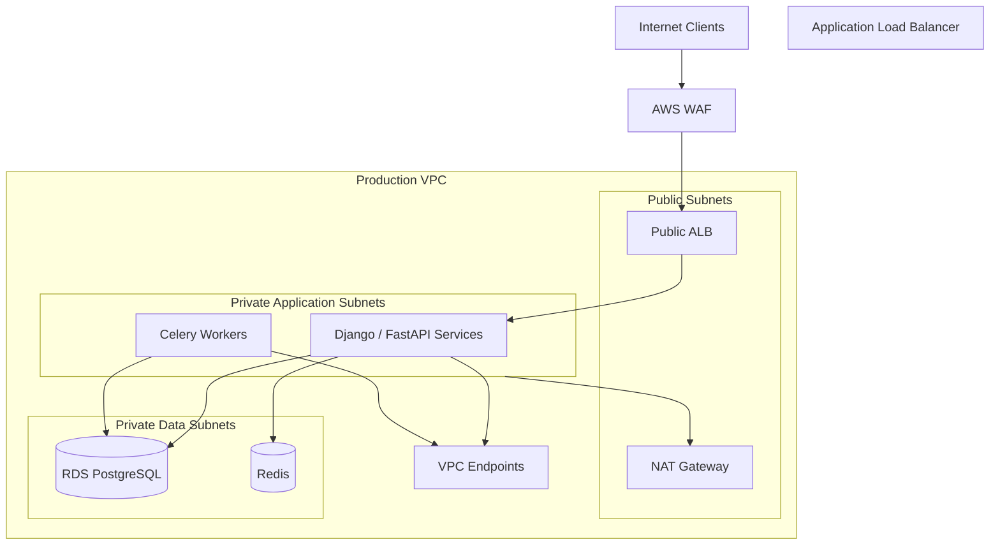

# 07- VPC Security and Network Access Controls

## Overview

Amazon Virtual Private Cloud (VPC) security defines how workloads communicate, which network paths are permitted, and how resources are isolated within AWS. It combines subnet design, route tables, security groups, network access control lists (NACLs), private connectivity, DNS controls, and network monitoring.

For backend engineers, these controls protect public APIs, private microservices, databases, Redis clusters, message brokers, administrative interfaces, and communication between AWS workloads.

A secure network design follows defense in depth: network controls restrict reachability, IAM governs AWS API permissions, TLS protects data in transit, and application-level authentication and authorization govern access to business operations.

### Security Objectives

A production VPC security design should:

- Minimize public exposure and unnecessary network paths.
- Separate internet-facing, application, and data workloads.
- Restrict communication to documented dependencies.
- Control access to AWS services and private endpoints.
- Support network troubleshooting and incident investigation.
- Preserve availability while enforcing least privilege.
- Provide auditable, repeatable configuration changes.

## VPC Security Architecture

### Core Components

| Component | Responsibility | Security relevance |
|---|---|---|
| VPC | Provides an isolated virtual network | Defines an IP address space and network boundary |
| Subnet | Places resources within an Availability Zone | Determines subnet-level routing and public-IP assignment behavior |
| Route table | Selects network destinations and next hops | Controls paths to internet gateways, NAT gateways, and connected networks |
| Security group | Stateful traffic filtering associated with network interfaces | Restricts inbound and outbound connections |
| Network ACL | Stateless subnet-level traffic filtering | Applies ordered allow and deny rules |
| Internet gateway | Provides a route between a VPC and the internet | Enables internet connectivity when addressing and controls permit it |
| NAT gateway | Supports outbound IPv4 connectivity from private subnets | Allows eligible outbound connections without directly exposing private resources |
| VPC endpoint | Provides private connectivity to supported AWS services | Can reduce dependence on public service endpoints |
| AWS PrivateLink | Provides private connectivity to supported services | Enables service access without general network connectivity to the provider VPC |
| Route 53 Resolver | Handles DNS resolution for VPC workloads | Influences service discovery and destination selection |
| VPC Flow Logs | Records metadata about IP traffic | Supports connectivity troubleshooting and security investigations |

These components solve different problems. A route table determines where traffic is sent, while security groups and NACLs determine whether traffic is permitted by their respective rules.

### Reference Architecture



A production implementation typically spans multiple Availability Zones and distributes application workloads across them. The actual routing, endpoint configuration, and load-balancer topology depend on the selected AWS services.

The security objectives are more important than the specific number of tiers:

- Public ingress should terminate at an intentionally exposed entry point.
- Application workloads should not require public IP addresses merely to serve requests.
- Databases and caches should accept connections only from authorized workloads.
- AWS service access should use private endpoints when appropriate.
- Outbound connectivity should match documented application dependencies.

## Public and Private Subnets

### Subnet Classification

A subnet is conventionally public when its associated route table includes a route to an internet gateway. A subnet without a direct internet-gateway route is conventionally private or isolated, depending on its other routes.

A route alone does not make a resource publicly reachable. Public IPv4 addressing or another valid public addressing arrangement, security controls, and a listening service also affect reachability.

| Subnet type | Typical workloads | Security considerations |
|---|---|---|
| Public | Internet-facing load balancers, NAT gateways | Expose only resources that intentionally require public connectivity |
| Private application | EC2 applications, ECS tasks, internal services | Restrict ingress to approved sources and control egress |
| Private data | RDS, internal databases, caches | Permit only required application connections |
| Isolated | Workloads without general external routing requirements | Confirm that operational dependencies remain reachable |

Subnet names are organizational labels, not enforcement mechanisms. Inspect routes, addresses, and filtering rules to determine actual exposure.

### Inspect VPCs, Subnets, and Routes

These are read-only AWS CLI operations.

Inspect a VPC:

```bash
aws ec2 describe-vpcs \
  --vpc-ids <vpc-id> \
  --region ap-south-1
```

Inspect subnets:

```bash
aws ec2 describe-subnets \
  --filters "Name=vpc-id,Values=<vpc-id>" \
  --region ap-south-1
```

Inspect route tables:

```bash
aws ec2 describe-route-tables \
  --filters "Name=vpc-id,Values=<vpc-id>" \
  --region ap-south-1
```

Review the subnet associations, routes, CIDR blocks, and route targets together. A route to an internet gateway is evidence of a public routing path, not proof that every resource in the subnet is externally reachable.

## Security Groups

### Purpose and Behavior

Security groups are stateful virtual firewalls associated with supported network interfaces and resources. They filter traffic using protocol, port, source, and destination rules.

They are generally the primary workload-level network control for EC2 instances, load balancers, RDS resources, and other supported VPC resources.

Security groups are stateful: when traffic is permitted, response traffic for that connection is automatically permitted by the security group, subject to applicable network controls and connection-tracking behavior.

Security groups support allow rules rather than explicit deny rules. Unmatched traffic is not permitted.

### Example: Three-Tier Application

Consider an application with a public HTTPS load balancer, private API services, and PostgreSQL.

| Resource | Direction | Source or destination | Port | Purpose |
|---|---|---|---|---|
| Public load balancer | Inbound | Intended client ranges | TCP 443 | HTTPS ingress |
| Application service | Inbound | Load balancer security group | Configured application port | Accept requests from the load balancer |
| PostgreSQL | Inbound | Application security group | TCP 5432 | Permit application database connections |
| Redis | Inbound | Authorized application or worker security group | TCP 6379 or configured TLS port | Permit required cache connections |
| Application service | Outbound | Required dependencies | Required ports | Permit application-initiated connections |

Use the actual listener ports configured by the deployment. Network permission does not replace database authentication, Redis authentication, TLS, or application-level authorization.

### Security-Group References

Referencing a source security group is often more maintainable than allowing an entire subnet CIDR.

For example, a database security group can permit TCP 5432 from the application security group. Application instances associated with that group can connect without requiring individual IP addresses to be maintained in the database rule.

Important limitations:

- A security-group reference does not create a route.
- The reference must be supported by the relevant network topology.
- Cross-VPC and cross-account scenarios have additional requirements.
- A referenced security group does not establish the identity of a human user or authorize database operations.

### Ingress and Egress

The default security-group configuration commonly includes unrestricted outbound access. This simplifies initial deployment but may permit a compromised workload to contact unintended destinations.

A mature design reviews both directions:

- **Ingress:** Which workloads or clients can initiate connections to this resource?
- **Egress:** Which destinations can this resource initiate connections to?

For a public HTTPS service, inbound TCP 443 from the internet may be intentional. For PostgreSQL, broad internet ingress is generally inappropriate.

Avoid unrestricted SSH and administrative ports. Prefer controlled administrative mechanisms such as AWS Systems Manager Session Manager when appropriate.

### Inspect Security Groups

Inspect all security groups in a VPC:

```bash
aws ec2 describe-security-groups \
  --filters "Name=vpc-id,Values=<vpc-id>" \
  --region ap-south-1
```

Inspect a specific group:

```bash
aws ec2 describe-security-groups \
  --group-ids <security-group-id> \
  --region ap-south-1
```

Review:

- Broad CIDR ranges on sensitive ports.
- Unnecessary administrative access.
- Database access from unrelated security groups.
- Unrestricted outbound traffic.
- Rules left behind after workload migrations.
- Differences between intended and deployed configuration.

### Security-Group Limitations

Security groups do not provide HTTP path filtering, SQL injection prevention, user-level authorization, or generalized application intrusion detection.

Use AWS WAF, application authorization, service-specific controls, and monitoring for those requirements.

## Network Access Control Lists

### Purpose and Behavior

Network ACLs are stateless traffic filters associated with subnets. They support inbound and outbound rules with allow or deny actions.

Rules are evaluated in ascending rule-number order. The first matching rule determines the result. Traffic that matches no rule is subject to the ACL's default behavior.

Unlike security groups, NACLs do not automatically permit return traffic for an allowed connection.

### Security Groups vs. NACLs

| Property | Security groups | NACLs |
|---|---|---|
| Scope | Resource network interfaces | Subnets |
| State | Stateful | Stateless |
| Rule model | Allow rules | Ordered allow and deny rules |
| Rule matching | Protocol, ports, and source/destination; supports group references in supported configurations | Protocol, ports, and CIDR ranges |
| Return traffic | Automatically permitted for allowed tracked connections | Must be allowed explicitly |
| Typical purpose | Primary workload-level filtering | Additional subnet-level filtering |

NACLs can provide defense in depth, but complicated ACL configurations increase the risk of blocking legitimate traffic.

### Ephemeral Ports and Return Traffic

Suppose an application initiates a TCP connection to PostgreSQL on port 5432. The request targets port 5432, while response packets return to an ephemeral port on the application side.

Because NACLs are stateless, the relevant inbound and outbound ACL rules must permit both directions. The required ephemeral-port range depends on the client operating system and network behavior.

Do not blindly open every port. Identify the actual connection direction, source, destination, and required port ranges.

### When to Use NACLs

NACLs may be appropriate for:

- Coarse subnet-level restrictions.
- Blocking specified CIDR ranges.
- Additional defense in depth.
- Enforcing broad boundaries between subnet groups.

Use security groups for application dependency relationships whenever possible. Use NACLs when their subnet-level scope and stateless behavior provide a clear security benefit.

### Inspect Network ACLs

```bash
aws ec2 describe-network-acls \
  --filters "Name=vpc-id,Values=<vpc-id>" \
  --region ap-south-1
```

Review the subnet associations, inbound and outbound entries, rule numbers, protocol identifiers, and CIDR ranges.

## Route Tables and Egress Security

### Route Tables

Route tables determine the next hop for traffic based on the destination address and matching route.

Common targets include:

- Local VPC routing.
- Internet gateways.
- NAT gateways.
- Transit gateways.
- Virtual private gateways.
- Gateway endpoints and other supported routing targets.

A security-group allow rule does not guarantee connectivity if there is no valid route. Likewise, a route does not authorize traffic through security groups or NACLs.

### NAT Gateway

A NAT gateway supports outbound IPv4 connectivity from eligible private-subnet workloads without requiring those workloads to have directly reachable public IPv4 addresses.

Common use cases include:

- Calling third-party APIs.
- Downloading external dependencies.
- Reaching destinations that are not available through private endpoints.

A NAT gateway does not provide unsolicited inbound internet connectivity to private instances.

Production considerations:

- Deploy NAT gateways across Availability Zones when required for resilience.
- Consider cross-AZ data-transfer costs.
- Monitor data processing charges and connectivity errors.
- Prefer private endpoints for supported AWS service dependencies where appropriate.
- Apply additional egress controls if the threat model requires destination restrictions.

A NAT gateway alone does not provide domain-based egress filtering.

### Restricting Outbound Access

Egress controls can reduce the impact of a compromised workload. Depending on the architecture, they may include:

- Narrow security-group egress rules.
- VPC endpoints for supported AWS services.
- NAT gateways for necessary external connectivity.
- AWS Network Firewall or proxy-based controls where appropriate.
- DNS controls and monitoring.
- Application-level destination validation.

Strict egress filtering requires a dependency inventory. Test DNS, AWS API calls, monitoring, package retrieval, deployment, and recovery workflows before removing broad rules.

## VPC Endpoints and AWS PrivateLink

### VPC Endpoints

VPC endpoints provide private connectivity to supported AWS services without requiring workloads to reach those services through public service endpoints.

The main categories are:

- **Gateway endpoints:** Used for supported services such as Amazon S3 and DynamoDB.
- **Interface endpoints:** Use private network interfaces and AWS PrivateLink technology to reach supported services.

Availability, endpoint policies, and DNS capabilities depend on the service and Region. Confirm the supported configuration before designing a production dependency around an endpoint.

### Endpoint Comparison

| Property | Gateway endpoint | Interface endpoint |
|---|---|---|
| Typical services | S3 and DynamoDB | Secrets Manager, Systems Manager, CloudWatch, and many other supported services |
| Connectivity | Route-table based | Private IP addresses on endpoint network interfaces |
| Security groups | Not attached as endpoint network interfaces | Endpoint security groups control traffic to the interfaces |
| DNS behavior | Uses the service's gateway-endpoint routing model | Can use private DNS where supported and enabled |
| Endpoint policies | Supported | Supported for services that provide endpoint-policy support |

An endpoint does not automatically grant permission to access the service. IAM policies, resource policies, KMS authorization, and endpoint policies where supported remain relevant.

### Example: Private Secrets Manager Access

A private application may need to retrieve a database credential from Secrets Manager.

An interface endpoint can provide a private path to the service when configured correctly. The application still needs:

- A valid workload identity.
- `secretsmanager:GetSecretValue` permission.
- Appropriate KMS authorization when required.
- DNS resolution to the intended endpoint.
- Network access to the endpoint over HTTPS.

### AWS PrivateLink

AWS PrivateLink enables private connectivity to supported services without requiring general network connectivity to the provider's VPC.

Typical use cases include:

- Private access to supported AWS services.
- Publishing a service privately to authorized consumers.
- Service-to-service connectivity across supported account and network boundaries.

PrivateLink reduces network exposure, but it does not replace service authentication, IAM authorization, or application-level access controls.

### Inspect VPC Endpoints

```bash
aws ec2 describe-vpc-endpoints \
  --filters "Name=vpc-id,Values=<vpc-id>" \
  --region ap-south-1
```

Review endpoint type, service name, state, route-table associations, subnet associations, endpoint security groups, private DNS configuration, and endpoint policies where supported.

## DNS Security

DNS determines which destination address an application uses. Incorrect DNS configuration can cause outages, unintended network paths, or access through an unexpected endpoint.

Review:

- VPC DNS resolution and DNS hostnames settings.
- Private hosted-zone associations.
- Route 53 Resolver rules and forwarding.
- Interface endpoint private DNS.
- Split-horizon DNS behavior.
- DNS logging and investigation requirements.

For supported interface endpoints, private DNS can make standard AWS service hostnames resolve to private endpoint addresses within the configured VPC.

When DNS is misconfigured, a service hostname may resolve to a public address instead of the expected private endpoint. This can break connectivity or violate the intended network path.

Do not treat DNS as authentication. Validate TLS certificates, authenticate services, and verify that applications use the intended endpoint.

## Secure Backend Communication

### Public API Ingress

A typical public API uses a controlled entry point, such as an Application Load Balancer or an appropriately configured API Gateway endpoint.

Recommended controls include:

- TLS for client-to-service communication.
- AWS WAF where supported and appropriate.
- Security groups exposing only required listener ports.
- Private application targets where supported.
- Authentication and authorization at the API layer.
- Request validation and rate limiting.
- Logging and alerting for suspicious traffic.

API Gateway does not use the same security-group attachment model as an EC2 instance. For private APIs and VPC integrations, use the endpoint, resource-policy, and integration configuration appropriate to the selected API Gateway architecture.

### Database Access

For RDS PostgreSQL:

- Place the database in private subnets.
- Disable public accessibility unless a documented requirement demands otherwise.
- Allow database traffic only from authorized application security groups.
- Use database roles with least privilege.
- Require TLS for database connections where configured and supported.
- Enable encryption at rest.
- Monitor connection activity and authentication failures.

A private subnet does not automatically make a database secure. Connected networks, routes, security groups, database credentials, and database-level permissions still determine the effective access boundary.

### Redis and Internal Services

For Redis, Kafka, gRPC services, and other internal dependencies:

- Avoid direct public exposure.
- Allow connections only from authorized workloads.
- Use supported TLS and authentication features.
- Separate workloads with materially different trust requirements.
- Monitor unexpected connections and network configuration changes.

Network filtering limits reachability. It does not establish whether a caller is allowed to read a particular Redis key, Kafka topic, or business resource.

## VPC Flow Logs and Network Observability

VPC Flow Logs record metadata about IP traffic to and from supported network interfaces, subnets, or VPCs.

They can support investigation of:

- Rejected traffic.
- Unexpected communication paths.
- Connectivity failures.
- Potential network scanning.
- Traffic patterns before and after an incident.

Flow Logs are not packet captures and do not provide full application payloads. They complement application logs, load-balancer access logs, and CloudTrail API activity records.

### Configuration Considerations

Flow Logs can be delivered to supported destinations such as CloudWatch Logs and Amazon S3.

Define:

- The required capture scope.
- Whether to record accepted, rejected, or all traffic.
- Destination and encryption requirements.
- Retention and access policies.
- Delivery permissions.
- Query and alerting workflows.

Flow Logs may be delayed and do not necessarily contain every packet-level detail. Account for aggregation behavior and delivery latency during investigations.

### Inspect Flow Logs

```bash
aws ec2 describe-flow-logs \
  --filter "Name=resource-id,Values=<vpc-id>" \
  --region ap-south-1
```

Review the resource scope, traffic type, delivery destination, and status. A configured Flow Log does not guarantee that retention, access controls, and query workflows are adequate.

## Operational CLI Workflows

### Inspect Network Interfaces

```bash
aws ec2 describe-network-interfaces \
  --filters "Name=vpc-id,Values=<vpc-id>" \
  --region ap-south-1
```

Use this to map interfaces to resources, IP addresses, and associated security groups when investigating unexpected connectivity.

### Review Network Exposure

A useful inspection sequence is:

1. Identify the resource and its network interfaces.
2. Inspect public addressing and subnet associations.
3. Inspect route tables and connected networks.
4. Review security-group ingress and egress.
5. Review NACL rules and ordering.
6. Inspect VPC endpoints and DNS configuration where relevant.
7. Check Flow Logs for evidence of accepted or rejected traffic.

Do not infer public exposure from one security-group rule alone. Evaluate the complete network path.

### Modifying Security Controls

Inspection commands should precede changes to routes, security groups, NACLs, or endpoints.

For example, the following command adds an inbound rule. It modifies live network access and must be used only with an approved source range.

```bash
aws ec2 authorize-security-group-ingress \
  --group-id <security-group-id> \
  --protocol tcp \
  --port 443 \
  --cidr <approved-cidr> \
  --region ap-south-1
```

Before changing production controls:

1. Identify the exact source, destination, protocol, and port.
2. Confirm the intended network path.
3. Inspect existing routes and filtering rules.
4. Apply the smallest required change through the approved change process.
5. Verify connectivity and security posture.
6. Remove temporary rules when they are no longer required.

For production environments, manage network controls through reviewed infrastructure-as-code changes where practical. This improves traceability, consistency, and rollback readiness.

## Troubleshooting

### Application Cannot Reach PostgreSQL

**Symptoms**

- Connection timeout.
- Connection refused.
- Health checks fail.
- Database connectivity fails from only some subnets.

**Likely causes**

- Database security group does not allow the application security group.
- Route table or subnet association is incorrect.
- NACL blocks request or return traffic.
- Database service is unavailable or not listening.
- DNS resolves to an unexpected address.
- TLS or database authentication errors are being mistaken for network failures.

**Isolation strategy**

1. Confirm the application and database endpoints.
2. Resolve the database hostname from the affected workload.
3. Inspect both security groups.
4. Inspect route tables and NACLs for both subnets.
5. Review Flow Logs where available.
6. Inspect database health and application error details.

**Corrective action**

Fix the specific missing route or rule. If the network path is valid, continue diagnosing database authentication, TLS, or service health instead of broadening network access.

**Verification**

Test from the actual application subnet and confirm that the application connects while unrelated workloads remain unable to reach the database.

### Private Workload Cannot Reach an AWS API

**Symptoms**

- Connection timeout to an AWS service endpoint.
- Secret retrieval fails before authorization is evaluated.
- Requests work from a public subnet but fail from a private subnet.

**Likely causes**

- Missing NAT route or VPC endpoint.
- Incorrect interface-endpoint subnet or security-group configuration.
- Incorrect private DNS configuration.
- DNS resolution or routing failure.
- Endpoint policy or IAM authorization restrictions.

**Isolation strategy**

1. Resolve the service hostname from the workload.
2. Confirm the intended network path.
3. Inspect NAT routes and VPC endpoint configuration.
4. Check endpoint security-group ingress for HTTPS where applicable.
5. Inspect endpoint policies and IAM permissions.
6. Review Flow Logs and AWS SDK error details.

**Corrective action**

Restore the intended network path or narrowly correct the applicable authorization policy.

**Verification**

Call the service through the application's intended identity from the private subnet and confirm that no unintended public exposure is required.

### Unexpected Public Exposure

**Symptoms**

- A database or administrative port is reachable from an unintended network.
- Security posture tools report an exposed resource.
- A security group contains broad ingress rules.

**Likely causes**

- An overly broad CIDR rule.
- Unintended public addressing.
- A route to an internet gateway combined with permissive controls.
- A resource placed in an unsuitable subnet.
- A connected network that provides another access path.

**Isolation strategy**

1. Identify the resource and its network interfaces.
2. Inspect public addressing and route tables.
3. Inspect security groups and NACLs.
4. Check connected networks and alternative access paths.
5. Determine whether the exposure is being used.

**Corrective action**

Remove unintended public exposure, restrict access to required sources, and move the workload to the appropriate network design if necessary.

**Verification**

Recheck effective routes and rules, test the intended private path, and confirm that the unwanted path is no longer reachable.

### NACL Change Causes Connection Failures

**Symptoms**

- Connections time out despite permissive security groups.
- Requests reach a destination, but responses fail.
- Connectivity changes after an ACL update.

**Likely causes**

- Missing outbound rules.
- Missing return-path ephemeral-port rules.
- An earlier rule matches before the intended rule.
- Different subnets have inconsistent ACL configurations.

**Isolation strategy**

1. Identify source and destination subnets.
2. Determine traffic direction and required ports.
3. Inspect inbound and outbound ACL rules.
4. Check rule numbers and first-match behavior.
5. Review Flow Logs for rejected traffic.

**Corrective action**

Add narrowly scoped rules for both directions, accounting for the actual client ephemeral-port requirements.

**Verification**

Test new connections across all relevant subnets and confirm that unrelated traffic remains blocked.

### DNS Resolves to the Wrong Destination

**Symptoms**

- A service resolves to public addresses instead of expected private addresses.
- Private endpoint connectivity fails.
- Different workloads resolve the same hostname differently.

**Likely causes**

- Incorrect private DNS configuration.
- Missing private hosted-zone association.
- Resolver forwarding rules differ across environments.
- DNS caching retains an earlier answer.

**Isolation strategy**

1. Resolve the hostname from the affected workload.
2. Inspect VPC DNS settings and hosted-zone associations.
3. Inspect endpoint private DNS configuration.
4. Review Resolver rules and forwarding.
5. Compare results with a known-good workload.

**Corrective action**

Fix the relevant DNS association, resolver rule, or endpoint configuration. Avoid hardcoding IP addresses as a permanent workaround for managed service endpoints.

**Verification**

Repeat DNS resolution from the affected workload and establish a connection using the intended hostname and TLS configuration.

## Production Security Checklist

### Network Design

- [ ] Place application and data workloads in appropriate subnets.
- [ ] Expose only intended ingress resources.
- [ ] Restrict database and cache access to authorized security groups.
- [ ] Review routes to internet gateways, NAT gateways, and connected networks.
- [ ] Evaluate outbound access requirements.
- [ ] Use supported VPC endpoints for appropriate AWS service dependencies.
- [ ] Review DNS resolution and forwarding paths.

### Access Controls

- [ ] Use security-group references where they clearly express workload relationships.
- [ ] Review broad CIDR rules and unnecessary ports.
- [ ] Validate NACL return-traffic rules when NACLs are used.
- [ ] Separate administrative access from application traffic.
- [ ] Treat network reachability and application authorization as separate controls.

### Monitoring and Operations

- [ ] Enable appropriate VPC Flow Logs.
- [ ] Define retention, encryption, and access policies.
- [ ] Monitor changes to security groups, routes, NACLs, and endpoints.
- [ ] Test connectivity from actual workload environments.
- [ ] Review public exposure and configuration compliance regularly.
- [ ] Document containment and rollback procedures.
- [ ] Manage production network changes through reviewed, repeatable deployment processes.

## Senior-Level Interview Questions

### Security Groups vs. NACLs

**Why can an application work with security groups but fail after a NACL change?**

Security groups are stateful, whereas NACLs are stateless. The ACL must permit request and response traffic, including the required client ephemeral ports. Rule ordering can also change the outcome.

### Private Subnets

**Does placing an EC2 instance in a private subnet guarantee that it cannot be accessed externally?**

No. Other access paths may exist through VPNs, Transit Gateway, peering, or other connected networks. Evaluate addressing, routes, security groups, NACLs, and connected network boundaries together.

### VPC Endpoints

**Do VPC endpoints eliminate the need for IAM permissions?**

No. Endpoints provide a network path to supported services. IAM, resource policies, KMS permissions, and endpoint policies where supported still govern access.

### Egress Controls

**Why might restricting all outbound traffic break a backend service even when inbound traffic remains available?**

The service may initiate connections to databases, caches, AWS APIs, DNS resolvers, monitoring systems, or external dependencies. Identify and test required dependencies before tightening egress rules.

### Incident Response

**A database security group allows access from `0.0.0.0/0`. What should happen first?**

Determine the resource's effective exposure and contain unintended access promptly through the incident-response process. Inspect routes, security controls, Flow Logs, and database audit evidence. Remove the broad rule, verify legitimate connectivity, and investigate whether unauthorized access occurred.

### Architecture Design

**How would you secure communication between a public API and a private database?**

Expose a controlled ingress service, use TLS at the intended boundaries, restrict application targets to authorized ingress sources, place the database in private subnets, and allow database traffic only from the application security group. Add database-level authorization, encryption, auditing, and tested recovery procedures.

## Key Takeaways

- Security groups provide stateful resource-level filtering, while NACLs provide stateless subnet-level filtering with ordered rules.
- Effective network reachability depends on routes, addressing, DNS, connected networks, and traffic controls.
- Use private subnets, narrowly scoped security-group relationships, and supported VPC endpoints to reduce unnecessary exposure.
- Network security complements IAM, TLS, application authentication, and authorization; it does not replace them.
- Use Flow Logs, configuration inspection, and controlled connectivity tests to investigate failures without broadly weakening security controls.