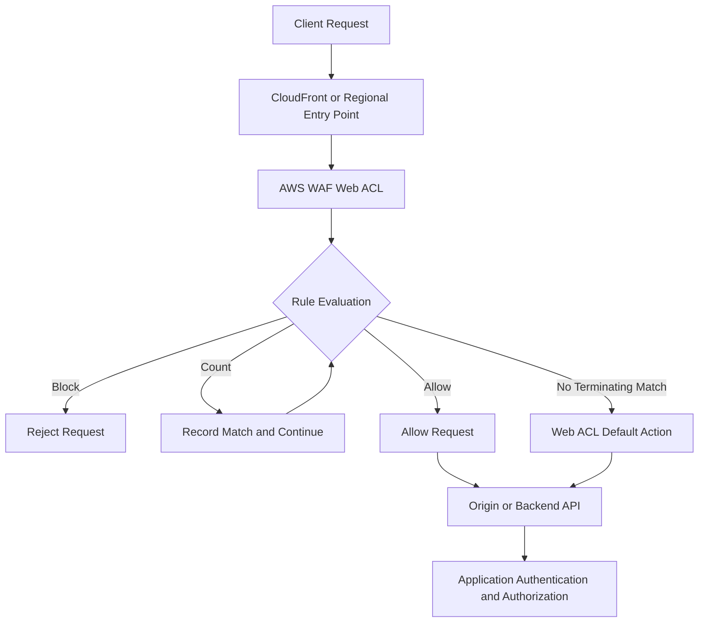
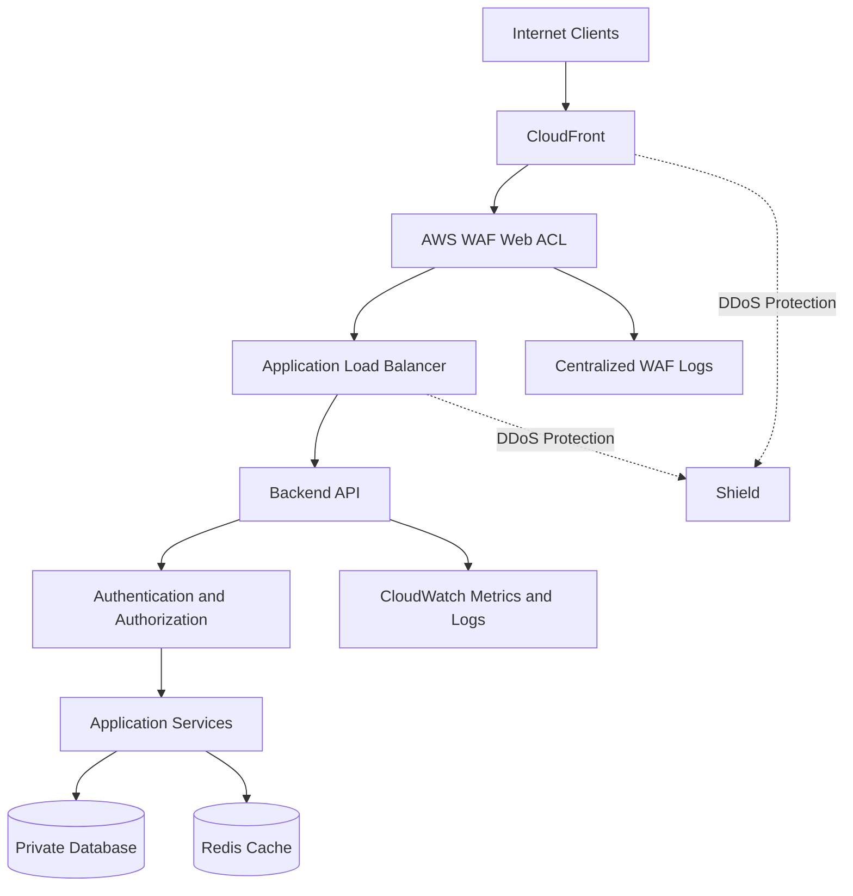

# 08- AWS WAF and Shield

## Overview

AWS WAF and AWS Shield provide complementary protection for publicly accessible applications and APIs. AWS WAF evaluates incoming HTTP and HTTPS requests against configurable rules, while AWS Shield provides protection against distributed denial-of-service (DDoS) attacks.

They are important components of a defense-in-depth architecture for backend systems built with API Gateway, Application Load Balancer (ALB), CloudFront, and other supported AWS services.

The primary responsibilities are:

- **AWS WAF:** Filter malicious HTTP requests, enforce request limits, inspect request attributes, and block unwanted traffic.
- **AWS Shield:** Detect and mitigate DDoS attacks against supported AWS resources.
- **Application authorization:** Determine whether an authenticated identity can perform a specific operation.
- **Network controls:** Restrict network-level connectivity through security groups, network ACLs, routing, and private connectivity.

Neither WAF nor Shield replaces secure application code, IAM, authentication, authorization, or network segmentation.

### Why these services matter

A public backend API may experience SQL injection attempts, cross-site scripting payloads, abusive clients, credential-stuffing attempts, HTTP floods, or volumetric DDoS attacks. These threats operate at different layers and require different controls.

WAF can reject suspicious HTTP requests before they reach application processing. Shield helps protect supported resources against DDoS attacks. Application-level controls must still enforce business rules, validate input, and authorize individual operations.

## AWS WAF

### What AWS WAF is

AWS WAF is a managed web application firewall that inspects HTTP and HTTPS requests associated with supported AWS resources. It evaluates requests against a web access control list (web ACL) containing ordered rules and rule groups.

WAF can inspect request characteristics such as:

- Source IP address.
- HTTP method and URI path.
- Query-string parameters.
- Selected HTTP headers.
- Request body, subject to inspection limits.
- Labels applied by earlier rules or managed rule groups.
- Request rate over a configured evaluation window.

### Supported integrations

AWS WAF can be associated with supported resources such as:

- Amazon CloudFront distributions.
- Application Load Balancers.
- Amazon API Gateway REST APIs.
- AWS AppSync GraphQL APIs.
- Amazon Cognito user pools.
- AWS App Runner services.
- Amazon Verified Access instances.

Supported integrations and feature availability vary by resource type and Region. CloudFront-scoped WAF resources are managed through the required global scope, while regional resources use their applicable AWS Region.

Verify the current integration and quota documentation before designing a deployment around a specific resource.

### Request inspection flow



The exact processing path depends on the associated resource and its configuration. A WAF decision does not automatically authenticate the caller or authorize a business operation.

### Web ACLs

A web ACL is the primary container for WAF rules. It defines:

- Which requests are evaluated.
- Rule ordering and priorities.
- The action associated with a matching rule.
- The default action when no terminating rule determines the result.
- Optional logging and metrics configuration.
- Associations with supported protected resources.

A web ACL can contain individual rules, managed rule groups, and rate-based rules.

Common rule actions include:

| Action | Behavior | Typical use |
|---|---|---|
| `ALLOW` | Allows the request and terminates evaluation | Explicitly trusted traffic conditions |
| `BLOCK` | Blocks the request and terminates evaluation | Known malicious patterns or prohibited traffic |
| `COUNT` | Records a match without terminating evaluation | Observe impact before enforcement |
| `CAPTCHA` | Requires a CAPTCHA challenge when applicable | Mitigating certain automated interactions |
| `CHALLENGE` | Applies a browser challenge when applicable | Evaluating suspicious client behavior |

Challenge actions have compatibility and token-handling considerations. They should be tested against API clients, mobile applications, and non-browser integrations before production use.

### Rule priority and evaluation

Rules are evaluated according to their configured priority, generally from the lowest numeric priority upward. A terminating action such as `ALLOW` or `BLOCK` ends further rule evaluation for that request.

Non-terminating actions, such as `COUNT`, allow evaluation to continue.

A rule that broadly allows requests can prevent later blocking rules from being evaluated. Avoid placing permissive rules ahead of critical protections without understanding their terminating behavior.

A useful design process is:

1. Identify the request patterns that must be blocked.
2. Add managed protections appropriate to the application.
3. Introduce narrowly scoped custom rules.
4. Use `COUNT` mode to observe false positives.
5. Review sampled requests, metrics, and logs.
6. Move validated rules into enforcement mode.
7. Monitor application availability and security metrics after deployment.

## AWS WAF Rule Types

### Managed rule groups

Managed rule groups provide collections of rules maintained by AWS or third-party providers.

AWS-managed protections can cover categories such as common web exploits, known malicious inputs, IP reputation, and suspicious request patterns.

Examples of managed rule group families include:

- Common rule sets.
- Known bad input protections.
- SQL injection protections.
- IP reputation lists.
- Anonymous IP lists.
- Bot Control, where appropriate and licensed.

Managed rule groups reduce the effort required to maintain detection patterns, but they do not guarantee detection of every attack.

**Production considerations:**

- Review the rule group's documentation and available rules.
- Understand exclusions and inspection limitations.
- Start with count-only evaluation where practical.
- Monitor false positives against legitimate application traffic.
- Review versioning and update behavior.
- Evaluate additional charges for premium managed protections.

Managed rules should complement input validation, parameterized SQL queries, secure deserialization, authentication, and application-level authorization.

### Custom rules

Custom rules provide application-specific filtering.

Examples include:

- Blocking requests to deprecated endpoints.
- Restricting access to administrative URL paths.
- Rejecting unsupported HTTP methods.
- Matching known malicious request patterns.
- Allowing traffic only from approved IP ranges where that restriction is appropriate.
- Inspecting headers or URI patterns associated with abuse.

Avoid relying on a single custom rule to validate complex business semantics. WAF operates at the request-filtering layer and does not replace application validation.

### Rate-based rules

Rate-based rules help mitigate excessive request rates from individual aggregation keys, such as source IP addresses or configured combinations of request characteristics.

They are useful for:

- Login endpoint abuse.
- Password-reset request flooding.
- Expensive search APIs.
- Public form submissions.
- Excessive traffic to selected routes.

A rate-based rule evaluates request volume over a configured time window and applies its action when the configured threshold is exceeded. Enforcement is not an exact, instantaneous per-second quota, and rate-based protections should not be treated as a precise billing or business-rate limiter.

Example policy:

| Endpoint | Illustrative policy | Additional control |
|---|---|---|
| `/auth/login` | Lower request threshold | Account-level throttling and MFA |
| `/auth/password-reset` | Lower request threshold | Per-account limits and abuse monitoring |
| `/api/search` | Threshold appropriate to expected usage | Query limits and database timeouts |
| `/api/public/catalog` | Higher threshold | Caching and application capacity controls |

The thresholds are application-specific. Measure legitimate traffic before setting enforcement values.

#### Important limitations

IP-based rate limiting can be imperfect because:

- Multiple users may share a NAT gateway or corporate proxy.
- Attackers can distribute requests across many IP addresses.
- Proxy configuration can make source-IP interpretation difficult.
- A single client can target multiple endpoints.
- WAF request-rate controls are not a substitute for per-user or per-account quotas.

Use layered rate limiting: WAF for edge-level abuse mitigation, API Gateway throttling where supported, and application-level quotas for authenticated users and business operations.

## AWS WAF Logging and Monitoring

### Logging

WAF logging provides request-level evidence about rule evaluation and actions. Logs can include request metadata, matching rules, terminating actions, labels, and other fields depending on the integration and configuration.

WAF logging destinations and configuration requirements depend on the selected logging service and resource scope. Common destinations include supported Amazon Data Firehose delivery streams.

WAF logging is separate from CloudTrail management-event auditing. CloudTrail records control-plane activity, such as changes to web ACLs; WAF logs provide evidence of inspected web requests.

### Metrics and sampled requests

Use CloudWatch metrics to track:

- Allowed requests.
- Blocked requests.
- Counted requests.
- Rule-specific matches.
- Rate-based rule activity.
- Unexpected changes in request volume.

Sampled requests help investigate why rules matched, but sampling is not a complete record of all requests.

For deeper investigations, enable appropriately secured WAF logging and ensure the retention and access controls meet operational and compliance requirements.

### Sensitive data in logs

Request logs can contain query strings, headers, URI paths, and other attacker-controlled data. These fields may accidentally include tokens, personal information, or application secrets.

Apply data minimization and redaction where supported. Restrict log access, encrypt log destinations, define retention policies, and prevent sensitive values from being placed in URLs.

## AWS Shield

### What AWS Shield is

AWS Shield is an AWS-managed DDoS protection service for supported AWS resources. It helps protect applications from attacks intended to overwhelm network, transport, or application-facing infrastructure.

Shield is complementary to WAF:

- Shield focuses on DDoS detection and mitigation.
- WAF evaluates HTTP requests against web application filtering rules.
- CloudFront and load balancing help distribute traffic and isolate origins.
- Application controls protect business operations and application resources.

### Shield Standard and Shield Advanced

| Capability | Shield Standard | Shield Advanced |
|---|---|---|
| Availability | Automatically included for AWS customers | Optional paid protection |
| Primary purpose | Baseline protection against common infrastructure-layer DDoS attacks | Enhanced DDoS protection and response capabilities |
| Configuration | Baseline managed protection | Requires explicit subscription and resource protection configuration |
| Operational support | Standard AWS support arrangements | Additional DDoS response and protection features, subject to plan terms |
| Cost considerations | Included | Subscription and applicable service charges; review current pricing |
| Best fit | General workloads requiring baseline DDoS protection | Business-critical public applications requiring enhanced DDoS response capabilities |

Shield Advanced provides additional capabilities, but the exact feature set, eligibility, support arrangements, and financial protections are subject to current AWS terms. Validate these before relying on them in a business continuity plan.

### DDoS defense-in-depth

A resilient public application typically combines:

1. CloudFront or another suitable edge entry point.
2. Shield protection for supported resources.
3. AWS WAF rules for application-layer request filtering.
4. Origin access restrictions so clients cannot bypass the intended edge path.
5. Application authentication and authorization.
6. Caching, connection limits, bounded workloads, and backpressure.
7. Monitoring and a documented incident-response process.

Shield does not guarantee that an application remains available during every attack. Origin bottlenecks, expensive application operations, database contention, and misconfigured access controls can still cause outages.

## Secure Public API Architecture

### Recommended architecture



This is a conceptual architecture. Resource support, association requirements, and the exact DDoS protection path depend on the services and deployment configuration.

### Origin protection

If CloudFront is the intended public entry point, prevent direct public access to the origin where practical.

For an ALB origin, this may involve a combination of:

- Appropriate network restrictions.
- Supported CloudFront origin access controls or origin-verification mechanisms.
- Restricting origin access to expected traffic.
- Validating origin requests where appropriate.
- Avoiding public access paths that bypass WAF.

Do not assume that attaching WAF to CloudFront automatically prevents direct access to an origin. Verify the origin's network and application access paths.

### API Gateway considerations

For API Gateway REST APIs, WAF can provide an additional request-filtering layer. Continue to use API Gateway authorization mechanisms, throttling, request validation where applicable, and application-level controls.

For backend services, ensure that authentication and authorization are consistently enforced even if WAF allows a request.

### Network controls versus WAF

| Control | Primary layer | What it protects |
|---|---|---|
| Security groups | Network | Permitted inbound and outbound connections |
| Network ACLs | Network subnet boundary | Stateless subnet-level traffic filtering |
| AWS WAF | HTTP/HTTPS application edge | Requests matching configured web rules |
| AWS Shield | DDoS protection | Supported resources against DDoS attacks |
| IAM | AWS API authorization | Access to AWS resources and operations |
| Application authorization | Business logic | User or service permissions for specific operations |

A WAF allow decision does not grant IAM permissions. Likewise, a security group allowing TCP/443 does not imply that an HTTP request is safe.

## Deploying and Managing AWS WAF with the CLI

### Prerequisites

You need:

- An AWS CLI installation and configured identity.
- The correct AWS account and Region.
- Permission to inspect and manage WAF resources.
- The appropriate WAF scope for the target resource.
- A plan for logging, metrics, testing, and rollback.

Use a named AWS CLI profile or an approved temporary credential source rather than embedding credentials in scripts.

```bash
aws sts get-caller-identity --profile security-admin

aws configure list --profile security-admin
```

`get-caller-identity` verifies which AWS identity is active. It does not prove that the identity has permission to modify WAF resources.

### List web ACLs

For a regional resource:

```bash
aws wafv2 list-web-acls \
  --scope REGIONAL \
  --region us-east-1 \
  --profile security-admin
```

For CloudFront scope:

```bash
aws wafv2 list-web-acls \
  --scope CLOUDFRONT \
  --region us-east-1 \
  --profile security-admin
```

CloudFront-scoped WAF management uses the required `us-east-1` endpoint. Regional WAF resources use their configured Region.

The output contains available web ACL summaries, including identifiers and ARNs. Use the exact returned values for subsequent commands.

### Inspect a web ACL

```bash
aws wafv2 get-web-acl \
  --name example-web-acl \
  --id <web-acl-id> \
  --scope REGIONAL \
  --region us-east-1 \
  --profile security-admin
```

Review:

- Rule priorities and actions.
- Managed rule group configuration.
- Default action.
- Visibility configuration and metrics.
- Association-related settings and identifiers.

This is a read-only inspection command.

### Inspect resource associations

```bash
aws wafv2 list-resources-for-web-acl \
  --web-acl-arn <web-acl-arn> \
  --region us-east-1 \
  --profile security-admin
```

This command is intended for applicable regional resources. CloudFront association workflows differ; use the appropriate CloudFront and WAF APIs for CloudFront-scoped resources.

Confirm that every intended public entry point is protected and that no unintended public path bypasses the web ACL.

### Inspect managed rule groups

```bash
aws wafv2 list-available-managed-rule-groups \
  --scope REGIONAL \
  --region us-east-1 \
  --profile security-admin
```

For CloudFront-scoped rule groups, use the CloudFront scope and required Region. Review provider documentation before selecting a managed rule group.

### Change-management requirements

WAF configuration changes can immediately affect application availability. Before modifying rules:

- Export or otherwise preserve the current configuration.
- Review the intended rule order and terminating behavior.
- Use count mode for uncertain rules where possible.
- Test legitimate and malicious request patterns.
- Monitor blocked-request metrics after rollout.
- Keep a tested rollback procedure.

WAF configuration updates require the relevant permissions and, for certain update operations, a current lock token. Use the lock token returned by the applicable read operation to avoid overwriting a concurrent update.

## AWS Shield Operations

### Review protected resources

Shield protection is associated with supported AWS resources. Shield Advanced has explicit resource-protection workflows; Shield Standard is baseline protection rather than a list of individually configured protected resources.

For Shield Advanced, inspect protections with the applicable API:

```bash
aws shield list-protections \
  --region us-east-1 \
  --profile security-admin
```

The command returns protection summaries visible to the caller. An empty result does not mean Shield Standard is disabled.

Inspect a specific protection when needed:

```bash
aws shield describe-protection \
  --protection-id <protection-id> \
  --region us-east-1 \
  --profile security-admin
```

Use the Shield API documentation for the precise supported resource and operation requirements.

### Operational considerations

For critical public services:

- Document protected resources and their owners.
- Establish escalation paths for suspected DDoS incidents.
- Understand the limits of standard and advanced protection.
- Monitor application and infrastructure capacity alongside DDoS-related signals.
- Test failover and recovery independently of DDoS protection.
- Review subscription, pricing, and eligibility before adopting Shield Advanced.

## Security Monitoring and Incident Response

### Preventive, detective, and responsive controls

| Control category | Examples | Purpose |
|---|---|---|
| Preventive | WAF blocking rules, origin restrictions, secure application authorization | Reduce attack opportunities |
| Detective | WAF logs, CloudWatch metrics, CloudTrail management events, GuardDuty findings | Identify suspicious activity and configuration changes |
| Responsive | Rule updates, origin isolation, credential revocation, incident escalation | Contain and remediate an incident |

No single control provides complete protection. Correlate edge traffic, application logs, load balancer metrics, infrastructure health, and audit records.

### Investigating a WAF block

When legitimate requests are blocked:

1. Identify the affected endpoint, time window, and client request characteristics.
2. Check the WAF terminating rule and matching labels.
3. Inspect sampled requests or protected WAF logs.
4. Determine whether the request is genuinely malicious or a false positive.
5. Reproduce the request in a controlled environment.
6. Adjust a narrow rule, add a justified exclusion, or change the action to count temporarily.
7. Verify the fix with both legitimate and malicious test cases.
8. Monitor metrics after deployment.

Avoid disabling the entire web ACL merely because one managed rule generates false positives.

### Investigating a traffic spike

A sudden increase in traffic may be legitimate, abusive, or part of a DDoS event.

Review:

- Request rates by endpoint and available aggregation dimensions.
- WAF block and count metrics.
- Load balancer request counts, latency, and target health.
- Application CPU, memory, connection pools, and worker saturation.
- Database connection counts and query latency.
- Cache hit rate and expensive uncached operations.
- Relevant Shield signals and available incident details.

Use rate-based rules and targeted mitigations where appropriate. Avoid relying only on source IP because distributed attacks can originate from many addresses.

### Incident containment

During a suspected attack:

- Preserve WAF, load balancer, application, and audit evidence.
- Restrict or block clearly malicious traffic using scoped controls.
- Protect origin infrastructure from direct access where feasible.
- Apply additional throttling to expensive endpoints.
- Scale only when the application and dependencies can handle the resulting load.
- Coordinate with the organization's incident-response and AWS support processes.
- Record configuration changes and their timestamps.

Do not make broad emergency changes without recording the rationale and recovery plan. Overly aggressive blocking can turn a security incident into an availability incident.

## Troubleshooting

### Unexpected WAF blocks

**Symptoms**

- Legitimate API calls receive HTTP 403 responses.
- Browser requests fail after a managed rule group is enabled.
- A specific payload or endpoint consistently triggers a block.

**Likely causes**

- A managed rule detects a legitimate request pattern.
- Rule priority or a terminating action is incorrect.
- The application sends unexpected headers, parameters, or request bodies.
- A custom rule is too broad.

**Isolation**

1. Identify the terminating rule from WAF logs or sampled requests.
2. Confirm the request reached the expected WAF-protected resource.
3. Reproduce the request using non-sensitive test data.
4. Compare behavior with the relevant rule in count mode where practical.

**Corrective actions**

- Narrow the custom rule.
- Add a targeted managed-rule exclusion if justified.
- Use count mode while validating the change.
- Keep unrelated protections enabled.

**Verification**

Test both the previously blocked legitimate request and representative malicious requests. Review metrics for regressions.

### WAF does not block expected traffic

**Symptoms**

- Known test payloads reach the backend.
- WAF metrics show no matching rule.
- Traffic reaches an origin through an unexpected path.

**Likely causes**

- The intended web ACL is not associated with the resource.
- The wrong scope or Region is being inspected.
- Rule conditions do not match the actual request.
- Rule ordering or an earlier terminating action prevents evaluation.
- Clients can bypass the intended CloudFront or load balancer entry point.

**Isolation**

```bash
aws wafv2 get-web-acl \
  --name example-web-acl \
  --id <web-acl-id> \
  --scope REGIONAL \
  --region us-east-1

aws wafv2 list-resources-for-web-acl \
  --web-acl-arn <web-acl-arn> \
  --region us-east-1
```

**Corrective actions**

Verify the web ACL association, rule conditions, priorities, and origin restrictions. Confirm that tests target the correct endpoint.

**Verification**

Run controlled test requests through the public entry point and inspect WAF metrics and logs. Confirm that direct-origin access is restricted as intended.

### Rate-based rule does not enforce the expected limit

**Symptoms**

- Traffic exceeds the configured threshold.
- Some requests continue after the limit is crossed.
- Legitimate users behind a shared IP address are throttled.

**Likely causes**

- Rate-based enforcement is not an exact instantaneous quota.
- Aggregation keys do not match the intended client identity.
- Traffic is distributed across multiple IP addresses.
- The configured threshold does not reflect actual traffic patterns.

**Corrective actions**

Review the aggregation configuration, rate window, and threshold. Use application-level or API Gateway throttling for additional controls, and use account-level quotas for authenticated operations.

**Verification**

Generate controlled traffic in a non-production environment. Review rule metrics and confirm that the application has a separate mechanism for enforcing business-critical quotas.

### Shield-related availability incident

**Symptoms**

- Public endpoints experience elevated latency or become unavailable during a traffic spike.
- Backend resources are saturated despite edge protection.
- DDoS-related signals coincide with application or database failures.

**Likely causes**

- An application-layer flood targets expensive operations.
- The origin is reachable through a bypass path.
- Caching is ineffective or disabled.
- Backend dependencies cannot handle the request rate.
- The incident involves legitimate traffic or a non-DDoS failure.

**Corrective actions**

Review available Shield and infrastructure signals, inspect WAF traffic patterns, restrict origin access, and protect expensive endpoints with appropriate throttling and caching. Escalate through the established AWS support process when warranted.

**Verification**

Confirm that the public service is reachable, backend saturation has decreased, and the mitigations do not block legitimate clients. Continue monitoring after the attack subsides.

### WAF CLI access denied

**Symptoms**

- WAF API commands return `AccessDeniedException` or an authorization error.
- A user can inspect one scope but cannot inspect another.

**Likely causes**

- Missing WAF permissions.
- Incorrect account or Region.
- CloudFront scope is being accessed through an incorrect regional endpoint.
- A permissions boundary, SCP, or session policy restricts the operation.

**Isolation**

```bash
aws sts get-caller-identity

aws configure list

aws wafv2 list-web-acls \
  --scope REGIONAL \
  --region us-east-1
```

**Corrective actions**

Verify the active identity and requested resource scope. Request only the missing permissions from the responsible administrator; do not grant unrestricted administrator access.

**Verification**

Retry the required read-only operation with the approved identity, then confirm the returned account, scope, and resource details.

## Production Best Practices

### Rule governance

- Use managed rule groups for relevant common threat categories.
- Keep custom rules narrow and understandable.
- Validate uncertain rules in count mode before enforcement.
- Review false positives and rule updates regularly.
- Version-control configuration where supported by the deployment workflow.
- Require review and rollback plans for changes that can affect availability.

### Secure API exposure

- Minimize public entry points.
- Restrict direct origin access when using an edge service.
- Use authentication and authorization for protected operations.
- Validate request schemas and enforce business-level quotas.
- Apply timeouts, payload limits, and database query bounds.
- Avoid exposing sensitive values in URLs and request logs.

### Monitoring and operations

- Enable suitable WAF logging for critical applications.
- Create alarms for unexpected block rates and traffic spikes.
- Correlate WAF events with application and infrastructure telemetry.
- Define ownership for web ACLs, managed rule groups, and protected resources.
- Test security controls after deployments and rule changes.
- Document incident-response actions and escalation paths.

### Cost and performance

WAF rule evaluation, logging, managed rule groups, and Shield Advanced can affect operating costs. Review current AWS pricing and quotas before deployment.

Security controls can also add operational complexity. An overly broad rule set can increase false positives, while ineffective inspection and origin restrictions can leave gaps.

Use measured traffic patterns, staged rollouts, and representative performance tests to balance protection, latency, availability, and cost.

## Practical Exercise: Inspect a WAF Deployment

### Prerequisites

- AWS CLI configured with an approved read-only security identity.
- A test account or approved environment.
- An existing WAF web ACL.
- The web ACL ARN and appropriate Region.

### Steps

**Inspect the active identity:**

```bash
aws sts get-caller-identity
```

**List regional web ACLs:**

```bash
aws wafv2 list-web-acls \
  --scope REGIONAL \
  --region us-east-1
```

**Inspect the selected web ACL:**

```bash
aws wafv2 get-web-acl \
  --name example-web-acl \
  --id <web-acl-id> \
  --scope REGIONAL \
  --region us-east-1
```

**Inspect associated regional resources:**

```bash
aws wafv2 list-resources-for-web-acl \
  --web-acl-arn <web-acl-arn> \
  --region us-east-1
```

### Expected outcome

You should be able to identify the active AWS identity, inspect the web ACL's rules and default action, and determine which supported regional resources are associated with it.

### Verification and cleanup

These commands are read-only and do not require cleanup. If you extend the exercise by modifying rules, use a non-production environment, preserve the original configuration, and restore the approved state after testing.

### Cost and quota considerations

The inspection commands do not create billable WAF resources. Existing resources may incur their normal charges. Review WAF quotas before designing large rule sets or high-volume logging configurations.

## Senior-Level Interview Questions

### Core concepts

**Why use AWS WAF if the application already validates input?**

WAF can reject known malicious request patterns and abusive traffic before they consume application resources. Application validation remains necessary because WAF inspection is not equivalent to business-level validation and cannot guarantee detection of all attacks.

**Does AWS Shield replace AWS WAF?**

No. Shield focuses on DDoS protection for supported resources, while WAF evaluates HTTP requests against configured rules. They solve complementary problems.

### Architecture and trade-offs

**How would you protect a public API behind CloudFront?**

Use Shield protection for supported resources, a carefully configured WAF web ACL, appropriate origin restrictions, application authentication and authorization, rate limiting, and monitoring. Ensure the origin cannot be accessed through an unintended public path.

**Would you block all traffic from unfamiliar IP addresses?**

Not by default. IP reputation and allowlists can help in specific scenarios, but broad IP restrictions can block legitimate customers and fail against distributed attacks. Prefer layered controls based on risk, request patterns, identity, and business requirements.

### Troubleshooting

**A WAF managed rule blocks legitimate JSON requests. What would you do?**

Identify the terminating rule, inspect the relevant request evidence, reproduce the issue safely, and use count mode to validate a targeted exclusion or rule adjustment. Verify that legitimate traffic succeeds and malicious test cases remain blocked.

**A rate-based rule is configured, but the backend still receives excessive traffic. Why?**

Rate-based rules are not exact instantaneous quotas, and aggregation choices may not match the desired client identity. Distributed traffic can also evade simple IP-based aggregation. Combine WAF with application-level throttling, API Gateway limits where applicable, and resource-capacity controls.

**CloudFront is protected by WAF, but the origin remains publicly reachable. Is the architecture secure?**

Not necessarily. Direct access may bypass the intended WAF policy. Restrict origin access using supported mechanisms, verify the network path, and test that requests cannot reach the origin through an unintended entry point.

### Senior-level reasoning

**How do you balance WAF protection with availability?**

Use staged rule rollout, count mode, traffic baselines, targeted exclusions, regression tests, monitoring, and documented rollback procedures. Avoid disabling all protections to resolve one false positive.

**What evidence would you collect during a suspected DDoS incident?**

Preserve WAF logs and metrics, load balancer telemetry, application logs, infrastructure health signals, relevant CloudTrail management events, and available Shield findings. Correlate timestamps and request patterns to distinguish malicious traffic from legitimate spikes or backend failures.

## Key Takeaways

- AWS WAF filters HTTP requests using ordered rules and rule groups; AWS Shield provides complementary DDoS protection.
- WAF `ALLOW`, `BLOCK`, and other rule actions have different evaluation semantics, so rule priority and terminating behavior must be reviewed carefully.
- Use staged rule deployment, request logging, metrics, and targeted exclusions to reduce false positives without disabling essential protections.
- Secure public APIs with layered controls, including origin restrictions, network security, authentication, authorization, rate limiting, and bounded backend workloads.
- Prepare for incidents with centralized evidence, tested mitigations, clear ownership, and documented recovery procedures.