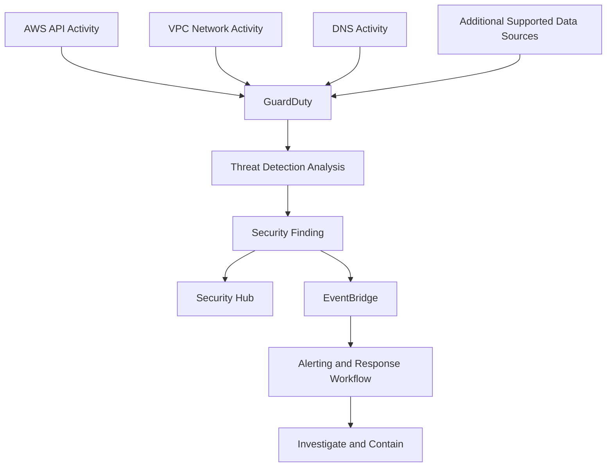
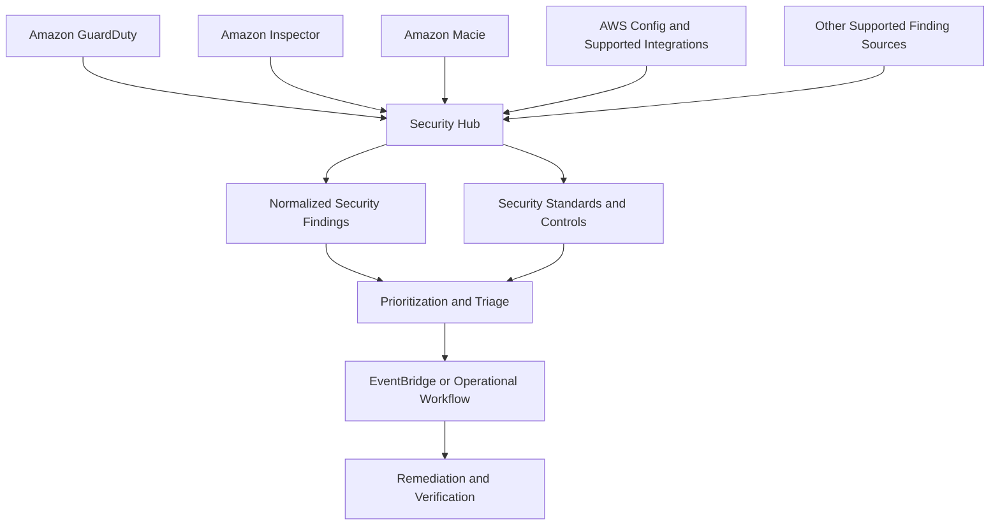
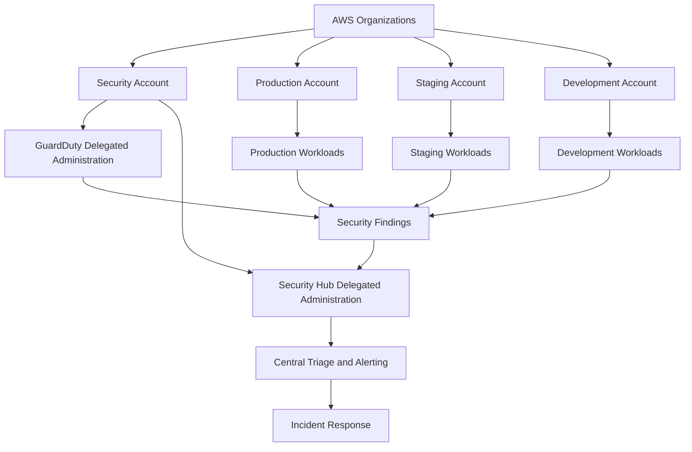
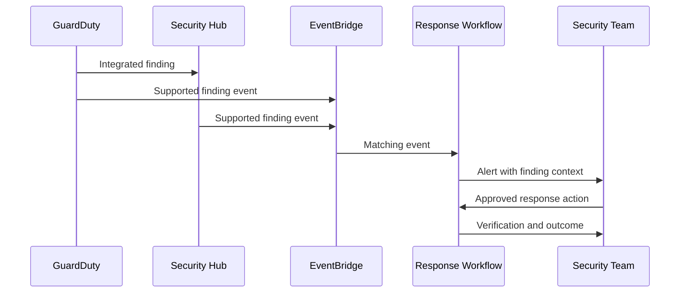

# 09- Threat Detection with GuardDuty and Security Hub

## Overview

AWS threat detection and security posture management help identify suspicious activity, misconfigurations, exposed resources, and potential compromise across AWS accounts and workloads.

Two core services are **Amazon GuardDuty** and **AWS Security Hub**:

- **Amazon GuardDuty** analyzes supported AWS data sources and produces security findings that indicate potentially malicious activity or suspicious behavior.
- **AWS Security Hub** centralizes security findings, evaluates security posture against supported standards and controls, and helps teams prioritize and manage security issues across their AWS environment.

These services complement preventive controls such as IAM, security groups, AWS WAF, and AWS KMS. They do not automatically replace incident response, remediation workflows, or application-level security monitoring.

### Why threat detection matters

Preventive controls reduce the likelihood of compromise, but they cannot eliminate every attack path. A leaked access key, compromised application, unexpected role assumption, exposed workload, or malicious insider may operate within permissions that were previously considered legitimate.

Threat detection helps identify these conditions through evidence such as unusual API activity, suspicious network behavior, potentially compromised compute resources, and security configuration findings.

A production security program should combine:

- Preventive controls to reduce exposure.
- Detective controls to identify suspicious activity and misconfiguration.
- Responsive controls to contain incidents and restore secure operation.
- Governance controls to enforce security requirements across accounts and workloads.

## Amazon GuardDuty

### What GuardDuty is

Amazon GuardDuty is a managed threat detection service that analyzes supported AWS telemetry and threat intelligence to identify potentially malicious activity.

Depending on the enabled protection plans, data sources, Region, and supported resource types, GuardDuty can detect threats involving:

- Suspicious AWS API activity.
- Potentially compromised credentials.
- Unusual network connections.
- Potentially malicious DNS activity.
- Suspicious behavior involving supported compute workloads.
- Threats involving supported container, database, storage, and identity-related activity.

GuardDuty generates findings that describe the detected activity, its severity, affected resources, and other investigation context.

### How GuardDuty works

GuardDuty uses supported AWS data sources and detection capabilities to identify activity that may indicate a security threat. It does not require customers to build and operate their own threat-detection infrastructure for the supported detection scenarios.

Depending on the enabled features, GuardDuty can analyze sources such as CloudTrail management events, VPC Flow Logs, DNS logs, and additional service-specific telemetry.

The exact data sources and protection capabilities vary by feature. Verify the current service documentation when designing coverage for a particular workload.



GuardDuty findings are evidence for investigation, not definitive proof that every affected resource is compromised. Detection confidence, severity, and operational context must be considered before remediation.

### GuardDuty findings

A finding identifies a potentially suspicious activity or security issue.

Important finding attributes commonly include:

| Attribute | Purpose |
|---|---|
| Finding ID | Identifies a specific finding |
| Finding type | Describes the detected threat category |
| Severity | Indicates the finding's assigned severity |
| Resource | Identifies the affected AWS resource or identity |
| Account ID | Identifies the account associated with the finding |
| Region | Identifies the Region in which the finding was generated |
| First seen | Indicates when the activity was first observed |
| Last seen | Indicates the most recent observation represented by the finding |
| Description | Provides contextual information about the detection |
| Remediation guidance | May provide investigation or remediation recommendations |

Use the actual finding fields returned by the service. Not every finding contains every attribute, and field availability depends on the finding type.

### Finding severity

GuardDuty findings include severity classifications that help prioritize investigation.

| Severity | Operational interpretation |
|---|---|
| Low | Investigate in context; the activity may have limited impact or require correlation |
| Medium | Review promptly and determine whether containment is necessary |
| High | Prioritize investigation and consider immediate containment based on evidence |

Severity is a prioritization signal, not a complete risk assessment. A medium-severity finding involving a production administrator identity may warrant more urgent action than a high-severity finding affecting an isolated test workload.

Consider business impact, resource exposure, identity privileges, evidence of exploitation, and the scope of the affected environment.

## GuardDuty Protection Plans

GuardDuty capabilities can be expanded through protection plans. Availability and requirements depend on the feature, Region, and supported resource type.

| Protection area | Purpose | Engineering considerations |
|---|---|---|
| Foundational threat detection | Detect suspicious AWS account, network, and DNS activity | Enable coverage in the accounts and Regions that contain workloads |
| S3 protection | Detect potentially suspicious activity involving supported S3 data events | Evaluate data coverage, access patterns, and additional costs |
| EKS protection | Detect supported threats involving Kubernetes workloads and activity | Verify cluster coverage and the selected detection capabilities |
| Runtime monitoring | Detect supported runtime behavior on eligible compute resources | Review agent or coverage requirements and operational overhead |
| Malware protection | Detect malware-related threats for supported resources and workflows | Validate supported resource types and remediation procedures |
| RDS protection | Detect supported suspicious database login activity | Review supported database engines and coverage requirements |
| Lambda protection | Detect supported threats involving Lambda network activity | Confirm supported configurations and the applicable protection plan |
| Extended identity-related detection | Detect supported suspicious identity and credential behavior | Review feature availability and account coverage |

Do not assume that enabling foundational GuardDuty automatically enables every protection plan. Explicitly review the features relevant to your workload.

### Coverage and deployment strategy

For production environments:

- Enable GuardDuty in every required account and Region.
- Use an appropriate delegated administrator model for multi-account environments.
- Review protection-plan coverage for the resource types actually deployed.
- Verify that new accounts and Regions are included in onboarding automation.
- Monitor detector status and feature configuration.
- Review service quotas, supported resources, and pricing before enabling additional plans broadly.

A detector being enabled does not necessarily mean that every supported protection plan is enabled or that every workload has complete telemetry coverage.

## AWS Security Hub

### What Security Hub is

AWS Security Hub centralizes security findings and security posture information across supported AWS services and accounts.

It helps security and platform teams:

- Aggregate findings from integrated AWS security services.
- Review security posture across accounts and Regions.
- Evaluate supported security standards and controls.
- Prioritize security issues.
- Correlate and normalize supported findings.
- Integrate security findings with alerting and remediation workflows.

Security Hub is a posture-management and finding-management service. It does not replace the individual detection engines that generate findings.

### How Security Hub works

Security Hub receives findings from supported integrated services and other supported sources. It presents security issues through a centralized view and evaluates applicable controls where security standards and controls are enabled.



The services and integrations available depend on the enabled features and supported configuration. Security Hub findings and control evaluations are not a guarantee that every possible security issue has been detected.

### Security standards and controls

Security Hub supports security standards and control evaluations that help assess configuration against defined security requirements.

The available standards, controls, and implementation details can change over time. Select standards that align with organizational requirements, then review the actual enabled controls and their evaluation status.

Typical assessment areas include:

- IAM configuration.
- Network exposure.
- Encryption configuration.
- Logging and auditing.
- Resource configuration.
- Storage access controls.
- Account-level security settings.

A failed control indicates that a specific requirement was not satisfied or that the evaluated resource did not meet the control's criteria. Investigate the underlying resource and evidence before deciding how to remediate it.

### Findings versus control status

These concepts serve different purposes:

| Concept | Meaning | Example |
|---|---|---|
| Threat finding | Suspicious activity detected by a security service | A potentially compromised compute resource |
| Configuration finding | A security configuration issue reported by a supported source | An S3 bucket with an unintended public-access configuration |
| Security control status | Result of evaluating a supported control | A resource fails an encryption-related control |
| Compliance posture | Aggregated view of evaluated requirements | Several accounts have unresolved security-control failures |

A configuration control may fail without an active attack. A threat finding may exist even when the relevant configuration controls pass.

## GuardDuty and Security Hub: Responsibilities and Trade-offs

| Capability | GuardDuty | Security Hub |
|---|---|---|
| Primary role | Threat detection | Security finding aggregation and posture management |
| Suspicious API activity | Detects supported threat patterns | Can display integrated findings |
| Network and DNS threats | Detects supported threat patterns | Centralizes findings from integrated sources |
| Configuration assessment | Not its primary purpose | Evaluates supported standards and controls |
| Finding aggregation | Produces findings | Aggregates findings from supported sources |
| Incident response | Provides evidence for investigation | Helps prioritize and route findings |
| Remediation | Does not automatically resolve every finding | Does not automatically remediate every finding |
| Multi-account operations | Supports centralized administration patterns | Supports centralized finding and posture workflows |

Use GuardDuty for managed threat detection and Security Hub for broader security posture visibility and finding management. They work best as complementary services.

## Multi-Account Security Architecture

### Recommended architecture

A production AWS environment should separate security administration from application workloads.



This is a conceptual architecture. Configure delegated administrators and organization-level enablement according to the relevant service requirements.

### Design principles

**Separate administrative and workload responsibilities.** Use a dedicated security account or designated security administration account to manage centralized visibility and investigation workflows.

**Enable coverage consistently.** Account onboarding should include GuardDuty and Security Hub configuration rather than relying on manual setup.

**Centralize findings, not unrestricted access.** Security teams should have the permissions needed to investigate and respond, while application teams retain appropriate ownership of their workloads.

**Preserve account boundaries.** Delegated administration should not become a justification for granting broad application permissions across all accounts.

**Plan for regional scope.** Security findings and service configuration may be Region-specific. Establish an explicit regional coverage strategy and validate that it meets the organization's requirements.

## Centralized Finding Delivery and Alerting

### Event-driven response

Security Hub and GuardDuty can be integrated with Amazon EventBridge to route supported findings to operational systems.

A typical workflow is:

1. A detection service generates a finding.
2. The finding is available through the service's finding interface.
3. An EventBridge rule matches relevant events.
4. A target receives the event, such as an approved notification or response workflow.
5. The response process enriches and prioritizes the finding.
6. An authorized responder investigates and applies containment.
7. The team records the result and verifies remediation.



The exact event structure and integration behavior depend on the event source and configuration. Avoid assuming that every finding follows an identical delivery path.

### Alert routing

Do not send every informational finding directly to an on-call engineer. Excessive alerts lead to fatigue and slower response to important incidents.

Useful routing criteria include:

- Finding severity.
- Resource criticality.
- Account and environment.
- Identity privileges.
- Public exposure.
- Whether the finding is new or recurring.
- Whether there is evidence of exploitation.
- Whether the affected resource is already covered by an active incident.

Use distinct response paths for high-impact production threats, routine posture findings, and low-risk informational events.

### Reliable event processing

Security-event consumers should be designed for retries and duplicate delivery.

Recommended practices:

- Make response workflows idempotent.
- Preserve the source finding ID and event timestamp.
- Store investigation state in an approved system.
- Handle transient downstream failures.
- Monitor failed deliveries and processing latency.
- Avoid embedding sensitive event details in unrestricted notifications.
- Require approval for disruptive actions unless an explicitly authorized automated response policy permits them.

## AWS CLI: GuardDuty Operations

The following commands are read-only unless explicitly identified otherwise. Replace placeholders with values from the target account and Region.

### Verify the active identity

```bash
aws sts get-caller-identity \
  --profile security-readonly
```

**Purpose:** Confirm the AWS account and principal used for subsequent operations.

**Interpretation:** Check the account ID and ARN before investigating findings. An incorrect profile can lead to reviewing the wrong environment.

### List GuardDuty detectors

```bash
aws guardduty list-detectors \
  --region us-east-1 \
  --profile security-readonly
```

**Purpose:** List GuardDuty detector identifiers in the selected Region.

**Interpretation:** An empty result may indicate that GuardDuty is not enabled in that account and Region, or that the active identity cannot see the relevant configuration.

### Inspect detector configuration

```bash
aws guardduty get-detector \
  --detector-id <detector-id> \
  --region us-east-1 \
  --profile security-readonly
```

**Purpose:** Inspect detector status and configuration.

**Interpretation:** Verify the detector status and review the returned feature configuration. A detector being enabled does not prove that all desired protection plans are enabled.

### List findings

```bash
aws guardduty list-findings \
  --detector-id <detector-id> \
  --region us-east-1 \
  --finding-criteria '{
    "Criterion": {
      "updatedAt": {
        "GreaterThanOrEqual": 0
      }
    }
  }' \
  --profile security-readonly
```

**Purpose:** Retrieve finding identifiers that match the supplied criteria.

**Important:** The timestamp criterion uses the service's timestamp representation. In operational scripts, generate the appropriate Unix epoch value for the intended time window rather than relying on `0`, which may include historical findings.

For example, use a recent timestamp supplied by your incident tooling or generated by a controlled script.

### Retrieve finding details

```bash
aws guardduty get-findings \
  --detector-id <detector-id> \
  --finding-ids <finding-id> \
  --region us-east-1 \
  --profile security-readonly
```

**Purpose:** Retrieve detailed information for a known finding ID.

**Interpretation:** Review the finding type, severity, affected resource, timestamps, and relevant evidence. Preserve the finding ID for incident correlation.

### Inspect organization configuration

For organization-level administration, use the relevant GuardDuty organization APIs and delegated-administrator configuration. These operations require the appropriate management or delegated-administrator permissions.

Before changing organization settings, verify the account role, current organization configuration, and intended account and Region coverage.

## AWS CLI: Security Hub Operations

### Inspect Security Hub status

```bash
aws securityhub describe-hub \
  --region us-east-1 \
  --profile security-readonly
```

**Purpose:** Inspect the Security Hub hub configuration in the selected Region.

**Interpretation:** A successful response indicates that the caller can inspect the configured hub. An error may indicate missing permissions, incorrect Region, or an unconfigured service.

### Retrieve findings

```bash
aws securityhub get-findings \
  --region us-east-1 \
  --filters '{
    "SeverityLabel": [
      {
        "Value": "HIGH",
        "Comparison": "EQUALS"
      },
      {
        "Value": "CRITICAL",
        "Comparison": "EQUALS"
      }
    ],
    "WorkflowStatus": [
      {
        "Value": "NEW",
        "Comparison": "EQUALS"
      }
    ]
  }' \
  --max-results 50 \
  --profile security-readonly
```

**Purpose:** Retrieve high- and critical-severity findings with a new workflow status.

**Interpretation:** Review the affected resource, finding type, account, Region, timestamps, and remediation guidance. Use pagination for complete retrieval when more results exist.

Finding filters and allowed values depend on the API's schema. Validate filter syntax against the current CLI/API documentation when building automated queries.

### Inspect enabled standards and controls

Use the appropriate Security Hub APIs to list enabled standards, retrieve control statuses, and inspect control details. This separates configuration compliance issues from runtime threat findings.

When evaluating posture, check:

- Whether the intended standard is enabled.
- Whether required controls are enabled and evaluated.
- Whether resources are excluded by design.
- Whether findings are current.
- Whether failed controls have documented exceptions and remediation owners.

## Investigation Workflow

### Triage a GuardDuty finding

Start with the finding itself rather than immediately modifying the affected resource.

1. Confirm the account, Region, finding ID, and timestamps.
2. Identify the finding type and severity.
3. Determine which resource or identity is involved.
4. Establish whether the activity is expected.
5. Correlate with CloudTrail, application logs, network telemetry, and relevant service logs.
6. Determine whether credentials, data, or production workloads may be compromised.
7. Apply containment proportional to the evidence.
8. Preserve relevant evidence and document actions.
9. Remediate the root cause.
10. Verify recovery and review preventive improvements.

### Correlate with CloudTrail

CloudTrail can provide evidence of AWS API activity associated with suspicious identities or resources.

For example, to investigate recent management events involving a specific IAM role:

```bash
aws cloudtrail lookup-events \
  --lookup-attributes \
    AttributeKey=Username,AttributeValue=<role-or-user-name> \
  --start-time <start-time> \
  --end-time <end-time> \
  --region us-east-1 \
  --profile security-readonly
```

**Purpose:** Search available CloudTrail event history using the specified lookup attribute.

**Important limitations:**

- `lookup-events` supports specific lookup attributes; it is not a general-purpose query language.
- Event history is regional and has a limited retention window.
- A role session may be represented by a session identity rather than the simple role name.
- Data events and additional logging sources may be needed for certain investigations.
- Organization trails and centralized log archives may provide broader historical coverage.

Correlate event times and request IDs where available. Avoid treating the absence of an event in a limited query as proof that the activity did not occur.

### Investigate a potentially compromised identity

If a finding suggests that credentials may be compromised:

- Identify the principal and its effective permissions.
- Inspect recent API activity.
- Identify resources modified or accessed by the principal.
- Determine whether the identity can assume other roles.
- Review resource policies and cross-account access.
- Revoke or rotate affected credentials through the appropriate process.
- Restrict the identity's access when justified.
- Check for persistence mechanisms, such as newly created credentials, roles, policies, or trust relationships.

For temporary role credentials, stopping future role assumptions does not necessarily invalidate every already-issued session immediately. Apply the supported revocation and containment mechanisms appropriate to the credential type, and account for any resource-specific behavior.

## Incident Response Scenarios

### Suspicious API activity

**Possible symptoms**

- GuardDuty reports suspicious API activity.
- CloudTrail shows unexpected calls to sensitive services.
- A role performs actions outside its normal operational pattern.

**Investigation**

- Identify the principal, session, source address, user agent, and affected resources.
- Compare activity with deployment records and approved automation.
- Inspect changes to IAM policies, trust relationships, access keys, and resource policies.
- Determine whether the principal had access to sensitive data or production resources.

**Containment**

- Restrict or revoke compromised credentials using the supported process.
- Disable or narrow affected access where appropriate.
- Preserve CloudTrail and other evidence.
- Investigate related identities and resources for follow-on activity.

**Verification**

Confirm that unauthorized activity has stopped, legitimate workloads can still operate, and any persistence mechanisms have been removed.

### Potentially compromised compute resource

**Possible symptoms**

- GuardDuty reports suspicious network activity.
- An EC2 instance or supported workload communicates with unexpected destinations.
- Application behavior or resource utilization changes unexpectedly.

**Investigation**

- Review the finding and associated resource details.
- Inspect network telemetry and application logs.
- Determine whether the workload is publicly exposed or has excessive IAM permissions.
- Identify sensitive data and credentials available to the workload.

**Containment**

- Restrict network access or isolate the workload using an approved incident procedure.
- Protect credentials and sensitive data that the workload could access.
- Preserve evidence before destructive changes when feasible.
- Rebuild from a trusted image if compromise is confirmed or cannot be ruled out.

**Verification**

Validate that the workload no longer performs suspicious activity and that the replacement has corrected the original exposure.

### S3-related threat finding

**Possible symptoms**

- GuardDuty reports suspicious S3 activity.
- Unexpected identities access sensitive objects.
- Data-access patterns deviate from normal application behavior.

**Investigation**

- Identify the bucket, principal, access method, and affected objects.
- Review available S3 data events and relevant CloudTrail evidence.
- Inspect bucket policies, access points, and public-access configuration.
- Determine whether sensitive data was accessed or modified.

**Containment**

- Restrict unauthorized access.
- Revoke or narrow compromised identities.
- Preserve relevant logs and object evidence.
- Follow the organization's data-breach and notification procedures when required.

**Verification**

Confirm that the unauthorized access path is closed and that required application access still works.

### Security Hub control failure

**Possible symptoms**

- A security standard control reports a failed status.
- Multiple accounts contain the same configuration issue.
- Security posture degrades after a deployment.

**Investigation**

- Identify the control, resource, account, and Region.
- Inspect the underlying resource configuration.
- Determine whether the failure is caused by an actual exposure, a deployment regression, or an intended exception.
- Review the ownership and remediation deadline.

**Remediation**

Correct the resource configuration through the approved infrastructure-as-code or change-management process. If an exception is justified, document its scope, rationale, owner, compensating controls, and expiration or review date.

**Verification**

Re-evaluate the control and confirm that the underlying resource now satisfies the intended requirement.

## Troubleshooting

### GuardDuty detector is missing or disabled

**Symptoms**

- `list-detectors` returns no detector identifiers.
- The expected account does not generate findings.
- Security tooling reports incomplete coverage.

**Likely causes**

- GuardDuty was not enabled in that account and Region.
- Organization onboarding did not include the account.
- The CLI uses the wrong profile or Region.
- The caller lacks permission to inspect the configuration.

**Isolation**

```bash
aws sts get-caller-identity

aws guardduty list-detectors \
  --region us-east-1
```

**Corrective actions**

Verify the active identity and Region. Enable GuardDuty through the approved account-onboarding process if it is missing. Review organization-level administration and delegated-administrator configuration.

**Verification**

Re-run the detector inspection, confirm that the detector is enabled, and verify the required protection-plan coverage.

**Prevention**

Automate account and Region coverage checks and alert on unexpected gaps.

### No GuardDuty findings are visible

**Symptoms**

- The detector is enabled, but no findings appear.
- Expected suspicious activity does not produce a finding.

**Likely causes**

- The activity is not covered by the enabled detection capabilities.
- Required telemetry or protection plans are not enabled.
- The activity occurred in another account or Region.
- Finding filters exclude the relevant results.
- The activity did not match a detection pattern.

**Isolation**

- Inspect detector and feature configuration.
- Verify account and Region scope.
- Review the query's finding criteria and time range.
- Confirm that the relevant data source or protection plan supports the scenario.

**Corrective actions**

Enable the required supported protection features, correct query filters, and verify that relevant resources are covered.

**Verification**

Use service-provided test procedures where available and confirm that findings can be retrieved through the expected workflow.

**Prevention**

Maintain a coverage inventory and avoid treating the absence of findings as proof that the environment is secure.

### Security Hub is unavailable or returns an authorization error

**Symptoms**

- `describe-hub` fails.
- `get-findings` returns `AccessDeniedException`.
- Findings appear in one Region but not another.

**Likely causes**

- Security Hub is not configured in the selected Region.
- The active identity lacks the required permissions.
- The caller is using the wrong account.
- Delegated administration or organization configuration is incomplete.

**Isolation**

```bash
aws sts get-caller-identity

aws securityhub describe-hub \
  --region us-east-1
```

**Corrective actions**

Verify the account, Region, service configuration, and required permissions. Request narrowly scoped access from the security administrator rather than granting broad administrator permissions.

**Verification**

Confirm that the hub is configured and the approved identity can retrieve the required findings.

**Prevention**

Include Security Hub configuration and access checks in account onboarding and operational validation.

### Findings are not reaching the response workflow

**Symptoms**

- A finding exists in GuardDuty or Security Hub but no alert is generated.
- EventBridge rules show no expected matches.
- A downstream workflow does not process security events.

**Likely causes**

- Event patterns do not match the actual event structure.
- The event source or Region is incorrect.
- The target lacks permission or is unavailable.
- Delivery or processing failures are not monitored.
- A workflow assumes every finding uses the same event schema.

**Isolation**

- Inspect the finding in the source service.
- Review EventBridge rule configuration and matching criteria.
- Check rule metrics and target delivery errors.
- Inspect the response workflow's logs and retry behavior.

**Corrective actions**

Correct the event pattern, target permissions, and failure handling. Make the consumer idempotent and provide a dead-letter or replay strategy where supported by the chosen integration.

**Verification**

Generate or replay an approved test event and confirm that it reaches the intended destination and is processed once logically, even if delivery is repeated.

**Prevention**

Test alert delivery during deployment and monitor the time from finding generation to successful triage.

### Findings appear stale or delayed

**Symptoms**

- A finding does not reflect the latest resource state.
- A finding remains open after remediation.
- Detection or alerting occurs later than expected.

**Likely causes**

- Detection and evaluation are asynchronous.
- The underlying resource has not been re-evaluated.
- A finding has not been updated or archived by the source workflow.
- A query uses the wrong timestamp or Region.
- The response workflow processes events with delay.

**Corrective actions**

Check first-seen and last-seen timestamps, inspect the current resource state, and query the source service directly. Determine whether the finding remains valid before changing its workflow status.

**Verification**

Confirm the actual resource configuration and current finding state. Do not close an incident solely because the finding is old.

**Prevention**

Use timestamp-aware triage, periodic reconciliation, and explicit ownership for stale findings.

## Operational Best Practices

### Identity and access

- Use short-lived credentials and workload roles.
- Restrict who can disable GuardDuty or Security Hub.
- Limit permissions to inspect, administer, and remediate findings according to responsibility.
- Monitor changes to detectors, delegated administrators, and security integrations.
- Protect privileged security administration identities with MFA and approved access workflows.

### Detection coverage

- Enable required security services in every in-scope account and Region.
- Validate protection-plan coverage against deployed resource types.
- Review detection gaps after adding new services or workload types.
- Use Security Hub controls to assess supported configuration requirements.
- Maintain explicit ownership for exceptions and unresolved findings.

### Finding management

- Prioritize by severity, resource criticality, exposure, and evidence.
- Correlate findings with CloudTrail and application telemetry.
- Deduplicate alerts where appropriate without discarding evidence.
- Keep investigation records and remediation history.
- Reopen or escalate issues when new evidence changes the risk assessment.

### Incident response readiness

- Define containment actions for compromised credentials and workloads.
- Test notification and escalation workflows.
- Preserve evidence before deleting or rebuilding affected resources where feasible.
- Ensure response roles have narrowly scoped emergency permissions.
- Validate recovery and monitor for recurrence.
- Conduct a post-incident review and convert lessons into preventive controls.

### Cost and operational trade-offs

GuardDuty and Security Hub pricing depends on enabled features, analyzed data, resource coverage, and other service-specific factors. Additional protection plans and broad data coverage can increase cost.

Before enabling features across a large organization:

- Review current pricing and quotas.
- Estimate workload and data-source coverage.
- Enable features through controlled rollout where appropriate.
- Monitor service configuration and usage.
- Reassess coverage against business risk rather than optimizing solely for cost.

Security coverage should be an explicit risk decision. Disabling a protection plan to reduce cost without evaluating its detection value can create an unrecognized monitoring gap.

## Practical Exercise: Retrieve and Triage Security Findings

### Prerequisites

- AWS CLI configured with an approved read-only security profile.
- GuardDuty enabled in the target account and Region.
- Security Hub configured if you want to inspect aggregated findings.
- Permissions to inspect detectors and findings.

### Inspect the active account

```bash
aws sts get-caller-identity \
  --profile security-readonly
```

Record the account ID and confirm that it is the intended environment.

### Discover the GuardDuty detector

```bash
aws guardduty list-detectors \
  --region us-east-1 \
  --profile security-readonly
```

Record the detector ID returned by the service.

### Retrieve finding identifiers

```bash
aws guardduty list-findings \
  --detector-id <detector-id> \
  --region us-east-1 \
  --profile security-readonly
```

For a real investigation, add criteria for severity, finding type, or time range using the supported API schema.

### Retrieve a finding

```bash
aws guardduty get-findings \
  --detector-id <detector-id> \
  --finding-ids <finding-id> \
  --region us-east-1 \
  --profile security-readonly
```

Record the finding ID, type, severity, affected resource, and timestamps. Do not copy sensitive resource details into unrestricted notes or public issue trackers.

### Inspect Security Hub findings

```bash
aws securityhub get-findings \
  --region us-east-1 \
  --max-results 20 \
  --profile security-readonly
```

Compare the aggregated findings with the source service's results. Differences may reflect account or Region scope, integration coverage, filters, or service processing.

### Expected outcome

You should be able to identify the active AWS identity, verify GuardDuty configuration, retrieve a finding, and distinguish a source threat finding from an aggregated Security Hub finding.

### Cleanup and cost considerations

The exercise uses read-only operations and does not create additional resources. No cleanup is required. Existing enabled services may incur charges under their normal pricing models.

## Senior-Level Interview Questions

### Core concepts

**What is the difference between GuardDuty and Security Hub?**

GuardDuty detects supported threats and generates findings. Security Hub aggregates findings from supported sources and evaluates security posture against supported standards and controls. Security Hub does not replace the detection capabilities of GuardDuty.

**Does enabling GuardDuty guarantee that every compromised resource will be detected?**

No. Detection depends on supported data sources, enabled protection plans, detection coverage, and the activity being observed. Treat GuardDuty as an important detective control, not a guarantee of complete threat detection.

**Can a Security Hub control fail without an active attack?**

Yes. A control may identify an insecure or noncompliant configuration even when there is no evidence of exploitation. Conversely, suspicious activity may occur even when relevant configuration controls pass.

### IAM and investigation

**GuardDuty reports suspicious API activity from a privileged role. What do you investigate first?**

Identify the role session, account, Region, timestamps, source information, and affected resources. Correlate the finding with CloudTrail and deployment activity, then determine whether the activity is expected. If compromise is credible, contain access and preserve evidence while investigating possible persistence.

**Why should you avoid granting administrator access to investigate an `AccessDenied` error?**

An access-denied error identifies a permission boundary, not necessarily a need for unrestricted access. Inspect the active principal, API action, resource, trust policy, applicable policy layers, and organization restrictions. Grant only the required permissions.

### Architecture and operations

**How would you implement centralized security monitoring across multiple AWS accounts?**

Use AWS Organizations and the supported delegated-administrator capabilities of GuardDuty and Security Hub. Standardize account and Region onboarding, centralize findings, route relevant events through EventBridge, and define triage ownership and incident-response procedures. Validate coverage continuously rather than assuming that organization membership automatically enables every feature.

**How do you reduce security-alert fatigue without losing important findings?**

Route findings based on severity, resource criticality, exposure, and evidence. Deduplicate repeated alerts carefully, preserve source finding identifiers, and use separate workflows for urgent incidents and routine posture issues. Measure alert delivery latency and time to triage.

**A production account has a GuardDuty finding, but Security Hub does not show it. What would you check?**

Confirm account and Region scope, Security Hub configuration, GuardDuty integration and finding availability, query filters, and event timing. Inspect the source finding directly before concluding that the detection is missing.

### Incident response

**A workload may be compromised and has access to production secrets. What is your response?**

Establish scope, preserve evidence, and contain the affected workload and credentials. Review IAM permissions and secret access, determine whether data was accessed, and rebuild from a trusted source if necessary. Rotate exposed credentials, remove persistence, verify recovery, and investigate related identities and resources.

**What is the risk of automatically terminating every resource associated with a high-severity finding?**

Automated termination can destroy evidence, cause production outages, or disrupt legitimate workloads. Use approved, risk-based response policies with clear scope, evidence preservation, authorization, and recovery procedures. Automate disruptive actions only when the conditions and business impact are understood.

## Key Takeaways

- GuardDuty detects supported suspicious activity and generates findings; Security Hub aggregates findings and evaluates security posture against supported controls and standards.
- Threat detection coverage depends on account and Region configuration, enabled protection plans, supported telemetry, and workload coverage.
- Investigate findings using resource context, CloudTrail, application logs, and network evidence before deciding on containment or remediation.
- Centralize findings and route them through reliable, monitored, idempotent response workflows with clear ownership and escalation paths.
- Treat detection as one layer of defense: maintain preventive controls, preserve incident evidence, verify remediation, and continuously review security coverage.