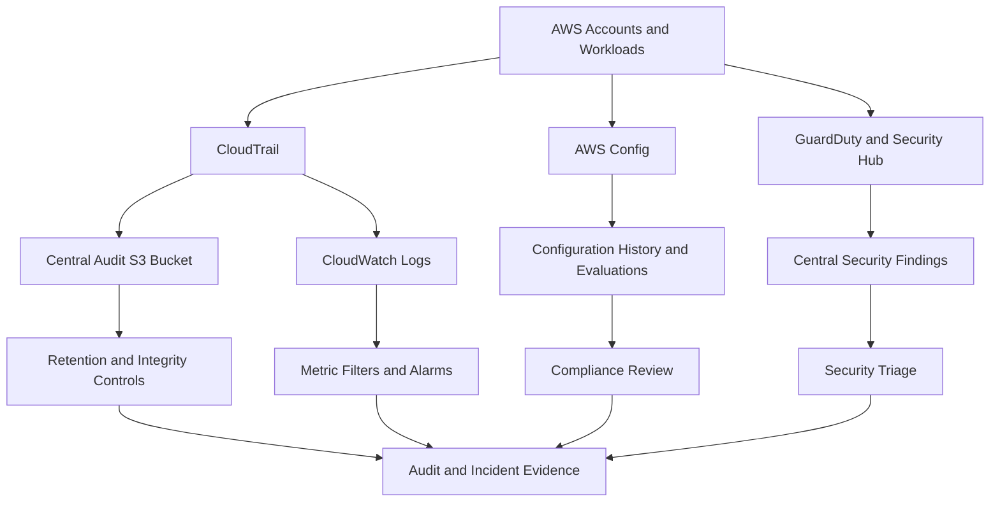
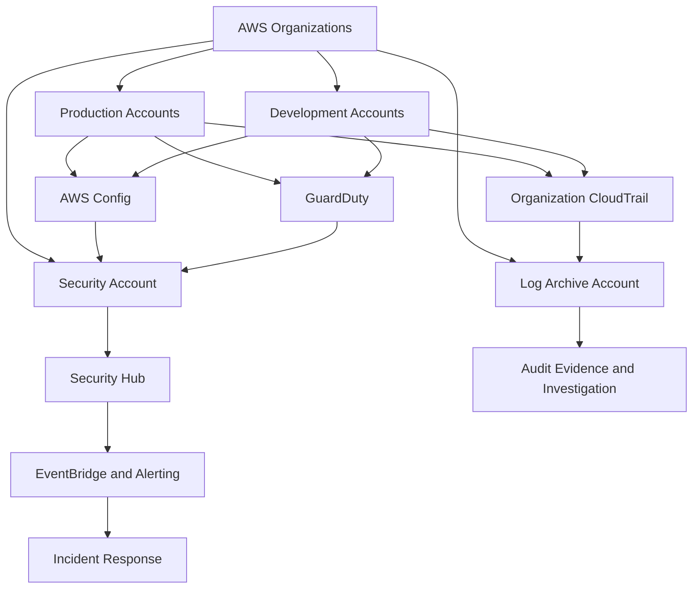
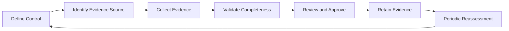

# 10- Compliance and Security Auditing

## Overview

AWS compliance and security auditing provide mechanisms to verify that cloud resources meet organizational security requirements, regulatory obligations, and operational policies. They also establish evidence of who performed an action, what changed, when it occurred, and whether security controls were operating as intended.

For backend engineering teams, compliance is not limited to passing an audit. It involves continuously validating infrastructure configuration, protecting sensitive data, recording privileged activity, detecting unauthorized changes, and maintaining evidence that security requirements are enforced.

A production AWS security auditing strategy commonly combines:

- **AWS CloudTrail** for auditing AWS API activity.
- **AWS Config** for recording resource configuration changes and evaluating configuration rules.
- **AWS Security Hub** for centralized security findings and security posture evaluation.
- **Amazon GuardDuty** for managed threat detection.
- **Amazon CloudWatch** for metrics, logs, dashboards, and alarms.
- **AWS Audit Manager** for collecting and organizing evidence relevant to supported compliance frameworks.
- **AWS Organizations** for multi-account governance and organization-level controls.

These services address different requirements. No single service independently proves that an entire application or cloud environment is compliant.

## Compliance, Security Auditing, and Governance

### Compliance

Compliance means demonstrating that systems and processes satisfy applicable requirements, such as organizational policies, contractual obligations, and regulatory standards.

Examples of technical requirements include:

- Restricting access to production resources.
- Encrypting sensitive data at rest and in transit.
- Recording administrative activity.
- Detecting public exposure of storage resources.
- Maintaining evidence of access reviews.
- Defining retention requirements for audit records.
- Demonstrating that security findings are investigated and remediated.

The specific requirements depend on the organization, workload, jurisdiction, and applicable framework. AWS service configuration alone does not establish compliance with every legal or contractual obligation.

### Security auditing

Security auditing examines whether access, configuration, and operational activity align with expected behavior.

A useful audit should answer:

- Who accessed or changed a resource?
- Which identity performed the operation?
- What API action was requested?
- When and from where did the activity occur?
- Did the request succeed or fail?
- What was the resource's configuration before and after the change?
- Was the activity authorized and approved?
- Was the resulting state compliant with policy?

CloudTrail, AWS Config, application logs, deployment records, and security findings provide complementary evidence for these questions.

### Governance

Governance establishes ownership, boundaries, and enforcement mechanisms across accounts and teams.

Typical governance mechanisms include:

- AWS Organizations and organizational units.
- Service control policies (SCPs).
- Centralized identity and role-based access.
- Organization-level CloudTrail and AWS Config deployment.
- Centralized security findings.
- Standardized retention and encryption policies.
- Infrastructure-as-code reviews and controlled deployment pipelines.
- Documented exception and remediation processes.

Governance is effective when requirements are enforced consistently rather than depending entirely on individual engineers to remember them.

## AWS Shared Responsibility and Audit Boundaries

AWS is responsible for security *of* the cloud, including the underlying infrastructure operated by AWS. Customers remain responsible for security *in* the cloud, with responsibilities varying by service and deployment model.

For example, AWS manages the underlying infrastructure for managed services, but customers must still configure access, data protection, logging, and application behavior appropriately.

| Area | Typical customer responsibility |
|---|---|
| Identity and access | IAM policies, role trust, privileged access, and credential protection |
| Data protection | Classification, access restrictions, encryption configuration, and retention |
| Application security | Authentication, authorization, input validation, dependency security, and secure coding |
| Network security | VPC design, security groups, routing, public exposure, and private connectivity |
| Audit evidence | Required logging, retention, access protection, and investigation processes |
| Resource configuration | Secure defaults, configuration validation, and remediation |
| Compliance evidence | Mapping technical controls to applicable organizational and regulatory requirements |

A successful audit must consider both AWS infrastructure controls and customer-managed configurations and processes.

## AWS CloudTrail

### Purpose

AWS CloudTrail records supported AWS API activity and provides evidence of actions performed by users, roles, and AWS services.

CloudTrail is a foundational source for investigating administrative changes, suspicious API calls, permission failures, and resource modifications.

Typical events include:

- Creating or deleting IAM roles.
- Updating an S3 bucket policy.
- Changing security-group rules.
- Disabling a security service.
- Modifying KMS key policies.
- Creating or modifying compute resources.
- Assuming an IAM role.
- Changing audit or logging configuration.

CloudTrail records API activity, not every internal operation performed by an application or every query executed against a database.

### Event categories

| Event category | What it records | Typical use |
|---|---|---|
| Management events | Control-plane operations, such as creating resources and changing configuration | Audit administrative actions and investigate configuration changes |
| Data events | Supported data-plane operations, such as selected S3 object or Lambda invocation activity | Investigate data access and workload-level activity |
| Network activity events | Supported network-related API activity for configured services and event sources | Investigate relevant network access patterns where supported |
| Insights events | Unusual API activity patterns identified by CloudTrail Insights when enabled and supported | Investigate anomalous API call rates or error rates |

CloudTrail event coverage depends on the event category, trail or event data store configuration, supported resource types, and selected event selectors.

Do not assume that every data-plane operation is recorded by default.

### Event history versus trails

CloudTrail Event history provides a searchable history of recent management events in a Region. It is useful for initial investigations but is not a substitute for a deliberately configured long-term audit strategy.

A CloudTrail trail can deliver selected events to an S3 bucket and optionally to CloudWatch Logs. Organization trails can centralize logging across an AWS Organization when configured appropriately.

| Capability | Event history | Trail |
|---|---|---|
| Primary purpose | Recent management-event investigation | Ongoing audit collection and delivery |
| Retention | Limited event-history window | Configurable through the destination's retention and lifecycle policies |
| Data events | Not a substitute for configured data-event collection | Can capture supported data events when configured |
| Centralized archive | Not a durable archive strategy | Supports delivery to a controlled S3 destination |
| Operational use | Quick investigation | Long-term auditing, compliance evidence, and incident response |

CloudTrail Lake provides an additional option for storing and querying selected events in event data stores. Evaluate its configuration, retention, and pricing separately from ordinary trails.

### Recommended audit architecture



### Enable organization-level logging

For production environments, consider an organization trail managed through an approved security or logging account.

Important configuration requirements include:

- Enable the intended management-event categories.
- Configure data events for sensitive resources where required.
- Deliver logs to a dedicated, access-restricted S3 bucket.
- Enable appropriate encryption and retention controls.
- Prevent workload identities from modifying or deleting audit records.
- Monitor delivery failures and changes to trail configuration.
- Validate coverage across required accounts and Regions.

Organization trails reduce duplicated setup, but they do not remove the need to validate member-account coverage, exclusions, event selectors, and destination access policies.

## AWS CLI: CloudTrail Auditing

The following commands are intended for inspection unless stated otherwise. Use an approved audit identity and verify the account and Region before investigating.

### Verify the active identity

```bash
aws sts get-caller-identity \
  --profile security-readonly
```

**Purpose:** Confirm the account and principal used for the audit.

**Interpretation:** Verify the account ID and ARN before retrieving evidence. A wrong profile can produce a misleading investigation.

### Inspect trails

```bash
aws cloudtrail describe-trails \
  --include-shadow-trails \
  --region us-east-1 \
  --profile security-readonly
```

**Purpose:** Inspect trails visible to the caller in the selected Region.

Review:

- Trail ARN and name.
- Whether the trail is multi-Region.
- Whether it is an organization trail.
- S3 destination and logging configuration.
- Whether the intended audit coverage is present.

### Check logging status

```bash
aws cloudtrail get-trail-status \
  --name <trail-arn-or-name> \
  --region us-east-1 \
  --profile security-readonly
```

**Purpose:** Inspect the status and delivery information for a trail.

**Interpretation:** Review the logging state and any delivery errors. A trail's existence does not prove that it is actively delivering all required events.

### Inspect event selectors

```bash
aws cloudtrail get-event-selectors \
  --trail-name <trail-arn-or-name> \
  --region us-east-1 \
  --profile security-readonly
```

**Purpose:** Inspect configured management-event and data-event selectors.

**Interpretation:** Verify that required data resources and event types are covered. An otherwise healthy trail can still have gaps if its selectors are too narrow.

### Search recent API activity

```bash
aws cloudtrail lookup-events \
  --lookup-attributes \
    AttributeKey=EventName,AttributeValue=PutBucketPolicy \
  --start-time <start-time> \
  --end-time <end-time> \
  --region us-east-1 \
  --profile security-readonly
```

**Purpose:** Search available Event history for a specific management-event name.

You can also search by supported attributes such as username or resource name. `lookup-events` supports a limited set of lookup attributes; it is not a general-purpose query language.

For broader investigations, use a suitable centralized log query or CloudTrail Lake event data store.

### Verify a sensitive change

When investigating a bucket policy change, inspect the event's identity, source address, request parameters, event time, and result. Then compare the change with the approved deployment or change-management record.

Do not assume that a successful API event is malicious. Correlate the event with the actor's role, approved automation, and intended deployment.

## AWS Config

### Purpose

AWS Config records supported resource configuration changes and evaluates resources against configuration rules.

It helps answer questions such as:

- Was a security group changed to allow public access?
- Does an S3 bucket satisfy a required configuration?
- Is a resource compliant with an approved encryption requirement?
- Which resources violate a defined configuration policy?
- How did a resource's configuration change over time?

AWS Config is primarily a configuration history and compliance evaluation service. It does not replace CloudTrail's API activity records.

### Configuration items and history

AWS Config records configuration information for supported resource types. Depending on the resource and configuration, the record can help reconstruct a resource's state and changes over time.

For a security investigation, combine:

- CloudTrail to identify the API actor and operation.
- AWS Config to inspect configuration history and compliance status.
- Security Hub to centralize relevant security findings.
- Application and infrastructure telemetry to determine operational impact.

### Config rules

Config rules evaluate resource configuration against defined requirements.

Rules can be managed by AWS or authored for organization-specific checks. Conformance packs can group rules and remediation actions into a reusable configuration package.

Examples include checks for:

- S3 public-access settings.
- Required encryption configuration.
- Security-group exposure.
- Logging configuration.
- Resource-specific security requirements.

The actual rule set must match the organization's environment. A rule can only assess the conditions it is designed and configured to evaluate.

### AWS Config versus Security Hub

| Capability | AWS Config | AWS Security Hub |
|---|---|---|
| Configuration history | Core capability for supported resources | Not its primary purpose |
| Configuration rules | Evaluates configured rules | Evaluates supported security standards and controls |
| Security finding aggregation | Not its primary purpose | Core capability |
| Threat detection | Not a general threat-detection engine | Aggregates findings from supported sources |
| Resource-state investigation | Useful for historical configuration analysis | Useful for centralized posture and finding review |

The services complement each other. AWS Config provides configuration history and rule evaluation; Security Hub helps centralize security findings and posture information.

## AWS CLI: AWS Config Operations

### Inspect recorder status

```bash
aws configservice describe-configuration-recorders \
  --region us-east-1 \
  --profile security-readonly
```

**Purpose:** List configured configuration recorders.

A recorder definition does not necessarily prove that recording is active. Inspect recorder status separately.

```bash
aws configservice describe-configuration-recorder-status \
  --region us-east-1 \
  --profile security-readonly
```

**Purpose:** Check whether recording is running and inspect relevant status details.

### Inspect compliance status

```bash
aws configservice describe-compliance-by-config-rule \
  --region us-east-1 \
  --profile security-readonly
```

**Purpose:** Retrieve compliance summaries for Config rules.

Review the rule name, compliance status, and evaluation details. Use resource-specific compliance APIs when you need to identify the exact resources contributing to a failed rule.

### Inspect configuration history

For a known resource, retrieve its configuration history using the appropriate AWS Config API. The exact API and resource identifier format depend on the resource type.

Use the returned configuration timeline to compare the resource state around the incident time. Correlate the timeline with CloudTrail events to identify the API operation responsible for a change.

### Operational considerations

AWS Config can incur charges based on configuration items, evaluations, and related features. Resource coverage, recording frequency, and rule selection affect cost.

Before enabling it across a large environment:

- Select the resource types that must be recorded.
- Define required Regions and accounts.
- Validate delivery and recording status.
- Avoid creating redundant custom rules without a clear requirement.
- Monitor failed evaluations and recorder interruptions.
- Test remediation actions before enabling them broadly.

## AWS Security Hub and GuardDuty in Auditing

Security Hub and GuardDuty provide different types of evidence.

GuardDuty generates findings about supported suspicious activity. Security Hub aggregates supported findings and evaluates security posture against enabled standards and controls.

For an audit, use them to demonstrate that:

- Threat detection is enabled where required.
- Security findings are visible to the responsible team.
- Relevant configuration controls are evaluated.
- Findings have an owner and workflow.
- High-risk issues are investigated within defined service-level targets.
- Exceptions and remediation outcomes are documented.

### Evidence of operation

A screenshot or configuration export showing that a service is enabled is not sufficient evidence that the entire detection and response process works.

Stronger evidence combines:

- Configuration and coverage records.
- Representative findings or controlled test results.
- Alert delivery records.
- Incident tickets and investigation notes.
- Remediation verification.
- Access reviews and periodic control checks.

Avoid generating artificial security incidents in production merely to create audit evidence. Use approved test scenarios and non-production environments where possible.

## AWS Audit Manager

### Purpose

AWS Audit Manager helps collect, organize, and review evidence relevant to supported compliance frameworks and assessments.

It can reduce the manual effort required to assemble evidence from supported AWS sources, but it does not independently certify that a workload complies with a regulation or framework.

Its outputs must be reviewed in the context of the organization's control requirements and evidence standards.

### Common use cases

- Organizing evidence for an internal audit.
- Mapping technical controls to an assessment framework.
- Collecting supported evidence from AWS services.
- Tracking assessment progress.
- Identifying evidence gaps that require manual review.

### Limitations

Audit Manager does not eliminate the need for:

- Control owners.
- Human review of evidence relevance.
- Policies and procedures outside AWS.
- Application-level testing.
- Access reviews and operational records.
- Independent audit or legal interpretation where required.

Before adopting it, verify current framework availability, evidence-source support, service pricing, and regional requirements.

## Preventive, Detective, and Responsive Controls

A mature compliance program distinguishes controls by their role in reducing and managing risk.

| Control category | Purpose | AWS examples |
|---|---|---|
| Preventive | Stop unauthorized or unsafe configurations and operations | IAM policies, SCPs, security groups, S3 Block Public Access, KMS key policies |
| Detective | Identify suspicious activity or noncompliant state | CloudTrail, AWS Config, GuardDuty, Security Hub |
| Responsive | Contain incidents and restore a secure state | Approved automation, credential revocation, configuration remediation, incident workflows |

For example, an SCP may prevent a member account from disabling an organization-required security control. CloudTrail records attempts and changes where applicable. Monitoring detects unexpected activity, and an incident-response workflow investigates and remediates the issue.

These controls must be tested together. A preventive policy without monitoring can hide operational failures, while detective controls without ownership and response procedures produce unresolved findings.

## Centralized Audit Architecture

### Recommended design

A multi-account environment should separate production workloads from centralized audit storage and security administration.



This is a conceptual design. Actual delegated administration, organization trails, Config aggregation, and regional deployment must be configured through their respective service mechanisms.

### Security controls for the log archive

Audit logs are themselves sensitive security assets. Protect them against unauthorized access, modification, deletion, and premature expiration.

Recommended controls include:

- A dedicated log archive account.
- A dedicated S3 bucket for audit data.
- Restricted bucket policies and access points where appropriate.
- Encryption at rest using an approved encryption configuration.
- TLS for data in transit.
- Versioning and appropriate retention or lifecycle policies.
- S3 Object Lock when immutable retention is required and configured appropriately.
- Monitoring for changes to bucket policies, logging, lifecycle rules, and encryption configuration.
- Restricted deletion and administrative access.
- Documented access and evidence-retrieval procedures.

S3 Object Lock can provide WORM-style retention for supported objects and configurations. It must be configured with the intended retention mode and governance process; merely enabling versioning does not make logs immutable.

### Cross-account access

Prefer a controlled role-assumption model for audit access.

- Security personnel assume approved read-only roles in workload accounts.
- Centralized automation uses dedicated roles with narrowly scoped permissions.
- Log archive permissions are separate from workload deployment permissions.
- Workload roles cannot modify the archive's security controls.
- Emergency access is explicitly controlled and audited.

Avoid granting every engineering team direct administrative access to the central logging account.

## Audit Evidence Lifecycle

Compliance evidence should be managed as a lifecycle rather than an ad hoc collection of screenshots.



### Define the control

Document the requirement in a form that can be tested. For example, "Production S3 buckets must not permit unintended public access" is more actionable than "S3 must be secure."

### Identify the evidence source

Determine which sources prove the control is operating:

- Configuration state.
- CloudTrail events.
- AWS Config evaluations.
- IAM policy and role configuration.
- Deployment pipeline records.
- Security Hub findings.
- Access-review records.
- Incident tickets.

### Validate evidence quality

Evidence should be:

- Relevant to the control.
- Traceable to the correct account and Region.
- Timestamped.
- Complete for the defined assessment period.
- Protected against unauthorized modification.
- Retained for the required duration.
- Reproducible where practical.

A successful command executed today does not prove that the same control was configured correctly six months ago. Historical evidence is required for time-bound audits.

## Audit Retention and Integrity

### Retention planning

Retention requirements depend on organizational policy, applicable regulations, incident-response needs, and the type of evidence.

Define retention separately for:

- CloudTrail event archives.
- CloudWatch Logs.
- AWS Config history and snapshots.
- Application logs.
- Security findings and incident records.
- Evidence packages and approval records.

Avoid one global retention value for every data type. Sensitive application logs may need stricter data minimization, while security audit records may require longer retention.

### Integrity and access protection

For long-term audit archives:

- Limit write and delete permissions.
- Separate archive administration from workload administration.
- Use appropriate encryption and key governance.
- Consider CloudTrail log file integrity validation.
- Monitor changes to trail configuration and destinations.
- Test restoration and evidence retrieval.
- Document break-glass access.

CloudTrail log file integrity validation helps verify the integrity of delivered CloudTrail log files using digest files and cryptographic validation mechanisms. It does not prove that every relevant event was selected or recorded in the first place.

### Compliance and cost trade-offs

Longer retention improves historical investigation and audit coverage but increases storage costs. Data events, high-volume application logs, and frequent configuration evaluations can also increase costs.

Use lifecycle policies and storage tiers where appropriate, but do not expire records before the approved retention period. Test lifecycle policies against the actual evidence-retention requirement.

## Security Auditing for Backend Applications

AWS control-plane auditing does not replace application-level audit logging.

A Django or FastAPI service may need to record business actions that AWS CloudTrail cannot describe, such as:

- A user changing an account's billing details.
- A service administrator granting another user access.
- A privileged API request modifying a customer record.
- A background worker exporting sensitive data.
- A business approval or authorization decision.

Application audit events should capture relevant context without unnecessarily storing credentials, session tokens, secrets, or sensitive request payloads.

A useful audit event might contain:

| Field | Purpose |
|---|---|
| Event ID | Unique identifier for correlation |
| Timestamp | Time of the business operation |
| Actor ID | User or service identity performing the action |
| Action | Business operation performed |
| Resource ID | Affected application resource |
| Outcome | Success, denial, or failure |
| Request or correlation ID | Connects the event to request telemetry |
| Source context | Relevant client or service metadata, subject to privacy requirements |

### Python example

The following example demonstrates structured application audit logging without recording authorization headers or secret values.

```python
import json
import logging
from datetime import UTC, datetime
from uuid import uuid4

logger = logging.getLogger("application.audit")


def record_audit_event(
    *,
    actor_id: str,
    action: str,
    resource_id: str,
    outcome: str,
    request_id: str,
) -> None:
    event = {
        "event_id": str(uuid4()),
        "timestamp": datetime.now(UTC).isoformat(),
        "actor_id": actor_id,
        "action": action,
        "resource_id": resource_id,
        "outcome": outcome,
        "request_id": request_id,
    }

    logger.info(json.dumps(event, separators=(",", ":")))
```

Production considerations:

- Derive the actor identity from authenticated application context, not arbitrary client-supplied fields.
- Validate and normalize fields to prevent log injection.
- Avoid logging access tokens, passwords, secret values, and unnecessary personal information.
- Restrict access to audit logs and configure retention.
- Ensure that security-sensitive audit events are not silently dropped.
- Use a durable delivery strategy when audit-event loss is unacceptable.
- Consider transactional outbox patterns when business state changes and audit-event publication must remain consistent.

For high-assurance business auditing, write the business change and its audit record within an appropriate transactional boundary. Asynchronous log delivery alone may not guarantee that an event is durably recorded before the request succeeds.

## Secure CI/CD and Compliance Enforcement

CI/CD pipelines are an important part of the compliance boundary because deployment identities can modify production infrastructure and application behavior.

### Recommended controls

- Use short-lived workload identity federation or approved role-assumption mechanisms.
- Avoid long-lived cloud credentials in repository secrets when a supported federation model is available.
- Require review for sensitive infrastructure changes.
- Run policy and configuration checks before deployment.
- Scan dependencies and container images.
- Protect production deployment permissions.
- Audit pipeline executions and infrastructure changes.
- Separate deployment permissions from security-administration permissions.
- Preserve release identifiers and deployment records for investigations.

### Example pipeline controls

A production deployment can validate infrastructure changes before applying them:

1. Run tests and static analysis.
2. Validate infrastructure templates.
3. Evaluate policy and security constraints.
4. Produce a reviewable deployment plan.
5. Require approval for sensitive changes.
6. Deploy using a narrowly scoped role.
7. Verify the deployed configuration.
8. Preserve the deployment record and correlate it with CloudTrail events.

Infrastructure-as-code reviews provide preventive assurance. CloudTrail and AWS Config provide complementary post-deployment evidence.

### Common mistakes

- Using one administrator role for every pipeline.
- Allowing a deployment identity to modify audit retention or disable security services.
- Treating a successful deployment as proof of compliance.
- Ignoring drift introduced by manual console changes.
- Failing to correlate infrastructure changes with the release that introduced them.

## Troubleshooting

### Missing CloudTrail events

**Symptoms**

- An expected API call does not appear in the audit archive.
- Event history contains an event that is missing from the long-term destination.
- Data-access investigations lack expected events.

**Likely causes**

- The wrong account or Region is being queried.
- The operation is a data event that was not selected.
- The trail was not logging during the relevant period.
- The event source or resource type is not covered by the current configuration.
- Delivery is delayed or failing.
- The query uses an incorrect time range or unsupported lookup attribute.

**Isolation**

```bash
aws sts get-caller-identity

aws cloudtrail describe-trails \
  --include-shadow-trails \
  --region us-east-1

aws cloudtrail get-trail-status \
  --name <trail-arn-or-name> \
  --region us-east-1

aws cloudtrail get-event-selectors \
  --trail-name <trail-arn-or-name> \
  --region us-east-1
```

**Corrective actions**

Verify the account, Region, trail status, selectors, destination, and delivery errors. Configure missing event categories through the approved change process.

**Verification**

Generate an approved test operation in a test environment, then confirm that the expected event is available in the source and archive.

**Prevention**

Monitor trail configuration, delivery status, and coverage. Alert on unexpected changes to selectors or logging state.

### AWS Config is not recording resources

**Symptoms**

- Expected resource types are absent from configuration history.
- Configuration compliance information is stale.
- New resources are not evaluated.

**Likely causes**

- The recorder is not running.
- The resource type is not included in the recording configuration.
- The account or Region is outside the intended coverage.
- Required permissions or delivery configuration are incorrect.

**Isolation**

```bash
aws configservice describe-configuration-recorders \
  --region us-east-1

aws configservice describe-configuration-recorder-status \
  --region us-east-1
```

**Corrective actions**

Verify recorder status, resource-type coverage, and configuration delivery settings. Restore recording through the approved administration process.

**Verification**

Confirm that new configuration items appear and that relevant rules evaluate the expected resources.

**Prevention**

Include recorder health and resource coverage in continuous compliance checks.

### Security Hub reports unexpected control failures

**Symptoms**

- A control reports a failed status after deployment.
- Security posture changes unexpectedly.
- Multiple accounts report the same failure.

**Likely causes**

- A deployment changed the underlying configuration.
- The control's evaluation criteria differ from local assumptions.
- The wrong account or Region is being reviewed.
- An exception or exclusion was not configured as intended.

**Isolation**

Identify the control and affected resource. Inspect the current resource configuration, the control's criteria, and the deployment history. Correlate changes with CloudTrail and AWS Config.

**Corrective actions**

Fix the underlying configuration or document an approved exception with compensating controls and an owner. Do not suppress findings merely to improve a compliance score.

**Verification**

Re-evaluate the control and verify that the underlying resource satisfies the intended requirement.

**Prevention**

Test infrastructure changes against the relevant controls before deployment and monitor repeated failures.

### Audit log delivery failures

**Symptoms**

- Logs are missing from the archive.
- Trail status reports delivery errors.
- CloudWatch Logs or S3 destinations do not receive expected records.

**Likely causes**

- Incorrect destination configuration.
- A restrictive or invalid destination policy.
- Encryption or KMS authorization problems.
- Logging configuration changes.
- Service delivery or permission issues.

**Isolation**

Inspect trail status, destination configuration, relevant resource policies, and KMS permissions. Verify that the destination exists and that the service can deliver records under the configured authorization model.

**Corrective actions**

Correct the narrow configuration or permission issue. Avoid granting broad S3 or KMS permissions to the workload merely to make audit delivery succeed.

**Verification**

Confirm successful delivery of new events and verify that the archive's encryption and retention requirements remain intact.

**Prevention**

Monitor delivery failures and periodically test retrieval from the archive.

### Unauthorized changes to audit configuration

**Symptoms**

- A trail is disabled or modified unexpectedly.
- Event selectors are narrowed.
- Audit destination or retention configuration changes without an approved record.

**Likely causes**

- Excessive administrative permissions.
- Compromised credentials.
- Weak separation between workload and security administration.
- Missing alerts for changes to audit controls.

**Isolation**

Use available CloudTrail evidence to identify the actor, session, source, event time, and affected configuration. Correlate the change with deployment and approval records.

**Corrective actions**

Restore the approved configuration, contain compromised credentials if indicated, preserve evidence, and review the principal's permissions. Use preventive organization-level controls where supported.

**Verification**

Confirm that logging is active, required events are covered, and the destination remains protected.

**Prevention**

Restrict audit administration, alert on sensitive configuration changes, and review privileged access regularly.

## Operational Audit Checklist

### Identity and access

- [ ] Production access uses approved identities and short-lived credentials where supported.
- [ ] Privileged roles and cross-account trust relationships are reviewed.
- [ ] Audit identities have read access appropriate to their responsibilities.
- [ ] Security-control administration is restricted to authorized principals.
- [ ] Access reviews and exception approvals are retained.

### Logging and evidence

- [ ] CloudTrail coverage matches the required accounts and Regions.
- [ ] Required management and data events are selected.
- [ ] Trails are logging and delivering records successfully.
- [ ] Audit destinations have appropriate encryption and access restrictions.
- [ ] Retention and deletion policies meet evidence requirements.
- [ ] Retrieval and integrity-verification procedures are documented and tested.

### Configuration compliance

- [ ] AWS Config recording covers required resource types.
- [ ] Required configuration rules are evaluated.
- [ ] Security Hub standards and controls are reviewed.
- [ ] GuardDuty coverage is enabled for the required accounts and Regions.
- [ ] High-risk findings have owners and remediation deadlines.
- [ ] Exceptions are documented and periodically reassessed.

### Incident readiness

- [ ] Security findings are routed to the responsible team.
- [ ] Alert delivery and failure handling are tested.
- [ ] Incident-response procedures cover credential compromise and unauthorized changes.
- [ ] Evidence preservation and access procedures are documented.
- [ ] Remediation is verified rather than assumed.
- [ ] Lessons from incidents are converted into preventive controls.

## Practical Exercise: Audit a Sensitive S3 Policy Change

### Prerequisites

- AWS CLI configured with an approved read-only profile.
- Access to CloudTrail Event history.
- A test account or an approved non-production environment.
- A known S3 bucket used for the exercise.

### Steps

**Verify the active identity:**

```bash
aws sts get-caller-identity \
  --profile security-readonly
```

**Inspect the bucket's current policy:**

```bash
aws s3api get-bucket-policy \
  --bucket <test-bucket-name> \
  --profile security-readonly
```

If the bucket has no policy, the command may return an error indicating that no policy exists. This does not by itself indicate a security incident.

**Search for policy changes:**

```bash
aws cloudtrail lookup-events \
  --lookup-attributes \
    AttributeKey=EventName,AttributeValue=PutBucketPolicy \
  --start-time <start-time> \
  --end-time <end-time> \
  --region us-east-1 \
  --profile security-readonly
```

**Inspect the matching event:**

Review the principal, event time, source context, request parameters, and result. Compare the operation with the expected deployment record.

**Check configuration evidence:**

If AWS Config records the bucket, inspect the relevant configuration history and compliance results through the applicable APIs or console.

### Expected outcome

You should be able to identify the current policy, locate available API evidence for policy changes, and correlate activity with configuration history and approved deployment records.

### Cleanup and verification

The commands above are read-only. No cleanup is required. If a policy change is part of a separately approved test, restore the original intended configuration through the approved workflow and verify the result.

### Cost and quota considerations

Read-only inspection commands do not create additional resources. Existing CloudTrail, AWS Config, Security Hub, and log-storage usage may incur charges according to the enabled features and pricing model. Review current pricing before enabling broad data-event logging or organization-wide configuration recording.

## Senior-Level Interview Questions

### Core concepts

**What is the difference between CloudTrail and AWS Config?**

CloudTrail records supported AWS API activity and helps identify who performed an operation. AWS Config records supported resource configuration state and evaluates configuration rules. Correlating them helps connect a configuration change to the actor and resulting state.

**Does CloudTrail automatically record every S3 object access?**

No. S3 object-level activity is a data-event category and must be configured through the relevant CloudTrail event selectors. Event coverage should be validated against the actual audit requirement.

**Does Security Hub prove regulatory compliance?**

No. Security Hub evaluates supported security controls and aggregates findings. Compliance also depends on the applicable requirements, application behavior, organizational processes, evidence quality, and independent assessment where required.

### Architecture and governance

**How would you design audit logging for a multi-account AWS organization?**

Use an organization trail with an appropriately protected central archive, define required event selectors, restrict archive access, establish retention and integrity controls, and monitor delivery failures. Combine CloudTrail with AWS Config and centralized security findings, then validate coverage across required accounts and Regions.

**Why should the log archive be separated from production accounts?**

Separation reduces the ability of a compromised workload or production administrator to modify or delete the evidence needed for an investigation. It also allows access to be controlled independently from application deployment permissions.

**How would you prevent a deployment pipeline from disabling required audit logging?**

Use narrowly scoped deployment roles, restrict sensitive audit administration, and apply organization-level preventive controls where supported. Add infrastructure policy checks and monitor CloudTrail for changes to audit configuration. Ensure emergency access remains controlled and auditable.

### Troubleshooting and incident response

**An API change is visible in CloudTrail Event history but missing from the S3 archive. What would you investigate?**

Check the trail's logging status, destination, selectors, delivery errors, account and Region scope, and the event's time. Verify whether the event was selected for delivery and whether the archive received it. Do not assume that Event history and a configured trail have identical coverage.

**A security control fails immediately after a deployment. How would you respond?**

Identify the control and affected resource, inspect the current configuration, and correlate the change with CloudTrail and deployment records. Correct the configuration through the approved pipeline or document a justified exception with compensating controls. Verify the control's subsequent evaluation.

**What evidence would you preserve after unauthorized changes to an audit trail?**

Preserve available CloudTrail events, trail configuration, destination policies, delivery status, related IAM changes, deployment records, and timestamps. Restrict access to the evidence, investigate possible credential compromise, restore approved logging, and verify coverage before declaring recovery.

### Senior-level reasoning

**Is a green compliance dashboard enough to prove that a system is secure?**

No. A dashboard only reflects the controls and evidence that the configured services evaluate. Review coverage gaps, application-level security, detection and response effectiveness, exceptions, and the quality and retention of historical evidence.

**How do you balance audit completeness with cost and data minimization?**

Map requirements to event categories and resource types, enable the necessary coverage, and retain evidence for approved periods. Avoid collecting unnecessary sensitive payloads, use suitable storage lifecycle policies, and monitor cost. Do not reduce essential audit coverage without an explicit risk decision.

## Key Takeaways

- CloudTrail records supported AWS API activity, while AWS Config tracks supported resource configuration and evaluates configuration rules.
- Security Hub, GuardDuty, and Audit Manager complement auditing by centralizing findings, detecting threats, and organizing compliance evidence.
- Centralized audit logs require strict access controls, appropriate encryption, retention, integrity protection, and monitoring for delivery or configuration failures.
- Effective compliance depends on traceable evidence, control ownership, approved exceptions, verified remediation, and continuous coverage checks.
- Combine AWS control-plane auditing with application-level audit events, deployment records, and incident-response workflows to establish a complete operational picture.
```