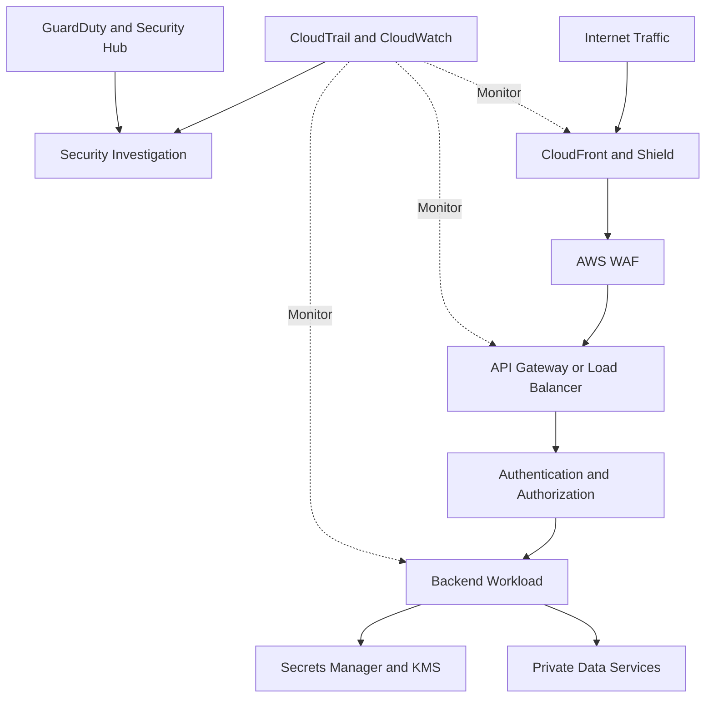
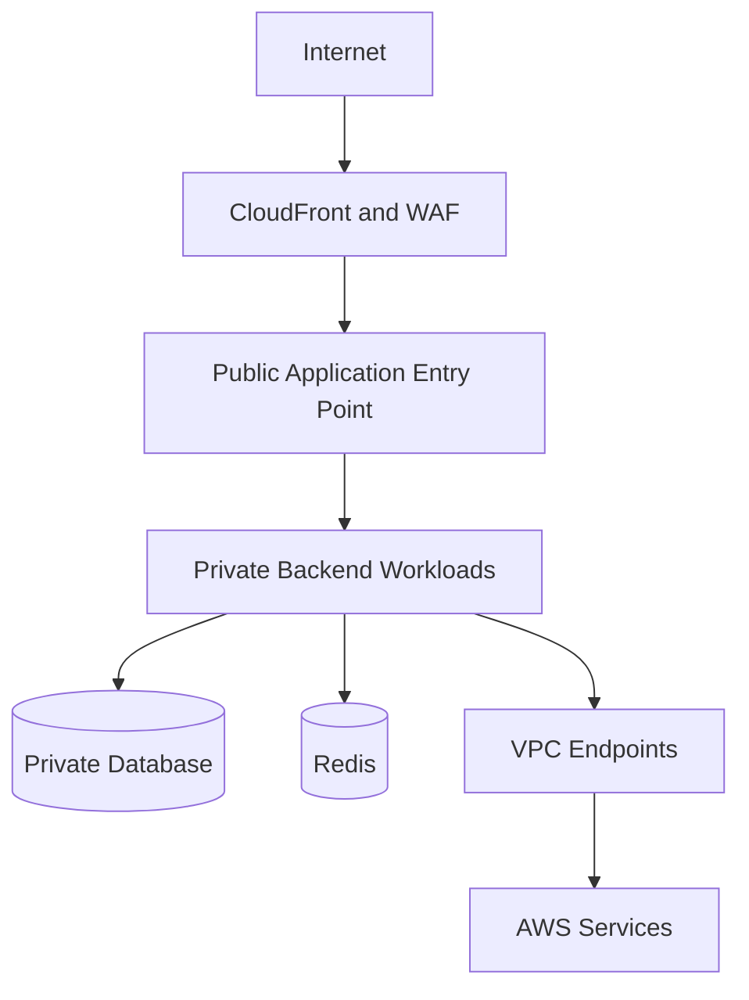
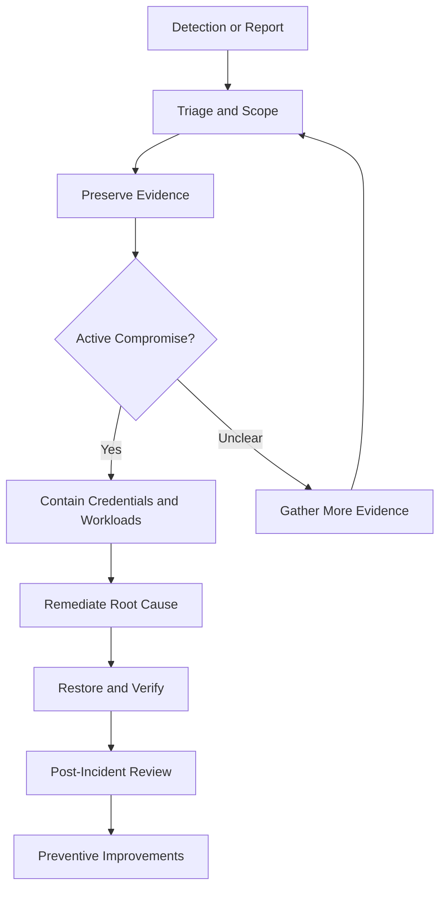

# 11- Security Hardening and Best Practices

## Overview

AWS security hardening is the process of reducing unnecessary access, exposure, configuration weaknesses, and operational risks across cloud infrastructure and applications. It combines preventive controls, continuous validation, monitoring, and incident-response readiness.

For backend systems built with Django, FastAPI, PostgreSQL, Redis, Celery, Docker, and AWS-managed services, security hardening must cover more than IAM policies. A secure design protects identities, APIs, data, workloads, deployment pipelines, audit evidence, and recovery mechanisms.

A production security baseline should establish:

- Least-privilege access for people, applications, and automation.
- Short-lived credentials and secure workload identities.
- Private networking and minimal public exposure.
- Encryption at rest and in transit.
- Secure storage and rotation of application secrets.
- Centralized auditing, threat detection, and configuration validation.
- Controlled deployment and emergency-access procedures.
- Tested incident response, backup, and recovery processes.

Security hardening is continuous. New services, deployments, policy changes, and operational exceptions can introduce risks after an environment has initially passed its security review.

## Security Hardening Principles

### Defense in depth

Defense in depth uses multiple independent controls to reduce the likelihood and impact of compromise.

For example, a public REST API may use CloudFront, AWS WAF, TLS, API authentication, application authorization, private database connectivity, and encrypted storage. A failure in one control should not automatically expose every downstream resource.



Each layer has a distinct responsibility:

| Layer | Primary control | Security objective |
|---|---|---|
| Edge | CloudFront, Shield, WAF | Reduce malicious traffic and public attack exposure |
| Network | VPCs, security groups, private endpoints | Restrict connectivity |
| Identity | IAM, STS, workload roles | Limit access to AWS resources |
| Application | Authentication, authorization, validation | Enforce business security rules |
| Data | KMS, encryption, database permissions | Protect sensitive information |
| Operations | CloudTrail, GuardDuty, Security Hub | Detect suspicious activity and misconfiguration |
| Recovery | Backups, tested restoration, incident procedures | Limit impact and restore service |

### Least privilege

Least privilege grants only the permissions required for a specific identity, workload, or operational task.

An application that reads one S3 prefix should not automatically receive write access to every bucket. A deployment role should not have unrestricted permission to change organization-wide security controls.

Apply least privilege to:

- IAM actions and resources.
- Trust policies and role-assumption conditions.
- Network connectivity.
- Database roles and schemas.
- Secret access.
- Deployment environments.
- Audit-log access.
- Emergency and administrative workflows.

Review effective access periodically. A policy that appears narrow in isolation may still provide excessive access when combined with resource policies, role assumptions, and other permission paths.

### Zero-trust principles

Zero trust avoids treating network location as sufficient proof of identity or authorization.

In AWS, this means:

- Authenticate users and workloads explicitly.
- Authorize each operation according to identity and context.
- Use private networking as an additional boundary, not as the sole access control.
- Prefer temporary credentials over long-lived access keys.
- Monitor sensitive operations.
- Reassess access when workloads, identities, or trust relationships change.

A service running inside a private subnet is not automatically authorized to access every internal API or database.

### Secure by default

Secure-by-default configurations reduce the number of unsafe decisions required during development and deployment.

Examples include:

- Private database subnets.
- No public IP addresses for workloads that do not require them.
- S3 Block Public Access enabled unless a documented requirement says otherwise.
- Encryption enabled for supported storage services.
- Restricted security-group ingress.
- Disabled debug mode in production.
- Explicitly scoped IAM permissions.
- Protected audit-log destinations.
- Automated security checks in CI/CD.

Exceptions should be documented, reviewed, time-bound where practical, and supported by compensating controls.

## AWS Shared Responsibility Model

AWS manages the security of the underlying cloud infrastructure, while customers remain responsible for configuring and operating their workloads securely. The exact responsibility boundary varies by service.

| Area | AWS responsibility | Customer responsibility |
|---|---|---|
| Physical infrastructure | Facilities, physical security, underlying infrastructure | Not normally customer-managed |
| Managed service infrastructure | Operates the underlying service infrastructure | Configure access, data protection, and service settings |
| IAM | Provides the identity and authorization platform | Define identities, permissions, trust, and privileged-access controls |
| Application | Provides supported infrastructure and service capabilities | Secure code, dependencies, authentication, and authorization |
| Data | Provides infrastructure capabilities for storage and processing | Classify data, restrict access, configure encryption, and manage retention |
| Network | Operates AWS networking infrastructure | Configure VPCs, routing, security groups, and public exposure |
| Audit and detection | Provides logging and security services | Enable required coverage, configure retention, investigate findings, and respond |

Do not assume that using a managed service transfers all security responsibilities to AWS. A managed database still requires correct network access, database credentials, authorization, encryption settings, and operational monitoring.

## IAM Hardening

### Use temporary credentials

Prefer IAM roles and temporary credentials for workloads running on AWS.

Common examples include:

- EC2 instance profiles.
- Lambda execution roles.
- ECS task roles.
- EKS workload identity mechanisms supported by the cluster configuration.
- Federated roles for CI/CD pipelines.
- Cross-account role assumption for approved administration.

Avoid embedding IAM access keys in source code, Docker images, configuration files, or repository secrets when a supported role-based identity mechanism is available.

### Scope permissions narrowly

A policy should identify the required actions and resources. Use conditions where they materially constrain access and are supported by the service.

For example, a workload that must read objects from a specific S3 prefix can use a policy such as:

```json
{
  "Version": "2012-10-17",
  "Statement": [
    {
      "Sid": "ReadApplicationReports",
      "Effect": "Allow",
      "Action": [
        "s3:GetObject"
      ],
      "Resource": "arn:aws:s3:::example-private-bucket/reports/*"
    }
  ]
}
```

This grants object-read permission for the specified prefix, but it does not grant bucket listing. Add `s3:ListBucket` only if required, scoped to the bucket and constrained by a prefix condition when appropriate.

A complete access design must also account for explicit denies, SCPs, permission boundaries, session policies, resource policies, and KMS permissions where applicable.

### Protect privileged identities

- Require MFA for privileged human access.
- Use federation and centralized identity where appropriate.
- Restrict role assumption through trust policies.
- Separate security administration from application deployment.
- Review unused credentials and stale role assignments.
- Monitor sensitive IAM changes.
- Use approved emergency-access procedures.

Do not use the AWS account root user for routine engineering work. Protect it with strong authentication and tightly control its use.

### Inspect the active identity

```bash
aws sts get-caller-identity \
  --profile production-readonly
```

This read-only command identifies the account and principal associated with the active credentials.

Before troubleshooting an authorization failure, verify that the command is using the intended profile, role, account, and Region.

## Secret Management

### Store secrets in dedicated services

Use AWS Secrets Manager or Systems Manager Parameter Store according to the secret's lifecycle and operational requirements.

| Requirement | Typical choice | Considerations |
|---|---|---|
| Database credentials requiring managed rotation | Secrets Manager | Rotation configuration, Lambda rotation workflow where applicable, and additional cost |
| API keys or application secrets requiring centralized lifecycle management | Secrets Manager | Access policies, rotation, caching, and auditability |
| Configuration values and parameters | Parameter Store | Parameter tier, encryption requirements, access control, and quotas |
| Non-sensitive application settings | Environment-specific configuration | Avoid mixing non-sensitive settings with credentials |

Encrypted parameters in Parameter Store can use AWS KMS. Secrets Manager also integrates with KMS for supported encryption configurations.

### Python example

Retrieve a secret through the AWS SDK's credential provider chain instead of embedding credentials in the application.

```python
import json

import boto3
from botocore.exceptions import BotoCoreError, ClientError


def load_database_secret(secret_id: str, region_name: str) -> dict:
    client = boto3.client(
        "secretsmanager",
        region_name=region_name,
    )

    try:
        response = client.get_secret_value(SecretId=secret_id)
    except (BotoCoreError, ClientError):
        # Log the failure category through the application's standard
        # exception handling, without logging secret values or response data.
        raise RuntimeError("Unable to retrieve database configuration") from None

    secret_string = response.get("SecretString")
    if not secret_string:
        raise RuntimeError("Expected a string-form database secret")

    try:
        secret = json.loads(secret_string)
    except json.JSONDecodeError:
        raise RuntimeError("Database secret is not valid JSON") from None

    required_fields = {"username", "password", "host", "dbname"}
    if not required_fields.issubset(secret):
        raise RuntimeError("Database secret is missing required fields")

    return secret
```

This example deliberately avoids logging the exception details because SDK errors and response metadata should be reviewed before they are written to logs. Production implementations should preserve safe diagnostic context, such as an error category and correlation ID, without exposing credentials.

Operational considerations:

- The workload identity needs `secretsmanager:GetSecretValue` for the specific secret.
- Customer-managed KMS keys may require additional authorization.
- Secret caching reduces API calls and latency but delays visibility of rotations.
- Database connection pools must handle credential rotation and reconnection safely.
- Secret values must not appear in logs, traces, error messages, or crash reports.

## Encryption and KMS Governance

### Encryption at rest

Enable appropriate encryption for supported storage services, including S3, EBS, RDS, and CloudWatch Logs.

Choose between AWS-managed and customer-managed KMS keys based on the required level of control.

| Key type | Advantages | Trade-offs |
|---|---|---|
| AWS-managed KMS key | Lower operational overhead and integrated service usage | Less customer control over key policy and lifecycle |
| Customer-managed KMS key | Greater control over policy, grants, rotation settings, and lifecycle | Additional governance, permission management, and cost considerations |

A customer-managed key is not automatically more secure. Its security depends on key policy design, grants, administrative access, lifecycle management, and monitoring.

### Key governance

- Restrict key administration and key usage separately where appropriate.
- Review key policies and grants.
- Enable supported rotation settings where required.
- Protect encryption context and sensitive metadata.
- Plan for key disablement and deletion carefully.
- Monitor KMS access-denied events and key-policy changes.
- Test recovery procedures for encrypted backups and archived data.

Deleting or disabling a key can make dependent data inaccessible. Key lifecycle changes should be treated as high-impact operations with explicit review and recovery planning.

### Encryption in transit

Use TLS for public APIs, internal service communication where appropriate, and connections to supported AWS services.

For backend applications:

- Validate certificates and hostnames.
- Avoid disabling TLS verification to bypass connectivity issues.
- Enforce secure protocols and cipher configurations supported by the service.
- Protect private keys and certificate material.
- Plan certificate renewal and expiry monitoring.

Encryption in transit protects data against network interception but does not replace endpoint authentication or authorization.

## Network Hardening

### Minimize public exposure

A secure VPC design separates public entry points from private workloads and data services.

Typical patterns include:

- Public subnets for internet-facing load balancers when required.
- Private subnets for application workloads.
- Isolated or tightly controlled database subnets.
- Security groups scoped to known service-to-service traffic.
- VPC endpoints or AWS PrivateLink for supported private service access.
- Controlled outbound connectivity where practical.



This is a conceptual design. Actual subnet placement and connectivity depend on the chosen AWS services and deployment model.

### Security groups

Security groups are stateful network controls attached to supported resources. Allow only required ports and source or destination ranges.

Examples:

- Permit HTTPS to the public entry point.
- Permit application traffic from the approved load-balancer security group.
- Permit database traffic only from the backend security group.
- Avoid unrestricted database ingress from the internet.

Network ACLs provide stateless subnet-level filtering and may be useful as an additional boundary, but they do not replace carefully scoped security groups.

### Verify security-group exposure

```bash
aws ec2 describe-security-groups \
  --group-ids <security-group-id> \
  --region us-east-1 \
  --profile security-readonly
```

Review ingress and egress rules, attached resources, and intended traffic paths. The command is read-only.

### Additional network controls

- Avoid public IP addresses on workloads that do not require them.
- Use private connectivity to supported AWS services where practical.
- Review DNS resolution and routing behavior.
- Prevent direct origin access when traffic is intended to pass through a protected edge.
- Monitor security-group and route-table changes.
- Review egress access for workloads handling sensitive data.

Private subnets do not automatically eliminate internet connectivity. Routes, NAT gateways, endpoints, proxies, and DNS configuration determine which destinations a workload can reach.

## Application and API Hardening

### Authentication and authorization

Use authentication to establish identity and authorization to determine permitted actions.

For REST APIs:

- Authenticate requests using an appropriate identity mechanism.
- Authorize access at the resource and operation level.
- Validate request schemas and business constraints.
- Enforce tenant isolation in queries and data access.
- Rate-limit expensive or abuse-prone operations.
- Apply timeouts and bounded request sizes.
- Avoid trusting client-supplied identity or authorization fields.

For Django and FastAPI services, authorization should be enforced in application logic and service boundaries rather than relying solely on network location or WAF rules.

### Input and dependency security

- Use parameterized database queries.
- Validate deserialized input.
- Avoid unsafe dynamic execution and deserialization patterns.
- Keep dependencies and container base images updated.
- Run dependency and image scanning in CI/CD.
- Store passwords using appropriate password-hashing algorithms rather than reversible encryption.
- Use secure cookie and session settings for browser-facing applications.
- Disable debug output in production.
- Avoid returning stack traces or internal configuration to clients.

### Public API protections

Combine AWS WAF and other supported edge protections with application-level controls.

WAF can filter request patterns and enforce rate-based rules, but it does not replace per-user quotas, authentication, business authorization, or database protection.

## Workload and Container Hardening

### EC2 and compute workloads

- Use dedicated instance roles with narrow permissions.
- Restrict metadata access and require IMDSv2 where appropriate.
- Keep operating systems and agents patched.
- Remove unused services and open ports.
- Restrict administrative access through approved secure channels.
- Monitor runtime and network behavior.

### Docker and container images

- Use trusted, maintained base images.
- Pin dependencies and review updates.
- Avoid embedding secrets in image layers.
- Run processes as non-root where practical.
- Drop unnecessary Linux capabilities.
- Use read-only filesystems where supported by the application.
- Scan images and dependencies.
- Limit container resource consumption.
- Keep production runtime configuration separate from image construction.

Docker hardening does not replace host, cluster, IAM, or network security. Containers share underlying kernel resources, so isolation depends on the deployment platform and configuration.

### Lambda

- Assign a dedicated execution role.
- Restrict permissions to required resources.
- Keep dependencies updated.
- Store secrets outside source code.
- Configure appropriate concurrency and timeout limits.
- Review function URL and API Gateway exposure.
- Monitor invocation errors and unexpected activity.
- Avoid placing sensitive values in logs or exception messages.

## Database and Cache Security

### PostgreSQL and managed databases

- Keep databases private unless public access is explicitly required.
- Restrict ingress to approved application security groups.
- Use dedicated database identities for each application or service.
- Grant schema and table permissions according to workload requirements.
- Enforce TLS where supported and required.
- Encrypt storage and backups.
- Rotate credentials through a tested process.
- Audit privileged access and sensitive operations where required.

Avoid using a single database superuser for normal application traffic. Separate migration permissions from runtime permissions when practical.

### Redis

- Keep Redis private and restrict network access.
- Use supported authentication and encryption features appropriate to the deployment.
- Avoid exposing Redis directly to the internet.
- Restrict command capabilities where the service supports it.
- Protect cached sensitive data and avoid treating the cache as an authorization authority.
- Define expiration and invalidation policies for security-sensitive cache entries.

A private network location is not sufficient authorization. Any workload that can connect to a cache may be able to read or modify data unless additional controls are enforced.

## Audit Logging and Threat Detection

### Core services

| Service | Security role |
|---|---|
| CloudTrail | Records supported AWS API activity |
| AWS Config | Tracks supported resource configuration and evaluates rules |
| GuardDuty | Detects supported suspicious activity |
| Security Hub | Aggregates findings and evaluates supported security controls |
| CloudWatch | Collects metrics and logs, creates alarms, and supports operational investigation |
| AWS Audit Manager | Helps organize evidence for supported compliance assessments |

Enable the services required by the security model, but verify coverage rather than assuming that enabling a service covers every account, Region, event category, or resource type.

### Monitoring priorities

Create alerts for high-impact changes, including:

- Changes to IAM policies and trust relationships.
- Unexpected public exposure.
- Disabling or modifying audit logging.
- Changes to KMS key policies or lifecycle settings.
- Suspicious API activity.
- High-severity threat findings.
- Unexpected changes to security groups.
- Secret retrieval failures and rotation errors.

Avoid alerting on every low-risk event without prioritization. Alert fatigue can delay investigation of critical incidents.

### Evidence retention

- Store audit logs in a controlled destination.
- Apply appropriate encryption and access restrictions.
- Define retention based on business and regulatory requirements.
- Monitor delivery failures.
- Consider immutable retention where required.
- Test retrieval and investigation workflows.

Audit records should remain available even if a production workload or administrator account is compromised.

## Secure CI/CD and Infrastructure as Code

### Deployment identity

Use short-lived credentials and narrowly scoped deployment roles. Separate routine application deployments from security administration and organization-wide governance.

A deployment identity should not automatically be allowed to:

- Disable required logging.
- Remove organization-level protections.
- Modify central audit retention.
- Change unrelated production resources.
- Grant itself additional permissions.

### Automated validation

A production pipeline should perform appropriate checks before deployment:

1. Unit and integration tests.
2. Static analysis and dependency scanning.
3. Infrastructure template validation.
4. Policy and configuration checks.
5. Container image scanning.
6. Review and approval for sensitive changes.
7. Deployment using the approved role.
8. Post-deployment verification.
9. Audit and release-record preservation.

Infrastructure-as-code reduces configuration drift when changes are controlled through the pipeline. It does not eliminate drift unless manual changes are detected and reconciled.

## Incident Response and Recovery

### Security incident workflow



### Credential compromise

If credentials may be compromised:

- Identify the credential type and affected principal.
- Review CloudTrail and relevant application logs.
- Revoke or rotate the credential through the supported mechanism.
- Restrict compromised identities where justified.
- Inspect role assumptions and changes to policies or trust relationships.
- Determine whether data or resources were accessed.
- Check for persistence mechanisms.
- Verify that unauthorized activity has stopped.

Disabling a role's ability to issue new sessions does not necessarily invalidate every already-issued temporary credential immediately. Use supported session-revocation or containment mechanisms and evaluate resource-specific behavior.

### Compromised workload

For a potentially compromised EC2 instance, container, or application:

- Preserve relevant evidence when feasible.
- Restrict network access.
- Identify credentials and secrets available to the workload.
- Review its IAM permissions and accessible data.
- Rotate exposed credentials.
- Rebuild from a trusted image when necessary.
- Verify that persistence mechanisms and vulnerable configurations are removed.

Avoid deleting an affected resource immediately if doing so would destroy essential forensic evidence, unless urgent containment requirements justify the action.

### Recovery

Recovery should include more than restarting a service.

- Restore from trusted artifacts or verified backups.
- Validate IAM, network, and encryption settings.
- Confirm that credentials and secrets have been rotated.
- Check for unauthorized persistence.
- Verify application functionality and security controls.
- Monitor for recurrence.
- Record the incident timeline and lessons learned.

Backups must be tested for restoration and integrity. An encrypted backup is not useful if the required KMS key has been deleted or is inaccessible.

## Security Hardening Verification Commands

These read-only commands help inspect common security settings. Run them using an approved profile and the intended Region.

### Verify identity

```bash
aws sts get-caller-identity \
  --profile security-readonly
```

Confirms the active account and principal.

### Inspect IAM role trust

```bash
aws iam get-role \
  --role-name <role-name> \
  --profile security-readonly
```

Review the trust policy, maximum session duration, and role metadata. The command does not show the complete effective permissions of the role.

### Inspect attached role policies

```bash
aws iam list-attached-role-policies \
  --role-name <role-name> \
  --profile security-readonly
```

Lists managed policies attached to the role. Also inspect inline policies and the managed policies' default versions when assessing permissions.

### Inspect KMS key metadata

```bash
aws kms describe-key \
  --key-id <key-id-or-arn> \
  --region us-east-1 \
  --profile security-readonly
```

Review key state, key manager, usage, and metadata. This does not fully evaluate the effective authorization for every principal or service.

### Inspect secret metadata

```bash
aws secretsmanager describe-secret \
  --secret-id <secret-id-or-arn> \
  --region us-east-1 \
  --profile security-readonly
```

Inspects secret metadata without requesting the secret value. Review rotation configuration and relevant metadata, but avoid exposing sensitive tags or values in unrestricted logs.

### Inspect security groups

```bash
aws ec2 describe-security-groups \
  --group-ids <security-group-id> \
  --region us-east-1 \
  --profile security-readonly
```

Review ingress and egress rules and compare them with the intended application traffic paths.

### Inspect CloudTrail status

```bash
aws cloudtrail get-trail-status \
  --name <trail-arn-or-name> \
  --region us-east-1 \
  --profile security-readonly
```

Review logging status and delivery errors. Follow up by inspecting event selectors and the destination configuration.

## Troubleshooting Common Hardening Failures

### IAM access denied

**Symptoms:** AWS API calls return `AccessDenied` or `AccessDeniedException`.

**Likely causes:** Missing identity permissions, resource policies, explicit denies, trust-policy problems, SCPs, permission boundaries, session policies, or KMS key-policy restrictions.

**Isolation:**

1. Run `aws sts get-caller-identity`.
2. Verify the requested action, resource ARN, account, and Region.
3. Inspect the identity policy and resource policy.
4. Review applicable boundaries and organization controls.
5. Inspect CloudTrail for the failed operation when available.

**Corrective action:** Add only the required permission or correct the applicable trust or resource policy. Do not solve the problem by granting unrestricted administrator access.

**Verification:** Retry the exact operation using the intended identity and verify that unrelated permissions remain restricted.

### KMS access denied

**Symptoms:** Encryption, decryption, or access to an encrypted resource fails.

**Likely causes:** Missing IAM permissions, key-policy restrictions, grant configuration, incorrect Region, or an unusable key state.

**Isolation:** Inspect key metadata, the relevant key policy and grants, the caller's identity, and the service's encryption configuration.

**Corrective action:** Restore the narrowly required authorization or key configuration through the approved process. Do not broaden access to all keys.

**Verification:** Perform an approved encryption or decryption test and verify that dependent services remain operational.

### Secret retrieval or rotation failure

**Symptoms:** The application cannot retrieve a secret, or a rotated credential causes connection failures.

**Likely causes:** Missing `GetSecretValue` permission, KMS authorization issues, incorrect secret identifier, invalid secret structure, failed rotation, or stale connection pools.

**Isolation:** Verify the active role, secret metadata, rotation status, KMS permissions where applicable, and application error category.

**Corrective action:** Correct the required access or rotation workflow and ensure that consumers can transition safely to the new credential.

**Verification:** Confirm retrieval without logging the value, establish a successful application connection, and verify that the old credential is no longer accepted when rotation policy requires it.

### Unexpected public exposure

**Symptoms:** A resource is reachable from an unintended network or security posture checks fail.

**Likely causes:** Broad security-group rules, public IP assignment, permissive routing, public resource policies, or an unintended origin path.

**Isolation:** Inspect the resource's network configuration, associated security groups, routes, public-access settings, and resource policies.

**Corrective action:** Restrict the exposure to required sources and restore the intended architecture through controlled change management.

**Verification:** Test legitimate access and confirm that unintended access paths are blocked.

### Missing audit evidence

**Symptoms:** An API event or configuration change cannot be found in the expected archive.

**Likely causes:** Incorrect account or Region, incomplete event selectors, inactive logging, delivery failures, or insufficient retention.

**Isolation:** Inspect CloudTrail trail status, event selectors, destination permissions, and the available Event history.

**Corrective action:** Restore required logging coverage and destination access without granting broad permissions.

**Verification:** Confirm that a controlled test event is delivered and can be retrieved from the intended archive.

## Production Security Review Checklist

### Identity and access

- [ ] Workloads use approved roles and short-lived credentials where supported.
- [ ] IAM permissions are scoped to required actions and resources.
- [ ] Trust policies and cross-account role assumptions are reviewed.
- [ ] Privileged human access is protected and monitored.
- [ ] Unused credentials and stale access are removed.
- [ ] Security administration is separated from routine deployment access.

### Data and encryption

- [ ] Sensitive data is classified and access is restricted.
- [ ] Required encryption at rest and in transit is enabled.
- [ ] KMS key policies and grants are reviewed.
- [ ] Secret rotation is tested and monitored.
- [ ] Backups can be restored with the required keys.
- [ ] Sensitive values are excluded from logs and source control.

### Network and workloads

- [ ] Public entry points are documented and minimized.
- [ ] Databases and internal services are not unintentionally public.
- [ ] Security groups permit only required traffic.
- [ ] Workload identities have narrow permissions.
- [ ] Runtime images, operating systems, and dependencies are maintained.
- [ ] API authentication, authorization, validation, and rate limiting are enforced.

### Monitoring and response

- [ ] CloudTrail covers the required accounts, Regions, and event categories.
- [ ] AWS Config records and evaluates required resources.
- [ ] GuardDuty and Security Hub coverage is validated.
- [ ] High-impact security events trigger actionable alerts.
- [ ] Audit logs are protected and retained for the required duration.
- [ ] Incident-response and restoration procedures are tested.

### CI/CD and governance

- [ ] Deployment identities use narrowly scoped permissions.
- [ ] Infrastructure changes are reviewed and validated.
- [ ] Security scanning is integrated into the delivery pipeline.
- [ ] Manual configuration drift is detected.
- [ ] Exceptions have owners and review dates.
- [ ] Security findings have clear remediation responsibilities.

## Senior-Level Interview Questions

### Core principles

**Why is defense in depth necessary if IAM is configured correctly?**

IAM controls access to AWS resources, but it does not independently address every application vulnerability, network exposure, credential leak, or denial-of-service scenario. Additional controls reduce the likelihood that a single failure compromises the entire system.

**Is a private subnet sufficient to secure a database?**

No. Private subnets reduce direct network exposure, but security groups, routing, database authentication, database permissions, encryption, and monitoring remain necessary. Any workload with network access may still be a threat if compromised.

### Identity and secrets

**Why should an application use an IAM role rather than a long-lived access key?**

Role-based credentials reduce the need to distribute and rotate static credentials manually. Temporary credentials can be issued and refreshed through supported identity mechanisms, reducing exposure and simplifying lifecycle management.

**How would you investigate an unexplained `AccessDenied` error?**

Verify the caller identity and exact operation first. Inspect identity policies, trust policies, resource policies, boundaries, SCPs, session policies, and relevant KMS authorization. Use CloudTrail evidence where available, and correct the specific authorization failure instead of granting broad permissions.

### Encryption and networking

**When would you choose a customer-managed KMS key?**

Use one when requirements justify greater control over key policy, grants, rotation settings, administration, or lifecycle. Balance that control against additional governance and operational responsibility.

**How do security groups and IAM differ?**

Security groups control network connectivity to supported resources. IAM controls authorization for AWS API operations and resource access. A permitted TCP connection does not imply permission to perform an application operation or AWS API call.

### Incident response

**A production role's credentials may have leaked. What steps would you take?**

Identify the credential type and affected role, investigate relevant activity, restrict or revoke access through supported mechanisms, rotate exposed secrets, and inspect for persistence or data access. Preserve evidence, restore a trusted state, and verify that unauthorized activity has stopped.

**How would you secure a multi-account AWS environment?**

Use AWS Organizations with separated workload, security, and log-archive responsibilities. Centralize identity and audit collection, apply organization-level preventive controls where appropriate, standardize threat detection, and continuously validate account and Region coverage.

### Senior-level reasoning

**Does passing an automated security scan prove that a deployment is secure?**

No. Scanners evaluate known rules and detected conditions within their coverage. A secure deployment also requires correct identity design, application-level authorization, runtime controls, operational monitoring, incident readiness, and validated recovery.

**How do you balance security hardening with delivery speed?**

Automate repeatable controls in infrastructure templates and CI/CD, establish secure defaults, scope exceptions, and make policy failures actionable. Use risk-based review for high-impact changes rather than relying on manual review for every routine configuration detail.

## Key Takeaways

- Security hardening requires layered controls across identity, networking, applications, data, deployment pipelines, monitoring, and recovery.
- Prefer short-lived workload credentials, least-privilege IAM policies, managed secret storage, and carefully governed encryption keys.
- Minimize public exposure, validate application authorization independently of network controls, and protect audit evidence against modification or loss.
- Automate security checks and configuration validation while preserving controlled exceptions, clear ownership, and tested remediation procedures.
- Treat security as a continuous operational process: detect changes, investigate incidents, verify recovery, and improve controls based on evidence.