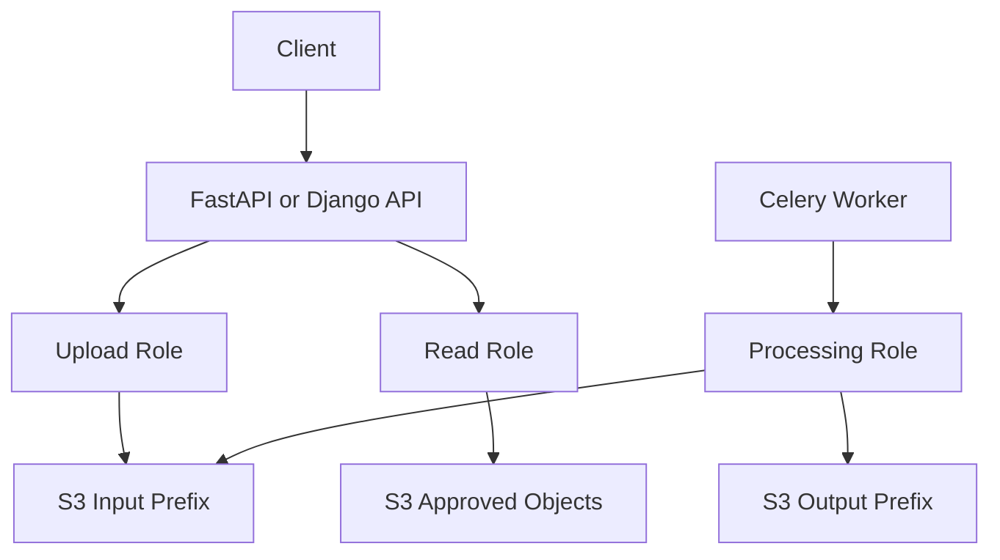

# 02- IAM Permissions for Amazon S3

## Overview

AWS Identity and Access Management (IAM) controls which identities can perform operations on Amazon S3 resources. Correct IAM configuration is essential for protecting application files, restricting administrative access, isolating workloads, and preventing unauthorized data modification or deletion.

S3 permissions are action-specific and resource-specific. Granting an application access to a bucket does not automatically grant every operation on its objects. Similarly, allowing an identity to read an object does not necessarily allow it to list the bucket or modify its configuration.

For production backend systems, IAM permissions should be designed around the operations each workload actually performs. A FastAPI service that generates download URLs, a Celery worker that processes uploaded files, and a CI/CD role that provisions S3 infrastructure should generally use different permissions.

This document covers:

- IAM identity policies and trust policies.
- S3 bucket-level and object-level permissions.
- Resource ARNs and policy structure.
- Least-privilege policies for common application workflows.
- Multipart upload and SSE-KMS permissions.
- Cross-account access and presigned URLs.
- Permission troubleshooting and verification.

Detailed policy evaluation logic, bucket policies, encryption configuration, and advanced access-control mechanisms belong in their respective dedicated documents.

## IAM Permission Fundamentals

An IAM policy defines which actions a principal can perform on specified resources under specified conditions.

A typical identity-based policy contains these elements:

| Element | Purpose |
|---|---|
| `Version` | Identifies the policy language version |
| `Statement` | Contains one or more permission statements |
| `Sid` | Optional statement identifier |
| `Effect` | Specifies `Allow` or `Deny` |
| `Action` | Specifies the operations affected by the statement |
| `Resource` | Specifies the resource ARNs affected by the statement |
| `Condition` | Optionally restricts when the statement applies |

Example:

```json
{
  "Version": "2012-10-17",
  "Statement": [
    {
      "Sid": "ReadApplicationObjects",
      "Effect": "Allow",
      "Action": [
        "s3:GetObject"
      ],
      "Resource": [
        "arn:aws:s3:::example-prod-documents/reports/*"
      ]
    }
  ]
}
```

This statement allows the attached identity to retrieve objects under the `reports/` prefix, subject to other applicable authorization controls.

It does not grant permission to list the bucket, upload objects, delete objects, change bucket policies, or perform unrelated S3 operations.

## IAM Roles and Permission Policies

IAM roles are generally preferable to long-lived access keys for application workloads.

A workload assumes or receives credentials for a role, and those credentials are used to sign S3 API requests.

### Common workload roles

| Workload | Typical S3 permissions |
|---|---|
| Django or FastAPI download service | Read required objects |
| Upload API | Write objects to an application-specific prefix |
| Celery image-processing worker | Read input objects and write processed outputs |
| Backup worker | Read or write only the designated backup resources |
| Analytics workload | Read required datasets and access supporting services |
| CI/CD deployment role | Manage only the infrastructure resources required for deployment |
| Administrative role | Perform approved management operations under controlled access |

Avoid giving all applications the same powerful S3 role. Separate identities reduce the impact of compromised credentials and make access reviews easier.

### Trust policies versus permission policies

An IAM role involves two distinct policy concepts.

**Trust policy:** Determines which principals can assume the role.

**Permission policy:** Determines which actions the assumed role can perform after obtaining credentials.

For example, an EC2 application role needs an appropriate EC2 trust relationship and an identity-based permission policy for S3 access. Granting `s3:GetObject` does not, by itself, allow an unrelated principal to assume the role.

For Lambda, ECS, EKS, and CI/CD workloads, configure the trust relationship according to the relevant service or workload identity mechanism.

Use temporary credentials whenever possible. Do not embed access keys in source code, Docker images, environment files committed to version control, or CI/CD workflow definitions.

Reference: [How Amazon S3 works with IAM](https://docs.aws.amazon.com/AmazonS3/latest/userguide/security_iam_service-with-iam.html).

## Bucket-Level and Object-Level Permissions

A critical S3 authorization distinction is the resource targeted by the action.

Bucket operations require a bucket ARN, while object operations require an object ARN.

| Resource type | ARN format | Examples |
|---|---|---|
| Bucket | `arn:aws:s3:::bucket-name` | `s3:ListBucket`, `s3:GetBucketLocation` |
| Objects | `arn:aws:s3:::bucket-name/*` | `s3:GetObject`, `s3:PutObject`, `s3:DeleteObject` |

An S3 object is not an independent IAM resource with its own ARN separate from its bucket. Its ARN incorporates the bucket name and object key.

### Bucket operations

Common bucket-level permission actions include:

| IAM action | Purpose |
|---|---|
| `s3:ListBucket` | List objects in a bucket |
| `s3:ListBucketVersions` | List object versions and delete markers |
| `s3:ListBucketMultipartUploads` | List multipart uploads in a bucket |
| `s3:GetBucketLocation` | Retrieve the bucket's Region information |
| `s3:GetBucketVersioning` | Read the bucket's versioning configuration |
| `s3:GetBucketPolicy` | Read the bucket policy |
| `s3:PutBucketPolicy` | Set the bucket policy |
| `s3:GetBucketEncryption` | Read the default encryption configuration |
| `s3:PutBucketEncryption` | Set the default encryption configuration |

These actions are not interchangeable. An application that only downloads objects usually does not need bucket-administration permissions.

### Object operations

Common object-level permission actions include:

| IAM action | Purpose |
|---|---|
| `s3:GetObject` | Retrieve an object |
| `s3:PutObject` | Upload or replace an object |
| `s3:DeleteObject` | Delete an object or create a delete marker, depending on bucket configuration |
| `s3:GetObjectVersion` | Retrieve a specific object version |
| `s3:DeleteObjectVersion` | Permanently delete a specific object version |
| `s3:GetObjectTagging` | Read object tags |
| `s3:PutObjectTagging` | Set object tags |
| `s3:AbortMultipartUpload` | Abort a multipart upload |
| `s3:ListMultipartUploadParts` | List the parts of a multipart upload |

The precise permissions needed depend on the API operation, object version, storage configuration, encryption, and other enabled features.

### Common policy mistake

This statement is insufficient for listing objects:

```json
{
  "Effect": "Allow",
  "Action": "s3:ListBucket",
  "Resource": "arn:aws:s3:::example-prod-documents/*"
}
```

The resource is incorrect because `s3:ListBucket` requires the bucket ARN.

The correct resource is:

```json
{
  "Effect": "Allow",
  "Action": "s3:ListBucket",
  "Resource": "arn:aws:s3:::example-prod-documents"
}
```

By contrast, `s3:GetObject` requires an object ARN such as:

```text
arn:aws:s3:::example-prod-documents/reports/report.pdf
```

Always verify the required resource type for each action.

Reference: [Required permissions for Amazon S3 API operations](https://docs.aws.amazon.com/AmazonS3/latest/userguide/using-with-s3-policy-actions.html).

## Common S3 API-to-IAM Permission Mappings

The API operation used by an application does not always have the same name as its required IAM action.

| S3 API operation | Common required IAM action |
|---|---|
| `ListObjectsV2` | `s3:ListBucket` |
| `HeadBucket` | `s3:ListBucket` |
| `GetObject` | `s3:GetObject` |
| `HeadObject` | `s3:GetObject` |
| `PutObject` | `s3:PutObject` |
| `CopyObject` | Source read permission and destination write permission, as applicable |
| `DeleteObject` | `s3:DeleteObject` |
| `GetObjectVersion` API operation | `s3:GetObjectVersion` |
| `ListObjectVersions` | `s3:ListBucketVersions` |
| `CreateMultipartUpload` | `s3:PutObject` |
| `UploadPart` | `s3:PutObject` |
| `CompleteMultipartUpload` | `s3:PutObject` |
| `AbortMultipartUpload` | `s3:AbortMultipartUpload` |

Some API operations require multiple permissions or additional permissions for specific features. For example, Object Lock metadata, version-specific operations, and SSE-KMS encryption can introduce additional authorization requirements.

Do not derive a production policy solely by guessing action names from API operation names. Consult the current S3 permissions reference for the operation being implemented.

## Least-Privilege Read-Only Policy

A service that retrieves reports from S3 should receive read access only to the required objects.

For example, a report-download service needs to retrieve objects from `reports/`.

```json
{
  "Version": "2012-10-17",
  "Statement": [
    {
      "Sid": "ReadReports",
      "Effect": "Allow",
      "Action": [
        "s3:GetObject"
      ],
      "Resource": [
        "arn:aws:s3:::example-prod-documents/reports/*"
      ]
    }
  ]
}
```

This policy is suitable when the service already knows the object keys and does not need to enumerate the bucket.

### Add listing only when required

If the service must list reports under the designated prefix, add a bucket-level permission constrained by `s3:prefix`.

```json
{
  "Version": "2012-10-17",
  "Statement": [
    {
      "Sid": "ListReportsPrefix",
      "Effect": "Allow",
      "Action": "s3:ListBucket",
      "Resource": "arn:aws:s3:::example-prod-documents",
      "Condition": {
        "StringLike": {
          "s3:prefix": [
            "reports/",
            "reports/*"
          ]
        }
      }
    },
    {
      "Sid": "ReadReports",
      "Effect": "Allow",
      "Action": "s3:GetObject",
      "Resource": "arn:aws:s3:::example-prod-documents/reports/*"
    }
  ]
}
```

The prefix condition limits listing requests according to the specified prefixes. It does not independently establish tenant-level application authorization, and it does not prevent access through other policies or authorized paths.

Add permissions for specific requirements rather than giving the role `s3:*`.

## Least-Privilege Upload Policy

An upload service may only need to write objects under a particular prefix.

```json
{
  "Version": "2012-10-17",
  "Statement": [
    {
      "Sid": "UploadReports",
      "Effect": "Allow",
      "Action": [
        "s3:PutObject"
      ],
      "Resource": [
        "arn:aws:s3:::example-prod-documents/reports/*"
      ]
    }
  ]
}
```

This statement permits uploads and replacement of objects within the designated prefix, subject to the remaining authorization controls.

It does not grant read, delete, or bucket-administration access.

If the application must also retrieve uploaded objects, add `s3:GetObject` only for the required resources.

### Consider overwrite behavior

Permission to write to an existing key can allow replacement of that object's current contents. Where overwrites are undesirable, design the application around unique object keys and suitable conditional-write mechanisms.

Versioning can help recover from certain accidental overwrites, but it is not a substitute for authorization controls.

### Conditional writes

S3 supports conditional requests for relevant operations, such as using preconditions to prevent unintended writes.

However, conditional-write behavior, required permissions, and the supported conditions depend on the specific API operation. Implement and test the chosen workflow rather than assuming IAM alone prevents every overwrite.

Reference: [Amazon S3 conditional requests](https://docs.aws.amazon.com/AmazonS3/latest/userguide/conditional-requests.html).

## Upload, Read, and Delete Permissions

A file-management service might need to upload, download, and delete objects under a specific prefix.

The following policy grants those operations but does not permit bucket administration.

```json
{
  "Version": "2012-10-17",
  "Statement": [
    {
      "Sid": "ListManagedPrefix",
      "Effect": "Allow",
      "Action": "s3:ListBucket",
      "Resource": "arn:aws:s3:::example-prod-documents",
      "Condition": {
        "StringLike": {
          "s3:prefix": [
            "managed/",
            "managed/*"
          ]
        }
      }
    },
    {
      "Sid": "ManageObjects",
      "Effect": "Allow",
      "Action": [
        "s3:GetObject",
        "s3:PutObject",
        "s3:DeleteObject"
      ],
      "Resource": "arn:aws:s3:::example-prod-documents/managed/*"
    }
  ]
}
```

This is a relatively powerful workload policy because it permits deletion and overwriting of managed objects. Use it only when the application requires those operations.

Avoid adding `s3:DeleteObjectVersion` unless the workload must permanently delete specific historical versions. In versioned buckets, that action is distinct from deleting the current object without a version ID.

For production systems, separate read, upload, cleanup, and administrative workloads when their responsibilities differ.

## Permissions for Multipart Uploads

Multipart upload improves reliability and throughput for large objects by allowing data to be transferred in parts.

Common operations and permissions include:

| Operation | IAM permission |
|---|---|
| Initiate multipart upload | `s3:PutObject` |
| Upload a part | `s3:PutObject` |
| Complete multipart upload | `s3:PutObject` |
| Copy a part from an existing object | Required source read access and relevant write permission |
| List uploaded parts | `s3:ListMultipartUploadParts` |
| Abort an upload | `s3:AbortMultipartUpload` |
| List multipart uploads in a bucket | `s3:ListBucketMultipartUploads` |

The bucket-level `s3:ListBucketMultipartUploads` permission and object-level `s3:ListMultipartUploadParts` permission serve different purposes.

A typical upload-only application may not need to list multipart uploads. A cleanup worker or recovery tool might require additional permissions for inspecting and aborting incomplete uploads.

### Recommended design

Grant multipart cleanup permissions to the component responsible for upload recovery rather than giving every application unrestricted cleanup capabilities.

For example, an upload API can write objects while a maintenance worker periodically inspects or aborts incomplete uploads under its designated scope.

References:

- [Multipart upload overview](https://docs.aws.amazon.com/AmazonS3/latest/userguide/mpuoverview.html)
- [S3 IAM action reference](https://docs.aws.amazon.com/service-authorization/latest/reference/list_amazons3.html)

## SSE-KMS and AWS KMS Permissions

When an object uses SSE-KMS, access to the object can require both S3 permissions and permissions to use the relevant KMS key.

These are separate authorization layers.

For example, a principal might have `s3:GetObject` but still receive `AccessDenied` because it lacks the required KMS permission.

### Common KMS permissions

| Operation or use case | Common KMS permissions |
|---|---|
| Read an SSE-KMS encrypted object | `kms:Decrypt` |
| Write an SSE-KMS encrypted object | `kms:GenerateDataKey`; other key permissions can be needed depending on the workflow |
| Read data through multipart or multipart-related encrypted operations | Relevant KMS permissions for encryption and decryption, depending on the operation |
| Inspect key configuration | Additional permissions such as `kms:DescribeKey` where required |

The required permissions depend on the exact API operation, encryption workflow, KMS key type, and key policy.

### Example KMS identity policy

The following example allows a role to use a specific customer-managed KMS key for relevant data-encryption operations.

```json
{
  "Version": "2012-10-17",
  "Statement": [
    {
      "Sid": "UseDocumentEncryptionKey",
      "Effect": "Allow",
      "Action": [
        "kms:Decrypt",
        "kms:GenerateDataKey"
      ],
      "Resource": "arn:aws:kms:ap-south-1:123456789012:key/11111111-2222-3333-4444-555555555555"
    }
  ]
}
```

Replace the example key ARN with the actual customer-managed key ARN.

An identity-based KMS allow does not override a restrictive KMS key policy. The key policy must permit the principal or delegate access appropriately.

Do not place KMS permissions in an S3 bucket policy as though they were S3 actions. KMS permissions belong in the relevant IAM and KMS authorization configuration.

For SSE-KMS workloads, test both the S3 and KMS permission paths.

Reference: [Using SSE-KMS with Amazon S3](https://docs.aws.amazon.com/AmazonS3/latest/userguide/UsingKMSEncryption.html).

## Cross-Account Access

Cross-account access occurs when a principal in one AWS account needs to access an S3 bucket or objects owned by another account.

A common arrangement is a processing account reading files from a centralized data account.

For a typical cross-account identity-policy design, access requires the appropriate permissions on both sides:

- The calling identity must have the required identity-based permissions.
- The target resource policy must permit the cross-account access, where required.
- The relevant KMS key policy and permissions must permit key usage for SSE-KMS objects.
- Organization-level controls, explicit denies, and other applicable restrictions must not block the request.

### Example bucket-policy statement

Suppose account `111122223333` owns the application role that needs access to objects in a bucket owned by another account.

A bucket-policy statement on the bucket-owning account can grant that role read access to the `reports/` prefix:

```json
{
  "Version": "2012-10-17",
  "Statement": [
    {
      "Sid": "AllowApplicationRoleToReadReports",
      "Effect": "Allow",
      "Principal": {
        "AWS": "arn:aws:iam::111122223333:role/ReportReaderRole"
      },
      "Action": [
        "s3:GetObject"
      ],
      "Resource": "arn:aws:s3:::central-prod-reports/reports/*"
    }
  ]
}
```

This is a resource-based bucket-policy grant. The calling role must also have the corresponding identity-based allow for the cross-account access pattern, and any other applicable authorization requirements must be satisfied.

If the objects use SSE-KMS with a customer-managed key, configure the KMS authorization separately.

### Prefer controlled access patterns

For sustained cross-account access, use narrowly scoped role trust, bucket policies, and KMS permissions. Avoid broad grants to an entire external account if a specific role can be identified.

Reference: [Cross-account access to Amazon S3](https://docs.aws.amazon.com/AmazonS3/latest/userguide/example-walkthroughs-managing-access.html).

## Presigned URLs and IAM Permissions

A presigned URL lets a client perform a specific S3 operation without receiving the application's AWS credentials.

The backend creates the URL using credentials with permission to perform the intended operation. The recipient can then use the URL until it expires or becomes invalid.

Examples include:

- A presigned PUT URL for a client upload.
- A presigned GET URL for a document download.
- A controlled upload workflow in which application metadata is recorded before the file is transferred.

### Important permission behavior

Generating a presigned URL is usually a local signing operation performed by the AWS SDK; it does not itself require a separate S3 permission simply to construct the URL.

However, the credentials used to sign the URL must be authorized for the intended operation, and the eventual request remains subject to applicable authorization controls.

A presigned URL does not grant permissions beyond those available to the signing principal. Its effective lifetime can also be limited by the expiration of the underlying credentials.

### Security recommendations

- Authenticate and authorize the user before generating a URL.
- Scope the URL to the intended object key and operation.
- Use short expiration periods appropriate to the workflow.
- Avoid allowing clients to select arbitrary object keys without validation.
- Protect URLs from logs, analytics events, and accidental disclosure.
- Validate uploaded file size and content type through an appropriate workflow.
- Verify that uploaded objects meet application requirements before treating them as trusted data.

Reference: [Sharing objects using presigned URLs](https://docs.aws.amazon.com/AmazonS3/latest/userguide/ShareObjectPreSignedURL.html).

## Backend Application Permission Design

IAM permission design should follow application responsibilities rather than framework structure alone.

### Example service separation



The diagram illustrates logical separation; the exact number of roles depends on the application's deployment and threat model.

### Recommended patterns

| Component | Recommended access |
|---|---|
| Upload API | Write to its designated input prefix |
| Download API | Read approved objects; no bucket-administration rights |
| Processing worker | Read input objects and write designated outputs |
| Cleanup worker | Delete only approved expired objects or versions |
| Reporting worker | Read the datasets needed for reporting |
| Infrastructure pipeline | Manage only the resources it must provision |
| Security administration role | Manage policies and access controls under a separate, controlled workflow |

For smaller systems, one role can support more than one operation when the blast radius remains acceptable. For higher-risk workloads, separate roles by responsibility.

Do not assume that creating multiple service classes in Python changes the permissions of the underlying IAM role. IAM authorization follows the AWS credentials used for the request.

## Permission Verification and Troubleshooting

When an S3 operation fails with `AccessDenied`, diagnose the exact operation before expanding the policy.

### Step: Identify the failed API action

Determine whether the failing operation is a bucket-level action, an object-level action, or a related-service operation.

For example:

- `ListObjectsV2` requires `s3:ListBucket`.
- `HeadObject` usually requires `s3:GetObject`.
- `GetObject` requires permission to retrieve the object.
- SSE-KMS access can additionally require KMS permissions.

### Step: Inspect the resource ARN

Check whether the policy uses the correct bucket or object ARN.

Incorrect resource scope is a common cause of access failures.

### Step: Review all applicable authorization layers

Inspect the following where relevant:

- Identity-based policies.
- Bucket policies.
- Access point policies.
- KMS key policies and identity-based KMS permissions.
- Permissions boundaries and session policies.
- Service control policies and other organization-level controls.
- VPC endpoint policies.
- Explicit denies and supported request conditions.

An allow in one policy does not automatically override an applicable explicit deny elsewhere.

### Step: Verify the active identity

Use the AWS CLI to confirm which identity is making the request:

```bash
aws sts get-caller-identity
```

Then verify the expected role, account, and environment.

A common operational error is debugging a correct policy attached to one role while the application is actually using credentials from another profile, container, or runtime identity.

### Step: Test the intended operation

Use a read-only command where possible to verify the specific permission path:

```bash
aws s3api head-object \
  --bucket example-prod-documents \
  --key reports/sample.pdf \
  --region ap-south-1
```

This example tests object metadata access and typically requires `s3:GetObject`. A failed request may indicate an authorization problem, an incorrect key, or another condition; interpret the service response in context.

For a missing object, S3 may return different responses depending on the caller's permissions. Do not assume every `403` proves that the key exists or that every `404` proves the bucket is correctly authorized.

### Step: Check encryption separately

If the object uses SSE-KMS, determine whether the failure arises from S3 authorization or KMS authorization.

Review the KMS key ARN, key policy, caller permissions, and any relevant encryption context or grant requirements before broadening permissions.

### Step: Prevent recurrence

After finding the root cause:

- Correct the narrowest affected permission or resource condition.
- Add regression tests for both allowed and denied operations.
- Review the deployment pipeline and role assignment.
- Record the failure mode in the operational runbook.
- Avoid granting broad permissions merely to suppress an error.

Reference: [Troubleshoot 403 Access Denied errors in Amazon S3](https://docs.aws.amazon.com/AmazonS3/latest/userguide/troubleshoot-403-errors.html).

## IAM Permission Best Practices

- Use IAM roles and temporary credentials for production workloads.
- Grant only required S3 actions against the smallest practical resource scope.
- Distinguish bucket-level permissions from object-level permissions.
- Separate runtime application permissions from infrastructure-administration permissions.
- Add delete, version-management, tagging, and bucket-configuration permissions only when required.
- Evaluate KMS access separately from S3 access.
- Use controlled cross-account policies and narrow role trust.
- Validate presigned URL creation with application-level authorization.
- Keep policies in infrastructure-as-code where practical.
- Test permission behavior in a nonproduction environment before broad deployment.
- Review effective access periodically and remove unused permissions.
- Monitor important authorization changes and investigate unexpected access failures.

## Official References

- [How Amazon S3 works with IAM](https://docs.aws.amazon.com/AmazonS3/latest/userguide/security_iam_service-with-iam.html)
- [Required permissions for Amazon S3 API operations](https://docs.aws.amazon.com/AmazonS3/latest/userguide/using-with-s3-policy-actions.html)
- [Actions, resources, and condition keys for Amazon S3](https://docs.aws.amazon.com/service-authorization/latest/reference/list_amazons3.html)
- [Example IAM policy for S3 read/write access](https://docs.aws.amazon.com/IAM/latest/UserGuide/reference_policies_examples_s3_rw-bucket.html)
- [Amazon S3 bucket policies](https://docs.aws.amazon.com/AmazonS3/latest/userguide/example-bucket-policies.html)
- [SSE-KMS encryption](https://docs.aws.amazon.com/AmazonS3/latest/userguide/UsingKMSEncryption.html)
- [Cross-account access to Amazon S3](https://docs.aws.amazon.com/AmazonS3/latest/userguide/example-walkthroughs-managing-access.html)
- [Presigned URLs](https://docs.aws.amazon.com/AmazonS3/latest/userguide/ShareObjectPreSignedURL.html)
- [Troubleshoot S3 403 errors](https://docs.aws.amazon.com/AmazonS3/latest/userguide/troubleshoot-403-errors.html)

## Key Takeaways

- IAM permissions must match the exact S3 actions and resource types required by an application.
- Bucket-level operations use bucket ARNs, while object-level operations use object ARNs.
- Least-privilege roles reduce the impact of compromised credentials and make access reviews more manageable.
- SSE-KMS, cross-account access, and presigned URLs introduce additional authorization considerations beyond a basic S3 allow statement.
- Diagnose `AccessDenied` by identifying the failed operation, active identity, resource ARN, and applicable authorization layers before changing permissions.