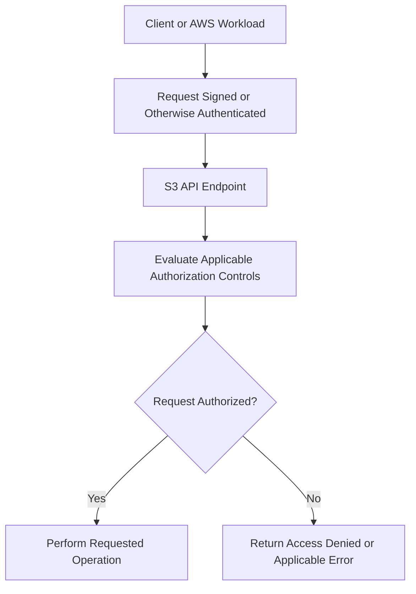

# 03- Bucket Policies

## Overview

Amazon S3 bucket policies are resource-based AWS Identity and Access Management (IAM) policies attached to S3 buckets. They define which principals can perform specified operations on a bucket or its objects, subject to the applicable authorization controls.

Bucket policies are particularly useful for granting cross-account access, restricting access to specific object prefixes, enforcing secure transport, controlling access through CloudFront, and preventing prohibited operations.

For production applications, a bucket policy should complement identity-based IAM policies rather than replace a complete access-control design. A secure configuration must account for the requesting principal, required S3 actions, resource ARNs, request conditions, encryption permissions, and other applicable policy restrictions.

This document covers:

- Bucket policy structure and authorization behavior.
- Bucket and object resource ARNs.
- Principals, actions, conditions, and explicit denies.
- Least-privilege access patterns.
- HTTPS enforcement, CloudFront integration, and cross-account access.
- Policy deployment, validation, troubleshooting, and operational safeguards.

## How Bucket Policies Work

A bucket policy is a JSON document attached to a general-purpose S3 bucket. It specifies which requests should be allowed or denied according to the policy statements.

Only the bucket owner can associate a bucket policy with the bucket. The policy can grant access to principals in the same account or, where supported and authorized, principals from other AWS accounts.

A bucket policy can contain:

- `Allow` statements granting specified permissions.
- `Deny` statements explicitly blocking requests.
- Conditions restricting access according to request attributes.
- Resource ARNs identifying the bucket, its objects, or other supported resources.

### Example request flow



The authorization decision considers applicable identity policies, resource policies, explicit denies, organization-level controls, permissions boundaries, session policies, and other relevant restrictions.

A bucket policy does not independently guarantee that every request is allowed merely because it contains an `Allow` statement.

Reference: [Bucket policies for Amazon S3](https://docs.aws.amazon.com/AmazonS3/latest/userguide/bucket-policies.html).

## Bucket Policies Versus Identity-Based Policies

Bucket policies and identity-based policies serve complementary purposes.

| Aspect | Bucket policy | Identity-based policy |
|---|---|---|
| Policy attachment | S3 bucket | IAM user, group, or role |
| Main purpose | Defines resource-side access rules | Defines permissions associated with an identity |
| Cross-account access | Can grant supported access to external principals | Supplies permissions to the requesting identity |
| Explicit deny | Can deny matching requests regardless of an applicable allow | Can deny actions for the identity to which the policy applies |
| Resource scope | Bucket and object resources, with supported actions | Specified resources and supported actions |
| Typical ownership | S3 resource owner | Identity or workload administrator |

For same-account access, an identity-based policy can provide the required permissions without a bucket policy granting the same access. Resource policies can impose additional restrictions or grant resource access where appropriate.

For a common cross-account design, the caller must have the required identity-based permissions, and the bucket policy must permit the external principal. The complete authorization path can include additional policies and controls.

### Example architecture

A backend service runs in Account A and reads reports from a bucket owned by Account B.

- The application role in Account A receives the necessary identity-based permissions.
- The bucket policy in Account B grants that role access to the intended objects.
- Any required KMS permissions are configured separately if the objects use SSE-KMS with a customer-managed key.

An `Allow` in only one of these policies may be insufficient.

## Bucket Policy Structure

An S3 bucket policy uses the AWS IAM JSON policy language.

```json
{
  "Version": "2012-10-17",
  "Statement": [
    {
      "Sid": "AllowReportReader",
      "Effect": "Allow",
      "Principal": {
        "AWS": "arn:aws:iam::111122223333:role/ReportReaderRole"
      },
      "Action": [
        "s3:GetObject"
      ],
      "Resource": [
        "arn:aws:s3:::example-prod-documents/reports/*"
      ]
    }
  ]
}
```

This statement grants the specified role permission to retrieve objects under the `reports/` prefix, subject to all other applicable authorization controls.

| Element | Meaning |
|---|---|
| `Version` | Specifies the IAM policy language version |
| `Statement` | Contains one or more policy statements |
| `Sid` | Optional statement identifier |
| `Effect` | Specifies `Allow` or `Deny` |
| `Principal` | Specifies the identity or identities to which the statement applies |
| `Action` | Specifies the S3 operations covered by the statement |
| `Resource` | Identifies the resource ARNs covered by the statement |
| `Condition` | Optional rules controlling when the statement applies |

### Principal

The `Principal` element identifies the users, roles, AWS accounts, or supported service principals affected by a resource-based policy statement.

Examples include:

- A specific IAM role.
- A particular AWS account principal.
- An AWS service principal such as CloudFront.
- The wildcard principal `*`, which can match any principal subject to the statement's conditions.

Use specific principals whenever practical. A wildcard principal combined with a restrictive condition can be useful, but its effective access must be evaluated carefully.

### Action

The `Action` element identifies the operations covered by a statement.

Common examples include:

| Action | Purpose |
|---|---|
| `s3:ListBucket` | Lists objects in a bucket |
| `s3:GetObject` | Retrieves an object |
| `s3:PutObject` | Uploads or replaces an object |
| `s3:DeleteObject` | Deletes an object or creates a delete marker, depending on bucket configuration |
| `s3:GetObjectVersion` | Retrieves a specific object version |
| `s3:DeleteObjectVersion` | Permanently deletes a specific object version |
| `s3:GetBucketLocation` | Retrieves the bucket's Region information |
| `s3:GetBucketPolicy` | Reads the bucket policy |
| `s3:PutBucketPolicy` | Updates the bucket policy |

The required permission depends on the API operation. Do not infer required permissions solely from the name of an API.

### Resource

The `Resource` element specifies the ARNs to which an action applies.

For example:

```text
Bucket ARN:
arn:aws:s3:::example-prod-documents

Object ARN:
arn:aws:s3:::example-prod-documents/*

Reports prefix:
arn:aws:s3:::example-prod-documents/reports/*
```

Bucket-level actions and object-level actions do not generally use interchangeable resource ARNs.

For example, `s3:ListBucket` operates on the bucket ARN, whereas `s3:GetObject` operates on object ARNs.

### Condition

The `Condition` element restricts when a policy statement applies.

Common condition keys include:

| Condition key | Typical purpose |
|---|---|
| `aws:SecureTransport` | Checks whether the request uses secure transport |
| `aws:SourceIp` | Restricts requests according to source IP conditions |
| `aws:SourceVpce` | Restricts requests according to a VPC endpoint ID where supported |
| `aws:PrincipalOrgID` | Restricts access according to an AWS organization ID |
| `aws:SourceArn` | Restricts supported service-to-service requests according to a source resource ARN |
| `s3:prefix` | Restricts bucket listing according to requested prefixes |
| `s3:ExistingObjectTag/<key>` | Checks supported existing-object tag values for applicable operations |
| `s3:RequestObjectTag/<key>` | Checks supported object-tag values supplied with a request |

A condition key is not valid for every action or resource type. Use the [Amazon S3 Service Authorization Reference](https://docs.aws.amazon.com/service-authorization/latest/reference/list_amazons3.html) to verify supported actions, resources, and condition keys.

## Bucket and Object Resource ARNs

Correct resource scoping is fundamental to bucket policy design.

### Bucket-level access

The following example grants a specific role permission to list a bucket.

```json
{
  "Version": "2012-10-17",
  "Statement": [
    {
      "Sid": "AllowBucketListing",
      "Effect": "Allow",
      "Principal": {
        "AWS": "arn:aws:iam::111122223333:role/ReportReaderRole"
      },
      "Action": "s3:ListBucket",
      "Resource": "arn:aws:s3:::example-prod-documents"
    }
  ]
}
```

This permission allows listing, subject to other controls. It does not automatically grant access to read the listed objects.

### Object-level access

The following example grants object-read access under `reports/`.

```json
{
  "Version": "2012-10-17",
  "Statement": [
    {
      "Sid": "AllowReadingReports",
      "Effect": "Allow",
      "Principal": {
        "AWS": "arn:aws:iam::111122223333:role/ReportReaderRole"
      },
      "Action": "s3:GetObject",
      "Resource": "arn:aws:s3:::example-prod-documents/reports/*"
    }
  ]
}
```

This grants access to the matching objects, subject to other applicable controls. It does not grant bucket listing or permission to modify the objects.

### Prefixes are not independent security boundaries

S3 uses object keys and prefixes rather than a hierarchical filesystem.

A key such as:

```text
reports/2026/october/report.pdf
```

is an object key. The `reports/` portion is a prefix that can be used in resource ARNs and supported policy conditions.

Prefix-based policies can restrict object access, but the application must still enforce its business and tenant authorization requirements. A prefix convention by itself does not provide security.

## Restrict Listing to a Specific Prefix

A backend service may need to list reports under one prefix without enumerating unrelated objects.

The following statement limits `s3:ListBucket` according to the requested prefix.

```json
{
  "Version": "2012-10-17",
  "Statement": [
    {
      "Sid": "ListReportsPrefix",
      "Effect": "Allow",
      "Principal": {
        "AWS": "arn:aws:iam::111122223333:role/ReportReaderRole"
      },
      "Action": "s3:ListBucket",
      "Resource": "arn:aws:s3:::example-prod-documents",
      "Condition": {
        "StringLike": {
          "s3:prefix": [
            "reports/",
            "reports/*"
          ]
        }
      }
    }
  ]
}
```

This statement restricts listing requests according to the specified prefixes. It does not grant `s3:GetObject`.

If the same application must read report contents, grant the required object-level permissions separately.

### Common mistakes

- Using an object ARN for `s3:ListBucket`.
- Granting `s3:ListBucket` when the application only needs known object keys.
- Assuming that listing an object means the principal can read it.
- Using overly broad prefixes that expose unrelated tenants or business data.
- Treating the S3 console's folder display as a real directory hierarchy.

Reference: [Bucket policy examples using condition keys](https://docs.aws.amazon.com/AmazonS3/latest/userguide/amazon-s3-policy-keys.html).

## Allow Cross-Account Access

Bucket policies can grant access to principals in other AWS accounts.

Suppose Account `111122223333` contains a backend role that needs to read reports from a centralized bucket.

The bucket owner can configure the following resource-based policy statement:

```json
{
  "Version": "2012-10-17",
  "Statement": [
    {
      "Sid": "AllowExternalReportReader",
      "Effect": "Allow",
      "Principal": {
        "AWS": "arn:aws:iam::111122223333:role/ReportReaderRole"
      },
      "Action": [
        "s3:GetObject"
      ],
      "Resource": [
        "arn:aws:s3:::central-prod-reports/reports/*"
      ]
    }
  ]
}
```

The external role must also have the necessary identity-based permissions for this cross-account access pattern.

### Cross-account design considerations

- Specify the intended role rather than an unrestricted principal whenever possible.
- Keep the permitted actions narrow.
- Restrict resources to the required object prefix.
- Review organization-level controls and explicit denies.
- Configure KMS key policies and permissions separately when applicable.
- Test access using the actual workload identity.

A bucket policy granting external read access does not automatically resolve SSE-KMS authorization requirements.

Reference: [Cross-account access to Amazon S3](https://docs.aws.amazon.com/AmazonS3/latest/userguide/example-walkthroughs-managing-access.html).

## Deny Insecure Transport

A common security requirement is to permit S3 data access only over HTTPS.

The following bucket policy denies matching requests made without secure transport:

```json
{
  "Version": "2012-10-17",
  "Statement": [
    {
      "Sid": "DenyInsecureTransport",
      "Effect": "Deny",
      "Principal": "*",
      "Action": "s3:*",
      "Resource": [
        "arn:aws:s3:::example-prod-documents",
        "arn:aws:s3:::example-prod-documents/*"
      ],
      "Condition": {
        "Bool": {
          "aws:SecureTransport": "false",
          "aws:PrincipalIsAWSService": "false"
        }
      }
    }
  ]
}
```

This statement denies matching insecure requests from principals that are not AWS service principals. Both conditions must match for the deny to apply.

The policy does not grant any permissions. Existing allowed access paths must remain configured.

The `aws:PrincipalIsAWSService` exception helps avoid denying supported AWS service-to-service requests where network context keys may be redacted. Service integrations still require their own appropriate permissions and conditions.

### Why use an explicit deny?

An explicit deny overrides an applicable allow. This provides a centralized way to enforce the secure-transport requirement even when another policy grants the underlying S3 operation.

Test the policy against application clients, presigned URL workflows, and relevant AWS service integrations before deploying it to production.

Reference: [Managing access based on HTTP or HTTPS requests](https://docs.aws.amazon.com/AmazonS3/latest/userguide/example-bucket-policies.html).

## Allow CloudFront to Read a Private S3 Origin

A common production architecture stores website assets in a private S3 bucket and serves them through CloudFront.

CloudFront Origin Access Control (OAC) allows CloudFront to access the bucket without granting public access to the S3 objects.

The bucket policy grants the CloudFront service principal permission to read objects for a specific distribution, constrained by the distribution's ARN.

```json
{
  "Version": "2012-10-17",
  "Statement": [
    {
      "Sid": "AllowCloudFrontOACRead",
      "Effect": "Allow",
      "Principal": {
        "Service": "cloudfront.amazonaws.com"
      },
      "Action": "s3:GetObject",
      "Resource": "arn:aws:s3:::example-prod-website/*",
      "Condition": {
        "StringEquals": {
          "AWS:SourceArn": "arn:aws:cloudfront::111122223333:distribution/E123EXAMPLE456"
        }
      }
    }
  ]
}
```

Replace the account ID, distribution ID, and bucket name with the actual resource identifiers.

### Important configuration dependencies

- Configure the CloudFront distribution to use the bucket as its origin.
- Configure OAC for the origin.
- Set the origin access configuration so CloudFront signs supported origin requests appropriately.
- Apply the bucket policy for the intended distribution.
- Keep S3 Block Public Access enabled for this private-origin design.
- Test direct S3 access and CloudFront delivery separately.

This policy grants `s3:GetObject` to the designated CloudFront distribution. It does not grant write access, bucket listing, or general public access.

If the origin uses SSE-KMS with a customer-managed key, configure the required KMS key policy and permissions separately.

Reference: [Using an S3 bucket as a CloudFront origin](https://docs.aws.amazon.com/AmazonCloudFront/latest/DeveloperGuide/DownloadDistS3AndCustomOrigins.html).

## Restrict Access According to a VPC Endpoint

A bucket policy can restrict supported requests according to the VPC endpoint through which they reach S3.

This can be useful when an application must access a bucket only from a designated private network path.

However, endpoint restrictions are powerful and can unintentionally block legitimate access.

### Design considerations

Before using `aws:SourceVpce`, identify every required access path, including:

- EC2, ECS, EKS, or Lambda workloads.
- AWS service integrations.
- Backup and replication workflows.
- Administrative access.
- CI/CD deployments and validation.
- Cross-account consumers.
- Analytics services that read the bucket.

A VPC endpoint policy does not grant bucket permissions by itself. The request must still satisfy the relevant S3 authorization controls.

Be particularly careful with a bucket-wide explicit deny when the condition is not satisfied. Console requests, external clients, or service requests that do not traverse the required endpoint may be denied.

Where network-path isolation is needed, design the endpoint policy, bucket policy, and application identity policy together. Test all required operations before enabling a restrictive deny in production.

References:

- [Controlling access from VPC endpoints with bucket policies](https://docs.aws.amazon.com/AmazonS3/latest/userguide/example-bucket-policies-vpc-endpoint.html)
- [Amazon S3 VPC endpoints](https://docs.aws.amazon.com/vpc/latest/privatelink/vpc-endpoints-s3.html).

## Explicit Deny and Policy Conditions

Bucket policies are often used to enforce security restrictions with `Effect: "Deny"`.

For example, a deny statement can prevent a particular class of requests even if an identity-based policy grants the corresponding action.

### Explicit deny takes precedence

Consider a role whose identity policy permits object reads while the bucket policy denies requests that use insecure transport.

The role remains authorized for HTTPS object reads but cannot perform a matching HTTP request.

This illustrates why policy evaluation must consider every relevant statement and policy layer rather than examining a single `Allow`.

### Condition operators

Common IAM condition operators include:

| Operator | Typical use |
|---|---|
| `StringEquals` | Requires an exact string match |
| `StringNotEquals` | Matches when the compared value is not equal |
| `StringLike` | Supports wildcard pattern matching |
| `Bool` | Tests Boolean request context values |
| `IpAddress` | Tests whether an IP address belongs to a specified range |
| `NotIpAddress` | Tests whether an IP address falls outside a specified range |
| `ArnEquals` | Compares ARN values |
| `ArnLike` | Compares ARNs using wildcard patterns |
| `Null` | Tests whether a condition key is present |

An incorrect operator or missing-key assumption can produce unintended access behavior.

For example, negated conditions such as `StringNotEquals` can match when a context key is absent. Review the behavior of each condition key for the relevant operation.

Reference: [IAM condition operators](https://docs.aws.amazon.com/IAM/latest/UserGuide/reference_policies_elements_condition_operators.html).

## Public Access and Block Public Access

A bucket policy should not be used as the only defense against unintended public access.

S3 Block Public Access provides additional controls at applicable organization, account, bucket, and access point levels.

For most private application buckets, enable all four bucket-level settings:

- `BlockPublicAcls`
- `IgnorePublicAcls`
- `BlockPublicPolicy`
- `RestrictPublicBuckets`

These settings can block public-access configurations even when a policy or ACL would otherwise expose data.

### Inspect Block Public Access

```bash
aws s3api get-public-access-block \
  --bucket example-prod-documents \
  --region ap-south-1
```

Review the account-level configuration as well:

```bash
aws s3control get-public-access-block \
  --account-id 123456789012 \
  --region ap-south-1
```

Use the actual account ID and intended Region.

### Keep intended public access explicit

If a workload genuinely requires public object access, such as a specifically designed public-content delivery system, review the architecture and exposure requirements carefully.

For a website served through CloudFront, prefer a private S3 origin with OAC rather than disabling Block Public Access.

Reference: [Blocking public access to Amazon S3 storage](https://docs.aws.amazon.com/AmazonS3/latest/userguide/access-control-block-public-access.html).

## Common Bucket Policy Mistakes

### Incorrect resource ARN

Using an object ARN for a bucket-level action can make a policy ineffective.

**Prevention:** Check the required resource type for every action.

### Broad wildcard principals

A statement with `"Principal": "*"` can expose data when its actions and conditions are not sufficiently restrictive.

**Prevention:** Prefer specific principals and carefully reviewed conditions. Use Block Public Access as an additional protection for private buckets.

### Assuming a bucket policy replaces IAM permissions

Cross-account access and many application workflows require the right permissions at multiple authorization layers.

**Prevention:** Verify the identity policy, resource policy, organization controls, and relevant encryption permissions together.

### Deploying a deny policy without testing all access paths

A restrictive policy can block administrators, applications, and service integrations.

**Prevention:** Validate the complete request flow in a nonproduction environment and retain an approved recovery path.

### Treating prefixes as tenant authorization

A prefix provides key organization and can be used in policies, but it does not automatically implement application-level tenant isolation.

**Prevention:** Authorize the user or workload before resolving the object key, and use appropriate IAM or resource policies.

### Overlooking SSE-KMS

An S3 bucket policy that permits `GetObject` may still be insufficient when KMS authorization fails.

**Prevention:** Review KMS key policies and permissions separately.

### Using conditions that do not apply to the action

Not every S3 condition key is supported for every operation.

**Prevention:** Validate action, resource, and condition-key compatibility against the Service Authorization Reference.

## Apply and Verify Bucket Policies

Bucket policy changes affect the security boundary of a resource. Deploy them through controlled change management.

### Save the policy

Create a file named `bucket-policy.json` containing the complete intended policy.

Do not overwrite an existing policy without reviewing the existing statements. The `put-bucket-policy` operation replaces the current bucket policy document; it does not merge new statements into the existing policy.

### Apply the policy

```bash
aws s3api put-bucket-policy \
  --bucket example-prod-documents \
  --policy file://bucket-policy.json \
  --region ap-south-1
```

The caller needs the appropriate permission to modify the bucket policy.

### Inspect the applied policy

```bash
aws s3api get-bucket-policy \
  --bucket example-prod-documents \
  --region ap-south-1
```

Review the returned policy and compare it with the intended configuration.

### Validate the effective behavior

Test the policy using the actual application or role identity.

Verify both successful and denied scenarios:

- Intended read operations succeed.
- Unnecessary write or delete operations fail.
- Prefix restrictions work as expected.
- CloudFront can read the intended private-origin content.
- Required AWS service integrations continue working.
- Cross-account access is limited to approved principals.
- Insecure transport is denied where required.
- Administrators retain the intended recovery and maintenance access.

Do not treat a successful `put-bucket-policy` response as proof that the resulting access behavior is correct.

### Use Access Analyzer

AWS IAM Access Analyzer can help identify public and cross-account access in supported S3 configurations.

Combine automated findings with policy review and controlled tests.

Reference: [Using IAM Access Analyzer to analyze S3 access](https://docs.aws.amazon.com/AmazonS3/latest/userguide/access-analyzer.html).

## Troubleshooting Bucket Policy Failures

Use a repeatable diagnostic sequence when a request returns `AccessDenied`.

### Identify the failed operation

Determine whether the failing request is a bucket operation, object operation, version operation, or related-service request.

For example, `ListObjectsV2` uses `s3:ListBucket`, while `GetObject` uses `s3:GetObject`.

### Verify the active principal

```bash
aws sts get-caller-identity
```

Confirm that the application or CLI is using the intended identity and AWS account.

### Check resource scope

Verify:

- Bucket name.
- Object key and prefix.
- Resource ARN.
- Required action.
- Region and intended account.

### Review policy statements

Inspect applicable identity-based and resource-based policies. Look for explicit denies, restrictive conditions, wildcard principals, and incorrect ARNs.

Review endpoint and organization controls where relevant.

### Separate S3 and KMS failures

For SSE-KMS objects, verify both S3 permissions and the key's authorization configuration. Do not respond to a KMS denial by adding unrelated S3 permissions.

### Reproduce the intended request

Test the exact operation with the intended principal and resource. A successful bucket listing does not prove that an object can be read, and successful object retrieval does not prove that the caller can list the bucket.

### Correct the narrowest cause

Change only the policy statement or permission responsible for the failure. Then test both the expected allow path and the restrictions that must remain enforced.

Reference: [Troubleshoot 403 Access Denied errors in Amazon S3](https://docs.aws.amazon.com/AmazonS3/latest/userguide/troubleshoot-403-errors.html).

## Production Bucket Policy Checklist

- [ ] The bucket has an explicit access-control design and owner.
- [ ] Principals are limited to the intended identities or service principals.
- [ ] Actions are restricted to required operations.
- [ ] Bucket and object ARNs use the correct resource scope.
- [ ] Prefix conditions are tested against actual API requests.
- [ ] Cross-account access includes the required identity and resource permissions.
- [ ] Explicit denies are reviewed for accidental service or administrator lockout.
- [ ] HTTPS enforcement is configured where required.
- [ ] Private buckets retain appropriate Block Public Access settings.
- [ ] CloudFront OAC is used for private S3 origins where appropriate.
- [ ] VPC endpoint restrictions account for all required access paths.
- [ ] SSE-KMS permissions and key policies are evaluated separately.
- [ ] Policy changes are reviewed, version-controlled, and deployed through approved processes.
- [ ] Read, write, delete, and unauthorized-access scenarios are tested.
- [ ] Access Analyzer findings and relevant security events are reviewed.

## Official References

- [Bucket policies for Amazon S3](https://docs.aws.amazon.com/AmazonS3/latest/userguide/bucket-policies.html)
- [Examples of Amazon S3 bucket policies](https://docs.aws.amazon.com/AmazonS3/latest/userguide/example-bucket-policies.html)
- [Policies and permissions in Amazon S3](https://docs.aws.amazon.com/AmazonS3/latest/userguide/access-policy-language-overview.html)
- [Bucket policy examples using condition keys](https://docs.aws.amazon.com/AmazonS3/latest/userguide/amazon-s3-policy-keys.html)
- [Required permissions for Amazon S3 API operations](https://docs.aws.amazon.com/AmazonS3/latest/userguide/using-with-s3-policy-actions.html)
- [Actions, resources, and condition keys for Amazon S3](https://docs.aws.amazon.com/service-authorization/latest/reference/list_amazons3.html)
- [Blocking public access to Amazon S3 storage](https://docs.aws.amazon.com/AmazonS3/latest/userguide/access-control-block-public-access.html)
- [Using an S3 bucket as a CloudFront origin](https://docs.aws.amazon.com/AmazonCloudFront/latest/DeveloperGuide/DownloadDistS3AndCustomOrigins.html)
- [Controlling access from VPC endpoints](https://docs.aws.amazon.com/AmazonS3/latest/userguide/example-bucket-policies-vpc-endpoint.html)
- [Using IAM Access Analyzer for S3](https://docs.aws.amazon.com/AmazonS3/latest/userguide/access-analyzer.html)
- [Troubleshoot 403 Access Denied errors](https://docs.aws.amazon.com/AmazonS3/latest/userguide/troubleshoot-403-errors.html)

## Key Takeaways

- Bucket policies define resource-side access rules using principals, actions, resource ARNs, and optional conditions.
- Bucket-level and object-level operations require correctly scoped resource ARNs; an incorrect ARN can invalidate the intended access design.
- Cross-account permissions, CloudFront access, network restrictions, and SSE-KMS often require coordination with other policies or controls.
- Explicit denies are powerful but can block legitimate workflows when their conditions or exceptions are incorrect.
- Validate bucket policies through controlled deployment, effective-access testing, and security analysis rather than relying only on successful policy updates.