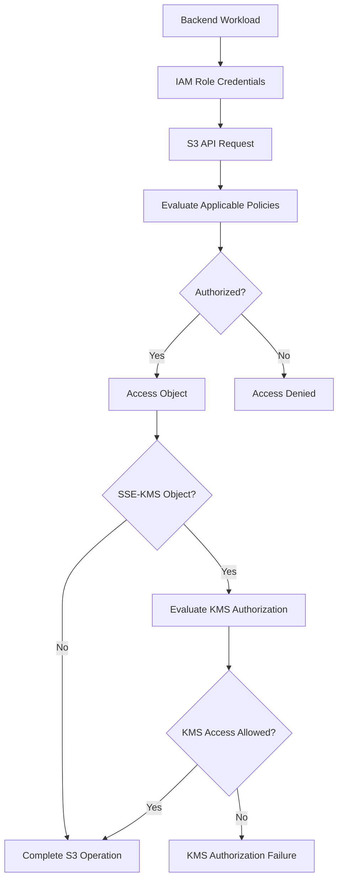
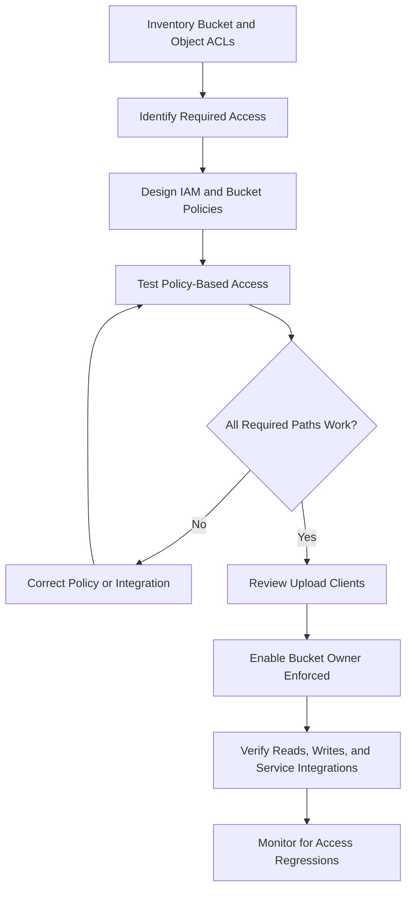

# 04- Access Control Lists (ACLs)

## Overview

Amazon S3 Access Control Lists (ACLs) are a legacy resource-level access-control mechanism that grants basic permissions to AWS accounts or predefined groups for individual buckets and objects.

An ACL is attached directly to a bucket or object and specifies the permissions granted to its owner and other supported grantees. Unlike IAM policies and S3 bucket policies, ACLs provide a limited set of permissions and do not support explicit deny statements.

**Modern S3 buckets have ACLs disabled by default through S3 Object Ownership's `Bucket owner enforced` setting.** AWS recommends keeping ACLs disabled for most workloads and using IAM policies and resource-based policies for access management.

ACLs remain relevant when maintaining legacy applications, integrating with systems that depend on object-level ownership, or supporting existing workflows that explicitly require ACL-based permissions.

This document covers:

- ACL structure, permissions, grantees, and canned ACLs.
- The relationship between ACLs and S3 Object Ownership.
- Bucket ACLs versus object ACLs.
- AWS CLI and Boto3 operations.
- Migration, security, troubleshooting, and production considerations.

## What Are S3 ACLs?

An ACL is an access-control subresource associated with an S3 bucket or object. It contains grants that associate a grantee with a particular permission.

For example, an object ACL could grant another AWS account permission to read the object without granting that account permission to read every object in the bucket.

ACLs predate IAM-based resource policies and are less expressive than modern policy-based access control.

### Why ACLs exist

Historically, S3 allowed objects uploaded by different AWS accounts to have different owners. ACLs provided a way for those owners to grant basic access to other accounts and predefined groups.

This model created operational complexity for shared buckets because object ownership and access permissions could differ from one object to another.

S3 Object Ownership addresses this problem by allowing the bucket owner to control object ownership and disable ACLs.

### When ACLs are appropriate

Consider ACLs only when a concrete compatibility or ownership requirement justifies them, such as:

- Integrating with a legacy application that relies on object ACLs.
- Maintaining an existing cross-account upload workflow that depends on the object writer's ownership.
- Supporting a specific workload that requires individual object-level ACL grants.

For new backend systems, prefer policy-based access control unless a documented requirement makes ACLs necessary.

## ACL Structure

An ACL identifies the resource owner and a list of grants. Each grant specifies a grantee and the permission granted to that grantee.

A simplified ACL representation looks like this:

```xml
<AccessControlPolicy>
    <Owner>
        <ID>OWNER_CANONICAL_USER_ID</ID>
    </Owner>
    <AccessControlList>
        <Grant>
            <Grantee>
                <ID>GRANTEE_CANONICAL_USER_ID</ID>
            </Grantee>
            <Permission>READ</Permission>
        </Grant>
    </AccessControlList>
</AccessControlPolicy>
```

This is a conceptual illustration of the ACL structure. Actual S3 ACL responses use the S3 XML schema and identify grantee types with the appropriate XML attributes.

### ACL components

| Component | Purpose |
|---|---|
| `Owner` | Identifies the AWS account's canonical user ID that owns the resource |
| `Grant` | Defines one permission grant |
| `Grantee` | Identifies the AWS account or predefined group receiving the permission |
| `Permission` | Specifies the allowed operation category |

An ACL can contain up to 100 grants.

ACLs provide allow-style grants. They cannot express an explicit deny, conditional access rules, or the rich action and resource combinations available in IAM policies.

## ACL Permissions

S3 ACLs support five permission values.

| Permission | Meaning | Important considerations |
|---|---|---|
| `READ` | Grants read access according to the ACL's resource type | Bucket and object ACLs provide different capabilities |
| `WRITE` | Grants write-related access | Primarily meaningful for bucket ACLs |
| `READ_ACP` | Grants permission to read the ACL | Does not independently grant object-content read access |
| `WRITE_ACP` | Grants permission to modify the ACL | Allows changing ACL grants when ACLs are enabled |
| `FULL_CONTROL` | Grants all ACL-defined permissions | Does not override other applicable authorization restrictions |

### Bucket ACL permissions

Bucket ACL permissions apply to the bucket-level operations associated with those grants.

| Permission | Typical capabilities |
|---|---|
| `READ` | List bucket contents and access supported bucket listing operations |
| `WRITE` | Create, overwrite, and delete objects, subject to applicable S3 behavior |
| `READ_ACP` | Retrieve the bucket ACL |
| `WRITE_ACP` | Modify the bucket ACL |
| `FULL_CONTROL` | Combines the above permission categories |

A bucket ACL's `WRITE` permission is particularly sensitive because it can allow an external grantee to modify or delete objects in the bucket. Where the grantee is the bucket owner, bucket ACL `WRITE` also permits deleting object versions through the corresponding version-deletion permission.

Do not grant bucket-level `WRITE` to an external principal merely because it needs to upload a limited set of files.

### Object ACL permissions

Object ACL permissions are scoped to the individual object.

| Permission | Typical capability |
|---|---|
| `READ` | Retrieve object content and supported object-version content |
| `READ_ACP` | Retrieve the object's ACL |
| `WRITE_ACP` | Modify the object's ACL |
| `FULL_CONTROL` | Combines the object ACL permission categories |

`WRITE` is not a standard object ACL permission in the same way it is for bucket ACLs. Object creation and replacement are controlled through the applicable bucket and object authorization mechanisms.

Object ACLs do not grant general bucket listing permissions.

Reference: [ACL overview for Amazon S3](https://docs.aws.amazon.com/AmazonS3/latest/userguide/acl-overview.html).

## Grantees

A grantee is the account or predefined group receiving an ACL permission.

### Canonical user ID

A canonical user ID identifies an AWS account for ACL purposes. It is not the same as an AWS account ID or IAM ARN.

Example:

```xml
<Grantee
    xmlns:xsi="http://www.w3.org/2001/XMLSchema-instance"
    xsi:type="CanonicalUser">
    <ID>GRANTEE_CANONICAL_USER_ID</ID>
</Grantee>
```

Use the canonical user ID when granting ACL permissions to a specific supported AWS account.

### Predefined groups

S3 defines groups that can be used as ACL grantees.

| Group | Meaning | Risk or purpose |
|---|---|---|
| `AllUsers` | All users, including anonymous internet users | Can expose data publicly |
| `AuthenticatedUsers` | All authenticated AWS users, not just users in your account | Broad exposure beyond your organization |
| `LogDelivery` | The S3 log-delivery group | Used by supported server access logging configurations |

The term `AuthenticatedUsers` does not mean authenticated users belonging to your own AWS account. It refers to authenticated AWS users generally.

Avoid granting access to `AllUsers` or `AuthenticatedUsers` unless the exposure is explicitly required and has undergone security review.

## Canned ACLs

A canned ACL is a predefined collection of ACL grants. Instead of constructing the grant list individually, an API request specifies a canned ACL value.

The following table describes common canned ACLs.

| Canned ACL | Purpose | Recommendation |
|---|---|---|
| `private` | Grants full control to the resource owner | Appropriate default where ACLs are enabled |
| `public-read` | Grants read access to the `AllUsers` group | Avoid for private application data |
| `public-read-write` | Grants public read and write access | Generally unsafe and should be avoided |
| `authenticated-read` | Grants read access to the `AuthenticatedUsers` group | Usually broader than intended |
| `bucket-owner-read` | On an object, grants the bucket owner read access | Legacy ownership-sharing workflow |
| `bucket-owner-full-control` | On an object, grants full control to the bucket owner and object owner under ACL-enabled ownership models | Used in compatible cross-account upload workflows |
| `log-delivery-write` | Grants permissions to the S3 log-delivery group on a bucket | Legacy or applicable logging configuration |

The `aws-exec-read` canned ACL also exists for the specific EC2 AMI-related use case documented by AWS; it is not a general application access pattern.

Only one canned ACL can be specified for a request.

### Example: canned ACL on an object

When the bucket supports ACLs, an object upload can specify a canned ACL through the AWS CLI:

```bash
aws s3api put-object \
  --bucket example-legacy-bucket \
  --key reports/monthly.csv \
  --body ./monthly.csv \
  --acl private
```

This attempts to set the object's ACL to `private`. It is not an appropriate command for a bucket configured with `Bucket owner enforced`, because the explicit ACL setting is unsupported.

### Important distinction

A canned ACL is not an IAM policy and does not replace the permissions required to perform the API request.

For example, the caller needs suitable authorization to upload the object. Supplying `--acl public-read` does not bypass IAM or other applicable access restrictions.

Reference: [Canned ACLs for Amazon S3](https://docs.aws.amazon.com/AmazonS3/latest/userguide/acl-overview.html).

## Bucket ACLs Versus Object ACLs

S3 separates bucket-level access controls from object-level access controls.

| Aspect | Bucket ACL | Object ACL |
|---|---|---|
| Attached resource | Bucket | Individual object |
| Primary scope | Bucket-level permissions | Permissions for one object |
| Typical use | Legacy bucket-level access grants | Legacy object-level sharing |
| Read grant | Can grant supported bucket listing permissions | Can grant object-content read access |
| Write grant | Can grant object creation and modification-related access | Does not provide a bucket ACL's general write permission |
| ACL ownership | Associated with the bucket's owner | Associated with the object's ownership model |
| Modern recommendation | Prefer bucket and IAM policies | Prefer bucket and IAM policies |

An important design point is that a bucket ACL does not automatically become the ACL for every object stored inside the bucket.

For example, a bucket ACL that grants one account permission to read the bucket ACL does not automatically grant that account permission to retrieve every object's content.

Similarly, a bucket-level grant must not be assumed to grant all object-level permissions.

## S3 Object Ownership

S3 Object Ownership determines who owns uploaded objects and whether ACLs affect access control.

For general-purpose S3 buckets, Object Ownership has three settings.

| Setting | ACL status | Object ownership behavior | Typical use |
|---|---|---|---|
| `Bucket owner enforced` | Disabled | Bucket owner owns all objects | Recommended for most modern systems |
| `Bucket owner preferred` | Enabled | Bucket owner owns new objects uploaded with the `bucket-owner-full-control` canned ACL | Legacy or compatible cross-account upload workflows |
| `Object writer` | Enabled | Uploading account owns the object | Legacy workflows requiring writer ownership |

### Bucket owner enforced

`Bucket owner enforced` is the default setting for newly created general-purpose S3 buckets.

When enabled:

- ACLs do not participate in authorization.
- The bucket owner owns all objects in the bucket.
- Access is managed through supported policies.
- Requests to set or update ACLs fail with `AccessControlListNotSupported`.
- ACL read operations remain supported.

An upload that does not specify an ACL is supported. An upload using the `bucket-owner-full-control` canned ACL is also supported. Other ACL-setting requests fail.

This is the preferred configuration for most backend applications because it centralizes access management and avoids object-writer ownership problems.

### Bucket owner preferred

This setting keeps ACLs enabled but provides a mechanism for the bucket owner to own new objects uploaded with the `bucket-owner-full-control` canned ACL.

It can support older cross-account workflows that rely on this upload convention.

However, ownership and ACL behavior must be configured consistently across the uploader, bucket policy, and downstream consumers.

### Object writer

With `Object writer`, the uploading account owns the new object. The writer has full control over it and can grant permissions through ACLs.

This is a legacy-oriented model. It can make centralized administration difficult because the bucket owner may not own objects uploaded by external accounts.

### Inspect Object Ownership

```bash
aws s3api get-bucket-ownership-controls \
  --bucket example-prod-documents \
  --region ap-south-1
```

If ownership controls are not configured, the command can return an error indicating that the setting is absent. Interpret that response alongside the bucket's history and configuration rather than assuming the bucket's effective behavior.

Reference: [Controlling ownership of objects and disabling ACLs](https://docs.aws.amazon.com/AmazonS3/latest/userguide/about-object-ownership.html).

## ACLs and Modern Authorization

For modern S3 designs, use IAM policies, bucket policies, and other supported policy-based controls rather than ACLs.

A typical backend authorization design might use:

- An IAM role for a FastAPI or Django application.
- An identity policy allowing the application to read a specific prefix.
- A bucket policy enforcing transport and resource restrictions.
- AWS KMS permissions for objects encrypted with a customer-managed KMS key.
- S3 Object Ownership set to `Bucket owner enforced`.



A bucket policy or identity policy can grant the required S3 action, but SSE-KMS introduces an additional authorization layer. ACLs should not be used to compensate for missing IAM or KMS permissions.

### ACLs do not override other security controls

When ACLs are enabled, an ACL grant does not guarantee that a request succeeds.

A request can still be rejected by:

- An applicable explicit deny.
- IAM or resource-policy restrictions.
- AWS Organizations service control policies or resource control policies.
- S3 Block Public Access.
- VPC endpoint policies or other relevant authorization controls.
- KMS key authorization requirements for SSE-KMS objects.

Always evaluate the request using the actual principal and operation.

## Inspect Bucket and Object ACLs

Use the AWS CLI to inspect ACLs before modifying a legacy bucket.

### Read a bucket ACL

```bash
aws s3api get-bucket-acl \
  --bucket example-legacy-bucket \
  --region ap-south-1
```

The response includes the resource owner and ACL grants.

### Read an object ACL

```bash
aws s3api get-object-acl \
  --bucket example-legacy-bucket \
  --key reports/monthly.csv \
  --region ap-south-1
```

For versioned buckets, you can inspect the ACL of a particular version:

```bash
aws s3api get-object-acl \
  --bucket example-legacy-bucket \
  --key reports/monthly.csv \
  --version-id VERSION_ID \
  --region ap-south-1
```

Replace `VERSION_ID` with the actual version identifier.

### Inspect a canned ACL's effective grants

S3 returns the grant list, not simply the name of the canned ACL originally used. Examine the grants and ownership information to understand the current access configuration.

Do not rely solely on assumptions based on how an object was uploaded.

## Modify ACLs with the AWS CLI

Only modify ACLs where they are enabled and where the security requirement justifies their use.

### Grant read access to a canonical user

```bash
aws s3api put-object-acl \
  --bucket example-legacy-bucket \
  --key reports/monthly.csv \
  --grant-read "id=GRANTEE_CANONICAL_USER_ID" \
  --region ap-south-1
```

This command sets the specified read grant through the object's ACL operation. ACL updates should be carefully reviewed because an update can replace the existing ACL grant set according to the request parameters and applicable API behavior.

Where preserving existing grants is essential, retrieve the current ACL, construct the intended complete ACL document, and apply it deliberately rather than assuming a partial update will merge grants.

### Apply a canned ACL

```bash
aws s3api put-object-acl \
  --bucket example-legacy-bucket \
  --key reports/monthly.csv \
  --acl bucket-owner-full-control \
  --region ap-south-1
```

This is applicable only when ACLs are enabled and the ownership workflow supports the canned ACL.

### Inspect the result

```bash
aws s3api get-object-acl \
  --bucket example-legacy-bucket \
  --key reports/monthly.csv \
  --region ap-south-1
```

Verify the expected owner, grantee, and permissions after the change.

### Operational safeguards

- Inspect existing grants before changing an ACL.
- Test the change in a nonproduction bucket first.
- Avoid granting public or broadly authenticated access.
- Use a controlled deployment process for security-sensitive updates.
- Keep a recovery path in case a grant removes required access.
- Prefer policy-based authorization for new systems.

## Manage ACLs with Boto3

The AWS SDK for Python exposes ACL operations through the S3 client.

### Read an object ACL

```python
import boto3

s3 = boto3.client("s3", region_name="ap-south-1")


def get_object_acl(bucket: str, key: str) -> dict:
    """Return the current ACL for an S3 object."""
    return s3.get_object_acl(
        Bucket=bucket,
        Key=key,
    )
```

### Apply a supported canned ACL

```python
import boto3
from botocore.exceptions import ClientError

s3 = boto3.client("s3", region_name="ap-south-1")


def set_bucket_owner_full_control(
    bucket: str,
    key: str,
) -> None:
    """Apply a legacy ownership-compatible object ACL."""
    try:
        s3.put_object_acl(
            Bucket=bucket,
            Key=key,
            ACL="bucket-owner-full-control",
        )
    except ClientError:
        # Log structured error details in the calling application.
        raise
```

This operation is applicable only when ACLs are enabled. With `Bucket owner enforced`, attempts to set this ACL through `PutObjectAcl` fail with `AccessControlListNotSupported`.

### Production implementation guidance

- Use the default AWS credential provider chain or environment-appropriate IAM roles.
- Do not embed long-lived access keys in source code.
- Do not add ACL operations automatically to every upload.
- Keep AWS interactions inside a reusable service layer rather than duplicating them across API handlers.
- Catch and classify AWS exceptions in the application boundary.
- Test legacy ACL workflows separately from modern policy-only buckets.

In a new FastAPI or Django service, the preferred approach is usually to omit ACL parameters when uploading to a bucket using `Bucket owner enforced`.

## Migrate from ACLs to Policy-Based Access

Migrating an existing bucket requires understanding the actual grants and ownership model before disabling ACLs.

### Migration workflow



### Migration steps

**Inventory current ACLs.** Inspect the bucket ACL and representative object ACLs. Where objects are numerous, use appropriate inventory or automation to discover legacy grants across the dataset.

**Identify dependencies.** Find applications that set ACL headers, integrations that expect a particular object owner, and workflows that rely on public or cross-account ACL grants.

**Translate access requirements.** Replace necessary ACL grants with appropriately scoped IAM or bucket policies. Include separate KMS permissions if applicable.

**Test policy-based access.** Verify that intended principals can perform their required operations and that unapproved access remains denied.

**Update upload clients.** Remove unsupported ACL-setting parameters from upload requests when moving to `Bucket owner enforced`. Uploads specifying `private`, `public-read`, or other non-`bucket-owner-full-control` ACL values will fail under that setting.

**Enable Object Ownership enforcement.** Apply the change through a controlled deployment process after validating the dependencies.

**Verify and monitor.** Test application upload, read, delete, presigned URL, and service-integration workflows. Review logs and application errors for ACL-related regressions.

Reference: [Disabling ACLs and enforcing Object Ownership](https://docs.aws.amazon.com/AmazonS3/latest/userguide/ensure-object-ownership.html).

## Common Errors and Troubleshooting

### `AccessControlListNotSupported`

**Symptom:** A `PutObject`, `PutObjectAcl`, or another operation that attempts to set an ACL fails.

**Likely cause:** The bucket uses `Bucket owner enforced`, which disables ACLs.

**Verification:**

```bash
aws s3api get-bucket-ownership-controls \
  --bucket example-prod-documents \
  --region ap-south-1
```

**Corrective action:** Prefer removing unnecessary ACL parameters and managing access through policies. Do not re-enable ACLs merely to bypass the error without an explicit compatibility requirement.

### `AccessDenied`

**Symptom:** An ACL read or modification fails.

**Possible causes:**

- The caller lacks the required IAM permission.
- An applicable explicit deny blocks the request.
- The caller is using an unexpected role or account.
- Another policy or organizational control restricts access.

**Verification:**

```bash
aws sts get-caller-identity

aws s3api get-object-acl \
  --bucket example-legacy-bucket \
  --key reports/monthly.csv \
  --region ap-south-1
```

Verify the principal and operation, then review applicable authorization controls. Do not assume every `AccessDenied` error is caused by an ACL grant.

### An external account cannot read an object

**Possible causes:**

- The object ACL does not grant the expected access in a legacy configuration.
- The caller's identity-based permissions are insufficient for the cross-account workflow.
- The bucket policy or an applicable explicit deny blocks access.
- The bucket owner has enforced Object Ownership and policy-based access is required.
- The object uses SSE-KMS and the caller lacks required KMS permissions.

**Corrective action:** Determine the bucket's Object Ownership setting, confirm the active principal and resource, and evaluate the complete authorization path. Grant only the permissions necessary for the workload.

### A migration breaks uploads

**Symptom:** An application begins failing after ACLs are disabled.

**Likely cause:** The client still sends an ACL parameter that is incompatible with `Bucket owner enforced`.

**Corrective action:** Remove unnecessary ACL settings from the AWS SDK or HTTP request. Verify that the bucket policy grants the application the required `s3:PutObject` permission and that any KMS requirements are satisfied.

## Security and Production Best Practices

- Prefer `Bucket owner enforced` for new general-purpose S3 buckets.
- Use IAM policies and bucket policies for access control unless ACLs are explicitly required.
- Never treat `AuthenticatedUsers` as equivalent to users in your AWS account.
- Avoid public ACLs and keep Block Public Access enabled for private application buckets.
- Do not grant bucket ACL `WRITE` to an external account merely to support uploads to a narrow prefix.
- Review ACLs before migrating a legacy bucket, including object ownership and cross-account integrations.
- Do not mix old ACL-based assumptions with a policy-only bucket configuration.
- Separate S3 data-access permissions from KMS encryption permissions.
- Validate security-sensitive changes with positive and negative access tests.
- Monitor application errors after changing Object Ownership or access policies.

## Official References

- [ACL overview for Amazon S3](https://docs.aws.amazon.com/AmazonS3/latest/userguide/acl-overview.html)
- [Managing access with ACLs](https://docs.aws.amazon.com/AmazonS3/latest/userguide/acls.html)
- [Configuring ACLs](https://docs.aws.amazon.com/AmazonS3/latest/userguide/managing-acls.html)
- [S3 Object Ownership and disabling ACLs](https://docs.aws.amazon.com/AmazonS3/latest/userguide/about-object-ownership.html)
- [Ensuring Object Ownership and disabling ACLs](https://docs.aws.amazon.com/AmazonS3/latest/userguide/ensure-object-ownership.html)
- [Amazon S3 API permissions](https://docs.aws.amazon.com/AmazonS3/latest/userguide/using-with-s3-policy-actions.html)

## Key Takeaways

- S3 ACLs grant limited resource-level permissions to accounts or predefined groups, but they cannot express the richer conditions and explicit denies available in IAM policies.
- `Bucket owner enforced` disables ACL-based authorization and makes the bucket owner the owner of all objects; it is the recommended default for most modern workloads.
- Bucket ACLs and object ACLs have different scopes, and granting bucket-level access does not automatically grant every object permission.
- Legacy ACL workflows must be migrated deliberately by inventorying grants, replacing required access with policies, and updating upload clients.
- Diagnose authorization failures by checking the actual principal, Object Ownership configuration, relevant policies, and KMS permissions rather than assuming the ACL is the only cause.